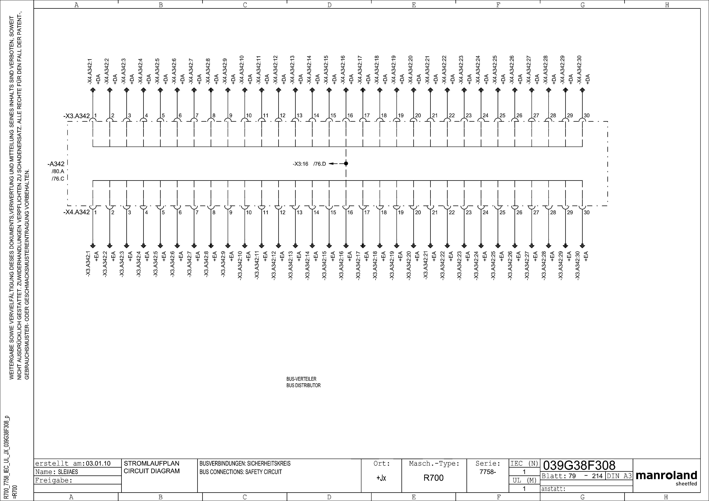

# +Jx — Sheet 79 of 214 — BUSVERBINDUNGEN: SICHERHEITSKREIS

**BUS CONNECTIONS: SAFETY**

> Part of the manroland **R700** printing press IEC/UL circuit diagrams.
> Drawing class: **Stromlaufplan / Circuit diagram** (DIN A3).
> Document `+Jx` covers the **1st printing module + feed register** machine section.

## At a glance

| Field | Value |
|---|---|
| Document | `+Jx`  (039G38F308) |
| Sheet | **79** of 214 |
| Section (DE) | BUSVERBINDUNGEN: SICHERHEITSKREIS |
| Section (EN) | BUS CONNECTIONS: SAFETY |
| Section type | CIRCUIT — Circuit diagram |
| Machine type | `R700` |
| Series | `7758` |
| Created | 03.01.10 |
| Replaces | — |
| Columns used | A, B, C, D, E, F, G |
| Path numbers | — |
| Labels on sheet | 189 |
| Cross-refs out | 3 |
| Cross-refs in | 63 |

**Previous:** [+Jx sheet 78](SHEET_0078.md) · **Next:** [+Jx sheet 80](SHEET_0080.md) · **Document TOC:** [_TOC.md](_TOC.md)  (+Jx) · **Master TOC:** [all sheets](../_MASTER_TOC.md)

## Sheet image (300 DPI, exact vector render)



_Rendered directly from the PDF vector layer at 300 DPI (1-bit), no OCR and no resampling. Use it to confirm anything ambiguous in the text below._

## Cross-references on this sheet

Each entry is a wire leaving this sheet. The printed token is `/sheet.column`; the link resolves to that sheet inside the same document.

| Ref | Target sheet | Col | Path | Destination on target | Target section | From col |
|---|---|---|---|---|---|---|
| `/76.D` | [+Jx sheet 76](SHEET_0076.md) | D | — | X3:16 | BUSVERBINDUNGEN: SICHERHEITSKREIS | D |
| `/80.A` | [+Jx sheet 80](SHEET_0080.md) | A | — | — | BUSVERBINDUNGEN: SICHERHEITSKREIS | A |
| `/76.C` | [+Jx sheet 76](SHEET_0076.md) | C | — | — | BUSVERBINDUNGEN: SICHERHEITSKREIS | A |

### Incoming references (sheets that point here)

Every other sheet that sends a wire to this one. `Back-ref` is the token printed on *that* sheet; `Path` is its line number.

| From sheet | Cols | Back-ref | Path | Refs | What continues there |
|---|---|---|---|---|---|
| [+Jx#76](SHEET_0076.md) | B, E | `/76.B`, `/76.E` | — | 2 | X3:16 |
| [+Jx#80](SHEET_0080.md) | A | `/80.A` | — | 1 | — |
| [+Jx#128](SHEET_0128.md) | A, B | `/128.A`, `/128.B` | — | 30 | — |
| [+Jx#129](SHEET_0129.md) | G, H | `/129.G`, `/129.H` | — | 30 | — |


## Devices on this sheet

| Tag | Class | Class meaning (IEC) | Col | Sub | Terminal | Sign |
|---|---|---|---|---|---|---|
| `A342` | A | Baugruppe / assembly, module, PC board | A | — | — | — |
| `X3:16` | X | Klemme / terminal, plug connector | D | — | 16 | — |
| `X4.A342:1` | — | cross-device reference | A | — | 1 | — |
| `X4.A342:2` | — | cross-device reference | A | — | 2 | — |
| `X4.A342:3` | — | cross-device reference | B | — | 3 | — |
| `X4.A342:4` | — | cross-device reference | B | — | 4 | — |
| `X4.A342:5` | — | cross-device reference | B | — | 5 | — |
| `X4.A342:6` | — | cross-device reference | B | — | 6 | — |
| `X4.A342:7` | — | cross-device reference | B | — | 7 | — |
| `X4.A342:8` | — | cross-device reference | C | — | 8 | — |
| `X4.A342:9` | — | cross-device reference | C | — | 9 | — |
| `X4.A342:10` | — | cross-device reference | C | — | 10 | — |
| `X4.A342:11` | — | cross-device reference | C | — | 11 | — |
| `X4.A342:12` | — | cross-device reference | C | — | 12 | — |
| `X4.A342:13` | — | cross-device reference | D | — | 13 | — |
| `X4.A342:14` | — | cross-device reference | D | — | 14 | — |
| `X4.A342:15` | — | cross-device reference | D | — | 15 | — |
| `X4.A342:16` | — | cross-device reference | D | — | 16 | — |
| `X4.A342:17` | — | cross-device reference | D | — | 17 | — |
| `X4.A342:18` | — | cross-device reference | E | — | 18 | — |
| `X4.A342:19` | — | cross-device reference | E | — | 19 | — |
| `X4.A342:20` | — | cross-device reference | E | — | 20 | — |
| `X4.A342:21` | — | cross-device reference | E | — | 21 | — |
| `X4.A342:22` | — | cross-device reference | E | — | 22 | — |
| `X4.A342:23` | — | cross-device reference | F | — | 23 | — |
| `X4.A342:24` | — | cross-device reference | F | — | 24 | — |
| `X4.A342:25` | — | cross-device reference | F | — | 25 | — |
| `X4.A342:26` | — | cross-device reference | F | — | 26 | — |
| `X4.A342:27` | — | cross-device reference | F | — | 27 | — |
| `X4.A342:28` | — | cross-device reference | G | — | 28 | — |
| `X4.A342:29` | — | cross-device reference | G | — | 29 | — |
| `X4.A342:30` | — | cross-device reference | G | — | 30 | — |
| `X4.A342` | — | cross-device reference | A | — | — | — |
| `X3.A342:1` | — | cross-device reference | A | — | 1 | — |
| `X3.A342:2` | — | cross-device reference | A | — | 2 | — |
| `X3.A342:3` | — | cross-device reference | B | — | 3 | — |
| `X3.A342:4` | — | cross-device reference | B | — | 4 | — |
| `X3.A342:5` | — | cross-device reference | B | — | 5 | — |
| `X3.A342:6` | — | cross-device reference | B | — | 6 | — |
| `X3.A342:7` | — | cross-device reference | B | — | 7 | — |
| `X3.A342:8` | — | cross-device reference | C | — | 8 | — |
| `X3.A342:9` | — | cross-device reference | C | — | 9 | — |
| `X3.A342:10` | — | cross-device reference | C | — | 10 | — |
| `X3.A342:11` | — | cross-device reference | C | — | 11 | — |
| `X3.A342:12` | — | cross-device reference | C | — | 12 | — |
| `X3.A342:13` | — | cross-device reference | D | — | 13 | — |
| `X3.A342:14` | — | cross-device reference | D | — | 14 | — |
| `X3.A342:15` | — | cross-device reference | D | — | 15 | — |
| `X3.A342:16` | — | cross-device reference | D | — | 16 | — |
| `X3.A342:17` | — | cross-device reference | D | — | 17 | — |
| `X3.A342:18` | — | cross-device reference | E | — | 18 | — |
| `X3.A342:19` | — | cross-device reference | E | — | 19 | — |
| `X3.A342:20` | — | cross-device reference | E | — | 20 | — |
| `X3.A342:21` | — | cross-device reference | E | — | 21 | — |
| `X3.A342:22` | — | cross-device reference | E | — | 22 | — |
| `X3.A342:23` | — | cross-device reference | F | — | 23 | — |
| `X3.A342:24` | — | cross-device reference | F | — | 24 | — |
| `X3.A342:25` | — | cross-device reference | F | — | 25 | — |
| `X3.A342:26` | — | cross-device reference | F | — | 26 | — |
| `X3.A342:27` | — | cross-device reference | F | — | 27 | — |
| `X3.A342:28` | — | cross-device reference | G | — | 28 | — |
| `X3.A342:29` | — | cross-device reference | G | — | 29 | — |
| `X3.A342:30` | — | cross-device reference | G | — | 30 | — |
| `X3.A342` | — | cross-device reference | A | — | — | — |

## Potentials / nets

_No named potentials on this sheet._

## Wire-end annotations (grouped as printed)

A wire that continues elsewhere is annotated with a small cluster: the destination description, the path/line number `#NN`, and the `/sheet.column` cross reference. Each row below is one such cluster exactly as it is grouped on the drawing.

| Col | Y | Path | Cross-ref | Text on the wire |
|---|---|---|---|---|
| C | 93.3 | — | — | `X4.A342:10` |
| C | 93.3 | — | — | `X4.A342:11` |
| C | 93.3 | — | — | `X4.A342:12` |
| D | 93.3 | — | — | `X4.A342:13` |
| D | 93.3 | — | — | `X4.A342:14` |
| D | 93.3 | — | — | `X4.A342:15` |
| D | 93.3 | — | — | `X4.A342:16` |
| D | 93.3 | — | — | `X4.A342:17` |
| E | 93.3 | — | — | `X4.A342:18` |
| E | 93.3 | — | — | `X4.A342:19` |
| E | 93.3 | — | — | `X4.A342:20` |
| E | 93.3 | — | — | `X4.A342:21` |
| E | 93.3 | — | — | `X4.A342:22` |
| F | 93.3 | — | — | `X4.A342:23` |
| F | 93.3 | — | — | `X4.A342:24` |
| F | 93.3 | — | — | `X4.A342:25` |
| F | 93.3 | — | — | `X4.A342:26` |
| F | 93.3 | — | — | `X4.A342:27` |
| G | 93.3 | — | — | `X4.A342:28` |
| G | 93.3 | — | — | `X4.A342:29` |
| G | 93.3 | — | — | `X4.A342:30` |
| A | 98.1 | — | — | `X4.A342:1` |
| A | 98.1 | — | — | `X4.A342:2` |
| B | 98.1 | — | — | `X4.A342:3` |
| B | 98.1 | — | — | `X4.A342:4` |
| B | 98.1 | — | — | `X4.A342:5` |
| B | 98.1 | — | — | `X4.A342:6` |
| B | 98.1 | — | — | `X4.A342:7` |
| C | 98.1 | — | — | `X4.A342:8` |
| C | 98.1 | — | — | `X4.A342:9` |
| A | 124.7 | — | — | `+DA` |
| A | 124.7 | — | — | `+DA` |
| B | 124.7 | — | — | `+DA` |
| B | 124.7 | — | — | `+DA` |
| B | 124.7 | — | — | `+DA` |
| B | 124.7 | — | — | `+DA` |
| B | 124.7 | — | — | `+DA` |
| C | 124.7 | — | — | `+DA` |
| C | 124.7 | — | — | `+DA` |
| C | 124.7 | — | — | `+DA` |
| C | 124.7 | — | — | `+DA` |
| C | 124.7 | — | — | `+DA` |
| D | 124.7 | — | — | `+DA` |
| D | 124.7 | — | — | `+DA` |
| D | 124.7 | — | — | `+DA` |
| D | 124.7 | — | — | `+DA` |
| D | 124.7 | — | — | `+DA` |
| E | 124.7 | — | — | `+DA` |
| E | 124.7 | — | — | `+DA` |
| E | 124.7 | — | — | `+DA` |
| E | 124.7 | — | — | `+DA` |
| E | 124.7 | — | — | `+DA` |
| F | 124.7 | — | — | `+DA` |
| F | 124.7 | — | — | `+DA` |
| F | 124.7 | — | — | `+DA` |
| F | 124.7 | — | — | `+DA` |
| F | 124.7 | — | — | `+DA` |
| G | 124.7 | — | — | `+DA` |
| G | 124.7 | — | — | `+DA` |
| G | 124.7 | — | — | `+DA` |
| A | 190.2 | — | — | `X3.A342 1` |
| D | 190.2 | — | — | `2 3 4 5 6 7 8 9 10 11 12 13 14 15 16 17 18 19 20 21 22 23 24 25 26 27 28 29 30` |
| A | 270.9 | — | — | `A342` |
| D | 271.6 | — | `/76.D` | `X3:16` |
| A | 284.0 | — | `/80.A`, `/76.C` | — |
| D | 351.7 | — | — | `X4.A342 1 2 3 4 5 6 7 8 9 10 11 12 13 14 15 16 17 18 19 20 21 22 23 24 25 26 27 28 29 30` |
| A | 420.9 | — | — | `X3.A342:1` |
| C | 420.9 | — | — | `X3.A342:11` |
| E | 420.9 | — | — | `X3.A342:21` |
| A | 422.1 | — | — | `X3.A342:2` |
| B | 422.1 | — | — | `X3.A342:3` |
| B | 422.1 | — | — | `X3.A342:4` |
| B | 422.1 | — | — | `X3.A342:5` |
| B | 422.1 | — | — | `X3.A342:6` |
| B | 422.1 | — | — | `X3.A342:7` |
| C | 422.1 | — | — | `X3.A342:8` |
| C | 422.1 | — | — | `X3.A342:9` |
| C | 422.1 | — | — | `X3.A342:10` |
| C | 422.1 | — | — | `X3.A342:12` |
| D | 422.1 | — | — | `X3.A342:13` |
| D | 422.1 | — | — | `X3.A342:14` |
| D | 422.1 | — | — | `X3.A342:15` |
| D | 422.1 | — | — | `X3.A342:16` |
| D | 422.1 | — | — | `X3.A342:17` |
| E | 422.1 | — | — | `X3.A342:18` |
| E | 422.1 | — | — | `X3.A342:19` |
| E | 422.1 | — | — | `X3.A342:20` |
| E | 422.1 | — | — | `X3.A342:22` |
| F | 422.1 | — | — | `X3.A342:23` |
| F | 422.1 | — | — | `X3.A342:24` |
| F | 422.1 | — | — | `X3.A342:25` |
| F | 422.1 | — | — | `X3.A342:26` |
| F | 422.1 | — | — | `X3.A342:27` |
| G | 422.1 | — | — | `X3.A342:28` |
| G | 422.1 | — | — | `X3.A342:29` |
| G | 422.1 | — | — | `X3.A342:30` |
| A | 422.4 | — | — | `+EA` |
| A | 422.4 | — | — | `+EA` |
| B | 422.4 | — | — | `+EA` |
| B | 422.4 | — | — | `+EA` |
| B | 422.4 | — | — | `+EA` |
| B | 422.4 | — | — | `+EA` |
| B | 422.4 | — | — | `+EA` |
| C | 422.4 | — | — | `+EA` |
| C | 422.4 | — | — | `+EA` |
| C | 422.4 | — | — | `+EA` |
| C | 422.4 | — | — | `+EA` |
| C | 422.4 | — | — | `+EA` |
| D | 422.4 | — | — | `+EA` |
| D | 422.4 | — | — | `+EA` |
| D | 422.4 | — | — | `+EA` |
| D | 422.4 | — | — | `+EA` |
| D | 422.4 | — | — | `+EA` |
| E | 422.4 | — | — | `+EA` |
| E | 422.4 | — | — | `+EA` |
| E | 422.4 | — | — | `+EA` |
| E | 422.4 | — | — | `+EA` |
| E | 422.4 | — | — | `+EA` |
| F | 422.4 | — | — | `+EA` |
| F | 422.4 | — | — | `+EA` |
| F | 422.4 | — | — | `+EA` |
| F | 422.4 | — | — | `+EA` |
| F | 422.4 | — | — | `+EA` |
| G | 422.4 | — | — | `+EA` |
| G | 422.4 | — | — | `+EA` |
| G | 422.4 | — | — | `+EA` |
| D | 634.1 | — | — | `BUS VERTEILER BUS DISTRIBUTOR` |


## Notes and free text on this sheet

| Text | Col | Y (pt) |
|---|---|---|
| `+DA` | A | 124.73 |
| `+DA` | B | 124.73 |
| `+DA` | C | 124.73 |
| `+DA` | D | 124.73 |
| `+DA` | E | 124.73 |
| `+DA` | F | 124.73 |
| `+DA` | G | 124.73 |
| `BUS VERTEILER` | D | 634.12 |
| `BUS DISTRIBUTOR` | D | 644.76 |
| `+EA` | A | 422.36 |
| `+EA` | B | 422.36 |
| `+EA` | C | 422.36 |
| `+EA` | D | 422.36 |
| `+EA` | E | 422.36 |
| `+EA` | F | 422.36 |
| `+EA` | G | 422.36 |

## Complete label inventory (exact text from the drawing)

Every text object inside the drawing area of this sheet, in DIN reading order (column A→H, then top→bottom). This is the authoritative list: if a string is not here it is not printed on this sheet.

| Col | Y | X | Dir | Type | Text |
|---|---|---|---|---|---|
| A | 98.1 | 146.9 | ↕ | device ref | `X4.A342:1` |
| A | 98.1 | 175.3 | ↕ | device ref | `X4.A342:2` |
| A | 124.7 | 161.1 | ↕ | text | `+DA` |
| A | 124.7 | 189.4 | ↕ | text | `+DA` |
| A | 190.2 | 106.6 | → | device ref | `X3.A342` |
| A | 190.2 | 157.9 | → | number | `1` |
| A | 190.2 | 187.1 | → | number | `2` |
| A | 270.9 | 79.9 | → | device tag | `A342` |
| A | 284.0 | 87.0 | → | cross-reference | `/80.A` |
| A | 296.4 | 87.0 | → | cross-reference | `/76.C` |
| A | 351.7 | 106.6 | → | device ref | `X4.A342` |
| A | 353.2 | 157.9 | → | number | `1` |
| A | 353.2 | 187.1 | → | number | `2` |
| A | 420.9 | 144.1 | ↕ | device ref | `X3.A342:1` |
| A | 422.1 | 172.4 | ↕ | device ref | `X3.A342:2` |
| A | 422.4 | 158.2 | ↕ | text | `+EA` |
| A | 422.4 | 186.6 | ↕ | text | `+EA` |
| B | 98.1 | 203.6 | ↕ | device ref | `X4.A342:3` |
| B | 98.1 | 232.0 | ↕ | device ref | `X4.A342:4` |
| B | 98.1 | 260.3 | ↕ | device ref | `X4.A342:5` |
| B | 98.1 | 288.6 | ↕ | device ref | `X4.A342:6` |
| B | 98.1 | 317.0 | ↕ | device ref | `X4.A342:7` |
| B | 124.7 | 217.8 | ↕ | text | `+DA` |
| B | 124.7 | 246.1 | ↕ | text | `+DA` |
| B | 124.7 | 274.5 | ↕ | text | `+DA` |
| B | 124.7 | 302.8 | ↕ | text | `+DA` |
| B | 124.7 | 331.2 | ↕ | text | `+DA` |
| B | 190.2 | 215.1 | → | number | `3` |
| B | 190.2 | 243.8 | → | number | `4` |
| B | 190.2 | 271.8 | → | number | `5` |
| B | 190.2 | 300.2 | → | number | `6` |
| B | 190.2 | 328.5 | → | number | `7` |
| B | 353.2 | 215.1 | → | number | `3` |
| B | 353.2 | 243.8 | → | number | `4` |
| B | 353.2 | 271.8 | → | number | `5` |
| B | 353.2 | 300.2 | → | number | `6` |
| B | 353.2 | 328.5 | → | number | `7` |
| B | 422.1 | 200.8 | ↕ | device ref | `X3.A342:3` |
| B | 422.1 | 229.1 | ↕ | device ref | `X3.A342:4` |
| B | 422.1 | 257.5 | ↕ | device ref | `X3.A342:5` |
| B | 422.1 | 285.8 | ↕ | device ref | `X3.A342:6` |
| B | 422.1 | 314.2 | ↕ | device ref | `X3.A342:7` |
| B | 422.4 | 214.9 | ↕ | text | `+EA` |
| B | 422.4 | 243.3 | ↕ | text | `+EA` |
| B | 422.4 | 271.6 | ↕ | text | `+EA` |
| B | 422.4 | 300.0 | ↕ | text | `+EA` |
| B | 422.4 | 328.3 | ↕ | text | `+EA` |
| C | 93.3 | 402.0 | ↕ | device ref | `X4.A342:10` |
| C | 93.3 | 430.4 | ↕ | device ref | `X4.A342:11` |
| C | 93.3 | 458.7 | ↕ | device ref | `X4.A342:12` |
| C | 98.1 | 345.3 | ↕ | device ref | `X4.A342:8` |
| C | 98.1 | 373.7 | ↕ | device ref | `X4.A342:9` |
| C | 124.7 | 359.5 | ↕ | text | `+DA` |
| C | 124.7 | 387.9 | ↕ | text | `+DA` |
| C | 124.7 | 416.2 | ↕ | text | `+DA` |
| C | 124.7 | 444.6 | ↕ | text | `+DA` |
| C | 124.7 | 472.9 | ↕ | text | `+DA` |
| C | 190.2 | 356.9 | → | number | `8` |
| C | 190.2 | 385.2 | → | number | `9` |
| C | 190.2 | 413.0 | → | number | `10` |
| C | 190.2 | 441.4 | → | number | `11` |
| C | 190.2 | 469.7 | → | number | `12` |
| C | 353.2 | 356.9 | → | number | `8` |
| C | 353.2 | 385.2 | → | number | `9` |
| C | 353.2 | 413.0 | → | number | `10` |
| C | 353.2 | 441.4 | → | number | `11` |
| C | 353.2 | 469.7 | → | number | `12` |
| C | 420.9 | 427.6 | ↕ | device ref | `X3.A342:11` |
| C | 422.1 | 342.5 | ↕ | device ref | `X3.A342:8` |
| C | 422.1 | 370.9 | ↕ | device ref | `X3.A342:9` |
| C | 422.1 | 399.2 | ↕ | device ref | `X3.A342:10` |
| C | 422.1 | 455.9 | ↕ | device ref | `X3.A342:12` |
| C | 422.4 | 356.6 | ↕ | text | `+EA` |
| C | 422.4 | 385.0 | ↕ | text | `+EA` |
| C | 422.4 | 413.3 | ↕ | text | `+EA` |
| C | 422.4 | 441.7 | ↕ | text | `+EA` |
| C | 422.4 | 470.0 | ↕ | text | `+EA` |
| D | 93.3 | 487.1 | ↕ | device ref | `X4.A342:13` |
| D | 93.3 | 515.4 | ↕ | device ref | `X4.A342:14` |
| D | 93.3 | 543.8 | ↕ | device ref | `X4.A342:15` |
| D | 93.3 | 572.1 | ↕ | device ref | `X4.A342:16` |
| D | 93.3 | 600.5 | ↕ | device ref | `X4.A342:17` |
| D | 124.7 | 501.3 | ↕ | text | `+DA` |
| D | 124.7 | 529.6 | ↕ | text | `+DA` |
| D | 124.7 | 557.9 | ↕ | text | `+DA` |
| D | 124.7 | 586.3 | ↕ | text | `+DA` |
| D | 124.7 | 614.6 | ↕ | text | `+DA` |
| D | 190.2 | 498.0 | → | number | `13` |
| D | 190.2 | 526.4 | → | number | `14` |
| D | 190.2 | 554.7 | → | number | `15` |
| D | 190.2 | 583.1 | → | number | `16` |
| D | 190.2 | 611.4 | → | number | `17` |
| D | 271.6 | 526.4 | → | cross-reference | `/76.D` |
| D | 271.7 | 491.8 | → | device tag | `X3:16` |
| D | 353.2 | 498.0 | → | number | `13` |
| D | 353.2 | 526.4 | → | number | `14` |
| D | 353.2 | 554.7 | → | number | `15` |
| D | 353.2 | 583.1 | → | number | `16` |
| D | 353.2 | 611.4 | → | number | `17` |
| D | 422.1 | 484.2 | ↕ | device ref | `X3.A342:13` |
| D | 422.1 | 512.6 | ↕ | device ref | `X3.A342:14` |
| D | 422.1 | 540.9 | ↕ | device ref | `X3.A342:15` |
| D | 422.1 | 569.3 | ↕ | device ref | `X3.A342:16` |
| D | 422.1 | 597.6 | ↕ | device ref | `X3.A342:17` |
| D | 422.4 | 498.4 | ↕ | text | `+EA` |
| D | 422.4 | 526.7 | ↕ | text | `+EA` |
| D | 422.4 | 555.1 | ↕ | text | `+EA` |
| D | 422.4 | 583.4 | ↕ | text | `+EA` |
| D | 422.4 | 611.8 | ↕ | text | `+EA` |
| D | 634.1 | 481.3 | → | text | `BUS VERTEILER` |
| D | 644.8 | 481.3 | → | text | `BUS DISTRIBUTOR` |
| E | 93.3 | 628.8 | ↕ | device ref | `X4.A342:18` |
| E | 93.3 | 657.2 | ↕ | device ref | `X4.A342:19` |
| E | 93.3 | 685.5 | ↕ | device ref | `X4.A342:20` |
| E | 93.3 | 713.8 | ↕ | device ref | `X4.A342:21` |
| E | 93.3 | 742.2 | ↕ | device ref | `X4.A342:22` |
| E | 124.7 | 643.0 | ↕ | text | `+DA` |
| E | 124.7 | 671.3 | ↕ | text | `+DA` |
| E | 124.7 | 699.7 | ↕ | text | `+DA` |
| E | 124.7 | 728.0 | ↕ | text | `+DA` |
| E | 124.7 | 756.4 | ↕ | text | `+DA` |
| E | 190.2 | 639.8 | → | number | `18` |
| E | 190.2 | 668.1 | → | number | `19` |
| E | 190.2 | 697.3 | → | number | `20` |
| E | 190.2 | 725.7 | → | number | `21` |
| E | 190.2 | 754.0 | → | number | `22` |
| E | 353.2 | 639.8 | → | number | `18` |
| E | 353.2 | 668.1 | → | number | `19` |
| E | 353.2 | 697.3 | → | number | `20` |
| E | 353.2 | 725.7 | → | number | `21` |
| E | 353.2 | 754.0 | → | number | `22` |
| E | 420.9 | 711.0 | ↕ | device ref | `X3.A342:21` |
| E | 422.1 | 626.0 | ↕ | device ref | `X3.A342:18` |
| E | 422.1 | 654.3 | ↕ | device ref | `X3.A342:19` |
| E | 422.1 | 682.7 | ↕ | device ref | `X3.A342:20` |
| E | 422.1 | 739.4 | ↕ | device ref | `X3.A342:22` |
| E | 422.4 | 640.1 | ↕ | text | `+EA` |
| E | 422.4 | 668.5 | ↕ | text | `+EA` |
| E | 422.4 | 696.8 | ↕ | text | `+EA` |
| E | 422.4 | 725.2 | ↕ | text | `+EA` |
| E | 422.4 | 753.5 | ↕ | text | `+EA` |
| F | 93.3 | 770.5 | ↕ | device ref | `X4.A342:23` |
| F | 93.3 | 798.9 | ↕ | device ref | `X4.A342:24` |
| F | 93.3 | 827.2 | ↕ | device ref | `X4.A342:25` |
| F | 93.3 | 855.6 | ↕ | device ref | `X4.A342:26` |
| F | 93.3 | 883.9 | ↕ | device ref | `X4.A342:27` |
| F | 124.7 | 784.7 | ↕ | text | `+DA` |
| F | 124.7 | 813.1 | ↕ | text | `+DA` |
| F | 124.7 | 841.4 | ↕ | text | `+DA` |
| F | 124.7 | 869.8 | ↕ | text | `+DA` |
| F | 124.7 | 898.1 | ↕ | text | `+DA` |
| F | 190.2 | 782.4 | → | number | `23` |
| F | 190.2 | 810.7 | → | number | `24` |
| F | 190.2 | 839.1 | → | number | `25` |
| F | 190.2 | 867.4 | → | number | `26` |
| F | 190.2 | 895.7 | → | number | `27` |
| F | 353.2 | 782.4 | → | number | `23` |
| F | 353.2 | 810.7 | → | number | `24` |
| F | 353.2 | 839.1 | → | number | `25` |
| F | 353.2 | 867.4 | → | number | `26` |
| F | 353.2 | 895.7 | → | number | `27` |
| F | 422.1 | 767.7 | ↕ | device ref | `X3.A342:23` |
| F | 422.1 | 796.1 | ↕ | device ref | `X3.A342:24` |
| F | 422.1 | 824.4 | ↕ | device ref | `X3.A342:25` |
| F | 422.1 | 852.7 | ↕ | device ref | `X3.A342:26` |
| F | 422.1 | 881.1 | ↕ | device ref | `X3.A342:27` |
| F | 422.4 | 781.8 | ↕ | text | `+EA` |
| F | 422.4 | 810.2 | ↕ | text | `+EA` |
| F | 422.4 | 838.5 | ↕ | text | `+EA` |
| F | 422.4 | 866.9 | ↕ | text | `+EA` |
| F | 422.4 | 895.2 | ↕ | text | `+EA` |
| G | 93.3 | 912.3 | ↕ | device ref | `X4.A342:28` |
| G | 93.3 | 940.6 | ↕ | device ref | `X4.A342:29` |
| G | 93.3 | 969.0 | ↕ | device ref | `X4.A342:30` |
| G | 124.7 | 926.5 | ↕ | text | `+DA` |
| G | 124.7 | 954.8 | ↕ | text | `+DA` |
| G | 124.7 | 983.1 | ↕ | text | `+DA` |
| G | 190.2 | 924.1 | → | number | `28` |
| G | 190.2 | 952.4 | → | number | `29` |
| G | 190.2 | 980.5 | → | number | `30` |
| G | 353.2 | 924.1 | → | number | `28` |
| G | 353.2 | 952.4 | → | number | `29` |
| G | 353.2 | 980.5 | → | number | `30` |
| G | 422.1 | 909.4 | ↕ | device ref | `X3.A342:28` |
| G | 422.1 | 937.8 | ↕ | device ref | `X3.A342:29` |
| G | 422.1 | 966.1 | ↕ | device ref | `X3.A342:30` |
| G | 422.4 | 923.6 | ↕ | text | `+EA` |
| G | 422.4 | 951.9 | ↕ | text | `+EA` |
| G | 422.4 | 980.3 | ↕ | text | `+EA` |

## Reading-order text block

The same content as a plain block, grouped by DIN column — convenient to paste or to match against a visual description.

```text
=== Column A ===
  98.1  146.9  devref       X4.A342:1
  98.1  175.3  devref       X4.A342:2
 124.7  161.1  text         +DA
 124.7  189.4  text         +DA
 190.2  106.6  devref       X3.A342
 190.2  157.9  numeric      1
 190.2  187.1  numeric      2
 270.9   79.9  devtag       A342
 284.0   87.0  xref         /80.A
 296.4   87.0  xref         /76.C
 351.7  106.6  devref       X4.A342
 353.2  157.9  numeric      1
 353.2  187.1  numeric      2
 420.9  144.1  devref       X3.A342:1
 422.1  172.4  devref       X3.A342:2
 422.4  158.2  text         +EA
 422.4  186.6  text         +EA
=== Column B ===
  98.1  203.6  devref       X4.A342:3
  98.1  232.0  devref       X4.A342:4
  98.1  260.3  devref       X4.A342:5
  98.1  288.6  devref       X4.A342:6
  98.1  317.0  devref       X4.A342:7
 124.7  217.8  text         +DA
 124.7  246.1  text         +DA
 124.7  274.5  text         +DA
 124.7  302.8  text         +DA
 124.7  331.2  text         +DA
 190.2  215.1  numeric      3
 190.2  243.8  numeric      4
 190.2  271.8  numeric      5
 190.2  300.2  numeric      6
 190.2  328.5  numeric      7
 353.2  215.1  numeric      3
 353.2  243.8  numeric      4
 353.2  271.8  numeric      5
 353.2  300.2  numeric      6
 353.2  328.5  numeric      7
 422.1  200.8  devref       X3.A342:3
 422.1  229.1  devref       X3.A342:4
 422.1  257.5  devref       X3.A342:5
 422.1  285.8  devref       X3.A342:6
 422.1  314.2  devref       X3.A342:7
 422.4  214.9  text         +EA
 422.4  243.3  text         +EA
 422.4  271.6  text         +EA
 422.4  300.0  text         +EA
 422.4  328.3  text         +EA
=== Column C ===
  93.3  402.0  devref       X4.A342:10
  93.3  430.4  devref       X4.A342:11
  93.3  458.7  devref       X4.A342:12
  98.1  345.3  devref       X4.A342:8
  98.1  373.7  devref       X4.A342:9
 124.7  359.5  text         +DA
 124.7  387.9  text         +DA
 124.7  416.2  text         +DA
 124.7  444.6  text         +DA
 124.7  472.9  text         +DA
 190.2  356.9  numeric      8
 190.2  385.2  numeric      9
 190.2  413.0  numeric      10
 190.2  441.4  numeric      11
 190.2  469.7  numeric      12
 353.2  356.9  numeric      8
 353.2  385.2  numeric      9
 353.2  413.0  numeric      10
 353.2  441.4  numeric      11
 353.2  469.7  numeric      12
 420.9  427.6  devref       X3.A342:11
 422.1  342.5  devref       X3.A342:8
 422.1  370.9  devref       X3.A342:9
 422.1  399.2  devref       X3.A342:10
 422.1  455.9  devref       X3.A342:12
 422.4  356.6  text         +EA
 422.4  385.0  text         +EA
 422.4  413.3  text         +EA
 422.4  441.7  text         +EA
 422.4  470.0  text         +EA
=== Column D ===
  93.3  487.1  devref       X4.A342:13
  93.3  515.4  devref       X4.A342:14
  93.3  543.8  devref       X4.A342:15
  93.3  572.1  devref       X4.A342:16
  93.3  600.5  devref       X4.A342:17
 124.7  501.3  text         +DA
 124.7  529.6  text         +DA
 124.7  557.9  text         +DA
 124.7  586.3  text         +DA
 124.7  614.6  text         +DA
 190.2  498.0  numeric      13
 190.2  526.4  numeric      14
 190.2  554.7  numeric      15
 190.2  583.1  numeric      16
 190.2  611.4  numeric      17
 271.6  526.4  xref         /76.D
 271.7  491.8  devtag       X3:16
 353.2  498.0  numeric      13
 353.2  526.4  numeric      14
 353.2  554.7  numeric      15
 353.2  583.1  numeric      16
 353.2  611.4  numeric      17
 422.1  484.2  devref       X3.A342:13
 422.1  512.6  devref       X3.A342:14
 422.1  540.9  devref       X3.A342:15
 422.1  569.3  devref       X3.A342:16
 422.1  597.6  devref       X3.A342:17
 422.4  498.4  text         +EA
 422.4  526.7  text         +EA
 422.4  555.1  text         +EA
 422.4  583.4  text         +EA
 422.4  611.8  text         +EA
 634.1  481.3  text         BUS VERTEILER
 644.8  481.3  text         BUS DISTRIBUTOR
=== Column E ===
  93.3  628.8  devref       X4.A342:18
  93.3  657.2  devref       X4.A342:19
  93.3  685.5  devref       X4.A342:20
  93.3  713.8  devref       X4.A342:21
  93.3  742.2  devref       X4.A342:22
 124.7  643.0  text         +DA
 124.7  671.3  text         +DA
 124.7  699.7  text         +DA
 124.7  728.0  text         +DA
 124.7  756.4  text         +DA
 190.2  639.8  numeric      18
 190.2  668.1  numeric      19
 190.2  697.3  numeric      20
 190.2  725.7  numeric      21
 190.2  754.0  numeric      22
 353.2  639.8  numeric      18
 353.2  668.1  numeric      19
 353.2  697.3  numeric      20
 353.2  725.7  numeric      21
 353.2  754.0  numeric      22
 420.9  711.0  devref       X3.A342:21
 422.1  626.0  devref       X3.A342:18
 422.1  654.3  devref       X3.A342:19
 422.1  682.7  devref       X3.A342:20
 422.1  739.4  devref       X3.A342:22
 422.4  640.1  text         +EA
 422.4  668.5  text         +EA
 422.4  696.8  text         +EA
 422.4  725.2  text         +EA
 422.4  753.5  text         +EA
=== Column F ===
  93.3  770.5  devref       X4.A342:23
  93.3  798.9  devref       X4.A342:24
  93.3  827.2  devref       X4.A342:25
  93.3  855.6  devref       X4.A342:26
  93.3  883.9  devref       X4.A342:27
 124.7  784.7  text         +DA
 124.7  813.1  text         +DA
 124.7  841.4  text         +DA
 124.7  869.8  text         +DA
 124.7  898.1  text         +DA
 190.2  782.4  numeric      23
 190.2  810.7  numeric      24
 190.2  839.1  numeric      25
 190.2  867.4  numeric      26
 190.2  895.7  numeric      27
 353.2  782.4  numeric      23
 353.2  810.7  numeric      24
 353.2  839.1  numeric      25
 353.2  867.4  numeric      26
 353.2  895.7  numeric      27
 422.1  767.7  devref       X3.A342:23
 422.1  796.1  devref       X3.A342:24
 422.1  824.4  devref       X3.A342:25
 422.1  852.7  devref       X3.A342:26
 422.1  881.1  devref       X3.A342:27
 422.4  781.8  text         +EA
 422.4  810.2  text         +EA
 422.4  838.5  text         +EA
 422.4  866.9  text         +EA
 422.4  895.2  text         +EA
=== Column G ===
  93.3  912.3  devref       X4.A342:28
  93.3  940.6  devref       X4.A342:29
  93.3  969.0  devref       X4.A342:30
 124.7  926.5  text         +DA
 124.7  954.8  text         +DA
 124.7  983.1  text         +DA
 190.2  924.1  numeric      28
 190.2  952.4  numeric      29
 190.2  980.5  numeric      30
 353.2  924.1  numeric      28
 353.2  952.4  numeric      29
 353.2  980.5  numeric      30
 422.1  909.4  devref       X3.A342:28
 422.1  937.8  devref       X3.A342:29
 422.1  966.1  devref       X3.A342:30
 422.4  923.6  text         +EA
 422.4  951.9  text         +EA
 422.4  980.3  text         +EA
```

---
_Generated from the PDF vector text layer; no OCR. Source: `R700_7758_IEC_UL_JX_039G38F308_p`, sheet 79._
