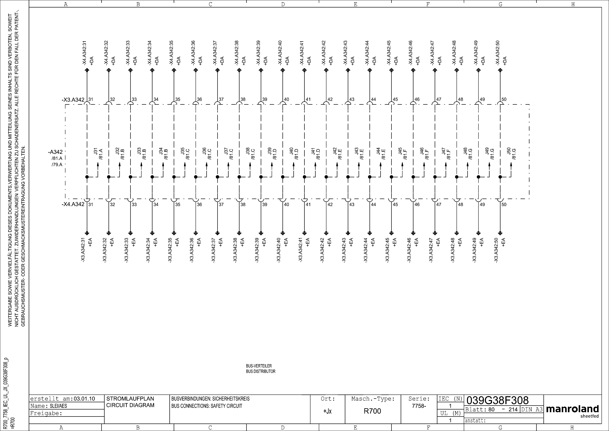

# +Jx — Sheet 80 of 214 — BUSVERBINDUNGEN: SICHERHEITSKREIS

**BUS CONNECTIONS: SAFETY**

> Part of the manroland **R700** printing press IEC/UL circuit diagrams.
> Drawing class: **Stromlaufplan / Circuit diagram** (DIN A3).
> Document `+Jx` covers the **1st printing module + feed register** machine section.

## At a glance

| Field | Value |
|---|---|
| Document | `+Jx`  (039G38F308) |
| Sheet | **80** of 214 |
| Section (DE) | BUSVERBINDUNGEN: SICHERHEITSKREIS |
| Section (EN) | BUS CONNECTIONS: SAFETY |
| Section type | CIRCUIT — Circuit diagram |
| Machine type | `R700` |
| Series | `7758` |
| Created | 03.01.10 |
| Replaces | — |
| Columns used | A, B, C, D, E, F, G |
| Path numbers | — |
| Labels on sheet | 167 |
| Cross-refs out | 22 |
| Cross-refs in | 62 |

**Previous:** [+Jx sheet 79](SHEET_0079.md) · **Next:** [+Jx sheet 81](SHEET_0081.md) · **Document TOC:** [_TOC.md](_TOC.md)  (+Jx) · **Master TOC:** [all sheets](../_MASTER_TOC.md)

## Sheet image (300 DPI, exact vector render)



_Rendered directly from the PDF vector layer at 300 DPI (1-bit), no OCR and no resampling. Use it to confirm anything ambiguous in the text below._

## Cross-references on this sheet

Each entry is a wire leaving this sheet. The printed token is `/sheet.column`; the link resolves to that sheet inside the same document.

| Ref | Target sheet | Col | Path | Destination on target | Target section | From col |
|---|---|---|---|---|---|---|
| `/81.A` | [+Jx sheet 81](SHEET_0081.md) | A | — | J31 | BUSVERBINDUNGEN: SICHERHEITSKREIS | A |
| `/81.B` | [+Jx sheet 81](SHEET_0081.md) | B | — | J32 | BUSVERBINDUNGEN: SICHERHEITSKREIS | B |
| `/81.B` | [+Jx sheet 81](SHEET_0081.md) | B | — | J33 | BUSVERBINDUNGEN: SICHERHEITSKREIS | B |
| `/81.B` | [+Jx sheet 81](SHEET_0081.md) | B | — | J34 | BUSVERBINDUNGEN: SICHERHEITSKREIS | B |
| `/81.C` | [+Jx sheet 81](SHEET_0081.md) | C | — | J35 | BUSVERBINDUNGEN: SICHERHEITSKREIS | C |
| `/81.C` | [+Jx sheet 81](SHEET_0081.md) | C | — | J36 | BUSVERBINDUNGEN: SICHERHEITSKREIS | C |
| `/81.C` | [+Jx sheet 81](SHEET_0081.md) | C | — | J37 | BUSVERBINDUNGEN: SICHERHEITSKREIS | C |
| `/81.C` | [+Jx sheet 81](SHEET_0081.md) | C | — | J38 | BUSVERBINDUNGEN: SICHERHEITSKREIS | D |
| `/81.D` | [+Jx sheet 81](SHEET_0081.md) | D | — | J39 | BUSVERBINDUNGEN: SICHERHEITSKREIS | D |
| `/81.D` | [+Jx sheet 81](SHEET_0081.md) | D | — | J40 | BUSVERBINDUNGEN: SICHERHEITSKREIS | D |
| `/81.D` | [+Jx sheet 81](SHEET_0081.md) | D | — | J41 | BUSVERBINDUNGEN: SICHERHEITSKREIS | D |
| `/81.E` | [+Jx sheet 81](SHEET_0081.md) | E | — | J42 | BUSVERBINDUNGEN: SICHERHEITSKREIS | E |
| `/81.E` | [+Jx sheet 81](SHEET_0081.md) | E | — | J43 | BUSVERBINDUNGEN: SICHERHEITSKREIS | E |
| `/81.E` | [+Jx sheet 81](SHEET_0081.md) | E | — | J44 | BUSVERBINDUNGEN: SICHERHEITSKREIS | E |
| `/81.F` | [+Jx sheet 81](SHEET_0081.md) | F | — | J45 | BUSVERBINDUNGEN: SICHERHEITSKREIS | F |
| `/81.F` | [+Jx sheet 81](SHEET_0081.md) | F | — | J46 | BUSVERBINDUNGEN: SICHERHEITSKREIS | F |
| `/81.F` | [+Jx sheet 81](SHEET_0081.md) | F | — | J47 | BUSVERBINDUNGEN: SICHERHEITSKREIS | F |
| `/81.G` | [+Jx sheet 81](SHEET_0081.md) | G | — | J48 | BUSVERBINDUNGEN: SICHERHEITSKREIS | G |
| `/81.G` | [+Jx sheet 81](SHEET_0081.md) | G | — | J49 | BUSVERBINDUNGEN: SICHERHEITSKREIS | G |
| `/81.G` | [+Jx sheet 81](SHEET_0081.md) | G | — | J50 | BUSVERBINDUNGEN: SICHERHEITSKREIS | G |
| `/81.A` | [+Jx sheet 81](SHEET_0081.md) | A | — | — | BUSVERBINDUNGEN: SICHERHEITSKREIS | A |
| `/79.A` | [+Jx sheet 79](SHEET_0079.md) | A | — | — | BUSVERBINDUNGEN: SICHERHEITSKREIS | A |

### Incoming references (sheets that point here)

Every other sheet that sends a wire to this one. `Back-ref` is the token printed on *that* sheet; `Path` is its line number.

| From sheet | Cols | Back-ref | Path | Refs | What continues there |
|---|---|---|---|---|---|
| [+Jx#79](SHEET_0079.md) | A | `/79.A` | — | 1 | — |
| [+Jx#81](SHEET_0081.md) | A, B, C, D, E, F, G | `/81.A`, `/81.B`, `/81.C`, `/81.D`, `/81.E`, `/81.F`, `/81.G` | — | 21 | J31; J32; J33; J34; J35; J36; J37; J38; J39; J40; J41; J42; J43; J44; J45; J46; J47; J48; J49; J50 |
| [+Jx#128](SHEET_0128.md) | B | `/128.B` | — | 20 | — |
| [+Jx#129](SHEET_0129.md) | H | `/129.H` | — | 20 | — |


## Devices on this sheet

| Tag | Class | Class meaning (IEC) | Col | Sub | Terminal | Sign |
|---|---|---|---|---|---|---|
| `A342` | A | Baugruppe / assembly, module, PC board | A | — | — | — |
| `J49` | J |  | G | — | — | — |
| `J48` | J |  | G | — | — | — |
| `J47` | J |  | F | — | — | — |
| `J50` | J |  | G | — | — | — |
| `J46` | J |  | F | — | — | — |
| `J39` | J |  | D | — | — | — |
| `J38` | J |  | D | — | — | — |
| `J37` | J |  | C | — | — | — |
| `J36` | J |  | C | — | — | — |
| `J40` | J |  | D | — | — | — |
| `J41` | J |  | D | — | — | — |
| `J45` | J |  | F | — | — | — |
| `J44` | J |  | E | — | — | — |
| `J43` | J |  | E | — | — | — |
| `J42` | J |  | E | — | — | — |
| `J35` | J |  | C | — | — | — |
| `J33` | J |  | B | — | — | — |
| `J34` | J |  | B | — | — | — |
| `J32` | J |  | B | — | — | — |
| `J31` | J |  | A | — | — | — |
| `X4.A342:31` | — | cross-device reference | A | — | 31 | — |
| `X4.A342:32` | — | cross-device reference | B | — | 32 | — |
| `X4.A342:33` | — | cross-device reference | B | — | 33 | — |
| `X4.A342:34` | — | cross-device reference | B | — | 34 | — |
| `X4.A342:35` | — | cross-device reference | B | — | 35 | — |
| `X4.A342:36` | — | cross-device reference | C | — | 36 | — |
| `X4.A342:37` | — | cross-device reference | C | — | 37 | — |
| `X4.A342:38` | — | cross-device reference | C | — | 38 | — |
| `X4.A342:39` | — | cross-device reference | D | — | 39 | — |
| `X4.A342:40` | — | cross-device reference | D | — | 40 | — |
| `X4.A342:41` | — | cross-device reference | D | — | 41 | — |
| `X4.A342:42` | — | cross-device reference | E | — | 42 | — |
| `X4.A342:43` | — | cross-device reference | E | — | 43 | — |
| `X4.A342:44` | — | cross-device reference | E | — | 44 | — |
| `X4.A342:45` | — | cross-device reference | E | — | 45 | — |
| `X4.A342:46` | — | cross-device reference | F | — | 46 | — |
| `X4.A342:47` | — | cross-device reference | F | — | 47 | — |
| `X4.A342:48` | — | cross-device reference | F | — | 48 | — |
| `X4.A342:49` | — | cross-device reference | G | — | 49 | — |
| `X4.A342:50` | — | cross-device reference | G | — | 50 | — |
| `X4.A342` | — | cross-device reference | A | — | — | — |
| `X3.A342:31` | — | cross-device reference | A | — | 31 | — |
| `X3.A342:32` | — | cross-device reference | B | — | 32 | — |
| `X3.A342:33` | — | cross-device reference | B | — | 33 | — |
| `X3.A342:34` | — | cross-device reference | B | — | 34 | — |
| `X3.A342:35` | — | cross-device reference | B | — | 35 | — |
| `X3.A342:36` | — | cross-device reference | C | — | 36 | — |
| `X3.A342:37` | — | cross-device reference | C | — | 37 | — |
| `X3.A342:38` | — | cross-device reference | C | — | 38 | — |
| `X3.A342:39` | — | cross-device reference | D | — | 39 | — |
| `X3.A342:40` | — | cross-device reference | D | — | 40 | — |
| `X3.A342:41` | — | cross-device reference | D | — | 41 | — |
| `X3.A342:42` | — | cross-device reference | E | — | 42 | — |
| `X3.A342:43` | — | cross-device reference | E | — | 43 | — |
| `X3.A342:44` | — | cross-device reference | E | — | 44 | — |
| `X3.A342:45` | — | cross-device reference | E | — | 45 | — |
| `X3.A342:46` | — | cross-device reference | F | — | 46 | — |
| `X3.A342:47` | — | cross-device reference | F | — | 47 | — |
| `X3.A342:48` | — | cross-device reference | F | — | 48 | — |
| `X3.A342:49` | — | cross-device reference | G | — | 49 | — |
| `X3.A342:50` | — | cross-device reference | G | — | 50 | — |
| `X3.A342` | — | cross-device reference | A | — | — | — |

## Potentials / nets

_No named potentials on this sheet._

## Wire-end annotations (grouped as printed)

A wire that continues elsewhere is annotated with a small cluster: the destination description, the path/line number `#NN`, and the `/sheet.column` cross reference. Each row below is one such cluster exactly as it is grouped on the drawing.

| Col | Y | Path | Cross-ref | Text on the wire |
|---|---|---|---|---|
| A | 79.1 | — | — | `X4.A342:31` |
| B | 79.1 | — | — | `X4.A342:32` |
| B | 79.1 | — | — | `X4.A342:33` |
| B | 79.1 | — | — | `X4.A342:34` |
| B | 79.1 | — | — | `X4.A342:35` |
| C | 79.1 | — | — | `X4.A342:36` |
| C | 79.1 | — | — | `X4.A342:37` |
| C | 79.1 | — | — | `X4.A342:38` |
| D | 79.1 | — | — | `X4.A342:39` |
| D | 79.1 | — | — | `X4.A342:40` |
| D | 79.1 | — | — | `X4.A342:41` |
| E | 79.1 | — | — | `X4.A342:42` |
| E | 79.1 | — | — | `X4.A342:43` |
| E | 79.1 | — | — | `X4.A342:44` |
| E | 79.1 | — | — | `X4.A342:45` |
| F | 79.1 | — | — | `X4.A342:46` |
| F | 79.1 | — | — | `X4.A342:47` |
| F | 79.1 | — | — | `X4.A342:48` |
| G | 79.1 | — | — | `X4.A342:49` |
| G | 79.1 | — | — | `X4.A342:50` |
| A | 110.5 | — | — | `+DA` |
| B | 110.5 | — | — | `+DA` |
| B | 110.5 | — | — | `+DA` |
| B | 110.5 | — | — | `+DA` |
| C | 110.5 | — | — | `+DA` |
| C | 110.5 | — | — | `+DA` |
| C | 110.5 | — | — | `+DA` |
| C | 110.5 | — | — | `+DA` |
| D | 110.5 | — | — | `+DA` |
| D | 110.5 | — | — | `+DA` |
| D | 110.5 | — | — | `+DA` |
| E | 110.5 | — | — | `+DA` |
| E | 110.5 | — | — | `+DA` |
| E | 110.5 | — | — | `+DA` |
| F | 110.5 | — | — | `+DA` |
| F | 110.5 | — | — | `+DA` |
| F | 110.5 | — | — | `+DA` |
| F | 110.5 | — | — | `+DA` |
| G | 110.5 | — | — | `+DA` |
| G | 110.5 | — | — | `+DA` |
| A | 190.2 | — | — | `X3.A342 31` |
| D | 190.2 | — | — | `32 33 34 35 36 37 38 39 40 41 42 43 44 45 46 47 48 49 50` |
| A | 288.0 | — | `/81.A` | `J31` |
| B | 288.0 | — | `/81.B` | `J32` |
| B | 288.0 | — | `/81.B` | `J33` |
| B | 288.0 | — | `/81.B` | `J34` |
| C | 288.0 | — | `/81.C` | `J35` |
| C | 288.0 | — | `/81.C` | `J36` |
| C | 288.0 | — | `/81.C` | `J37` |
| D | 288.0 | — | `/81.C` | `J38` |
| D | 288.0 | — | `/81.D` | `J39` |
| D | 288.0 | — | `/81.D` | `J40` |
| D | 288.0 | — | `/81.D` | `J41` |
| E | 288.0 | — | `/81.E` | `J42` |
| E | 288.0 | — | `/81.E` | `J43` |
| E | 288.0 | — | `/81.E` | `J44` |
| F | 288.0 | — | `/81.F` | `J45` |
| F | 288.0 | — | `/81.F` | `J46` |
| F | 288.0 | — | `/81.F` | `J47` |
| G | 288.0 | — | `/81.G` | `J48` |
| G | 288.0 | — | `/81.G` | `J49` |
| G | 288.0 | — | `/81.G` | `J50` |
| A | 292.2 | — | — | `A342` |
| A | 305.3 | — | `/81.A`, `/79.A` | — |
| D | 394.3 | — | — | `X4.A342 31 32 33 34 35 36 37 38 39 40 41 42 43 44 45 46 47 48 49 50` |
| A | 463.5 | — | — | `X3.A342:31` |
| D | 463.5 | — | — | `X3.A342:41` |
| B | 464.6 | — | — | `X3.A342:32` |
| B | 464.6 | — | — | `X3.A342:33` |
| B | 464.6 | — | — | `X3.A342:34` |
| B | 464.6 | — | — | `X3.A342:35` |
| C | 464.6 | — | — | `X3.A342:36` |
| C | 464.6 | — | — | `X3.A342:37` |
| C | 464.6 | — | — | `X3.A342:38` |
| D | 464.6 | — | — | `X3.A342:39` |
| D | 464.6 | — | — | `X3.A342:40` |
| E | 464.6 | — | — | `X3.A342:42` |
| E | 464.6 | — | — | `X3.A342:43` |
| E | 464.6 | — | — | `X3.A342:44` |
| E | 464.6 | — | — | `X3.A342:45` |
| F | 464.6 | — | — | `X3.A342:46` |
| F | 464.6 | — | — | `X3.A342:47` |
| F | 464.6 | — | — | `X3.A342:48` |
| G | 464.6 | — | — | `X3.A342:49` |
| G | 464.6 | — | — | `X3.A342:50` |
| A | 464.9 | — | — | `+EA` |
| B | 464.9 | — | — | `+EA` |
| B | 464.9 | — | — | `+EA` |
| B | 464.9 | — | — | `+EA` |
| C | 464.9 | — | — | `+EA` |
| C | 464.9 | — | — | `+EA` |
| C | 464.9 | — | — | `+EA` |
| C | 464.9 | — | — | `+EA` |
| D | 464.9 | — | — | `+EA` |
| D | 464.9 | — | — | `+EA` |
| D | 464.9 | — | — | `+EA` |
| E | 464.9 | — | — | `+EA` |
| E | 464.9 | — | — | `+EA` |
| E | 464.9 | — | — | `+EA` |
| F | 464.9 | — | — | `+EA` |
| F | 464.9 | — | — | `+EA` |
| F | 464.9 | — | — | `+EA` |
| F | 464.9 | — | — | `+EA` |
| G | 464.9 | — | — | `+EA` |
| G | 464.9 | — | — | `+EA` |
| D | 712.1 | — | — | `BUS VERTEILER BUS DISTRIBUTOR` |


## Notes and free text on this sheet

| Text | Col | Y (pt) |
|---|---|---|
| `+DA` | A | 110.55 |
| `+DA` | B | 110.55 |
| `+DA` | C | 110.55 |
| `+DA` | D | 110.55 |
| `+DA` | E | 110.55 |
| `+DA` | F | 110.55 |
| `+DA` | G | 110.55 |
| `BUS VERTEILER` | D | 712.07 |
| `BUS DISTRIBUTOR` | D | 722.71 |
| `+EA` | A | 464.88 |
| `+EA` | B | 464.88 |
| `+EA` | C | 464.88 |
| `+EA` | D | 464.88 |
| `+EA` | E | 464.88 |
| `+EA` | F | 464.88 |
| `+EA` | G | 464.88 |

## Complete label inventory (exact text from the drawing)

Every text object inside the drawing area of this sheet, in DIN reading order (column A→H, then top→bottom). This is the authoritative list: if a string is not here it is not printed on this sheet.

| Col | Y | X | Dir | Type | Text |
|---|---|---|---|---|---|
| A | 79.1 | 161.1 | ↕ | device ref | `X4.A342:31` |
| A | 110.6 | 175.3 | ↕ | text | `+DA` |
| A | 190.2 | 120.8 | → | device ref | `X3.A342` |
| A | 190.2 | 172.6 | → | number | `31` |
| A | 288.0 | 183.1 | ↕ | device tag | `J31` |
| A | 291.1 | 192.9 | ↕ | cross-reference | `/81.A` |
| A | 292.2 | 94.1 | → | device tag | `A342` |
| A | 305.3 | 101.2 | → | cross-reference | `/81.A` |
| A | 317.7 | 101.2 | → | cross-reference | `/79.A` |
| A | 394.3 | 120.8 | → | device ref | `X4.A342` |
| A | 395.7 | 172.6 | → | number | `31` |
| A | 463.5 | 158.3 | ↕ | device ref | `X3.A342:31` |
| A | 464.9 | 172.4 | ↕ | text | `+EA` |
| B | 79.1 | 203.6 | ↕ | device ref | `X4.A342:32` |
| B | 79.1 | 246.1 | ↕ | device ref | `X4.A342:33` |
| B | 79.1 | 288.7 | ↕ | device ref | `X4.A342:34` |
| B | 79.1 | 331.2 | ↕ | device ref | `X4.A342:35` |
| B | 110.6 | 217.8 | ↕ | text | `+DA` |
| B | 110.6 | 260.3 | ↕ | text | `+DA` |
| B | 110.6 | 302.8 | ↕ | text | `+DA` |
| B | 190.2 | 215.1 | → | number | `32` |
| B | 190.2 | 257.7 | → | number | `33` |
| B | 190.2 | 300.2 | → | number | `34` |
| B | 288.0 | 225.6 | ↕ | device tag | `J32` |
| B | 288.0 | 268.1 | ↕ | device tag | `J33` |
| B | 288.0 | 310.6 | ↕ | device tag | `J34` |
| B | 291.1 | 235.5 | ↕ | cross-reference | `/81.B` |
| B | 291.1 | 278.0 | ↕ | cross-reference | `/81.B` |
| B | 291.1 | 320.5 | ↕ | cross-reference | `/81.B` |
| B | 395.7 | 215.1 | → | number | `32` |
| B | 395.7 | 257.7 | → | number | `33` |
| B | 395.7 | 300.2 | → | number | `34` |
| B | 464.6 | 200.8 | ↕ | device ref | `X3.A342:32` |
| B | 464.6 | 243.3 | ↕ | device ref | `X3.A342:33` |
| B | 464.6 | 285.8 | ↕ | device ref | `X3.A342:34` |
| B | 464.6 | 328.3 | ↕ | device ref | `X3.A342:35` |
| B | 464.9 | 214.9 | ↕ | text | `+EA` |
| B | 464.9 | 257.4 | ↕ | text | `+EA` |
| B | 464.9 | 300.0 | ↕ | text | `+EA` |
| C | 79.1 | 373.7 | ↕ | device ref | `X4.A342:36` |
| C | 79.1 | 416.2 | ↕ | device ref | `X4.A342:37` |
| C | 79.1 | 458.7 | ↕ | device ref | `X4.A342:38` |
| C | 110.6 | 345.3 | ↕ | text | `+DA` |
| C | 110.6 | 387.9 | ↕ | text | `+DA` |
| C | 110.6 | 430.4 | ↕ | text | `+DA` |
| C | 110.6 | 472.9 | ↕ | text | `+DA` |
| C | 190.2 | 342.7 | → | number | `35` |
| C | 190.2 | 385.2 | → | number | `36` |
| C | 190.2 | 427.7 | → | number | `37` |
| C | 190.2 | 470.3 | → | number | `38` |
| C | 288.0 | 353.1 | ↕ | device tag | `J35` |
| C | 288.0 | 395.7 | ↕ | device tag | `J36` |
| C | 288.0 | 438.2 | ↕ | device tag | `J37` |
| C | 290.8 | 363.1 | ↕ | cross-reference | `/81.C` |
| C | 290.8 | 405.6 | ↕ | cross-reference | `/81.C` |
| C | 290.8 | 448.1 | ↕ | cross-reference | `/81.C` |
| C | 395.7 | 342.7 | → | number | `35` |
| C | 395.7 | 385.2 | → | number | `36` |
| C | 395.7 | 427.7 | → | number | `37` |
| C | 395.7 | 470.3 | → | number | `38` |
| C | 464.6 | 370.9 | ↕ | device ref | `X3.A342:36` |
| C | 464.6 | 413.4 | ↕ | device ref | `X3.A342:37` |
| C | 464.6 | 455.9 | ↕ | device ref | `X3.A342:38` |
| C | 464.9 | 342.5 | ↕ | text | `+EA` |
| C | 464.9 | 385.0 | ↕ | text | `+EA` |
| C | 464.9 | 427.5 | ↕ | text | `+EA` |
| C | 464.9 | 470.0 | ↕ | text | `+EA` |
| D | 79.1 | 501.3 | ↕ | device ref | `X4.A342:39` |
| D | 79.1 | 543.8 | ↕ | device ref | `X4.A342:40` |
| D | 79.1 | 586.3 | ↕ | device ref | `X4.A342:41` |
| D | 110.6 | 515.4 | ↕ | text | `+DA` |
| D | 110.6 | 557.9 | ↕ | text | `+DA` |
| D | 110.6 | 600.5 | ↕ | text | `+DA` |
| D | 190.2 | 512.8 | → | number | `39` |
| D | 190.2 | 555.6 | → | number | `40` |
| D | 190.2 | 598.1 | → | number | `41` |
| D | 288.0 | 480.7 | ↕ | device tag | `J38` |
| D | 288.0 | 523.2 | ↕ | device tag | `J39` |
| D | 288.0 | 565.7 | ↕ | device tag | `J40` |
| D | 288.0 | 608.3 | ↕ | device tag | `J41` |
| D | 290.8 | 490.6 | ↕ | cross-reference | `/81.C` |
| D | 290.8 | 533.1 | ↕ | cross-reference | `/81.D` |
| D | 290.8 | 575.7 | ↕ | cross-reference | `/81.D` |
| D | 290.8 | 618.2 | ↕ | cross-reference | `/81.D` |
| D | 395.7 | 512.8 | → | number | `39` |
| D | 395.7 | 555.6 | → | number | `40` |
| D | 395.7 | 598.1 | → | number | `41` |
| D | 463.5 | 583.5 | ↕ | device ref | `X3.A342:41` |
| D | 464.6 | 498.4 | ↕ | device ref | `X3.A342:39` |
| D | 464.6 | 540.9 | ↕ | device ref | `X3.A342:40` |
| D | 464.9 | 512.6 | ↕ | text | `+EA` |
| D | 464.9 | 555.1 | ↕ | text | `+EA` |
| D | 464.9 | 597.6 | ↕ | text | `+EA` |
| D | 712.1 | 481.3 | → | text | `BUS VERTEILER` |
| D | 722.7 | 481.3 | → | text | `BUS DISTRIBUTOR` |
| E | 79.1 | 628.8 | ↕ | device ref | `X4.A342:42` |
| E | 79.1 | 671.3 | ↕ | device ref | `X4.A342:43` |
| E | 79.1 | 713.8 | ↕ | device ref | `X4.A342:44` |
| E | 79.1 | 756.4 | ↕ | device ref | `X4.A342:45` |
| E | 110.6 | 643.0 | ↕ | text | `+DA` |
| E | 110.6 | 685.5 | ↕ | text | `+DA` |
| E | 110.6 | 728.0 | ↕ | text | `+DA` |
| E | 190.2 | 640.6 | → | number | `42` |
| E | 190.2 | 683.1 | → | number | `43` |
| E | 190.2 | 725.7 | → | number | `44` |
| E | 288.0 | 650.8 | ↕ | device tag | `J42` |
| E | 288.0 | 693.3 | ↕ | device tag | `J43` |
| E | 288.0 | 735.8 | ↕ | device tag | `J44` |
| E | 291.1 | 660.7 | ↕ | cross-reference | `/81.E` |
| E | 291.1 | 703.2 | ↕ | cross-reference | `/81.E` |
| E | 291.1 | 745.7 | ↕ | cross-reference | `/81.E` |
| E | 395.7 | 640.6 | → | number | `42` |
| E | 395.7 | 683.1 | → | number | `43` |
| E | 395.7 | 725.7 | → | number | `44` |
| E | 464.6 | 626.0 | ↕ | device ref | `X3.A342:42` |
| E | 464.6 | 668.5 | ↕ | device ref | `X3.A342:43` |
| E | 464.6 | 711.0 | ↕ | device ref | `X3.A342:44` |
| E | 464.6 | 753.5 | ↕ | device ref | `X3.A342:45` |
| E | 464.9 | 640.1 | ↕ | text | `+EA` |
| E | 464.9 | 682.6 | ↕ | text | `+EA` |
| E | 464.9 | 725.2 | ↕ | text | `+EA` |
| F | 79.1 | 798.9 | ↕ | device ref | `X4.A342:46` |
| F | 79.1 | 841.4 | ↕ | device ref | `X4.A342:47` |
| F | 79.1 | 883.9 | ↕ | device ref | `X4.A342:48` |
| F | 110.6 | 770.5 | ↕ | text | `+DA` |
| F | 110.6 | 813.1 | ↕ | text | `+DA` |
| F | 110.6 | 855.6 | ↕ | text | `+DA` |
| F | 110.6 | 898.1 | ↕ | text | `+DA` |
| F | 190.2 | 768.2 | → | number | `45` |
| F | 190.2 | 810.7 | → | number | `46` |
| F | 190.2 | 853.2 | → | number | `47` |
| F | 190.2 | 895.7 | → | number | `48` |
| F | 288.0 | 778.3 | ↕ | device tag | `J45` |
| F | 288.0 | 820.8 | ↕ | device tag | `J46` |
| F | 288.0 | 863.4 | ↕ | device tag | `J47` |
| F | 291.7 | 788.2 | ↕ | cross-reference | `/81.F` |
| F | 291.7 | 830.8 | ↕ | cross-reference | `/81.F` |
| F | 291.7 | 873.3 | ↕ | cross-reference | `/81.F` |
| F | 395.7 | 768.2 | → | number | `45` |
| F | 395.7 | 810.7 | → | number | `46` |
| F | 395.7 | 853.2 | → | number | `47` |
| F | 395.7 | 895.7 | → | number | `48` |
| F | 464.6 | 796.1 | ↕ | device ref | `X3.A342:46` |
| F | 464.6 | 838.6 | ↕ | device ref | `X3.A342:47` |
| F | 464.6 | 881.1 | ↕ | device ref | `X3.A342:48` |
| F | 464.9 | 767.7 | ↕ | text | `+EA` |
| F | 464.9 | 810.2 | ↕ | text | `+EA` |
| F | 464.9 | 852.7 | ↕ | text | `+EA` |
| F | 464.9 | 895.2 | ↕ | text | `+EA` |
| G | 79.1 | 926.4 | ↕ | device ref | `X4.A342:49` |
| G | 79.1 | 969.0 | ↕ | device ref | `X4.A342:50` |
| G | 110.6 | 940.6 | ↕ | text | `+DA` |
| G | 110.6 | 983.1 | ↕ | text | `+DA` |
| G | 190.2 | 938.3 | → | number | `49` |
| G | 190.2 | 980.5 | → | number | `50` |
| G | 288.0 | 905.9 | ↕ | device tag | `J48` |
| G | 288.0 | 948.4 | ↕ | device tag | `J49` |
| G | 288.0 | 990.9 | ↕ | device tag | `J50` |
| G | 290.3 | 915.8 | ↕ | cross-reference | `/81.G` |
| G | 290.3 | 958.3 | ↕ | cross-reference | `/81.G` |
| G | 290.3 | 1000.8 | ↕ | cross-reference | `/81.G` |
| G | 395.7 | 938.3 | → | number | `49` |
| G | 395.7 | 980.5 | → | number | `50` |
| G | 464.6 | 923.6 | ↕ | device ref | `X3.A342:49` |
| G | 464.6 | 966.1 | ↕ | device ref | `X3.A342:50` |
| G | 464.9 | 937.7 | ↕ | text | `+EA` |
| G | 464.9 | 980.3 | ↕ | text | `+EA` |

## Reading-order text block

The same content as a plain block, grouped by DIN column — convenient to paste or to match against a visual description.

```text
=== Column A ===
  79.1  161.1  devref       X4.A342:31
 110.6  175.3  text         +DA
 190.2  120.8  devref       X3.A342
 190.2  172.6  numeric      31
 288.0  183.1  devtag       J31
 291.1  192.9  xref         /81.A
 292.2   94.1  devtag       A342
 305.3  101.2  xref         /81.A
 317.7  101.2  xref         /79.A
 394.3  120.8  devref       X4.A342
 395.7  172.6  numeric      31
 463.5  158.3  devref       X3.A342:31
 464.9  172.4  text         +EA
=== Column B ===
  79.1  203.6  devref       X4.A342:32
  79.1  246.1  devref       X4.A342:33
  79.1  288.7  devref       X4.A342:34
  79.1  331.2  devref       X4.A342:35
 110.6  217.8  text         +DA
 110.6  260.3  text         +DA
 110.6  302.8  text         +DA
 190.2  215.1  numeric      32
 190.2  257.7  numeric      33
 190.2  300.2  numeric      34
 288.0  225.6  devtag       J32
 288.0  268.1  devtag       J33
 288.0  310.6  devtag       J34
 291.1  235.5  xref         /81.B
 291.1  278.0  xref         /81.B
 291.1  320.5  xref         /81.B
 395.7  215.1  numeric      32
 395.7  257.7  numeric      33
 395.7  300.2  numeric      34
 464.6  200.8  devref       X3.A342:32
 464.6  243.3  devref       X3.A342:33
 464.6  285.8  devref       X3.A342:34
 464.6  328.3  devref       X3.A342:35
 464.9  214.9  text         +EA
 464.9  257.4  text         +EA
 464.9  300.0  text         +EA
=== Column C ===
  79.1  373.7  devref       X4.A342:36
  79.1  416.2  devref       X4.A342:37
  79.1  458.7  devref       X4.A342:38
 110.6  345.3  text         +DA
 110.6  387.9  text         +DA
 110.6  430.4  text         +DA
 110.6  472.9  text         +DA
 190.2  342.7  numeric      35
 190.2  385.2  numeric      36
 190.2  427.7  numeric      37
 190.2  470.3  numeric      38
 288.0  353.1  devtag       J35
 288.0  395.7  devtag       J36
 288.0  438.2  devtag       J37
 290.8  363.1  xref         /81.C
 290.8  405.6  xref         /81.C
 290.8  448.1  xref         /81.C
 395.7  342.7  numeric      35
 395.7  385.2  numeric      36
 395.7  427.7  numeric      37
 395.7  470.3  numeric      38
 464.6  370.9  devref       X3.A342:36
 464.6  413.4  devref       X3.A342:37
 464.6  455.9  devref       X3.A342:38
 464.9  342.5  text         +EA
 464.9  385.0  text         +EA
 464.9  427.5  text         +EA
 464.9  470.0  text         +EA
=== Column D ===
  79.1  501.3  devref       X4.A342:39
  79.1  543.8  devref       X4.A342:40
  79.1  586.3  devref       X4.A342:41
 110.6  515.4  text         +DA
 110.6  557.9  text         +DA
 110.6  600.5  text         +DA
 190.2  512.8  numeric      39
 190.2  555.6  numeric      40
 190.2  598.1  numeric      41
 288.0  480.7  devtag       J38
 288.0  523.2  devtag       J39
 288.0  565.7  devtag       J40
 288.0  608.3  devtag       J41
 290.8  490.6  xref         /81.C
 290.8  533.1  xref         /81.D
 290.8  575.7  xref         /81.D
 290.8  618.2  xref         /81.D
 395.7  512.8  numeric      39
 395.7  555.6  numeric      40
 395.7  598.1  numeric      41
 463.5  583.5  devref       X3.A342:41
 464.6  498.4  devref       X3.A342:39
 464.6  540.9  devref       X3.A342:40
 464.9  512.6  text         +EA
 464.9  555.1  text         +EA
 464.9  597.6  text         +EA
 712.1  481.3  text         BUS VERTEILER
 722.7  481.3  text         BUS DISTRIBUTOR
=== Column E ===
  79.1  628.8  devref       X4.A342:42
  79.1  671.3  devref       X4.A342:43
  79.1  713.8  devref       X4.A342:44
  79.1  756.4  devref       X4.A342:45
 110.6  643.0  text         +DA
 110.6  685.5  text         +DA
 110.6  728.0  text         +DA
 190.2  640.6  numeric      42
 190.2  683.1  numeric      43
 190.2  725.7  numeric      44
 288.0  650.8  devtag       J42
 288.0  693.3  devtag       J43
 288.0  735.8  devtag       J44
 291.1  660.7  xref         /81.E
 291.1  703.2  xref         /81.E
 291.1  745.7  xref         /81.E
 395.7  640.6  numeric      42
 395.7  683.1  numeric      43
 395.7  725.7  numeric      44
 464.6  626.0  devref       X3.A342:42
 464.6  668.5  devref       X3.A342:43
 464.6  711.0  devref       X3.A342:44
 464.6  753.5  devref       X3.A342:45
 464.9  640.1  text         +EA
 464.9  682.6  text         +EA
 464.9  725.2  text         +EA
=== Column F ===
  79.1  798.9  devref       X4.A342:46
  79.1  841.4  devref       X4.A342:47
  79.1  883.9  devref       X4.A342:48
 110.6  770.5  text         +DA
 110.6  813.1  text         +DA
 110.6  855.6  text         +DA
 110.6  898.1  text         +DA
 190.2  768.2  numeric      45
 190.2  810.7  numeric      46
 190.2  853.2  numeric      47
 190.2  895.7  numeric      48
 288.0  778.3  devtag       J45
 288.0  820.8  devtag       J46
 288.0  863.4  devtag       J47
 291.7  788.2  xref         /81.F
 291.7  830.8  xref         /81.F
 291.7  873.3  xref         /81.F
 395.7  768.2  numeric      45
 395.7  810.7  numeric      46
 395.7  853.2  numeric      47
 395.7  895.7  numeric      48
 464.6  796.1  devref       X3.A342:46
 464.6  838.6  devref       X3.A342:47
 464.6  881.1  devref       X3.A342:48
 464.9  767.7  text         +EA
 464.9  810.2  text         +EA
 464.9  852.7  text         +EA
 464.9  895.2  text         +EA
=== Column G ===
  79.1  926.4  devref       X4.A342:49
  79.1  969.0  devref       X4.A342:50
 110.6  940.6  text         +DA
 110.6  983.1  text         +DA
 190.2  938.3  numeric      49
 190.2  980.5  numeric      50
 288.0  905.9  devtag       J48
 288.0  948.4  devtag       J49
 288.0  990.9  devtag       J50
 290.3  915.8  xref         /81.G
 290.3  958.3  xref         /81.G
 290.3 1000.8  xref         /81.G
 395.7  938.3  numeric      49
 395.7  980.5  numeric      50
 464.6  923.6  devref       X3.A342:49
 464.6  966.1  devref       X3.A342:50
 464.9  937.7  text         +EA
 464.9  980.3  text         +EA
```

---
_Generated from the PDF vector text layer; no OCR. Source: `R700_7758_IEC_UL_JX_039G38F308_p`, sheet 80._
