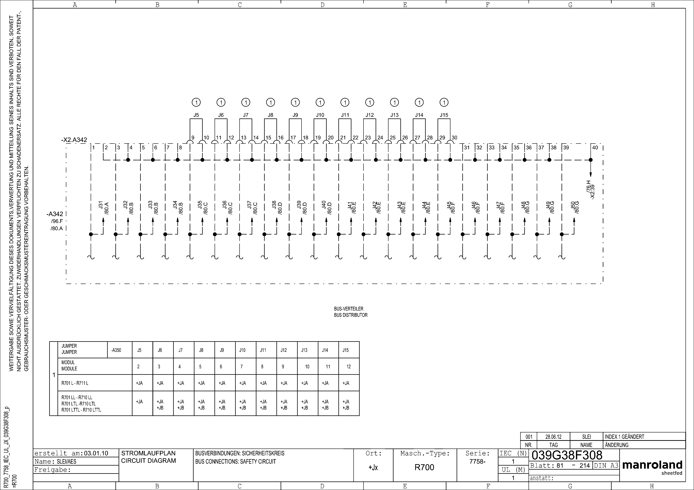

# +Jx — Sheet 81 of 214 — BUSVERBINDUNGEN: SICHERHEITSKREIS

**BUS CONNECTIONS: SAFETY**

> Part of the manroland **R700** printing press IEC/UL circuit diagrams.
> Drawing class: **Stromlaufplan / Circuit diagram** (DIN A3).
> Document `+Jx` covers the **1st printing module + feed register** machine section.

## At a glance

| Field | Value |
|---|---|
| Document | `+Jx`  (039G38F308) |
| Sheet | **81** of 214 |
| Section (DE) | BUSVERBINDUNGEN: SICHERHEITSKREIS |
| Section (EN) | BUS CONNECTIONS: SAFETY |
| Section type | CIRCUIT — Circuit diagram |
| Machine type | `R700` |
| Series | `7758` |
| Created | 03.01.10 |
| Replaces | — |
| Columns used | A, B, C, D, E, F, G, H |
| Path numbers | — |
| Labels on sheet | 182 |
| Cross-refs out | 23 |
| Cross-refs in | 63 |

**Previous:** [+Jx sheet 80](SHEET_0080.md) · **Next:** [+Jx sheet 82](SHEET_0082.md) · **Document TOC:** [_TOC.md](_TOC.md)  (+Jx) · **Master TOC:** [all sheets](../_MASTER_TOC.md)

## Sheet image (300 DPI, exact vector render)



_Rendered directly from the PDF vector layer at 300 DPI (1-bit), no OCR and no resampling. Use it to confirm anything ambiguous in the text below._

## Cross-references on this sheet

Each entry is a wire leaving this sheet. The printed token is `/sheet.column`; the link resolves to that sheet inside the same document.

| Ref | Target sheet | Col | Path | Destination on target | Target section | From col |
|---|---|---|---|---|---|---|
| `/76.H` | [+Jx sheet 76](SHEET_0076.md) | H | — | X2:39 | BUSVERBINDUNGEN: SICHERHEITSKREIS | G |
| `/80.A` | [+Jx sheet 80](SHEET_0080.md) | A | — | J31 | BUSVERBINDUNGEN: SICHERHEITSKREIS | A |
| `/80.B` | [+Jx sheet 80](SHEET_0080.md) | B | — | J32 | BUSVERBINDUNGEN: SICHERHEITSKREIS | B |
| `/80.B` | [+Jx sheet 80](SHEET_0080.md) | B | — | J33 | BUSVERBINDUNGEN: SICHERHEITSKREIS | B |
| `/80.B` | [+Jx sheet 80](SHEET_0080.md) | B | — | J34 | BUSVERBINDUNGEN: SICHERHEITSKREIS | B |
| `/80.C` | [+Jx sheet 80](SHEET_0080.md) | C | — | J35 | BUSVERBINDUNGEN: SICHERHEITSKREIS | C |
| `/80.C` | [+Jx sheet 80](SHEET_0080.md) | C | — | J36 | BUSVERBINDUNGEN: SICHERHEITSKREIS | C |
| `/80.C` | [+Jx sheet 80](SHEET_0080.md) | C | — | J37 | BUSVERBINDUNGEN: SICHERHEITSKREIS | C |
| `/80.D` | [+Jx sheet 80](SHEET_0080.md) | D | — | J38 | BUSVERBINDUNGEN: SICHERHEITSKREIS | C |
| `/80.D` | [+Jx sheet 80](SHEET_0080.md) | D | — | J39 | BUSVERBINDUNGEN: SICHERHEITSKREIS | D |
| `/80.D` | [+Jx sheet 80](SHEET_0080.md) | D | — | J40 | BUSVERBINDUNGEN: SICHERHEITSKREIS | D |
| `/80.G` | [+Jx sheet 80](SHEET_0080.md) | G | — | J48 | BUSVERBINDUNGEN: SICHERHEITSKREIS | F |
| `/80.G` | [+Jx sheet 80](SHEET_0080.md) | G | — | J49 | BUSVERBINDUNGEN: SICHERHEITSKREIS | G |
| `/80.G` | [+Jx sheet 80](SHEET_0080.md) | G | — | J50 | BUSVERBINDUNGEN: SICHERHEITSKREIS | G |
| `/80.E` | [+Jx sheet 80](SHEET_0080.md) | E | — | J41 | BUSVERBINDUNGEN: SICHERHEITSKREIS | D |
| `/80.E` | [+Jx sheet 80](SHEET_0080.md) | E | — | J42 | BUSVERBINDUNGEN: SICHERHEITSKREIS | E |
| `/80.E` | [+Jx sheet 80](SHEET_0080.md) | E | — | J43 | BUSVERBINDUNGEN: SICHERHEITSKREIS | E |
| `/80.E` | [+Jx sheet 80](SHEET_0080.md) | E | — | J44 | BUSVERBINDUNGEN: SICHERHEITSKREIS | E |
| `/80.F` | [+Jx sheet 80](SHEET_0080.md) | F | — | J45 | BUSVERBINDUNGEN: SICHERHEITSKREIS | F |
| `/80.F` | [+Jx sheet 80](SHEET_0080.md) | F | — | J46 | BUSVERBINDUNGEN: SICHERHEITSKREIS | F |
| `/80.F` | [+Jx sheet 80](SHEET_0080.md) | F | — | J47 | BUSVERBINDUNGEN: SICHERHEITSKREIS | F |
| `/96.F` | [+Jx sheet 96](SHEET_0096.md) | F | — | — | RESERVE | A |
| `/80.A` | [+Jx sheet 80](SHEET_0080.md) | A | — | — | BUSVERBINDUNGEN: SICHERHEITSKREIS | A |

### Incoming references (sheets that point here)

Every other sheet that sends a wire to this one. `Back-ref` is the token printed on *that* sheet; `Path` is its line number.

| From sheet | Cols | Back-ref | Path | Refs | What continues there |
|---|---|---|---|---|---|
| [+Jx#76](SHEET_0076.md) | H | `/76.H` | — | 1 | — |
| [+Jx#80](SHEET_0080.md) | A, B, C, D, E, F, G | `/80.A`, `/80.B`, `/80.C`, `/80.D`, `/80.E`, `/80.F`, `/80.G` | — | 21 | J31; J32; J33; J34; J35; J36; J37; J38; J39; J40; J41; J42; J43; J44; J45; J46; J47; J48; J49; J50 |
| [+Jx#96](SHEET_0096.md) | F | `/96.F` | — | 1 | — |
| [+Jx#126](SHEET_0126.md) | B, C | `/126.B`, `/126.C` | — | 40 | — |


## Devices on this sheet

| Tag | Class | Class meaning (IEC) | Col | Sub | Terminal | Sign |
|---|---|---|---|---|---|---|
| `A342` | A | Baugruppe / assembly, module, PC board | A | — | — | — |
| `X2:39` | X | Klemme / terminal, plug connector | G | — | 39 | — |
| `J50` | J |  | G | — | — | — |
| `J49` | J |  | G | — | — | — |
| `J48` | J |  | F | — | — | — |
| `J47` | J |  | F | — | — | — |
| `J46` | J |  | F | — | — | — |
| `J40` | J |  | D | — | — | — |
| `J39` | J |  | D | — | — | — |
| `J38` | J |  | C | — | — | — |
| `J37` | J |  | C | — | — | — |
| `J41` | J |  | D | — | — | — |
| `J45` | J |  | F | — | — | — |
| `J44` | J |  | E | — | — | — |
| `J43` | J |  | E | — | — | — |
| `J42` | J |  | E | — | — | — |
| `J36` | J |  | C | — | — | — |
| `J33` | J |  | B | — | — | — |
| `J34` | J |  | B | — | — | — |
| `J32` | J |  | B | — | — | — |
| `J31` | J |  | A | — | — | — |
| `J35` | J |  | C | — | — | — |
| `J14` | J |  | E | — | — | — |
| `J13` | J |  | E | — | — | — |
| `J15` | J |  | E | — | — | — |
| `J12` | J |  | E | — | — | — |
| `J11` | J |  | D | — | — | — |
| `J10` | J |  | D | — | — | — |
| `J9` | J |  | D | — | — | — |
| `J8` | J |  | C | — | — | — |
| `J7` | J |  | C | — | — | — |
| `J6` | J |  | C | — | — | — |
| `J5` | J |  | B | — | — | — |
| `A350` | A | Baugruppe / assembly, module, PC board | B | — | — | — |
| `J5` | J |  | B | — | — | — |
| `J6` | J |  | B | — | — | — |
| `J7` | J |  | B | — | — | — |
| `J8` | J |  | C | — | — | — |
| `J9` | J |  | C | — | — | — |
| `J10` | J |  | C | — | — | — |
| `J11` | J |  | C | — | — | — |
| `J12` | J |  | D | — | — | — |
| `J13` | J |  | D | — | — | — |
| `J14` | J |  | D | — | — | — |
| `J15` | J |  | D | — | — | — |
| `NR.` | — | cross-device reference | G | — | — | — |
| `28.06.12` | — | cross-device reference | G | — | — | — |
| `X2.A342` | — | cross-device reference | A | — | — | — |

## Potentials / nets

_No named potentials on this sheet._

## Wire-end annotations (grouped as printed)

A wire that continues elsewhere is annotated with a small cluster: the destination description, the path/line number `#NN`, and the `/sheet.column` cross reference. Each row below is one such cluster exactly as it is grouped on the drawing.

| Col | Y | Path | Cross-ref | Text on the wire |
|---|---|---|---|---|
| B | 172.7 | — | — | `1` |
| C | 172.7 | — | — | `1` |
| C | 172.7 | — | — | `1` |
| C | 172.7 | — | — | `1` |
| D | 172.7 | — | — | `1` |
| D | 172.7 | — | — | `1` |
| D | 172.7 | — | — | `1` |
| E | 172.7 | — | — | `1` |
| E | 172.7 | — | — | `1` |
| E | 172.7 | — | — | `1` |
| E | 172.7 | — | — | `1` |
| B | 193.7 | — | — | `J5` |
| C | 193.7 | — | — | `J6` |
| C | 193.7 | — | — | `J7` |
| C | 193.7 | — | — | `J8` |
| D | 193.7 | — | — | `J9` |
| D | 193.7 | — | — | `J10` |
| D | 193.7 | — | — | `J11` |
| E | 193.7 | — | — | `J12` |
| E | 193.7 | — | — | `J13 J14` |
| E | 193.7 | — | — | `J15` |
| D | 232.7 | — | — | `9 10 11 12 13 14 15 16 17 18 19 20 21 22 23 24 25 26 27 28 29 30` |
| A | 235.5 | — | — | `X2.A342` |
| D | 249.7 | — | — | `1 2 3 4 5 6 7 8 31 32 33 34 35 36 37 38 39 40` |
| G | 309.8 | — | `/76.H` | `X2:39` |
| A | 344.7 | — | `/80.A` | `J31` |
| B | 344.7 | — | `/80.B` | `J32` |
| B | 344.7 | — | `/80.B` | `J33` |
| B | 344.7 | — | `/80.B` | `J34` |
| C | 344.7 | — | `/80.C` | `J35` |
| C | 344.7 | — | `/80.C` | `J36` |
| C | 344.7 | — | `/80.C` | `J37` |
| C | 344.7 | — | `/80.D` | `J38` |
| D | 344.7 | — | `/80.D` | `J39` |
| D | 344.7 | — | `/80.D` | `J40` |
| F | 345.5 | — | `/80.G` | `J48` |
| G | 345.5 | — | `/80.G` | `J49` |
| G | 345.5 | — | `/80.G` | `J50` |
| D | 346.1 | — | `/80.E` | `J41` |
| E | 346.1 | — | `/80.E` | `J42` |
| E | 346.1 | — | `/80.E` | `J43` |
| E | 346.1 | — | `/80.E` | `J44` |
| F | 346.1 | — | `/80.F` | `J45` |
| F | 346.1 | — | `/80.F` | `J46` |
| F | 346.1 | — | `/80.F` | `J47` |
| A | 363.1 | — | — | `A342` |
| A | 376.1 | — | `/96.F`, `/80.A` | — |
| D | 527.8 | — | — | `BUS VERTEILER BUS DISTRIBUTOR` |
| A | 591.6 | — | — | `JUMPER JUMPER` |
| C | 598.6 | — | — | `J5 J6 J7 J8 J9 J10 J11 J12 J13 J14 J15` |
| B | 598.7 | — | — | `A350` |
| A | 620.0 | — | — | `MODUL MODULE` |
| D | 626.8 | — | — | `10 11 12` |
| C | 627.0 | — | — | `2 3 4 5 6 7 8 9` |
| A | 639.4 | — | — | `1` |
| C | 655.3 | — | — | `+JA +JA +JA +JA +JA +JA +JA +JA +JA +JA +JA` |
| A | 655.4 | — | — | `R701 L R711 L` |
| A | 680.2 | — | — | `R701 LL R710 LL R701 LTL R710 LTL R701 LTTL R710 LTTL` |
| B | 687.2 | — | — | `+JA +JA +JB` |
| B | 687.2 | — | — | `+JA +JB` |
| C | 687.2 | — | — | `+JA +JB` |
| C | 687.2 | — | — | `+JA +JB` |
| C | 687.2 | — | — | `+JA +JB` |
| C | 687.2 | — | — | `+JA +JB` |
| D | 687.2 | — | — | `+JA +JB` |
| D | 687.2 | — | — | `+JA +JB` |
| D | 687.2 | — | — | `+JA +JB` |
| D | 687.2 | — | — | `+JA +JB` |
| G | 747.1 | — | — | `001 28.06.12 SLEI INDEX 1 GEÄNDERT` |
| G | 761.3 | — | — | `NR. TAG NAME ÄNDERUNG` |


## Notes and free text on this sheet

| Text | Col | Y (pt) |
|---|---|---|
| `BUS VERTEILER` | D | 527.82 |
| `BUS DISTRIBUTOR` | D | 538.46 |
| `TAG` | G | 761.41 |
| `NAME` | G | 761.4 |
| `ÄNDERUNG` | H | 761.42 |
| `SLEI` | G | 747.24 |
| `INDEX 1 GEÄNDERT` | H | 747.26 |
| `JUMPER` | A | 591.62 |
| `MODUL` | A | 619.98 |
| `MODULE` | A | 630.6 |
| `R701 L R711 L` | A | 655.4 |
| `R701 LL R710 LL` | A | 680.21 |
| `R701 LTL R710 LTL` | A | 690.84 |
| `R701 LTTL R710 LTTL` | A | 701.47 |
| `+JA` | B | 655.34 |
| `+JA` | C | 655.34 |
| `+JA` | D | 655.34 |
| `+JB` | B | 697.84 |
| `+JB` | C | 697.84 |
| `+JB` | D | 697.84 |

## Complete label inventory (exact text from the drawing)

Every text object inside the drawing area of this sheet, in DIN reading order (column A→H, then top→bottom). This is the authoritative list: if a string is not here it is not printed on this sheet.

| Col | Y | X | Dir | Type | Text |
|---|---|---|---|---|---|
| A | 235.5 | 105.2 | → | device ref | `X2.A342` |
| A | 249.7 | 157.9 | → | number | `1` |
| A | 249.7 | 180.0 | → | number | `2` |
| A | 344.7 | 168.9 | ↕ | device tag | `J31` |
| A | 347.8 | 178.8 | ↕ | cross-reference | `/80.A` |
| A | 363.1 | 79.9 | → | device tag | `A342` |
| A | 376.1 | 87.9 | → | cross-reference | `/96.F` |
| A | 388.5 | 87.0 | → | cross-reference | `/80.A` |
| A | 591.6 | 106.0 | → | text | `JUMPER` |
| A | 602.2 | 106.0 | → | text | `JUMPER` |
| A | 620.0 | 105.7 | → | text | `MODUL` |
| A | 630.6 | 105.7 | → | text | `MODULE` |
| A | 639.4 | 89.6 | → | number | `1` |
| A | 655.4 | 105.7 | → | text | `R701 L R711 L` |
| A | 680.2 | 105.7 | → | text | `R701 LL R710 LL` |
| A | 690.8 | 105.7 | → | text | `R701 LTL R710 LTL` |
| A | 701.5 | 105.7 | → | text | `R701 LTTL R710 LTTL` |
| B | 172.7 | 334.8 | → | number | `1` |
| B | 193.7 | 331.9 | → | device tag | `J5` |
| B | 232.7 | 328.5 | → | number | `9` |
| B | 249.7 | 201.0 | → | number | `3` |
| B | 249.7 | 222.5 | → | number | `4` |
| B | 249.7 | 243.5 | → | number | `5` |
| B | 249.7 | 264.8 | → | number | `6` |
| B | 249.7 | 286.0 | → | number | `7` |
| B | 249.7 | 307.3 | → | number | `8` |
| B | 344.7 | 211.4 | ↕ | device tag | `J32` |
| B | 344.7 | 253.9 | ↕ | device tag | `J33` |
| B | 344.7 | 296.4 | ↕ | device tag | `J34` |
| B | 347.8 | 221.3 | ↕ | cross-reference | `/80.B` |
| B | 347.8 | 263.8 | ↕ | cross-reference | `/80.B` |
| B | 347.8 | 306.3 | ↕ | cross-reference | `/80.B` |
| B | 598.6 | 233.9 | → | device tag | `J5` |
| B | 598.6 | 269.3 | → | device tag | `J6` |
| B | 598.6 | 304.7 | → | device tag | `J7` |
| B | 598.7 | 191.1 | → | device tag | `A350` |
| B | 627.0 | 233.9 | → | number | `2` |
| B | 627.0 | 269.3 | → | number | `3` |
| B | 627.0 | 304.7 | → | number | `4` |
| B | 655.3 | 233.6 | → | text | `+JA` |
| B | 655.3 | 269.0 | → | text | `+JA` |
| B | 655.3 | 304.4 | → | text | `+JA` |
| B | 687.2 | 233.6 | → | text | `+JA` |
| B | 687.2 | 269.0 | → | text | `+JA` |
| B | 687.2 | 304.4 | → | text | `+JA` |
| B | 697.8 | 269.0 | → | text | `+JB` |
| B | 697.8 | 304.4 | → | text | `+JB` |
| C | 172.7 | 377.3 | → | number | `1` |
| C | 172.7 | 419.8 | → | number | `1` |
| C | 172.7 | 462.3 | → | number | `1` |
| C | 193.7 | 374.5 | → | device tag | `J6` |
| C | 193.7 | 417.0 | → | device tag | `J7` |
| C | 193.7 | 459.5 | → | device tag | `J8` |
| C | 232.7 | 349.2 | → | number | `10` |
| C | 232.7 | 370.5 | → | number | `11` |
| C | 232.7 | 391.7 | → | number | `12` |
| C | 232.7 | 413.0 | → | number | `13` |
| C | 232.7 | 434.3 | → | number | `14` |
| C | 232.7 | 455.5 | → | number | `15` |
| C | 232.7 | 476.8 | → | number | `16` |
| C | 344.7 | 339.0 | ↕ | device tag | `J35` |
| C | 344.7 | 381.5 | ↕ | device tag | `J36` |
| C | 344.7 | 424.0 | ↕ | device tag | `J37` |
| C | 344.7 | 466.5 | ↕ | device tag | `J38` |
| C | 347.5 | 348.9 | ↕ | cross-reference | `/80.C` |
| C | 347.5 | 391.4 | ↕ | cross-reference | `/80.C` |
| C | 347.5 | 433.9 | ↕ | cross-reference | `/80.C` |
| C | 347.5 | 476.4 | ↕ | cross-reference | `/80.D` |
| C | 598.6 | 340.2 | → | device tag | `J8` |
| C | 598.6 | 375.6 | → | device tag | `J9` |
| C | 598.6 | 446.2 | → | device tag | `J11` |
| C | 598.7 | 410.7 | → | device tag | `J10` |
| C | 627.0 | 340.2 | → | number | `5` |
| C | 627.0 | 375.6 | → | number | `6` |
| C | 627.0 | 411.0 | → | number | `7` |
| C | 627.0 | 446.5 | → | number | `8` |
| C | 655.3 | 339.9 | → | text | `+JA` |
| C | 655.3 | 375.3 | → | text | `+JA` |
| C | 655.3 | 410.7 | → | text | `+JA` |
| C | 655.3 | 446.2 | → | text | `+JA` |
| C | 687.2 | 339.9 | → | text | `+JA` |
| C | 687.2 | 375.3 | → | text | `+JA` |
| C | 687.2 | 410.7 | → | text | `+JA` |
| C | 687.2 | 446.2 | → | text | `+JA` |
| C | 697.8 | 339.9 | → | text | `+JB` |
| C | 697.8 | 375.3 | → | text | `+JB` |
| C | 697.8 | 410.7 | → | text | `+JB` |
| C | 697.8 | 446.2 | → | text | `+JB` |
| D | 172.7 | 504.8 | → | number | `1` |
| D | 172.7 | 547.4 | → | number | `1` |
| D | 172.7 | 589.9 | → | number | `1` |
| D | 193.7 | 502.0 | → | device tag | `J9` |
| D | 193.7 | 542.1 | → | device tag | `J10` |
| D | 193.7 | 585.2 | → | device tag | `J11` |
| D | 232.7 | 498.0 | → | number | `17` |
| D | 232.7 | 519.3 | → | number | `18` |
| D | 232.7 | 540.6 | → | number | `19` |
| D | 232.7 | 562.7 | → | number | `20` |
| D | 232.7 | 583.9 | → | number | `21` |
| D | 232.7 | 605.2 | → | number | `22` |
| D | 344.7 | 509.0 | ↕ | device tag | `J39` |
| D | 344.7 | 551.6 | ↕ | device tag | `J40` |
| D | 346.1 | 596.3 | ↕ | device tag | `J41` |
| D | 346.4 | 603.1 | ↕ | cross-reference | `/80.E` |
| D | 347.5 | 519.0 | ↕ | cross-reference | `/80.D` |
| D | 347.5 | 561.5 | ↕ | cross-reference | `/80.D` |
| D | 527.8 | 573.4 | → | text | `BUS VERTEILER` |
| D | 538.5 | 573.4 | → | text | `BUS DISTRIBUTOR` |
| D | 598.7 | 481.6 | → | device tag | `J12` |
| D | 598.7 | 517.0 | → | device tag | `J13` |
| D | 598.7 | 552.5 | → | device tag | `J14` |
| D | 598.7 | 587.9 | → | device tag | `J15` |
| D | 626.8 | 559.0 | → | number | `11` |
| D | 627.0 | 481.9 | → | number | `9` |
| D | 627.0 | 523.6 | → | number | `10` |
| D | 627.0 | 594.4 | → | number | `12` |
| D | 655.3 | 481.6 | → | text | `+JA` |
| D | 655.3 | 517.0 | → | text | `+JA` |
| D | 655.3 | 552.5 | → | text | `+JA` |
| D | 655.3 | 587.9 | → | text | `+JA` |
| D | 687.2 | 481.6 | → | text | `+JA` |
| D | 687.2 | 517.0 | → | text | `+JA` |
| D | 687.2 | 552.5 | → | text | `+JA` |
| D | 687.2 | 587.9 | → | text | `+JA` |
| D | 697.8 | 481.6 | → | text | `+JB` |
| D | 697.8 | 517.0 | → | text | `+JB` |
| D | 697.8 | 552.5 | → | text | `+JB` |
| D | 697.8 | 587.9 | → | text | `+JB` |
| E | 172.7 | 632.4 | → | number | `1` |
| E | 172.7 | 674.9 | → | number | `1` |
| E | 172.7 | 717.4 | → | number | `1` |
| E | 172.7 | 760.0 | → | number | `1` |
| E | 193.7 | 627.2 | → | device tag | `J12` |
| E | 193.7 | 669.7 | → | device tag | `J13` |
| E | 193.7 | 712.2 | → | device tag | `J14` |
| E | 193.7 | 754.7 | → | device tag | `J15` |
| E | 232.7 | 626.5 | → | number | `23` |
| E | 232.7 | 647.7 | → | number | `24` |
| E | 232.7 | 669.0 | → | number | `25` |
| E | 232.7 | 690.2 | → | number | `26` |
| E | 232.7 | 711.5 | → | number | `27` |
| E | 232.7 | 732.8 | → | number | `28` |
| E | 232.7 | 754.0 | → | number | `29` |
| E | 346.1 | 638.9 | ↕ | device tag | `J42` |
| E | 346.1 | 681.4 | ↕ | device tag | `J43` |
| E | 346.1 | 723.9 | ↕ | device tag | `J44` |
| E | 346.4 | 645.6 | ↕ | cross-reference | `/80.E` |
| E | 346.4 | 688.2 | ↕ | cross-reference | `/80.E` |
| E | 346.4 | 730.7 | ↕ | cross-reference | `/80.E` |
| F | 232.7 | 775.0 | → | number | `30` |
| F | 249.7 | 796.3 | → | number | `31` |
| F | 249.7 | 817.5 | → | number | `32` |
| F | 249.7 | 838.8 | → | number | `33` |
| F | 249.7 | 860.0 | → | number | `34` |
| F | 249.7 | 881.3 | → | number | `35` |
| F | 345.5 | 900.8 | ↕ | cross-reference | `/80.G` |
| F | 346.1 | 766.4 | ↕ | device tag | `J45` |
| F | 346.1 | 808.9 | ↕ | device tag | `J46` |
| F | 346.1 | 851.5 | ↕ | device tag | `J47` |
| F | 346.1 | 894.0 | ↕ | device tag | `J48` |
| F | 347.0 | 773.2 | ↕ | cross-reference | `/80.F` |
| F | 347.0 | 815.7 | ↕ | cross-reference | `/80.F` |
| F | 347.0 | 858.3 | ↕ | cross-reference | `/80.F` |
| G | 249.7 | 902.6 | → | number | `36` |
| G | 249.7 | 923.8 | → | number | `37` |
| G | 249.7 | 945.1 | → | number | `38` |
| G | 249.7 | 966.3 | → | number | `39` |
| G | 249.7 | 1016.2 | → | number | `40` |
| G | 309.8 | 1006.0 | ↕ | cross-reference | `/76.H` |
| G | 317.2 | 1012.8 | ↕ | device tag | `X2:39` |
| G | 345.5 | 943.3 | ↕ | cross-reference | `/80.G` |
| G | 345.5 | 985.8 | ↕ | cross-reference | `/80.G` |
| G | 346.1 | 936.5 | ↕ | device tag | `J49` |
| G | 346.1 | 979.0 | ↕ | device tag | `J50` |
| G | 747.1 | 901.8 | → | number | `001` |
| G | 747.2 | 999.0 | → | text | `SLEI` |
| G | 747.3 | 936.0 | → | device ref | `28.06.12` |
| G | 761.3 | 901.0 | → | device ref | `NR.` |
| G | 761.4 | 942.7 | → | text | `TAG` |
| G | 761.4 | 996.0 | → | text | `NAME` |
| H | 747.3 | 1037.6 | → | text | `INDEX 1 GEÄNDERT` |
| H | 761.4 | 1038.2 | → | text | `ÄNDERUNG` |

## Reading-order text block

The same content as a plain block, grouped by DIN column — convenient to paste or to match against a visual description.

```text
=== Column A ===
 235.5  105.2  devref       X2.A342
 249.7  157.9  numeric      1
 249.7  180.0  numeric      2
 344.7  168.9  devtag       J31
 347.8  178.8  xref         /80.A
 363.1   79.9  devtag       A342
 376.1   87.9  xref         /96.F
 388.5   87.0  xref         /80.A
 591.6  106.0  text         JUMPER
 602.2  106.0  text         JUMPER
 620.0  105.7  text         MODUL
 630.6  105.7  text         MODULE
 639.4   89.6  numeric      1
 655.4  105.7  text         R701 L R711 L
 680.2  105.7  text         R701 LL R710 LL
 690.8  105.7  text         R701 LTL R710 LTL
 701.5  105.7  text         R701 LTTL R710 LTTL
=== Column B ===
 172.7  334.8  numeric      1
 193.7  331.9  devtag       J5
 232.7  328.5  numeric      9
 249.7  201.0  numeric      3
 249.7  222.5  numeric      4
 249.7  243.5  numeric      5
 249.7  264.8  numeric      6
 249.7  286.0  numeric      7
 249.7  307.3  numeric      8
 344.7  211.4  devtag       J32
 344.7  253.9  devtag       J33
 344.7  296.4  devtag       J34
 347.8  221.3  xref         /80.B
 347.8  263.8  xref         /80.B
 347.8  306.3  xref         /80.B
 598.6  233.9  devtag       J5
 598.6  269.3  devtag       J6
 598.6  304.7  devtag       J7
 598.7  191.1  devtag       A350
 627.0  233.9  numeric      2
 627.0  269.3  numeric      3
 627.0  304.7  numeric      4
 655.3  233.6  text         +JA
 655.3  269.0  text         +JA
 655.3  304.4  text         +JA
 687.2  233.6  text         +JA
 687.2  269.0  text         +JA
 687.2  304.4  text         +JA
 697.8  269.0  text         +JB
 697.8  304.4  text         +JB
=== Column C ===
 172.7  377.3  numeric      1
 172.7  419.8  numeric      1
 172.7  462.3  numeric      1
 193.7  374.5  devtag       J6
 193.7  417.0  devtag       J7
 193.7  459.5  devtag       J8
 232.7  349.2  numeric      10
 232.7  370.5  numeric      11
 232.7  391.7  numeric      12
 232.7  413.0  numeric      13
 232.7  434.3  numeric      14
 232.7  455.5  numeric      15
 232.7  476.8  numeric      16
 344.7  339.0  devtag       J35
 344.7  381.5  devtag       J36
 344.7  424.0  devtag       J37
 344.7  466.5  devtag       J38
 347.5  348.9  xref         /80.C
 347.5  391.4  xref         /80.C
 347.5  433.9  xref         /80.C
 347.5  476.4  xref         /80.D
 598.6  340.2  devtag       J8
 598.6  375.6  devtag       J9
 598.6  446.2  devtag       J11
 598.7  410.7  devtag       J10
 627.0  340.2  numeric      5
 627.0  375.6  numeric      6
 627.0  411.0  numeric      7
 627.0  446.5  numeric      8
 655.3  339.9  text         +JA
 655.3  375.3  text         +JA
 655.3  410.7  text         +JA
 655.3  446.2  text         +JA
 687.2  339.9  text         +JA
 687.2  375.3  text         +JA
 687.2  410.7  text         +JA
 687.2  446.2  text         +JA
 697.8  339.9  text         +JB
 697.8  375.3  text         +JB
 697.8  410.7  text         +JB
 697.8  446.2  text         +JB
=== Column D ===
 172.7  504.8  numeric      1
 172.7  547.4  numeric      1
 172.7  589.9  numeric      1
 193.7  502.0  devtag       J9
 193.7  542.1  devtag       J10
 193.7  585.2  devtag       J11
 232.7  498.0  numeric      17
 232.7  519.3  numeric      18
 232.7  540.6  numeric      19
 232.7  562.7  numeric      20
 232.7  583.9  numeric      21
 232.7  605.2  numeric      22
 344.7  509.0  devtag       J39
 344.7  551.6  devtag       J40
 346.1  596.3  devtag       J41
 346.4  603.1  xref         /80.E
 347.5  519.0  xref         /80.D
 347.5  561.5  xref         /80.D
 527.8  573.4  text         BUS VERTEILER
 538.5  573.4  text         BUS DISTRIBUTOR
 598.7  481.6  devtag       J12
 598.7  517.0  devtag       J13
 598.7  552.5  devtag       J14
 598.7  587.9  devtag       J15
 626.8  559.0  numeric      11
 627.0  481.9  numeric      9
 627.0  523.6  numeric      10
 627.0  594.4  numeric      12
 655.3  481.6  text         +JA
 655.3  517.0  text         +JA
 655.3  552.5  text         +JA
 655.3  587.9  text         +JA
 687.2  481.6  text         +JA
 687.2  517.0  text         +JA
 687.2  552.5  text         +JA
 687.2  587.9  text         +JA
 697.8  481.6  text         +JB
 697.8  517.0  text         +JB
 697.8  552.5  text         +JB
 697.8  587.9  text         +JB
=== Column E ===
 172.7  632.4  numeric      1
 172.7  674.9  numeric      1
 172.7  717.4  numeric      1
 172.7  760.0  numeric      1
 193.7  627.2  devtag       J12
 193.7  669.7  devtag       J13
 193.7  712.2  devtag       J14
 193.7  754.7  devtag       J15
 232.7  626.5  numeric      23
 232.7  647.7  numeric      24
 232.7  669.0  numeric      25
 232.7  690.2  numeric      26
 232.7  711.5  numeric      27
 232.7  732.8  numeric      28
 232.7  754.0  numeric      29
 346.1  638.9  devtag       J42
 346.1  681.4  devtag       J43
 346.1  723.9  devtag       J44
 346.4  645.6  xref         /80.E
 346.4  688.2  xref         /80.E
 346.4  730.7  xref         /80.E
=== Column F ===
 232.7  775.0  numeric      30
 249.7  796.3  numeric      31
 249.7  817.5  numeric      32
 249.7  838.8  numeric      33
 249.7  860.0  numeric      34
 249.7  881.3  numeric      35
 345.5  900.8  xref         /80.G
 346.1  766.4  devtag       J45
 346.1  808.9  devtag       J46
 346.1  851.5  devtag       J47
 346.1  894.0  devtag       J48
 347.0  773.2  xref         /80.F
 347.0  815.7  xref         /80.F
 347.0  858.3  xref         /80.F
=== Column G ===
 249.7  902.6  numeric      36
 249.7  923.8  numeric      37
 249.7  945.1  numeric      38
 249.7  966.3  numeric      39
 249.7 1016.2  numeric      40
 309.8 1006.0  xref         /76.H
 317.2 1012.8  devtag       X2:39
 345.5  943.3  xref         /80.G
 345.5  985.8  xref         /80.G
 346.1  936.5  devtag       J49
 346.1  979.0  devtag       J50
 747.1  901.8  numeric      001
 747.2  999.0  text         SLEI
 747.3  936.0  devref       28.06.12
 761.3  901.0  devref       NR.
 761.4  942.7  text         TAG
 761.4  996.0  text         NAME
=== Column H ===
 747.3 1037.6  text         INDEX 1 GEÄNDERT
 761.4 1038.2  text         ÄNDERUNG
```

---
_Generated from the PDF vector text layer; no OCR. Source: `R700_7758_IEC_UL_JX_039G38F308_p`, sheet 81._
