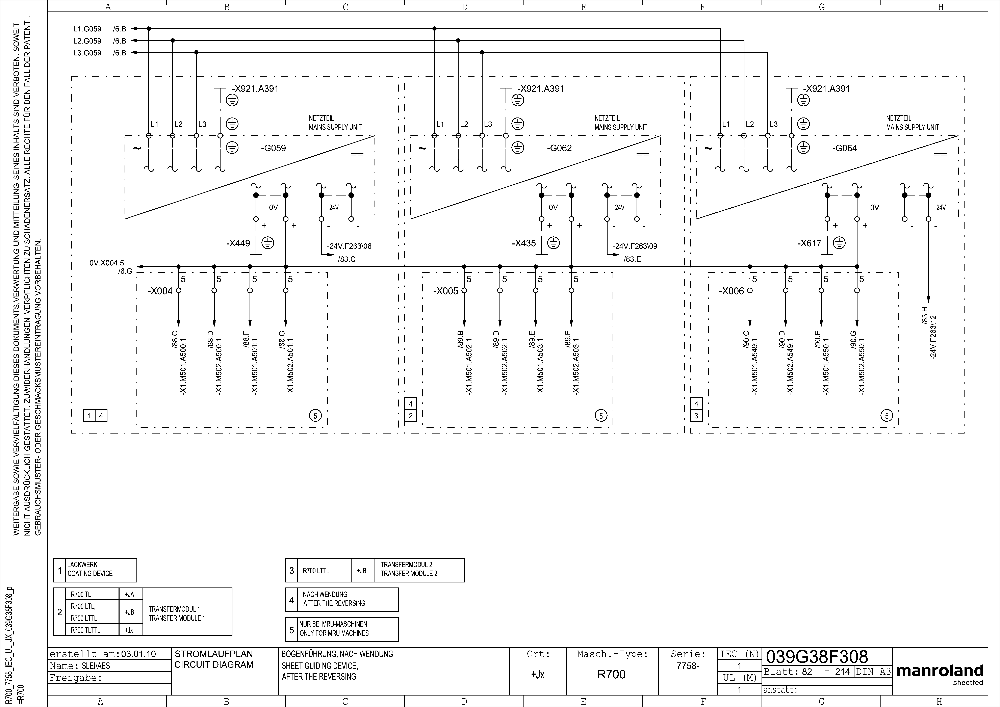

# +Jx — Sheet 82 of 214 — BOGENFÜHRUNG, NACH WENDUNG

**SHEET GUIDING DEVICE**

> Part of the manroland **R700** printing press IEC/UL circuit diagrams.
> Drawing class: **Stromlaufplan / Circuit diagram** (DIN A3).
> Document `+Jx` covers the **1st printing module + feed register** machine section.

## At a glance

| Field | Value |
|---|---|
| Document | `+Jx`  (039G38F308) |
| Sheet | **82** of 214 |
| Section (DE) | BOGENFÜHRUNG, NACH WENDUNG |
| Section (EN) | SHEET GUIDING DEVICE |
| Section type | CIRCUIT — Circuit diagram |
| Machine type | `R700` |
| Series | `7758` |
| Created | 03.01.10 |
| Replaces | — |
| Columns used | A, B, C, D, E, F, G, H |
| Path numbers | — |
| Labels on sheet | 125 |
| Cross-refs out | 19 |
| Cross-refs in | 19 |

**Previous:** [+Jx sheet 81](SHEET_0081.md) · **Next:** [+Jx sheet 83](SHEET_0083.md) · **Document TOC:** [_TOC.md](_TOC.md)  (+Jx) · **Master TOC:** [all sheets](../_MASTER_TOC.md)

## Sheet image (300 DPI, exact vector render)



_Rendered directly from the PDF vector layer at 300 DPI (1-bit), no OCR and no resampling. Use it to confirm anything ambiguous in the text below._

## Cross-references on this sheet

Each entry is a wire leaving this sheet. The printed token is `/sheet.column`; the link resolves to that sheet inside the same document.

| Ref | Target sheet | Col | Path | Destination on target | Target section | From col |
|---|---|---|---|---|---|---|
| `/6.B` | [+Jx sheet 6](SHEET_0006.md) | B | — | L1.G059 | SPANNUNGSVERSORGUNG, SCHALTSCHRANKBELÜFTUNG | A |
| `/6.B` | [+Jx sheet 6](SHEET_0006.md) | B | — | L2.G059 | SPANNUNGSVERSORGUNG, SCHALTSCHRANKBELÜFTUNG | A |
| `/6.B` | [+Jx sheet 6](SHEET_0006.md) | B | — | L3.G059 | SPANNUNGSVERSORGUNG, SCHALTSCHRANKBELÜFTUNG | A |
| `/83.E` | [+Jx sheet 83](SHEET_0083.md) | E | — | — | BOGENFÜHRUNG, NACH WENDUNG | E |
| `/83.C` | [+Jx sheet 83](SHEET_0083.md) | C | — | — | BOGENFÜHRUNG, NACH WENDUNG | C |
| `/6.G` | [+Jx sheet 6](SHEET_0006.md) | G | — | 0V.X004:5 | SPANNUNGSVERSORGUNG, SCHALTSCHRANKBELÜFTUNG | A |
| `/83.H` | [+Jx sheet 83](SHEET_0083.md) | H | — | — | BOGENFÜHRUNG, NACH WENDUNG | H |
| `/88.C` | [+Jx sheet 88](SHEET_0088.md) | C | — | — | BOGENFÜHRUNG, NACH WENDUNG | B |
| `/88.D` | [+Jx sheet 88](SHEET_0088.md) | D | — | — | BOGENFÜHRUNG, NACH WENDUNG | B |
| `/88.F` | [+Jx sheet 88](SHEET_0088.md) | F | — | — | BOGENFÜHRUNG, NACH WENDUNG | B |
| `/88.G` | [+Jx sheet 88](SHEET_0088.md) | G | — | — | BOGENFÜHRUNG, NACH WENDUNG | B |
| `/89.B` | [+Jx sheet 89](SHEET_0089.md) | B | — | — | BOGENFÜHRUNG, NACH WENDUNG | D |
| `/89.D` | [+Jx sheet 89](SHEET_0089.md) | D | — | — | BOGENFÜHRUNG, NACH WENDUNG | D |
| `/89.E` | [+Jx sheet 89](SHEET_0089.md) | E | — | — | BOGENFÜHRUNG, NACH WENDUNG | E |
| `/89.F` | [+Jx sheet 89](SHEET_0089.md) | F | — | — | BOGENFÜHRUNG, NACH WENDUNG | E |
| `/90.C` | [+Jx sheet 90](SHEET_0090.md) | C | — | — | BOGENFÜHRUNG, NACH WENDUNG | F |
| `/90.D` | [+Jx sheet 90](SHEET_0090.md) | D | — | — | BOGENFÜHRUNG, NACH WENDUNG | G |
| `/90.E` | [+Jx sheet 90](SHEET_0090.md) | E | — | — | BOGENFÜHRUNG, NACH WENDUNG | G |
| `/90.G` | [+Jx sheet 90](SHEET_0090.md) | G | — | — | BOGENFÜHRUNG, NACH WENDUNG | G |

### Incoming references (sheets that point here)

Every other sheet that sends a wire to this one. `Back-ref` is the token printed on *that* sheet; `Path` is its line number.

| From sheet | Cols | Back-ref | Path | Refs | What continues there |
|---|---|---|---|---|---|
| [+Jx#6](SHEET_0006.md) | B, G | `/6.B`, `/6.G` | — | 4 | 0V.X004:5; L1.G057:L1 L1.G059; L2.G057:L2 L2.G059; L3.G057:L3 L3.G059 |
| [+Jx#83](SHEET_0083.md) | B, F | `/83.B`, `/83.F` | — | 3 | 24V.F263\06; 24V.F263\09 24V.F263\12 |
| [+Jx#88](SHEET_0088.md) | C, D, F, G | `/88.C`, `/88.D`, `/88.F`, `/88.G` | — | 4 | X1.M501.A500:1; X1.M501.A501:1; X1.M502.A500:1; X1.M502.A501:1 |
| [+Jx#89](SHEET_0089.md) | B, D, E, F | `/89.B`, `/89.D`, `/89.E`, `/89.F` | — | 4 | X1.M501.A502:1; X1.M501.A503:1; X1.M502.A502:1; X1.M502.A503:1 |
| [+Jx#90](SHEET_0090.md) | C, D, E, G | `/90.C`, `/90.D`, `/90.E`, `/90.G` | — | 4 | X1.M501.A549:1; X1.M501.A550:1; X1.M502.A549:1; X1.M502.A550:1 |


## Devices on this sheet

| Tag | Class | Class meaning (IEC) | Col | Sub | Terminal | Sign |
|---|---|---|---|---|---|---|
| `G062` | G | Stromversorgung / power supply | E | — | — | — |
| `G064` | G | Stromversorgung / power supply | G | — | — | — |
| `G059` | G | Stromversorgung / power supply | B | — | — | — |
| `X005` | X | Klemme / terminal, plug connector | D | — | — | — |
| `X006` | X | Klemme / terminal, plug connector | F | — | — | — |
| `X004` | X | Klemme / terminal, plug connector | A | — | — | — |
| `X617` | X | Klemme / terminal, plug connector | G | — | — | — |
| `X435` | X | Klemme / terminal, plug connector | E | — | — | — |
| `X449` | X | Klemme / terminal, plug connector | B | — | — | — |
| `X1.M501.A501:1` | — | cross-device reference | B | — | 1 | — |
| `X1.M501.A500:1` | — | cross-device reference | B | — | 1 | — |
| `X1.M501.A549:1` | — | cross-device reference | F | — | 1 | — |
| `X1.M501.A503:1` | — | cross-device reference | E | — | 1 | — |
| `X1.M501.A502:1` | — | cross-device reference | D | — | 1 | — |
| `X1.M502.A550:1` | — | cross-device reference | G | — | 1 | — |
| `X1.M502.A549:1` | — | cross-device reference | G | — | 1 | — |
| `X1.M502.A500:1` | — | cross-device reference | B | — | 1 | — |
| `X1.M501.A550:1` | — | cross-device reference | G | — | 1 | — |
| `X1.M502.A501:1` | — | cross-device reference | C | — | 1 | — |
| `X1.M502.A503:1` | — | cross-device reference | E | — | 1 | — |
| `X1.M502.A502:1` | — | cross-device reference | D | — | 1 | — |
| `X921.A391` | — | cross-device reference | B | — | — | — |
| `X921.A391` | — | cross-device reference | G | — | — | — |
| `X921.A391` | — | cross-device reference | E | — | — | — |

## Potentials / nets

| Potential | Count | Columns | Attached devices | Terminals |
|---|---|---|---|---|
| `0V` | 4 | A, B, E, G | `X004` | `5` |
| `24V` | 6 | C, E, H | `F263\06`, `F263\09`, `F263\12` | — |
| `L1` | 4 | A, D, F | `G059` | — |
| `L2` | 4 | A, B, D, F | `G059` | — |
| `L3` | 4 | A, B, D, G | `G059` | — |


A potential such as `L24+/4` or `M24+` is a named supply/return rail; every place it appears on this sheet is electrically common.

## Wire-end annotations (grouped as printed)

A wire that continues elsewhere is annotated with a small cluster: the destination description, the path/line number `#NN`, and the `/sheet.column` cross reference. Each row below is one such cluster exactly as it is grouped on the drawing.

| Col | Y | Path | Cross-ref | Text on the wire |
|---|---|---|---|---|
| A | 30.6 | — | `/6.B` | `L1.G059` |
| A | 44.8 | — | `/6.B` | `L2.G059` |
| A | 59.0 | — | `/6.B` | `L3.G059` |
| E | 100.9 | — | — | `X921.A391 X921.A391 X921.A391` |
| C | 138.0 | — | — | `NETZTEIL MAINS SUPPLY UNIT` |
| E | 138.0 | — | — | `NETZTEIL MAINS SUPPLY UNIT` |
| H | 138.0 | — | — | `NETZTEIL MAINS SUPPLY UNIT` |
| B | 144.1 | — | — | `L1 L2 L3` |
| D | 144.1 | — | — | `L1 L2 L3` |
| F | 144.1 | — | — | `L1 L2 L3` |
| A | 169.1 | — | — | `~` |
| E | 169.1 | — | — | `~ ~` |
| B | 171.7 | — | — | `G059` |
| E | 171.7 | — | — | `G062` |
| G | 171.7 | — | — | `G064` |
| C | 243.3 | — | — | `0V 24V` |
| E | 243.3 | — | — | `0V 24V` |
| G | 243.3 | — | — | `0V` |
| H | 244.4 | — | — | `24V` |
| B | 263.8 | — | — | `+ +` |
| E | 263.8 | — | — | `+` |
| E | 263.8 | — | — | `+` |
| G | 263.8 | — | — | `+` |
| G | 263.8 | — | — | `+` |
| E | 285.1 | — | — | `X449 X435 X617` |
| C | 289.4 | — | — | `24V.F263\06` |
| E | 289.4 | — | — | `24V.F263\09` |
| C | 304.9 | — | `/83.C` | — |
| E | 304.9 | — | `/83.E` | — |
| A | 309.2 | — | `/6.G` | `0V.X004:5` |
| D | 327.6 | — | — | `X004 5 5 5 5 5` |
| B | 327.6 | — | — | `5 5 5` |
| D | 327.6 | — | — | `X005 5` |
| F | 327.6 | — | — | `5 5 X006 5` |
| H | 365.1 | — | `/83.H` | — |
| H | 375.3 | — | — | `24V.F263\12` |
| B | 393.7 | — | `/88.C` | — |
| B | 393.7 | — | `/88.D` | — |
| B | 393.7 | — | `/88.F` | — |
| B | 393.7 | — | `/88.G` | — |
| D | 393.7 | — | `/89.B` | — |
| D | 393.7 | — | `/89.D` | — |
| E | 393.7 | — | `/89.E` | — |
| E | 393.7 | — | `/89.F` | — |
| F | 393.7 | — | `/90.C` | — |
| G | 393.7 | — | `/90.D` | — |
| G | 393.7 | — | `/90.E` | — |
| G | 393.7 | — | `/90.G` | — |
| B | 402.5 | — | — | `X1.M501.A500:1` |
| B | 402.5 | — | — | `X1.M502.A500:1` |
| B | 402.5 | — | — | `X1.M501.A501:1` |
| C | 402.5 | — | — | `X1.M502.A501:1` |
| D | 402.5 | — | — | `X1.M501.A502:1` |
| D | 402.5 | — | — | `X1.M502.A502:1` |
| E | 402.5 | — | — | `X1.M501.A503:1` |
| E | 402.5 | — | — | `X1.M502.A503:1` |
| F | 402.5 | — | — | `X1.M501.A549:1` |
| G | 402.5 | — | — | `X1.M502.A549:1` |
| G | 402.5 | — | — | `X1.M501.A550:1` |
| G | 402.5 | — | — | `X1.M502.A550:1` |
| D | 477.2 | — | — | `4` |
| F | 477.2 | — | — | `4` |
| A | 491.4 | — | — | `1 4` |
| C | 491.4 | — | — | `5 2` |
| F | 491.4 | — | — | `5 3 5` |
| B | 669.5 | — | — | `1 LACKWERK COATING DEVICE 3 TRANSFERMODUL 2 TRANSFER MODULE 2` |
| C | 676.6 | — | — | `R700 LTTL +JB` |
| A | 704.9 | — | — | `+JA` |
| A | 705.0 | — | — | `R700 TL` |
| C | 705.0 | — | — | `NACH WENDUNG` |
| C | 710.3 | — | — | `4 AFTER THE REVERSING` |
| A | 719.1 | — | — | `R700 LTL,` |
| A | 722.7 | — | — | `2 +JB TRANSFERMODUL 1 TRANSFER MODULE 1` |
| A | 733.4 | — | — | `R700 LTTL` |
| C | 740.4 | — | — | `5 NUR BEI MRU MASCHINEN ONLY FOR MRU MACHINES` |
| A | 747.5 | — | — | `R700 TLTTL +Jx` |


## Notes and free text on this sheet

| Text | Col | Y (pt) |
|---|---|---|
| `NETZTEIL` | E | 138.04 |
| `MAINS SUPPLY UNIT` | E | 148.69 |
| `NETZTEIL` | H | 138.04 |
| `MAINS SUPPLY UNIT` | H | 148.69 |
| `NETZTEIL` | C | 138.04 |
| `MAINS SUPPLY UNIT` | C | 148.69 |
| `R700 TL` | A | 704.99 |
| `R700 LTL,` | A | 719.15 |
| `+JA` | A | 704.94 |
| `R700 TLTTL` | A | 747.52 |
| `+Jx` | A | 747.56 |
| `R700 LTTL` | A | 733.35 |
| `+JB` | A | 726.18 |
| `TRANSFERMODUL 1` | B | 722.72 |
| `TRANSFER MODULE 1` | B | 733.34 |
| `LACKWERK` | A | 669.51 |
| `COATING DEVICE` | A | 680.18 |
| `TRANSFERMODUL 2` | D | 669.58 |
| `TRANSFER MODULE 2` | D | 680.21 |
| `NACH WENDUNG` | C | 704.98 |
| `AFTER THE REVERSING` | C | 715.62 |
| `R700 LTTL` | C | 676.65 |
| `+JB` | C | 676.57 |
| `NUR BEI MRU MASCHINEN` | C | 740.44 |
| `ONLY FOR MRU MACHINES` | C | 751.08 |

## Complete label inventory (exact text from the drawing)

Every text object inside the drawing area of this sheet, in DIN reading order (column A→H, then top→bottom). This is the authoritative list: if a string is not here it is not printed on this sheet.

| Col | Y | X | Dir | Type | Text |
|---|---|---|---|---|---|
| A | 30.6 | 134.6 | → | cross-reference | `/6.B` |
| A | 30.7 | 87.3 | → | potential | `L1.G059` |
| A | 44.8 | 134.6 | → | cross-reference | `/6.B` |
| A | 44.9 | 87.3 | → | potential | `L2.G059` |
| A | 59.0 | 134.6 | → | cross-reference | `/6.B` |
| A | 59.1 | 87.3 | → | potential | `L3.G059` |
| A | 144.1 | 179.4 | → | potential | `L1` |
| A | 169.1 | 157.9 | → | other | `~` |
| A | 309.2 | 106.6 | → | potential | `0V.X004:5` |
| A | 319.1 | 140.9 | → | cross-reference | `/6.G` |
| A | 341.6 | 175.7 | → | device tag | `X004` |
| A | 491.4 | 104.2 | → | number | `1` |
| A | 491.4 | 118.2 | → | number | `4` |
| A | 669.5 | 80.2 | → | text | `LACKWERK` |
| A | 674.8 | 68.3 | → | number | `1` |
| A | 680.2 | 80.5 | → | text | `COATING DEVICE` |
| A | 704.9 | 148.5 | → | text | `+JA` |
| A | 705.0 | 84.5 | → | text | `R700 TL` |
| A | 719.1 | 84.5 | → | text | `R700 LTL,` |
| A | 724.5 | 68.0 | → | number | `2` |
| A | 726.2 | 148.5 | → | text | `+JB` |
| A | 733.3 | 84.5 | → | text | `R700 LTTL` |
| A | 747.5 | 84.5 | → | text | `R700 TLTTL` |
| A | 747.6 | 148.5 | → | text | `+Jx` |
| B | 100.9 | 276.1 | → | device ref | `X921.A391` |
| B | 144.1 | 207.8 | → | potential | `L2` |
| B | 144.1 | 236.1 | → | potential | `L3` |
| B | 171.7 | 311.0 | → | device tag | `G059` |
| B | 243.3 | 320.5 | → | potential | `0V` |
| B | 263.8 | 311.2 | → | number | `+` |
| B | 285.1 | 269.6 | → | device tag | `X449` |
| B | 327.6 | 215.1 | → | number | `5` |
| B | 327.6 | 257.7 | → | number | `5` |
| B | 327.6 | 300.2 | → | number | `5` |
| B | 393.7 | 204.3 | ↕ | cross-reference | `/88.C` |
| B | 393.7 | 246.8 | ↕ | cross-reference | `/88.D` |
| B | 393.7 | 289.3 | ↕ | cross-reference | `/88.F` |
| B | 393.7 | 331.9 | ↕ | cross-reference | `/88.G` |
| B | 402.5 | 214.3 | ↕ | device ref | `X1.M501.A500:1` |
| B | 402.5 | 256.8 | ↕ | device ref | `X1.M502.A500:1` |
| B | 402.5 | 299.3 | ↕ | device ref | `X1.M501.A501:1` |
| B | 722.7 | 177.2 | → | text | `TRANSFERMODUL 1` |
| B | 733.3 | 177.2 | → | text | `TRANSFER MODULE 1` |
| C | 138.0 | 367.9 | → | text | `NETZTEIL` |
| C | 148.7 | 367.9 | → | text | `MAINS SUPPLY UNIT` |
| C | 244.4 | 390.1 | → | potential | `24V` |
| C | 263.8 | 346.7 | → | number | `+` |
| C | 289.4 | 389.5 | → | potential | `24V.F263\06` |
| C | 304.9 | 402.5 | → | cross-reference | `/83.C` |
| C | 327.6 | 342.7 | → | number | `5` |
| C | 402.5 | 341.8 | ↕ | device ref | `X1.M502.A501:1` |
| C | 492.0 | 373.6 | → | number | `5` |
| C | 674.8 | 344.3 | → | number | `3` |
| C | 676.6 | 424.9 | → | text | `+JB` |
| C | 676.7 | 360.9 | → | text | `R700 LTTL` |
| C | 705.0 | 360.9 | → | text | `NACH WENDUNG` |
| C | 710.3 | 344.4 | → | number | `4` |
| C | 715.6 | 361.4 | → | text | `AFTER THE REVERSING` |
| C | 740.4 | 356.6 | → | text | `NUR BEI MRU MASCHINEN` |
| C | 745.7 | 344.3 | → | number | `5` |
| C | 751.1 | 356.9 | → | text | `ONLY FOR MRU MACHINES` |
| D | 144.1 | 519.6 | → | potential | `L1` |
| D | 144.1 | 547.9 | → | potential | `L2` |
| D | 144.1 | 576.3 | → | potential | `L3` |
| D | 169.1 | 498.0 | → | other | `~` |
| D | 327.6 | 555.3 | → | number | `5` |
| D | 327.6 | 597.8 | → | number | `5` |
| D | 341.6 | 515.9 | → | device tag | `X005` |
| D | 393.7 | 544.4 | ↕ | cross-reference | `/89.B` |
| D | 393.7 | 587.0 | ↕ | cross-reference | `/89.D` |
| D | 402.5 | 554.4 | ↕ | device ref | `X1.M501.A502:1` |
| D | 402.5 | 596.9 | ↕ | device ref | `X1.M502.A502:1` |
| D | 477.2 | 486.7 | → | number | `4` |
| D | 491.4 | 486.7 | → | number | `2` |
| D | 669.6 | 453.5 | → | text | `TRANSFERMODUL 2` |
| D | 680.2 | 453.5 | → | text | `TRANSFER MODULE 2` |
| E | 100.9 | 616.3 | → | device ref | `X921.A391` |
| E | 138.0 | 708.1 | → | text | `NETZTEIL` |
| E | 148.7 | 708.1 | → | text | `MAINS SUPPLY UNIT` |
| E | 171.7 | 651.4 | → | device tag | `G062` |
| E | 243.3 | 653.5 | → | potential | `0V` |
| E | 244.4 | 730.3 | → | potential | `24V` |
| E | 263.8 | 651.4 | → | number | `+` |
| E | 263.8 | 686.8 | → | number | `+` |
| E | 285.1 | 609.7 | → | device tag | `X435` |
| E | 289.4 | 729.6 | → | potential | `24V.F263\09` |
| E | 304.9 | 742.7 | → | cross-reference | `/83.E` |
| E | 327.6 | 640.3 | → | number | `5` |
| E | 327.6 | 682.9 | → | number | `5` |
| E | 393.7 | 629.5 | ↕ | cross-reference | `/89.E` |
| E | 393.7 | 672.0 | ↕ | cross-reference | `/89.F` |
| E | 402.5 | 639.5 | ↕ | device ref | `X1.M501.A503:1` |
| E | 402.5 | 682.0 | ↕ | device ref | `X1.M502.A503:1` |
| E | 492.0 | 713.8 | → | number | `5` |
| F | 144.1 | 859.7 | → | potential | `L1` |
| F | 144.1 | 888.1 | → | potential | `L2` |
| F | 169.1 | 838.2 | → | other | `~` |
| F | 327.6 | 895.5 | → | number | `5` |
| F | 341.6 | 856.1 | → | device tag | `X006` |
| F | 393.7 | 884.6 | ↕ | cross-reference | `/90.C` |
| F | 402.5 | 894.6 | ↕ | device ref | `X1.M501.A549:1` |
| F | 477.2 | 826.9 | → | number | `4` |
| F | 491.4 | 826.7 | → | number | `3` |
| G | 100.9 | 956.4 | → | device ref | `X921.A391` |
| G | 144.1 | 916.4 | → | potential | `L3` |
| G | 171.7 | 991.3 | → | device tag | `G064` |
| G | 243.3 | 1036.2 | → | potential | `0V` |
| G | 263.8 | 991.6 | → | number | `+` |
| G | 263.8 | 1027.0 | → | number | `+` |
| G | 285.1 | 949.9 | → | device tag | `X617` |
| G | 327.6 | 938.0 | → | number | `5` |
| G | 327.6 | 980.5 | → | number | `5` |
| G | 327.6 | 1023.0 | → | number | `5` |
| G | 393.7 | 927.2 | ↕ | cross-reference | `/90.D` |
| G | 393.7 | 969.6 | ↕ | cross-reference | `/90.E` |
| G | 393.7 | 1012.2 | ↕ | cross-reference | `/90.G` |
| G | 402.5 | 937.1 | ↕ | device ref | `X1.M502.A549:1` |
| G | 402.5 | 979.6 | ↕ | device ref | `X1.M501.A550:1` |
| G | 402.5 | 1022.1 | ↕ | device ref | `X1.M502.A550:1` |
| H | 138.0 | 1055.3 | → | text | `NETZTEIL` |
| H | 148.7 | 1055.3 | → | text | `MAINS SUPPLY UNIT` |
| H | 244.4 | 1113.0 | → | potential | `24V` |
| H | 365.1 | 1097.2 | ↕ | cross-reference | `/83.H` |
| H | 375.3 | 1107.2 | ↕ | potential | `24V.F263\12` |
| H | 492.0 | 1053.9 | → | number | `5` |

## Reading-order text block

The same content as a plain block, grouped by DIN column — convenient to paste or to match against a visual description.

```text
=== Column A ===
  30.6  134.6  xref         /6.B
  30.7   87.3  net          L1.G059
  44.8  134.6  xref         /6.B
  44.9   87.3  net          L2.G059
  59.0  134.6  xref         /6.B
  59.1   87.3  net          L3.G059
 144.1  179.4  net          L1
 169.1  157.9  other        ~
 309.2  106.6  net          0V.X004:5
 319.1  140.9  xref         /6.G
 341.6  175.7  devtag       X004
 491.4  104.2  numeric      1
 491.4  118.2  numeric      4
 669.5   80.2  text         LACKWERK
 674.8   68.3  numeric      1
 680.2   80.5  text         COATING DEVICE
 704.9  148.5  text         +JA
 705.0   84.5  text         R700 TL
 719.1   84.5  text         R700 LTL,
 724.5   68.0  numeric      2
 726.2  148.5  text         +JB
 733.3   84.5  text         R700 LTTL
 747.5   84.5  text         R700 TLTTL
 747.6  148.5  text         +Jx
=== Column B ===
 100.9  276.1  devref       X921.A391
 144.1  207.8  net          L2
 144.1  236.1  net          L3
 171.7  311.0  devtag       G059
 243.3  320.5  net          0V
 263.8  311.2  numeric      +
 285.1  269.6  devtag       X449
 327.6  215.1  numeric      5
 327.6  257.7  numeric      5
 327.6  300.2  numeric      5
 393.7  204.3  xref         /88.C
 393.7  246.8  xref         /88.D
 393.7  289.3  xref         /88.F
 393.7  331.9  xref         /88.G
 402.5  214.3  devref       X1.M501.A500:1
 402.5  256.8  devref       X1.M502.A500:1
 402.5  299.3  devref       X1.M501.A501:1
 722.7  177.2  text         TRANSFERMODUL 1
 733.3  177.2  text         TRANSFER MODULE 1
=== Column C ===
 138.0  367.9  text         NETZTEIL
 148.7  367.9  text         MAINS SUPPLY UNIT
 244.4  390.1  net          24V
 263.8  346.7  numeric      +
 289.4  389.5  net          24V.F263\06
 304.9  402.5  xref         /83.C
 327.6  342.7  numeric      5
 402.5  341.8  devref       X1.M502.A501:1
 492.0  373.6  numeric      5
 674.8  344.3  numeric      3
 676.6  424.9  text         +JB
 676.7  360.9  text         R700 LTTL
 705.0  360.9  text         NACH WENDUNG
 710.3  344.4  numeric      4
 715.6  361.4  text         AFTER THE REVERSING
 740.4  356.6  text         NUR BEI MRU MASCHINEN
 745.7  344.3  numeric      5
 751.1  356.9  text         ONLY FOR MRU MACHINES
=== Column D ===
 144.1  519.6  net          L1
 144.1  547.9  net          L2
 144.1  576.3  net          L3
 169.1  498.0  other        ~
 327.6  555.3  numeric      5
 327.6  597.8  numeric      5
 341.6  515.9  devtag       X005
 393.7  544.4  xref         /89.B
 393.7  587.0  xref         /89.D
 402.5  554.4  devref       X1.M501.A502:1
 402.5  596.9  devref       X1.M502.A502:1
 477.2  486.7  numeric      4
 491.4  486.7  numeric      2
 669.6  453.5  text         TRANSFERMODUL 2
 680.2  453.5  text         TRANSFER MODULE 2
=== Column E ===
 100.9  616.3  devref       X921.A391
 138.0  708.1  text         NETZTEIL
 148.7  708.1  text         MAINS SUPPLY UNIT
 171.7  651.4  devtag       G062
 243.3  653.5  net          0V
 244.4  730.3  net          24V
 263.8  651.4  numeric      +
 263.8  686.8  numeric      +
 285.1  609.7  devtag       X435
 289.4  729.6  net          24V.F263\09
 304.9  742.7  xref         /83.E
 327.6  640.3  numeric      5
 327.6  682.9  numeric      5
 393.7  629.5  xref         /89.E
 393.7  672.0  xref         /89.F
 402.5  639.5  devref       X1.M501.A503:1
 402.5  682.0  devref       X1.M502.A503:1
 492.0  713.8  numeric      5
=== Column F ===
 144.1  859.7  net          L1
 144.1  888.1  net          L2
 169.1  838.2  other        ~
 327.6  895.5  numeric      5
 341.6  856.1  devtag       X006
 393.7  884.6  xref         /90.C
 402.5  894.6  devref       X1.M501.A549:1
 477.2  826.9  numeric      4
 491.4  826.7  numeric      3
=== Column G ===
 100.9  956.4  devref       X921.A391
 144.1  916.4  net          L3
 171.7  991.3  devtag       G064
 243.3 1036.2  net          0V
 263.8  991.6  numeric      +
 263.8 1027.0  numeric      +
 285.1  949.9  devtag       X617
 327.6  938.0  numeric      5
 327.6  980.5  numeric      5
 327.6 1023.0  numeric      5
 393.7  927.2  xref         /90.D
 393.7  969.6  xref         /90.E
 393.7 1012.2  xref         /90.G
 402.5  937.1  devref       X1.M502.A549:1
 402.5  979.6  devref       X1.M501.A550:1
 402.5 1022.1  devref       X1.M502.A550:1
=== Column H ===
 138.0 1055.3  text         NETZTEIL
 148.7 1055.3  text         MAINS SUPPLY UNIT
 244.4 1113.0  net          24V
 365.1 1097.2  xref         /83.H
 375.3 1107.2  net          24V.F263\12
 492.0 1053.9  numeric      5
```

---
_Generated from the PDF vector text layer; no OCR. Source: `R700_7758_IEC_UL_JX_039G38F308_p`, sheet 82._
