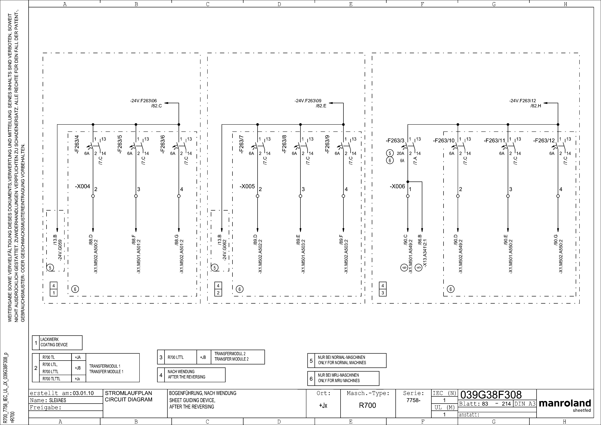

# +Jx — Sheet 83 of 214 — BOGENFÜHRUNG, NACH WENDUNG

**SHEET GUIDING DEVICE**

> Part of the manroland **R700** printing press IEC/UL circuit diagrams.
> Drawing class: **Stromlaufplan / Circuit diagram** (DIN A3).
> Document `+Jx` covers the **1st printing module + feed register** machine section.

## At a glance

| Field | Value |
|---|---|
| Document | `+Jx`  (039G38F308) |
| Sheet | **83** of 214 |
| Section (DE) | BOGENFÜHRUNG, NACH WENDUNG |
| Section (EN) | SHEET GUIDING DEVICE |
| Section type | CIRCUIT — Circuit diagram |
| Machine type | `R700` |
| Series | `7758` |
| Created | 03.01.10 |
| Replaces | — |
| Columns used | A, B, C, D, E, F, G, H |
| Path numbers | — |
| Labels on sheet | 158 |
| Cross-refs out | 26 |
| Cross-refs in | 26 |

**Previous:** [+Jx sheet 82](SHEET_0082.md) · **Next:** [+Jx sheet 84](SHEET_0084.md) · **Document TOC:** [_TOC.md](_TOC.md)  (+Jx) · **Master TOC:** [all sheets](../_MASTER_TOC.md)

## Sheet image (300 DPI, exact vector render)



_Rendered directly from the PDF vector layer at 300 DPI (1-bit), no OCR and no resampling. Use it to confirm anything ambiguous in the text below._

## Cross-references on this sheet

Each entry is a wire leaving this sheet. The printed token is `/sheet.column`; the link resolves to that sheet inside the same document.

| Ref | Target sheet | Col | Path | Destination on target | Target section | From col |
|---|---|---|---|---|---|---|
| `/82.C` | [+Jx sheet 82](SHEET_0082.md) | C | — | 24V.F263\06 | BOGENFÜHRUNG, NACH WENDUNG | B |
| `/82.E` | [+Jx sheet 82](SHEET_0082.md) | E | — | 24V.F263\09 24V.F263\12 | BOGENFÜHRUNG, NACH WENDUNG | F |
| `/82.H` | [+Jx sheet 82](SHEET_0082.md) | H | — | 24V.F263\09 24V.F263\12 | BOGENFÜHRUNG, NACH WENDUNG | F |
| `/7.C` | [+Jx sheet 7](SHEET_0007.md) | C | — | — | SPANNUNGSVERSORGUNG, SCHALTSCHRANKBELÜFTUNG | B |
| `/7.C` | [+Jx sheet 7](SHEET_0007.md) | C | — | — | SPANNUNGSVERSORGUNG, SCHALTSCHRANKBELÜFTUNG | B |
| `/7.C` | [+Jx sheet 7](SHEET_0007.md) | C | — | — | SPANNUNGSVERSORGUNG, SCHALTSCHRANKBELÜFTUNG | C |
| `/7.C` | [+Jx sheet 7](SHEET_0007.md) | C | — | — | SPANNUNGSVERSORGUNG, SCHALTSCHRANKBELÜFTUNG | D |
| `/7.C` | [+Jx sheet 7](SHEET_0007.md) | C | — | — | SPANNUNGSVERSORGUNG, SCHALTSCHRANKBELÜFTUNG | D |
| `/7.C` | [+Jx sheet 7](SHEET_0007.md) | C | — | — | SPANNUNGSVERSORGUNG, SCHALTSCHRANKBELÜFTUNG | E |
| `/7.C` | [+Jx sheet 7](SHEET_0007.md) | C | — | — | SPANNUNGSVERSORGUNG, SCHALTSCHRANKBELÜFTUNG | G |
| `/7.C` | [+Jx sheet 7](SHEET_0007.md) | C | — | — | SPANNUNGSVERSORGUNG, SCHALTSCHRANKBELÜFTUNG | G |
| `/7.C` | [+Jx sheet 7](SHEET_0007.md) | C | — | — | SPANNUNGSVERSORGUNG, SCHALTSCHRANKBELÜFTUNG | H |
| `/7.A` | [+Jx sheet 7](SHEET_0007.md) | A | — | — | SPANNUNGSVERSORGUNG, SCHALTSCHRANKBELÜFTUNG | F |
| `/13.B` | [+Jx sheet 13](SHEET_0013.md) | B | — | — | SPANNUNGSVERSORGUNG, SCHALTSCHRANKBELÜFTUNG | A |
| `/88.D` | [+Jx sheet 88](SHEET_0088.md) | D | — | — | BOGENFÜHRUNG, NACH WENDUNG | A |
| `/88.F` | [+Jx sheet 88](SHEET_0088.md) | F | — | — | BOGENFÜHRUNG, NACH WENDUNG | B |
| `/88.G` | [+Jx sheet 88](SHEET_0088.md) | G | — | — | BOGENFÜHRUNG, NACH WENDUNG | C |
| `/13.B` | [+Jx sheet 13](SHEET_0013.md) | B | — | — | SPANNUNGSVERSORGUNG, SCHALTSCHRANKBELÜFTUNG | C |
| `/89.D` | [+Jx sheet 89](SHEET_0089.md) | D | — | — | BOGENFÜHRUNG, NACH WENDUNG | D |
| `/89.E` | [+Jx sheet 89](SHEET_0089.md) | E | — | — | BOGENFÜHRUNG, NACH WENDUNG | D |
| `/89.F` | [+Jx sheet 89](SHEET_0089.md) | F | — | — | BOGENFÜHRUNG, NACH WENDUNG | E |
| `/90.C` | [+Jx sheet 90](SHEET_0090.md) | C | — | — | BOGENFÜHRUNG, NACH WENDUNG | F |
| `/86.B` | [+Jx sheet 86](SHEET_0086.md) | B | — | — | BOGENFÜHRUNG | F |
| `/90.D` | [+Jx sheet 90](SHEET_0090.md) | D | — | — | BOGENFÜHRUNG, NACH WENDUNG | F |
| `/90.E` | [+Jx sheet 90](SHEET_0090.md) | E | — | — | BOGENFÜHRUNG, NACH WENDUNG | G |
| `/90.G` | [+Jx sheet 90](SHEET_0090.md) | G | — | — | BOGENFÜHRUNG, NACH WENDUNG | H |

### Incoming references (sheets that point here)

Every other sheet that sends a wire to this one. `Back-ref` is the token printed on *that* sheet; `Path` is its line number.

| From sheet | Cols | Back-ref | Path | Refs | What continues there |
|---|---|---|---|---|---|
| [+Jx#7](SHEET_0007.md) | A, C | `/7.A`, `/7.C` | — | 10 | — |
| [+Jx#13](SHEET_0013.md) | B, C | `/13.B`, `/13.C` | — | 2 | 24V.G059; 24V.G062 |
| [+Jx#82](SHEET_0082.md) | C, E, H | `/82.C`, `/82.E`, `/82.H` | — | 3 | — |
| [+Jx#86](SHEET_0086.md) | B | `/86.B` | — | 1 | X13.A341\2:1 |
| [+Jx#88](SHEET_0088.md) | D, F, G | `/88.D`, `/88.F`, `/88.G` | — | 3 | X1.M501.A501:2; X1.M502.A500:2; X1.M502.A501:2 |
| [+Jx#89](SHEET_0089.md) | D, E, F | `/89.D`, `/89.E`, `/89.F` | — | 3 | X1.M501.A503:2; X1.M502.A502:2; X1.M502.A503:2 |
| [+Jx#90](SHEET_0090.md) | C, D, E, G | `/90.C`, `/90.D`, `/90.E`, `/90.G` | — | 4 | X1.M501.A549:2; X1.M501.A550:2; X1.M502.A549:2; X1.M502.A550:2 |


## Devices on this sheet

| Tag | Class | Class meaning (IEC) | Col | Sub | Terminal | Sign |
|---|---|---|---|---|---|---|
| `F263/7` | F | Schutz / protection device (fuse, circuit breaker) | C | 7 | — | — |
| `F263/8` | F | Schutz / protection device (fuse, circuit breaker) | D | 8 | — | — |
| `F263/9` | F | Schutz / protection device (fuse, circuit breaker) | E | 9 | — | — |
| `F263/4` | F | Schutz / protection device (fuse, circuit breaker) | A | 4 | — | — |
| `F263/5` | F | Schutz / protection device (fuse, circuit breaker) | B | 5 | — | — |
| `F263/6` | F | Schutz / protection device (fuse, circuit breaker) | B | 6 | — | — |
| `F263/3` | F | Schutz / protection device (fuse, circuit breaker) | F | 3 | — | — |
| `F263/10` | F | Schutz / protection device (fuse, circuit breaker) | F | 10 | — | — |
| `F263/11` | F | Schutz / protection device (fuse, circuit breaker) | G | 11 | — | — |
| `F263/12` | F | Schutz / protection device (fuse, circuit breaker) | H | 12 | — | — |
| `X004` | X | Klemme / terminal, plug connector | A | — | — | — |
| `X005` | X | Klemme / terminal, plug connector | D | — | — | — |
| `X006` | X | Klemme / terminal, plug connector | F | — | — | — |
| `X1.M501.A501:2` | — | cross-device reference | B | — | 2 | — |
| `X1.M501.A503:2` | — | cross-device reference | D | — | 2 | — |
| `X1.M501.A549:2` | — | cross-device reference | F | — | 2 | — |
| `X1.M502.A550:2` | — | cross-device reference | H | — | 2 | — |
| `X13.A341\2:1` | — | cross-device reference | F | — | 1 | — |
| `X1.M502.A549:2` | — | cross-device reference | G | — | 2 | — |
| `X1.M502.A500:2` | — | cross-device reference | A | — | 2 | — |
| `X1.M501.A550:2` | — | cross-device reference | G | — | 2 | — |
| `X1.M502.A503:2` | — | cross-device reference | E | — | 2 | — |
| `X1.M502.A501:2` | — | cross-device reference | C | — | 2 | — |
| `X1.M502.A502:2` | — | cross-device reference | D | — | 2 | — |

## Potentials / nets

| Potential | Count | Columns | Attached devices | Terminals |
|---|---|---|---|---|
| `24V` | 5 | A, B, C, D, G | `F263\06`, `F263\09`, `F263\12`, `G059`, `G062` | — |


A potential such as `L24+/4` or `M24+` is a named supply/return rail; every place it appears on this sheet is electrically common.

## Wire-end annotations (grouped as printed)

A wire that continues elsewhere is annotated with a small cluster: the destination description, the path/line number `#NN`, and the `/sheet.column` cross reference. Each row below is one such cluster exactly as it is grouped on the drawing.

| Col | Y | Path | Cross-ref | Text on the wire |
|---|---|---|---|---|
| B | 195.8 | — | `/82.C` | `24V.F263\06` |
| F | 195.8 | — | `/82.E`, `/82.H` | `24V.F263\09 24V.F263\12` |
| D | 267.3 | — | — | `F263/8` |
| A | 267.6 | — | — | `F263/4` |
| B | 267.6 | — | — | `F263/5` |
| B | 267.6 | — | — | `F263/6` |
| C | 267.6 | — | — | `F263/7` |
| E | 267.6 | — | — | `F263/9` |
| A | 271.7 | — | — | `1` |
| B | 271.7 | — | — | `13` |
| B | 271.7 | — | — | `1` |
| B | 271.7 | — | — | `13` |
| C | 271.7 | — | — | `1` |
| C | 271.7 | — | — | `13` |
| D | 271.7 | — | — | `1` |
| D | 271.7 | — | — | `13` |
| D | 271.7 | — | — | `1` |
| D | 271.7 | — | — | `13` |
| E | 271.7 | — | — | `1` |
| E | 271.7 | — | — | `13` |
| F | 271.7 | — | — | `1` |
| F | 271.7 | — | — | `13` |
| G | 271.7 | — | — | `1` |
| G | 271.7 | — | — | `13` |
| G | 271.7 | — | — | `1` |
| G | 271.7 | — | — | `13` |
| H | 271.7 | — | — | `1` |
| H | 271.7 | — | — | `13` |
| F | 273.8 | — | — | `F263/3` |
| F | 273.8 | — | — | `F263/10` |
| G | 273.8 | — | — | `F263/11` |
| H | 273.8 | — | — | `F263/12` |
| A | 300.0 | — | — | `6A 2` |
| B | 300.0 | — | — | `14` |
| B | 300.0 | — | — | `6A 2` |
| B | 300.0 | — | — | `14` |
| C | 300.0 | — | — | `6A 2` |
| C | 300.0 | — | — | `14` |
| D | 300.0 | — | — | `6A 2` |
| D | 300.0 | — | — | `14` |
| D | 300.0 | — | — | `6A 2` |
| D | 300.0 | — | — | `14` |
| E | 300.0 | — | — | `6A 2` |
| E | 300.0 | — | — | `14` |
| F | 300.0 | — | — | `20A 2` |
| F | 300.0 | — | — | `14` |
| F | 300.0 | — | — | `6A 2` |
| G | 300.0 | — | — | `14` |
| G | 300.0 | — | — | `6A 2` |
| G | 300.0 | — | — | `14` |
| H | 300.0 | — | — | `6A 2` |
| H | 300.0 | — | — | `14` |
| F | 300.7 | — | — | `5` |
| B | 310.1 | — | `/7.C` | — |
| B | 310.1 | — | `/7.C` | — |
| C | 310.1 | — | `/7.C` | — |
| D | 310.1 | — | `/7.C` | — |
| D | 310.1 | — | `/7.C` | — |
| E | 310.1 | — | `/7.C` | — |
| G | 310.1 | — | `/7.C` | — |
| G | 310.1 | — | `/7.C` | — |
| H | 310.1 | — | `/7.C` | — |
| F | 310.4 | — | `/7.A` | — |
| F | 314.9 | — | — | `6 6A` |
| E | 364.2 | — | — | `X004 2 3 4 X005 2 3 4 X006 1 2 3 4` |
| A | 464.6 | — | `/13.B` | — |
| A | 464.6 | — | `/88.D` | — |
| B | 464.6 | — | `/88.F` | — |
| C | 464.6 | — | `/88.G` | — |
| C | 464.6 | — | `/13.B` | — |
| D | 464.6 | — | `/89.D` | — |
| D | 464.6 | — | `/89.E` | — |
| E | 464.6 | — | `/89.F` | — |
| F | 464.6 | — | `/90.C` | — |
| F | 464.6 | — | `/86.B` | — |
| F | 464.6 | — | `/90.D` | — |
| G | 464.6 | — | `/90.E` | — |
| H | 464.6 | — | `/90.G` | — |
| F | 473.4 | — | — | `X13.A341\2:1` |
| A | 474.5 | — | — | `24V.G059` |
| A | 474.5 | — | — | `X1.M502.A500:2` |
| B | 474.5 | — | — | `X1.M501.A501:2` |
| C | 474.5 | — | — | `X1.M502.A501:2` |
| C | 474.5 | — | — | `24V.G062` |
| D | 474.5 | — | — | `X1.M502.A502:2` |
| D | 474.5 | — | — | `X1.M501.A503:2` |
| E | 474.5 | — | — | `X1.M502.A503:2` |
| F | 474.5 | — | — | `X1.M501.A549:2` |
| G | 474.5 | — | — | `X1.M502.A549:2` |
| G | 474.5 | — | — | `X1.M501.A550:2` |
| H | 474.5 | — | — | `X1.M502.A550:2` |
| A | 527.5 | — | — | `5` |
| C | 527.5 | — | — | `5` |
| F | 528.1 | — | — | `6` |
| F | 528.1 | — | — | `5` |
| A | 562.2 | — | — | `4` |
| C | 562.2 | — | — | `4` |
| E | 562.2 | — | — | `4` |
| A | 570.0 | — | — | `6` |
| C | 570.0 | — | — | `6` |
| F | 570.0 | — | — | `6` |
| A | 576.4 | — | — | `1` |
| C | 576.4 | — | — | `2` |
| E | 576.4 | — | — | `3` |
| A | 669.5 | — | — | `1 LACKWERK COATING DEVICE` |
| C | 697.9 | — | — | `3 TRANSFERMODUL 2 TRANSFER MODULE 2` |
| A | 704.9 | — | — | `+JA` |
| C | 704.9 | — | — | `R700 LTTL +JB` |
| A | 705.0 | — | — | `R700 TL` |
| E | 705.0 | — | — | `5 NUR BEI NORMAL MASCHINEN ONLY FOR NORMAL MACHINES` |
| A | 719.1 | — | — | `R700 LTL,` |
| A | 722.7 | — | — | `2 +JB TRANSFERMODUL 1 TRANSFER MODULE 1` |
| C | 733.3 | — | — | `NACH WENDUNG` |
| A | 733.4 | — | — | `R700 LTTL` |
| D | 738.6 | — | — | `4 AFTER THE REVERSING 6 NUR BEI MRU MASCHINEN ONLY FOR MRU MACHINES` |
| A | 747.5 | — | — | `R700 TLTTL +Jx` |


## Reconstructed tables

This sheet carries tabular content (pin map / terminal assignment / index). The grid below was rebuilt from the drawing's own rule lines, so each row is exactly one physical row of the table.

### Table 1 — 1 data rows × 7 columns (at x=113.4, y=246.6)

| F263/4 6A X004 /88.D 24V.G059 6 DEVICE +JA | F263/5 1 13 2 14 6A /7.C 2 /88.F X1.M502.A500:2 | F263/6 1 13 2 14 6A /7.C 3 /88.G X1.M501.A501:2 3 R700 | 1 13 2 14 /7.C 4 /13.B X1.M502.A501:2 5 4 2 +JB LTTL | F263/7 6A X005 /89.D 24V.G062 6 TRANSFERMODUL 2 TRANSFER MODULE 2 | F263/8 1 13 2 14 6A /7.C 2 /89.E X1.M502.A502:2 | F263/9 1 13 2 14 6A /7.C 3 /89.F X1.M501.A503:2 NUR BEI |
|---|---|---|---|---|---|---|
| `+JB` | `TRANSFERMODUL 1 TRANSFER MODULE 1` | `NACH` | `WENDUNG` |  |  | `5 ONLY FOR NORMAL` |


## Notes and free text on this sheet

| Text | Col | Y (pt) |
|---|---|---|
| `6A` | D | 300.24 |
| `6A` | E | 300.24 |
| `6A` | A | 300.24 |
| `6A` | B | 300.24 |
| `6A` | C | 300.24 |
| `20A` | F | 300.24 |
| `6A` | F | 300.24 |
| `6A` | G | 300.24 |
| `6A` | H | 300.24 |
| `R700 TL` | A | 704.99 |
| `R700 LTL,` | A | 719.15 |
| `+JA` | A | 704.94 |
| `R700 TLTTL` | A | 747.52 |
| `+Jx` | A | 747.56 |
| `R700 LTTL` | A | 733.35 |
| `+JB` | A | 726.18 |
| `TRANSFERMODUL 1` | B | 722.72 |
| `TRANSFER MODULE 1` | B | 733.34 |
| `LACKWERK` | A | 669.51 |
| `COATING DEVICE` | A | 680.18 |
| `TRANSFERMODUL 2` | C | 697.93 |
| `TRANSFER MODULE 2` | C | 708.55 |
| `NACH WENDUNG` | C | 733.32 |
| `AFTER THE REVERSING` | C | 743.97 |
| `NUR BEI MRU MASCHINEN` | E | 740.44 |
| `ONLY FOR MRU MACHINES` | E | 751.08 |
| `NUR BEI NORMAL MASCHINEN` | E | 705.01 |
| `ONLY FOR NORMAL MACHINES` | E | 715.64 |
| `R700 LTTL` | C | 705 |
| `+JB` | C | 704.92 |

## Complete label inventory (exact text from the drawing)

Every text object inside the drawing area of this sheet, in DIN reading order (column A→H, then top→bottom). This is the authoritative list: if a string is not here it is not printed on this sheet.

| Col | Y | X | Dir | Type | Text |
|---|---|---|---|---|---|
| A | 267.6 | 147.6 | ↕ | device tag | `F263/4` |
| A | 271.7 | 186.2 | → | number | `1` |
| A | 300.0 | 187.1 | → | number | `2` |
| A | 300.2 | 167.2 | → | text | `6A` |
| A | 364.2 | 148.8 | → | device tag | `X004` |
| A | 370.1 | 186.8 | → | number | `2` |
| A | 464.6 | 105.1 | ↕ | cross-reference | `/13.B` |
| A | 464.6 | 176.0 | ↕ | cross-reference | `/88.D` |
| A | 474.5 | 115.0 | ↕ | potential | `24V.G059` |
| A | 474.5 | 185.9 | ↕ | device ref | `X1.M502.A500:2` |
| A | 527.5 | 97.2 | → | number | `5` |
| A | 562.2 | 104.0 | → | number | `4` |
| A | 570.0 | 146.8 | → | number | `6` |
| A | 576.4 | 104.2 | → | number | `1` |
| A | 669.5 | 80.2 | → | text | `LACKWERK` |
| A | 674.8 | 68.3 | → | number | `1` |
| A | 680.2 | 80.5 | → | text | `COATING DEVICE` |
| A | 704.9 | 148.5 | → | text | `+JA` |
| A | 705.0 | 84.5 | → | text | `R700 TL` |
| A | 719.1 | 84.5 | → | text | `R700 LTL,` |
| A | 724.5 | 68.0 | → | number | `2` |
| A | 726.2 | 148.5 | → | text | `+JB` |
| A | 733.3 | 84.5 | → | text | `R700 LTTL` |
| A | 747.5 | 84.5 | → | text | `R700 TLTTL` |
| A | 747.6 | 148.5 | → | text | `+Jx` |
| B | 195.8 | 257.7 | → | potential | `24V.F263\06` |
| B | 205.7 | 299.6 | → | cross-reference | `/82.C` |
| B | 267.6 | 232.7 | ↕ | device tag | `F263/5` |
| B | 267.6 | 317.7 | ↕ | device tag | `F263/6` |
| B | 271.7 | 200.4 | → | number | `13` |
| B | 271.7 | 271.3 | → | number | `1` |
| B | 271.7 | 285.4 | → | number | `13` |
| B | 300.0 | 200.4 | → | number | `14` |
| B | 300.0 | 272.1 | → | number | `2` |
| B | 300.0 | 285.4 | → | number | `14` |
| B | 300.2 | 252.3 | → | text | `6A` |
| B | 310.1 | 195.1 | ↕ | cross-reference | `/7.C` |
| B | 310.1 | 280.1 | ↕ | cross-reference | `/7.C` |
| B | 370.1 | 271.8 | → | number | `3` |
| B | 464.6 | 261.0 | ↕ | cross-reference | `/88.F` |
| B | 474.5 | 270.9 | ↕ | device ref | `X1.M501.A501:2` |
| B | 703.2 | 315.9 | → | number | `3` |
| B | 722.7 | 177.2 | → | text | `TRANSFERMODUL 1` |
| B | 733.3 | 177.2 | → | text | `TRANSFER MODULE 1` |
| B | 738.6 | 316.1 | → | number | `4` |
| C | 267.6 | 473.6 | ↕ | device tag | `F263/7` |
| C | 271.7 | 356.3 | → | number | `1` |
| C | 271.7 | 370.5 | → | number | `13` |
| C | 300.0 | 357.2 | → | number | `2` |
| C | 300.0 | 370.5 | → | number | `14` |
| C | 300.2 | 337.3 | → | text | `6A` |
| C | 310.1 | 365.2 | ↕ | cross-reference | `/7.C` |
| C | 370.1 | 357.2 | → | number | `4` |
| C | 464.6 | 346.0 | ↕ | cross-reference | `/88.G` |
| C | 464.6 | 431.1 | ↕ | cross-reference | `/13.B` |
| C | 474.5 | 356.0 | ↕ | device ref | `X1.M502.A501:2` |
| C | 474.5 | 441.0 | ↕ | potential | `24V.G062` |
| C | 527.5 | 423.2 | → | number | `5` |
| C | 562.2 | 430.0 | → | number | `4` |
| C | 570.0 | 472.8 | → | number | `6` |
| C | 576.4 | 430.0 | → | number | `2` |
| C | 697.9 | 425.2 | → | text | `TRANSFERMODUL 2` |
| C | 704.9 | 396.6 | → | text | `+JB` |
| C | 705.0 | 332.5 | → | text | `R700 LTTL` |
| C | 708.6 | 425.2 | → | text | `TRANSFER MODULE 2` |
| C | 733.3 | 332.5 | → | text | `NACH WENDUNG` |
| C | 744.0 | 333.1 | → | text | `AFTER THE REVERSING` |
| D | 195.8 | 583.7 | → | potential | `24V.F263\09` |
| D | 267.3 | 558.7 | ↕ | device tag | `F263/8` |
| D | 271.7 | 512.2 | → | number | `1` |
| D | 271.7 | 526.4 | → | number | `13` |
| D | 271.7 | 597.3 | → | number | `1` |
| D | 271.7 | 611.4 | → | number | `13` |
| D | 300.0 | 513.1 | → | number | `2` |
| D | 300.0 | 526.4 | → | number | `14` |
| D | 300.0 | 598.1 | → | number | `2` |
| D | 300.0 | 611.4 | → | number | `14` |
| D | 300.2 | 493.2 | → | text | `6A` |
| D | 300.2 | 578.3 | → | text | `6A` |
| D | 310.1 | 521.1 | ↕ | cross-reference | `/7.C` |
| D | 310.1 | 606.1 | ↕ | cross-reference | `/7.C` |
| D | 364.2 | 474.8 | → | device tag | `X005` |
| D | 370.1 | 512.8 | → | number | `2` |
| D | 370.1 | 597.8 | → | number | `3` |
| D | 464.6 | 502.0 | ↕ | cross-reference | `/89.D` |
| D | 464.6 | 587.0 | ↕ | cross-reference | `/89.E` |
| D | 474.5 | 511.9 | ↕ | device ref | `X1.M502.A502:2` |
| D | 474.5 | 596.9 | ↕ | device ref | `X1.M501.A503:2` |
| D | 710.3 | 613.6 | → | number | `5` |
| D | 745.7 | 613.6 | → | number | `6` |
| E | 205.7 | 625.9 | → | cross-reference | `/82.E` |
| E | 267.6 | 643.7 | ↕ | device tag | `F263/9` |
| E | 271.7 | 682.3 | → | number | `1` |
| E | 271.7 | 696.5 | → | number | `13` |
| E | 300.0 | 683.1 | → | number | `2` |
| E | 300.0 | 696.5 | → | number | `14` |
| E | 300.2 | 663.3 | → | text | `6A` |
| E | 310.1 | 691.2 | ↕ | cross-reference | `/7.C` |
| E | 370.1 | 683.1 | → | number | `4` |
| E | 464.6 | 672.0 | ↕ | cross-reference | `/89.F` |
| E | 474.5 | 682.0 | ↕ | device ref | `X1.M502.A503:2` |
| E | 562.2 | 756.0 | → | number | `4` |
| E | 576.4 | 755.9 | → | number | `3` |
| E | 705.0 | 630.1 | → | text | `NUR BEI NORMAL MASCHINEN` |
| E | 715.6 | 630.4 | → | text | `ONLY FOR NORMAL MACHINES` |
| E | 740.4 | 630.1 | → | text | `NUR BEI MRU MASCHINEN` |
| E | 751.1 | 630.4 | → | text | `ONLY FOR MRU MACHINES` |
| F | 271.7 | 809.9 | → | number | `1` |
| F | 271.7 | 824.0 | → | number | `13` |
| F | 273.8 | 764.5 | → | device tag | `F263/3` |
| F | 273.8 | 858.0 | → | device tag | `F263/10` |
| F | 300.0 | 810.7 | → | number | `2` |
| F | 300.0 | 824.0 | → | number | `14` |
| F | 300.2 | 786.3 | → | text | `20A` |
| F | 300.2 | 890.1 | → | text | `6A` |
| F | 300.7 | 770.4 | → | number | `5` |
| F | 310.4 | 818.7 | ↕ | cross-reference | `/7.A` |
| F | 314.9 | 770.4 | → | number | `6` |
| F | 315.2 | 793.1 | → | text | `6A` |
| F | 364.2 | 772.4 | → | device tag | `X006` |
| F | 370.1 | 809.6 | → | number | `1` |
| F | 464.6 | 799.6 | ↕ | cross-reference | `/90.C` |
| F | 464.6 | 827.9 | ↕ | cross-reference | `/86.B` |
| F | 464.6 | 898.8 | ↕ | cross-reference | `/90.D` |
| F | 473.4 | 837.9 | ↕ | device ref | `X13.A341\2:1` |
| F | 474.5 | 809.5 | ↕ | device ref | `X1.M501.A549:2` |
| F | 528.1 | 798.2 | ↕ | number | `6` |
| F | 528.1 | 826.5 | ↕ | number | `5` |
| F | 570.0 | 890.9 | → | number | `6` |
| G | 195.8 | 1008.9 | → | potential | `24V.F263\12` |
| G | 271.7 | 909.1 | → | number | `1` |
| G | 271.7 | 923.2 | → | number | `13` |
| G | 271.7 | 1008.3 | → | number | `1` |
| G | 271.7 | 1022.5 | → | number | `13` |
| G | 273.8 | 958.7 | → | device tag | `F263/11` |
| G | 300.0 | 909.9 | → | number | `2` |
| G | 300.0 | 923.2 | → | number | `14` |
| G | 300.0 | 1009.1 | → | number | `2` |
| G | 300.0 | 1022.5 | → | number | `14` |
| G | 300.2 | 989.3 | → | text | `6A` |
| G | 310.1 | 917.9 | ↕ | cross-reference | `/7.C` |
| G | 310.1 | 1017.1 | ↕ | cross-reference | `/7.C` |
| G | 370.1 | 909.6 | → | number | `2` |
| G | 370.1 | 1008.9 | → | number | `3` |
| G | 464.6 | 998.0 | ↕ | cross-reference | `/90.E` |
| G | 474.5 | 908.7 | ↕ | device ref | `X1.M502.A549:2` |
| G | 474.5 | 1008.0 | ↕ | device ref | `X1.M501.A550:2` |
| H | 205.7 | 1051.1 | → | cross-reference | `/82.H` |
| H | 271.7 | 1107.5 | → | number | `1` |
| H | 271.7 | 1121.7 | → | number | `13` |
| H | 273.8 | 1056.5 | → | device tag | `F263/12` |
| H | 300.0 | 1108.3 | → | number | `2` |
| H | 300.0 | 1121.7 | → | number | `14` |
| H | 300.2 | 1088.5 | → | text | `6A` |
| H | 310.1 | 1116.4 | ↕ | cross-reference | `/7.C` |
| H | 370.1 | 1108.3 | → | number | `4` |
| H | 464.6 | 1097.2 | ↕ | cross-reference | `/90.G` |
| H | 474.5 | 1107.2 | ↕ | device ref | `X1.M502.A550:2` |

## Reading-order text block

The same content as a plain block, grouped by DIN column — convenient to paste or to match against a visual description.

```text
=== Column A ===
 267.6  147.6  devtag       F263/4
 271.7  186.2  numeric      1
 300.0  187.1  numeric      2
 300.2  167.2  text         6A
 364.2  148.8  devtag       X004
 370.1  186.8  numeric      2
 464.6  105.1  xref         /13.B
 464.6  176.0  xref         /88.D
 474.5  115.0  net          24V.G059
 474.5  185.9  devref       X1.M502.A500:2
 527.5   97.2  numeric      5
 562.2  104.0  numeric      4
 570.0  146.8  numeric      6
 576.4  104.2  numeric      1
 669.5   80.2  text         LACKWERK
 674.8   68.3  numeric      1
 680.2   80.5  text         COATING DEVICE
 704.9  148.5  text         +JA
 705.0   84.5  text         R700 TL
 719.1   84.5  text         R700 LTL,
 724.5   68.0  numeric      2
 726.2  148.5  text         +JB
 733.3   84.5  text         R700 LTTL
 747.5   84.5  text         R700 TLTTL
 747.6  148.5  text         +Jx
=== Column B ===
 195.8  257.7  net          24V.F263\06
 205.7  299.6  xref         /82.C
 267.6  232.7  devtag       F263/5
 267.6  317.7  devtag       F263/6
 271.7  200.4  numeric      13
 271.7  271.3  numeric      1
 271.7  285.4  numeric      13
 300.0  200.4  numeric      14
 300.0  272.1  numeric      2
 300.0  285.4  numeric      14
 300.2  252.3  text         6A
 310.1  195.1  xref         /7.C
 310.1  280.1  xref         /7.C
 370.1  271.8  numeric      3
 464.6  261.0  xref         /88.F
 474.5  270.9  devref       X1.M501.A501:2
 703.2  315.9  numeric      3
 722.7  177.2  text         TRANSFERMODUL 1
 733.3  177.2  text         TRANSFER MODULE 1
 738.6  316.1  numeric      4
=== Column C ===
 267.6  473.6  devtag       F263/7
 271.7  356.3  numeric      1
 271.7  370.5  numeric      13
 300.0  357.2  numeric      2
 300.0  370.5  numeric      14
 300.2  337.3  text         6A
 310.1  365.2  xref         /7.C
 370.1  357.2  numeric      4
 464.6  346.0  xref         /88.G
 464.6  431.1  xref         /13.B
 474.5  356.0  devref       X1.M502.A501:2
 474.5  441.0  net          24V.G062
 527.5  423.2  numeric      5
 562.2  430.0  numeric      4
 570.0  472.8  numeric      6
 576.4  430.0  numeric      2
 697.9  425.2  text         TRANSFERMODUL 2
 704.9  396.6  text         +JB
 705.0  332.5  text         R700 LTTL
 708.6  425.2  text         TRANSFER MODULE 2
 733.3  332.5  text         NACH WENDUNG
 744.0  333.1  text         AFTER THE REVERSING
=== Column D ===
 195.8  583.7  net          24V.F263\09
 267.3  558.7  devtag       F263/8
 271.7  512.2  numeric      1
 271.7  526.4  numeric      13
 271.7  597.3  numeric      1
 271.7  611.4  numeric      13
 300.0  513.1  numeric      2
 300.0  526.4  numeric      14
 300.0  598.1  numeric      2
 300.0  611.4  numeric      14
 300.2  493.2  text         6A
 300.2  578.3  text         6A
 310.1  521.1  xref         /7.C
 310.1  606.1  xref         /7.C
 364.2  474.8  devtag       X005
 370.1  512.8  numeric      2
 370.1  597.8  numeric      3
 464.6  502.0  xref         /89.D
 464.6  587.0  xref         /89.E
 474.5  511.9  devref       X1.M502.A502:2
 474.5  596.9  devref       X1.M501.A503:2
 710.3  613.6  numeric      5
 745.7  613.6  numeric      6
=== Column E ===
 205.7  625.9  xref         /82.E
 267.6  643.7  devtag       F263/9
 271.7  682.3  numeric      1
 271.7  696.5  numeric      13
 300.0  683.1  numeric      2
 300.0  696.5  numeric      14
 300.2  663.3  text         6A
 310.1  691.2  xref         /7.C
 370.1  683.1  numeric      4
 464.6  672.0  xref         /89.F
 474.5  682.0  devref       X1.M502.A503:2
 562.2  756.0  numeric      4
 576.4  755.9  numeric      3
 705.0  630.1  text         NUR BEI NORMAL MASCHINEN
 715.6  630.4  text         ONLY FOR NORMAL MACHINES
 740.4  630.1  text         NUR BEI MRU MASCHINEN
 751.1  630.4  text         ONLY FOR MRU MACHINES
=== Column F ===
 271.7  809.9  numeric      1
 271.7  824.0  numeric      13
 273.8  764.5  devtag       F263/3
 273.8  858.0  devtag       F263/10
 300.0  810.7  numeric      2
 300.0  824.0  numeric      14
 300.2  786.3  text         20A
 300.2  890.1  text         6A
 300.7  770.4  numeric      5
 310.4  818.7  xref         /7.A
 314.9  770.4  numeric      6
 315.2  793.1  text         6A
 364.2  772.4  devtag       X006
 370.1  809.6  numeric      1
 464.6  799.6  xref         /90.C
 464.6  827.9  xref         /86.B
 464.6  898.8  xref         /90.D
 473.4  837.9  devref       X13.A341\2:1
 474.5  809.5  devref       X1.M501.A549:2
 528.1  798.2  numeric      6
 528.1  826.5  numeric      5
 570.0  890.9  numeric      6
=== Column G ===
 195.8 1008.9  net          24V.F263\12
 271.7  909.1  numeric      1
 271.7  923.2  numeric      13
 271.7 1008.3  numeric      1
 271.7 1022.5  numeric      13
 273.8  958.7  devtag       F263/11
 300.0  909.9  numeric      2
 300.0  923.2  numeric      14
 300.0 1009.1  numeric      2
 300.0 1022.5  numeric      14
 300.2  989.3  text         6A
 310.1  917.9  xref         /7.C
 310.1 1017.1  xref         /7.C
 370.1  909.6  numeric      2
 370.1 1008.9  numeric      3
 464.6  998.0  xref         /90.E
 474.5  908.7  devref       X1.M502.A549:2
 474.5 1008.0  devref       X1.M501.A550:2
=== Column H ===
 205.7 1051.1  xref         /82.H
 271.7 1107.5  numeric      1
 271.7 1121.7  numeric      13
 273.8 1056.5  devtag       F263/12
 300.0 1108.3  numeric      2
 300.0 1121.7  numeric      14
 300.2 1088.5  text         6A
 310.1 1116.4  xref         /7.C
 370.1 1108.3  numeric      4
 464.6 1097.2  xref         /90.G
 474.5 1107.2  devref       X1.M502.A550:2
```

---
_Generated from the PDF vector text layer; no OCR. Source: `R700_7758_IEC_UL_JX_039G38F308_p`, sheet 83._
