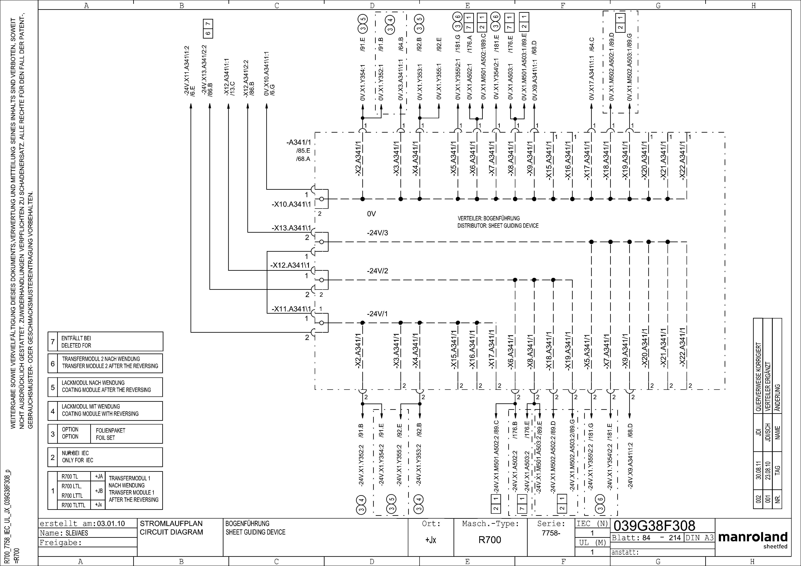

# +Jx — Sheet 84 of 214 — BOGENFÜHRUNG

**SHEET GUIDING DEVICE**

> Part of the manroland **R700** printing press IEC/UL circuit diagrams.
> Drawing class: **Stromlaufplan / Circuit diagram** (DIN A3).
> Document `+Jx` covers the **1st printing module + feed register** machine section.

## At a glance

| Field | Value |
|---|---|
| Document | `+Jx`  (039G38F308) |
| Sheet | **84** of 214 |
| Section (DE) | BOGENFÜHRUNG |
| Section (EN) | SHEET GUIDING DEVICE |
| Section type | CIRCUIT — Circuit diagram |
| Machine type | `R700` |
| Series | `7758` |
| Created | 03.01.10 |
| Replaces | — |
| Columns used | A, B, C, D, E, F, G, H |
| Path numbers | — |
| Labels on sheet | 234 |
| Cross-refs out | 35 |
| Cross-refs in | 67 |

**Previous:** [+Jx sheet 83](SHEET_0083.md) · **Next:** [+Jx sheet 85](SHEET_0085.md) · **Document TOC:** [_TOC.md](_TOC.md)  (+Jx) · **Master TOC:** [all sheets](../_MASTER_TOC.md)

## Sheet image (300 DPI, exact vector render)



_Rendered directly from the PDF vector layer at 300 DPI (1-bit), no OCR and no resampling. Use it to confirm anything ambiguous in the text below._

## Cross-references on this sheet

Each entry is a wire leaving this sheet. The printed token is `/sheet.column`; the link resolves to that sheet inside the same document.

| Ref | Target sheet | Col | Path | Destination on target | Target section | From col |
|---|---|---|---|---|---|---|
| `/89.D` | [+Jx sheet 89](SHEET_0089.md) | D | — | 0V.X1.M502.A502:1 | BOGENFÜHRUNG, NACH WENDUNG | G |
| `/89.E` | [+Jx sheet 89](SHEET_0089.md) | E | — | 0V.X1.M501.A503:1 | BOGENFÜHRUNG, NACH WENDUNG | F |
| `/89.G` | [+Jx sheet 89](SHEET_0089.md) | G | — | 0V.X1.M502.A503:1 | BOGENFÜHRUNG, NACH WENDUNG | G |
| `/89.C` | [+Jx sheet 89](SHEET_0089.md) | C | — | 0V.X1.M501.A502:1 | BOGENFÜHRUNG, NACH WENDUNG | E |
| `/181.G` | [+Jx sheet 181](SHEET_0181.md) | G | — | 0V.X1.Y355\2:1 | OPTION: TRANSFERMODUL 2 | E |
| `/181.E` | [+Jx sheet 181](SHEET_0181.md) | E | — | 0V.X1.Y354\2:1 | OPTION: TRANSFERMODUL 2 | E |
| `/176.A` | [+Jx sheet 176](SHEET_0176.md) | A | — | 0V.X1.A502:1 | OPTION: TRANSFERMODUL 1 NACH | E |
| `/176.E` | [+Jx sheet 176](SHEET_0176.md) | E | — | 0V.X1.A503:1 | OPTION: TRANSFERMODUL 1 NACH | E |
| `/64.B` | [+Jx sheet 64](SHEET_0064.md) | B | — | 0V.X3.A341\1:1 | TROPFEINRICHTUNG | D |
| `/64.C` | [+Jx sheet 64](SHEET_0064.md) | C | — | 0V.X17.A341\1:1 | TROPFEINRICHTUNG | F |
| `/91.E` | [+Jx sheet 91](SHEET_0091.md) | E | — | 0V.X1.Y354:1 | BOGENFÜHRUNG (BLASROHRE) | D |
| `/91.B` | [+Jx sheet 91](SHEET_0091.md) | B | — | 0V.X1.Y352:1 24V.X1.Y354:2 | BOGENFÜHRUNG (BLASROHRE) | D |
| `/91.E` | [+Jx sheet 91](SHEET_0091.md) | E | — | 0V.X1.Y352:1 24V.X1.Y354:2 | BOGENFÜHRUNG (BLASROHRE) | D |
| `/92.B` | [+Jx sheet 92](SHEET_0092.md) | B | — | 0V.X1.Y353:1 | BOGENFÜHRUNG (BLASROHRE) | E |
| `/92.E` | [+Jx sheet 92](SHEET_0092.md) | E | — | 0V.X1.Y355:1 | BOGENFÜHRUNG (BLASROHRE) | E |
| `/68.D` | [+Jx sheet 68](SHEET_0068.md) | D | — | 0V.X9.A341\1:1 | BLAS/SAUGLUFT MIT MOTORVENTILEINSTELLUNG | F |
| `/86.B` | [+Jx sheet 86](SHEET_0086.md) | B | — | 24V.X13.A341/2:2 | BOGENFÜHRUNG | B |
| `/6.E` | [+Jx sheet 6](SHEET_0006.md) | E | — | 24V.X11.A341\1:2 | SPANNUNGSVERSORGUNG, SCHALTSCHRANKBELÜFTUNG | B |
| `/6.G` | [+Jx sheet 6](SHEET_0006.md) | G | — | 0V.X10.A341\1:1 | SPANNUNGSVERSORGUNG, SCHALTSCHRANKBELÜFTUNG | C |
| `/13.C` | [+Jx sheet 13](SHEET_0013.md) | C | — | X12.A341\1:1 | SPANNUNGSVERSORGUNG, SCHALTSCHRANKBELÜFTUNG | C |
| `/86.B` | [+Jx sheet 86](SHEET_0086.md) | B | — | X12.A341\2:2 | BOGENFÜHRUNG | C |
| `/85.E` | [+Jx sheet 85](SHEET_0085.md) | E | — | — | BOGENFÜHRUNG | C |
| `/68.A` | [+Jx sheet 68](SHEET_0068.md) | A | — | — | BLAS/SAUGLUFT MIT MOTORVENTILEINSTELLUNG | C |
| `/89.G` | [+Jx sheet 89](SHEET_0089.md) | G | — | 24V.X1.M502.A503:2 | BOGENFÜHRUNG, NACH WENDUNG | F |
| `/89.C` | [+Jx sheet 89](SHEET_0089.md) | C | — | 24V.X1.M501.A502:2 | BOGENFÜHRUNG, NACH WENDUNG | E |
| `/176.E` | [+Jx sheet 176](SHEET_0176.md) | E | — | 24V.X1.A503:2 | OPTION: TRANSFERMODUL 1 NACH | F |
| `/89.E` | [+Jx sheet 89](SHEET_0089.md) | E | — | 24V.X1.M501.A503:2 | BOGENFÜHRUNG, NACH WENDUNG | F |
| `/89.D` | [+Jx sheet 89](SHEET_0089.md) | D | — | 24V.X1.M502.A502:2 | BOGENFÜHRUNG, NACH WENDUNG | F |
| `/176.B` | [+Jx sheet 176](SHEET_0176.md) | B | — | 24V.X1.A502:2 | OPTION: TRANSFERMODUL 1 NACH | F |
| `/92.B` | [+Jx sheet 92](SHEET_0092.md) | B | — | 24V.X1.Y353:2 | BOGENFÜHRUNG (BLASROHRE) | D |
| `/181.G` | [+Jx sheet 181](SHEET_0181.md) | G | — | 24V.X1.Y355\2:2 | OPTION: TRANSFERMODUL 2 | F |
| `/181.E` | [+Jx sheet 181](SHEET_0181.md) | E | — | 24V.X1.Y354\2:2 | OPTION: TRANSFERMODUL 2 | F |
| `/68.D` | [+Jx sheet 68](SHEET_0068.md) | D | — | 24V.X9.A341\1:2 | BLAS/SAUGLUFT MIT MOTORVENTILEINSTELLUNG | G |
| `/91.B` | [+Jx sheet 91](SHEET_0091.md) | B | — | 24V.X1.Y352:2 | BOGENFÜHRUNG (BLASROHRE) | D |
| `/92.E` | [+Jx sheet 92](SHEET_0092.md) | E | — | 24V.X1.Y355:2 | BOGENFÜHRUNG (BLASROHRE) | D |

### Incoming references (sheets that point here)

Every other sheet that sends a wire to this one. `Back-ref` is the token printed on *that* sheet; `Path` is its line number.

| From sheet | Cols | Back-ref | Path | Refs | What continues there |
|---|---|---|---|---|---|
| [+Jx#6](SHEET_0006.md) | F, H | `/6.F`, `/6.H` | — | 2 | 0V.X10.A341\1:1 |
| [+Jx#13](SHEET_0013.md) | C | `/13.C` | — | 1 | X12.A341\1:1 |
| [+Jx#64](SHEET_0064.md) | C, D | `/64.C`, `/64.D` | — | 2 | 0V.X17.A341\1:1; 24V.X1.Y248:2 |
| [+Jx#68](SHEET_0068.md) | A, D | `/68.A`, `/68.D` | — | 3 | — |
| [+Jx#85](SHEET_0085.md) | E | `/85.E` | — | 1 | — |
| [+Jx#86](SHEET_0086.md) | B | `/86.B` | — | 2 | 24V.X13.A341/2:2; X12.A341\2:2 |
| [+Jx#89](SHEET_0089.md) | C, D, E, G | `/89.C`, `/89.D`, `/89.E`, `/89.G` | — | 8 | 0V.X1.M501.A502:1; 0V.X1.M501.A503:1; 0V.X1.M502.A502:1; 0V.X1.M502.A503:1; 24V.X1.M501.A502:2; 24V.X1.M501.A503:2; 24V.X1.M502.A502:2; 24V.X1.M502.A503:2 |
| [+Jx#91](SHEET_0091.md) | B, D | `/91.B`, `/91.D` | — | 4 | 0V.X1.Y352:1; 0V.X1.Y354:1; 24V.X1.Y352:2; 24V.X1.Y354:2 |
| [+Jx#92](SHEET_0092.md) | B, D | `/92.B`, `/92.D` | — | 4 | 0V.X1.Y353:1; 0V.X1.Y355:1; 24V.X1.Y353:2; 24V.X1.Y355:2 |
| [+Jx#126](SHEET_0126.md) | A | `/126.A` | — | 2 | — |
| [+Jx#127](SHEET_0127.md) | G | `/127.G` | — | 2 | — |
| [+Jx#129](SHEET_0129.md) | F | `/129.F` | — | 2 | — |
| [+Jx#131](SHEET_0131.md) | F | `/131.F` | — | 2 | — |
| [+Jx#132](SHEET_0132.md) | G | `/132.G` | — | 2 | — |
| [+Jx#133](SHEET_0133.md) | B, H | `/133.B`, `/133.H` | — | 4 | — |
| [+Jx#134](SHEET_0134.md) | F | `/134.F` | — | 2 | — |
| [+Jx#138](SHEET_0138.md) | H | `/138.H` | — | 2 | — |
| [+Jx#139](SHEET_0139.md) | E | `/139.E` | — | 2 | — |
| [+Jx#140](SHEET_0140.md) | B, F | `/140.B`, `/140.F` | — | 4 | — |
| [+Jx#141](SHEET_0141.md) | A, E, G | `/141.A`, `/141.E`, `/141.G` | — | 6 | — |
| [+Jx#142](SHEET_0142.md) | A | `/142.A` | — | 2 | — |
| [+Jx#176](SHEET_0176.md) | A, B, E | `/176.A`, `/176.B`, `/176.E` | — | 4 | 0V.X1.A502:1; 0V.X1.A503:1; 24V.X1.A502:2; 24V.X1.A503:2 |
| [+Jx#181](SHEET_0181.md) | E | `/181.E` | — | 4 | 0V.X1.Y354\2:1 0V.X1.Y355\2:1; 24V.X1.Y354\2:2 24V.X1.Y355\2:2 |


## Devices on this sheet

| Tag | Class | Class meaning (IEC) | Col | Sub | Terminal | Sign |
|---|---|---|---|---|---|---|
| `A341/1` | A | Baugruppe / assembly, module, PC board | C | 1 | — | — |
| `X12.A341\1` | — | cross-device reference | C | — | — | — |
| `X10.A341\1` | — | cross-device reference | C | — | — | — |
| `X11.A341\1` | — | cross-device reference | C | — | — | — |
| `X13.A341\1` | — | cross-device reference | C | — | — | — |
| `NR.` | — | cross-device reference | H | — | — | — |
| `23.08.10` | — | cross-device reference | H | — | — | — |
| `X12.A341\1:1` | — | cross-device reference | B | — | 1 | — |
| `X12.A341\2:2` | — | cross-device reference | C | — | 2 | — |
| `30.08.11` | — | cross-device reference | H | — | — | — |

## Potentials / nets

| Potential | Count | Columns | Attached devices | Terminals |
|---|---|---|---|---|
| `0V` | 17 | C, D, E, F, G | `A341\1`, `A502`, `A503`, `M501`, `M502`, `X1`, `X10`, `X17`, `X3`, `X9`, `Y352`, `Y353`, `Y354`, `Y354\2`, `Y355`, `Y355\2` | `1` |
| `24V` | 17 | B, D, E, F, G | `A341\1`, `A502`, `A503`, `M501`, `M502`, `X1`, `X11`, `X9`, `Y352`, `Y353`, `Y354`, `Y354\2`, `Y355`, `Y355\2` | `2` |


A potential such as `L24+/4` or `M24+` is a named supply/return rail; every place it appears on this sheet is electrically common.

## Wire-end annotations (grouped as printed)

A wire that continues elsewhere is annotated with a small cluster: the destination description, the path/line number `#NN`, and the `/sheet.column` cross reference. Each row below is one such cluster exactly as it is grouped on the drawing.

| Col | Y | Path | Cross-ref | Text on the wire |
|---|---|---|---|---|
| F | 22.4 | — | — | `1 2` |
| E | 22.9 | — | — | `6 3` |
| E | 22.9 | — | — | `6 3` |
| E | 23.4 | — | — | `1 2` |
| E | 23.6 | — | — | `1 7` |
| E | 23.6 | — | — | `1 7` |
| G | 23.8 | — | — | `1 2` |
| D | 26.4 | — | — | `5 3` |
| E | 26.4 | — | — | `5 3` |
| D | 27.8 | — | — | `3 4` |
| B | 32.8 | — | — | `7 6` |
| G | 48.6 | — | `/89.D` | `0V.X1.M502.A502:1` |
| F | 49.2 | — | `/89.E` | `0V.X1.M501.A503:1` |
| G | 49.5 | — | `/89.G` | `0V.X1.M502.A503:1` |
| E | 49.9 | — | `/89.C` | `0V.X1.M501.A502:1` |
| E | 51.6 | — | `/181.G` | `0V.X1.Y355\2:1` |
| E | 51.8 | — | `/181.E` | `0V.X1.Y354\2:1` |
| E | 53.1 | — | `/176.A` | `0V.X1.A502:1` |
| E | 53.1 | — | `/176.E` | `0V.X1.A503:1` |
| D | 55.1 | — | `/64.B` | `0V.X3.A341\1:1` |
| F | 55.4 | — | `/64.C` | `0V.X17.A341\1:1` |
| D | 55.6 | — | `/91.E` | `0V.X1.Y354:1` |
| D | 55.6 | — | `/91.B`, `/91.E` | `0V.X1.Y352:1 24V.X1.Y354:2` |
| E | 55.7 | — | `/92.B` | `0V.X1.Y353:1` |
| E | 55.7 | — | `/92.E` | `0V.X1.Y355:1` |
| F | 60.4 | — | `/68.D` | `0V.X9.A341\1:1` |
| B | 66.8 | — | `/86.B` | `24V.X13.A341/2:2` |
| B | 68.2 | — | `/6.E` | `24V.X11.A341\1:2` |
| C | 75.9 | — | `/6.G` | `0V.X10.A341\1:1` |
| C | 86.3 | — | `/13.C` | `X12.A341\1:1` |
| C | 89.2 | — | `/86.B` | `X12.A341\2:2` |
| D | 182.9 | — | — | `1` |
| D | 182.9 | — | — | `1` |
| E | 182.9 | — | — | `1` |
| E | 182.9 | — | — | `1` |
| E | 182.9 | — | — | `1` |
| E | 182.9 | — | — | `1` |
| F | 182.9 | — | — | `1` |
| F | 182.9 | — | — | `1` |
| F | 182.9 | — | — | `1` |
| G | 182.9 | — | — | `1` |
| G | 182.9 | — | — | `1` |
| F | 199.9 | — | — | `1 1` |
| G | 199.9 | — | — | `1 1 1` |
| C | 207.0 | — | — | `A341/1` |
| D | 209.0 | — | — | `X2.A341/1` |
| D | 209.0 | — | — | `X3.A341/1` |
| D | 209.0 | — | — | `X4.A341/1` |
| E | 209.0 | — | — | `X5.A341/1` |
| E | 209.0 | — | — | `X6.A341/1` |
| E | 209.0 | — | — | `X7.A341/1` |
| E | 209.0 | — | — | `X8.A341/1` |
| F | 209.0 | — | — | `X9.A341/1` |
| F | 209.0 | — | — | `X15.A341/1` |
| F | 209.0 | — | — | `X16.A341/1` |
| F | 209.0 | — | — | `X17.A341/1` |
| F | 209.0 | — | — | `X18.A341/1` |
| G | 209.0 | — | — | `X19.A341/1` |
| G | 209.0 | — | — | `X20.A341/1` |
| G | 209.0 | — | — | `X21.A341/1` |
| G | 209.0 | — | — | `X22.A341/1` |
| C | 220.0 | — | `/85.E`, `/68.A` | — |
| C | 284.9 | — | — | `X10.A341\1 1` |
| D | 313.2 | — | — | `0V` |
| C | 314.0 | — | — | `2` |
| E | 322.1 | — | — | `DISTRIBUTOR: SHEET GUIDING DEVICE VERTEILER: BOGENFÜHRUNG` |
| C | 334.5 | — | — | `X13.A341\1 2` |
| D | 341.6 | — | — | `24V/3` |
| C | 377.0 | — | — | `1` |
| C | 389.9 | — | — | `X12.A341\1 1` |
| D | 398.3 | — | — | `24V/2` |
| C | 433.6 | — | — | `2` |
| C | 434.5 | — | — | `2` |
| C | 455.0 | — | — | `X11.A341\1 1` |
| C | 455.7 | — | — | `1` |
| D | 462.1 | — | — | `24V/1` |
| G | 486.6 | — | — | `X22.A341/1` |
| G | 487.6 | — | — | `X21.A341/1` |
| G | 487.9 | — | — | `X20.A341/1` |
| E | 489.7 | — | — | `X17.A341/1` |
| E | 490.4 | — | — | `X15.A341/1` |
| E | 490.4 | — | — | `X16.A341/1` |
| F | 492.5 | — | — | `X18.A341/1` |
| F | 492.5 | — | — | `X19.A341/1` |
| D | 494.7 | — | — | `X4.A341/1` |
| D | 495.1 | — | — | `X2.A341/1` |
| D | 495.1 | — | — | `X3.A341/1` |
| G | 495.4 | — | — | `X9.A341/1` |
| F | 496.0 | — | — | `X7.A341/1` |
| F | 496.6 | — | — | `X8.A341/1` |
| F | 496.6 | — | — | `X5.A341/1` |
| E | 496.9 | — | — | `X6.A341/1` |
| C | 497.5 | — | — | `2` |
| A | 500.4 | — | — | `7 ENTFÄLLT BEI DELETED FOR` |
| H | 509.2 | — | — | `JDI 30.08.11 QUERVERWEISE KORRIGIERT 002` |
| A | 531.1 | — | — | `6 TRANSFERMODUL 2 NACH WENDUNG TRANSFER MODULE 2 AFTER THE REVERSING` |
| H | 537.9 | — | — | `001 JDI/SCH 23.08.10 VERTEILER ERGÄNZT` |
| A | 566.5 | — | — | `5 LACKMODUL NACH WENDUNG COATING MODULE AFTER THE REVERSING` |
| D | 569.8 | — | — | `2` |
| E | 569.8 | — | — | `2 2 2` |
| G | 569.8 | — | — | `2 2 2` |
| H | 571.6 | — | — | `NR. NAME TAG ÄNDERUNG` |
| D | 586.8 | — | — | `2` |
| E | 586.8 | — | — | `2` |
| F | 586.8 | — | — | `2` |
| F | 586.8 | — | — | `2` |
| F | 586.8 | — | — | `2` |
| F | 586.8 | — | — | `2` |
| F | 586.8 | — | — | `2` |
| G | 586.8 | — | — | `2` |
| G | 586.8 | — | — | `2` |
| A | 602.0 | — | — | `4 LACKMODUL MIT WENDUNG COATING MODULE WITH REVERSING` |
| F | 623.6 | — | `/89.G` | `24V.X1.M502.A503:2` |
| E | 625.1 | — | `/89.C` | `24V.X1.M501.A502:2` |
| F | 626.2 | — | `/176.E` | `24V.X1.A503:2` |
| F | 626.2 | — | `/89.E` | `24V.X1.M501.A503:2` |
| F | 626.2 | — | `/89.D` | `24V.X1.M502.A502:2` |
| F | 626.9 | — | `/176.B` | `24V.X1.A502:2` |
| D | 629.0 | — | `/92.B` | `24V.X1.Y353:2` |
| F | 629.3 | — | `/181.G` | `24V.X1.Y355\2:2` |
| F | 629.9 | — | `/181.E` | `24V.X1.Y354\2:2` |
| G | 629.9 | — | `/68.D` | `24V.X9.A341\1:2` |
| D | 630.2 | — | `/91.B` | `24V.X1.Y352:2` |
| D | 630.3 | — | `/92.E` | `24V.X1.Y355:2` |
| A | 635.9 | — | — | `3 OPTION OPTION` |
| A | 637.7 | — | — | `FOLIENPAKET FOIL SET` |
| A | 671.2 | — | — | `2 NUR BEI IEC ONLY FOR IEC` |
| A | 672.0 | — | — | `3` |
| A | 705.6 | — | — | `+JA` |
| A | 706.2 | — | — | `R700 TL` |
| A | 708.6 | — | — | `NACH WENDUNG TRANSFERMODUL 1` |
| A | 720.3 | — | — | `R700 LTL,` |
| A | 725.6 | — | — | `1 +JB` |
| A | 729.9 | — | — | `TRANSFER MODULE 1 AFTER THE REVERSING` |
| A | 734.5 | — | — | `R700 LTTL` |
| F | 739.2 | — | — | `1 2` |
| E | 739.5 | — | — | `1 2` |
| F | 739.5 | — | — | `1 7` |
| D | 740.6 | — | — | `5` |
| F | 740.6 | — | — | `6 3` |
| D | 740.8 | — | — | `3 4` |
| D | 741.9 | — | — | `4` |
| A | 747.7 | — | — | `R700 TLTTL +Jx` |
| D | 754.8 | — | — | `3` |
| D | 756.2 | — | — | `3` |


## Reconstructed tables

This sheet carries tabular content (pin map / terminal assignment / index). The grid below was rebuilt from the drawing's own rule lines, so each row is exactly one physical row of the table.

### Table 1 — 7 data rows × 1 columns (at x=396.3, y=281.8)

| C1 |
|---|
| `1` |
| `X10.A341\1 2 X13.A341\1` |
| `2` |
| `1 X12.A341\1` |
| `1` |
| `2 2 X11.A341\1 1` |
| `1` |


### Table 2 — 4 data rows × 1 columns (at x=539.0, y=281.8)

| C1 |
|---|
| `0V` |
| `24V/3` |
| `24V/2` |
| `24V/1` |


## Notes and free text on this sheet

| Text | Col | Y (pt) |
|---|---|---|
| `VERTEILER: BOGENFÜHRUNG` | E | 322.13 |
| `DISTRIBUTOR: SHEET GUIDING DEVICE` | E | 332.74 |
| `X2.A341/1` | D | 495.05 |
| `X4.A341/1` | D | 494.73 |
| `X3.A341/1` | D | 209 |
| `X6.A341/1` | E | 209 |
| `X7.A341/1` | E | 209 |
| `X5.A341/1` | E | 209 |
| `X8.A341/1` | E | 209 |
| `X9.A341/1` | F | 209 |
| `X17.A341/1` | F | 209 |
| `X18.A341/1` | F | 209 |
| `X19.A341/1` | G | 209 |
| `X8.A341/1` | F | 496.6 |
| `X19.A341/1` | F | 492.47 |
| `X5.A341/1` | F | 496.6 |
| `X7.A341/1` | F | 495.98 |
| `X9.A341/1` | G | 495.36 |
| `TAG` | H | 692.65 |
| `NAME` | H | 633.42 |
| `ÄNDERUNG` | H | 571.56 |
| `JDI/SCH` | H | 629.62 |
| `VERTEILER ERGÄNZT` | H | 537.91 |
| `JDI` | H | 637.7 |
| `QUERVERWEISE KORRIGIERT` | H | 509.25 |
| `24V.X13.A341/2:2` | B | 66.76 |
| `X16.A341/1` | F | 209 |
| `X15.A341/1` | F | 209 |
| `X20.A341/1` | G | 209 |
| `X22.A341/1` | G | 209 |
| `X21.A341/1` | G | 209 |
| `X16.A341/1` | E | 490.37 |
| `X17.A341/1` | E | 489.74 |
| `X15.A341/1` | E | 490.37 |
| `R700 TL` | A | 706.16 |
| `R700 LTL,` | A | 720.31 |
| `+JA` | A | 705.65 |
| `R700 TLTTL` | A | 748.68 |
| `+Jx` | A | 747.68 |
| `R700 LTTL` | A | 734.51 |
| `+JB` | A | 727.31 |
| `TRANSFERMODUL 1` | A | 708.6 |
| `NACH WENDUNG` | A | 719.17 |
| `TRANSFER MODULE 1` | A | 729.86 |
| `AFTER THE REVERSING` | A | 740.48 |
| `NUR BEI IEC` | A | 671.23 |
| `ONLY FOR IEC` | A | 681.88 |
| `LACKMODUL MIT WENDUNG` | A | 601.98 |
| `COATING MODULE WITH REVERSING` | A | 612.61 |
| `LACKMODUL NACH WENDUNG` | A | 566.55 |
| `COATING MODULE AFTER THE REVERSING` | A | 577.19 |
| `TRANSFERMODUL 2 NACH WENDUNG` | A | 531.13 |
| `TRANSFER MODULE 2 AFTER THE REVERSING` | A | 541.75 |
| `OPTION` | A | 635.92 |
| `FOLIENPAKET` | A | 637.73 |
| `FOIL SET` | A | 648.36 |
| `ENTFÄLLT BEI` | A | 500.38 |
| `DELETED FOR` | A | 511.05 |

## Complete label inventory (exact text from the drawing)

Every text object inside the drawing area of this sheet, in DIN reading order (column A→H, then top→bottom). This is the authoritative list: if a string is not here it is not printed on this sheet.

| Col | Y | X | Dir | Type | Text |
|---|---|---|---|---|---|
| A | 500.4 | 91.5 | → | text | `ENTFÄLLT BEI` |
| A | 503.9 | 75.5 | → | number | `7` |
| A | 511.0 | 91.5 | → | text | `DELETED FOR` |
| A | 531.1 | 92.6 | → | text | `TRANSFERMODUL 2 NACH WENDUNG` |
| A | 536.4 | 75.5 | → | number | `6` |
| A | 541.8 | 92.6 | → | text | `TRANSFER MODULE 2 AFTER THE REVERSING` |
| A | 566.6 | 92.0 | → | text | `LACKMODUL NACH WENDUNG` |
| A | 571.8 | 75.5 | → | number | `5` |
| A | 577.2 | 92.3 | → | text | `COATING MODULE AFTER THE REVERSING` |
| A | 602.0 | 92.0 | → | text | `LACKMODUL MIT WENDUNG` |
| A | 607.3 | 75.6 | → | number | `4` |
| A | 612.6 | 92.3 | → | text | `COATING MODULE WITH REVERSING` |
| A | 635.9 | 92.3 | → | text | `OPTION` |
| A | 637.7 | 142.8 | → | text | `FOLIENPAKET` |
| A | 641.2 | 75.5 | → | number | `3` |
| A | 646.5 | 92.3 | → | text | `OPTION` |
| A | 648.4 | 142.8 | → | text | `FOIL SET` |
| A | 671.2 | 92.2 | → | text | `NUR BEI IEC` |
| A | 672.0 | 101.7 | ↕ | number | `3` |
| A | 676.0 | 75.3 | → | number | `2` |
| A | 681.9 | 92.5 | → | text | `ONLY FOR IEC` |
| A | 705.7 | 141.6 | → | text | `+JA` |
| A | 706.2 | 91.8 | → | text | `R700 TL` |
| A | 708.6 | 162.1 | → | text | `TRANSFERMODUL 1` |
| A | 719.2 | 161.6 | → | text | `NACH WENDUNG` |
| A | 720.3 | 91.8 | → | text | `R700 LTL,` |
| A | 725.6 | 75.6 | → | number | `1` |
| A | 727.3 | 141.6 | → | text | `+JB` |
| A | 729.9 | 162.1 | → | text | `TRANSFER MODULE 1` |
| A | 734.5 | 91.8 | → | text | `R700 LTTL` |
| A | 740.5 | 162.1 | → | text | `AFTER THE REVERSING` |
| A | 747.7 | 141.6 | → | text | `+Jx` |
| A | 748.7 | 91.8 | → | text | `R700 TLTTL` |
| B | 32.8 | 305.4 | ↕ | number | `7` |
| B | 47.3 | 305.4 | ↕ | number | `6` |
| B | 66.8 | 299.6 | ↕ | text | `24V.X13.A341/2:2` |
| B | 68.2 | 273.6 | ↕ | potential | `24V.X11.A341\1:2` |
| B | 86.3 | 332.9 | ↕ | device ref | `X12.A341\1:1` |
| B | 123.3 | 308.5 | ↕ | cross-reference | `/86.B` |
| B | 127.8 | 282.2 | ↕ | cross-reference | `/6.E` |
| C | 75.9 | 392.1 | ↕ | potential | `0V.X10.A341\1:1` |
| C | 89.2 | 361.8 | ↕ | device ref | `X12.A341\2:2` |
| C | 121.2 | 341.5 | ↕ | cross-reference | `/13.C` |
| C | 121.5 | 370.4 | ↕ | cross-reference | `/86.B` |
| C | 125.5 | 400.8 | ↕ | cross-reference | `/6.G` |
| C | 207.0 | 425.9 | → | device tag | `A341/1` |
| C | 220.0 | 440.6 | → | cross-reference | `/85.E` |
| C | 232.4 | 440.3 | → | cross-reference | `/68.A` |
| C | 284.9 | 452.8 | → | number | `1` |
| C | 299.1 | 404.1 | → | device ref | `X10.A341\1` |
| C | 314.0 | 472.9 | → | number | `2` |
| C | 334.5 | 404.1 | → | device ref | `X13.A341\1` |
| C | 348.7 | 453.7 | → | number | `2` |
| C | 377.0 | 452.8 | → | number | `1` |
| C | 389.9 | 402.0 | → | device ref | `X12.A341\1` |
| C | 405.4 | 452.8 | → | number | `1` |
| C | 433.6 | 453.9 | → | number | `2` |
| C | 434.5 | 475.2 | → | number | `2` |
| C | 455.0 | 404.1 | → | device ref | `X11.A341\1` |
| C | 455.7 | 474.3 | → | number | `1` |
| C | 469.1 | 452.8 | → | number | `1` |
| C | 497.5 | 453.7 | → | number | `2` |
| D | 26.4 | 536.5 | ↕ | number | `5` |
| D | 27.8 | 577.0 | ↕ | number | `4` |
| D | 40.6 | 536.5 | ↕ | number | `3` |
| D | 42.0 | 577.0 | ↕ | number | `3` |
| D | 55.1 | 592.1 | ↕ | cross-reference | `/64.B` |
| D | 55.6 | 535.0 | ↕ | cross-reference | `/91.E` |
| D | 55.6 | 562.1 | ↕ | cross-reference | `/91.B` |
| D | 55.7 | 619.2 | ↕ | cross-reference | `/92.B` |
| D | 87.5 | 591.8 | ↕ | potential | `0V.X3.A341\1:1` |
| D | 95.2 | 562.5 | ↕ | potential | `0V.X1.Y352:1` |
| D | 95.5 | 535.3 | ↕ | potential | `0V.X1.Y354:1` |
| D | 182.9 | 541.0 | → | number | `1` |
| D | 182.9 | 597.7 | → | number | `1` |
| D | 209.0 | 527.9 | ↕ | text | `X2.A341/1` |
| D | 209.0 | 584.6 | ↕ | text | `X3.A341/1` |
| D | 209.0 | 612.9 | ↕ | text | `X4.A341/1` |
| D | 313.2 | 545.8 | → | potential | `0V` |
| D | 341.6 | 545.8 | → | potential | `24V/3` |
| D | 398.3 | 545.8 | → | potential | `24V/2` |
| D | 462.1 | 545.8 | → | potential | `24V/1` |
| D | 494.7 | 612.9 | ↕ | text | `X4.A341/1` |
| D | 495.0 | 527.7 | ↕ | text | `X2.A341/1` |
| D | 495.0 | 584.5 | ↕ | text | `X3.A341/1` |
| D | 569.8 | 598.5 | → | number | `2` |
| D | 586.8 | 541.8 | → | number | `2` |
| D | 629.0 | 619.2 | ↕ | cross-reference | `/92.B` |
| D | 629.9 | 562.8 | ↕ | cross-reference | `/91.E` |
| D | 630.2 | 532.5 | ↕ | cross-reference | `/91.B` |
| D | 630.3 | 589.9 | ↕ | cross-reference | `/92.E` |
| D | 660.8 | 563.1 | ↕ | potential | `24V.X1.Y354:2` |
| D | 660.8 | 618.6 | ↕ | potential | `24V.X1.Y353:2` |
| D | 661.4 | 589.6 | ↕ | potential | `24V.X1.Y355:2` |
| D | 661.7 | 533.2 | ↕ | potential | `24V.X1.Y352:2` |
| D | 740.6 | 579.0 | ↕ | number | `5` |
| D | 740.8 | 619.6 | ↕ | number | `4` |
| D | 741.9 | 534.3 | ↕ | number | `4` |
| D | 754.8 | 579.0 | ↕ | number | `3` |
| D | 755.1 | 619.5 | ↕ | number | `3` |
| D | 756.2 | 534.2 | ↕ | number | `3` |
| E | 22.9 | 677.4 | ↕ | number | `6` |
| E | 22.9 | 733.8 | ↕ | number | `6` |
| E | 23.4 | 712.8 | ↕ | number | `1` |
| E | 23.6 | 693.0 | ↕ | number | `1` |
| E | 23.6 | 753.6 | ↕ | number | `1` |
| E | 26.4 | 620.3 | ↕ | number | `5` |
| E | 37.1 | 677.4 | ↕ | number | `3` |
| E | 37.1 | 733.8 | ↕ | number | `3` |
| E | 38.0 | 712.8 | ↕ | number | `2` |
| E | 38.3 | 753.6 | ↕ | number | `7` |
| E | 38.4 | 693.0 | ↕ | number | `7` |
| E | 40.6 | 620.3 | ↕ | number | `3` |
| E | 49.9 | 714.9 | ↕ | cross-reference | `/89.C` |
| E | 51.6 | 676.6 | ↕ | cross-reference | `/181.G` |
| E | 51.8 | 734.3 | ↕ | cross-reference | `/181.E` |
| E | 53.1 | 694.3 | ↕ | cross-reference | `/176.A` |
| E | 53.1 | 755.0 | ↕ | cross-reference | `/176.E` |
| E | 55.7 | 648.8 | ↕ | cross-reference | `/92.E` |
| E | 69.6 | 714.9 | ↕ | potential | `0V.X1.M501.A502:1` |
| E | 86.0 | 733.7 | ↕ | potential | `0V.X1.Y354\2:1` |
| E | 86.6 | 676.9 | ↕ | potential | `0V.X1.Y355\2:1` |
| E | 93.7 | 648.5 | ↕ | potential | `0V.X1.Y355:1` |
| E | 93.8 | 694.3 | ↕ | potential | `0V.X1.A502:1` |
| E | 93.8 | 755.0 | ↕ | potential | `0V.X1.A503:1` |
| E | 94.6 | 620.2 | ↕ | potential | `0V.X1.Y353:1` |
| E | 182.9 | 626.0 | → | number | `1` |
| E | 182.9 | 682.7 | → | number | `1` |
| E | 182.9 | 711.0 | → | number | `1` |
| E | 182.9 | 739.4 | → | number | `1` |
| E | 209.0 | 669.6 | ↕ | text | `X5.A341/1` |
| E | 209.0 | 698.0 | ↕ | text | `X6.A341/1` |
| E | 209.0 | 726.3 | ↕ | text | `X7.A341/1` |
| E | 209.0 | 754.7 | ↕ | text | `X8.A341/1` |
| E | 322.1 | 680.7 | → | text | `VERTEILER: BOGENFÜHRUNG` |
| E | 332.7 | 680.1 | → | text | `DISTRIBUTOR: SHEET GUIDING DEVICE` |
| E | 489.7 | 726.1 | ↕ | text | `X17.A341/1` |
| E | 490.4 | 669.9 | ↕ | text | `X15.A341/1` |
| E | 490.4 | 697.4 | ↕ | text | `X16.A341/1` |
| E | 496.9 | 754.4 | ↕ | text | `X6.A341/1` |
| E | 569.8 | 683.5 | → | number | `2` |
| E | 569.8 | 711.9 | → | number | `2` |
| E | 569.8 | 740.2 | → | number | `2` |
| E | 586.8 | 626.9 | → | number | `2` |
| E | 625.1 | 733.9 | ↕ | cross-reference | `/89.C` |
| E | 648.1 | 733.9 | ↕ | potential | `24V.X1.M501.A502:2` |
| E | 739.4 | 733.4 | ↕ | number | `1` |
| E | 754.0 | 733.4 | ↕ | number | `2` |
| F | 22.4 | 775.3 | ↕ | number | `1` |
| F | 37.0 | 775.3 | ↕ | number | `2` |
| F | 49.2 | 775.2 | ↕ | cross-reference | `/89.E` |
| F | 55.4 | 875.9 | ↕ | cross-reference | `/64.C` |
| F | 60.4 | 790.1 | ↕ | cross-reference | `/68.D` |
| F | 71.2 | 775.2 | ↕ | potential | `0V.X1.M501.A503:1` |
| F | 82.4 | 875.6 | ↕ | potential | `0V.X17.A341\1:1` |
| F | 87.9 | 791.1 | ↕ | potential | `0V.X9.A341\1:1` |
| F | 182.9 | 767.7 | → | number | `1` |
| F | 182.9 | 796.1 | → | number | `1` |
| F | 182.9 | 881.1 | → | number | `1` |
| F | 199.9 | 824.4 | → | number | `1` |
| F | 199.9 | 852.8 | → | number | `1` |
| F | 209.0 | 783.0 | ↕ | text | `X9.A341/1` |
| F | 209.0 | 811.3 | ↕ | text | `X15.A341/1` |
| F | 209.0 | 839.7 | ↕ | text | `X16.A341/1` |
| F | 209.0 | 868.0 | ↕ | text | `X17.A341/1` |
| F | 209.0 | 896.4 | ↕ | text | `X18.A341/1` |
| F | 492.5 | 811.3 | ↕ | text | `X18.A341/1` |
| F | 492.5 | 839.7 | ↕ | text | `X19.A341/1` |
| F | 496.0 | 896.9 | ↕ | text | `X7.A341/1` |
| F | 496.6 | 783.4 | ↕ | text | `X8.A341/1` |
| F | 496.6 | 867.9 | ↕ | text | `X5.A341/1` |
| F | 586.8 | 768.6 | → | number | `2` |
| F | 586.8 | 796.9 | → | number | `2` |
| F | 586.8 | 825.3 | → | number | `2` |
| F | 586.8 | 853.6 | → | number | `2` |
| F | 586.8 | 882.0 | → | number | `2` |
| F | 623.7 | 846.9 | ↕ | cross-reference | `/89.G` |
| F | 626.2 | 779.6 | ↕ | cross-reference | `/176.E` |
| F | 626.2 | 798.3 | ↕ | cross-reference | `/89.E` |
| F | 626.2 | 818.6 | ↕ | cross-reference | `/89.D` |
| F | 626.9 | 761.5 | ↕ | cross-reference | `/176.B` |
| F | 629.3 | 874.3 | ↕ | cross-reference | `/181.G` |
| F | 629.9 | 902.4 | ↕ | cross-reference | `/181.E` |
| F | 645.5 | 846.9 | ↕ | potential | `24V.X1.M502.A503:2` |
| F | 648.5 | 796.8 | ↕ | potential | `24V.X1.M501.A503:2` |
| F | 648.6 | 818.2 | ↕ | potential | `24V.X1.M502.A502:2` |
| F | 660.4 | 874.0 | ↕ | potential | `24V.X1.Y355\2:2` |
| F | 670.3 | 761.5 | ↕ | potential | `24V.X1.A502:2` |
| F | 671.0 | 779.6 | ↕ | potential | `24V.X1.A503:2` |
| F | 739.2 | 831.7 | ↕ | number | `1` |
| F | 739.4 | 772.4 | ↕ | number | `1` |
| F | 740.6 | 889.2 | ↕ | number | `6` |
| F | 753.8 | 831.7 | ↕ | number | `2` |
| F | 754.2 | 772.4 | ↕ | number | `7` |
| F | 754.7 | 889.2 | ↕ | number | `3` |
| G | 23.8 | 918.4 | ↕ | number | `1` |
| G | 38.4 | 918.4 | ↕ | number | `2` |
| G | 48.6 | 905.5 | ↕ | cross-reference | `/89.D` |
| G | 49.6 | 931.7 | ↕ | cross-reference | `/89.G` |
| G | 71.4 | 905.2 | ↕ | potential | `0V.X1.M502.A502:1` |
| G | 71.7 | 932.0 | ↕ | potential | `0V.X1.M502.A503:1` |
| G | 182.9 | 909.5 | → | number | `1` |
| G | 182.9 | 937.8 | → | number | `1` |
| G | 199.9 | 966.2 | → | number | `1` |
| G | 199.9 | 994.5 | → | number | `1` |
| G | 199.9 | 1022.9 | → | number | `1` |
| G | 209.0 | 924.7 | ↕ | text | `X19.A341/1` |
| G | 209.0 | 953.1 | ↕ | text | `X20.A341/1` |
| G | 209.0 | 981.4 | ↕ | text | `X21.A341/1` |
| G | 209.0 | 1009.8 | ↕ | text | `X22.A341/1` |
| G | 486.6 | 1009.8 | ↕ | text | `X22.A341/1` |
| G | 487.6 | 981.4 | ↕ | text | `X21.A341/1` |
| G | 487.9 | 953.7 | ↕ | text | `X20.A341/1` |
| G | 495.4 | 924.7 | ↕ | text | `X9.A341/1` |
| G | 569.8 | 967.0 | → | number | `2` |
| G | 569.8 | 995.4 | → | number | `2` |
| G | 569.8 | 1023.7 | → | number | `2` |
| G | 586.8 | 910.3 | → | number | `2` |
| G | 586.8 | 938.7 | → | number | `2` |
| G | 629.9 | 932.9 | ↕ | cross-reference | `/68.D` |
| G | 658.3 | 933.2 | ↕ | potential | `24V.X9.A341\1:2` |
| G | 660.1 | 902.7 | ↕ | potential | `24V.X1.Y354\2:2` |
| H | 509.2 | 1124.5 | ↕ | text | `QUERVERWEISE KORRIGIERT` |
| H | 537.9 | 1138.5 | ↕ | text | `VERTEILER ERGÄNZT` |
| H | 571.6 | 1152.6 | ↕ | text | `ÄNDERUNG` |
| H | 629.6 | 1138.4 | ↕ | text | `JDI/SCH` |
| H | 633.4 | 1152.6 | ↕ | text | `NAME` |
| H | 637.7 | 1124.4 | ↕ | text | `JDI` |
| H | 685.6 | 1124.4 | ↕ | device ref | `30.08.11` |
| H | 686.6 | 1138.4 | ↕ | device ref | `23.08.10` |
| H | 692.6 | 1152.6 | ↕ | text | `TAG` |
| H | 735.9 | 1138.3 | ↕ | number | `001` |
| H | 736.3 | 1152.5 | ↕ | device ref | `NR.` |
| H | 736.8 | 1124.5 | ↕ | number | `002` |

## Reading-order text block

The same content as a plain block, grouped by DIN column — convenient to paste or to match against a visual description.

```text
=== Column A ===
 500.4   91.5  text         ENTFÄLLT BEI
 503.9   75.5  numeric      7
 511.0   91.5  text         DELETED FOR
 531.1   92.6  text         TRANSFERMODUL 2 NACH WENDUNG
 536.4   75.5  numeric      6
 541.8   92.6  text         TRANSFER MODULE 2 AFTER THE REVERSING
 566.6   92.0  text         LACKMODUL NACH WENDUNG
 571.8   75.5  numeric      5
 577.2   92.3  text         COATING MODULE AFTER THE REVERSING
 602.0   92.0  text         LACKMODUL MIT WENDUNG
 607.3   75.6  numeric      4
 612.6   92.3  text         COATING MODULE WITH REVERSING
 635.9   92.3  text         OPTION
 637.7  142.8  text         FOLIENPAKET
 641.2   75.5  numeric      3
 646.5   92.3  text         OPTION
 648.4  142.8  text         FOIL SET
 671.2   92.2  text         NUR BEI IEC
 672.0  101.7  numeric      3
 676.0   75.3  numeric      2
 681.9   92.5  text         ONLY FOR IEC
 705.7  141.6  text         +JA
 706.2   91.8  text         R700 TL
 708.6  162.1  text         TRANSFERMODUL 1
 719.2  161.6  text         NACH WENDUNG
 720.3   91.8  text         R700 LTL,
 725.6   75.6  numeric      1
 727.3  141.6  text         +JB
 729.9  162.1  text         TRANSFER MODULE 1
 734.5   91.8  text         R700 LTTL
 740.5  162.1  text         AFTER THE REVERSING
 747.7  141.6  text         +Jx
 748.7   91.8  text         R700 TLTTL
=== Column B ===
  32.8  305.4  numeric      7
  47.3  305.4  numeric      6
  66.8  299.6  text         24V.X13.A341/2:2
  68.2  273.6  net          24V.X11.A341\1:2
  86.3  332.9  devref       X12.A341\1:1
 123.3  308.5  xref         /86.B
 127.8  282.2  xref         /6.E
=== Column C ===
  75.9  392.1  net          0V.X10.A341\1:1
  89.2  361.8  devref       X12.A341\2:2
 121.2  341.5  xref         /13.C
 121.5  370.4  xref         /86.B
 125.5  400.8  xref         /6.G
 207.0  425.9  devtag       A341/1
 220.0  440.6  xref         /85.E
 232.4  440.3  xref         /68.A
 284.9  452.8  numeric      1
 299.1  404.1  devref       X10.A341\1
 314.0  472.9  numeric      2
 334.5  404.1  devref       X13.A341\1
 348.7  453.7  numeric      2
 377.0  452.8  numeric      1
 389.9  402.0  devref       X12.A341\1
 405.4  452.8  numeric      1
 433.6  453.9  numeric      2
 434.5  475.2  numeric      2
 455.0  404.1  devref       X11.A341\1
 455.7  474.3  numeric      1
 469.1  452.8  numeric      1
 497.5  453.7  numeric      2
=== Column D ===
  26.4  536.5  numeric      5
  27.8  577.0  numeric      4
  40.6  536.5  numeric      3
  42.0  577.0  numeric      3
  55.1  592.1  xref         /64.B
  55.6  535.0  xref         /91.E
  55.6  562.1  xref         /91.B
  55.7  619.2  xref         /92.B
  87.5  591.8  net          0V.X3.A341\1:1
  95.2  562.5  net          0V.X1.Y352:1
  95.5  535.3  net          0V.X1.Y354:1
 182.9  541.0  numeric      1
 182.9  597.7  numeric      1
 209.0  527.9  text         X2.A341/1
 209.0  584.6  text         X3.A341/1
 209.0  612.9  text         X4.A341/1
 313.2  545.8  net          0V
 341.6  545.8  net          24V/3
 398.3  545.8  net          24V/2
 462.1  545.8  net          24V/1
 494.7  612.9  text         X4.A341/1
 495.0  527.7  text         X2.A341/1
 495.0  584.5  text         X3.A341/1
 569.8  598.5  numeric      2
 586.8  541.8  numeric      2
 629.0  619.2  xref         /92.B
 629.9  562.8  xref         /91.E
 630.2  532.5  xref         /91.B
 630.3  589.9  xref         /92.E
 660.8  563.1  net          24V.X1.Y354:2
 660.8  618.6  net          24V.X1.Y353:2
 661.4  589.6  net          24V.X1.Y355:2
 661.7  533.2  net          24V.X1.Y352:2
 740.6  579.0  numeric      5
 740.8  619.6  numeric      4
 741.9  534.3  numeric      4
 754.8  579.0  numeric      3
 755.1  619.5  numeric      3
 756.2  534.2  numeric      3
=== Column E ===
  22.9  677.4  numeric      6
  22.9  733.8  numeric      6
  23.4  712.8  numeric      1
  23.6  693.0  numeric      1
  23.6  753.6  numeric      1
  26.4  620.3  numeric      5
  37.1  677.4  numeric      3
  37.1  733.8  numeric      3
  38.0  712.8  numeric      2
  38.3  753.6  numeric      7
  38.4  693.0  numeric      7
  40.6  620.3  numeric      3
  49.9  714.9  xref         /89.C
  51.6  676.6  xref         /181.G
  51.8  734.3  xref         /181.E
  53.1  694.3  xref         /176.A
  53.1  755.0  xref         /176.E
  55.7  648.8  xref         /92.E
  69.6  714.9  net          0V.X1.M501.A502:1
  86.0  733.7  net          0V.X1.Y354\2:1
  86.6  676.9  net          0V.X1.Y355\2:1
  93.7  648.5  net          0V.X1.Y355:1
  93.8  694.3  net          0V.X1.A502:1
  93.8  755.0  net          0V.X1.A503:1
  94.6  620.2  net          0V.X1.Y353:1
 182.9  626.0  numeric      1
 182.9  682.7  numeric      1
 182.9  711.0  numeric      1
 182.9  739.4  numeric      1
 209.0  669.6  text         X5.A341/1
 209.0  698.0  text         X6.A341/1
 209.0  726.3  text         X7.A341/1
 209.0  754.7  text         X8.A341/1
 322.1  680.7  text         VERTEILER: BOGENFÜHRUNG
 332.7  680.1  text         DISTRIBUTOR: SHEET GUIDING DEVICE
 489.7  726.1  text         X17.A341/1
 490.4  669.9  text         X15.A341/1
 490.4  697.4  text         X16.A341/1
 496.9  754.4  text         X6.A341/1
 569.8  683.5  numeric      2
 569.8  711.9  numeric      2
 569.8  740.2  numeric      2
 586.8  626.9  numeric      2
 625.1  733.9  xref         /89.C
 648.1  733.9  net          24V.X1.M501.A502:2
 739.4  733.4  numeric      1
 754.0  733.4  numeric      2
=== Column F ===
  22.4  775.3  numeric      1
  37.0  775.3  numeric      2
  49.2  775.2  xref         /89.E
  55.4  875.9  xref         /64.C
  60.4  790.1  xref         /68.D
  71.2  775.2  net          0V.X1.M501.A503:1
  82.4  875.6  net          0V.X17.A341\1:1
  87.9  791.1  net          0V.X9.A341\1:1
 182.9  767.7  numeric      1
 182.9  796.1  numeric      1
 182.9  881.1  numeric      1
 199.9  824.4  numeric      1
 199.9  852.8  numeric      1
 209.0  783.0  text         X9.A341/1
 209.0  811.3  text         X15.A341/1
 209.0  839.7  text         X16.A341/1
 209.0  868.0  text         X17.A341/1
 209.0  896.4  text         X18.A341/1
 492.5  811.3  text         X18.A341/1
 492.5  839.7  text         X19.A341/1
 496.0  896.9  text         X7.A341/1
 496.6  783.4  text         X8.A341/1
 496.6  867.9  text         X5.A341/1
 586.8  768.6  numeric      2
 586.8  796.9  numeric      2
 586.8  825.3  numeric      2
 586.8  853.6  numeric      2
 586.8  882.0  numeric      2
 623.7  846.9  xref         /89.G
 626.2  779.6  xref         /176.E
 626.2  798.3  xref         /89.E
 626.2  818.6  xref         /89.D
 626.9  761.5  xref         /176.B
 629.3  874.3  xref         /181.G
 629.9  902.4  xref         /181.E
 645.5  846.9  net          24V.X1.M502.A503:2
 648.5  796.8  net          24V.X1.M501.A503:2
 648.6  818.2  net          24V.X1.M502.A502:2
 660.4  874.0  net          24V.X1.Y355\2:2
 670.3  761.5  net          24V.X1.A502:2
 671.0  779.6  net          24V.X1.A503:2
 739.2  831.7  numeric      1
 739.4  772.4  numeric      1
 740.6  889.2  numeric      6
 753.8  831.7  numeric      2
 754.2  772.4  numeric      7
 754.7  889.2  numeric      3
=== Column G ===
  23.8  918.4  numeric      1
  38.4  918.4  numeric      2
  48.6  905.5  xref         /89.D
  49.6  931.7  xref         /89.G
  71.4  905.2  net          0V.X1.M502.A502:1
  71.7  932.0  net          0V.X1.M502.A503:1
 182.9  909.5  numeric      1
 182.9  937.8  numeric      1
 199.9  966.2  numeric      1
 199.9  994.5  numeric      1
 199.9 1022.9  numeric      1
 209.0  924.7  text         X19.A341/1
 209.0  953.1  text         X20.A341/1
 209.0  981.4  text         X21.A341/1
 209.0 1009.8  text         X22.A341/1
 486.6 1009.8  text         X22.A341/1
 487.6  981.4  text         X21.A341/1
 487.9  953.7  text         X20.A341/1
 495.4  924.7  text         X9.A341/1
 569.8  967.0  numeric      2
 569.8  995.4  numeric      2
 569.8 1023.7  numeric      2
 586.8  910.3  numeric      2
 586.8  938.7  numeric      2
 629.9  932.9  xref         /68.D
 658.3  933.2  net          24V.X9.A341\1:2
 660.1  902.7  net          24V.X1.Y354\2:2
=== Column H ===
 509.2 1124.5  text         QUERVERWEISE KORRIGIERT
 537.9 1138.5  text         VERTEILER ERGÄNZT
 571.6 1152.6  text         ÄNDERUNG
 629.6 1138.4  text         JDI/SCH
 633.4 1152.6  text         NAME
 637.7 1124.4  text         JDI
 685.6 1124.4  devref       30.08.11
 686.6 1138.4  devref       23.08.10
 692.6 1152.6  text         TAG
 735.9 1138.3  numeric      001
 736.3 1152.5  devref       NR.
 736.8 1124.5  numeric      002
```

---
_Generated from the PDF vector text layer; no OCR. Source: `R700_7758_IEC_UL_JX_039G38F308_p`, sheet 84._
