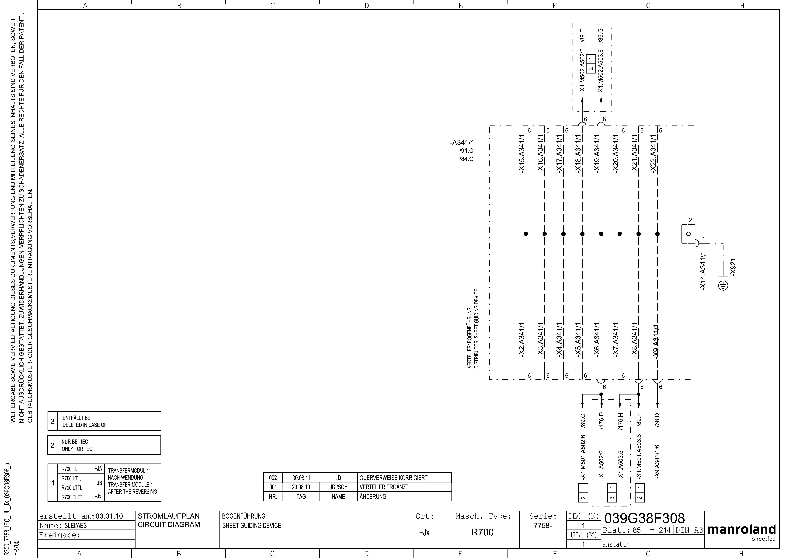

# +Jx — Sheet 85 of 214 — BOGENFÜHRUNG

**SHEET GUIDING DEVICE**

> Part of the manroland **R700** printing press IEC/UL circuit diagrams.
> Drawing class: **Stromlaufplan / Circuit diagram** (DIN A3).
> Document `+Jx` covers the **1st printing module + feed register** machine section.

## At a glance

| Field | Value |
|---|---|
| Document | `+Jx`  (039G38F308) |
| Sheet | **85** of 214 |
| Section (DE) | BOGENFÜHRUNG |
| Section (EN) | SHEET GUIDING DEVICE |
| Section type | CIRCUIT — Circuit diagram |
| Machine type | `R700` |
| Series | `7758` |
| Created | 03.01.10 |
| Replaces | — |
| Columns used | A, B, C, D, E, F, G, H |
| Path numbers | — |
| Labels on sheet | 93 |
| Cross-refs out | 9 |
| Cross-refs in | 25 |

**Previous:** [+Jx sheet 84](SHEET_0084.md) · **Next:** [+Jx sheet 86](SHEET_0086.md) · **Document TOC:** [_TOC.md](_TOC.md)  (+Jx) · **Master TOC:** [all sheets](../_MASTER_TOC.md)

## Sheet image (300 DPI, exact vector render)



_Rendered directly from the PDF vector layer at 300 DPI (1-bit), no OCR and no resampling. Use it to confirm anything ambiguous in the text below._

## Cross-references on this sheet

Each entry is a wire leaving this sheet. The printed token is `/sheet.column`; the link resolves to that sheet inside the same document.

| Ref | Target sheet | Col | Path | Destination on target | Target section | From col |
|---|---|---|---|---|---|---|
| `/89.G` | [+Jx sheet 89](SHEET_0089.md) | G | — | X1.M502.A503:6 | BOGENFÜHRUNG, NACH WENDUNG | F |
| `/89.E` | [+Jx sheet 89](SHEET_0089.md) | E | — | X1.M502.A502:6 | BOGENFÜHRUNG, NACH WENDUNG | F |
| `/91.C` | [+Jx sheet 91](SHEET_0091.md) | C | — | — | BOGENFÜHRUNG (BLASROHRE) | E |
| `/84.C` | [+Jx sheet 84](SHEET_0084.md) | C | — | — | BOGENFÜHRUNG | E |
| `/176.D` | [+Jx sheet 176](SHEET_0176.md) | D | — | X1.A502:6 | OPTION: TRANSFERMODUL 1 NACH | G |
| `/176.H` | [+Jx sheet 176](SHEET_0176.md) | H | — | X1.A503:6 | OPTION: TRANSFERMODUL 1 NACH | G |
| `/89.F` | [+Jx sheet 89](SHEET_0089.md) | F | — | X1.M501.A503:6 | BOGENFÜHRUNG, NACH WENDUNG | G |
| `/68.D` | [+Jx sheet 68](SHEET_0068.md) | D | — | X9.A341\1:6 | BLAS/SAUGLUFT MIT MOTORVENTILEINSTELLUNG | G |
| `/89.C` | [+Jx sheet 89](SHEET_0089.md) | C | — | X1.M501.A502:6 | BOGENFÜHRUNG, NACH WENDUNG | F |

### Incoming references (sheets that point here)

Every other sheet that sends a wire to this one. `Back-ref` is the token printed on *that* sheet; `Path` is its line number.

| From sheet | Cols | Back-ref | Path | Refs | What continues there |
|---|---|---|---|---|---|
| [+Jx#68](SHEET_0068.md) | D | `/68.D` | — | 1 | — |
| [+Jx#84](SHEET_0084.md) | C | `/84.C` | — | 1 | — |
| [+Jx#89](SHEET_0089.md) | C, D, F, G | `/89.C`, `/89.D`, `/89.F`, `/89.G` | — | 4 | X1.M501.A502:6; X1.M501.A503:6; X1.M502.A502:6; X1.M502.A503:6 |
| [+Jx#91](SHEET_0091.md) | B | `/91.B` | — | 1 | — |
| [+Jx#126](SHEET_0126.md) | A | `/126.A` | — | 1 | — |
| [+Jx#127](SHEET_0127.md) | G | `/127.G` | — | 1 | — |
| [+Jx#129](SHEET_0129.md) | F | `/129.F` | — | 1 | — |
| [+Jx#131](SHEET_0131.md) | F | `/131.F` | — | 1 | — |
| [+Jx#132](SHEET_0132.md) | G | `/132.G` | — | 1 | — |
| [+Jx#133](SHEET_0133.md) | B, H | `/133.B`, `/133.H` | — | 2 | — |
| [+Jx#134](SHEET_0134.md) | F | `/134.F` | — | 1 | — |
| [+Jx#138](SHEET_0138.md) | H | `/138.H` | — | 1 | — |
| [+Jx#139](SHEET_0139.md) | E | `/139.E` | — | 1 | — |
| [+Jx#140](SHEET_0140.md) | B, F | `/140.B`, `/140.F` | — | 2 | — |
| [+Jx#141](SHEET_0141.md) | A, E, G | `/141.A`, `/141.E`, `/141.G` | — | 3 | — |
| [+Jx#142](SHEET_0142.md) | A | `/142.A` | — | 1 | — |
| [+Jx#176](SHEET_0176.md) | D, H | `/176.D`, `/176.H` | — | 2 | X1.A502:6 |


## Devices on this sheet

| Tag | Class | Class meaning (IEC) | Col | Sub | Terminal | Sign |
|---|---|---|---|---|---|---|
| `A341/1` | A | Baugruppe / assembly, module, PC board | E | 1 | — | — |
| `X921` | X | Klemme / terminal, plug connector | H | — | — | — |
| `X14.A341\1` | — | cross-device reference | H | — | — | — |
| `NR.` | — | cross-device reference | C | — | — | — |
| `23.08.10` | — | cross-device reference | C | — | — | — |
| `X1.M501.A503:6` | — | cross-device reference | G | — | 6 | — |
| `X1.M501.A502:6` | — | cross-device reference | F | — | 6 | — |
| `X1.M502.A503:6` | — | cross-device reference | F | — | 6 | — |
| `X9.A341\1:6` | — | cross-device reference | G | — | 6 | — |
| `X1.M502.A502:6` | — | cross-device reference | F | — | 6 | — |
| `30.08.11` | — | cross-device reference | C | — | — | — |
| `X1.A502:6` | — | cross-device reference | G | — | 6 | — |
| `X1.A503:6` | — | cross-device reference | G | — | 6 | — |

## Potentials / nets

_No named potentials on this sheet._

## Wire-end annotations (grouped as printed)

A wire that continues elsewhere is annotated with a small cluster: the destination description, the path/line number `#NN`, and the `/sheet.column` cross reference. Each row below is one such cluster exactly as it is grouped on the drawing.

| Col | Y | Path | Cross-ref | Text on the wire |
|---|---|---|---|---|
| F | 42.6 | — | `/89.G` | `X1.M502.A503:6` |
| F | 43.4 | — | `/89.E` | `X1.M502.A502:6` |
| F | 85.3 | — | — | `1 2` |
| F | 176.0 | — | — | `6` |
| G | 176.0 | — | — | `6` |
| F | 193.0 | — | — | `6 6 6 6` |
| F | 193.0 | — | — | `6` |
| F | 193.0 | — | — | `6` |
| F | 202.1 | — | — | `X15.A341/1` |
| F | 202.1 | — | — | `X16.A341/1` |
| F | 202.1 | — | — | `X17.A341/1` |
| F | 202.1 | — | — | `X18.A341/1` |
| F | 202.1 | — | — | `X19.A341/1` |
| G | 202.1 | — | — | `X20.A341/1 X7.A341/1` |
| G | 202.1 | — | — | `X21.A341/1` |
| G | 202.1 | — | — | `X22.A341/1` |
| E | 210.4 | — | — | `A341/1` |
| E | 223.5 | — | `/91.C`, `/84.C` | — |
| G | 328.4 | — | — | `2` |
| H | 355.9 | — | — | `1` |
| H | 379.3 | — | — | `X14.A341\1` |
| H | 388.6 | — | — | `X921` |
| E | 435.6 | — | — | `DISTRIBUTOR: SHEET GUIDING DEVICE` |
| E | 463.8 | — | — | `VERTEILER: BOGENFÜHRUNG` |
| F | 485.6 | — | — | `X2.A341/1` |
| F | 485.6 | — | — | `X3.A341/1` |
| F | 485.6 | — | — | `X4.A341/1` |
| F | 485.6 | — | — | `X5.A341/1` |
| F | 485.6 | — | — | `X6.A341/1` |
| G | 485.6 | — | — | `X8.A341/1` |
| G | 488.4 | — | — | `X9.A341/1` |
| F | 563.0 | — | — | `6 6 6 6` |
| G | 563.0 | — | — | `6` |
| G | 580.0 | — | — | `6` |
| G | 580.0 | — | — | `6` |
| G | 580.0 | — | — | `6` |
| G | 621.9 | — | `/176.D` | `X1.A502:6` |
| G | 623.0 | — | `/176.H` | `X1.A503:6` |
| G | 623.3 | — | `/89.F` | `X1.M501.A503:6` |
| G | 623.3 | — | `/68.D` | `X9.A341\1:6` |
| F | 624.3 | — | `/89.C` | `X1.M501.A502:6` |
| A | 627.7 | — | — | `3 ENTFÄLLT BEI DELETED IN CASE OF` |
| A | 663.9 | — | — | `NUR BEI IEC ONLY FOR IEC` |
| A | 667.4 | — | — | `2` |
| A | 704.2 | — | — | `+JA` |
| A | 704.7 | — | — | `R700 TL` |
| A | 707.2 | — | — | `NACH WENDUNG TRANSFERMODUL 1` |
| D | 717.8 | — | — | `002 30.08.11 JDI QUERVERWEISE KORRIGIERT` |
| A | 718.9 | — | — | `R700 LTL,` |
| A | 724.2 | — | — | `1 +JB` |
| B | 728.4 | — | — | `TRANSFER MODULE 1 AFTER THE REVERSING` |
| D | 731.7 | — | — | `001 23.08.10 JDI/SCH VERTEILER ERGÄNZT` |
| F | 732.7 | — | — | `1 2` |
| G | 732.7 | — | — | `1 3` |
| G | 732.7 | — | — | `1 2` |
| A | 733.1 | — | — | `R700 LTTL` |
| D | 746.1 | — | — | `NR. TAG NAME ÄNDERUNG` |
| A | 746.3 | — | — | `R700 TLTTL +Jx` |


## Notes and free text on this sheet

| Text | Col | Y (pt) |
|---|---|---|
| `VERTEILER: BOGENFÜHRUNG` | E | 463.79 |
| `DISTRIBUTOR: SHEET GUIDING DEVICE` | E | 435.62 |
| `X18.A341/1` | F | 202.11 |
| `X6.A341/1` | F | 485.58 |
| `X8.A341/1` | G | 485.58 |
| `X9.A341/1` | G | 488.41 |
| `X19.A341/1` | F | 202.11 |
| `TAG` | C | 746.26 |
| `NAME` | D | 746.25 |
| `ÄNDERUNG` | D | 746.27 |
| `JDI/SCH` | D | 731.79 |
| `VERTEILER ERGÄNZT` | D | 731.84 |
| `JDI` | D | 717.82 |
| `QUERVERWEISE KORRIGIERT` | D | 717.91 |
| `X3.A341/1` | F | 485.58 |
| `X5.A341/1` | F | 485.58 |
| `X2.A341/1` | F | 485.58 |
| `X4.A341/1` | F | 485.58 |
| `X15.A341/1` | F | 202.11 |
| `X16.A341/1` | F | 202.11 |
| `X17.A341/1` | F | 202.11 |
| `X7.A341/1` | G | 485.58 |
| `X20.A341/1` | G | 202.11 |
| `X21.A341/1` | G | 202.11 |
| `X22.A341/1` | G | 202.11 |
| `R700 TL` | A | 704.74 |
| `R700 LTL,` | A | 718.89 |
| `+JA` | A | 704.23 |
| `R700 TLTTL` | A | 747.26 |
| `+Jx` | A | 746.26 |
| `R700 LTTL` | A | 733.09 |
| `+JB` | A | 725.9 |
| `TRANSFERMODUL 1` | A | 707.18 |
| `NACH WENDUNG` | A | 717.76 |
| `TRANSFER MODULE 1` | A | 728.44 |
| `AFTER THE REVERSING` | B | 739.07 |
| `ENTFÄLLT BEI` | A | 627.71 |
| `DELETED IN CASE OF` | A | 638.37 |
| `NUR BEI IEC` | A | 663.86 |
| `ONLY FOR IEC` | A | 674.51 |

## Complete label inventory (exact text from the drawing)

Every text object inside the drawing area of this sheet, in DIN reading order (column A→H, then top→bottom). This is the authoritative list: if a string is not here it is not printed on this sheet.

| Col | Y | X | Dir | Type | Text |
|---|---|---|---|---|---|
| A | 627.7 | 94.6 | → | text | `ENTFÄLLT BEI` |
| A | 631.2 | 76.4 | → | number | `3` |
| A | 638.4 | 94.6 | → | text | `DELETED IN CASE OF` |
| A | 663.9 | 93.1 | → | text | `NUR BEI IEC` |
| A | 667.4 | 76.3 | → | number | `2` |
| A | 674.5 | 93.4 | → | text | `ONLY FOR IEC` |
| A | 704.2 | 142.8 | → | text | `+JA` |
| A | 704.7 | 93.0 | → | text | `R700 TL` |
| A | 707.2 | 163.3 | → | text | `TRANSFERMODUL 1` |
| A | 717.8 | 162.8 | → | text | `NACH WENDUNG` |
| A | 718.9 | 93.0 | → | text | `R700 LTL,` |
| A | 724.2 | 76.8 | → | number | `1` |
| A | 725.9 | 142.8 | → | text | `+JB` |
| A | 728.4 | 163.3 | → | text | `TRANSFER MODULE 1` |
| A | 733.1 | 93.0 | → | text | `R700 LTTL` |
| A | 746.3 | 142.8 | → | text | `+Jx` |
| A | 747.3 | 93.0 | → | text | `R700 TLTTL` |
| B | 739.1 | 163.3 | → | text | `AFTER THE REVERSING` |
| C | 717.9 | 406.2 | → | number | `002` |
| C | 717.9 | 441.4 | → | device ref | `30.08.11` |
| C | 731.7 | 406.4 | → | number | `001` |
| C | 731.8 | 440.7 | → | device ref | `23.08.10` |
| C | 746.2 | 405.6 | → | device ref | `NR.` |
| C | 746.3 | 447.3 | → | text | `TAG` |
| D | 717.8 | 506.1 | → | text | `JDI` |
| D | 717.9 | 542.8 | → | text | `QUERVERWEISE KORRIGIERT` |
| D | 731.8 | 497.4 | → | text | `JDI/SCH` |
| D | 731.8 | 542.8 | → | text | `VERTEILER ERGÄNZT` |
| D | 746.2 | 500.6 | → | text | `NAME` |
| D | 746.3 | 542.8 | → | text | `ÄNDERUNG` |
| E | 210.4 | 679.0 | → | device tag | `A341/1` |
| E | 223.5 | 693.5 | → | cross-reference | `/91.C` |
| E | 235.9 | 693.5 | → | cross-reference | `/84.C` |
| E | 435.6 | 716.1 | ↕ | text | `DISTRIBUTOR: SHEET GUIDING DEVICE` |
| E | 463.8 | 705.5 | ↕ | text | `VERTEILER: BOGENFÜHRUNG` |
| F | 42.6 | 902.5 | ↕ | cross-reference | `/89.G` |
| F | 43.4 | 875.0 | ↕ | cross-reference | `/89.E` |
| F | 73.0 | 875.0 | ↕ | device ref | `X1.M502.A502:6` |
| F | 74.4 | 902.5 | ↕ | device ref | `X1.M502.A503:6` |
| F | 85.4 | 887.9 | ↕ | number | `1` |
| F | 101.4 | 887.9 | ↕ | number | `2` |
| F | 176.0 | 881.3 | → | number | `6` |
| F | 193.0 | 796.3 | → | number | `6` |
| F | 193.0 | 824.6 | → | number | `6` |
| F | 193.0 | 852.9 | → | number | `6` |
| F | 202.1 | 782.6 | ↕ | text | `X15.A341/1` |
| F | 202.1 | 810.9 | ↕ | text | `X16.A341/1` |
| F | 202.1 | 839.3 | ↕ | text | `X17.A341/1` |
| F | 202.1 | 867.6 | ↕ | text | `X18.A341/1` |
| F | 202.1 | 896.0 | ↕ | text | `X19.A341/1` |
| F | 485.6 | 782.6 | ↕ | text | `X2.A341/1` |
| F | 485.6 | 811.0 | ↕ | text | `X3.A341/1` |
| F | 485.6 | 839.3 | ↕ | text | `X4.A341/1` |
| F | 485.6 | 867.6 | ↕ | text | `X5.A341/1` |
| F | 485.6 | 896.0 | ↕ | text | `X6.A341/1` |
| F | 562.9 | 796.3 | → | number | `6` |
| F | 562.9 | 824.6 | → | number | `6` |
| F | 562.9 | 852.9 | → | number | `6` |
| F | 562.9 | 881.3 | → | number | `6` |
| F | 624.3 | 875.8 | ↕ | cross-reference | `/89.C` |
| F | 656.1 | 875.8 | ↕ | device ref | `X1.M501.A502:6` |
| F | 732.7 | 876.3 | ↕ | number | `1` |
| F | 748.8 | 876.3 | ↕ | number | `2` |
| G | 176.0 | 909.6 | → | number | `6` |
| G | 193.0 | 938.0 | → | number | `6` |
| G | 193.0 | 966.3 | → | number | `6` |
| G | 193.0 | 994.7 | → | number | `6` |
| G | 202.1 | 924.3 | ↕ | text | `X20.A341/1` |
| G | 202.1 | 952.7 | ↕ | text | `X21.A341/1` |
| G | 202.1 | 981.0 | ↕ | text | `X22.A341/1` |
| G | 328.4 | 1039.5 | → | number | `2` |
| G | 485.6 | 924.3 | ↕ | text | `X7.A341/1` |
| G | 485.6 | 952.7 | ↕ | text | `X8.A341/1` |
| G | 488.4 | 985.3 | ↕ | text | `X9.A341/1` |
| G | 562.9 | 938.0 | → | number | `6` |
| G | 580.0 | 909.6 | → | number | `6` |
| G | 580.0 | 966.3 | → | number | `6` |
| G | 580.0 | 994.7 | → | number | `6` |
| G | 621.9 | 903.8 | ↕ | cross-reference | `/176.D` |
| G | 623.0 | 932.7 | ↕ | cross-reference | `/176.H` |
| G | 623.3 | 960.3 | ↕ | cross-reference | `/89.F` |
| G | 623.3 | 987.8 | ↕ | cross-reference | `/68.D` |
| G | 655.1 | 960.3 | ↕ | device ref | `X1.M501.A503:6` |
| G | 671.0 | 987.8 | ↕ | device ref | `X9.A341\1:6` |
| G | 679.7 | 903.8 | ↕ | device ref | `X1.A502:6` |
| G | 679.7 | 932.7 | ↕ | device ref | `X1.A503:6` |
| G | 732.7 | 919.7 | ↕ | number | `1` |
| G | 732.7 | 961.6 | ↕ | number | `1` |
| G | 748.8 | 961.6 | ↕ | number | `2` |
| G | 748.9 | 919.7 | ↕ | number | `3` |
| H | 355.9 | 1059.0 | → | number | `1` |
| H | 379.3 | 1056.1 | ↕ | device ref | `X14.A341\1` |
| H | 388.6 | 1101.5 | ↕ | device tag | `X921` |

## Reading-order text block

The same content as a plain block, grouped by DIN column — convenient to paste or to match against a visual description.

```text
=== Column A ===
 627.7   94.6  text         ENTFÄLLT BEI
 631.2   76.4  numeric      3
 638.4   94.6  text         DELETED IN CASE OF
 663.9   93.1  text         NUR BEI IEC
 667.4   76.3  numeric      2
 674.5   93.4  text         ONLY FOR IEC
 704.2  142.8  text         +JA
 704.7   93.0  text         R700 TL
 707.2  163.3  text         TRANSFERMODUL 1
 717.8  162.8  text         NACH WENDUNG
 718.9   93.0  text         R700 LTL,
 724.2   76.8  numeric      1
 725.9  142.8  text         +JB
 728.4  163.3  text         TRANSFER MODULE 1
 733.1   93.0  text         R700 LTTL
 746.3  142.8  text         +Jx
 747.3   93.0  text         R700 TLTTL
=== Column B ===
 739.1  163.3  text         AFTER THE REVERSING
=== Column C ===
 717.9  406.2  numeric      002
 717.9  441.4  devref       30.08.11
 731.7  406.4  numeric      001
 731.8  440.7  devref       23.08.10
 746.2  405.6  devref       NR.
 746.3  447.3  text         TAG
=== Column D ===
 717.8  506.1  text         JDI
 717.9  542.8  text         QUERVERWEISE KORRIGIERT
 731.8  497.4  text         JDI/SCH
 731.8  542.8  text         VERTEILER ERGÄNZT
 746.2  500.6  text         NAME
 746.3  542.8  text         ÄNDERUNG
=== Column E ===
 210.4  679.0  devtag       A341/1
 223.5  693.5  xref         /91.C
 235.9  693.5  xref         /84.C
 435.6  716.1  text         DISTRIBUTOR: SHEET GUIDING DEVICE
 463.8  705.5  text         VERTEILER: BOGENFÜHRUNG
=== Column F ===
  42.6  902.5  xref         /89.G
  43.4  875.0  xref         /89.E
  73.0  875.0  devref       X1.M502.A502:6
  74.4  902.5  devref       X1.M502.A503:6
  85.4  887.9  numeric      1
 101.4  887.9  numeric      2
 176.0  881.3  numeric      6
 193.0  796.3  numeric      6
 193.0  824.6  numeric      6
 193.0  852.9  numeric      6
 202.1  782.6  text         X15.A341/1
 202.1  810.9  text         X16.A341/1
 202.1  839.3  text         X17.A341/1
 202.1  867.6  text         X18.A341/1
 202.1  896.0  text         X19.A341/1
 485.6  782.6  text         X2.A341/1
 485.6  811.0  text         X3.A341/1
 485.6  839.3  text         X4.A341/1
 485.6  867.6  text         X5.A341/1
 485.6  896.0  text         X6.A341/1
 562.9  796.3  numeric      6
 562.9  824.6  numeric      6
 562.9  852.9  numeric      6
 562.9  881.3  numeric      6
 624.3  875.8  xref         /89.C
 656.1  875.8  devref       X1.M501.A502:6
 732.7  876.3  numeric      1
 748.8  876.3  numeric      2
=== Column G ===
 176.0  909.6  numeric      6
 193.0  938.0  numeric      6
 193.0  966.3  numeric      6
 193.0  994.7  numeric      6
 202.1  924.3  text         X20.A341/1
 202.1  952.7  text         X21.A341/1
 202.1  981.0  text         X22.A341/1
 328.4 1039.5  numeric      2
 485.6  924.3  text         X7.A341/1
 485.6  952.7  text         X8.A341/1
 488.4  985.3  text         X9.A341/1
 562.9  938.0  numeric      6
 580.0  909.6  numeric      6
 580.0  966.3  numeric      6
 580.0  994.7  numeric      6
 621.9  903.8  xref         /176.D
 623.0  932.7  xref         /176.H
 623.3  960.3  xref         /89.F
 623.3  987.8  xref         /68.D
 655.1  960.3  devref       X1.M501.A503:6
 671.0  987.8  devref       X9.A341\1:6
 679.7  903.8  devref       X1.A502:6
 679.7  932.7  devref       X1.A503:6
 732.7  919.7  numeric      1
 732.7  961.6  numeric      1
 748.8  961.6  numeric      2
 748.9  919.7  numeric      3
=== Column H ===
 355.9 1059.0  numeric      1
 379.3 1056.1  devref       X14.A341\1
 388.6 1101.5  devtag       X921
```

---
_Generated from the PDF vector text layer; no OCR. Source: `R700_7758_IEC_UL_JX_039G38F308_p`, sheet 85._
