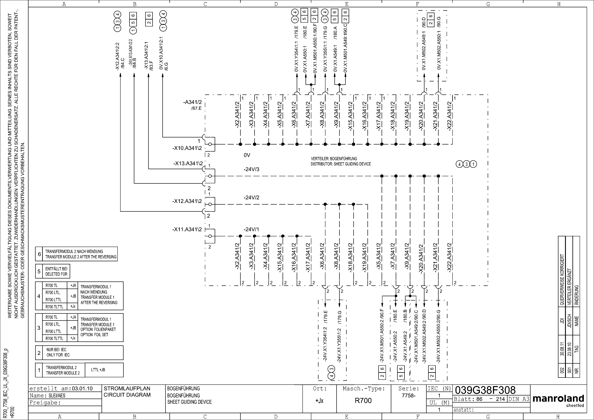

# +Jx — Sheet 86 of 214 — BOGENFÜHRUNG

**BOGENFÜHRUNG**

> Part of the manroland **R700** printing press IEC/UL circuit diagrams.
> Drawing class: **Stromlaufplan / Circuit diagram** (DIN A3).
> Document `+Jx` covers the **1st printing module + feed register** machine section.

## At a glance

| Field | Value |
|---|---|
| Document | `+Jx`  (039G38F308) |
| Sheet | **86** of 214 |
| Section (DE) | BOGENFÜHRUNG |
| Section (EN) | BOGENFÜHRUNG |
| Section type | CIRCUIT — Circuit diagram |
| Machine type | `R700` |
| Series | `7758` |
| Created | 03.01.10 |
| Replaces | — |
| Columns used | A, B, C, D, E, F, G, H |
| Path numbers | — |
| Labels on sheet | 209 |
| Cross-refs out | 21 |
| Cross-refs in | 53 |

**Previous:** [+Jx sheet 85](SHEET_0085.md) · **Next:** [+Jx sheet 87](SHEET_0087.md) · **Document TOC:** [_TOC.md](_TOC.md)  (+Jx) · **Master TOC:** [all sheets](../_MASTER_TOC.md)

## Sheet image (300 DPI, exact vector render)



_Rendered directly from the PDF vector layer at 300 DPI (1-bit), no OCR and no resampling. Use it to confirm anything ambiguous in the text below._

## Cross-references on this sheet

Each entry is a wire leaving this sheet. The printed token is `/sheet.column`; the link resolves to that sheet inside the same document.

| Ref | Target sheet | Col | Path | Destination on target | Target section | From col |
|---|---|---|---|---|---|---|
| `/90.G` | [+Jx sheet 90](SHEET_0090.md) | G | — | 0V.X1.M502.A550:1 | BOGENFÜHRUNG, NACH WENDUNG | F |
| `/90.D` | [+Jx sheet 90](SHEET_0090.md) | D | — | 0V.X1.M502.A549:1 | BOGENFÜHRUNG, NACH WENDUNG | F |
| `/90.F` | [+Jx sheet 90](SHEET_0090.md) | F | — | 0V.X1.M501.A550:1 | BOGENFÜHRUNG, NACH WENDUNG | E |
| `/90.C` | [+Jx sheet 90](SHEET_0090.md) | C | — | 0V.X1.M501.A549:1 | BOGENFÜHRUNG, NACH WENDUNG | E |
| `/179.E` | [+Jx sheet 179](SHEET_0179.md) | E | — | 0V.X1.Y354\1:1 | OPTION: TRANSFERMODUL 1 NACH | D |
| `/180.E` | [+Jx sheet 180](SHEET_0180.md) | E | — | 0V.X1.A550:1 | OPTION: TRANSFERMODUL 2 | D |
| `/179.G` | [+Jx sheet 179](SHEET_0179.md) | G | — | 0V.X1.Y355\1:1 | OPTION: TRANSFERMODUL 1 NACH | E |
| `/180.A` | [+Jx sheet 180](SHEET_0180.md) | A | — | 0V.X1.A549:1 | OPTION: TRANSFERMODUL 2 | E |
| `/6.G` | [+Jx sheet 6](SHEET_0006.md) | G | — | 0V.X10.A341\2:1 | SPANNUNGSVERSORGUNG, SCHALTSCHRANKBELÜFTUNG | B |
| `/84.B` | [+Jx sheet 84](SHEET_0084.md) | B | — | 24V.X13.A341/2:2 | BOGENFÜHRUNG | B |
| `/83.F` | [+Jx sheet 83](SHEET_0083.md) | F | — | X13.A341\2:1 | BOGENFÜHRUNG, NACH WENDUNG | B |
| `/84.C` | [+Jx sheet 84](SHEET_0084.md) | C | — | X12.A341\2:2 | BOGENFÜHRUNG | B |
| `/87.E` | [+Jx sheet 87](SHEET_0087.md) | E | — | — | BOGENFÜHRUNG | C |
| `/90.F` | [+Jx sheet 90](SHEET_0090.md) | F | — | 24V.X1.M501.A550:2 | BOGENFÜHRUNG, NACH WENDUNG | F |
| `/90.D` | [+Jx sheet 90](SHEET_0090.md) | D | — | 24V.X1.M502.A549:2 | BOGENFÜHRUNG, NACH WENDUNG | F |
| `/180.E` | [+Jx sheet 180](SHEET_0180.md) | E | — | 24V.X1.A550:2 | OPTION: TRANSFERMODUL 2 | F |
| `/180.B` | [+Jx sheet 180](SHEET_0180.md) | B | — | 24V.X1.A549:2 | OPTION: TRANSFERMODUL 2 | F |
| `/90.G` | [+Jx sheet 90](SHEET_0090.md) | G | — | 24V.X1.M502.A550:2 | BOGENFÜHRUNG, NACH WENDUNG | F |
| `/90.C` | [+Jx sheet 90](SHEET_0090.md) | C | — | 24V.X1.M501.A549:2 | BOGENFÜHRUNG, NACH WENDUNG | F |
| `/179.E` | [+Jx sheet 179](SHEET_0179.md) | E | — | 24V.X1.Y354\1:2 | OPTION: TRANSFERMODUL 1 NACH | E |
| `/179.G` | [+Jx sheet 179](SHEET_0179.md) | G | — | 24V.X1.Y355\1:2 | OPTION: TRANSFERMODUL 1 NACH | E |

### Incoming references (sheets that point here)

Every other sheet that sends a wire to this one. `Back-ref` is the token printed on *that* sheet; `Path` is its line number.

| From sheet | Cols | Back-ref | Path | Refs | What continues there |
|---|---|---|---|---|---|
| [+Jx#6](SHEET_0006.md) | H | `/6.H` | — | 1 | 0V.X10.A341\2:1 |
| [+Jx#83](SHEET_0083.md) | F | `/83.F` | — | 1 | — |
| [+Jx#84](SHEET_0084.md) | B, C | `/84.B`, `/84.C` | — | 2 | 24V.X13.A341/2:2; X12.A341\2:2 |
| [+Jx#87](SHEET_0087.md) | E | `/87.E` | — | 1 | — |
| [+Jx#90](SHEET_0090.md) | C, D, F, G | `/90.C`, `/90.D`, `/90.F`, `/90.G` | — | 8 | 0V.X1.M501.A549:1; 0V.X1.M501.A550:1; 0V.X1.M502.A549:1; 0V.X1.M502.A550:1; 24V.X1.M501.A549:2; 24V.X1.M501.A550:2; 24V.X1.M502.A549:2; 24V.X1.M502.A550:2 |
| [+Jx#126](SHEET_0126.md) | A | `/126.A` | — | 2 | — |
| [+Jx#127](SHEET_0127.md) | G | `/127.G` | — | 2 | — |
| [+Jx#129](SHEET_0129.md) | F | `/129.F` | — | 2 | — |
| [+Jx#131](SHEET_0131.md) | G | `/131.G` | — | 2 | — |
| [+Jx#132](SHEET_0132.md) | G | `/132.G` | — | 2 | — |
| [+Jx#133](SHEET_0133.md) | B, H | `/133.B`, `/133.H` | — | 4 | — |
| [+Jx#134](SHEET_0134.md) | F | `/134.F` | — | 2 | — |
| [+Jx#138](SHEET_0138.md) | H | `/138.H` | — | 2 | — |
| [+Jx#139](SHEET_0139.md) | E | `/139.E` | — | 2 | — |
| [+Jx#140](SHEET_0140.md) | B, F | `/140.B`, `/140.F` | — | 4 | — |
| [+Jx#141](SHEET_0141.md) | B, E, G | `/141.B`, `/141.E`, `/141.G` | — | 6 | — |
| [+Jx#142](SHEET_0142.md) | B | `/142.B` | — | 2 | — |
| [+Jx#179](SHEET_0179.md) | D, E, F | `/179.D`, `/179.E`, `/179.F` | — | 4 | 0V.X1.Y354\1:1 0V.X1.Y355\1:1; 24V.X1.Y354\1:2; 24V.X1.Y355\1:2 |
| [+Jx#180](SHEET_0180.md) | A, B, E | `/180.A`, `/180.B`, `/180.E` | — | 4 | 0V.X1.A549:1; 0V.X1.A550:1; 24V.X1.A549:2; 24V.X1.A550:2 |


## Devices on this sheet

| Tag | Class | Class meaning (IEC) | Col | Sub | Terminal | Sign |
|---|---|---|---|---|---|---|
| `A341/2` | A | Baugruppe / assembly, module, PC board | C | 2 | — | — |
| `X10.A341\2` | — | cross-device reference | C | — | — | — |
| `X13.A341\2` | — | cross-device reference | C | — | — | — |
| `X12.A341\2` | — | cross-device reference | C | — | — | — |
| `NR.` | — | cross-device reference | H | — | — | — |
| `23.08.10` | — | cross-device reference | H | — | — | — |
| `X13.A341\2:1` | — | cross-device reference | B | — | 1 | — |
| `X12.A341\2:2` | — | cross-device reference | B | — | 2 | — |
| `30.08.11` | — | cross-device reference | H | — | — | — |
| `X11.A341\2` | — | cross-device reference | C | — | — | — |

## Potentials / nets

| Potential | Count | Columns | Attached devices | Terminals |
|---|---|---|---|---|
| `0V` | 10 | B, D, E, F | `A341\2`, `A549`, `A550`, `M501`, `M502`, `X1`, `X10`, `Y354\1`, `Y355\1` | `1` |
| `24V` | 11 | D, E, F | `A549`, `A550`, `M501`, `M502`, `X1`, `Y354\1`, `Y355\1` | `2` |


A potential such as `L24+/4` or `M24+` is a named supply/return rail; every place it appears on this sheet is electrically common.

## Wire-end annotations (grouped as printed)

A wire that continues elsewhere is annotated with a small cluster: the destination description, the path/line number `#NN`, and the `/sheet.column` cross reference. Each row below is one such cluster exactly as it is grouped on the drawing.

| Col | Y | Path | Cross-ref | Text on the wire |
|---|---|---|---|---|
| D | 20.9 | — | — | `6 5` |
| E | 20.9 | — | — | `6 2` |
| E | 22.1 | — | — | `6 5` |
| E | 22.1 | — | — | `6 2` |
| E | 22.6 | — | — | `4` |
| D | 22.8 | — | — | `4` |
| B | 26.0 | — | — | `1 3 4` |
| B | 27.0 | — | — | `1 3 4` |
| B | 28.6 | — | — | `6 5` |
| B | 28.6 | — | — | `6 2` |
| F | 29.9 | — | — | `6 2` |
| F | 33.3 | — | `/90.G` | `0V.X1.M502.A550:1` |
| F | 34.5 | — | `/90.D` | `0V.X1.M502.A549:1` |
| E | 36.9 | — | — | `3` |
| D | 37.1 | — | — | `3` |
| E | 46.9 | — | `/90.F` | `0V.X1.M501.A550:1` |
| E | 47.5 | — | `/90.C` | `0V.X1.M501.A549:1` |
| D | 51.6 | — | `/179.E` | `0V.X1.Y354\1:1` |
| D | 51.6 | — | `/180.E` | `0V.X1.A550:1` |
| E | 52.2 | — | `/179.G` | `0V.X1.Y355\1:1` |
| E | 53.1 | — | `/180.A` | `0V.X1.A549:1` |
| B | 58.8 | — | — | `1` |
| B | 72.7 | — | `/6.G` | `0V.X10.A341\2:1` |
| B | 78.6 | — | `/84.B` | `24V.X13.A341/2:2` |
| B | 83.2 | — | `/83.F` | `X13.A341\2:1` |
| B | 85.4 | — | `/84.C` | `X12.A341\2:2` |
| D | 176.0 | — | — | `1` |
| E | 176.0 | — | — | `1` |
| E | 176.0 | — | — | `1` |
| E | 176.0 | — | — | `1` |
| F | 176.0 | — | — | `1` |
| F | 176.0 | — | — | `1` |
| E | 193.0 | — | — | `1 1 1 1 1 1 1` |
| G | 193.0 | — | — | `1` |
| C | 200.1 | — | — | `A341/2` |
| C | 203.5 | — | — | `X2.A341/2` |
| D | 203.5 | — | — | `X3.A341/2 X3.A341/2` |
| D | 203.5 | — | — | `X4.A341/2` |
| D | 203.5 | — | — | `X5.A341/2` |
| D | 203.5 | — | — | `X6.A341/2` |
| D | 203.5 | — | — | `X7.A341/2` |
| E | 203.5 | — | — | `X8.A341/2` |
| E | 203.5 | — | — | `X9.A341/2` |
| E | 203.5 | — | — | `X15.A341/2` |
| E | 203.5 | — | — | `X16.A341/2` |
| E | 203.5 | — | — | `X17.A341/2` |
| F | 203.5 | — | — | `X18.A341/2` |
| F | 203.5 | — | — | `X19.A341/2` |
| F | 203.5 | — | — | `X20.A341/2` |
| F | 203.5 | — | — | `X21.A341/2` |
| F | 203.5 | — | — | `X22.A341/2` |
| C | 213.1 | — | `/87.E` | — |
| C | 278.0 | — | — | `X10.A341\2 1` |
| D | 306.4 | — | — | `0V` |
| C | 307.1 | — | — | `2` |
| D | 315.2 | — | — | `X13.A341\2 DISTRIBUTOR: SHEET GUIDING DEVICE VERTEILER: BOGENFÜHRUNG` |
| G | 325.8 | — | — | `4 3 1` |
| C | 328.4 | — | — | `1` |
| D | 334.7 | — | — | `24V/3` |
| C | 372.8 | — | — | `2` |
| C | 385.1 | — | — | `1` |
| D | 391.4 | — | — | `24V/2` |
| C | 398.5 | — | — | `X12.A341\2` |
| C | 427.9 | — | — | `2` |
| C | 448.9 | — | — | `1` |
| C | 455.2 | — | — | `X11.A341\2` |
| D | 455.2 | — | — | `24V/1` |
| C | 487.0 | — | — | `X2.A341/2` |
| D | 487.0 | — | — | `X4.A341/2` |
| D | 487.0 | — | — | `X15.A341/2` |
| D | 487.0 | — | — | `X16.A341/2` |
| D | 487.0 | — | — | `X17.A341/2` |
| E | 487.0 | — | — | `X6.A341/2` |
| E | 487.0 | — | — | `X8.A341/2` |
| E | 487.0 | — | — | `X18.A341/2` |
| E | 487.0 | — | — | `X19.A341/2` |
| E | 487.0 | — | — | `X5.A341/2` |
| F | 487.0 | — | — | `X7.A341/2` |
| F | 487.0 | — | — | `X9.A341/2` |
| F | 487.0 | — | — | `X21.A341/2` |
| F | 487.0 | — | — | `X22.A341/2` |
| F | 489.8 | — | — | `X20.A341/2` |
| C | 491.4 | — | — | `2` |
| A | 501.4 | — | — | `TRANSFERMODUL 2 NACH WENDUNG TRANSFER MODULE 2 AFTER THE REVERSING` |
| A | 504.7 | — | — | `6` |
| H | 509.2 | — | — | `JDI 30.08.11 QUERVERWEISE KORRIGIERT 002` |
| A | 536.1 | — | — | `5 ENTFÄLLT BEI DELETED FOR` |
| H | 537.9 | — | — | `001 JDI/SCH 23.08.10 VERTEILER ERGÄNZT` |
| D | 563.0 | — | — | `2 2 2` |
| D | 563.0 | — | — | `2 2 2` |
| E | 563.0 | — | — | `2 2 2` |
| G | 563.0 | — | — | `2` |
| A | 569.1 | — | — | `+JA` |
| A | 569.6 | — | — | `R700 TL` |
| H | 571.6 | — | — | `NR. NAME TAG ÄNDERUNG` |
| A | 572.0 | — | — | `NACH WENDUNG TRANSFERMODUL 1` |
| E | 580.0 | — | — | `2` |
| E | 580.0 | — | — | `2` |
| F | 580.0 | — | — | `2` |
| F | 580.0 | — | — | `2` |
| F | 580.0 | — | — | `2` |
| F | 580.0 | — | — | `2` |
| A | 583.7 | — | — | `R700 LTL,` |
| A | 589.0 | — | — | `4 +JB` |
| A | 593.3 | — | — | `TRANSFER MODULE 1 AFTER THE REVERSING` |
| A | 597.9 | — | — | `R700 LTTL` |
| A | 611.1 | — | — | `R700 TLTTL +Jx` |
| F | 618.8 | — | `/90.F` | `24V.X1.M501.A550:2` |
| F | 619.9 | — | `/90.D` | `24V.X1.M502.A549:2` |
| F | 620.4 | — | `/180.E` | `24V.X1.A550:2` |
| F | 620.4 | — | `/180.B` | `24V.X1.A549:2` |
| F | 621.2 | — | `/90.G` | `24V.X1.M502.A550:2` |
| F | 621.5 | — | `/90.C` | `24V.X1.M501.A549:2` |
| E | 622.1 | — | `/179.E` | `24V.X1.Y354\1:2` |
| E | 623.0 | — | `/179.G` | `24V.X1.Y355\1:2` |
| A | 632.7 | — | — | `+JA` |
| A | 633.2 | — | — | `R700 TL` |
| A | 637.3 | — | — | `TRANSFERMODUL 1 TRANSFER MODULE 1` |
| A | 647.4 | — | — | `R700 LTL,` |
| A | 652.6 | — | — | `3 +JB` |
| A | 657.5 | — | — | `OPTION OPTION` |
| B | 657.5 | — | — | `FOLIENPAKET FOIL SET` |
| A | 661.5 | — | — | `R700 LTTL` |
| A | 674.7 | — | — | `R700 TLTTL +Jx` |
| A | 698.0 | — | — | `2 NUR BEI IEC ONLY FOR IEC` |
| A | 734.2 | — | — | `TRANSFERMODUL 2 TRANSFER MODULE 2` |
| F | 736.8 | — | — | `6 2` |
| F | 736.8 | — | — | `6 5` |
| F | 736.8 | — | — | `6 2` |
| A | 737.5 | — | — | `1 LTTL +JB` |
| E | 737.6 | — | — | `3 4` |


## Reconstructed tables

This sheet carries tabular content (pin map / terminal assignment / index). The grid below was rebuilt from the drawing's own rule lines, so each row is exactly one physical row of the table.

### Table 1 — 4 data rows × 1 columns (at x=326.0, y=275.0)

| C1 |
|---|
| `1` |
| `X10.A341\2 2 X13.A341\2 1` |
| `2 1 X12.A341\2` |
| `2 1 X11.A341\2` |


### Table 2 — 4 data rows × 1 columns (at x=481.9, y=275.0)

| C1 |
|---|
| `0V` |
| `24V/3` |
| `24V/2` |
| `24V/1` |


## Notes and free text on this sheet

| Text | Col | Y (pt) |
|---|---|---|
| `VERTEILER: BOGENFÜHRUNG` | E | 315.24 |
| `DISTRIBUTOR: SHEET GUIDING DEVICE` | E | 325.86 |
| `X6.A341/2` | D | 203.53 |
| `X7.A341/2` | D | 203.53 |
| `X8.A341/2` | E | 203.53 |
| `X9.A341/2` | E | 203.53 |
| `X21.A341/2` | F | 203.53 |
| `X20.A341/2` | F | 203.53 |
| `X6.A341/2` | E | 486.99 |
| `X7.A341/2` | F | 486.99 |
| `X9.A341/2` | F | 486.99 |
| `TAG` | H | 692.65 |
| `NAME` | H | 633.42 |
| `ÄNDERUNG` | H | 571.56 |
| `JDI/SCH` | H | 629.62 |
| `VERTEILER ERGÄNZT` | H | 537.91 |
| `JDI` | H | 637.7 |
| `QUERVERWEISE KORRIGIERT` | H | 509.25 |
| `24V.X13.A341/2:2` | B | 78.61 |
| `X3.A341/2` | D | 486.99 |
| `X5.A341/2` | D | 203.53 |
| `X4.A341/2` | D | 203.53 |
| `X2.A341/2` | C | 203.53 |
| `X16.A341/2` | E | 203.53 |
| `X18.A341/2` | F | 203.53 |
| `X17.A341/2` | E | 203.53 |
| `X15.A341/2` | E | 203.53 |
| `X22.A341/2` | F | 203.53 |
| `X19.A341/2` | F | 203.53 |
| `X16.A341/2` | D | 486.99 |
| `X17.A341/2` | D | 486.99 |
| `X15.A341/2` | D | 486.99 |
| `X18.A341/2` | E | 486.99 |
| `X19.A341/2` | E | 486.99 |
| `X5.A341/2` | E | 486.99 |
| `TRANSFERMODUL 2` | A | 734.21 |
| `TRANSFER MODULE 2` | A | 744.84 |
| `LTTL +JB` | A | 738.49 |
| `NUR BEI IEC` | A | 698.02 |
| `ONLY FOR IEC` | A | 708.67 |
| `OPTION` | A | 657.55 |
| `FOLIENPAKET` | B | 657.55 |
| `FOIL SET` | B | 668.17 |
| `TRANSFERMODUL 2 NACH WENDUNG` | A | 501.45 |
| `TRANSFER MODULE 2 AFTER THE REVERSING` | A | 512.07 |
| `ENTFÄLLT BEI` | A | 536.1 |
| `DELETED FOR` | A | 546.76 |
| `R700 TL` | A | 569.58 |
| `R700 LTL,` | A | 583.74 |
| `+JA` | A | 569.08 |
| `R700 TLTTL` | A | 612.11 |
| `+Jx` | A | 611.1 |
| `R700 LTTL` | A | 597.93 |
| `+JB` | A | 590.74 |
| `TRANSFERMODUL 1` | A | 572.03 |
| `NACH WENDUNG` | A | 582.6 |
| `TRANSFER MODULE 1` | A | 593.29 |
| `AFTER THE REVERSING` | A | 603.91 |

## Complete label inventory (exact text from the drawing)

Every text object inside the drawing area of this sheet, in DIN reading order (column A→H, then top→bottom). This is the authoritative list: if a string is not here it is not printed on this sheet.

| Col | Y | X | Dir | Type | Text |
|---|---|---|---|---|---|
| A | 501.4 | 91.0 | → | text | `TRANSFERMODUL 2 NACH WENDUNG` |
| A | 504.7 | 76.3 | → | number | `6` |
| A | 512.1 | 91.0 | → | text | `TRANSFER MODULE 2 AFTER THE REVERSING` |
| A | 536.1 | 91.1 | → | text | `ENTFÄLLT BEI` |
| A | 539.6 | 75.1 | → | number | `5` |
| A | 546.8 | 91.1 | → | text | `DELETED FOR` |
| A | 569.1 | 141.3 | → | text | `+JA` |
| A | 569.6 | 91.5 | → | text | `R700 TL` |
| A | 572.0 | 161.8 | → | text | `TRANSFERMODUL 1` |
| A | 582.6 | 161.3 | → | text | `NACH WENDUNG` |
| A | 583.7 | 91.5 | → | text | `R700 LTL,` |
| A | 589.0 | 75.0 | → | number | `4` |
| A | 590.7 | 141.3 | → | text | `+JB` |
| A | 593.3 | 161.8 | → | text | `TRANSFER MODULE 1` |
| A | 597.9 | 91.5 | → | text | `R700 LTTL` |
| A | 603.9 | 161.8 | → | text | `AFTER THE REVERSING` |
| A | 611.1 | 141.3 | → | text | `+Jx` |
| A | 612.1 | 91.5 | → | text | `R700 TLTTL` |
| A | 632.7 | 141.3 | → | text | `+JA` |
| A | 633.2 | 91.4 | → | text | `R700 TL` |
| A | 637.3 | 161.8 | → | text | `TRANSFERMODUL 1` |
| A | 647.3 | 91.4 | → | text | `R700 LTL,` |
| A | 648.0 | 161.8 | → | text | `TRANSFER MODULE 1` |
| A | 652.7 | 74.9 | → | number | `3` |
| A | 654.4 | 141.3 | → | text | `+JB` |
| A | 657.5 | 161.5 | → | text | `OPTION` |
| A | 661.5 | 91.4 | → | text | `R700 LTTL` |
| A | 668.2 | 161.5 | → | text | `OPTION` |
| A | 674.7 | 141.3 | → | text | `+Jx` |
| A | 675.7 | 91.4 | → | text | `R700 TLTTL` |
| A | 698.0 | 93.3 | → | text | `NUR BEI IEC` |
| A | 703.0 | 75.3 | → | number | `2` |
| A | 708.7 | 93.6 | → | text | `ONLY FOR IEC` |
| A | 734.2 | 92.4 | → | text | `TRANSFERMODUL 2` |
| A | 737.5 | 75.4 | → | number | `1` |
| A | 738.5 | 182.9 | → | text | `LTTL +JB` |
| A | 744.8 | 92.4 | → | text | `TRANSFER MODULE 2` |
| B | 26.0 | 324.5 | ↕ | number | `4` |
| B | 27.0 | 232.8 | ↕ | number | `4` |
| B | 28.6 | 263.0 | ↕ | number | `6` |
| B | 28.6 | 294.8 | ↕ | number | `6` |
| B | 40.3 | 324.4 | ↕ | number | `3` |
| B | 41.2 | 232.7 | ↕ | number | `3` |
| B | 42.9 | 294.8 | ↕ | number | `2` |
| B | 43.1 | 263.0 | ↕ | number | `5` |
| B | 52.9 | 324.0 | ↕ | number | `1` |
| B | 53.8 | 232.3 | ↕ | number | `1` |
| B | 58.8 | 263.8 | ↕ | number | `1` |
| B | 72.7 | 319.0 | ↕ | potential | `0V.X10.A341\2:1` |
| B | 78.6 | 258.8 | ↕ | text | `24V.X13.A341/2:2` |
| B | 83.2 | 289.4 | ↕ | device ref | `X13.A341\2:1` |
| B | 85.4 | 231.4 | ↕ | device ref | `X12.A341\2:2` |
| B | 116.2 | 242.0 | ↕ | cross-reference | `/84.C` |
| B | 116.2 | 265.5 | ↕ | cross-reference | `/84.B` |
| B | 121.6 | 299.3 | ↕ | cross-reference | `/83.F` |
| B | 125.2 | 329.2 | ↕ | cross-reference | `/6.G` |
| B | 657.5 | 188.7 | → | text | `FOLIENPAKET` |
| B | 668.2 | 188.7 | → | text | `FOIL SET` |
| C | 200.1 | 367.4 | → | device tag | `A341/2` |
| C | 203.5 | 470.8 | ↕ | text | `X2.A341/2` |
| C | 213.1 | 383.5 | → | cross-reference | `/87.E` |
| C | 278.0 | 395.7 | → | number | `1` |
| C | 292.2 | 345.5 | → | device ref | `X10.A341\2` |
| C | 307.1 | 415.8 | → | number | `2` |
| C | 322.9 | 347.6 | → | device ref | `X13.A341\2` |
| C | 328.4 | 417.3 | → | number | `1` |
| C | 372.8 | 416.3 | → | number | `2` |
| C | 385.1 | 417.3 | → | number | `1` |
| C | 398.5 | 345.5 | → | device ref | `X12.A341\2` |
| C | 427.9 | 415.0 | → | number | `2` |
| C | 448.9 | 417.3 | → | number | `1` |
| C | 455.2 | 345.5 | → | device ref | `X11.A341\2` |
| C | 487.0 | 470.8 | ↕ | text | `X2.A341/2` |
| C | 491.4 | 418.1 | → | number | `2` |
| D | 20.9 | 606.1 | ↕ | number | `6` |
| D | 22.8 | 588.6 | ↕ | number | `4` |
| D | 35.3 | 606.1 | ↕ | number | `5` |
| D | 37.1 | 588.5 | ↕ | number | `3` |
| D | 51.6 | 590.2 | ↕ | cross-reference | `/179.E` |
| D | 51.6 | 607.5 | ↕ | cross-reference | `/180.E` |
| D | 82.1 | 590.2 | ↕ | potential | `0V.X1.Y354\1:1` |
| D | 90.9 | 607.5 | ↕ | potential | `0V.X1.A550:1` |
| D | 176.0 | 597.3 | → | number | `1` |
| D | 193.0 | 483.9 | → | number | `1` |
| D | 193.0 | 512.2 | → | number | `1` |
| D | 193.0 | 540.6 | → | number | `1` |
| D | 193.0 | 568.9 | → | number | `1` |
| D | 203.5 | 499.1 | ↕ | text | `X3.A341/2` |
| D | 203.5 | 527.5 | ↕ | text | `X4.A341/2` |
| D | 203.5 | 555.8 | ↕ | text | `X5.A341/2` |
| D | 203.5 | 584.2 | ↕ | text | `X6.A341/2` |
| D | 203.5 | 612.5 | ↕ | text | `X7.A341/2` |
| D | 306.4 | 488.7 | → | potential | `0V` |
| D | 334.7 | 488.7 | → | potential | `24V/3` |
| D | 391.4 | 488.7 | → | potential | `24V/2` |
| D | 455.2 | 488.7 | → | potential | `24V/1` |
| D | 487.0 | 499.1 | ↕ | text | `X3.A341/2` |
| D | 487.0 | 527.5 | ↕ | text | `X4.A341/2` |
| D | 487.0 | 555.8 | ↕ | text | `X15.A341/2` |
| D | 487.0 | 584.2 | ↕ | text | `X16.A341/2` |
| D | 487.0 | 612.5 | ↕ | text | `X17.A341/2` |
| D | 562.9 | 484.7 | → | number | `2` |
| D | 562.9 | 513.1 | → | number | `2` |
| D | 562.9 | 541.4 | → | number | `2` |
| D | 562.9 | 569.8 | → | number | `2` |
| D | 562.9 | 598.1 | → | number | `2` |
| E | 20.9 | 626.4 | ↕ | number | `6` |
| E | 22.1 | 666.8 | ↕ | number | `6` |
| E | 22.1 | 688.5 | ↕ | number | `6` |
| E | 22.7 | 648.4 | ↕ | number | `4` |
| E | 35.2 | 626.4 | ↕ | number | `2` |
| E | 36.4 | 688.5 | ↕ | number | `2` |
| E | 36.5 | 666.8 | ↕ | number | `5` |
| E | 36.9 | 648.3 | ↕ | number | `3` |
| E | 46.9 | 627.8 | ↕ | cross-reference | `/90.F` |
| E | 47.5 | 688.5 | ↕ | cross-reference | `/90.C` |
| E | 52.2 | 648.0 | ↕ | cross-reference | `/179.G` |
| E | 53.1 | 668.2 | ↕ | cross-reference | `/180.A` |
| E | 66.8 | 688.5 | ↕ | potential | `0V.X1.M501.A549:1` |
| E | 68.3 | 627.8 | ↕ | potential | `0V.X1.M501.A550:1` |
| E | 82.1 | 648.0 | ↕ | potential | `0V.X1.Y355\1:1` |
| E | 89.5 | 668.2 | ↕ | potential | `0V.X1.A549:1` |
| E | 176.0 | 625.6 | → | number | `1` |
| E | 176.0 | 654.0 | → | number | `1` |
| E | 176.0 | 682.3 | → | number | `1` |
| E | 193.0 | 710.6 | → | number | `1` |
| E | 193.0 | 739.0 | → | number | `1` |
| E | 203.5 | 640.9 | ↕ | text | `X8.A341/2` |
| E | 203.5 | 669.2 | ↕ | text | `X9.A341/2` |
| E | 203.5 | 697.6 | ↕ | text | `X15.A341/2` |
| E | 203.5 | 725.9 | ↕ | text | `X16.A341/2` |
| E | 203.5 | 754.3 | ↕ | text | `X17.A341/2` |
| E | 315.2 | 623.6 | → | text | `VERTEILER: BOGENFÜHRUNG` |
| E | 325.9 | 623.1 | → | text | `DISTRIBUTOR: SHEET GUIDING DEVICE` |
| E | 487.0 | 640.9 | ↕ | text | `X6.A341/2` |
| E | 487.0 | 669.2 | ↕ | text | `X8.A341/2` |
| E | 487.0 | 697.6 | ↕ | text | `X18.A341/2` |
| E | 487.0 | 725.9 | ↕ | text | `X19.A341/2` |
| E | 487.0 | 754.3 | ↕ | text | `X5.A341/2` |
| E | 562.9 | 626.5 | → | number | `2` |
| E | 562.9 | 711.5 | → | number | `2` |
| E | 562.9 | 739.8 | → | number | `2` |
| E | 580.0 | 654.8 | → | number | `2` |
| E | 580.0 | 683.1 | → | number | `2` |
| E | 622.1 | 648.9 | ↕ | cross-reference | `/179.E` |
| E | 623.0 | 676.9 | ↕ | cross-reference | `/179.G` |
| E | 655.5 | 647.6 | ↕ | potential | `24V.X1.Y354\1:2` |
| E | 658.3 | 676.0 | ↕ | potential | `24V.X1.Y355\1:2` |
| E | 737.6 | 661.5 | ↕ | number | `3` |
| E | 751.6 | 661.5 | ↕ | number | `4` |
| F | 29.8 | 859.5 | ↕ | number | `6` |
| F | 33.3 | 875.6 | ↕ | cross-reference | `/90.G` |
| F | 34.5 | 845.6 | ↕ | cross-reference | `/90.D` |
| F | 44.2 | 859.5 | ↕ | number | `2` |
| F | 61.1 | 876.2 | ↕ | potential | `0V.X1.M502.A550:1` |
| F | 62.1 | 845.6 | ↕ | potential | `0V.X1.M502.A549:1` |
| F | 176.0 | 852.4 | → | number | `1` |
| F | 176.0 | 880.7 | → | number | `1` |
| F | 193.0 | 767.3 | → | number | `1` |
| F | 203.5 | 782.6 | ↕ | text | `X18.A341/2` |
| F | 203.5 | 810.9 | ↕ | text | `X19.A341/2` |
| F | 203.5 | 839.3 | ↕ | text | `X20.A341/2` |
| F | 203.5 | 867.6 | ↕ | text | `X21.A341/2` |
| F | 203.5 | 896.0 | ↕ | text | `X22.A341/2` |
| F | 487.0 | 782.6 | ↕ | text | `X7.A341/2` |
| F | 487.0 | 811.0 | ↕ | text | `X9.A341/2` |
| F | 487.0 | 867.6 | ↕ | text | `X21.A341/2` |
| F | 487.0 | 896.0 | ↕ | text | `X22.A341/2` |
| F | 489.8 | 839.3 | ↕ | text | `X20.A341/2` |
| F | 562.9 | 768.2 | → | number | `2` |
| F | 580.0 | 796.5 | → | number | `2` |
| F | 580.0 | 824.9 | → | number | `2` |
| F | 580.0 | 853.2 | → | number | `2` |
| F | 580.0 | 881.6 | → | number | `2` |
| F | 618.8 | 761.7 | ↕ | cross-reference | `/90.F` |
| F | 619.9 | 846.3 | ↕ | cross-reference | `/90.D` |
| F | 620.4 | 788.2 | ↕ | cross-reference | `/180.E` |
| F | 620.4 | 808.5 | ↕ | cross-reference | `/180.B` |
| F | 621.2 | 875.2 | ↕ | cross-reference | `/90.G` |
| F | 621.5 | 830.3 | ↕ | cross-reference | `/90.C` |
| F | 640.9 | 761.7 | ↕ | potential | `24V.X1.M501.A550:2` |
| F | 642.4 | 874.9 | ↕ | potential | `24V.X1.M502.A550:2` |
| F | 642.7 | 846.6 | ↕ | potential | `24V.X1.M502.A549:2` |
| F | 643.0 | 830.3 | ↕ | potential | `24V.X1.M501.A549:2` |
| F | 663.8 | 788.3 | ↕ | potential | `24V.X1.A550:2` |
| F | 663.8 | 808.5 | ↕ | potential | `24V.X1.A549:2` |
| F | 736.8 | 762.3 | ↕ | number | `6` |
| F | 736.8 | 799.9 | ↕ | number | `6` |
| F | 736.8 | 862.0 | ↕ | number | `6` |
| F | 751.2 | 762.3 | ↕ | number | `2` |
| F | 751.2 | 862.0 | ↕ | number | `2` |
| F | 751.3 | 799.9 | ↕ | number | `5` |
| G | 193.0 | 909.1 | → | number | `1` |
| G | 325.8 | 946.6 | → | number | `1` |
| G | 326.2 | 933.2 | → | number | `3` |
| G | 326.3 | 919.2 | → | number | `4` |
| G | 562.9 | 909.9 | → | number | `2` |
| H | 509.2 | 1123.5 | ↕ | text | `QUERVERWEISE KORRIGIERT` |
| H | 537.9 | 1138.5 | ↕ | text | `VERTEILER ERGÄNZT` |
| H | 571.6 | 1152.6 | ↕ | text | `ÄNDERUNG` |
| H | 629.6 | 1138.4 | ↕ | text | `JDI/SCH` |
| H | 633.4 | 1152.6 | ↕ | text | `NAME` |
| H | 637.7 | 1123.4 | ↕ | text | `JDI` |
| H | 685.6 | 1123.5 | ↕ | device ref | `30.08.11` |
| H | 686.6 | 1138.4 | ↕ | device ref | `23.08.10` |
| H | 692.6 | 1152.6 | ↕ | text | `TAG` |
| H | 735.9 | 1138.3 | ↕ | number | `001` |
| H | 736.3 | 1152.5 | ↕ | device ref | `NR.` |
| H | 736.8 | 1123.5 | ↕ | number | `002` |

## Reading-order text block

The same content as a plain block, grouped by DIN column — convenient to paste or to match against a visual description.

```text
=== Column A ===
 501.4   91.0  text         TRANSFERMODUL 2 NACH WENDUNG
 504.7   76.3  numeric      6
 512.1   91.0  text         TRANSFER MODULE 2 AFTER THE REVERSING
 536.1   91.1  text         ENTFÄLLT BEI
 539.6   75.1  numeric      5
 546.8   91.1  text         DELETED FOR
 569.1  141.3  text         +JA
 569.6   91.5  text         R700 TL
 572.0  161.8  text         TRANSFERMODUL 1
 582.6  161.3  text         NACH WENDUNG
 583.7   91.5  text         R700 LTL,
 589.0   75.0  numeric      4
 590.7  141.3  text         +JB
 593.3  161.8  text         TRANSFER MODULE 1
 597.9   91.5  text         R700 LTTL
 603.9  161.8  text         AFTER THE REVERSING
 611.1  141.3  text         +Jx
 612.1   91.5  text         R700 TLTTL
 632.7  141.3  text         +JA
 633.2   91.4  text         R700 TL
 637.3  161.8  text         TRANSFERMODUL 1
 647.3   91.4  text         R700 LTL,
 648.0  161.8  text         TRANSFER MODULE 1
 652.7   74.9  numeric      3
 654.4  141.3  text         +JB
 657.5  161.5  text         OPTION
 661.5   91.4  text         R700 LTTL
 668.2  161.5  text         OPTION
 674.7  141.3  text         +Jx
 675.7   91.4  text         R700 TLTTL
 698.0   93.3  text         NUR BEI IEC
 703.0   75.3  numeric      2
 708.7   93.6  text         ONLY FOR IEC
 734.2   92.4  text         TRANSFERMODUL 2
 737.5   75.4  numeric      1
 738.5  182.9  text         LTTL +JB
 744.8   92.4  text         TRANSFER MODULE 2
=== Column B ===
  26.0  324.5  numeric      4
  27.0  232.8  numeric      4
  28.6  263.0  numeric      6
  28.6  294.8  numeric      6
  40.3  324.4  numeric      3
  41.2  232.7  numeric      3
  42.9  294.8  numeric      2
  43.1  263.0  numeric      5
  52.9  324.0  numeric      1
  53.8  232.3  numeric      1
  58.8  263.8  numeric      1
  72.7  319.0  net          0V.X10.A341\2:1
  78.6  258.8  text         24V.X13.A341/2:2
  83.2  289.4  devref       X13.A341\2:1
  85.4  231.4  devref       X12.A341\2:2
 116.2  242.0  xref         /84.C
 116.2  265.5  xref         /84.B
 121.6  299.3  xref         /83.F
 125.2  329.2  xref         /6.G
 657.5  188.7  text         FOLIENPAKET
 668.2  188.7  text         FOIL SET
=== Column C ===
 200.1  367.4  devtag       A341/2
 203.5  470.8  text         X2.A341/2
 213.1  383.5  xref         /87.E
 278.0  395.7  numeric      1
 292.2  345.5  devref       X10.A341\2
 307.1  415.8  numeric      2
 322.9  347.6  devref       X13.A341\2
 328.4  417.3  numeric      1
 372.8  416.3  numeric      2
 385.1  417.3  numeric      1
 398.5  345.5  devref       X12.A341\2
 427.9  415.0  numeric      2
 448.9  417.3  numeric      1
 455.2  345.5  devref       X11.A341\2
 487.0  470.8  text         X2.A341/2
 491.4  418.1  numeric      2
=== Column D ===
  20.9  606.1  numeric      6
  22.8  588.6  numeric      4
  35.3  606.1  numeric      5
  37.1  588.5  numeric      3
  51.6  590.2  xref         /179.E
  51.6  607.5  xref         /180.E
  82.1  590.2  net          0V.X1.Y354\1:1
  90.9  607.5  net          0V.X1.A550:1
 176.0  597.3  numeric      1
 193.0  483.9  numeric      1
 193.0  512.2  numeric      1
 193.0  540.6  numeric      1
 193.0  568.9  numeric      1
 203.5  499.1  text         X3.A341/2
 203.5  527.5  text         X4.A341/2
 203.5  555.8  text         X5.A341/2
 203.5  584.2  text         X6.A341/2
 203.5  612.5  text         X7.A341/2
 306.4  488.7  net          0V
 334.7  488.7  net          24V/3
 391.4  488.7  net          24V/2
 455.2  488.7  net          24V/1
 487.0  499.1  text         X3.A341/2
 487.0  527.5  text         X4.A341/2
 487.0  555.8  text         X15.A341/2
 487.0  584.2  text         X16.A341/2
 487.0  612.5  text         X17.A341/2
 562.9  484.7  numeric      2
 562.9  513.1  numeric      2
 562.9  541.4  numeric      2
 562.9  569.8  numeric      2
 562.9  598.1  numeric      2
=== Column E ===
  20.9  626.4  numeric      6
  22.1  666.8  numeric      6
  22.1  688.5  numeric      6
  22.7  648.4  numeric      4
  35.2  626.4  numeric      2
  36.4  688.5  numeric      2
  36.5  666.8  numeric      5
  36.9  648.3  numeric      3
  46.9  627.8  xref         /90.F
  47.5  688.5  xref         /90.C
  52.2  648.0  xref         /179.G
  53.1  668.2  xref         /180.A
  66.8  688.5  net          0V.X1.M501.A549:1
  68.3  627.8  net          0V.X1.M501.A550:1
  82.1  648.0  net          0V.X1.Y355\1:1
  89.5  668.2  net          0V.X1.A549:1
 176.0  625.6  numeric      1
 176.0  654.0  numeric      1
 176.0  682.3  numeric      1
 193.0  710.6  numeric      1
 193.0  739.0  numeric      1
 203.5  640.9  text         X8.A341/2
 203.5  669.2  text         X9.A341/2
 203.5  697.6  text         X15.A341/2
 203.5  725.9  text         X16.A341/2
 203.5  754.3  text         X17.A341/2
 315.2  623.6  text         VERTEILER: BOGENFÜHRUNG
 325.9  623.1  text         DISTRIBUTOR: SHEET GUIDING DEVICE
 487.0  640.9  text         X6.A341/2
 487.0  669.2  text         X8.A341/2
 487.0  697.6  text         X18.A341/2
 487.0  725.9  text         X19.A341/2
 487.0  754.3  text         X5.A341/2
 562.9  626.5  numeric      2
 562.9  711.5  numeric      2
 562.9  739.8  numeric      2
 580.0  654.8  numeric      2
 580.0  683.1  numeric      2
 622.1  648.9  xref         /179.E
 623.0  676.9  xref         /179.G
 655.5  647.6  net          24V.X1.Y354\1:2
 658.3  676.0  net          24V.X1.Y355\1:2
 737.6  661.5  numeric      3
 751.6  661.5  numeric      4
=== Column F ===
  29.8  859.5  numeric      6
  33.3  875.6  xref         /90.G
  34.5  845.6  xref         /90.D
  44.2  859.5  numeric      2
  61.1  876.2  net          0V.X1.M502.A550:1
  62.1  845.6  net          0V.X1.M502.A549:1
 176.0  852.4  numeric      1
 176.0  880.7  numeric      1
 193.0  767.3  numeric      1
 203.5  782.6  text         X18.A341/2
 203.5  810.9  text         X19.A341/2
 203.5  839.3  text         X20.A341/2
 203.5  867.6  text         X21.A341/2
 203.5  896.0  text         X22.A341/2
 487.0  782.6  text         X7.A341/2
 487.0  811.0  text         X9.A341/2
 487.0  867.6  text         X21.A341/2
 487.0  896.0  text         X22.A341/2
 489.8  839.3  text         X20.A341/2
 562.9  768.2  numeric      2
 580.0  796.5  numeric      2
 580.0  824.9  numeric      2
 580.0  853.2  numeric      2
 580.0  881.6  numeric      2
 618.8  761.7  xref         /90.F
 619.9  846.3  xref         /90.D
 620.4  788.2  xref         /180.E
 620.4  808.5  xref         /180.B
 621.2  875.2  xref         /90.G
 621.5  830.3  xref         /90.C
 640.9  761.7  net          24V.X1.M501.A550:2
 642.4  874.9  net          24V.X1.M502.A550:2
 642.7  846.6  net          24V.X1.M502.A549:2
 643.0  830.3  net          24V.X1.M501.A549:2
 663.8  788.3  net          24V.X1.A550:2
 663.8  808.5  net          24V.X1.A549:2
 736.8  762.3  numeric      6
 736.8  799.9  numeric      6
 736.8  862.0  numeric      6
 751.2  762.3  numeric      2
 751.2  862.0  numeric      2
 751.3  799.9  numeric      5
=== Column G ===
 193.0  909.1  numeric      1
 325.8  946.6  numeric      1
 326.2  933.2  numeric      3
 326.3  919.2  numeric      4
 562.9  909.9  numeric      2
=== Column H ===
 509.2 1123.5  text         QUERVERWEISE KORRIGIERT
 537.9 1138.5  text         VERTEILER ERGÄNZT
 571.6 1152.6  text         ÄNDERUNG
 629.6 1138.4  text         JDI/SCH
 633.4 1152.6  text         NAME
 637.7 1123.4  text         JDI
 685.6 1123.5  devref       30.08.11
 686.6 1138.4  devref       23.08.10
 692.6 1152.6  text         TAG
 735.9 1138.3  numeric      001
 736.3 1152.5  devref       NR.
 736.8 1123.5  numeric      002
```

---
_Generated from the PDF vector text layer; no OCR. Source: `R700_7758_IEC_UL_JX_039G38F308_p`, sheet 86._
