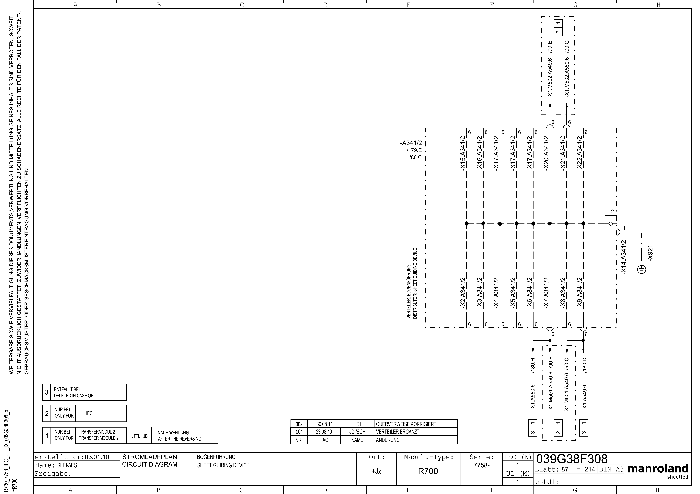

# +Jx — Sheet 87 of 214 — BOGENFÜHRUNG

**SHEET GUIDING DEVICE**

> Part of the manroland **R700** printing press IEC/UL circuit diagrams.
> Drawing class: **Stromlaufplan / Circuit diagram** (DIN A3).
> Document `+Jx` covers the **1st printing module + feed register** machine section.

## At a glance

| Field | Value |
|---|---|
| Document | `+Jx`  (039G38F308) |
| Sheet | **87** of 214 |
| Section (DE) | BOGENFÜHRUNG |
| Section (EN) | SHEET GUIDING DEVICE |
| Section type | CIRCUIT — Circuit diagram |
| Machine type | `R700` |
| Series | `7758` |
| Created | 03.01.10 |
| Replaces | — |
| Columns used | A, B, D, E, F, G, H |
| Path numbers | — |
| Labels on sheet | 88 |
| Cross-refs out | 8 |
| Cross-refs in | 24 |

**Previous:** [+Jx sheet 86](SHEET_0086.md) · **Next:** [+Jx sheet 88](SHEET_0088.md) · **Document TOC:** [_TOC.md](_TOC.md)  (+Jx) · **Master TOC:** [all sheets](../_MASTER_TOC.md)

## Sheet image (300 DPI, exact vector render)



_Rendered directly from the PDF vector layer at 300 DPI (1-bit), no OCR and no resampling. Use it to confirm anything ambiguous in the text below._

## Cross-references on this sheet

Each entry is a wire leaving this sheet. The printed token is `/sheet.column`; the link resolves to that sheet inside the same document.

| Ref | Target sheet | Col | Path | Destination on target | Target section | From col |
|---|---|---|---|---|---|---|
| `/90.G` | [+Jx sheet 90](SHEET_0090.md) | G | — | X1.M502.A550:6 | BOGENFÜHRUNG, NACH WENDUNG | G |
| `/90.E` | [+Jx sheet 90](SHEET_0090.md) | E | — | X1.M502.A549:6 X1.M501.A550:6 | BOGENFÜHRUNG, NACH WENDUNG | G |
| `/90.F` | [+Jx sheet 90](SHEET_0090.md) | F | — | X1.M502.A549:6 X1.M501.A550:6 | BOGENFÜHRUNG, NACH WENDUNG | G |
| `/179.E` | [+Jx sheet 179](SHEET_0179.md) | E | — | — | OPTION: TRANSFERMODUL 1 NACH | E |
| `/86.C` | [+Jx sheet 86](SHEET_0086.md) | C | — | — | BOGENFÜHRUNG | E |
| `/90.C` | [+Jx sheet 90](SHEET_0090.md) | C | — | X1.M501.A549:6 | BOGENFÜHRUNG, NACH WENDUNG | G |
| `/180.D` | [+Jx sheet 180](SHEET_0180.md) | D | — | X1.A549:6 | OPTION: TRANSFERMODUL 2 | G |
| `/180.H` | [+Jx sheet 180](SHEET_0180.md) | H | — | X1.A550:6 | OPTION: TRANSFERMODUL 2 | F |

### Incoming references (sheets that point here)

Every other sheet that sends a wire to this one. `Back-ref` is the token printed on *that* sheet; `Path` is its line number.

| From sheet | Cols | Back-ref | Path | Refs | What continues there |
|---|---|---|---|---|---|
| [+Jx#86](SHEET_0086.md) | C | `/86.C` | — | 1 | — |
| [+Jx#90](SHEET_0090.md) | C, E, F, G | `/90.C`, `/90.E`, `/90.F`, `/90.G` | — | 4 | X1.M501.A549:6; X1.M501.A550:6; X1.M502.A549:6; X1.M502.A550:6 |
| [+Jx#126](SHEET_0126.md) | A | `/126.A` | — | 1 | — |
| [+Jx#127](SHEET_0127.md) | G | `/127.G` | — | 1 | — |
| [+Jx#129](SHEET_0129.md) | F | `/129.F` | — | 1 | — |
| [+Jx#131](SHEET_0131.md) | G | `/131.G` | — | 1 | — |
| [+Jx#132](SHEET_0132.md) | G | `/132.G` | — | 1 | — |
| [+Jx#133](SHEET_0133.md) | B, H | `/133.B`, `/133.H` | — | 2 | — |
| [+Jx#134](SHEET_0134.md) | F | `/134.F` | — | 1 | — |
| [+Jx#138](SHEET_0138.md) | H | `/138.H` | — | 1 | — |
| [+Jx#139](SHEET_0139.md) | E | `/139.E` | — | 1 | — |
| [+Jx#140](SHEET_0140.md) | B, F | `/140.B`, `/140.F` | — | 2 | — |
| [+Jx#141](SHEET_0141.md) | B, E, G | `/141.B`, `/141.E`, `/141.G` | — | 3 | — |
| [+Jx#142](SHEET_0142.md) | B | `/142.B` | — | 1 | — |
| [+Jx#179](SHEET_0179.md) | E | `/179.E` | — | 1 | — |
| [+Jx#180](SHEET_0180.md) | D, H | `/180.D`, `/180.H` | — | 2 | X1.A549:6; X1.A550:6 |


## Devices on this sheet

| Tag | Class | Class meaning (IEC) | Col | Sub | Terminal | Sign |
|---|---|---|---|---|---|---|
| `A341/2` | A | Baugruppe / assembly, module, PC board | E | 2 | — | — |
| `X921` | X | Klemme / terminal, plug connector | H | — | — | — |
| `X14.A341\2` | — | cross-device reference | H | — | — | — |
| `NR.` | — | cross-device reference | D | — | — | — |
| `23.08.10` | — | cross-device reference | D | — | — | — |
| `X1.M502.A550:6` | — | cross-device reference | G | — | 6 | — |
| `X1.M502.A549:6` | — | cross-device reference | G | — | 6 | — |
| `X1.M501.A550:6` | — | cross-device reference | G | — | 6 | — |
| `X1.M501.A549:6` | — | cross-device reference | G | — | 6 | — |
| `30.08.11` | — | cross-device reference | D | — | — | — |
| `X1.A550:6` | — | cross-device reference | F | — | 6 | — |
| `X1.A549:6` | — | cross-device reference | G | — | 6 | — |

## Potentials / nets

_No named potentials on this sheet._

## Wire-end annotations (grouped as printed)

A wire that continues elsewhere is annotated with a small cluster: the destination description, the path/line number `#NN`, and the `/sheet.column` cross reference. Each row below is one such cluster exactly as it is grouped on the drawing.

| Col | Y | Path | Cross-ref | Text on the wire |
|---|---|---|---|---|
| G | 36.2 | — | — | `1 2` |
| G | 68.6 | — | `/90.G` | `X1.M502.A550:6` |
| G | 69.5 | — | `/90.E`, `/90.F` | `X1.M502.A549:6 X1.M501.A550:6` |
| G | 204.4 | — | — | `6` |
| G | 204.4 | — | — | `6` |
| F | 221.4 | — | — | `6 6 6 6` |
| F | 221.4 | — | — | `6 6` |
| F | 231.9 | — | — | `X15.A341/2` |
| F | 231.9 | — | — | `X16.A341/2` |
| F | 231.9 | — | — | `X17.A341/2` |
| F | 231.9 | — | — | `X17.A341/2` |
| F | 231.9 | — | — | `X17.A341/2` |
| G | 231.9 | — | — | `X20.A341/2` |
| G | 231.9 | — | — | `X21.A341/2` |
| G | 231.9 | — | — | `X22.A341/2` |
| E | 238.9 | — | — | `A341/2` |
| E | 252.0 | — | `/179.E` | — |
| E | 264.4 | — | `/86.C` | — |
| G | 356.7 | — | — | `2` |
| H | 384.3 | — | — | `1` |
| H | 409.0 | — | — | `X14.A341\2` |
| H | 417.0 | — | — | `X921` |
| E | 422.6 | — | — | `DISTRIBUTOR: SHEET GUIDING DEVICE` |
| E | 450.8 | — | — | `VERTEILER: BOGENFÜHRUNG` |
| F | 472.8 | — | — | `X2.A341/2` |
| F | 472.8 | — | — | `X3.A341/2` |
| F | 472.8 | — | — | `X4.A341/2` |
| F | 472.8 | — | — | `X5.A341/2` |
| F | 472.8 | — | — | `X6.A341/2` |
| G | 472.8 | — | — | `X7.A341/2` |
| G | 472.8 | — | — | `X8.A341/2` |
| G | 472.8 | — | — | `X9.A341/2` |
| F | 548.8 | — | — | `6 6 6 6 6` |
| G | 548.8 | — | — | `6` |
| G | 565.8 | — | — | `6` |
| G | 565.8 | — | — | `6` |
| G | 609.5 | — | `/90.C` | `X1.M501.A549:6` |
| G | 609.6 | — | `/180.D` | `X1.A549:6` |
| F | 610.0 | — | `/180.H` | `X1.A550:6` |
| A | 660.9 | — | — | `3 ENTFÄLLT BEI DELETED IN CASE OF` |
| A | 695.2 | — | — | `2 NUR BEI ONLY FOR IEC` |
| F | 718.6 | — | — | `1 3` |
| G | 718.6 | — | — | `1 2` |
| G | 718.6 | — | — | `1 3` |
| D | 719.5 | — | — | `002 30.08.11 JDI QUERVERWEISE KORRIGIERT` |
| D | 732.7 | — | — | `001 23.08.10 JDI/SCH VERTEILER ERGÄNZT` |
| A | 733.0 | — | — | `1 NUR BEI ONLY FOR TRANSFERMODUL 2 TRANSFER MODULE 2 LTTL +JB NACH WENDUNG` |
| B | 745.3 | — | — | `AFTER THE REVERSING` |
| D | 746.9 | — | — | `NR. TAG NAME ÄNDERUNG` |


## Notes and free text on this sheet

| Text | Col | Y (pt) |
|---|---|---|
| `X20.A341/2` | G | 231.88 |
| `X21.A341/2` | G | 231.88 |
| `VERTEILER: BOGENFÜHRUNG` | E | 450.78 |
| `DISTRIBUTOR: SHEET GUIDING DEVICE` | E | 422.61 |
| `X7.A341/2` | G | 472.82 |
| `X9.A341/2` | G | 472.82 |
| `TAG` | D | 746.98 |
| `NAME` | D | 746.97 |
| `ÄNDERUNG` | E | 747 |
| `JDI/SCH` | D | 732.8 |
| `VERTEILER ERGÄNZT` | E | 732.85 |
| `JDI` | D | 719.55 |
| `QUERVERWEISE KORRIGIERT` | E | 719.64 |
| `X15.A341/2` | F | 231.88 |
| `X16.A341/2` | F | 231.88 |
| `X17.A341/2` | F | 231.88 |
| `X22.A341/2` | G | 231.88 |
| `X3.A341/2` | F | 472.82 |
| `X5.A341/2` | F | 472.82 |
| `X2.A341/2` | F | 472.82 |
| `X4.A341/2` | F | 472.82 |
| `X6.A341/2` | F | 472.82 |
| `X8.A341/2` | G | 472.82 |
| `TRANSFERMODUL 2` | A | 733.22 |
| `TRANSFER MODULE 2` | A | 743.85 |
| `NUR BEI` | A | 733.04 |
| `ONLY FOR` | A | 743.73 |
| `LTTL +JB` | B | 740.39 |
| `NACH WENDUNG` | B | 734.63 |
| `AFTER THE REVERSING` | B | 745.27 |
| `IEC` | A | 701.29 |
| `ENTFÄLLT BEI` | A | 660.88 |
| `DELETED IN CASE OF` | A | 671.53 |

## Complete label inventory (exact text from the drawing)

Every text object inside the drawing area of this sheet, in DIN reading order (column A→H, then top→bottom). This is the authoritative list: if a string is not here it is not printed on this sheet.

| Col | Y | X | Dir | Type | Text |
|---|---|---|---|---|---|
| A | 660.9 | 91.9 | → | text | `ENTFÄLLT BEI` |
| A | 663.9 | 76.5 | → | number | `3` |
| A | 671.5 | 91.9 | → | text | `DELETED IN CASE OF` |
| A | 695.2 | 92.9 | → | text | `NUR BEI` |
| A | 700.1 | 76.6 | → | number | `2` |
| A | 701.3 | 146.6 | → | text | `IEC` |
| A | 705.9 | 93.2 | → | text | `ONLY FOR` |
| A | 733.0 | 93.0 | → | text | `NUR BEI` |
| A | 733.2 | 134.4 | → | text | `TRANSFERMODUL 2` |
| A | 737.9 | 76.9 | → | number | `1` |
| A | 743.7 | 93.3 | → | text | `ONLY FOR` |
| A | 743.8 | 134.4 | → | text | `TRANSFER MODULE 2` |
| B | 734.6 | 268.3 | → | text | `NACH WENDUNG` |
| B | 740.4 | 223.5 | → | text | `LTTL +JB` |
| B | 745.3 | 268.9 | → | text | `AFTER THE REVERSING` |
| D | 719.5 | 602.9 | → | text | `JDI` |
| D | 719.6 | 503.0 | → | number | `002` |
| D | 719.6 | 538.3 | → | device ref | `30.08.11` |
| D | 732.7 | 503.3 | → | number | `001` |
| D | 732.8 | 537.5 | → | device ref | `23.08.10` |
| D | 732.8 | 594.2 | → | text | `JDI/SCH` |
| D | 746.9 | 502.5 | → | device ref | `NR.` |
| D | 747.0 | 544.2 | → | text | `TAG` |
| D | 747.0 | 597.5 | → | text | `NAME` |
| E | 238.9 | 680.6 | → | device tag | `A341/2` |
| E | 252.0 | 692.0 | → | cross-reference | `/179.E` |
| E | 264.4 | 696.5 | → | cross-reference | `/86.C` |
| E | 422.6 | 703.1 | ↕ | text | `DISTRIBUTOR: SHEET GUIDING DEVICE` |
| E | 450.8 | 692.5 | ↕ | text | `VERTEILER: BOGENFÜHRUNG` |
| E | 719.6 | 639.7 | → | text | `QUERVERWEISE KORRIGIERT` |
| E | 732.8 | 639.7 | → | text | `VERTEILER ERGÄNZT` |
| E | 747.0 | 639.7 | → | text | `ÄNDERUNG` |
| F | 221.4 | 796.3 | → | number | `6` |
| F | 221.4 | 824.6 | → | number | `6` |
| F | 221.4 | 852.9 | → | number | `6` |
| F | 221.4 | 881.3 | → | number | `6` |
| F | 231.9 | 782.6 | ↕ | text | `X15.A341/2` |
| F | 231.9 | 810.9 | ↕ | text | `X16.A341/2` |
| F | 231.9 | 839.3 | ↕ | text | `X17.A341/2` |
| F | 231.9 | 867.6 | ↕ | text | `X17.A341/2` |
| F | 231.9 | 896.0 | ↕ | text | `X17.A341/2` |
| F | 472.8 | 782.6 | ↕ | text | `X2.A341/2` |
| F | 472.8 | 811.0 | ↕ | text | `X3.A341/2` |
| F | 472.8 | 839.3 | ↕ | text | `X4.A341/2` |
| F | 472.8 | 867.6 | ↕ | text | `X5.A341/2` |
| F | 472.8 | 896.0 | ↕ | text | `X6.A341/2` |
| F | 548.8 | 796.3 | → | number | `6` |
| F | 548.8 | 824.6 | → | number | `6` |
| F | 548.8 | 852.9 | → | number | `6` |
| F | 548.8 | 881.3 | → | number | `6` |
| F | 610.0 | 902.3 | ↕ | cross-reference | `/180.H` |
| F | 655.1 | 902.3 | ↕ | device ref | `X1.A550:6` |
| F | 718.6 | 902.4 | ↕ | number | `1` |
| F | 734.7 | 902.4 | ↕ | number | `3` |
| G | 36.2 | 945.7 | ↕ | number | `1` |
| G | 52.2 | 945.7 | ↕ | number | `2` |
| G | 68.6 | 960.3 | ↕ | cross-reference | `/90.G` |
| G | 69.4 | 931.3 | ↕ | cross-reference | `/90.E` |
| G | 97.6 | 960.3 | ↕ | device ref | `X1.M502.A550:6` |
| G | 99.0 | 931.4 | ↕ | device ref | `X1.M502.A549:6` |
| G | 204.4 | 938.0 | → | number | `6` |
| G | 204.4 | 966.3 | → | number | `6` |
| G | 221.4 | 909.6 | → | number | `6` |
| G | 221.4 | 994.7 | → | number | `6` |
| G | 231.9 | 924.3 | ↕ | text | `X20.A341/2` |
| G | 231.9 | 952.7 | ↕ | text | `X21.A341/2` |
| G | 231.9 | 981.0 | ↕ | text | `X22.A341/2` |
| G | 356.7 | 1039.5 | → | number | `2` |
| G | 472.8 | 924.3 | ↕ | text | `X7.A341/2` |
| G | 472.8 | 952.7 | ↕ | text | `X8.A341/2` |
| G | 472.8 | 981.0 | ↕ | text | `X9.A341/2` |
| G | 548.8 | 909.6 | → | number | `6` |
| G | 548.8 | 966.3 | → | number | `6` |
| G | 565.8 | 938.0 | → | number | `6` |
| G | 565.8 | 994.7 | → | number | `6` |
| G | 607.4 | 932.8 | ↕ | cross-reference | `/90.F` |
| G | 609.5 | 959.9 | ↕ | cross-reference | `/90.C` |
| G | 609.6 | 990.5 | ↕ | cross-reference | `/180.D` |
| G | 633.4 | 932.8 | ↕ | device ref | `X1.M501.A550:6` |
| G | 635.6 | 959.9 | ↕ | device ref | `X1.M501.A549:6` |
| G | 655.8 | 990.5 | ↕ | device ref | `X1.A549:6` |
| G | 718.6 | 945.7 | ↕ | number | `1` |
| G | 718.6 | 989.1 | ↕ | number | `1` |
| G | 734.6 | 945.7 | ↕ | number | `2` |
| G | 734.7 | 989.1 | ↕ | number | `3` |
| H | 384.3 | 1059.0 | → | number | `1` |
| H | 409.0 | 1056.1 | ↕ | device ref | `X14.A341\2` |
| H | 417.0 | 1101.5 | ↕ | device tag | `X921` |

## Reading-order text block

The same content as a plain block, grouped by DIN column — convenient to paste or to match against a visual description.

```text
=== Column A ===
 660.9   91.9  text         ENTFÄLLT BEI
 663.9   76.5  numeric      3
 671.5   91.9  text         DELETED IN CASE OF
 695.2   92.9  text         NUR BEI
 700.1   76.6  numeric      2
 701.3  146.6  text         IEC
 705.9   93.2  text         ONLY FOR
 733.0   93.0  text         NUR BEI
 733.2  134.4  text         TRANSFERMODUL 2
 737.9   76.9  numeric      1
 743.7   93.3  text         ONLY FOR
 743.8  134.4  text         TRANSFER MODULE 2
=== Column B ===
 734.6  268.3  text         NACH WENDUNG
 740.4  223.5  text         LTTL +JB
 745.3  268.9  text         AFTER THE REVERSING
=== Column D ===
 719.5  602.9  text         JDI
 719.6  503.0  numeric      002
 719.6  538.3  devref       30.08.11
 732.7  503.3  numeric      001
 732.8  537.5  devref       23.08.10
 732.8  594.2  text         JDI/SCH
 746.9  502.5  devref       NR.
 747.0  544.2  text         TAG
 747.0  597.5  text         NAME
=== Column E ===
 238.9  680.6  devtag       A341/2
 252.0  692.0  xref         /179.E
 264.4  696.5  xref         /86.C
 422.6  703.1  text         DISTRIBUTOR: SHEET GUIDING DEVICE
 450.8  692.5  text         VERTEILER: BOGENFÜHRUNG
 719.6  639.7  text         QUERVERWEISE KORRIGIERT
 732.8  639.7  text         VERTEILER ERGÄNZT
 747.0  639.7  text         ÄNDERUNG
=== Column F ===
 221.4  796.3  numeric      6
 221.4  824.6  numeric      6
 221.4  852.9  numeric      6
 221.4  881.3  numeric      6
 231.9  782.6  text         X15.A341/2
 231.9  810.9  text         X16.A341/2
 231.9  839.3  text         X17.A341/2
 231.9  867.6  text         X17.A341/2
 231.9  896.0  text         X17.A341/2
 472.8  782.6  text         X2.A341/2
 472.8  811.0  text         X3.A341/2
 472.8  839.3  text         X4.A341/2
 472.8  867.6  text         X5.A341/2
 472.8  896.0  text         X6.A341/2
 548.8  796.3  numeric      6
 548.8  824.6  numeric      6
 548.8  852.9  numeric      6
 548.8  881.3  numeric      6
 610.0  902.3  xref         /180.H
 655.1  902.3  devref       X1.A550:6
 718.6  902.4  numeric      1
 734.7  902.4  numeric      3
=== Column G ===
  36.2  945.7  numeric      1
  52.2  945.7  numeric      2
  68.6  960.3  xref         /90.G
  69.4  931.3  xref         /90.E
  97.6  960.3  devref       X1.M502.A550:6
  99.0  931.4  devref       X1.M502.A549:6
 204.4  938.0  numeric      6
 204.4  966.3  numeric      6
 221.4  909.6  numeric      6
 221.4  994.7  numeric      6
 231.9  924.3  text         X20.A341/2
 231.9  952.7  text         X21.A341/2
 231.9  981.0  text         X22.A341/2
 356.7 1039.5  numeric      2
 472.8  924.3  text         X7.A341/2
 472.8  952.7  text         X8.A341/2
 472.8  981.0  text         X9.A341/2
 548.8  909.6  numeric      6
 548.8  966.3  numeric      6
 565.8  938.0  numeric      6
 565.8  994.7  numeric      6
 607.4  932.8  xref         /90.F
 609.5  959.9  xref         /90.C
 609.6  990.5  xref         /180.D
 633.4  932.8  devref       X1.M501.A550:6
 635.6  959.9  devref       X1.M501.A549:6
 655.8  990.5  devref       X1.A549:6
 718.6  945.7  numeric      1
 718.6  989.1  numeric      1
 734.6  945.7  numeric      2
 734.7  989.1  numeric      3
=== Column H ===
 384.3 1059.0  numeric      1
 409.0 1056.1  devref       X14.A341\2
 417.0 1101.5  devtag       X921
```

---
_Generated from the PDF vector text layer; no OCR. Source: `R700_7758_IEC_UL_JX_039G38F308_p`, sheet 87._
