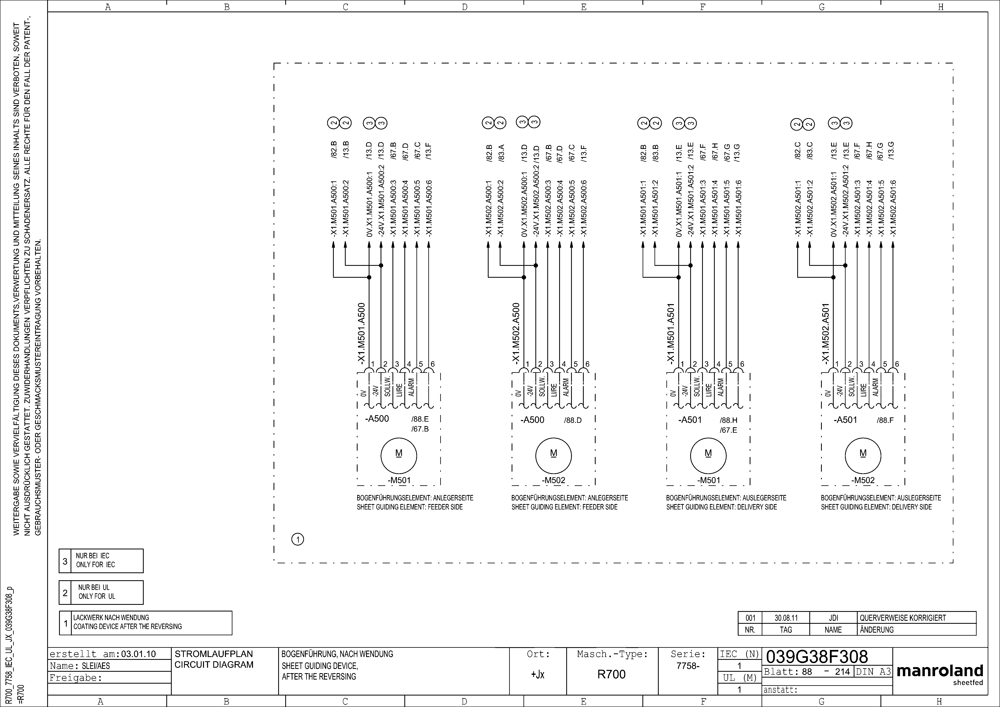

# +Jx — Sheet 88 of 214 — BOGENFÜHRUNG, NACH WENDUNG

**SHEET GUIDING DEVICE**

> Part of the manroland **R700** printing press IEC/UL circuit diagrams.
> Drawing class: **Stromlaufplan / Circuit diagram** (DIN A3).
> Document `+Jx` covers the **1st printing module + feed register** machine section.

## At a glance

| Field | Value |
|---|---|
| Document | `+Jx`  (039G38F308) |
| Sheet | **88** of 214 |
| Section (DE) | BOGENFÜHRUNG, NACH WENDUNG |
| Section (EN) | SHEET GUIDING DEVICE |
| Section type | CIRCUIT — Circuit diagram |
| Machine type | `R700` |
| Series | `7758` |
| Created | 03.01.10 |
| Replaces | — |
| Columns used | A, C, D, E, F, G, H |
| Path numbers | — |
| Labels on sheet | 172 |
| Cross-refs out | 38 |
| Cross-refs in | 62 |

**Previous:** [+Jx sheet 87](SHEET_0087.md) · **Next:** [+Jx sheet 89](SHEET_0089.md) · **Document TOC:** [_TOC.md](_TOC.md)  (+Jx) · **Master TOC:** [all sheets](../_MASTER_TOC.md)

## Sheet image (300 DPI, exact vector render)



_Rendered directly from the PDF vector layer at 300 DPI (1-bit), no OCR and no resampling. Use it to confirm anything ambiguous in the text below._

## Cross-references on this sheet

Each entry is a wire leaving this sheet. The printed token is `/sheet.column`; the link resolves to that sheet inside the same document.

| Ref | Target sheet | Col | Path | Destination on target | Target section | From col |
|---|---|---|---|---|---|---|
| `/82.B` | [+Jx sheet 82](SHEET_0082.md) | B | — | X1.M501.A500:1 | BOGENFÜHRUNG, NACH WENDUNG | C |
| `/13.B` | [+Jx sheet 13](SHEET_0013.md) | B | — | X1.M501.A500:2 | SPANNUNGSVERSORGUNG, SCHALTSCHRANKBELÜFTUNG | C |
| `/13.G` | [+Jx sheet 13](SHEET_0013.md) | G | — | X1.M502.A501:6 | SPANNUNGSVERSORGUNG, SCHALTSCHRANKBELÜFTUNG | H |
| `/13.D` | [+Jx sheet 13](SHEET_0013.md) | D | — | 0V.X1.M501.A500:1 | SPANNUNGSVERSORGUNG, SCHALTSCHRANKBELÜFTUNG | C |
| `/13.D` | [+Jx sheet 13](SHEET_0013.md) | D | — | 24V.X1.M501.A500:2 | SPANNUNGSVERSORGUNG, SCHALTSCHRANKBELÜFTUNG | C |
| `/67.C` | [+Jx sheet 67](SHEET_0067.md) | C | — | X1.M501.A500:5 | BOGENFÜHRUNG | D |
| `/82.C` | [+Jx sheet 82](SHEET_0082.md) | C | — | X1.M502.A501:1 | BOGENFÜHRUNG, NACH WENDUNG | G |
| `/83.C` | [+Jx sheet 83](SHEET_0083.md) | C | — | X1.M502.A501:2 | BOGENFÜHRUNG, NACH WENDUNG | G |
| `/67.H` | [+Jx sheet 67](SHEET_0067.md) | H | — | X1.M502.A501:4 | BOGENFÜHRUNG | G |
| `/67.B` | [+Jx sheet 67](SHEET_0067.md) | B | — | X1.M501.A500:3 | BOGENFÜHRUNG | C |
| `/13.E` | [+Jx sheet 13](SHEET_0013.md) | E | — | 24V.X1.M501.A501:2 | SPANNUNGSVERSORGUNG, SCHALTSCHRANKBELÜFTUNG | F |
| `/13.E` | [+Jx sheet 13](SHEET_0013.md) | E | — | 0V.X1.M502.A501:1 | SPANNUNGSVERSORGUNG, SCHALTSCHRANKBELÜFTUNG | G |
| `/13.E` | [+Jx sheet 13](SHEET_0013.md) | E | — | 24V.X1.M502.A501:2 | SPANNUNGSVERSORGUNG, SCHALTSCHRANKBELÜFTUNG | G |
| `/13.F` | [+Jx sheet 13](SHEET_0013.md) | F | — | X1.M501.A500:6 | SPANNUNGSVERSORGUNG, SCHALTSCHRANKBELÜFTUNG | D |
| `/67.F` | [+Jx sheet 67](SHEET_0067.md) | F | — | X1.M502.A501:3 | BOGENFÜHRUNG | G |
| `/67.G` | [+Jx sheet 67](SHEET_0067.md) | G | — | X1.M502.A501:5 | BOGENFÜHRUNG | H |
| `/67.D` | [+Jx sheet 67](SHEET_0067.md) | D | — | X1.M501.A500:4 | BOGENFÜHRUNG | D |
| `/67.H` | [+Jx sheet 67](SHEET_0067.md) | H | — | X1.M501.A501:4 | BOGENFÜHRUNG | F |
| `/67.F` | [+Jx sheet 67](SHEET_0067.md) | F | — | X1.M501.A501:3 | BOGENFÜHRUNG | F |
| `/67.G` | [+Jx sheet 67](SHEET_0067.md) | G | — | X1.M501.A501:5 | BOGENFÜHRUNG | F |
| `/13.G` | [+Jx sheet 13](SHEET_0013.md) | G | — | X1.M501.A501:6 | SPANNUNGSVERSORGUNG, SCHALTSCHRANKBELÜFTUNG | F |
| `/67.C` | [+Jx sheet 67](SHEET_0067.md) | C | — | X1.M502.A500:5 | BOGENFÜHRUNG | E |
| `/13.D` | [+Jx sheet 13](SHEET_0013.md) | D | — | 0V.X1.M502.A500:1 | SPANNUNGSVERSORGUNG, SCHALTSCHRANKBELÜFTUNG | E |
| `/82.B` | [+Jx sheet 82](SHEET_0082.md) | B | — | X1.M502.A500:1 | BOGENFÜHRUNG, NACH WENDUNG | D |
| `/83.A` | [+Jx sheet 83](SHEET_0083.md) | A | — | X1.M502.A500:2 | BOGENFÜHRUNG, NACH WENDUNG | D |
| `/67.B` | [+Jx sheet 67](SHEET_0067.md) | B | — | X1.M502.A500:3 | BOGENFÜHRUNG | E |
| `/82.B` | [+Jx sheet 82](SHEET_0082.md) | B | — | X1.M501.A501:1 | BOGENFÜHRUNG, NACH WENDUNG | F |
| `/83.B` | [+Jx sheet 83](SHEET_0083.md) | B | — | X1.M501.A501:2 | BOGENFÜHRUNG, NACH WENDUNG | F |
| `/13.E` | [+Jx sheet 13](SHEET_0013.md) | E | — | 0V.X1.M501.A501:1 | SPANNUNGSVERSORGUNG, SCHALTSCHRANKBELÜFTUNG | F |
| `/13.F` | [+Jx sheet 13](SHEET_0013.md) | F | — | X1.M502.A500:6 | SPANNUNGSVERSORGUNG, SCHALTSCHRANKBELÜFTUNG | E |
| `/13.D` | [+Jx sheet 13](SHEET_0013.md) | D | — | 24V.X1.M502.A500:2 | SPANNUNGSVERSORGUNG, SCHALTSCHRANKBELÜFTUNG | E |
| `/67.D` | [+Jx sheet 67](SHEET_0067.md) | D | — | X1.M502.A500:4 | BOGENFÜHRUNG | E |
| `/88.E` | [+Jx sheet 88](SHEET_0088.md) | E | — | A500 | BOGENFÜHRUNG, NACH WENDUNG | C |
| `/67.B` | [+Jx sheet 67](SHEET_0067.md) | B | — | A500 | BOGENFÜHRUNG | C |
| `/88.D` | [+Jx sheet 88](SHEET_0088.md) | D | — | A500 | BOGENFÜHRUNG, NACH WENDUNG | E |
| `/88.H` | [+Jx sheet 88](SHEET_0088.md) | H | — | A501 | BOGENFÜHRUNG, NACH WENDUNG | F |
| `/67.E` | [+Jx sheet 67](SHEET_0067.md) | E | — | A501 | BOGENFÜHRUNG | F |
| `/88.F` | [+Jx sheet 88](SHEET_0088.md) | F | — | A501 | BOGENFÜHRUNG, NACH WENDUNG | G |

### Incoming references (sheets that point here)

Every other sheet that sends a wire to this one. `Back-ref` is the token printed on *that* sheet; `Path` is its line number.

| From sheet | Cols | Back-ref | Path | Refs | What continues there |
|---|---|---|---|---|---|
| [+Jx#13](SHEET_0013.md) | B, D, E, F, G | `/13.B`, `/13.D`, `/13.E`, `/13.F`, `/13.G` | — | 13 | 0V.X1.M501.A500:1; 0V.X1.M501.A501:1; 0V.X1.M502.A500:1; 0V.X1.M502.A501:1; 24V.X1.M501.A500:2; 24V.X1.M501.A501:2; 24V.X1.M502.A500:2; 24V.X1.M502.A501:2; X1.M |
| [+Jx#67](SHEET_0067.md) | A, C, D, E, F, G | `/67.A`, `/67.C`, `/67.D`, `/67.E`, `/67.F`, `/67.G` | — | 14 | X1.M501.A500:3 X1.M501.A500:4; X1.M501.A500:5 X1.M501.A501:4 X1.M501.A501:3; X1.M501.A501:5; X1.M502.A500:3 X1.M502.A501:3 X1.M502.A501:4; X1.M502.A500:4; X1.M5 |
| [+Jx#82](SHEET_0082.md) | B | `/82.B` | — | 4 | — |
| [+Jx#83](SHEET_0083.md) | A, B, C | `/83.A`, `/83.B`, `/83.C` | — | 3 | — |
| [+Jx#88](SHEET_0088.md) | C, E, F, G | `/88.C`, `/88.E`, `/88.F`, `/88.G` | — | 4 | A500; A501 |
| [+Jx#119](SHEET_0119.md) | B, E | `/119.B`, `/119.E` | — | 24 | — |


## Devices on this sheet

| Tag | Class | Class meaning (IEC) | Col | Sub | Terminal | Sign |
|---|---|---|---|---|---|---|
| `A500` | A | Baugruppe / assembly, module, PC board | C | — | — | — |
| `A500` | A | Baugruppe / assembly, module, PC board | E | — | — | — |
| `A501` | A | Baugruppe / assembly, module, PC board | F | — | — | — |
| `A501` | A | Baugruppe / assembly, module, PC board | G | — | — | — |
| `X1.M501.A500` | — | cross-device reference | C | — | — | — |
| `X1.M502.A500` | — | cross-device reference | D | — | — | — |
| `X1.M501.A501` | — | cross-device reference | F | — | — | — |
| `X1.M502.A501` | — | cross-device reference | G | — | — | — |
| `X1.M501.A501:1` | — | cross-device reference | F | — | 1 | — |
| `X1.M501.A501:2` | — | cross-device reference | F | — | 2 | — |
| `X1.M501.A501:5` | — | cross-device reference | F | — | 5 | — |
| `X1.M501.A501:4` | — | cross-device reference | F | — | 4 | — |
| `X1.M501.A501:3` | — | cross-device reference | F | — | 3 | — |
| `X1.M501.A500:6` | — | cross-device reference | D | — | 6 | — |
| `X1.M501.A500:5` | — | cross-device reference | D | — | 5 | — |
| `X1.M501.A500:1` | — | cross-device reference | C | — | 1 | — |
| `X1.M501.A500:4` | — | cross-device reference | D | — | 4 | — |
| `X1.M501.A500:3` | — | cross-device reference | C | — | 3 | — |
| `X1.M501.A501:6` | — | cross-device reference | F | — | 6 | — |
| `X1.M502.A500:1` | — | cross-device reference | D | — | 1 | — |
| `X1.M502.A500:6` | — | cross-device reference | E | — | 6 | — |
| `X1.M502.A500:2` | — | cross-device reference | D | — | 2 | — |
| `X1.M502.A501:1` | — | cross-device reference | G | — | 1 | — |
| `X1.M502.A501:6` | — | cross-device reference | H | — | 6 | — |
| `X1.M502.A501:2` | — | cross-device reference | G | — | 2 | — |
| `X1.M502.A501:5` | — | cross-device reference | H | — | 5 | — |
| `X1.M502.A501:4` | — | cross-device reference | G | — | 4 | — |
| `X1.M502.A500:3` | — | cross-device reference | E | — | 3 | — |
| `X1.M501.A500:2` | — | cross-device reference | C | — | 2 | — |
| `X1.M502.A500:4` | — | cross-device reference | E | — | 4 | — |
| `X1.M502.A500:5` | — | cross-device reference | E | — | 5 | — |
| `X1.M502.A501:3` | — | cross-device reference | G | — | 3 | — |
| `NR.` | — | cross-device reference | F | — | — | — |
| `30.08.11` | — | cross-device reference | G | — | — | — |
| `SOLLW.` | — | cross-device reference | C | — | — | — |
| `SOLLW.` | — | cross-device reference | E | — | — | — |
| `SOLLW.` | — | cross-device reference | F | — | — | — |
| `SOLLW.` | — | cross-device reference | G | — | — | — |

## Potentials / nets

| Potential | Count | Columns | Attached devices | Terminals |
|---|---|---|---|---|
| `0V` | 8 | C, D, E, F, G | `A500`, `A501`, `M501`, `M502`, `X1` | `1` |
| `24V` | 8 | C, E, F, G | `A500`, `A501`, `M501`, `M502`, `X1` | `2` |
| `M501` | 2 | C, F | — | — |
| `M502` | 2 | E, G | — | — |


A potential such as `L24+/4` or `M24+` is a named supply/return rail; every place it appears on this sheet is electrically common.

## Wire-end annotations (grouped as printed)

A wire that continues elsewhere is annotated with a small cluster: the destination description, the path/line number `#NN`, and the `/sheet.column` cross reference. Each row below is one such cluster exactly as it is grouped on the drawing.

| Col | Y | Path | Cross-ref | Text on the wire |
|---|---|---|---|---|
| D | 143.2 | — | — | `3` |
| E | 143.2 | — | — | `3` |
| C | 144.3 | — | — | `2` |
| C | 144.3 | — | — | `2` |
| D | 144.3 | — | — | `2` |
| D | 144.3 | — | — | `2` |
| C | 144.7 | — | — | `3` |
| C | 144.7 | — | — | `3` |
| F | 144.7 | — | — | `2` |
| F | 144.7 | — | — | `2` |
| G | 144.7 | — | — | `3` |
| G | 144.7 | — | — | `3` |
| F | 144.9 | — | — | `3` |
| F | 144.9 | — | — | `3` |
| G | 146.1 | — | — | `2` |
| G | 146.1 | — | — | `2` |
| C | 167.8 | — | `/82.B` | `X1.M501.A500:1` |
| C | 167.8 | — | `/13.B` | `X1.M501.A500:2` |
| H | 168.3 | — | `/13.G` | `X1.M502.A501:6` |
| C | 168.9 | — | `/13.D` | `0V.X1.M501.A500:1` |
| C | 168.9 | — | `/13.D` | `24V.X1.M501.A500:2` |
| D | 168.9 | — | `/67.C` | `X1.M501.A500:5` |
| G | 168.9 | — | `/82.C` | `X1.M502.A501:1` |
| G | 168.9 | — | `/83.C` | `X1.M502.A501:2` |
| G | 168.9 | — | `/67.H` | `X1.M502.A501:4` |
| C | 169.2 | — | `/67.B` | `X1.M501.A500:3` |
| F | 169.2 | — | `/13.E` | `24V.X1.M501.A501:2` |
| G | 169.2 | — | `/13.E` | `0V.X1.M502.A501:1` |
| G | 169.2 | — | `/13.E` | `24V.X1.M502.A501:2` |
| D | 169.8 | — | `/13.F` | `X1.M501.A500:6` |
| G | 169.8 | — | `/67.F` | `X1.M502.A501:3` |
| H | 169.8 | — | `/67.G` | `X1.M502.A501:5` |
| D | 170.4 | — | `/67.D` | `X1.M501.A500:4` |
| F | 170.4 | — | `/67.H` | `X1.M501.A501:4` |
| F | 171.2 | — | `/67.F` | `X1.M501.A501:3` |
| F | 171.2 | — | `/67.G` | `X1.M501.A501:5` |
| F | 171.2 | — | `/13.G` | `X1.M501.A501:6` |
| E | 171.8 | — | `/13.D` | `0V.X1.M502.A500:1` |
| E | 171.8 | — | `/67.C` | `X1.M502.A500:5` |
| D | 172.1 | — | `/82.B` | `X1.M502.A500:1` |
| D | 172.1 | — | `/83.A` | `X1.M502.A500:2` |
| E | 172.1 | — | `/67.B` | `X1.M502.A500:3` |
| F | 172.1 | — | `/82.B` | `X1.M501.A501:1` |
| F | 172.1 | — | `/83.B` | `X1.M501.A501:2` |
| F | 172.1 | — | `/13.E` | `0V.X1.M501.A501:1` |
| E | 172.7 | — | `/13.F` | `X1.M502.A500:6` |
| E | 173.3 | — | `/13.D` | `24V.X1.M502.A500:2` |
| E | 173.3 | — | `/67.D` | `X1.M502.A500:4` |
| C | 360.3 | — | — | `X1.M501.A500` |
| D | 360.3 | — | — | `X1.M502.A500` |
| F | 360.3 | — | — | `X1.M501.A501` |
| G | 360.3 | — | — | `X1.M502.A501` |
| C | 429.8 | — | — | `1` |
| D | 429.8 | — | — | `2 3 4 5 6` |
| E | 429.8 | — | — | `1` |
| E | 429.8 | — | — | `2 3 4 5 6` |
| F | 429.8 | — | — | `1` |
| F | 429.8 | — | — | `2 3 4 5 6` |
| G | 429.8 | — | — | `1` |
| G | 429.8 | — | — | `2 3 4 5 6` |
| C | 447.8 | — | — | `SOLLW.` |
| E | 447.8 | — | — | `SOLLW.` |
| F | 447.8 | — | — | `SOLLW.` |
| G | 447.8 | — | — | `SOLLW.` |
| D | 450.5 | — | — | `ALARM` |
| E | 450.5 | — | — | `ALARM` |
| F | 450.5 | — | — | `ALARM` |
| G | 450.5 | — | — | `ALARM` |
| C | 456.6 | — | — | `LI/RE` |
| E | 456.6 | — | — | `LI/RE` |
| F | 456.6 | — | — | `LI/RE` |
| G | 456.6 | — | — | `LI/RE` |
| C | 459.1 | — | — | `24V` |
| E | 459.1 | — | — | `24V` |
| F | 459.1 | — | — | `24V` |
| G | 459.1 | — | — | `24V` |
| C | 464.6 | — | — | `0V` |
| D | 464.6 | — | — | `0V` |
| F | 464.6 | — | — | `0V` |
| G | 464.6 | — | — | `0V` |
| C | 493.9 | — | `/88.E`, `/67.B` | `A500` |
| E | 495.3 | — | `/88.D` | `A500` |
| F | 495.3 | — | `/88.H`, `/67.E` | `A501` |
| G | 495.3 | — | `/88.F` | `A501` |
| C | 534.6 | — | — | `M` |
| E | 534.6 | — | — | `M` |
| F | 534.6 | — | — | `M` |
| G | 534.6 | — | — | `M` |
| C | 567.5 | — | — | `M501` |
| E | 567.5 | — | — | `M502` |
| F | 567.5 | — | — | `M501` |
| G | 567.5 | — | — | `M502` |
| D | 590.2 | — | — | `BOGENFÜHRUNGSELEMENT: ANLEGERSEITE SHEET GUIDING ELEMENT: FEEDER SIDE` |
| E | 590.2 | — | — | `BOGENFÜHRUNGSELEMENT: ANLEGERSEITE SHEET GUIDING ELEMENT: FEEDER SIDE` |
| F | 590.2 | — | — | `BOGENFÜHRUNGSELEMENT: AUSLEGERSEITE SHEET GUIDING ELEMENT: DELIVERY SIDE` |
| G | 590.2 | — | — | `BOGENFÜHRUNGSELEMENT: AUSLEGERSEITE SHEET GUIDING ELEMENT: DELIVERY SIDE` |
| C | 639.0 | — | — | `1` |
| A | 659.0 | — | — | `3 NUR BEI IEC ONLY FOR IEC` |
| A | 696.6 | — | — | `2 NUR BEI UL ONLY FOR UL` |
| A | 732.6 | — | — | `1 LACKWERK NACH WENDUNG COATING DEVICE AFTER THE REVERSING` |
| G | 732.7 | — | — | `001 30.08.11 JDI QUERVERWEISE KORRIGIERT` |
| G | 746.9 | — | — | `NR. TAG NAME ÄNDERUNG` |


## Notes and free text on this sheet

| Text | Col | Y (pt) |
|---|---|---|
| `BOGENFÜHRUNGSELEMENT: ANLEGERSEITE` | D | 590.24 |
| `SHEET GUIDING ELEMENT: FEEDER SIDE` | D | 600.86 |
| `BOGENFÜHRUNGSELEMENT: ANLEGERSEITE` | E | 590.24 |
| `SHEET GUIDING ELEMENT: FEEDER SIDE` | E | 600.86 |
| `BOGENFÜHRUNGSELEMENT: AUSLEGERSEITE` | F | 590.24 |
| `SHEET GUIDING ELEMENT: DELIVERY SIDE` | F | 600.86 |
| `BOGENFÜHRUNGSELEMENT: AUSLEGERSEITE` | G | 590.24 |
| `SHEET GUIDING ELEMENT: DELIVERY SIDE` | G | 600.86 |
| `TAG` | G | 746.98 |
| `NAME` | G | 746.97 |
| `ÄNDERUNG` | G | 747 |
| `JDI` | G | 732.73 |
| `QUERVERWEISE KORRIGIERT` | H | 732.82 |
| `LI/RE` | C | 456.63 |
| `ALARM` | D | 450.51 |
| `M` | C | 534.64 |
| `LI/RE` | E | 456.63 |
| `ALARM` | E | 450.51 |
| `M` | E | 534.64 |
| `LI/RE` | F | 456.63 |
| `ALARM` | F | 450.51 |
| `M` | F | 534.64 |
| `LI/RE` | G | 456.63 |
| `ALARM` | G | 450.51 |
| `M` | G | 534.64 |
| `NUR BEI UL` | A | 696.57 |
| `ONLY FOR UL` | A | 707.22 |
| `NUR BEI IEC` | A | 658.97 |
| `ONLY FOR IEC` | A | 669.62 |
| `LACKWERK NACH WENDUNG` | A | 732.59 |
| `COATING DEVICE AFTER THE REVERSING` | A | 743.24 |

## Complete label inventory (exact text from the drawing)

Every text object inside the drawing area of this sheet, in DIN reading order (column A→H, then top→bottom). This is the authoritative list: if a string is not here it is not printed on this sheet.

| Col | Y | X | Dir | Type | Text |
|---|---|---|---|---|---|
| A | 659.0 | 90.5 | → | text | `NUR BEI IEC` |
| A | 663.9 | 74.5 | → | number | `3` |
| A | 669.6 | 90.8 | → | text | `ONLY FOR IEC` |
| A | 696.6 | 93.4 | → | text | `NUR BEI UL` |
| A | 701.5 | 74.7 | → | number | `2` |
| A | 707.2 | 93.7 | → | text | `ONLY FOR UL` |
| A | 732.6 | 87.3 | → | text | `LACKWERK NACH WENDUNG` |
| A | 737.9 | 75.4 | → | number | `1` |
| A | 743.2 | 87.6 | → | text | `COATING DEVICE AFTER THE REVERSING` |
| C | 144.3 | 394.4 | ↕ | number | `2` |
| C | 144.3 | 408.6 | ↕ | number | `2` |
| C | 144.7 | 437.0 | ↕ | number | `3` |
| C | 144.7 | 451.2 | ↕ | number | `3` |
| C | 167.8 | 393.6 | ↕ | cross-reference | `/82.B` |
| C | 167.8 | 408.0 | ↕ | cross-reference | `/13.B` |
| C | 168.9 | 435.5 | ↕ | cross-reference | `/13.D` |
| C | 168.9 | 450.0 | ↕ | cross-reference | `/13.D` |
| C | 169.2 | 464.4 | ↕ | cross-reference | `/67.B` |
| C | 196.2 | 450.4 | ↕ | potential | `24V.X1.M501.A500:2` |
| C | 203.9 | 436.2 | ↕ | potential | `0V.X1.M501.A500:1` |
| C | 214.3 | 393.7 | ↕ | device ref | `X1.M501.A500:1` |
| C | 214.3 | 407.8 | ↕ | device ref | `X1.M501.A500:2` |
| C | 214.3 | 464.5 | ↕ | device ref | `X1.M501.A500:3` |
| C | 360.3 | 425.6 | ↕ | device ref | `X1.M501.A500` |
| C | 429.8 | 441.5 | → | number | `1` |
| C | 429.8 | 456.5 | → | number | `2` |
| C | 429.8 | 470.4 | → | number | `3` |
| C | 447.8 | 458.4 | ↕ | device ref | `SOLLW.` |
| C | 456.6 | 472.6 | ↕ | text | `LI/RE` |
| C | 459.1 | 444.3 | ↕ | potential | `24V` |
| C | 464.6 | 430.1 | ↕ | potential | `0V` |
| C | 493.9 | 434.8 | → | device tag | `A500` |
| C | 534.6 | 470.5 | → | text | `M` |
| C | 567.5 | 461.7 | → | potential | `M501` |
| C | 639.0 | 352.6 | → | number | `1` |
| D | 143.2 | 619.2 | ↕ | number | `3` |
| D | 144.3 | 578.6 | ↕ | number | `2` |
| D | 144.3 | 592.8 | ↕ | number | `2` |
| D | 168.9 | 493.3 | ↕ | cross-reference | `/67.C` |
| D | 169.8 | 506.3 | ↕ | cross-reference | `/13.F` |
| D | 170.4 | 478.9 | ↕ | cross-reference | `/67.D` |
| D | 172.1 | 578.6 | ↕ | cross-reference | `/82.B` |
| D | 172.1 | 593.1 | ↕ | cross-reference | `/83.A` |
| D | 214.3 | 478.7 | ↕ | device ref | `X1.M501.A500:4` |
| D | 214.3 | 492.9 | ↕ | device ref | `X1.M501.A500:5` |
| D | 214.3 | 507.1 | ↕ | device ref | `X1.M501.A500:6` |
| D | 214.3 | 577.9 | ↕ | device ref | `X1.M502.A500:1` |
| D | 214.3 | 592.1 | ↕ | device ref | `X1.M502.A500:2` |
| D | 360.3 | 609.8 | ↕ | device ref | `X1.M502.A500` |
| D | 429.8 | 484.9 | → | number | `4` |
| D | 429.8 | 498.7 | → | number | `5` |
| D | 429.8 | 512.9 | → | number | `6` |
| D | 450.5 | 486.9 | ↕ | text | `ALARM` |
| D | 464.6 | 614.4 | ↕ | potential | `0V` |
| D | 495.3 | 489.9 | → | cross-reference | `/88.E` |
| D | 506.8 | 489.9 | → | cross-reference | `/67.B` |
| D | 590.2 | 424.8 | → | text | `BOGENFÜHRUNGSELEMENT: ANLEGERSEITE` |
| D | 600.9 | 425.0 | → | text | `SHEET GUIDING ELEMENT: FEEDER SIDE` |
| E | 143.2 | 633.4 | ↕ | number | `3` |
| E | 171.8 | 620.4 | ↕ | cross-reference | `/13.D` |
| E | 171.8 | 676.9 | ↕ | cross-reference | `/67.C` |
| E | 172.1 | 649.4 | ↕ | cross-reference | `/67.B` |
| E | 172.7 | 691.4 | ↕ | cross-reference | `/13.F` |
| E | 173.3 | 635.0 | ↕ | cross-reference | `/13.D` |
| E | 173.3 | 662.5 | ↕ | cross-reference | `/67.D` |
| E | 196.2 | 634.6 | ↕ | potential | `24V.X1.M502.A500:2` |
| E | 203.9 | 620.4 | ↕ | potential | `0V.X1.M502.A500:1` |
| E | 214.3 | 648.8 | ↕ | device ref | `X1.M502.A500:3` |
| E | 214.3 | 663.0 | ↕ | device ref | `X1.M502.A500:4` |
| E | 214.3 | 677.1 | ↕ | device ref | `X1.M502.A500:5` |
| E | 214.3 | 691.3 | ↕ | device ref | `X1.M502.A500:6` |
| E | 429.8 | 625.7 | → | number | `1` |
| E | 429.8 | 640.8 | → | number | `2` |
| E | 429.8 | 654.6 | → | number | `3` |
| E | 429.8 | 669.1 | → | number | `4` |
| E | 429.8 | 683.0 | → | number | `5` |
| E | 429.8 | 697.2 | → | number | `6` |
| E | 447.8 | 642.7 | ↕ | device ref | `SOLLW.` |
| E | 450.5 | 671.1 | ↕ | text | `ALARM` |
| E | 456.6 | 656.9 | ↕ | text | `LI/RE` |
| E | 459.1 | 628.6 | ↕ | potential | `24V` |
| E | 495.3 | 619.9 | → | device tag | `A500` |
| E | 496.7 | 671.8 | → | cross-reference | `/88.D` |
| E | 534.6 | 654.8 | → | text | `M` |
| E | 567.5 | 645.3 | → | potential | `M502` |
| E | 590.2 | 609.0 | → | text | `BOGENFÜHRUNGSELEMENT: ANLEGERSEITE` |
| E | 600.9 | 609.3 | → | text | `SHEET GUIDING ELEMENT: FEEDER SIDE` |
| F | 144.7 | 763.8 | ↕ | number | `2` |
| F | 144.7 | 777.9 | ↕ | number | `2` |
| F | 144.9 | 805.4 | ↕ | number | `3` |
| F | 144.9 | 819.6 | ↕ | number | `3` |
| F | 169.2 | 818.6 | ↕ | cross-reference | `/13.E` |
| F | 170.4 | 847.5 | ↕ | cross-reference | `/67.H` |
| F | 171.2 | 833.1 | ↕ | cross-reference | `/67.F` |
| F | 171.2 | 862.0 | ↕ | cross-reference | `/67.G` |
| F | 171.2 | 873.5 | ↕ | cross-reference | `/13.G` |
| F | 172.1 | 762.2 | ↕ | cross-reference | `/82.B` |
| F | 172.1 | 776.7 | ↕ | cross-reference | `/83.B` |
| F | 172.1 | 804.7 | ↕ | cross-reference | `/13.E` |
| F | 196.2 | 818.9 | ↕ | potential | `24V.X1.M501.A501:2` |
| F | 203.9 | 804.7 | ↕ | potential | `0V.X1.M501.A501:1` |
| F | 214.3 | 762.2 | ↕ | device ref | `X1.M501.A501:1` |
| F | 214.3 | 776.4 | ↕ | device ref | `X1.M501.A501:2` |
| F | 214.3 | 833.0 | ↕ | device ref | `X1.M501.A501:3` |
| F | 214.3 | 847.2 | ↕ | device ref | `X1.M501.A501:4` |
| F | 214.3 | 861.4 | ↕ | device ref | `X1.M501.A501:5` |
| F | 214.3 | 875.6 | ↕ | device ref | `X1.M501.A501:6` |
| F | 360.3 | 794.1 | ↕ | device ref | `X1.M501.A501` |
| F | 429.8 | 810.0 | → | number | `1` |
| F | 429.8 | 825.0 | → | number | `2` |
| F | 429.8 | 838.9 | → | number | `3` |
| F | 429.8 | 853.4 | → | number | `4` |
| F | 429.8 | 867.2 | → | number | `5` |
| F | 429.8 | 881.4 | → | number | `6` |
| F | 447.8 | 826.9 | ↕ | device ref | `SOLLW.` |
| F | 450.5 | 855.4 | ↕ | text | `ALARM` |
| F | 456.6 | 841.1 | ↕ | text | `LI/RE` |
| F | 459.1 | 812.8 | ↕ | potential | `24V` |
| F | 464.6 | 798.6 | ↕ | potential | `0V` |
| F | 495.3 | 807.8 | → | device tag | `A501` |
| F | 496.7 | 857.1 | → | cross-reference | `/88.H` |
| F | 508.3 | 857.1 | → | cross-reference | `/67.E` |
| F | 534.6 | 839.0 | → | text | `M` |
| F | 567.5 | 830.3 | → | potential | `M501` |
| F | 590.2 | 793.3 | → | text | `BOGENFÜHRUNGSELEMENT: AUSLEGERSEITE` |
| F | 600.9 | 793.5 | → | text | `SHEET GUIDING ELEMENT: DELIVERY SIDE` |
| F | 732.7 | 887.8 | → | number | `001` |
| F | 746.9 | 887.0 | → | device ref | `NR.` |
| G | 144.7 | 990.7 | ↕ | number | `3` |
| G | 144.7 | 1004.9 | ↕ | number | `3` |
| G | 146.1 | 945.9 | ↕ | number | `2` |
| G | 146.1 | 960.1 | ↕ | number | `2` |
| G | 168.9 | 945.8 | ↕ | cross-reference | `/82.C` |
| G | 168.9 | 960.3 | ↕ | cross-reference | `/83.C` |
| G | 168.9 | 1031.1 | ↕ | cross-reference | `/67.H` |
| G | 169.2 | 989.2 | ↕ | cross-reference | `/13.E` |
| G | 169.2 | 1003.6 | ↕ | cross-reference | `/13.E` |
| G | 169.8 | 1016.7 | ↕ | cross-reference | `/67.F` |
| G | 169.8 | 1044.1 | ↕ | cross-reference | `/67.G` |
| G | 196.2 | 1003.1 | ↕ | potential | `24V.X1.M502.A501:2` |
| G | 203.9 | 988.9 | ↕ | potential | `0V.X1.M502.A501:1` |
| G | 214.3 | 946.4 | ↕ | device ref | `X1.M502.A501:1` |
| G | 214.3 | 960.6 | ↕ | device ref | `X1.M502.A501:2` |
| G | 214.3 | 1017.3 | ↕ | device ref | `X1.M502.A501:3` |
| G | 214.3 | 1031.5 | ↕ | device ref | `X1.M502.A501:4` |
| G | 360.3 | 978.3 | ↕ | device ref | `X1.M502.A501` |
| G | 429.8 | 994.2 | → | number | `1` |
| G | 429.8 | 1009.3 | → | number | `2` |
| G | 429.8 | 1023.2 | → | number | `3` |
| G | 429.8 | 1037.6 | → | number | `4` |
| G | 447.8 | 1011.2 | ↕ | device ref | `SOLLW.` |
| G | 450.5 | 1039.6 | ↕ | text | `ALARM` |
| G | 456.6 | 1025.4 | ↕ | text | `LI/RE` |
| G | 459.1 | 997.1 | ↕ | potential | `24V` |
| G | 464.6 | 982.9 | ↕ | potential | `0V` |
| G | 495.3 | 992.8 | → | device tag | `A501` |
| G | 534.6 | 1023.3 | → | text | `M` |
| G | 567.5 | 1013.8 | → | potential | `M502` |
| G | 590.2 | 977.5 | → | text | `BOGENFÜHRUNGSELEMENT: AUSLEGERSEITE` |
| G | 600.9 | 977.8 | → | text | `SHEET GUIDING ELEMENT: DELIVERY SIDE` |
| G | 732.7 | 987.2 | → | text | `JDI` |
| G | 732.8 | 922.6 | → | device ref | `30.08.11` |
| G | 747.0 | 928.7 | → | text | `TAG` |
| G | 747.0 | 982.0 | → | text | `NAME` |
| G | 747.0 | 1024.2 | → | text | `ÄNDERUNG` |
| H | 168.4 | 1057.1 | ↕ | cross-reference | `/13.G` |
| H | 214.3 | 1045.6 | ↕ | device ref | `X1.M502.A501:5` |
| H | 214.3 | 1059.8 | ↕ | device ref | `X1.M502.A501:6` |
| H | 429.8 | 1051.5 | → | number | `5` |
| H | 429.8 | 1065.7 | → | number | `6` |
| H | 496.7 | 1044.2 | → | cross-reference | `/88.F` |
| H | 732.8 | 1024.0 | → | text | `QUERVERWEISE KORRIGIERT` |

## Reading-order text block

The same content as a plain block, grouped by DIN column — convenient to paste or to match against a visual description.

```text
=== Column A ===
 659.0   90.5  text         NUR BEI IEC
 663.9   74.5  numeric      3
 669.6   90.8  text         ONLY FOR IEC
 696.6   93.4  text         NUR BEI UL
 701.5   74.7  numeric      2
 707.2   93.7  text         ONLY FOR UL
 732.6   87.3  text         LACKWERK NACH WENDUNG
 737.9   75.4  numeric      1
 743.2   87.6  text         COATING DEVICE AFTER THE REVERSING
=== Column C ===
 144.3  394.4  numeric      2
 144.3  408.6  numeric      2
 144.7  437.0  numeric      3
 144.7  451.2  numeric      3
 167.8  393.6  xref         /82.B
 167.8  408.0  xref         /13.B
 168.9  435.5  xref         /13.D
 168.9  450.0  xref         /13.D
 169.2  464.4  xref         /67.B
 196.2  450.4  net          24V.X1.M501.A500:2
 203.9  436.2  net          0V.X1.M501.A500:1
 214.3  393.7  devref       X1.M501.A500:1
 214.3  407.8  devref       X1.M501.A500:2
 214.3  464.5  devref       X1.M501.A500:3
 360.3  425.6  devref       X1.M501.A500
 429.8  441.5  numeric      1
 429.8  456.5  numeric      2
 429.8  470.4  numeric      3
 447.8  458.4  devref       SOLLW.
 456.6  472.6  text         LI/RE
 459.1  444.3  net          24V
 464.6  430.1  net          0V
 493.9  434.8  devtag       A500
 534.6  470.5  text         M
 567.5  461.7  net          M501
 639.0  352.6  numeric      1
=== Column D ===
 143.2  619.2  numeric      3
 144.3  578.6  numeric      2
 144.3  592.8  numeric      2
 168.9  493.3  xref         /67.C
 169.8  506.3  xref         /13.F
 170.4  478.9  xref         /67.D
 172.1  578.6  xref         /82.B
 172.1  593.1  xref         /83.A
 214.3  478.7  devref       X1.M501.A500:4
 214.3  492.9  devref       X1.M501.A500:5
 214.3  507.1  devref       X1.M501.A500:6
 214.3  577.9  devref       X1.M502.A500:1
 214.3  592.1  devref       X1.M502.A500:2
 360.3  609.8  devref       X1.M502.A500
 429.8  484.9  numeric      4
 429.8  498.7  numeric      5
 429.8  512.9  numeric      6
 450.5  486.9  text         ALARM
 464.6  614.4  net          0V
 495.3  489.9  xref         /88.E
 506.8  489.9  xref         /67.B
 590.2  424.8  text         BOGENFÜHRUNGSELEMENT: ANLEGERSEITE
 600.9  425.0  text         SHEET GUIDING ELEMENT: FEEDER SIDE
=== Column E ===
 143.2  633.4  numeric      3
 171.8  620.4  xref         /13.D
 171.8  676.9  xref         /67.C
 172.1  649.4  xref         /67.B
 172.7  691.4  xref         /13.F
 173.3  635.0  xref         /13.D
 173.3  662.5  xref         /67.D
 196.2  634.6  net          24V.X1.M502.A500:2
 203.9  620.4  net          0V.X1.M502.A500:1
 214.3  648.8  devref       X1.M502.A500:3
 214.3  663.0  devref       X1.M502.A500:4
 214.3  677.1  devref       X1.M502.A500:5
 214.3  691.3  devref       X1.M502.A500:6
 429.8  625.7  numeric      1
 429.8  640.8  numeric      2
 429.8  654.6  numeric      3
 429.8  669.1  numeric      4
 429.8  683.0  numeric      5
 429.8  697.2  numeric      6
 447.8  642.7  devref       SOLLW.
 450.5  671.1  text         ALARM
 456.6  656.9  text         LI/RE
 459.1  628.6  net          24V
 495.3  619.9  devtag       A500
 496.7  671.8  xref         /88.D
 534.6  654.8  text         M
 567.5  645.3  net          M502
 590.2  609.0  text         BOGENFÜHRUNGSELEMENT: ANLEGERSEITE
 600.9  609.3  text         SHEET GUIDING ELEMENT: FEEDER SIDE
=== Column F ===
 144.7  763.8  numeric      2
 144.7  777.9  numeric      2
 144.9  805.4  numeric      3
 144.9  819.6  numeric      3
 169.2  818.6  xref         /13.E
 170.4  847.5  xref         /67.H
 171.2  833.1  xref         /67.F
 171.2  862.0  xref         /67.G
 171.2  873.5  xref         /13.G
 172.1  762.2  xref         /82.B
 172.1  776.7  xref         /83.B
 172.1  804.7  xref         /13.E
 196.2  818.9  net          24V.X1.M501.A501:2
 203.9  804.7  net          0V.X1.M501.A501:1
 214.3  762.2  devref       X1.M501.A501:1
 214.3  776.4  devref       X1.M501.A501:2
 214.3  833.0  devref       X1.M501.A501:3
 214.3  847.2  devref       X1.M501.A501:4
 214.3  861.4  devref       X1.M501.A501:5
 214.3  875.6  devref       X1.M501.A501:6
 360.3  794.1  devref       X1.M501.A501
 429.8  810.0  numeric      1
 429.8  825.0  numeric      2
 429.8  838.9  numeric      3
 429.8  853.4  numeric      4
 429.8  867.2  numeric      5
 429.8  881.4  numeric      6
 447.8  826.9  devref       SOLLW.
 450.5  855.4  text         ALARM
 456.6  841.1  text         LI/RE
 459.1  812.8  net          24V
 464.6  798.6  net          0V
 495.3  807.8  devtag       A501
 496.7  857.1  xref         /88.H
 508.3  857.1  xref         /67.E
 534.6  839.0  text         M
 567.5  830.3  net          M501
 590.2  793.3  text         BOGENFÜHRUNGSELEMENT: AUSLEGERSEITE
 600.9  793.5  text         SHEET GUIDING ELEMENT: DELIVERY SIDE
 732.7  887.8  numeric      001
 746.9  887.0  devref       NR.
=== Column G ===
 144.7  990.7  numeric      3
 144.7 1004.9  numeric      3
 146.1  945.9  numeric      2
 146.1  960.1  numeric      2
 168.9  945.8  xref         /82.C
 168.9  960.3  xref         /83.C
 168.9 1031.1  xref         /67.H
 169.2  989.2  xref         /13.E
 169.2 1003.6  xref         /13.E
 169.8 1016.7  xref         /67.F
 169.8 1044.1  xref         /67.G
 196.2 1003.1  net          24V.X1.M502.A501:2
 203.9  988.9  net          0V.X1.M502.A501:1
 214.3  946.4  devref       X1.M502.A501:1
 214.3  960.6  devref       X1.M502.A501:2
 214.3 1017.3  devref       X1.M502.A501:3
 214.3 1031.5  devref       X1.M502.A501:4
 360.3  978.3  devref       X1.M502.A501
 429.8  994.2  numeric      1
 429.8 1009.3  numeric      2
 429.8 1023.2  numeric      3
 429.8 1037.6  numeric      4
 447.8 1011.2  devref       SOLLW.
 450.5 1039.6  text         ALARM
 456.6 1025.4  text         LI/RE
 459.1  997.1  net          24V
 464.6  982.9  net          0V
 495.3  992.8  devtag       A501
 534.6 1023.3  text         M
 567.5 1013.8  net          M502
 590.2  977.5  text         BOGENFÜHRUNGSELEMENT: AUSLEGERSEITE
 600.9  977.8  text         SHEET GUIDING ELEMENT: DELIVERY SIDE
 732.7  987.2  text         JDI
 732.8  922.6  devref       30.08.11
 747.0  928.7  text         TAG
 747.0  982.0  text         NAME
 747.0 1024.2  text         ÄNDERUNG
=== Column H ===
 168.4 1057.1  xref         /13.G
 214.3 1045.6  devref       X1.M502.A501:5
 214.3 1059.8  devref       X1.M502.A501:6
 429.8 1051.5  numeric      5
 429.8 1065.7  numeric      6
 496.7 1044.2  xref         /88.F
 732.8 1024.0  text         QUERVERWEISE KORRIGIERT
```

---
_Generated from the PDF vector text layer; no OCR. Source: `R700_7758_IEC_UL_JX_039G38F308_p`, sheet 88._
