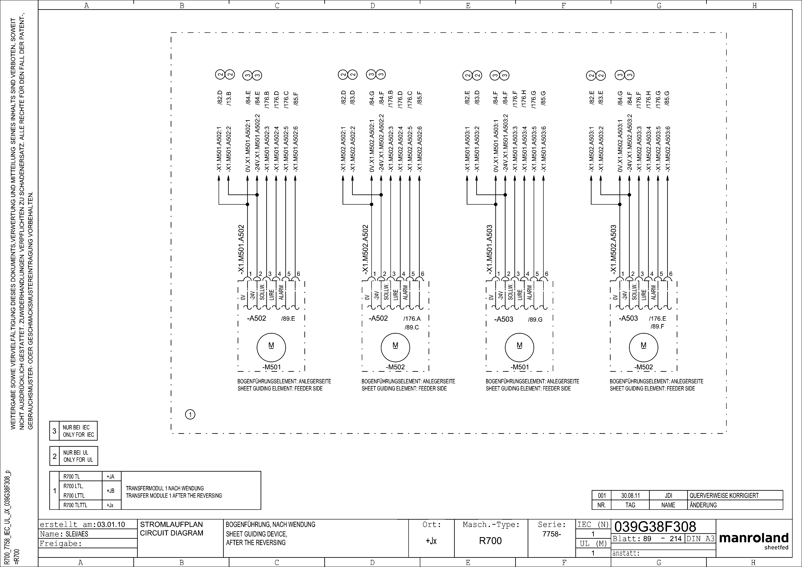

# +Jx — Sheet 89 of 214 — BOGENFÜHRUNG, NACH WENDUNG

**SHEET GUIDING DEVICE**

> Part of the manroland **R700** printing press IEC/UL circuit diagrams.
> Drawing class: **Stromlaufplan / Circuit diagram** (DIN A3).
> Document `+Jx` covers the **1st printing module + feed register** machine section.

## At a glance

| Field | Value |
|---|---|
| Document | `+Jx`  (039G38F308) |
| Sheet | **89** of 214 |
| Section (DE) | BOGENFÜHRUNG, NACH WENDUNG |
| Section (EN) | SHEET GUIDING DEVICE |
| Section type | CIRCUIT — Circuit diagram |
| Machine type | `R700` |
| Series | `7758` |
| Created | 03.01.10 |
| Replaces | — |
| Columns used | A, B, C, D, E, F, G, H |
| Path numbers | — |
| Labels on sheet | 179 |
| Cross-refs out | 38 |
| Cross-refs in | 62 |

**Previous:** [+Jx sheet 88](SHEET_0088.md) · **Next:** [+Jx sheet 90](SHEET_0090.md) · **Document TOC:** [_TOC.md](_TOC.md)  (+Jx) · **Master TOC:** [all sheets](../_MASTER_TOC.md)

## Sheet image (300 DPI, exact vector render)



_Rendered directly from the PDF vector layer at 300 DPI (1-bit), no OCR and no resampling. Use it to confirm anything ambiguous in the text below._

## Cross-references on this sheet

Each entry is a wire leaving this sheet. The printed token is `/sheet.column`; the link resolves to that sheet inside the same document.

| Ref | Target sheet | Col | Path | Destination on target | Target section | From col |
|---|---|---|---|---|---|---|
| `/176.H` | [+Jx sheet 176](SHEET_0176.md) | H | — | X1.M501.A503:4 | OPTION: TRANSFERMODUL 1 NACH | F |
| `/176.B` | [+Jx sheet 176](SHEET_0176.md) | B | — | X1.M502.A502:3 | OPTION: TRANSFERMODUL 1 NACH | D |
| `/82.D` | [+Jx sheet 82](SHEET_0082.md) | D | — | X1.M501.A502:1 | BOGENFÜHRUNG, NACH WENDUNG | B |
| `/82.D` | [+Jx sheet 82](SHEET_0082.md) | D | — | X1.M502.A502:1 | BOGENFÜHRUNG, NACH WENDUNG | D |
| `/83.D` | [+Jx sheet 83](SHEET_0083.md) | D | — | X1.M502.A502:2 | BOGENFÜHRUNG, NACH WENDUNG | D |
| `/83.D` | [+Jx sheet 83](SHEET_0083.md) | D | — | X1.M501.A503:2 | BOGENFÜHRUNG, NACH WENDUNG | E |
| `/84.E` | [+Jx sheet 84](SHEET_0084.md) | E | — | 0V.X1.M501.A502:1 | BOGENFÜHRUNG | C |
| `/82.E` | [+Jx sheet 82](SHEET_0082.md) | E | — | X1.M501.A503:1 | BOGENFÜHRUNG, NACH WENDUNG | E |
| `/82.E` | [+Jx sheet 82](SHEET_0082.md) | E | — | X1.M502.A503:1 | BOGENFÜHRUNG, NACH WENDUNG | F |
| `/83.E` | [+Jx sheet 83](SHEET_0083.md) | E | — | X1.M502.A503:2 | BOGENFÜHRUNG, NACH WENDUNG | F |
| `/176.F` | [+Jx sheet 176](SHEET_0176.md) | F | — | X1.M501.A503:3 | OPTION: TRANSFERMODUL 1 NACH | E |
| `/176.G` | [+Jx sheet 176](SHEET_0176.md) | G | — | X1.M501.A503:5 | OPTION: TRANSFERMODUL 1 NACH | F |
| `/176.G` | [+Jx sheet 176](SHEET_0176.md) | G | — | X1.M502.A503:5 | OPTION: TRANSFERMODUL 1 NACH | G |
| `/84.F` | [+Jx sheet 84](SHEET_0084.md) | F | — | 24V.X1.M502.A502:2 | BOGENFÜHRUNG | D |
| `/85.F` | [+Jx sheet 85](SHEET_0085.md) | F | — | X1.M502.A502:6 | BOGENFÜHRUNG | D |
| `/84.F` | [+Jx sheet 84](SHEET_0084.md) | F | — | 0V.X1.M501.A503:1 | BOGENFÜHRUNG | E |
| `/84.F` | [+Jx sheet 84](SHEET_0084.md) | F | — | 24V.X1.M501.A503:2 | BOGENFÜHRUNG | E |
| `/84.G` | [+Jx sheet 84](SHEET_0084.md) | G | — | 0V.X1.M502.A502:1 | BOGENFÜHRUNG | D |
| `/85.G` | [+Jx sheet 85](SHEET_0085.md) | G | — | X1.M501.A503:6 | BOGENFÜHRUNG | F |
| `/84.G` | [+Jx sheet 84](SHEET_0084.md) | G | — | 0V.X1.M502.A503:1 | BOGENFÜHRUNG | G |
| `/85.G` | [+Jx sheet 85](SHEET_0085.md) | G | — | X1.M502.A503:6 | BOGENFÜHRUNG | G |
| `/176.D` | [+Jx sheet 176](SHEET_0176.md) | D | — | X1.M501.A502:4 | OPTION: TRANSFERMODUL 1 NACH | C |
| `/176.C` | [+Jx sheet 176](SHEET_0176.md) | C | — | X1.M501.A502:5 | OPTION: TRANSFERMODUL 1 NACH | C |
| `/176.D` | [+Jx sheet 176](SHEET_0176.md) | D | — | X1.M502.A502:4 | OPTION: TRANSFERMODUL 1 NACH | D |
| `/176.C` | [+Jx sheet 176](SHEET_0176.md) | C | — | X1.M502.A502:5 | OPTION: TRANSFERMODUL 1 NACH | D |
| `/176.H` | [+Jx sheet 176](SHEET_0176.md) | H | — | X1.M502.A503:4 | OPTION: TRANSFERMODUL 1 NACH | G |
| `/84.E` | [+Jx sheet 84](SHEET_0084.md) | E | — | 24V.X1.M501.A502:2 | BOGENFÜHRUNG | C |
| `/176.B` | [+Jx sheet 176](SHEET_0176.md) | B | — | X1.M501.A502:3 | OPTION: TRANSFERMODUL 1 NACH | C |
| `/13.B` | [+Jx sheet 13](SHEET_0013.md) | B | — | X1.M501.A502:2 | SPANNUNGSVERSORGUNG, SCHALTSCHRANKBELÜFTUNG | B |
| `/84.F` | [+Jx sheet 84](SHEET_0084.md) | F | — | 24V.X1.M502.A503:2 | BOGENFÜHRUNG | G |
| `/176.F` | [+Jx sheet 176](SHEET_0176.md) | F | — | X1.M502.A503:3 | OPTION: TRANSFERMODUL 1 NACH | G |
| `/85.F` | [+Jx sheet 85](SHEET_0085.md) | F | — | X1.M501.A502:6 | BOGENFÜHRUNG | C |
| `/89.E` | [+Jx sheet 89](SHEET_0089.md) | E | — | A502 | BOGENFÜHRUNG, NACH WENDUNG | C |
| `/176.A` | [+Jx sheet 176](SHEET_0176.md) | A | — | A502 | OPTION: TRANSFERMODUL 1 NACH | D |
| `/176.E` | [+Jx sheet 176](SHEET_0176.md) | E | — | A503 | OPTION: TRANSFERMODUL 1 NACH | G |
| `/89.G` | [+Jx sheet 89](SHEET_0089.md) | G | — | A503 | BOGENFÜHRUNG, NACH WENDUNG | F |
| `/89.F` | [+Jx sheet 89](SHEET_0089.md) | F | — | — | BOGENFÜHRUNG, NACH WENDUNG | G |
| `/89.C` | [+Jx sheet 89](SHEET_0089.md) | C | — | — | BOGENFÜHRUNG, NACH WENDUNG | D |

### Incoming references (sheets that point here)

Every other sheet that sends a wire to this one. `Back-ref` is the token printed on *that* sheet; `Path` is its line number.

| From sheet | Cols | Back-ref | Path | Refs | What continues there |
|---|---|---|---|---|---|
| [+Jx#13](SHEET_0013.md) | B | `/13.B` | — | 1 | — |
| [+Jx#82](SHEET_0082.md) | D, E | `/82.D`, `/82.E` | — | 4 | — |
| [+Jx#83](SHEET_0083.md) | D, E | `/83.D`, `/83.E` | — | 3 | — |
| [+Jx#84](SHEET_0084.md) | E, F, G | `/84.E`, `/84.F`, `/84.G` | — | 8 | 0V.X1.M501.A502:1; 0V.X1.M501.A503:1; 0V.X1.M502.A502:1; 0V.X1.M502.A503:1; 24V.X1.M501.A502:2; 24V.X1.M501.A503:2; 24V.X1.M502.A502:2; 24V.X1.M502.A503:2 |
| [+Jx#85](SHEET_0085.md) | F, G | `/85.F`, `/85.G` | — | 4 | X1.M501.A502:6; X1.M501.A503:6; X1.M502.A502:6; X1.M502.A503:6 |
| [+Jx#89](SHEET_0089.md) | C, D, F, G | `/89.C`, `/89.D`, `/89.F`, `/89.G` | — | 4 | A502; A503 |
| [+Jx#119](SHEET_0119.md) | B, C, E, F | `/119.B`, `/119.C`, `/119.E`, `/119.F` | — | 24 | — |
| [+Jx#176](SHEET_0176.md) | A, C, D, E, F, G, H | `/176.A`, `/176.C`, `/176.D`, `/176.E`, `/176.F`, `/176.G`, `/176.H` | — | 14 | X1.M501.A502:3; X1.M501.A502:4; X1.M501.A502:5; X1.M501.A503:3; X1.M501.A503:4; X1.M501.A503:5; X1.M502.A502:3; X1.M502.A502:4; X1.M502.A502:5; X1.M502.A503:3; |


## Devices on this sheet

| Tag | Class | Class meaning (IEC) | Col | Sub | Terminal | Sign |
|---|---|---|---|---|---|---|
| `A502` | A | Baugruppe / assembly, module, PC board | C | — | — | — |
| `A502` | A | Baugruppe / assembly, module, PC board | D | — | — | — |
| `A503` | A | Baugruppe / assembly, module, PC board | E | — | — | — |
| `A503` | A | Baugruppe / assembly, module, PC board | G | — | — | — |
| `X1.M501.A502` | — | cross-device reference | C | — | — | — |
| `X1.M502.A502` | — | cross-device reference | D | — | — | — |
| `X1.M501.A503` | — | cross-device reference | E | — | — | — |
| `X1.M502.A503` | — | cross-device reference | G | — | — | — |
| `X1.M501.A503:4` | — | cross-device reference | F | — | 4 | — |
| `X1.M501.A503:3` | — | cross-device reference | E | — | 3 | — |
| `X1.M501.A503:5` | — | cross-device reference | F | — | 5 | — |
| `X1.M501.A503:6` | — | cross-device reference | F | — | 6 | — |
| `X1.M501.A503:2` | — | cross-device reference | E | — | 2 | — |
| `X1.M501.A503:1` | — | cross-device reference | E | — | 1 | — |
| `X1.M501.A502:3` | — | cross-device reference | C | — | 3 | — |
| `X1.M501.A502:1` | — | cross-device reference | B | — | 1 | — |
| `X1.M501.A502:4` | — | cross-device reference | C | — | 4 | — |
| `X1.M501.A502:6` | — | cross-device reference | C | — | 6 | — |
| `X1.M501.A502:5` | — | cross-device reference | C | — | 5 | — |
| `X1.M502.A503:6` | — | cross-device reference | G | — | 6 | — |
| `X1.M502.A503:1` | — | cross-device reference | F | — | 1 | — |
| `X1.M502.A502:6` | — | cross-device reference | D | — | 6 | — |
| `X1.M502.A503:2` | — | cross-device reference | F | — | 2 | — |
| `X1.M502.A503:3` | — | cross-device reference | G | — | 3 | — |
| `X1.M502.A503:5` | — | cross-device reference | G | — | 5 | — |
| `X1.M502.A503:4` | — | cross-device reference | G | — | 4 | — |
| `X1.M502.A502:5` | — | cross-device reference | D | — | 5 | — |
| `X1.M502.A502:1` | — | cross-device reference | D | — | 1 | — |
| `X1.M502.A502:2` | — | cross-device reference | D | — | 2 | — |
| `X1.M502.A502:4` | — | cross-device reference | D | — | 4 | — |
| `X1.M502.A502:3` | — | cross-device reference | D | — | 3 | — |
| `X1.M501.A502:2` | — | cross-device reference | B | — | 2 | — |
| `NR.` | — | cross-device reference | F | — | — | — |
| `30.08.11` | — | cross-device reference | G | — | — | — |
| `SOLLW.` | — | cross-device reference | C | — | — | — |
| `SOLLW.` | — | cross-device reference | D | — | — | — |
| `SOLLW.` | — | cross-device reference | E | — | — | — |
| `SOLLW.` | — | cross-device reference | G | — | — | — |

## Potentials / nets

| Potential | Count | Columns | Attached devices | Terminals |
|---|---|---|---|---|
| `0V` | 8 | C, D, E, G | `A502`, `A503`, `M501`, `M502`, `X1` | `1` |
| `24V` | 8 | C, D, E, G | `A502`, `A503`, `M501`, `M502`, `X1` | `2` |
| `M501` | 2 | C, F | — | — |
| `M502` | 2 | D, G | — | — |


A potential such as `L24+/4` or `M24+` is a named supply/return rail; every place it appears on this sheet is electrically common.

## Wire-end annotations (grouped as printed)

A wire that continues elsewhere is annotated with a small cluster: the destination description, the path/line number `#NN`, and the `/sheet.column` cross reference. Each row below is one such cluster exactly as it is grouped on the drawing.

| Col | Y | Path | Cross-ref | Text on the wire |
|---|---|---|---|---|
| B | 108.5 | — | — | `2` |
| C | 108.5 | — | — | `2` |
| D | 108.5 | — | — | `3` |
| D | 108.5 | — | — | `3` |
| D | 108.8 | — | — | `2` |
| D | 108.8 | — | — | `2` |
| G | 109.4 | — | — | `3` |
| G | 109.4 | — | — | `3` |
| C | 110.0 | — | — | `3` |
| C | 110.0 | — | — | `3` |
| E | 110.0 | — | — | `2` |
| E | 110.0 | — | — | `2` |
| E | 110.0 | — | — | `3` |
| E | 110.0 | — | — | `3` |
| F | 110.3 | — | — | `2` |
| F | 110.3 | — | — | `2` |
| F | 133.7 | — | `/176.H` | `X1.M501.A503:4` |
| D | 134.0 | — | `/176.B` | `X1.M502.A502:3` |
| B | 134.2 | — | `/82.D` | `X1.M501.A502:1` |
| D | 134.2 | — | `/82.D` | `X1.M502.A502:1` |
| D | 134.2 | — | `/83.D` | `X1.M502.A502:2` |
| E | 134.2 | — | `/83.D` | `X1.M501.A503:2` |
| C | 134.5 | — | `/84.E` | `0V.X1.M501.A502:1` |
| E | 134.5 | — | `/82.E` | `X1.M501.A503:1` |
| F | 134.5 | — | `/82.E` | `X1.M502.A503:1` |
| F | 134.5 | — | `/83.E` | `X1.M502.A503:2` |
| E | 134.6 | — | `/176.F` | `X1.M501.A503:3` |
| F | 134.6 | — | `/176.G` | `X1.M501.A503:5` |
| G | 134.6 | — | `/176.G` | `X1.M502.A503:5` |
| D | 135.1 | — | `/84.G` | `0V.X1.M502.A502:1` |
| D | 135.1 | — | `/84.F` | `24V.X1.M502.A502:2` |
| D | 135.1 | — | `/85.F` | `X1.M502.A502:6` |
| E | 135.1 | — | `/84.F` | `0V.X1.M501.A503:1` |
| E | 135.1 | — | `/84.F` | `24V.X1.M501.A503:2` |
| F | 135.1 | — | `/85.G` | `X1.M501.A503:6` |
| G | 135.1 | — | `/84.G` | `0V.X1.M502.A503:1` |
| G | 135.1 | — | `/85.G` | `X1.M502.A503:6` |
| C | 135.2 | — | `/176.D` | `X1.M501.A502:4` |
| C | 135.2 | — | `/176.C` | `X1.M501.A502:5` |
| D | 135.2 | — | `/176.D` | `X1.M502.A502:4` |
| D | 135.2 | — | `/176.C` | `X1.M502.A502:5` |
| G | 135.2 | — | `/176.H` | `X1.M502.A503:4` |
| C | 135.4 | — | `/84.E` | `24V.X1.M501.A502:2` |
| C | 135.5 | — | `/176.B` | `X1.M501.A502:3` |
| B | 135.9 | — | `/13.B` | `X1.M501.A502:2` |
| G | 135.9 | — | `/84.F` | `24V.X1.M502.A503:2` |
| G | 136.0 | — | `/176.F` | `X1.M502.A503:3` |
| C | 136.5 | — | `/85.F` | `X1.M501.A502:6` |
| C | 333.5 | — | — | `X1.M501.A502` |
| D | 333.5 | — | — | `X1.M502.A502` |
| E | 333.5 | — | — | `X1.M501.A503` |
| G | 333.5 | — | — | `X1.M502.A503` |
| C | 403.0 | — | — | `1` |
| C | 403.0 | — | — | `2 3 4 5 6` |
| D | 403.0 | — | — | `1` |
| D | 403.0 | — | — | `2 3 4 5 6` |
| E | 403.0 | — | — | `1` |
| F | 403.0 | — | — | `2 3 4 5 6` |
| G | 403.0 | — | — | `1` |
| G | 403.0 | — | — | `2 3 4 5 6` |
| C | 421.0 | — | — | `SOLLW.` |
| D | 421.0 | — | — | `SOLLW.` |
| E | 421.0 | — | — | `SOLLW.` |
| G | 421.0 | — | — | `SOLLW.` |
| C | 423.7 | — | — | `ALARM` |
| D | 423.7 | — | — | `ALARM` |
| F | 423.7 | — | — | `ALARM` |
| G | 423.7 | — | — | `ALARM` |
| C | 429.8 | — | — | `LI/RE` |
| D | 429.8 | — | — | `LI/RE` |
| F | 429.8 | — | — | `LI/RE` |
| G | 429.8 | — | — | `LI/RE` |
| C | 432.3 | — | — | `24V` |
| D | 432.3 | — | — | `24V` |
| E | 432.3 | — | — | `24V` |
| G | 432.3 | — | — | `24V` |
| C | 437.8 | — | — | `0V` |
| D | 437.8 | — | — | `0V` |
| E | 437.8 | — | — | `0V` |
| G | 437.8 | — | — | `0V` |
| C | 467.9 | — | `/89.E` | `A502` |
| D | 467.9 | — | `/176.A` | `A502` |
| G | 467.9 | — | `/176.E` | `A503` |
| F | 469.3 | — | `/89.G` | `A503` |
| G | 480.8 | — | `/89.F` | — |
| D | 482.3 | — | `/89.C` | — |
| C | 507.8 | — | — | `M` |
| D | 507.8 | — | — | `M` |
| F | 507.8 | — | — | `M` |
| G | 507.8 | — | — | `M` |
| C | 540.7 | — | — | `M501` |
| D | 540.7 | — | — | `M502` |
| F | 540.7 | — | — | `M501` |
| G | 540.7 | — | — | `M502` |
| C | 563.4 | — | — | `BOGENFÜHRUNGSELEMENT: ANLEGERSEITE SHEET GUIDING ELEMENT: FEEDER SIDE` |
| D | 563.4 | — | — | `BOGENFÜHRUNGSELEMENT: ANLEGERSEITE SHEET GUIDING ELEMENT: FEEDER SIDE` |
| F | 563.4 | — | — | `BOGENFÜHRUNGSELEMENT: ANLEGERSEITE SHEET GUIDING ELEMENT: FEEDER SIDE` |
| G | 563.4 | — | — | `BOGENFÜHRUNGSELEMENT: ANLEGERSEITE SHEET GUIDING ELEMENT: FEEDER SIDE` |
| B | 612.2 | — | — | `1` |
| A | 632.0 | — | — | `3 NUR BEI IEC ONLY FOR IEC` |
| A | 669.3 | — | — | `2 NUR BEI UL ONLY FOR UL` |
| A | 704.7 | — | — | `R700 TL` |
| A | 704.7 | — | — | `+JA` |
| A | 718.9 | — | — | `R700 LTL,` |
| B | 722.5 | — | — | `1 +JB TRANSFERMODUL 1 NACH WENDUNG TRANSFER MODULE 1 AFTER THE REVERSING` |
| G | 732.7 | — | — | `001 30.08.11 JDI QUERVERWEISE KORRIGIERT` |
| A | 733.1 | — | — | `R700 LTTL` |
| G | 746.9 | — | — | `NR. TAG NAME ÄNDERUNG` |
| A | 747.3 | — | — | `R700 TLTTL +Jx` |


## Notes and free text on this sheet

| Text | Col | Y (pt) |
|---|---|---|
| `BOGENFÜHRUNGSELEMENT: ANLEGERSEITE` | C | 563.43 |
| `SHEET GUIDING ELEMENT: FEEDER SIDE` | C | 574.06 |
| `BOGENFÜHRUNGSELEMENT: ANLEGERSEITE` | D | 563.43 |
| `SHEET GUIDING ELEMENT: FEEDER SIDE` | D | 574.06 |
| `BOGENFÜHRUNGSELEMENT: ANLEGERSEITE` | F | 563.43 |
| `SHEET GUIDING ELEMENT: FEEDER SIDE` | F | 574.06 |
| `BOGENFÜHRUNGSELEMENT: ANLEGERSEITE` | G | 563.43 |
| `SHEET GUIDING ELEMENT: FEEDER SIDE` | G | 574.06 |
| `TAG` | G | 746.98 |
| `NAME` | G | 746.97 |
| `ÄNDERUNG` | G | 747 |
| `JDI` | G | 732.73 |
| `QUERVERWEISE KORRIGIERT` | H | 732.82 |
| `LI/RE` | C | 429.83 |
| `ALARM` | C | 423.71 |
| `M` | C | 507.83 |
| `LI/RE` | D | 429.83 |
| `ALARM` | D | 423.71 |
| `M` | D | 507.83 |
| `LI/RE` | F | 429.83 |
| `ALARM` | F | 423.71 |
| `M` | F | 507.83 |
| `LI/RE` | G | 429.83 |
| `ALARM` | G | 423.71 |
| `M` | G | 507.83 |
| `NUR BEI UL` | A | 669.32 |
| `ONLY FOR UL` | A | 679.97 |
| `R700 TL` | A | 704.74 |
| `R700 LTL,` | A | 718.89 |
| `+JA` | A | 704.69 |
| `R700 TLTTL` | A | 747.26 |
| `+Jx` | A | 747.31 |
| `R700 LTTL` | A | 733.09 |
| `+JB` | A | 725.93 |
| `TRANSFERMODUL 1 NACH WENDUNG` | B | 722.46 |
| `TRANSFER MODULE 1 AFTER THE REVERSING` | B | 733.09 |
| `NUR BEI IEC` | A | 631.97 |
| `ONLY FOR IEC` | A | 642.62 |

## Complete label inventory (exact text from the drawing)

Every text object inside the drawing area of this sheet, in DIN reading order (column A→H, then top→bottom). This is the authoritative list: if a string is not here it is not printed on this sheet.

| Col | Y | X | Dir | Type | Text |
|---|---|---|---|---|---|
| A | 632.0 | 93.4 | → | text | `NUR BEI IEC` |
| A | 635.5 | 77.8 | → | number | `3` |
| A | 642.6 | 93.7 | → | text | `ONLY FOR IEC` |
| A | 669.3 | 94.1 | → | text | `NUR BEI UL` |
| A | 673.1 | 78.2 | → | number | `2` |
| A | 680.0 | 94.4 | → | text | `ONLY FOR UL` |
| A | 704.7 | 94.4 | → | text | `R700 TL` |
| A | 704.7 | 158.5 | → | text | `+JA` |
| A | 718.9 | 94.4 | → | text | `R700 LTL,` |
| A | 724.2 | 78.3 | → | number | `1` |
| A | 725.9 | 158.5 | → | text | `+JB` |
| A | 733.1 | 94.4 | → | text | `R700 LTTL` |
| A | 747.3 | 94.4 | → | text | `R700 TLTTL` |
| A | 747.3 | 158.5 | → | text | `+Jx` |
| B | 108.5 | 324.3 | ↕ | number | `2` |
| B | 134.2 | 322.8 | ↕ | cross-reference | `/82.D` |
| B | 136.0 | 335.7 | ↕ | cross-reference | `/13.B` |
| B | 187.5 | 321.6 | ↕ | device ref | `X1.M501.A502:1` |
| B | 187.5 | 335.7 | ↕ | device ref | `X1.M501.A502:2` |
| B | 612.2 | 280.5 | → | number | `1` |
| B | 722.5 | 187.1 | → | text | `TRANSFERMODUL 1 NACH WENDUNG` |
| B | 733.1 | 187.1 | → | text | `TRANSFER MODULE 1 AFTER THE REVERSING` |
| C | 108.5 | 338.4 | ↕ | number | `2` |
| C | 110.0 | 364.7 | ↕ | number | `3` |
| C | 110.0 | 378.9 | ↕ | number | `3` |
| C | 134.5 | 364.6 | ↕ | cross-reference | `/84.E` |
| C | 135.2 | 406.6 | ↕ | cross-reference | `/176.D` |
| C | 135.2 | 421.1 | ↕ | cross-reference | `/176.C` |
| C | 135.4 | 378.2 | ↕ | cross-reference | `/84.E` |
| C | 135.5 | 392.1 | ↕ | cross-reference | `/176.B` |
| C | 136.5 | 435.5 | ↕ | cross-reference | `/85.F` |
| C | 169.4 | 378.2 | ↕ | potential | `24V.X1.M501.A502:2` |
| C | 177.1 | 364.1 | ↕ | potential | `0V.X1.M501.A502:1` |
| C | 187.5 | 392.4 | ↕ | device ref | `X1.M501.A502:3` |
| C | 187.5 | 406.6 | ↕ | device ref | `X1.M501.A502:4` |
| C | 187.5 | 420.8 | ↕ | device ref | `X1.M501.A502:5` |
| C | 187.5 | 434.9 | ↕ | device ref | `X1.M501.A502:6` |
| C | 333.5 | 353.5 | ↕ | device ref | `X1.M501.A502` |
| C | 403.0 | 369.4 | → | number | `1` |
| C | 403.0 | 384.4 | → | number | `2` |
| C | 403.0 | 398.3 | → | number | `3` |
| C | 403.0 | 412.7 | → | number | `4` |
| C | 403.0 | 426.6 | → | number | `5` |
| C | 403.0 | 440.8 | → | number | `6` |
| C | 421.0 | 386.3 | ↕ | device ref | `SOLLW.` |
| C | 423.7 | 414.7 | ↕ | text | `ALARM` |
| C | 429.8 | 400.5 | ↕ | text | `LI/RE` |
| C | 432.3 | 372.2 | ↕ | potential | `24V` |
| C | 437.8 | 358.0 | ↕ | potential | `0V` |
| C | 467.9 | 366.9 | → | device tag | `A502` |
| C | 469.2 | 417.6 | → | cross-reference | `/89.E` |
| C | 507.8 | 398.4 | → | text | `M` |
| C | 540.7 | 389.6 | → | potential | `M501` |
| C | 563.4 | 352.6 | → | text | `BOGENFÜHRUNGSELEMENT: ANLEGERSEITE` |
| C | 574.1 | 352.9 | → | text | `SHEET GUIDING ELEMENT: FEEDER SIDE` |
| D | 108.5 | 548.3 | ↕ | number | `3` |
| D | 108.5 | 562.5 | ↕ | number | `3` |
| D | 108.8 | 506.5 | ↕ | number | `2` |
| D | 108.8 | 520.7 | ↕ | number | `2` |
| D | 134.0 | 575.7 | ↕ | cross-reference | `/176.B` |
| D | 134.2 | 506.4 | ↕ | cross-reference | `/82.D` |
| D | 134.2 | 519.4 | ↕ | cross-reference | `/83.D` |
| D | 135.1 | 548.3 | ↕ | cross-reference | `/84.G` |
| D | 135.1 | 562.7 | ↕ | cross-reference | `/84.F` |
| D | 135.1 | 619.1 | ↕ | cross-reference | `/85.F` |
| D | 135.2 | 590.2 | ↕ | cross-reference | `/176.D` |
| D | 135.2 | 604.7 | ↕ | cross-reference | `/176.C` |
| D | 169.4 | 562.5 | ↕ | potential | `24V.X1.M502.A502:2` |
| D | 177.1 | 548.3 | ↕ | potential | `0V.X1.M502.A502:1` |
| D | 187.5 | 505.8 | ↕ | device ref | `X1.M502.A502:1` |
| D | 187.5 | 520.0 | ↕ | device ref | `X1.M502.A502:2` |
| D | 187.5 | 576.7 | ↕ | device ref | `X1.M502.A502:3` |
| D | 187.5 | 590.9 | ↕ | device ref | `X1.M502.A502:4` |
| D | 187.5 | 605.0 | ↕ | device ref | `X1.M502.A502:5` |
| D | 187.5 | 619.2 | ↕ | device ref | `X1.M502.A502:6` |
| D | 333.5 | 537.7 | ↕ | device ref | `X1.M502.A502` |
| D | 403.0 | 553.6 | → | number | `1` |
| D | 403.0 | 568.6 | → | number | `2` |
| D | 403.0 | 582.5 | → | number | `3` |
| D | 403.0 | 597.0 | → | number | `4` |
| D | 403.0 | 610.9 | → | number | `5` |
| D | 421.0 | 570.5 | ↕ | device ref | `SOLLW.` |
| D | 423.7 | 599.0 | ↕ | text | `ALARM` |
| D | 429.8 | 584.8 | ↕ | text | `LI/RE` |
| D | 432.3 | 556.5 | ↕ | potential | `24V` |
| D | 437.8 | 542.3 | ↕ | potential | `0V` |
| D | 467.9 | 547.6 | → | device tag | `A502` |
| D | 469.3 | 599.0 | → | cross-reference | `/176.A` |
| D | 482.3 | 600.9 | → | cross-reference | `/89.C` |
| D | 507.8 | 582.7 | → | text | `M` |
| D | 540.7 | 573.2 | → | potential | `M502` |
| D | 563.4 | 536.9 | → | text | `BOGENFÜHRUNGSELEMENT: ANLEGERSEITE` |
| D | 574.1 | 537.2 | → | text | `SHEET GUIDING ELEMENT: FEEDER SIDE` |
| E | 110.0 | 691.5 | ↕ | number | `2` |
| E | 110.0 | 705.6 | ↕ | number | `2` |
| E | 110.0 | 731.9 | ↕ | number | `3` |
| E | 110.0 | 746.1 | ↕ | number | `3` |
| E | 134.2 | 704.4 | ↕ | cross-reference | `/83.D` |
| E | 134.5 | 689.9 | ↕ | cross-reference | `/82.E` |
| E | 134.6 | 760.8 | ↕ | cross-reference | `/176.F` |
| E | 135.1 | 731.9 | ↕ | cross-reference | `/84.F` |
| E | 135.1 | 746.3 | ↕ | cross-reference | `/84.F` |
| E | 169.4 | 746.8 | ↕ | potential | `24V.X1.M501.A503:2` |
| E | 177.1 | 732.6 | ↕ | potential | `0V.X1.M501.A503:1` |
| E | 187.5 | 690.1 | ↕ | device ref | `X1.M501.A503:1` |
| E | 187.5 | 704.2 | ↕ | device ref | `X1.M501.A503:2` |
| E | 187.5 | 760.9 | ↕ | device ref | `X1.M501.A503:3` |
| E | 333.5 | 722.0 | ↕ | device ref | `X1.M501.A503` |
| E | 403.0 | 625.1 | → | number | `6` |
| E | 403.0 | 737.9 | → | number | `1` |
| E | 403.0 | 752.9 | → | number | `2` |
| E | 421.0 | 754.8 | ↕ | device ref | `SOLLW.` |
| E | 432.3 | 740.7 | ↕ | potential | `24V` |
| E | 437.8 | 726.5 | ↕ | potential | `0V` |
| E | 469.3 | 733.8 | → | device tag | `A503` |
| F | 110.3 | 875.0 | ↕ | number | `2` |
| F | 110.3 | 889.2 | ↕ | number | `2` |
| F | 133.7 | 773.8 | ↕ | cross-reference | `/176.H` |
| F | 134.5 | 875.0 | ↕ | cross-reference | `/82.E` |
| F | 134.5 | 888.0 | ↕ | cross-reference | `/83.E` |
| F | 134.6 | 788.3 | ↕ | cross-reference | `/176.G` |
| F | 135.1 | 802.7 | ↕ | cross-reference | `/85.G` |
| F | 187.5 | 775.1 | ↕ | device ref | `X1.M501.A503:4` |
| F | 187.5 | 789.3 | ↕ | device ref | `X1.M501.A503:5` |
| F | 187.5 | 803.4 | ↕ | device ref | `X1.M501.A503:6` |
| F | 187.5 | 874.3 | ↕ | device ref | `X1.M502.A503:1` |
| F | 187.5 | 888.5 | ↕ | device ref | `X1.M502.A503:2` |
| F | 403.0 | 766.8 | → | number | `3` |
| F | 403.0 | 781.2 | → | number | `4` |
| F | 403.0 | 795.1 | → | number | `5` |
| F | 403.0 | 809.3 | → | number | `6` |
| F | 423.7 | 783.3 | ↕ | text | `ALARM` |
| F | 429.8 | 769.0 | ↕ | text | `LI/RE` |
| F | 470.7 | 784.0 | → | cross-reference | `/89.G` |
| F | 507.8 | 766.9 | → | text | `M` |
| F | 540.7 | 758.1 | → | potential | `M501` |
| F | 563.4 | 721.1 | → | text | `BOGENFÜHRUNGSELEMENT: ANLEGERSEITE` |
| F | 574.1 | 721.4 | → | text | `SHEET GUIDING ELEMENT: FEEDER SIDE` |
| F | 732.7 | 887.8 | → | number | `001` |
| F | 746.9 | 887.0 | → | device ref | `NR.` |
| G | 109.4 | 917.5 | ↕ | number | `3` |
| G | 109.4 | 931.7 | ↕ | number | `3` |
| G | 134.6 | 973.3 | ↕ | cross-reference | `/176.G` |
| G | 135.1 | 916.9 | ↕ | cross-reference | `/84.G` |
| G | 135.1 | 986.3 | ↕ | cross-reference | `/85.G` |
| G | 135.2 | 958.9 | ↕ | cross-reference | `/176.H` |
| G | 136.0 | 931.0 | ↕ | cross-reference | `/84.F` |
| G | 136.0 | 944.4 | ↕ | cross-reference | `/176.F` |
| G | 169.4 | 931.0 | ↕ | potential | `24V.X1.M502.A503:2` |
| G | 177.1 | 916.8 | ↕ | potential | `0V.X1.M502.A503:1` |
| G | 187.5 | 945.2 | ↕ | device ref | `X1.M502.A503:3` |
| G | 187.5 | 959.4 | ↕ | device ref | `X1.M502.A503:4` |
| G | 187.5 | 973.5 | ↕ | device ref | `X1.M502.A503:5` |
| G | 187.5 | 987.7 | ↕ | device ref | `X1.M502.A503:6` |
| G | 333.5 | 906.2 | ↕ | device ref | `X1.M502.A503` |
| G | 403.0 | 922.1 | → | number | `1` |
| G | 403.0 | 937.1 | → | number | `2` |
| G | 403.0 | 951.0 | → | number | `3` |
| G | 403.0 | 965.5 | → | number | `4` |
| G | 403.0 | 979.4 | → | number | `5` |
| G | 403.0 | 993.6 | → | number | `6` |
| G | 421.0 | 939.0 | ↕ | device ref | `SOLLW.` |
| G | 423.7 | 967.5 | ↕ | text | `ALARM` |
| G | 429.8 | 953.3 | ↕ | text | `LI/RE` |
| G | 432.3 | 925.0 | ↕ | potential | `24V` |
| G | 437.8 | 910.8 | ↕ | potential | `0V` |
| G | 467.9 | 918.9 | → | device tag | `A503` |
| G | 469.3 | 963.6 | → | cross-reference | `/176.E` |
| G | 480.8 | 966.1 | → | cross-reference | `/89.F` |
| G | 507.8 | 951.2 | → | text | `M` |
| G | 540.7 | 941.7 | → | potential | `M502` |
| G | 563.4 | 905.4 | → | text | `BOGENFÜHRUNGSELEMENT: ANLEGERSEITE` |
| G | 574.1 | 905.7 | → | text | `SHEET GUIDING ELEMENT: FEEDER SIDE` |
| G | 732.7 | 987.2 | → | text | `JDI` |
| G | 732.8 | 922.6 | → | device ref | `30.08.11` |
| G | 747.0 | 928.7 | → | text | `TAG` |
| G | 747.0 | 982.0 | → | text | `NAME` |
| G | 747.0 | 1024.2 | → | text | `ÄNDERUNG` |
| H | 732.8 | 1024.0 | → | text | `QUERVERWEISE KORRIGIERT` |

## Reading-order text block

The same content as a plain block, grouped by DIN column — convenient to paste or to match against a visual description.

```text
=== Column A ===
 632.0   93.4  text         NUR BEI IEC
 635.5   77.8  numeric      3
 642.6   93.7  text         ONLY FOR IEC
 669.3   94.1  text         NUR BEI UL
 673.1   78.2  numeric      2
 680.0   94.4  text         ONLY FOR UL
 704.7   94.4  text         R700 TL
 704.7  158.5  text         +JA
 718.9   94.4  text         R700 LTL,
 724.2   78.3  numeric      1
 725.9  158.5  text         +JB
 733.1   94.4  text         R700 LTTL
 747.3   94.4  text         R700 TLTTL
 747.3  158.5  text         +Jx
=== Column B ===
 108.5  324.3  numeric      2
 134.2  322.8  xref         /82.D
 136.0  335.7  xref         /13.B
 187.5  321.6  devref       X1.M501.A502:1
 187.5  335.7  devref       X1.M501.A502:2
 612.2  280.5  numeric      1
 722.5  187.1  text         TRANSFERMODUL 1 NACH WENDUNG
 733.1  187.1  text         TRANSFER MODULE 1 AFTER THE REVERSING
=== Column C ===
 108.5  338.4  numeric      2
 110.0  364.7  numeric      3
 110.0  378.9  numeric      3
 134.5  364.6  xref         /84.E
 135.2  406.6  xref         /176.D
 135.2  421.1  xref         /176.C
 135.4  378.2  xref         /84.E
 135.5  392.1  xref         /176.B
 136.5  435.5  xref         /85.F
 169.4  378.2  net          24V.X1.M501.A502:2
 177.1  364.1  net          0V.X1.M501.A502:1
 187.5  392.4  devref       X1.M501.A502:3
 187.5  406.6  devref       X1.M501.A502:4
 187.5  420.8  devref       X1.M501.A502:5
 187.5  434.9  devref       X1.M501.A502:6
 333.5  353.5  devref       X1.M501.A502
 403.0  369.4  numeric      1
 403.0  384.4  numeric      2
 403.0  398.3  numeric      3
 403.0  412.7  numeric      4
 403.0  426.6  numeric      5
 403.0  440.8  numeric      6
 421.0  386.3  devref       SOLLW.
 423.7  414.7  text         ALARM
 429.8  400.5  text         LI/RE
 432.3  372.2  net          24V
 437.8  358.0  net          0V
 467.9  366.9  devtag       A502
 469.2  417.6  xref         /89.E
 507.8  398.4  text         M
 540.7  389.6  net          M501
 563.4  352.6  text         BOGENFÜHRUNGSELEMENT: ANLEGERSEITE
 574.1  352.9  text         SHEET GUIDING ELEMENT: FEEDER SIDE
=== Column D ===
 108.5  548.3  numeric      3
 108.5  562.5  numeric      3
 108.8  506.5  numeric      2
 108.8  520.7  numeric      2
 134.0  575.7  xref         /176.B
 134.2  506.4  xref         /82.D
 134.2  519.4  xref         /83.D
 135.1  548.3  xref         /84.G
 135.1  562.7  xref         /84.F
 135.1  619.1  xref         /85.F
 135.2  590.2  xref         /176.D
 135.2  604.7  xref         /176.C
 169.4  562.5  net          24V.X1.M502.A502:2
 177.1  548.3  net          0V.X1.M502.A502:1
 187.5  505.8  devref       X1.M502.A502:1
 187.5  520.0  devref       X1.M502.A502:2
 187.5  576.7  devref       X1.M502.A502:3
 187.5  590.9  devref       X1.M502.A502:4
 187.5  605.0  devref       X1.M502.A502:5
 187.5  619.2  devref       X1.M502.A502:6
 333.5  537.7  devref       X1.M502.A502
 403.0  553.6  numeric      1
 403.0  568.6  numeric      2
 403.0  582.5  numeric      3
 403.0  597.0  numeric      4
 403.0  610.9  numeric      5
 421.0  570.5  devref       SOLLW.
 423.7  599.0  text         ALARM
 429.8  584.8  text         LI/RE
 432.3  556.5  net          24V
 437.8  542.3  net          0V
 467.9  547.6  devtag       A502
 469.3  599.0  xref         /176.A
 482.3  600.9  xref         /89.C
 507.8  582.7  text         M
 540.7  573.2  net          M502
 563.4  536.9  text         BOGENFÜHRUNGSELEMENT: ANLEGERSEITE
 574.1  537.2  text         SHEET GUIDING ELEMENT: FEEDER SIDE
=== Column E ===
 110.0  691.5  numeric      2
 110.0  705.6  numeric      2
 110.0  731.9  numeric      3
 110.0  746.1  numeric      3
 134.2  704.4  xref         /83.D
 134.5  689.9  xref         /82.E
 134.6  760.8  xref         /176.F
 135.1  731.9  xref         /84.F
 135.1  746.3  xref         /84.F
 169.4  746.8  net          24V.X1.M501.A503:2
 177.1  732.6  net          0V.X1.M501.A503:1
 187.5  690.1  devref       X1.M501.A503:1
 187.5  704.2  devref       X1.M501.A503:2
 187.5  760.9  devref       X1.M501.A503:3
 333.5  722.0  devref       X1.M501.A503
 403.0  625.1  numeric      6
 403.0  737.9  numeric      1
 403.0  752.9  numeric      2
 421.0  754.8  devref       SOLLW.
 432.3  740.7  net          24V
 437.8  726.5  net          0V
 469.3  733.8  devtag       A503
=== Column F ===
 110.3  875.0  numeric      2
 110.3  889.2  numeric      2
 133.7  773.8  xref         /176.H
 134.5  875.0  xref         /82.E
 134.5  888.0  xref         /83.E
 134.6  788.3  xref         /176.G
 135.1  802.7  xref         /85.G
 187.5  775.1  devref       X1.M501.A503:4
 187.5  789.3  devref       X1.M501.A503:5
 187.5  803.4  devref       X1.M501.A503:6
 187.5  874.3  devref       X1.M502.A503:1
 187.5  888.5  devref       X1.M502.A503:2
 403.0  766.8  numeric      3
 403.0  781.2  numeric      4
 403.0  795.1  numeric      5
 403.0  809.3  numeric      6
 423.7  783.3  text         ALARM
 429.8  769.0  text         LI/RE
 470.7  784.0  xref         /89.G
 507.8  766.9  text         M
 540.7  758.1  net          M501
 563.4  721.1  text         BOGENFÜHRUNGSELEMENT: ANLEGERSEITE
 574.1  721.4  text         SHEET GUIDING ELEMENT: FEEDER SIDE
 732.7  887.8  numeric      001
 746.9  887.0  devref       NR.
=== Column G ===
 109.4  917.5  numeric      3
 109.4  931.7  numeric      3
 134.6  973.3  xref         /176.G
 135.1  916.9  xref         /84.G
 135.1  986.3  xref         /85.G
 135.2  958.9  xref         /176.H
 136.0  931.0  xref         /84.F
 136.0  944.4  xref         /176.F
 169.4  931.0  net          24V.X1.M502.A503:2
 177.1  916.8  net          0V.X1.M502.A503:1
 187.5  945.2  devref       X1.M502.A503:3
 187.5  959.4  devref       X1.M502.A503:4
 187.5  973.5  devref       X1.M502.A503:5
 187.5  987.7  devref       X1.M502.A503:6
 333.5  906.2  devref       X1.M502.A503
 403.0  922.1  numeric      1
 403.0  937.1  numeric      2
 403.0  951.0  numeric      3
 403.0  965.5  numeric      4
 403.0  979.4  numeric      5
 403.0  993.6  numeric      6
 421.0  939.0  devref       SOLLW.
 423.7  967.5  text         ALARM
 429.8  953.3  text         LI/RE
 432.3  925.0  net          24V
 437.8  910.8  net          0V
 467.9  918.9  devtag       A503
 469.3  963.6  xref         /176.E
 480.8  966.1  xref         /89.F
 507.8  951.2  text         M
 540.7  941.7  net          M502
 563.4  905.4  text         BOGENFÜHRUNGSELEMENT: ANLEGERSEITE
 574.1  905.7  text         SHEET GUIDING ELEMENT: FEEDER SIDE
 732.7  987.2  text         JDI
 732.8  922.6  devref       30.08.11
 747.0  928.7  text         TAG
 747.0  982.0  text         NAME
 747.0 1024.2  text         ÄNDERUNG
=== Column H ===
 732.8 1024.0  text         QUERVERWEISE KORRIGIERT
```

---
_Generated from the PDF vector text layer; no OCR. Source: `R700_7758_IEC_UL_JX_039G38F308_p`, sheet 89._
