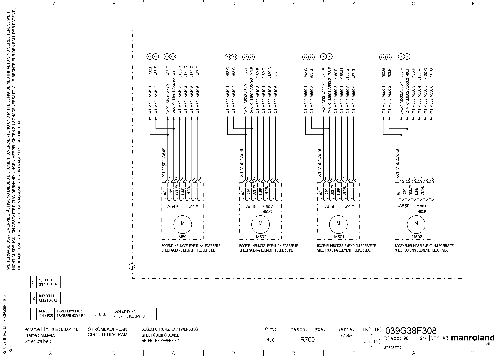

# +Jx — Sheet 90 of 214 — BOGENFÜHRUNG, NACH WENDUNG

**SHEET GUIDING DEVICE**

> Part of the manroland **R700** printing press IEC/UL circuit diagrams.
> Drawing class: **Stromlaufplan / Circuit diagram** (DIN A3).
> Document `+Jx` covers the **1st printing module + feed register** machine section.

## At a glance

| Field | Value |
|---|---|
| Document | `+Jx`  (039G38F308) |
| Sheet | **90** of 214 |
| Section (DE) | BOGENFÜHRUNG, NACH WENDUNG |
| Section (EN) | SHEET GUIDING DEVICE |
| Section type | CIRCUIT — Circuit diagram |
| Machine type | `R700` |
| Series | `7758` |
| Created | 03.01.10 |
| Replaces | — |
| Columns used | A, B, C, D, E, F, G |
| Path numbers | — |
| Labels on sheet | 169 |
| Cross-refs out | 38 |
| Cross-refs in | 62 |

**Previous:** [+Jx sheet 89](SHEET_0089.md) · **Next:** [+Jx sheet 91](SHEET_0091.md) · **Document TOC:** [_TOC.md](_TOC.md)  (+Jx) · **Master TOC:** [all sheets](../_MASTER_TOC.md)

## Sheet image (300 DPI, exact vector render)



_Rendered directly from the PDF vector layer at 300 DPI (1-bit), no OCR and no resampling. Use it to confirm anything ambiguous in the text below._

## Cross-references on this sheet

Each entry is a wire leaving this sheet. The printed token is `/sheet.column`; the link resolves to that sheet inside the same document.

| Ref | Target sheet | Col | Path | Destination on target | Target section | From col |
|---|---|---|---|---|---|---|
| `/82.F` | [+Jx sheet 82](SHEET_0082.md) | F | — | X1.M501.A549:1 | BOGENFÜHRUNG, NACH WENDUNG | C |
| `/87.G` | [+Jx sheet 87](SHEET_0087.md) | G | — | X1.M501.A549:6 | BOGENFÜHRUNG | C |
| `/180.D` | [+Jx sheet 180](SHEET_0180.md) | D | — | X1.M501.A549:4 | OPTION: TRANSFERMODUL 2 | C |
| `/180.C` | [+Jx sheet 180](SHEET_0180.md) | C | — | X1.M501.A549:5 | OPTION: TRANSFERMODUL 2 | C |
| `/180.B` | [+Jx sheet 180](SHEET_0180.md) | B | — | X1.M501.A549:3 | OPTION: TRANSFERMODUL 2 | C |
| `/86.E` | [+Jx sheet 86](SHEET_0086.md) | E | — | 0V.X1.M501.A549:1 | BOGENFÜHRUNG | C |
| `/83.F` | [+Jx sheet 83](SHEET_0083.md) | F | — | X1.M501.A549:2 | BOGENFÜHRUNG, NACH WENDUNG | C |
| `/86.F` | [+Jx sheet 86](SHEET_0086.md) | F | — | 24V.X1.M501.A549:2 | BOGENFÜHRUNG | C |
| `/86.F` | [+Jx sheet 86](SHEET_0086.md) | F | — | 0V.X1.M502.A549:1 | BOGENFÜHRUNG | D |
| `/86.F` | [+Jx sheet 86](SHEET_0086.md) | F | — | 24V.X1.M502.A549:2 | BOGENFÜHRUNG | D |
| `/86.F` | [+Jx sheet 86](SHEET_0086.md) | F | — | 24V.X1.M501.A550:2 | BOGENFÜHRUNG | F |
| `/82.G` | [+Jx sheet 82](SHEET_0082.md) | G | — | X1.M502.A549:1 | BOGENFÜHRUNG, NACH WENDUNG | D |
| `/83.G` | [+Jx sheet 83](SHEET_0083.md) | G | — | X1.M502.A549:2 | BOGENFÜHRUNG, NACH WENDUNG | D |
| `/180.C` | [+Jx sheet 180](SHEET_0180.md) | C | — | X1.M502.A549:5 | OPTION: TRANSFERMODUL 2 | E |
| `/86.F` | [+Jx sheet 86](SHEET_0086.md) | F | — | 24V.X1.M502.A550:2 | BOGENFÜHRUNG | G |
| `/87.G` | [+Jx sheet 87](SHEET_0087.md) | G | — | X1.M502.A549:6 | BOGENFÜHRUNG | E |
| `/180.D` | [+Jx sheet 180](SHEET_0180.md) | D | — | X1.M502.A549:4 | OPTION: TRANSFERMODUL 2 | E |
| `/180.B` | [+Jx sheet 180](SHEET_0180.md) | B | — | X1.M502.A549:3 | OPTION: TRANSFERMODUL 2 | D |
| `/86.E` | [+Jx sheet 86](SHEET_0086.md) | E | — | 0V.X1.M501.A550:1 | BOGENFÜHRUNG | F |
| `/180.F` | [+Jx sheet 180](SHEET_0180.md) | F | — | X1.M502.A550:3 | OPTION: TRANSFERMODUL 2 | G |
| `/180.G` | [+Jx sheet 180](SHEET_0180.md) | G | — | X1.M502.A550:5 | OPTION: TRANSFERMODUL 2 | G |
| `/86.F` | [+Jx sheet 86](SHEET_0086.md) | F | — | 0V.X1.M502.A550:1 | BOGENFÜHRUNG | G |
| `/82.G` | [+Jx sheet 82](SHEET_0082.md) | G | — | X1.M501.A550:1 | BOGENFÜHRUNG, NACH WENDUNG | E |
| `/82.G` | [+Jx sheet 82](SHEET_0082.md) | G | — | X1.M502.A550:1 | BOGENFÜHRUNG, NACH WENDUNG | G |
| `/87.G` | [+Jx sheet 87](SHEET_0087.md) | G | — | X1.M502.A550:6 | BOGENFÜHRUNG | G |
| `/180.H` | [+Jx sheet 180](SHEET_0180.md) | H | — | X1.M501.A550:4 | OPTION: TRANSFERMODUL 2 | F |
| `/83.H` | [+Jx sheet 83](SHEET_0083.md) | H | — | X1.M502.A550:2 | BOGENFÜHRUNG, NACH WENDUNG | G |
| `/180.F` | [+Jx sheet 180](SHEET_0180.md) | F | — | X1.M501.A550:3 | OPTION: TRANSFERMODUL 2 | F |
| `/180.G` | [+Jx sheet 180](SHEET_0180.md) | G | — | X1.M501.A550:5 | OPTION: TRANSFERMODUL 2 | F |
| `/83.G` | [+Jx sheet 83](SHEET_0083.md) | G | — | X1.M501.A550:2 | BOGENFÜHRUNG, NACH WENDUNG | E |
| `/87.G` | [+Jx sheet 87](SHEET_0087.md) | G | — | X1.M501.A550:6 | BOGENFÜHRUNG | F |
| `/180.H` | [+Jx sheet 180](SHEET_0180.md) | H | — | X1.M502.A550:4 | OPTION: TRANSFERMODUL 2 | G |
| `/180.E` | [+Jx sheet 180](SHEET_0180.md) | E | — | A550 | OPTION: TRANSFERMODUL 2 | G |
| `/90.E` | [+Jx sheet 90](SHEET_0090.md) | E | — | A549 | BOGENFÜHRUNG, NACH WENDUNG | C |
| `/180.A` | [+Jx sheet 180](SHEET_0180.md) | A | — | A549 | OPTION: TRANSFERMODUL 2 | D |
| `/90.C` | [+Jx sheet 90](SHEET_0090.md) | C | — | A549 | BOGENFÜHRUNG, NACH WENDUNG | D |
| `/90.G` | [+Jx sheet 90](SHEET_0090.md) | G | — | A550 | BOGENFÜHRUNG, NACH WENDUNG | F |
| `/90.F` | [+Jx sheet 90](SHEET_0090.md) | F | — | — | BOGENFÜHRUNG, NACH WENDUNG | G |

### Incoming references (sheets that point here)

Every other sheet that sends a wire to this one. `Back-ref` is the token printed on *that* sheet; `Path` is its line number.

| From sheet | Cols | Back-ref | Path | Refs | What continues there |
|---|---|---|---|---|---|
| [+Jx#82](SHEET_0082.md) | F, G | `/82.F`, `/82.G` | — | 4 | — |
| [+Jx#83](SHEET_0083.md) | F, G, H | `/83.F`, `/83.G`, `/83.H` | — | 4 | — |
| [+Jx#86](SHEET_0086.md) | E, F | `/86.E`, `/86.F` | — | 8 | 0V.X1.M501.A549:1; 0V.X1.M501.A550:1; 0V.X1.M502.A549:1; 0V.X1.M502.A550:1; 24V.X1.M501.A549:2; 24V.X1.M501.A550:2; 24V.X1.M502.A549:2; 24V.X1.M502.A550:2 |
| [+Jx#87](SHEET_0087.md) | G | `/87.G` | — | 4 | X1.M501.A549:6; X1.M502.A549:6 X1.M501.A550:6; X1.M502.A550:6 |
| [+Jx#90](SHEET_0090.md) | C, D, F, G | `/90.C`, `/90.D`, `/90.F`, `/90.G` | — | 4 | A549; A550 |
| [+Jx#119](SHEET_0119.md) | C, F | `/119.C`, `/119.F` | — | 24 | — |
| [+Jx#180](SHEET_0180.md) | A, C, D, E, F, G, H | `/180.A`, `/180.C`, `/180.D`, `/180.E`, `/180.F`, `/180.G`, `/180.H` | — | 14 | X1.M501.A549:3; X1.M501.A549:4; X1.M501.A549:5; X1.M501.A550:3; X1.M501.A550:4; X1.M501.A550:5; X1.M502.A549:3; X1.M502.A549:4; X1.M502.A549:5; X1.M502.A550:3; |


## Devices on this sheet

| Tag | Class | Class meaning (IEC) | Col | Sub | Terminal | Sign |
|---|---|---|---|---|---|---|
| `A549` | A | Baugruppe / assembly, module, PC board | C | — | — | — |
| `A549` | A | Baugruppe / assembly, module, PC board | D | — | — | — |
| `A550` | A | Baugruppe / assembly, module, PC board | F | — | — | — |
| `A550` | A | Baugruppe / assembly, module, PC board | G | — | — | — |
| `X1.M501.A549` | — | cross-device reference | C | — | — | — |
| `X1.M502.A549` | — | cross-device reference | D | — | — | — |
| `X1.M501.A550` | — | cross-device reference | E | — | — | — |
| `X1.M502.A550` | — | cross-device reference | G | — | — | — |
| `X1.M501.A549:1` | — | cross-device reference | C | — | 1 | — |
| `X1.M501.A549:2` | — | cross-device reference | C | — | 2 | — |
| `X1.M501.A549:3` | — | cross-device reference | C | — | 3 | — |
| `X1.M502.A549:1` | — | cross-device reference | D | — | 1 | — |
| `X1.M502.A550:3` | — | cross-device reference | G | — | 3 | — |
| `X1.M502.A550:2` | — | cross-device reference | G | — | 2 | — |
| `X1.M502.A550:4` | — | cross-device reference | G | — | 4 | — |
| `X1.M502.A550:5` | — | cross-device reference | G | — | 5 | — |
| `X1.M502.A550:6` | — | cross-device reference | G | — | 6 | — |
| `X1.M502.A550:1` | — | cross-device reference | G | — | 1 | — |
| `X1.M502.A549:2` | — | cross-device reference | D | — | 2 | — |
| `X1.M502.A549:3` | — | cross-device reference | D | — | 3 | — |
| `X1.M502.A549:4` | — | cross-device reference | E | — | 4 | — |
| `X1.M502.A549:6` | — | cross-device reference | E | — | 6 | — |
| `X1.M502.A549:5` | — | cross-device reference | E | — | 5 | — |
| `X1.M501.A550:6` | — | cross-device reference | F | — | 6 | — |
| `X1.M501.A550:5` | — | cross-device reference | F | — | 5 | — |
| `X1.M501.A550:4` | — | cross-device reference | F | — | 4 | — |
| `X1.M501.A550:3` | — | cross-device reference | F | — | 3 | — |
| `X1.M501.A549:5` | — | cross-device reference | C | — | 5 | — |
| `X1.M501.A549:4` | — | cross-device reference | C | — | 4 | — |
| `X1.M501.A549:6` | — | cross-device reference | C | — | 6 | — |
| `X1.M501.A550:2` | — | cross-device reference | E | — | 2 | — |
| `X1.M501.A550:1` | — | cross-device reference | E | — | 1 | — |
| `SOLLW.` | — | cross-device reference | C | — | — | — |
| `SOLLW.` | — | cross-device reference | D | — | — | — |
| `SOLLW.` | — | cross-device reference | F | — | — | — |
| `SOLLW.` | — | cross-device reference | G | — | — | — |

## Potentials / nets

| Potential | Count | Columns | Attached devices | Terminals |
|---|---|---|---|---|
| `0V` | 8 | C, D, E, F, G | `A549`, `A550`, `M501`, `M502`, `X1` | `1` |
| `24V` | 8 | C, D, F, G | `A549`, `A550`, `M501`, `M502`, `X1` | `2` |
| `M501` | 2 | C, F | — | — |
| `M502` | 2 | D, G | — | — |


A potential such as `L24+/4` or `M24+` is a named supply/return rail; every place it appears on this sheet is electrically common.

## Wire-end annotations (grouped as printed)

A wire that continues elsewhere is annotated with a small cluster: the destination description, the path/line number `#NN`, and the `/sheet.column` cross reference. Each row below is one such cluster exactly as it is grouped on the drawing.

| Col | Y | Path | Cross-ref | Text on the wire |
|---|---|---|---|---|
| C | 131.7 | — | — | `2` |
| C | 131.7 | — | — | `2` |
| C | 131.7 | — | — | `3` |
| C | 131.7 | — | — | `3` |
| F | 131.7 | — | — | `3` |
| F | 131.7 | — | — | `3` |
| G | 131.7 | — | — | `3` |
| G | 131.7 | — | — | `3` |
| D | 133.1 | — | — | `2` |
| D | 133.1 | — | — | `2` |
| D | 133.1 | — | — | `3` |
| D | 133.1 | — | — | `3` |
| E | 133.1 | — | — | `2` |
| E | 133.1 | — | — | `2` |
| F | 133.1 | — | — | `2` |
| G | 133.1 | — | — | `2` |
| C | 155.3 | — | `/82.F` | `X1.M501.A549:1` |
| C | 155.3 | — | `/87.G` | `X1.M501.A549:6` |
| C | 155.4 | — | `/180.D` | `X1.M501.A549:4` |
| C | 155.4 | — | `/180.C` | `X1.M501.A549:5` |
| C | 155.7 | — | `/180.B` | `X1.M501.A549:3` |
| C | 156.2 | — | `/86.E` | `0V.X1.M501.A549:1` |
| C | 156.8 | — | `/83.F` | `X1.M501.A549:2` |
| C | 156.8 | — | `/86.F` | `24V.X1.M501.A549:2` |
| D | 158.2 | — | `/82.G` | `X1.M502.A549:1` |
| D | 158.2 | — | `/83.G` | `X1.M502.A549:2` |
| D | 158.2 | — | `/86.F` | `0V.X1.M502.A549:1` |
| D | 158.2 | — | `/86.F` | `24V.X1.M502.A549:2` |
| F | 158.2 | — | `/86.F` | `24V.X1.M501.A550:2` |
| E | 158.3 | — | `/180.C` | `X1.M502.A549:5` |
| E | 159.7 | — | `/87.G` | `X1.M502.A549:6` |
| G | 159.7 | — | `/86.F` | `24V.X1.M502.A550:2` |
| E | 159.8 | — | `/180.D` | `X1.M502.A549:4` |
| D | 160.1 | — | `/180.B` | `X1.M502.A549:3` |
| F | 160.3 | — | `/86.E` | `0V.X1.M501.A550:1` |
| G | 160.6 | — | `/180.F` | `X1.M502.A550:3` |
| G | 160.6 | — | `/180.G` | `X1.M502.A550:5` |
| G | 160.9 | — | `/86.F` | `0V.X1.M502.A550:1` |
| E | 161.1 | — | `/82.G` | `X1.M501.A550:1` |
| G | 161.1 | — | `/82.G` | `X1.M502.A550:1` |
| G | 161.1 | — | `/87.G` | `X1.M502.A550:6` |
| F | 161.2 | — | `/180.H` | `X1.M501.A550:4` |
| G | 161.7 | — | `/83.H` | `X1.M502.A550:2` |
| F | 162.1 | — | `/180.F` | `X1.M501.A550:3` |
| F | 162.1 | — | `/180.G` | `X1.M501.A550:5` |
| E | 162.6 | — | `/83.G` | `X1.M501.A550:2` |
| F | 162.6 | — | `/87.G` | `X1.M501.A550:6` |
| G | 162.7 | — | `/180.H` | `X1.M502.A550:4` |
| C | 348.6 | — | — | `X1.M501.A549` |
| D | 348.6 | — | — | `X1.M502.A549` |
| E | 348.6 | — | — | `X1.M501.A550` |
| G | 348.6 | — | — | `X1.M502.A550` |
| C | 418.0 | — | — | `1` |
| C | 418.0 | — | — | `2 3 4 5 6` |
| D | 418.0 | — | — | `1` |
| E | 418.0 | — | — | `2 3 4 5 6` |
| F | 418.0 | — | — | `1` |
| F | 418.0 | — | — | `2 3 4 5 6` |
| G | 418.0 | — | — | `1` |
| G | 418.0 | — | — | `2 3 4 5 6` |
| C | 436.0 | — | — | `SOLLW.` |
| D | 436.0 | — | — | `SOLLW.` |
| F | 436.0 | — | — | `SOLLW.` |
| G | 436.0 | — | — | `SOLLW.` |
| C | 438.7 | — | — | `ALARM` |
| E | 438.7 | — | — | `ALARM` |
| F | 438.7 | — | — | `ALARM` |
| G | 438.7 | — | — | `ALARM` |
| C | 444.9 | — | — | `LI/RE` |
| D | 444.9 | — | — | `LI/RE` |
| F | 444.9 | — | — | `LI/RE` |
| G | 444.9 | — | — | `LI/RE` |
| C | 447.4 | — | — | `24V` |
| D | 447.4 | — | — | `24V` |
| F | 447.4 | — | — | `24V` |
| G | 447.4 | — | — | `24V` |
| C | 452.8 | — | — | `0V` |
| D | 452.8 | — | — | `0V` |
| E | 452.8 | — | — | `0V` |
| G | 452.8 | — | — | `0V` |
| G | 482.3 | — | `/180.E` | `A550` |
| C | 483.8 | — | `/90.E` | `A549` |
| D | 483.8 | — | `/180.A`, `/90.C` | `A549` |
| F | 483.8 | — | `/90.G` | `A550` |
| G | 496.7 | — | `/90.F` | — |
| C | 522.9 | — | — | `M` |
| D | 522.9 | — | — | `M` |
| F | 522.9 | — | — | `M` |
| G | 522.9 | — | — | `M` |
| C | 555.7 | — | — | `M501` |
| D | 555.7 | — | — | `M502` |
| F | 555.7 | — | — | `M501` |
| G | 555.7 | — | — | `M502` |
| C | 578.5 | — | — | `BOGENFÜHRUNGSELEMENT: ANLEGERSEITE SHEET GUIDING ELEMENT: FEEDER SIDE` |
| E | 578.5 | — | — | `BOGENFÜHRUNGSELEMENT: ANLEGERSEITE SHEET GUIDING ELEMENT: FEEDER SIDE` |
| F | 578.5 | — | — | `BOGENFÜHRUNGSELEMENT: ANLEGERSEITE SHEET GUIDING ELEMENT: FEEDER SIDE` |
| G | 578.5 | — | — | `BOGENFÜHRUNGSELEMENT: ANLEGERSEITE SHEET GUIDING ELEMENT: FEEDER SIDE` |
| B | 627.3 | — | — | `1` |
| A | 659.7 | — | — | `3 NUR BEI IEC ONLY FOR IEC` |
| A | 697.0 | — | — | `2 NUR BEI UL ONLY FOR UL` |
| A | 733.0 | — | — | `1 NUR BEI ONLY FOR TRANSFERMODUL 2 TRANSFER MODULE 2 LTTL +JB NACH WENDUNG` |
| B | 745.3 | — | — | `AFTER THE REVERSING` |


## Notes and free text on this sheet

| Text | Col | Y (pt) |
|---|---|---|
| `BOGENFÜHRUNGSELEMENT: ANLEGERSEITE` | C | 578.46 |
| `SHEET GUIDING ELEMENT: FEEDER SIDE` | C | 589.08 |
| `BOGENFÜHRUNGSELEMENT: ANLEGERSEITE` | E | 578.46 |
| `SHEET GUIDING ELEMENT: FEEDER SIDE` | E | 589.08 |
| `BOGENFÜHRUNGSELEMENT: ANLEGERSEITE` | F | 578.46 |
| `SHEET GUIDING ELEMENT: FEEDER SIDE` | F | 589.08 |
| `BOGENFÜHRUNGSELEMENT: ANLEGERSEITE` | G | 578.46 |
| `SHEET GUIDING ELEMENT: FEEDER SIDE` | G | 589.08 |
| `LI/RE` | C | 444.86 |
| `ALARM` | C | 438.74 |
| `M` | C | 522.86 |
| `LI/RE` | D | 444.86 |
| `ALARM` | E | 438.74 |
| `M` | D | 522.86 |
| `LI/RE` | F | 444.86 |
| `ALARM` | F | 438.74 |
| `M` | F | 522.86 |
| `LI/RE` | G | 444.86 |
| `ALARM` | G | 438.74 |
| `M` | G | 522.86 |
| `TRANSFERMODUL 2` | A | 733.22 |
| `TRANSFER MODULE 2` | A | 743.85 |
| `NUR BEI` | A | 733.04 |
| `ONLY FOR` | A | 743.73 |
| `LTTL +JB` | B | 740.39 |
| `NACH WENDUNG` | B | 734.63 |
| `AFTER THE REVERSING` | B | 745.27 |
| `NUR BEI UL` | A | 697.04 |
| `ONLY FOR UL` | A | 707.69 |
| `NUR BEI IEC` | A | 659.69 |
| `ONLY FOR IEC` | A | 670.35 |

## Complete label inventory (exact text from the drawing)

Every text object inside the drawing area of this sheet, in DIN reading order (column A→H, then top→bottom). This is the authoritative list: if a string is not here it is not printed on this sheet.

| Col | Y | X | Dir | Type | Text |
|---|---|---|---|---|---|
| A | 659.7 | 91.7 | → | text | `NUR BEI IEC` |
| A | 663.2 | 76.1 | → | number | `3` |
| A | 670.3 | 92.0 | → | text | `ONLY FOR IEC` |
| A | 697.0 | 92.4 | → | text | `NUR BEI UL` |
| A | 700.8 | 76.5 | → | number | `2` |
| A | 707.7 | 92.7 | → | text | `ONLY FOR UL` |
| A | 733.0 | 93.0 | → | text | `NUR BEI` |
| A | 733.2 | 134.4 | → | text | `TRANSFERMODUL 2` |
| A | 737.9 | 76.9 | → | number | `1` |
| A | 743.7 | 93.3 | → | text | `ONLY FOR` |
| A | 743.8 | 134.4 | → | text | `TRANSFER MODULE 2` |
| B | 627.3 | 310.1 | → | number | `1` |
| B | 734.6 | 268.3 | → | text | `NACH WENDUNG` |
| B | 740.4 | 223.5 | → | text | `LTTL +JB` |
| B | 745.3 | 268.9 | → | text | `AFTER THE REVERSING` |
| C | 131.7 | 351.7 | ↕ | number | `2` |
| C | 131.7 | 365.9 | ↕ | number | `2` |
| C | 131.7 | 392.2 | ↕ | number | `3` |
| C | 131.7 | 406.4 | ↕ | number | `3` |
| C | 155.3 | 351.6 | ↕ | cross-reference | `/82.F` |
| C | 155.3 | 464.4 | ↕ | cross-reference | `/87.G` |
| C | 155.4 | 435.5 | ↕ | cross-reference | `/180.D` |
| C | 155.4 | 450.0 | ↕ | cross-reference | `/180.C` |
| C | 155.7 | 422.5 | ↕ | cross-reference | `/180.B` |
| C | 156.2 | 393.6 | ↕ | cross-reference | `/86.E` |
| C | 156.8 | 364.7 | ↕ | cross-reference | `/83.F` |
| C | 156.8 | 408.0 | ↕ | cross-reference | `/86.F` |
| C | 184.4 | 407.9 | ↕ | potential | `24V.X1.M501.A549:2` |
| C | 192.1 | 393.7 | ↕ | potential | `0V.X1.M501.A549:1` |
| C | 202.6 | 351.2 | ↕ | device ref | `X1.M501.A549:1` |
| C | 202.6 | 365.4 | ↕ | device ref | `X1.M501.A549:2` |
| C | 202.6 | 422.1 | ↕ | device ref | `X1.M501.A549:3` |
| C | 202.6 | 436.2 | ↕ | device ref | `X1.M501.A549:4` |
| C | 202.6 | 450.4 | ↕ | device ref | `X1.M501.A549:5` |
| C | 202.6 | 464.6 | ↕ | device ref | `X1.M501.A549:6` |
| C | 348.5 | 383.1 | ↕ | device ref | `X1.M501.A549` |
| C | 418.0 | 399.0 | → | number | `1` |
| C | 418.0 | 414.0 | → | number | `2` |
| C | 418.0 | 427.9 | → | number | `3` |
| C | 418.0 | 442.4 | → | number | `4` |
| C | 418.0 | 456.3 | → | number | `5` |
| C | 418.0 | 470.4 | → | number | `6` |
| C | 436.0 | 415.9 | ↕ | device ref | `SOLLW.` |
| C | 438.7 | 444.4 | ↕ | text | `ALARM` |
| C | 444.9 | 430.1 | ↕ | text | `LI/RE` |
| C | 447.4 | 401.9 | ↕ | potential | `24V` |
| C | 452.8 | 387.7 | ↕ | potential | `0V` |
| C | 483.8 | 392.6 | → | device tag | `A549` |
| C | 485.1 | 448.0 | → | cross-reference | `/90.E` |
| C | 522.9 | 428.1 | → | text | `M` |
| C | 555.7 | 419.3 | → | potential | `M501` |
| C | 578.5 | 382.3 | → | text | `BOGENFÜHRUNGSELEMENT: ANLEGERSEITE` |
| C | 589.1 | 382.6 | → | text | `SHEET GUIDING ELEMENT: FEEDER SIDE` |
| D | 133.1 | 536.8 | ↕ | number | `2` |
| D | 133.1 | 551.0 | ↕ | number | `2` |
| D | 133.1 | 578.7 | ↕ | number | `3` |
| D | 133.1 | 592.9 | ↕ | number | `3` |
| D | 158.2 | 535.3 | ↕ | cross-reference | `/82.G` |
| D | 158.2 | 549.7 | ↕ | cross-reference | `/83.G` |
| D | 158.2 | 578.6 | ↕ | cross-reference | `/86.F` |
| D | 158.2 | 591.6 | ↕ | cross-reference | `/86.F` |
| D | 160.0 | 606.1 | ↕ | cross-reference | `/180.B` |
| D | 184.4 | 592.1 | ↕ | potential | `24V.X1.M502.A549:2` |
| D | 192.1 | 578.0 | ↕ | potential | `0V.X1.M502.A549:1` |
| D | 202.6 | 535.4 | ↕ | device ref | `X1.M502.A549:1` |
| D | 202.6 | 549.6 | ↕ | device ref | `X1.M502.A549:2` |
| D | 202.6 | 606.3 | ↕ | device ref | `X1.M502.A549:3` |
| D | 348.5 | 567.3 | ↕ | device ref | `X1.M502.A549` |
| D | 418.0 | 583.3 | → | number | `1` |
| D | 418.0 | 598.3 | → | number | `2` |
| D | 418.0 | 612.2 | → | number | `3` |
| D | 436.0 | 600.2 | ↕ | device ref | `SOLLW.` |
| D | 444.9 | 614.4 | ↕ | text | `LI/RE` |
| D | 447.4 | 586.1 | ↕ | potential | `24V` |
| D | 452.8 | 571.9 | ↕ | potential | `0V` |
| D | 483.8 | 579.1 | → | device tag | `A549` |
| D | 522.9 | 612.3 | → | text | `M` |
| D | 555.7 | 602.8 | → | potential | `M502` |
| E | 133.1 | 720.4 | ↕ | number | `2` |
| E | 133.1 | 734.6 | ↕ | number | `2` |
| E | 158.3 | 635.0 | ↕ | cross-reference | `/180.C` |
| E | 159.7 | 649.5 | ↕ | cross-reference | `/87.G` |
| E | 159.8 | 620.6 | ↕ | cross-reference | `/180.D` |
| E | 161.1 | 720.3 | ↕ | cross-reference | `/82.G` |
| E | 162.6 | 733.3 | ↕ | cross-reference | `/83.G` |
| E | 202.6 | 620.5 | ↕ | device ref | `X1.M502.A549:4` |
| E | 202.6 | 634.7 | ↕ | device ref | `X1.M502.A549:5` |
| E | 202.6 | 648.8 | ↕ | device ref | `X1.M502.A549:6` |
| E | 202.6 | 719.7 | ↕ | device ref | `X1.M501.A550:1` |
| E | 202.6 | 733.9 | ↕ | device ref | `X1.M501.A550:2` |
| E | 348.5 | 751.6 | ↕ | device ref | `X1.M501.A550` |
| E | 418.0 | 626.6 | → | number | `4` |
| E | 418.0 | 640.5 | → | number | `5` |
| E | 418.0 | 654.7 | → | number | `6` |
| E | 438.7 | 628.6 | ↕ | text | `ALARM` |
| E | 452.8 | 756.2 | ↕ | potential | `0V` |
| E | 485.2 | 622.1 | → | cross-reference | `/180.A` |
| E | 496.7 | 622.6 | → | cross-reference | `/90.C` |
| E | 578.5 | 566.5 | → | text | `BOGENFÜHRUNGSELEMENT: ANLEGERSEITE` |
| E | 589.1 | 566.8 | → | text | `SHEET GUIDING ELEMENT: FEEDER SIDE` |
| F | 131.7 | 762.9 | ↕ | number | `3` |
| F | 131.7 | 777.1 | ↕ | number | `3` |
| F | 133.1 | 902.5 | ↕ | number | `2` |
| F | 158.2 | 776.7 | ↕ | cross-reference | `/86.F` |
| F | 160.3 | 762.2 | ↕ | cross-reference | `/86.E` |
| F | 161.2 | 804.2 | ↕ | cross-reference | `/180.H` |
| F | 162.1 | 791.1 | ↕ | cross-reference | `/180.F` |
| F | 162.1 | 818.6 | ↕ | cross-reference | `/180.G` |
| F | 162.6 | 833.1 | ↕ | cross-reference | `/87.G` |
| F | 184.4 | 776.4 | ↕ | potential | `24V.X1.M501.A550:2` |
| F | 192.1 | 762.2 | ↕ | potential | `0V.X1.M501.A550:1` |
| F | 202.6 | 790.6 | ↕ | device ref | `X1.M501.A550:3` |
| F | 202.6 | 804.7 | ↕ | device ref | `X1.M501.A550:4` |
| F | 202.6 | 818.9 | ↕ | device ref | `X1.M501.A550:5` |
| F | 202.6 | 833.1 | ↕ | device ref | `X1.M501.A550:6` |
| F | 418.0 | 767.5 | → | number | `1` |
| F | 418.0 | 782.5 | → | number | `2` |
| F | 418.0 | 796.4 | → | number | `3` |
| F | 418.0 | 810.9 | → | number | `4` |
| F | 418.0 | 824.8 | → | number | `5` |
| F | 418.0 | 838.9 | → | number | `6` |
| F | 436.0 | 784.4 | ↕ | device ref | `SOLLW.` |
| F | 438.7 | 812.9 | ↕ | text | `ALARM` |
| F | 444.9 | 798.7 | ↕ | text | `LI/RE` |
| F | 447.4 | 770.4 | ↕ | potential | `24V` |
| F | 483.8 | 765.9 | → | device tag | `A550` |
| F | 485.2 | 817.2 | → | cross-reference | `/90.G` |
| F | 522.9 | 796.6 | → | text | `M` |
| F | 555.7 | 787.8 | → | potential | `M501` |
| F | 578.5 | 750.8 | → | text | `BOGENFÜHRUNGSELEMENT: ANLEGERSEITE` |
| F | 589.1 | 751.1 | → | text | `SHEET GUIDING ELEMENT: FEEDER SIDE` |
| G | 131.7 | 947.2 | ↕ | number | `3` |
| G | 131.7 | 961.4 | ↕ | number | `3` |
| G | 133.1 | 916.7 | ↕ | number | `2` |
| G | 159.6 | 960.3 | ↕ | cross-reference | `/86.F` |
| G | 160.6 | 974.7 | ↕ | cross-reference | `/180.F` |
| G | 160.6 | 1003.7 | ↕ | cross-reference | `/180.G` |
| G | 160.9 | 946.4 | ↕ | cross-reference | `/86.F` |
| G | 161.1 | 903.9 | ↕ | cross-reference | `/82.G` |
| G | 161.1 | 1016.7 | ↕ | cross-reference | `/87.G` |
| G | 161.7 | 918.4 | ↕ | cross-reference | `/83.H` |
| G | 162.7 | 989.2 | ↕ | cross-reference | `/180.H` |
| G | 184.4 | 960.6 | ↕ | potential | `24V.X1.M502.A550:2` |
| G | 192.1 | 946.5 | ↕ | potential | `0V.X1.M502.A550:1` |
| G | 202.6 | 904.0 | ↕ | device ref | `X1.M502.A550:1` |
| G | 202.6 | 918.1 | ↕ | device ref | `X1.M502.A550:2` |
| G | 202.6 | 974.8 | ↕ | device ref | `X1.M502.A550:3` |
| G | 202.6 | 989.0 | ↕ | device ref | `X1.M502.A550:4` |
| G | 202.6 | 1003.2 | ↕ | device ref | `X1.M502.A550:5` |
| G | 202.6 | 1017.3 | ↕ | device ref | `X1.M502.A550:6` |
| G | 348.5 | 935.8 | ↕ | device ref | `X1.M502.A550` |
| G | 418.0 | 951.8 | → | number | `1` |
| G | 418.0 | 966.8 | → | number | `2` |
| G | 418.0 | 980.7 | → | number | `3` |
| G | 418.0 | 995.1 | → | number | `4` |
| G | 418.0 | 1009.0 | → | number | `5` |
| G | 418.0 | 1023.2 | → | number | `6` |
| G | 436.0 | 968.7 | ↕ | device ref | `SOLLW.` |
| G | 438.7 | 997.1 | ↕ | text | `ALARM` |
| G | 444.9 | 982.9 | ↕ | text | `LI/RE` |
| G | 447.4 | 954.6 | ↕ | potential | `24V` |
| G | 452.8 | 940.4 | ↕ | potential | `0V` |
| G | 482.3 | 940.8 | → | device tag | `A550` |
| G | 483.7 | 986.7 | → | cross-reference | `/180.E` |
| G | 496.7 | 989.2 | → | cross-reference | `/90.F` |
| G | 522.9 | 980.8 | → | text | `M` |
| G | 555.7 | 971.3 | → | potential | `M502` |
| G | 578.5 | 935.0 | → | text | `BOGENFÜHRUNGSELEMENT: ANLEGERSEITE` |
| G | 589.1 | 935.3 | → | text | `SHEET GUIDING ELEMENT: FEEDER SIDE` |

## Reading-order text block

The same content as a plain block, grouped by DIN column — convenient to paste or to match against a visual description.

```text
=== Column A ===
 659.7   91.7  text         NUR BEI IEC
 663.2   76.1  numeric      3
 670.3   92.0  text         ONLY FOR IEC
 697.0   92.4  text         NUR BEI UL
 700.8   76.5  numeric      2
 707.7   92.7  text         ONLY FOR UL
 733.0   93.0  text         NUR BEI
 733.2  134.4  text         TRANSFERMODUL 2
 737.9   76.9  numeric      1
 743.7   93.3  text         ONLY FOR
 743.8  134.4  text         TRANSFER MODULE 2
=== Column B ===
 627.3  310.1  numeric      1
 734.6  268.3  text         NACH WENDUNG
 740.4  223.5  text         LTTL +JB
 745.3  268.9  text         AFTER THE REVERSING
=== Column C ===
 131.7  351.7  numeric      2
 131.7  365.9  numeric      2
 131.7  392.2  numeric      3
 131.7  406.4  numeric      3
 155.3  351.6  xref         /82.F
 155.3  464.4  xref         /87.G
 155.4  435.5  xref         /180.D
 155.4  450.0  xref         /180.C
 155.7  422.5  xref         /180.B
 156.2  393.6  xref         /86.E
 156.8  364.7  xref         /83.F
 156.8  408.0  xref         /86.F
 184.4  407.9  net          24V.X1.M501.A549:2
 192.1  393.7  net          0V.X1.M501.A549:1
 202.6  351.2  devref       X1.M501.A549:1
 202.6  365.4  devref       X1.M501.A549:2
 202.6  422.1  devref       X1.M501.A549:3
 202.6  436.2  devref       X1.M501.A549:4
 202.6  450.4  devref       X1.M501.A549:5
 202.6  464.6  devref       X1.M501.A549:6
 348.5  383.1  devref       X1.M501.A549
 418.0  399.0  numeric      1
 418.0  414.0  numeric      2
 418.0  427.9  numeric      3
 418.0  442.4  numeric      4
 418.0  456.3  numeric      5
 418.0  470.4  numeric      6
 436.0  415.9  devref       SOLLW.
 438.7  444.4  text         ALARM
 444.9  430.1  text         LI/RE
 447.4  401.9  net          24V
 452.8  387.7  net          0V
 483.8  392.6  devtag       A549
 485.1  448.0  xref         /90.E
 522.9  428.1  text         M
 555.7  419.3  net          M501
 578.5  382.3  text         BOGENFÜHRUNGSELEMENT: ANLEGERSEITE
 589.1  382.6  text         SHEET GUIDING ELEMENT: FEEDER SIDE
=== Column D ===
 133.1  536.8  numeric      2
 133.1  551.0  numeric      2
 133.1  578.7  numeric      3
 133.1  592.9  numeric      3
 158.2  535.3  xref         /82.G
 158.2  549.7  xref         /83.G
 158.2  578.6  xref         /86.F
 158.2  591.6  xref         /86.F
 160.0  606.1  xref         /180.B
 184.4  592.1  net          24V.X1.M502.A549:2
 192.1  578.0  net          0V.X1.M502.A549:1
 202.6  535.4  devref       X1.M502.A549:1
 202.6  549.6  devref       X1.M502.A549:2
 202.6  606.3  devref       X1.M502.A549:3
 348.5  567.3  devref       X1.M502.A549
 418.0  583.3  numeric      1
 418.0  598.3  numeric      2
 418.0  612.2  numeric      3
 436.0  600.2  devref       SOLLW.
 444.9  614.4  text         LI/RE
 447.4  586.1  net          24V
 452.8  571.9  net          0V
 483.8  579.1  devtag       A549
 522.9  612.3  text         M
 555.7  602.8  net          M502
=== Column E ===
 133.1  720.4  numeric      2
 133.1  734.6  numeric      2
 158.3  635.0  xref         /180.C
 159.7  649.5  xref         /87.G
 159.8  620.6  xref         /180.D
 161.1  720.3  xref         /82.G
 162.6  733.3  xref         /83.G
 202.6  620.5  devref       X1.M502.A549:4
 202.6  634.7  devref       X1.M502.A549:5
 202.6  648.8  devref       X1.M502.A549:6
 202.6  719.7  devref       X1.M501.A550:1
 202.6  733.9  devref       X1.M501.A550:2
 348.5  751.6  devref       X1.M501.A550
 418.0  626.6  numeric      4
 418.0  640.5  numeric      5
 418.0  654.7  numeric      6
 438.7  628.6  text         ALARM
 452.8  756.2  net          0V
 485.2  622.1  xref         /180.A
 496.7  622.6  xref         /90.C
 578.5  566.5  text         BOGENFÜHRUNGSELEMENT: ANLEGERSEITE
 589.1  566.8  text         SHEET GUIDING ELEMENT: FEEDER SIDE
=== Column F ===
 131.7  762.9  numeric      3
 131.7  777.1  numeric      3
 133.1  902.5  numeric      2
 158.2  776.7  xref         /86.F
 160.3  762.2  xref         /86.E
 161.2  804.2  xref         /180.H
 162.1  791.1  xref         /180.F
 162.1  818.6  xref         /180.G
 162.6  833.1  xref         /87.G
 184.4  776.4  net          24V.X1.M501.A550:2
 192.1  762.2  net          0V.X1.M501.A550:1
 202.6  790.6  devref       X1.M501.A550:3
 202.6  804.7  devref       X1.M501.A550:4
 202.6  818.9  devref       X1.M501.A550:5
 202.6  833.1  devref       X1.M501.A550:6
 418.0  767.5  numeric      1
 418.0  782.5  numeric      2
 418.0  796.4  numeric      3
 418.0  810.9  numeric      4
 418.0  824.8  numeric      5
 418.0  838.9  numeric      6
 436.0  784.4  devref       SOLLW.
 438.7  812.9  text         ALARM
 444.9  798.7  text         LI/RE
 447.4  770.4  net          24V
 483.8  765.9  devtag       A550
 485.2  817.2  xref         /90.G
 522.9  796.6  text         M
 555.7  787.8  net          M501
 578.5  750.8  text         BOGENFÜHRUNGSELEMENT: ANLEGERSEITE
 589.1  751.1  text         SHEET GUIDING ELEMENT: FEEDER SIDE
=== Column G ===
 131.7  947.2  numeric      3
 131.7  961.4  numeric      3
 133.1  916.7  numeric      2
 159.6  960.3  xref         /86.F
 160.6  974.7  xref         /180.F
 160.6 1003.7  xref         /180.G
 160.9  946.4  xref         /86.F
 161.1  903.9  xref         /82.G
 161.1 1016.7  xref         /87.G
 161.7  918.4  xref         /83.H
 162.7  989.2  xref         /180.H
 184.4  960.6  net          24V.X1.M502.A550:2
 192.1  946.5  net          0V.X1.M502.A550:1
 202.6  904.0  devref       X1.M502.A550:1
 202.6  918.1  devref       X1.M502.A550:2
 202.6  974.8  devref       X1.M502.A550:3
 202.6  989.0  devref       X1.M502.A550:4
 202.6 1003.2  devref       X1.M502.A550:5
 202.6 1017.3  devref       X1.M502.A550:6
 348.5  935.8  devref       X1.M502.A550
 418.0  951.8  numeric      1
 418.0  966.8  numeric      2
 418.0  980.7  numeric      3
 418.0  995.1  numeric      4
 418.0 1009.0  numeric      5
 418.0 1023.2  numeric      6
 436.0  968.7  devref       SOLLW.
 438.7  997.1  text         ALARM
 444.9  982.9  text         LI/RE
 447.4  954.6  net          24V
 452.8  940.4  net          0V
 482.3  940.8  devtag       A550
 483.7  986.7  xref         /180.E
 496.7  989.2  xref         /90.F
 522.9  980.8  text         M
 555.7  971.3  net          M502
 578.5  935.0  text         BOGENFÜHRUNGSELEMENT: ANLEGERSEITE
 589.1  935.3  text         SHEET GUIDING ELEMENT: FEEDER SIDE
```

---
_Generated from the PDF vector text layer; no OCR. Source: `R700_7758_IEC_UL_JX_039G38F308_p`, sheet 90._
