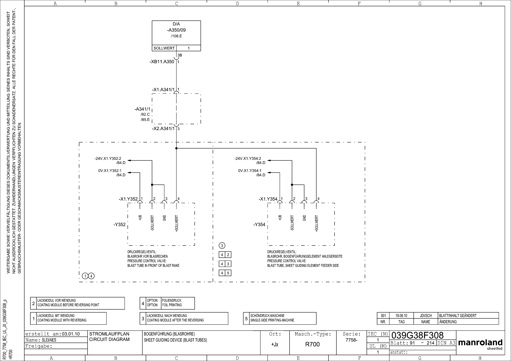

# +Jx — Sheet 91 of 214 — BOGENFÜHRUNG (BLASROHRE)

**SHEET GUIDING DEVICE (BLAST TUBES)**

> Part of the manroland **R700** printing press IEC/UL circuit diagrams.
> Drawing class: **Stromlaufplan / Circuit diagram** (DIN A3).
> Document `+Jx` covers the **1st printing module + feed register** machine section.

## At a glance

| Field | Value |
|---|---|
| Document | `+Jx`  (039G38F308) |
| Sheet | **91** of 214 |
| Section (DE) | BOGENFÜHRUNG (BLASROHRE) |
| Section (EN) | SHEET GUIDING DEVICE (BLAST TUBES) |
| Section type | CIRCUIT — Circuit diagram |
| Machine type | `R700` |
| Series | `7758` |
| Created | 03.01.10 |
| Replaces | — |
| Columns used | A, B, C, D, E, F, G, H |
| Path numbers | — |
| Labels on sheet | 85 |
| Cross-refs out | 7 |
| Cross-refs in | 18 |

**Previous:** [+Jx sheet 90](SHEET_0090.md) · **Next:** [+Jx sheet 92](SHEET_0092.md) · **Document TOC:** [_TOC.md](_TOC.md)  (+Jx) · **Master TOC:** [all sheets](../_MASTER_TOC.md)

## Sheet image (300 DPI, exact vector render)



_Rendered directly from the PDF vector layer at 300 DPI (1-bit), no OCR and no resampling. Use it to confirm anything ambiguous in the text below._

## Cross-references on this sheet

Each entry is a wire leaving this sheet. The printed token is `/sheet.column`; the link resolves to that sheet inside the same document.

| Ref | Target sheet | Col | Path | Destination on target | Target section | From col |
|---|---|---|---|---|---|---|
| `/108.E` | [+Jx sheet 108](SHEET_0108.md) | E | — | — | REFERENZMODUL | C |
| `/92.C` | [+Jx sheet 92](SHEET_0092.md) | C | — | — | BOGENFÜHRUNG (BLASROHRE) | B |
| `/85.E` | [+Jx sheet 85](SHEET_0085.md) | E | — | — | BOGENFÜHRUNG | B |
| `/84.D` | [+Jx sheet 84](SHEET_0084.md) | D | — | 24V.X1.Y352:2 | BOGENFÜHRUNG | B |
| `/84.D` | [+Jx sheet 84](SHEET_0084.md) | D | — | 24V.X1.Y354:2 | BOGENFÜHRUNG | D |
| `/84.D` | [+Jx sheet 84](SHEET_0084.md) | D | — | 0V.X1.Y352:1 | BOGENFÜHRUNG | B |
| `/84.D` | [+Jx sheet 84](SHEET_0084.md) | D | — | 0V.X1.Y354:1 | BOGENFÜHRUNG | D |

### Incoming references (sheets that point here)

Every other sheet that sends a wire to this one. `Back-ref` is the token printed on *that* sheet; `Path` is its line number.

| From sheet | Cols | Back-ref | Path | Refs | What continues there |
|---|---|---|---|---|---|
| [+Jx#84](SHEET_0084.md) | D | `/84.D` | — | 4 | 0V.X1.Y352:1 24V.X1.Y354:2; 0V.X1.Y354:1; 24V.X1.Y352:2 |
| [+Jx#85](SHEET_0085.md) | E | `/85.E` | — | 1 | — |
| [+Jx#92](SHEET_0092.md) | B | `/92.B` | — | 1 | — |
| [+Jx#108](SHEET_0108.md) | E | `/108.E` | — | 1 | — |
| [+Jx#114](SHEET_0114.md) | A | `/114.A` | — | 1 | — |
| [+Jx#121](SHEET_0121.md) | A, B | `/121.A`, `/121.B` | — | 8 | — |
| [+Jx#126](SHEET_0126.md) | A | `/126.A` | — | 1 | — |
| [+Jx#136](SHEET_0136.md) | G | `/136.G` | — | 1 | — |


## Devices on this sheet

| Tag | Class | Class meaning (IEC) | Col | Sub | Terminal | Sign |
|---|---|---|---|---|---|---|
| `A350/09` | A | Baugruppe / assembly, module, PC board | C | 09 | — | — |
| `A341/1` | A | Baugruppe / assembly, module, PC board | B | 1 | — | — |
| `Y352` | Y | Magnetventil / solenoid valve, actuator | B | — | — | — |
| `Y354` | Y | Magnetventil / solenoid valve, actuator | D | — | — | — |
| `NR.` | — | cross-device reference | F | — | — | — |
| `19.08.10` | — | cross-device reference | G | — | — | — |
| `XB11.A350` | — | cross-device reference | C | — | — | — |
| `X1.Y352` | — | cross-device reference | B | — | — | — |
| `X1.Y354` | — | cross-device reference | E | — | — | — |

## Potentials / nets

| Potential | Count | Columns | Attached devices | Terminals |
|---|---|---|---|---|
| `0V` | 2 | B, D | `X1`, `Y352`, `Y354` | `1` |
| `24V` | 2 | B, D | `X1`, `Y352`, `Y354` | `2` |


A potential such as `L24+/4` or `M24+` is a named supply/return rail; every place it appears on this sheet is electrically common.

## Wire-end annotations (grouped as printed)

A wire that continues elsewhere is annotated with a small cluster: the destination description, the path/line number `#NN`, and the `/sheet.column` cross reference. Each row below is one such cluster exactly as it is grouped on the drawing.

| Col | Y | Path | Cross-ref | Text on the wire |
|---|---|---|---|---|
| C | 51.5 | — | — | `D/A` |
| C | 65.4 | — | — | `A350/09` |
| C | 80.3 | — | `/108.E` | — |
| C | 108.6 | — | — | `SOLLWERT 1` |
| C | 124.9 | — | — | `3B` |
| C | 139.1 | — | — | `XB11.A350 1` |
| C | 204.3 | — | — | `X1.A341/1 1` |
| B | 249.7 | — | — | `A341/1` |
| B | 262.8 | — | `/92.C`, `/85.E` | — |
| C | 295.1 | — | — | `X2.A341/1 3` |
| B | 365.9 | — | `/84.D` | `24V.X1.Y352:2` |
| D | 365.9 | — | `/84.D` | `24V.X1.Y354:2` |
| B | 394.2 | — | `/84.D` | `0V.X1.Y352:1` |
| D | 394.2 | — | `/84.D` | `0V.X1.Y354:1` |
| C | 459.5 | — | — | `X1.Y352 1 2 3 4` |
| E | 459.5 | — | — | `X1.Y354 1 2 3 4` |
| B | 501.4 | — | — | `+UB` |
| C | 501.4 | — | — | `GND` |
| E | 501.4 | — | — | `+UB` |
| E | 501.4 | — | — | `GND` |
| C | 501.7 | — | — | `SOLLWERT` |
| C | 501.7 | — | — | `+SOLLWERT` |
| E | 501.7 | — | — | `SOLLWERT` |
| E | 501.7 | — | — | `+SOLLWERT` |
| B | 519.1 | — | — | `Y352` |
| D | 519.1 | — | — | `Y354` |
| D | 570.0 | — | — | `3` |
| C | 584.5 | — | — | `DRUCKREGELVENTIL: BLASROHR VOR BLASRECHEN PRESSURE CONTROL VALVE: BLAST TUBE IN FRONT OF BLAST RAKE` |
| E | 584.5 | — | — | `DRUCKREGELVENTIL: BLASROHR, BOGENFÜHRUNGSELEMENT ANLEGERSEITE PRESSURE CONTROL VALVE: BLAST TUBE, SHEET GUIDING ELEMENT FEEDER SIDE` |
| D | 590.6 | — | — | `4 2` |
| D | 611.8 | — | — | `4 3` |
| D | 633.1 | — | — | `4 5` |
| B | 640.4 | — | — | `1 4` |
| A | 697.9 | — | — | `2 LACKMODUL VOR WENDUNG COATING MODULE BEFORE REVERSING POINT` |
| C | 697.9 | — | — | `4 OPTION OPTION FOLIENDRUCK FOIL PRINTING` |
| G | 733.0 | — | — | `001 19.08.10 JDI/SCH BLATTINHALT GEÄNDERT` |
| A | 733.3 | — | — | `1 LACKMODUL MIT WENDUNG COATING MODULE WITH REVERSING` |
| C | 733.3 | — | — | `3 LACKMODUL NACH WENDUNG COATING MODULE AFTER THE REVERSING` |
| E | 733.4 | — | — | `5 SCHÖNDRUCK MASCHINE SINGLE SIDE PRINTING MACHINE` |
| G | 747.1 | — | — | `NR. TAG NAME ÄNDERUNG` |


## Reconstructed tables

This sheet carries tabular content (pin map / terminal assignment / index). The grid below was rebuilt from the drawing's own rule lines, so each row is exactly one physical row of the table.

### Table 1 — 2 data rows × 4 columns (at x=326.0, y=48.2)

|  |  | D/A | A350/09 /108.E |
|---|---|---|---|
|  | `SOLLWERT` |  | `1` |
| `A341/1 /92.C /85.E` | `XB11.A350 X1.A341/1 X2.A341/1` |  | `3B 1 1 3` |


## Notes and free text on this sheet

| Text | Col | Y (pt) |
|---|---|---|
| `TAG` | G | 747.23 |
| `NAME` | G | 747.22 |
| `ÄNDERUNG` | G | 747.25 |
| `JDI/SCH` | G | 733.05 |
| `BLATTINHALT GEÄNDERT` | H | 733.1 |
| `3B` | C | 124.94 |
| `D/A` | C | 51.55 |
| `SOLLWERT` | C | 108.6 |
| `X1.A341/1` | C | 204.34 |
| `DRUCKREGELVENTIL:` | B | 584.52 |
| `BLASROHR VOR BLASRECHEN` | C | 595.15 |
| `PRESSURE CONTROL VALVE:` | C | 605.77 |
| `BLAST TUBE IN FRONT OF BLAST RAKE` | C | 616.4 |
| `DRUCKREGELVENTIL:` | E | 584.52 |
| `BLASROHR, BOGENFÜHRUNGSELEMENT ANLEGERSEITE` | E | 595.16 |
| `PRESSURE CONTROL VALVE:` | E | 605.77 |
| `BLAST TUBE, SHEET GUIDING ELEMENT FEEDER SIDE` | E | 616.41 |
| `X2.A341/1` | C | 295.05 |
| `LACKMODUL MIT WENDUNG` | A | 733.34 |
| `COATING MODULE WITH REVERSING` | A | 743.96 |
| `LACKMODUL VOR WENDUNG` | A | 697.91 |
| `COATING MODULE BEFORE REVERSING POINT` | A | 708.54 |
| `LACKMODUL NACH WENDUNG` | C | 733.34 |
| `COATING MODULE AFTER THE REVERSING` | C | 743.98 |
| `OPTION` | C | 697.88 |
| `FOLIENDRUCK` | C | 697.93 |
| `FOIL PRINTING` | C | 708.53 |
| `+UB` | B | 501.45 |
| `GND` | C | 501.45 |
| `+SOLLWERT` | C | 501.73 |
| `+UB` | E | 501.45 |
| `SOLLWERT` | E | 501.73 |
| `GND` | E | 501.45 |
| `+SOLLWERT` | E | 501.73 |
| `SCHÖNDRUCK MASCHINE` | D | 733.37 |
| `SINGLE SIDE PRINTING MACHINE` | E | 743.98 |

## Complete label inventory (exact text from the drawing)

Every text object inside the drawing area of this sheet, in DIN reading order (column A→H, then top→bottom). This is the authoritative list: if a string is not here it is not printed on this sheet.

| Col | Y | X | Dir | Type | Text |
|---|---|---|---|---|---|
| A | 640.4 | 196.6 | → | number | `1` |
| A | 697.9 | 87.3 | → | text | `LACKMODUL VOR WENDUNG` |
| A | 703.2 | 75.1 | → | number | `2` |
| A | 708.5 | 87.6 | → | text | `COATING MODULE BEFORE REVERSING POINT` |
| A | 733.3 | 87.3 | → | text | `LACKMODUL MIT WENDUNG` |
| A | 738.6 | 75.4 | → | number | `1` |
| A | 744.0 | 87.6 | → | text | `COATING MODULE WITH REVERSING` |
| B | 249.7 | 313.5 | → | device tag | `A341/1` |
| B | 262.8 | 328.0 | → | cross-reference | `/92.C` |
| B | 275.2 | 328.3 | → | cross-reference | `/85.E` |
| B | 365.9 | 220.3 | → | potential | `24V.X1.Y352:2` |
| B | 375.8 | 271.3 | → | cross-reference | `/84.D` |
| B | 394.2 | 229.0 | → | potential | `0V.X1.Y352:1` |
| B | 404.2 | 271.3 | → | cross-reference | `/84.D` |
| B | 459.5 | 277.2 | → | device ref | `X1.Y352` |
| B | 459.5 | 328.0 | → | number | `1` |
| B | 501.5 | 323.7 | ↕ | text | `+UB` |
| B | 519.1 | 264.8 | → | device tag | `Y352` |
| B | 584.5 | 297.1 | → | text | `DRUCKREGELVENTIL:` |
| B | 640.9 | 210.8 | → | number | `4` |
| B | 703.2 | 330.2 | → | number | `4` |
| B | 738.6 | 330.1 | → | number | `3` |
| C | 51.5 | 402.5 | → | text | `D/A` |
| C | 65.4 | 389.5 | → | device tag | `A350/09` |
| C | 80.3 | 398.4 | → | cross-reference | `/108.E` |
| C | 108.6 | 358.0 | → | text | `SOLLWERT` |
| C | 108.7 | 437.2 | → | number | `1` |
| C | 124.9 | 413.6 | → | text | `3B` |
| C | 139.1 | 348.7 | → | device ref | `XB11.A350` |
| C | 140.6 | 413.0 | → | number | `1` |
| C | 204.3 | 354.3 | → | text | `X1.A341/1` |
| C | 204.4 | 413.0 | → | number | `1` |
| C | 295.0 | 354.3 | → | text | `X2.A341/1` |
| C | 296.5 | 413.6 | → | number | `3` |
| C | 459.5 | 357.2 | → | number | `2` |
| C | 459.5 | 385.2 | → | number | `3` |
| C | 459.5 | 413.9 | → | number | `4` |
| C | 501.4 | 380.4 | ↕ | text | `GND` |
| C | 501.7 | 352.0 | ↕ | text | `SOLLWERT` |
| C | 501.7 | 408.7 | ↕ | text | `+SOLLWERT` |
| C | 595.2 | 297.1 | → | text | `BLASROHR VOR BLASRECHEN` |
| C | 605.8 | 297.1 | → | text | `PRESSURE CONTROL VALVE:` |
| C | 616.4 | 297.1 | → | text | `BLAST TUBE IN FRONT OF BLAST RAKE` |
| C | 697.9 | 342.7 | → | text | `OPTION` |
| C | 697.9 | 377.9 | → | text | `FOLIENDRUCK` |
| C | 708.5 | 342.7 | → | text | `OPTION` |
| C | 708.5 | 377.9 | → | text | `FOIL PRINTING` |
| C | 733.3 | 342.4 | → | text | `LACKMODUL NACH WENDUNG` |
| C | 744.0 | 342.7 | → | text | `COATING MODULE AFTER THE REVERSING` |
| D | 365.9 | 546.2 | → | potential | `24V.X1.Y354:2` |
| D | 375.8 | 597.3 | → | cross-reference | `/84.D` |
| D | 394.2 | 555.0 | → | potential | `0V.X1.Y354:1` |
| D | 404.2 | 597.3 | → | cross-reference | `/84.D` |
| D | 519.1 | 590.5 | → | device tag | `Y354` |
| D | 570.0 | 515.3 | → | number | `3` |
| D | 590.6 | 515.1 | → | number | `4` |
| D | 590.6 | 529.2 | → | number | `2` |
| D | 611.8 | 515.1 | → | number | `4` |
| D | 611.8 | 529.1 | → | number | `3` |
| D | 633.1 | 515.1 | → | number | `4` |
| D | 633.1 | 529.1 | → | number | `5` |
| D | 733.4 | 583.7 | → | text | `SCHÖNDRUCK MASCHINE` |
| D | 738.6 | 571.0 | → | number | `5` |
| E | 459.5 | 602.9 | → | device ref | `X1.Y354` |
| E | 459.5 | 654.0 | → | number | `1` |
| E | 459.5 | 683.1 | → | number | `2` |
| E | 459.5 | 711.2 | → | number | `3` |
| E | 459.5 | 739.8 | → | number | `4` |
| E | 501.4 | 706.4 | ↕ | text | `GND` |
| E | 501.5 | 649.7 | ↕ | text | `+UB` |
| E | 501.7 | 678.0 | ↕ | text | `SOLLWERT` |
| E | 501.7 | 734.7 | ↕ | text | `+SOLLWERT` |
| E | 584.5 | 623.1 | → | text | `DRUCKREGELVENTIL:` |
| E | 595.2 | 623.1 | → | text | `BLASROHR, BOGENFÜHRUNGSELEMENT ANLEGERSEITE` |
| E | 605.8 | 623.1 | → | text | `PRESSURE CONTROL VALVE:` |
| E | 616.4 | 623.1 | → | text | `BLAST TUBE, SHEET GUIDING ELEMENT FEEDER SIDE` |
| E | 744.0 | 583.7 | → | text | `SINGLE SIDE PRINTING MACHINE` |
| F | 733.0 | 887.6 | → | number | `001` |
| F | 747.1 | 886.8 | → | device ref | `NR.` |
| G | 733.1 | 921.5 | → | device ref | `19.08.10` |
| G | 733.1 | 978.6 | → | text | `JDI/SCH` |
| G | 747.2 | 928.5 | → | text | `TAG` |
| G | 747.2 | 981.8 | → | text | `NAME` |
| G | 747.3 | 1024.0 | → | text | `ÄNDERUNG` |
| H | 733.1 | 1023.4 | → | text | `BLATTINHALT GEÄNDERT` |

## Reading-order text block

The same content as a plain block, grouped by DIN column — convenient to paste or to match against a visual description.

```text
=== Column A ===
 640.4  196.6  numeric      1
 697.9   87.3  text         LACKMODUL VOR WENDUNG
 703.2   75.1  numeric      2
 708.5   87.6  text         COATING MODULE BEFORE REVERSING POINT
 733.3   87.3  text         LACKMODUL MIT WENDUNG
 738.6   75.4  numeric      1
 744.0   87.6  text         COATING MODULE WITH REVERSING
=== Column B ===
 249.7  313.5  devtag       A341/1
 262.8  328.0  xref         /92.C
 275.2  328.3  xref         /85.E
 365.9  220.3  net          24V.X1.Y352:2
 375.8  271.3  xref         /84.D
 394.2  229.0  net          0V.X1.Y352:1
 404.2  271.3  xref         /84.D
 459.5  277.2  devref       X1.Y352
 459.5  328.0  numeric      1
 501.5  323.7  text         +UB
 519.1  264.8  devtag       Y352
 584.5  297.1  text         DRUCKREGELVENTIL:
 640.9  210.8  numeric      4
 703.2  330.2  numeric      4
 738.6  330.1  numeric      3
=== Column C ===
  51.5  402.5  text         D/A
  65.4  389.5  devtag       A350/09
  80.3  398.4  xref         /108.E
 108.6  358.0  text         SOLLWERT
 108.7  437.2  numeric      1
 124.9  413.6  text         3B
 139.1  348.7  devref       XB11.A350
 140.6  413.0  numeric      1
 204.3  354.3  text         X1.A341/1
 204.4  413.0  numeric      1
 295.0  354.3  text         X2.A341/1
 296.5  413.6  numeric      3
 459.5  357.2  numeric      2
 459.5  385.2  numeric      3
 459.5  413.9  numeric      4
 501.4  380.4  text         GND
 501.7  352.0  text         SOLLWERT
 501.7  408.7  text         +SOLLWERT
 595.2  297.1  text         BLASROHR VOR BLASRECHEN
 605.8  297.1  text         PRESSURE CONTROL VALVE:
 616.4  297.1  text         BLAST TUBE IN FRONT OF BLAST RAKE
 697.9  342.7  text         OPTION
 697.9  377.9  text         FOLIENDRUCK
 708.5  342.7  text         OPTION
 708.5  377.9  text         FOIL PRINTING
 733.3  342.4  text         LACKMODUL NACH WENDUNG
 744.0  342.7  text         COATING MODULE AFTER THE REVERSING
=== Column D ===
 365.9  546.2  net          24V.X1.Y354:2
 375.8  597.3  xref         /84.D
 394.2  555.0  net          0V.X1.Y354:1
 404.2  597.3  xref         /84.D
 519.1  590.5  devtag       Y354
 570.0  515.3  numeric      3
 590.6  515.1  numeric      4
 590.6  529.2  numeric      2
 611.8  515.1  numeric      4
 611.8  529.1  numeric      3
 633.1  515.1  numeric      4
 633.1  529.1  numeric      5
 733.4  583.7  text         SCHÖNDRUCK MASCHINE
 738.6  571.0  numeric      5
=== Column E ===
 459.5  602.9  devref       X1.Y354
 459.5  654.0  numeric      1
 459.5  683.1  numeric      2
 459.5  711.2  numeric      3
 459.5  739.8  numeric      4
 501.4  706.4  text         GND
 501.5  649.7  text         +UB
 501.7  678.0  text         SOLLWERT
 501.7  734.7  text         +SOLLWERT
 584.5  623.1  text         DRUCKREGELVENTIL:
 595.2  623.1  text         BLASROHR, BOGENFÜHRUNGSELEMENT ANLEGERSEITE
 605.8  623.1  text         PRESSURE CONTROL VALVE:
 616.4  623.1  text         BLAST TUBE, SHEET GUIDING ELEMENT FEEDER SIDE
 744.0  583.7  text         SINGLE SIDE PRINTING MACHINE
=== Column F ===
 733.0  887.6  numeric      001
 747.1  886.8  devref       NR.
=== Column G ===
 733.1  921.5  devref       19.08.10
 733.1  978.6  text         JDI/SCH
 747.2  928.5  text         TAG
 747.2  981.8  text         NAME
 747.3 1024.0  text         ÄNDERUNG
=== Column H ===
 733.1 1023.4  text         BLATTINHALT GEÄNDERT
```

---
_Generated from the PDF vector text layer; no OCR. Source: `R700_7758_IEC_UL_JX_039G38F308_p`, sheet 91._
