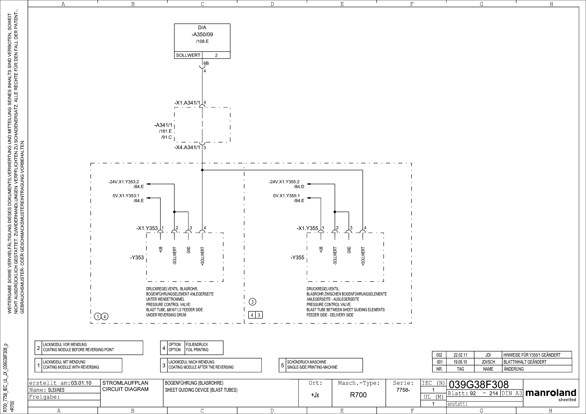

# +Jx — Sheet 92 of 214 — BOGENFÜHRUNG (BLASROHRE)

**SHEET GUIDING DEVICE (BLAST TUBES)**

> Part of the manroland **R700** printing press IEC/UL circuit diagrams.
> Drawing class: **Stromlaufplan / Circuit diagram** (DIN A3).
> Document `+Jx` covers the **1st printing module + feed register** machine section.

## At a glance

| Field | Value |
|---|---|
| Document | `+Jx`  (039G38F308) |
| Sheet | **92** of 214 |
| Section (DE) | BOGENFÜHRUNG (BLASROHRE) |
| Section (EN) | SHEET GUIDING DEVICE (BLAST TUBES) |
| Section type | CIRCUIT — Circuit diagram |
| Machine type | `R700` |
| Series | `7758` |
| Created | 03.01.10 |
| Replaces | — |
| Columns used | A, B, C, D, E, F, G, H |
| Path numbers | — |
| Labels on sheet | 88 |
| Cross-refs out | 7 |
| Cross-refs in | 18 |

**Previous:** [+Jx sheet 91](SHEET_0091.md) · **Next:** [+Jx sheet 93](SHEET_0093.md) · **Document TOC:** [_TOC.md](_TOC.md)  (+Jx) · **Master TOC:** [all sheets](../_MASTER_TOC.md)

## Sheet image (300 DPI, exact vector render)



_Rendered directly from the PDF vector layer at 300 DPI (1-bit), no OCR and no resampling. Use it to confirm anything ambiguous in the text below._

## Cross-references on this sheet

Each entry is a wire leaving this sheet. The printed token is `/sheet.column`; the link resolves to that sheet inside the same document.

| Ref | Target sheet | Col | Path | Destination on target | Target section | From col |
|---|---|---|---|---|---|---|
| `/108.E` | [+Jx sheet 108](SHEET_0108.md) | E | — | — | REFERENZMODUL | C |
| `/181.E` | [+Jx sheet 181](SHEET_0181.md) | E | — | — | OPTION: TRANSFERMODUL 2 | B |
| `/91.C` | [+Jx sheet 91](SHEET_0091.md) | C | — | — | BOGENFÜHRUNG (BLASROHRE) | B |
| `/84.E` | [+Jx sheet 84](SHEET_0084.md) | E | — | 24V.X1.Y353:2 | BOGENFÜHRUNG | B |
| `/84.D` | [+Jx sheet 84](SHEET_0084.md) | D | — | 24V.X1.Y355:2 | BOGENFÜHRUNG | D |
| `/84.E` | [+Jx sheet 84](SHEET_0084.md) | E | — | 0V.X1.Y353:1 | BOGENFÜHRUNG | B |
| `/84.E` | [+Jx sheet 84](SHEET_0084.md) | E | — | 0V.X1.Y355:1 | BOGENFÜHRUNG | D |

### Incoming references (sheets that point here)

Every other sheet that sends a wire to this one. `Back-ref` is the token printed on *that* sheet; `Path` is its line number.

| From sheet | Cols | Back-ref | Path | Refs | What continues there |
|---|---|---|---|---|---|
| [+Jx#84](SHEET_0084.md) | D, E | `/84.D`, `/84.E` | — | 4 | 0V.X1.Y353:1; 0V.X1.Y355:1; 24V.X1.Y353:2; 24V.X1.Y355:2 |
| [+Jx#91](SHEET_0091.md) | B | `/91.B` | — | 1 | — |
| [+Jx#108](SHEET_0108.md) | E | `/108.E` | — | 1 | — |
| [+Jx#114](SHEET_0114.md) | A | `/114.A` | — | 1 | — |
| [+Jx#121](SHEET_0121.md) | A, E | `/121.A`, `/121.E` | — | 8 | — |
| [+Jx#129](SHEET_0129.md) | F | `/129.F` | — | 1 | — |
| [+Jx#136](SHEET_0136.md) | G | `/136.G` | — | 1 | — |
| [+Jx#181](SHEET_0181.md) | E | `/181.E` | — | 1 | — |


## Devices on this sheet

| Tag | Class | Class meaning (IEC) | Col | Sub | Terminal | Sign |
|---|---|---|---|---|---|---|
| `A350/09` | A | Baugruppe / assembly, module, PC board | C | 09 | — | — |
| `Y353` | Y | Magnetventil / solenoid valve, actuator | B | — | — | — |
| `Y355` | Y | Magnetventil / solenoid valve, actuator | D | — | — | — |
| `A341/1` | A | Baugruppe / assembly, module, PC board | B | 1 | — | — |
| `NR.` | — | cross-device reference | F | — | — | — |
| `19.08.10` | — | cross-device reference | G | — | — | — |
| `X1.Y353` | — | cross-device reference | B | — | — | — |
| `X1.Y355` | — | cross-device reference | E | — | — | — |
| `22.02.11` | — | cross-device reference | G | — | — | — |

## Potentials / nets

| Potential | Count | Columns | Attached devices | Terminals |
|---|---|---|---|---|
| `0V` | 2 | B, D | `X1`, `Y353`, `Y355` | `1` |
| `24V` | 2 | B, D | `X1`, `Y353`, `Y355` | `2` |


A potential such as `L24+/4` or `M24+` is a named supply/return rail; every place it appears on this sheet is electrically common.

## Wire-end annotations (grouped as printed)

A wire that continues elsewhere is annotated with a small cluster: the destination description, the path/line number `#NN`, and the `/sheet.column` cross reference. Each row below is one such cluster exactly as it is grouped on the drawing.

| Col | Y | Path | Cross-ref | Text on the wire |
|---|---|---|---|---|
| C | 51.5 | — | — | `D/A` |
| C | 65.4 | — | — | `A350/09` |
| C | 80.3 | — | `/108.E` | — |
| C | 108.6 | — | — | `SOLLWERT 2` |
| C | 124.9 | — | — | `6B` |
| C | 140.6 | — | — | `4` |
| C | 204.3 | — | — | `X1.A341/1 4` |
| B | 249.7 | — | — | `A341/1` |
| B | 262.8 | — | `/181.E` | — |
| B | 275.2 | — | `/91.C` | — |
| C | 295.1 | — | — | `X4.A341/1 3` |
| B | 365.9 | — | `/84.E` | `24V.X1.Y353:2` |
| D | 365.9 | — | `/84.D` | `24V.X1.Y355:2` |
| B | 394.2 | — | `/84.E` | `0V.X1.Y353:1` |
| D | 394.2 | — | `/84.E` | `0V.X1.Y355:1` |
| C | 459.5 | — | — | `X1.Y353 1 2 3 4` |
| E | 459.5 | — | — | `X1.Y355 1 2 3 4` |
| B | 501.4 | — | — | `+UB` |
| C | 501.4 | — | — | `GND` |
| E | 501.4 | — | — | `+UB` |
| E | 501.4 | — | — | `GND` |
| C | 501.7 | — | — | `SOLLWERT` |
| C | 501.7 | — | — | `+SOLLWERT` |
| E | 501.7 | — | — | `SOLLWERT` |
| E | 501.7 | — | — | `+SOLLWERT` |
| B | 519.1 | — | — | `Y353` |
| D | 519.1 | — | — | `Y355` |
| C | 584.5 | — | — | `DRUCKREGELVENTIL: BLASROHR, BOGENFÜHRUNGSELEMENT ANLEGERSEITE UNTER WENDETROMMEL PRESSURE CONTROL VALVE: BLAST TUBE, &B1671;/2 FEEDER SIDE UNDER REVERSING DRUM` |
| E | 584.5 | — | — | `DRUCKREGELVENTIL: BLASROHR ZWISCHEN BOGENFÜHRUNGSELEMENTE` |
| E | 605.8 | — | — | `PRESSURE CONTROL VALVE: BLAST TUBE BETWEEN SHEET GUIDING ELEMENTS FEEDER SIDE DELIVERY SIDE ANLEGERSEITE AUSLEGERSEITE` |
| D | 611.0 | — | — | `3` |
| C | 637.0 | — | — | `1 4 4 3` |
| A | 697.9 | — | — | `2 LACKMODUL VOR WENDUNG COATING MODULE BEFORE REVERSING POINT` |
| C | 697.9 | — | — | `4 OPTION OPTION FOLIENDRUCK FOIL PRINTING` |
| G | 718.7 | — | — | `002 22.02.11 JDI HINWEISE FÜR Y355/1 GEÄNDERT` |
| G | 733.0 | — | — | `001 19.08.10 JDI/SCH BLATTINHALT GEÄNDERT` |
| A | 733.3 | — | — | `1 LACKMODUL MIT WENDUNG COATING MODULE WITH REVERSING` |
| C | 733.3 | — | — | `3 LACKMODUL NACH WENDUNG COATING MODULE AFTER THE REVERSING` |
| E | 733.4 | — | — | `5 SCHÖNDRUCK MASCHINE SINGLE SIDE PRINTING MACHINE` |
| G | 747.1 | — | — | `NR. TAG NAME ÄNDERUNG` |


## Reconstructed tables

This sheet carries tabular content (pin map / terminal assignment / index). The grid below was rebuilt from the drawing's own rule lines, so each row is exactly one physical row of the table.

### Table 1 — 2 data rows × 4 columns (at x=326.0, y=48.2)

|  |  | D/A | A350/09 /108.E |
|---|---|---|---|
|  | `SOLLWERT` |  | `2` |
| `A341/1 /181.E /91.C` | `X1.A341/1 X4.A341/1` |  | `6B 4 4 3` |


## Notes and free text on this sheet

| Text | Col | Y (pt) |
|---|---|---|
| `TAG` | G | 747.23 |
| `NAME` | G | 747.22 |
| `ÄNDERUNG` | G | 747.25 |
| `JDI/SCH` | G | 733.05 |
| `BLATTINHALT GEÄNDERT` | H | 733.1 |
| `6B` | C | 124.94 |
| `D/A` | C | 51.55 |
| `SOLLWERT` | C | 108.6 |
| `X1.A341/1` | C | 204.34 |
| `DRUCKREGELVENTIL: BLASROHR,` | C | 584.52 |
| `BOGENFÜHRUNGSELEMENT ANLEGERSEITE` | C | 595.16 |
| `UNTER WENDETROMMEL` | B | 605.78 |
| `PRESSURE CONTROL VALVE:` | C | 616.41 |
| `BLAST TUBE, &B1671;/2 FEEDER SIDE` | C | 627.03 |
| `UNDER REVERSING DRUM` | B | 637.7 |
| `DRUCKREGELVENTIL:` | E | 584.52 |
| `BLASROHR ZWISCHEN BOGENFÜHRUNGSELEMENTE` | E | 595.15 |
| `ANLEGERSEITE AUSLEGERSEITE` | E | 605.77 |
| `PRESSURE CONTROL VALVE:` | E | 616.41 |
| `BLAST TUBE BETWEEN SHEET GUIDING ELEMENTS` | E | 627.03 |
| `FEEDER SIDE DELIVERY SIDE` | E | 637.66 |
| `X4.A341/1` | C | 295.05 |
| `JDI` | G | 718.71 |
| `HINWEISE FÜR Y355/1 GEÄNDERT` | H | 718.8 |
| `+UB` | B | 501.45 |
| `GND` | C | 501.45 |
| `+SOLLWERT` | C | 501.73 |
| `+UB` | E | 501.45 |
| `SOLLWERT` | E | 501.73 |
| `GND` | E | 501.45 |
| `+SOLLWERT` | E | 501.73 |
| `LACKMODUL MIT WENDUNG` | A | 733.34 |
| `COATING MODULE WITH REVERSING` | A | 743.96 |
| `LACKMODUL VOR WENDUNG` | A | 697.91 |
| `COATING MODULE BEFORE REVERSING POINT` | A | 708.54 |
| `LACKMODUL NACH WENDUNG` | C | 733.34 |
| `COATING MODULE AFTER THE REVERSING` | C | 743.98 |
| `OPTION` | C | 697.88 |
| `FOLIENDRUCK` | C | 697.93 |
| `FOIL PRINTING` | C | 708.53 |
| `SCHÖNDRUCK MASCHINE` | D | 733.37 |
| `SINGLE SIDE PRINTING MACHINE` | E | 743.98 |

## Complete label inventory (exact text from the drawing)

Every text object inside the drawing area of this sheet, in DIN reading order (column A→H, then top→bottom). This is the authoritative list: if a string is not here it is not printed on this sheet.

| Col | Y | X | Dir | Type | Text |
|---|---|---|---|---|---|
| A | 640.4 | 196.6 | → | number | `1` |
| A | 697.9 | 87.3 | → | text | `LACKMODUL VOR WENDUNG` |
| A | 703.2 | 75.1 | → | number | `2` |
| A | 708.5 | 87.6 | → | text | `COATING MODULE BEFORE REVERSING POINT` |
| A | 733.3 | 87.3 | → | text | `LACKMODUL MIT WENDUNG` |
| A | 738.6 | 75.4 | → | number | `1` |
| A | 744.0 | 87.6 | → | text | `COATING MODULE WITH REVERSING` |
| B | 249.7 | 313.5 | → | device tag | `A341/1` |
| B | 262.8 | 323.4 | → | cross-reference | `/181.E` |
| B | 275.2 | 328.0 | → | cross-reference | `/91.C` |
| B | 365.9 | 220.3 | → | potential | `24V.X1.Y353:2` |
| B | 375.8 | 271.6 | → | cross-reference | `/84.E` |
| B | 394.2 | 229.0 | → | potential | `0V.X1.Y353:1` |
| B | 404.1 | 271.6 | → | cross-reference | `/84.E` |
| B | 459.5 | 276.9 | → | device ref | `X1.Y353` |
| B | 459.5 | 328.0 | → | number | `1` |
| B | 501.5 | 323.7 | ↕ | text | `+UB` |
| B | 519.1 | 264.5 | → | device tag | `Y353` |
| B | 605.8 | 297.1 | → | text | `UNTER WENDETROMMEL` |
| B | 637.7 | 297.1 | → | text | `UNDER REVERSING DRUM` |
| B | 640.9 | 210.8 | → | number | `4` |
| B | 703.2 | 330.2 | → | number | `4` |
| B | 738.6 | 330.1 | → | number | `3` |
| C | 51.5 | 402.5 | → | text | `D/A` |
| C | 65.4 | 389.5 | → | device tag | `A350/09` |
| C | 80.3 | 398.4 | → | cross-reference | `/108.E` |
| C | 108.6 | 358.0 | → | text | `SOLLWERT` |
| C | 108.7 | 437.1 | → | number | `2` |
| C | 124.9 | 413.6 | → | text | `6B` |
| C | 140.6 | 413.9 | → | number | `4` |
| C | 204.3 | 354.3 | → | text | `X1.A341/1` |
| C | 204.4 | 413.9 | → | number | `4` |
| C | 295.0 | 354.3 | → | text | `X4.A341/1` |
| C | 296.5 | 413.6 | → | number | `3` |
| C | 459.5 | 357.2 | → | number | `2` |
| C | 459.5 | 385.2 | → | number | `3` |
| C | 459.5 | 413.9 | → | number | `4` |
| C | 501.4 | 380.4 | ↕ | text | `GND` |
| C | 501.7 | 352.0 | ↕ | text | `SOLLWERT` |
| C | 501.7 | 408.7 | ↕ | text | `+SOLLWERT` |
| C | 584.5 | 297.1 | → | text | `DRUCKREGELVENTIL: BLASROHR,` |
| C | 595.2 | 297.1 | → | text | `BOGENFÜHRUNGSELEMENT ANLEGERSEITE` |
| C | 616.4 | 297.1 | → | text | `PRESSURE CONTROL VALVE:` |
| C | 627.0 | 297.1 | → | text | `BLAST TUBE, &B1671;/2 FEEDER SIDE` |
| C | 697.9 | 342.7 | → | text | `OPTION` |
| C | 697.9 | 377.9 | → | text | `FOLIENDRUCK` |
| C | 708.5 | 342.7 | → | text | `OPTION` |
| C | 708.5 | 377.9 | → | text | `FOIL PRINTING` |
| C | 733.3 | 342.4 | → | text | `LACKMODUL NACH WENDUNG` |
| C | 744.0 | 342.7 | → | text | `COATING MODULE AFTER THE REVERSING` |
| D | 365.9 | 546.2 | → | potential | `24V.X1.Y355:2` |
| D | 375.8 | 597.3 | → | cross-reference | `/84.D` |
| D | 394.2 | 555.0 | → | potential | `0V.X1.Y355:1` |
| D | 404.1 | 597.5 | → | cross-reference | `/84.E` |
| D | 519.1 | 590.5 | → | device tag | `Y355` |
| D | 611.0 | 511.1 | → | number | `3` |
| D | 637.0 | 509.8 | → | number | `4` |
| D | 637.0 | 523.8 | → | number | `3` |
| D | 733.4 | 583.7 | → | text | `SCHÖNDRUCK MASCHINE` |
| D | 738.6 | 571.0 | → | number | `5` |
| E | 459.5 | 602.9 | → | device ref | `X1.Y355` |
| E | 459.5 | 654.0 | → | number | `1` |
| E | 459.5 | 683.1 | → | number | `2` |
| E | 459.5 | 711.2 | → | number | `3` |
| E | 459.5 | 739.8 | → | number | `4` |
| E | 501.4 | 706.4 | ↕ | text | `GND` |
| E | 501.5 | 649.7 | ↕ | text | `+UB` |
| E | 501.7 | 678.0 | ↕ | text | `SOLLWERT` |
| E | 501.7 | 734.7 | ↕ | text | `+SOLLWERT` |
| E | 584.5 | 623.1 | → | text | `DRUCKREGELVENTIL:` |
| E | 595.2 | 623.1 | → | text | `BLASROHR ZWISCHEN BOGENFÜHRUNGSELEMENTE` |
| E | 605.8 | 623.6 | → | text | `ANLEGERSEITE AUSLEGERSEITE` |
| E | 616.4 | 623.1 | → | text | `PRESSURE CONTROL VALVE:` |
| E | 627.0 | 623.1 | → | text | `BLAST TUBE BETWEEN SHEET GUIDING ELEMENTS` |
| E | 637.7 | 623.1 | → | text | `FEEDER SIDE DELIVERY SIDE` |
| E | 744.0 | 583.7 | → | text | `SINGLE SIDE PRINTING MACHINE` |
| F | 718.8 | 886.6 | → | number | `002` |
| F | 733.0 | 887.6 | → | number | `001` |
| F | 747.1 | 886.8 | → | device ref | `NR.` |
| G | 718.7 | 986.5 | → | text | `JDI` |
| G | 718.8 | 921.9 | → | device ref | `22.02.11` |
| G | 733.1 | 921.5 | → | device ref | `19.08.10` |
| G | 733.1 | 978.6 | → | text | `JDI/SCH` |
| G | 747.2 | 928.5 | → | text | `TAG` |
| G | 747.2 | 981.8 | → | text | `NAME` |
| G | 747.3 | 1024.0 | → | text | `ÄNDERUNG` |
| H | 718.8 | 1023.0 | → | text | `HINWEISE FÜR Y355/1 GEÄNDERT` |
| H | 733.1 | 1023.4 | → | text | `BLATTINHALT GEÄNDERT` |

## Reading-order text block

The same content as a plain block, grouped by DIN column — convenient to paste or to match against a visual description.

```text
=== Column A ===
 640.4  196.6  numeric      1
 697.9   87.3  text         LACKMODUL VOR WENDUNG
 703.2   75.1  numeric      2
 708.5   87.6  text         COATING MODULE BEFORE REVERSING POINT
 733.3   87.3  text         LACKMODUL MIT WENDUNG
 738.6   75.4  numeric      1
 744.0   87.6  text         COATING MODULE WITH REVERSING
=== Column B ===
 249.7  313.5  devtag       A341/1
 262.8  323.4  xref         /181.E
 275.2  328.0  xref         /91.C
 365.9  220.3  net          24V.X1.Y353:2
 375.8  271.6  xref         /84.E
 394.2  229.0  net          0V.X1.Y353:1
 404.1  271.6  xref         /84.E
 459.5  276.9  devref       X1.Y353
 459.5  328.0  numeric      1
 501.5  323.7  text         +UB
 519.1  264.5  devtag       Y353
 605.8  297.1  text         UNTER WENDETROMMEL
 637.7  297.1  text         UNDER REVERSING DRUM
 640.9  210.8  numeric      4
 703.2  330.2  numeric      4
 738.6  330.1  numeric      3
=== Column C ===
  51.5  402.5  text         D/A
  65.4  389.5  devtag       A350/09
  80.3  398.4  xref         /108.E
 108.6  358.0  text         SOLLWERT
 108.7  437.1  numeric      2
 124.9  413.6  text         6B
 140.6  413.9  numeric      4
 204.3  354.3  text         X1.A341/1
 204.4  413.9  numeric      4
 295.0  354.3  text         X4.A341/1
 296.5  413.6  numeric      3
 459.5  357.2  numeric      2
 459.5  385.2  numeric      3
 459.5  413.9  numeric      4
 501.4  380.4  text         GND
 501.7  352.0  text         SOLLWERT
 501.7  408.7  text         +SOLLWERT
 584.5  297.1  text         DRUCKREGELVENTIL: BLASROHR,
 595.2  297.1  text         BOGENFÜHRUNGSELEMENT ANLEGERSEITE
 616.4  297.1  text         PRESSURE CONTROL VALVE:
 627.0  297.1  text         BLAST TUBE, &B1671;/2 FEEDER SIDE
 697.9  342.7  text         OPTION
 697.9  377.9  text         FOLIENDRUCK
 708.5  342.7  text         OPTION
 708.5  377.9  text         FOIL PRINTING
 733.3  342.4  text         LACKMODUL NACH WENDUNG
 744.0  342.7  text         COATING MODULE AFTER THE REVERSING
=== Column D ===
 365.9  546.2  net          24V.X1.Y355:2
 375.8  597.3  xref         /84.D
 394.2  555.0  net          0V.X1.Y355:1
 404.1  597.5  xref         /84.E
 519.1  590.5  devtag       Y355
 611.0  511.1  numeric      3
 637.0  509.8  numeric      4
 637.0  523.8  numeric      3
 733.4  583.7  text         SCHÖNDRUCK MASCHINE
 738.6  571.0  numeric      5
=== Column E ===
 459.5  602.9  devref       X1.Y355
 459.5  654.0  numeric      1
 459.5  683.1  numeric      2
 459.5  711.2  numeric      3
 459.5  739.8  numeric      4
 501.4  706.4  text         GND
 501.5  649.7  text         +UB
 501.7  678.0  text         SOLLWERT
 501.7  734.7  text         +SOLLWERT
 584.5  623.1  text         DRUCKREGELVENTIL:
 595.2  623.1  text         BLASROHR ZWISCHEN BOGENFÜHRUNGSELEMENTE
 605.8  623.6  text         ANLEGERSEITE AUSLEGERSEITE
 616.4  623.1  text         PRESSURE CONTROL VALVE:
 627.0  623.1  text         BLAST TUBE BETWEEN SHEET GUIDING ELEMENTS
 637.7  623.1  text         FEEDER SIDE DELIVERY SIDE
 744.0  583.7  text         SINGLE SIDE PRINTING MACHINE
=== Column F ===
 718.8  886.6  numeric      002
 733.0  887.6  numeric      001
 747.1  886.8  devref       NR.
=== Column G ===
 718.7  986.5  text         JDI
 718.8  921.9  devref       22.02.11
 733.1  921.5  devref       19.08.10
 733.1  978.6  text         JDI/SCH
 747.2  928.5  text         TAG
 747.2  981.8  text         NAME
 747.3 1024.0  text         ÄNDERUNG
=== Column H ===
 718.8 1023.0  text         HINWEISE FÜR Y355/1 GEÄNDERT
 733.1 1023.4  text         BLATTINHALT GEÄNDERT
```

---
_Generated from the PDF vector text layer; no OCR. Source: `R700_7758_IEC_UL_JX_039G38F308_p`, sheet 92._
