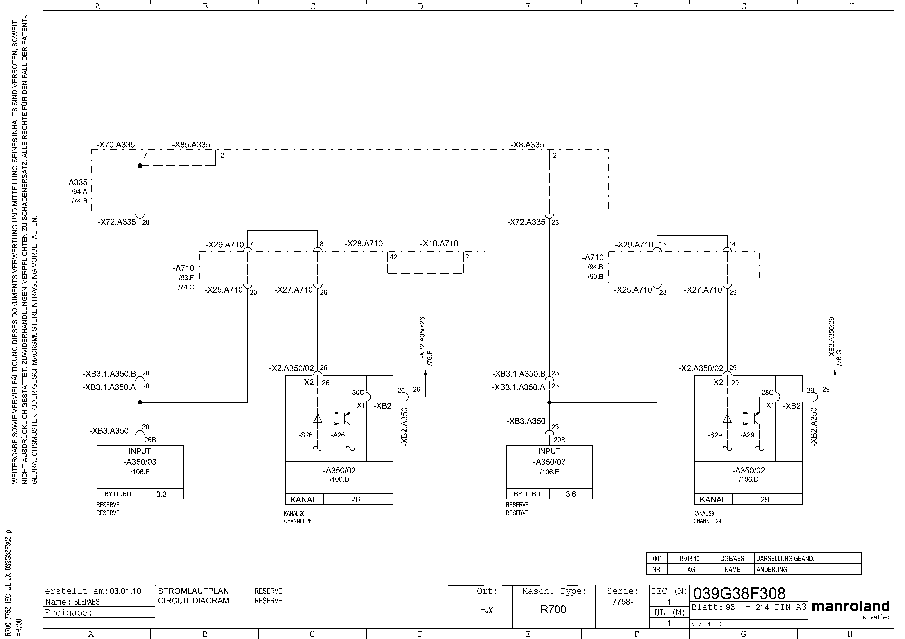

# +Jx — Sheet 93 of 214 — RESERVE

**RESERVE**

> Part of the manroland **R700** printing press IEC/UL circuit diagrams.
> Drawing class: **Stromlaufplan / Circuit diagram** (DIN A3).
> Document `+Jx` covers the **1st printing module + feed register** machine section.

## At a glance

| Field | Value |
|---|---|
| Document | `+Jx`  (039G38F308) |
| Sheet | **93** of 214 |
| Section (DE) | RESERVE |
| Section (EN) | RESERVE |
| Section type | CIRCUIT — Circuit diagram |
| Machine type | `R700` |
| Series | `7758` |
| Created | 03.01.10 |
| Replaces | — |
| Columns used | A, B, C, D, E, F, G, H |
| Path numbers | — |
| Labels on sheet | 113 |
| Cross-refs out | 12 |
| Cross-refs in | 37 |

**Previous:** [+Jx sheet 92](SHEET_0092.md) · **Next:** [+Jx sheet 94](SHEET_0094.md) · **Document TOC:** [_TOC.md](_TOC.md)  (+Jx) · **Master TOC:** [all sheets](../_MASTER_TOC.md)

## Sheet image (300 DPI, exact vector render)



_Rendered directly from the PDF vector layer at 300 DPI (1-bit), no OCR and no resampling. Use it to confirm anything ambiguous in the text below._

## Cross-references on this sheet

Each entry is a wire leaving this sheet. The printed token is `/sheet.column`; the link resolves to that sheet inside the same document.

| Ref | Target sheet | Col | Path | Destination on target | Target section | From col |
|---|---|---|---|---|---|---|
| `/94.A` | [+Jx sheet 94](SHEET_0094.md) | A | — | — | RESERVE | A |
| `/74.B` | [+Jx sheet 74](SHEET_0074.md) | B | — | — | REDUNDANZ: ANTRIEBE | A |
| `/94.B` | [+Jx sheet 94](SHEET_0094.md) | B | — | — | RESERVE | F |
| `/93.B` | [+Jx sheet 93](SHEET_0093.md) | B | — | — | RESERVE | F |
| `/93.F` | [+Jx sheet 93](SHEET_0093.md) | F | — | — | RESERVE | B |
| `/74.C` | [+Jx sheet 74](SHEET_0074.md) | C | — | — | REDUNDANZ: ANTRIEBE | B |
| `/76.F` | [+Jx sheet 76](SHEET_0076.md) | F | — | XB2.A350:26 | BUSVERBINDUNGEN: SICHERHEITSKREIS | D |
| `/76.G` | [+Jx sheet 76](SHEET_0076.md) | G | — | XB2.A350:29 | BUSVERBINDUNGEN: SICHERHEITSKREIS | H |
| `/106.E` | [+Jx sheet 106](SHEET_0106.md) | E | — | — | REFERENZMODUL | A |
| `/106.E` | [+Jx sheet 106](SHEET_0106.md) | E | — | — | REFERENZMODUL | E |
| `/106.D` | [+Jx sheet 106](SHEET_0106.md) | D | — | — | REFERENZMODUL | C |
| `/106.D` | [+Jx sheet 106](SHEET_0106.md) | D | — | — | REFERENZMODUL | G |

### Incoming references (sheets that point here)

Every other sheet that sends a wire to this one. `Back-ref` is the token printed on *that* sheet; `Path` is its line number.

| From sheet | Cols | Back-ref | Path | Refs | What continues there |
|---|---|---|---|---|---|
| [+Jx#74](SHEET_0074.md) | B, C | `/74.B`, `/74.C` | — | 2 | — |
| [+Jx#76](SHEET_0076.md) | F, G | `/76.F`, `/76.G` | — | 2 | XB2.A350:26; XB2.A350:29 |
| [+Jx#93](SHEET_0093.md) | B, F | `/93.B`, `/93.F` | — | 2 | — |
| [+Jx#94](SHEET_0094.md) | A, B | `/94.A`, `/94.B` | — | 2 | — |
| [+Jx#106](SHEET_0106.md) | D, E | `/106.D`, `/106.E` | — | 4 | — |
| [+Jx#126](SHEET_0126.md) | F | `/126.F` | — | 4 | — |
| [+Jx#128](SHEET_0128.md) | C, D, F | `/128.C`, `/128.D`, `/128.F` | — | 6 | — |
| [+Jx#133](SHEET_0133.md) | G | `/133.G` | — | 1 | — |
| [+Jx#135](SHEET_0135.md) | F | `/135.F` | — | 1 | — |
| [+Jx#143](SHEET_0143.md) | A | `/143.A` | — | 2 | — |
| [+Jx#144](SHEET_0144.md) | D | `/144.D` | — | 2 | — |
| [+Jx#146](SHEET_0146.md) | B | `/146.B` | — | 1 | — |
| [+Jx#147](SHEET_0147.md) | B | `/147.B` | — | 4 | — |
| [+Jx#153](SHEET_0153.md) | A, C | `/153.A`, `/153.C` | — | 3 | — |
| [+Jx#156](SHEET_0156.md) | G | `/156.G` | — | 1 | — |


## Devices on this sheet

| Tag | Class | Class meaning (IEC) | Col | Sub | Terminal | Sign |
|---|---|---|---|---|---|---|
| `A350/03` | A | Baugruppe / assembly, module, PC board | A | 03 | — | — |
| `S26` | S | Schalter / switch | C | — | — | — |
| `A26` | A | Baugruppe / assembly, module, PC board | C | — | — | — |
| `X1` | X | Klemme / terminal, plug connector | C | — | — | — |
| `X2` | X | Klemme / terminal, plug connector | C | — | — | — |
| `XB2` | XB |  | D | — | — | — |
| `A350/02` | A | Baugruppe / assembly, module, PC board | C | 02 | — | — |
| `A335` | A | Baugruppe / assembly, module, PC board | A | — | — | — |
| `A350/03` | A | Baugruppe / assembly, module, PC board | E | 03 | — | — |
| `S29` | S | Schalter / switch | G | — | — | — |
| `A29` | A | Baugruppe / assembly, module, PC board | G | — | — | — |
| `X1` | X | Klemme / terminal, plug connector | G | — | — | — |
| `X2` | X | Klemme / terminal, plug connector | G | — | — | — |
| `XB2` | XB |  | G | — | — | — |
| `A350/02` | A | Baugruppe / assembly, module, PC board | G | 02 | — | — |
| `A710` | A | Baugruppe / assembly, module, PC board | F | — | — | — |
| `A710` | A | Baugruppe / assembly, module, PC board | B | — | — | — |
| `X72.A335` | — | cross-device reference | E | — | — | — |
| `XB3.A350` | — | cross-device reference | A | — | — | — |
| `3.3` | — | cross-device reference | B | — | — | — |
| `XB2.A350` | — | cross-device reference | D | — | — | — |
| `XB3.1.A350.B` | — | cross-device reference | A | — | — | — |
| `XB3.1.A350.A` | — | cross-device reference | A | — | — | — |
| `3.6` | — | cross-device reference | E | — | — | — |
| `XB3.A350` | — | cross-device reference | E | — | — | — |
| `XB2.A350` | — | cross-device reference | H | — | — | — |
| `XB3.1.A350.B` | — | cross-device reference | E | — | — | — |
| `XB3.1.A350.A` | — | cross-device reference | E | — | — | — |
| `X27.A710` | — | cross-device reference | G | — | — | — |
| `X29.A710` | — | cross-device reference | F | — | — | — |
| `X25.A710` | — | cross-device reference | F | — | — | — |
| `X27.A710` | — | cross-device reference | C | — | — | — |
| `X25.A710` | — | cross-device reference | B | — | — | — |
| `X29.A710` | — | cross-device reference | B | — | — | — |
| `X72.A335` | — | cross-device reference | A | — | — | — |
| `NR.` | — | cross-device reference | F | — | — | — |
| `19.08.10` | — | cross-device reference | F | — | — | — |
| `XB2.A350:29` | — | cross-device reference | H | — | 29 | — |
| `XB2.A350:26` | — | cross-device reference | D | — | 26 | — |
| `X8.A335` | — | cross-device reference | E | — | — | — |
| `X28.A710` | — | cross-device reference | C | — | — | — |
| `X10.A710` | — | cross-device reference | D | — | — | — |
| `X85.A335` | — | cross-device reference | B | — | — | — |
| `X70.A335` | — | cross-device reference | A | — | — | — |

## Potentials / nets

_No named potentials on this sheet._

## Wire-end annotations (grouped as printed)

A wire that continues elsewhere is annotated with a small cluster: the destination description, the path/line number `#NN`, and the `/sheet.column` cross reference. Each row below is one such cluster exactly as it is grouped on the drawing.

| Col | Y | Path | Cross-ref | Text on the wire |
|---|---|---|---|---|
| B | 185.9 | — | — | `X70.A335 X85.A335 2` |
| E | 185.9 | — | — | `X8.A335` |
| A | 200.8 | — | — | `7` |
| E | 200.8 | — | — | `2` |
| A | 235.5 | — | — | `A335` |
| A | 248.6 | — | `/94.A`, `/74.B` | — |
| A | 287.9 | — | — | `X72.A335 20` |
| E | 287.9 | — | — | `X72.A335 23` |
| D | 316.3 | — | — | `X28.A710 X10.A710` |
| C | 317.7 | — | — | `X29.A710 7 8` |
| F | 317.7 | — | — | `X29.A710 13` |
| G | 317.8 | — | — | `14` |
| F | 334.7 | — | — | `A710` |
| D | 334.8 | — | — | `42 2` |
| F | 347.8 | — | `/94.B`, `/93.B` | — |
| B | 348.9 | — | — | `A710` |
| B | 362.0 | — | `/93.F`, `/74.C` | — |
| C | 377.2 | — | — | `X25.A710 20 X27.A710 26` |
| F | 377.2 | — | — | `X25.A710 23` |
| G | 377.2 | — | — | `X27.A710 29` |
| D | 417.5 | — | `/76.F` | `XB2.A350:26` |
| H | 417.5 | — | `/76.G` | `XB2.A350:29` |
| C | 480.7 | — | — | `X2.A350/02 26` |
| G | 480.7 | — | — | `X2.A350/02 29` |
| A | 487.8 | — | — | `XB3.1.A350.B 20` |
| E | 487.8 | — | — | `XB3.1.A350.B 23` |
| C | 499.1 | — | — | `X2` |
| G | 499.1 | — | — | `X2` |
| C | 500.6 | — | — | `26 26` |
| G | 500.6 | — | — | `29 29` |
| A | 504.8 | — | — | `XB3.1.A350.A 20` |
| E | 504.8 | — | — | `XB3.1.A350.A 23` |
| D | 509.1 | — | — | `26` |
| H | 509.1 | — | — | `29` |
| C | 513.3 | — | — | `30C` |
| G | 513.3 | — | — | `28C` |
| C | 530.3 | — | — | `X1` |
| D | 530.3 | — | — | `XB2` |
| G | 530.3 | — | — | `X1` |
| G | 530.3 | — | — | `XB2` |
| D | 536.6 | — | — | `XB2.A350` |
| H | 536.6 | — | — | `XB2.A350` |
| E | 550.2 | — | — | `XB3.A350 23` |
| A | 558.7 | — | — | `XB3.A350 20` |
| C | 569.3 | — | — | `S26 A26` |
| G | 569.3 | — | — | `S29 A29` |
| A | 575.7 | — | — | `26B` |
| E | 575.7 | — | — | `29B` |
| A | 590.2 | — | — | `INPUT` |
| E | 590.2 | — | — | `INPUT` |
| A | 604.0 | — | — | `A350/03` |
| E | 604.0 | — | — | `A350/03` |
| C | 615.4 | — | — | `A350/02` |
| G | 615.4 | — | — | `A350/02` |
| A | 617.8 | — | `/106.E` | — |
| E | 617.8 | — | `/106.E` | — |
| C | 627.8 | — | `/106.D` | — |
| G | 627.8 | — | `/106.D` | — |
| A | 646.9 | — | — | `BYTE.BIT 3.3` |
| E | 646.9 | — | — | `BYTE.BIT 3.6` |
| C | 653.6 | — | — | `KANAL 26` |
| G | 653.6 | — | — | `KANAL 29` |
| A | 662.4 | — | — | `RESERVE RESERVE` |
| E | 662.4 | — | — | `RESERVE RESERVE` |
| C | 674.0 | — | — | `KANAL 26 CHANNEL 26` |
| G | 674.0 | — | — | `KANAL 29 CHANNEL 29` |
| G | 733.0 | — | — | `001 19.08.10 DGE/AES DARSELLUNG GEÄND.` |
| G | 747.1 | — | — | `NR. TAG NAME ÄNDERUNG` |


## Reconstructed tables

This sheet carries tabular content (pin map / terminal assignment / index). The grid below was rebuilt from the drawing's own rule lines, so each row is exactly one physical row of the table.

### Table 1 — 8 data rows × 19 columns (at x=127.6, y=218.3)

| X72.A335 | 20 |  |  |  |  |  |  |  |  | X72.A335 | 23 |  |  |  |  |  |  |  |
|---|---|---|---|---|---|---|---|---|---|---|---|---|---|---|---|---|---|---|
|  |  | `X29.A710 A710` | `7` |  | `8` | `X28.A710` |  | `42` | `X10.A710 2` |  |  | `X29.A710 A710 /94.B` | `13` |  | `14` |  |  |  |
| `XB3.1.A350.B` | `20` | `/93.F /74.C X25.A710` | `20` | `X27.A710 X2.A350/02` | `26 26` |  |  | `XB2.A350:26` | `/76.F` | `XB3.1.A350.B` | `23` | `/93.B X25.A710` | `23` | `X27.A710 X2.A350/02` | `29 29` |  |  | `XB2.A350:29` |
| `XB3.1.A350.A` | `20` |  |  | `X2` | `26` | `30C` |  | `26 26` |  | `XB3.1.A350.A` | `23` |  |  | `X2` | `29` | `28C` |  | `29 29` |
| `XB3.A350` | `20 26B` |  |  | `S26` | `A26` | `X1` | `XB2` | `XB2.A350` |  | `XB3.A350` | `23 29B` |  |  | `S29` | `A29` | `X1` | `XB2` | `XB2.A350` |
| `INPUT` |  |  |  |  |  |  |  |  |  | `INPUT` |  |  |  |  |  |  |  |  |
| `A350/03` | `/106.E` |  |  |  | `A350/02 /106.D` |  |  |  |  |  | `A350/03 /106.E` |  |  |  | `A350/02 /106.D` |  |  |  |
| `BYTE.BIT` | `3.3` |  |  |  |  |  |  |  |  | `BYTE.BIT` | `3.6` |  |  |  |  |  |  |  |
|  |  |  |  | `KANAL` |  | `26` |  |  |  |  |  |  |  | `KANAL` |  | `29` |  |  |


## Notes and free text on this sheet

| Text | Col | Y (pt) |
|---|---|---|
| `26B` | A | 575.66 |
| `INPUT` | A | 590.18 |
| `BYTE.BIT` | A | 647.44 |
| `RESERVE` | A | 662.44 |
| `KANAL 26` | C | 673.97 |
| `CHANNEL 26` | C | 683.91 |
| `30C` | C | 513.34 |
| `KANAL` | C | 653.62 |
| `X2.A350/02` | C | 480.71 |
| `29B` | E | 575.66 |
| `INPUT` | E | 590.18 |
| `BYTE.BIT` | E | 647.44 |
| `RESERVE` | E | 662.44 |
| `KANAL 29` | G | 673.97 |
| `CHANNEL 29` | G | 683.91 |
| `28C` | G | 513.34 |
| `KANAL` | G | 653.62 |
| `X2.A350/02` | G | 480.71 |
| `TAG` | G | 747.23 |
| `NAME` | G | 747.22 |
| `ÄNDERUNG` | G | 747.25 |
| `DGE/AES` | G | 733.06 |
| `DARSELLUNG GEÄND.` | G | 733.07 |

## Complete label inventory (exact text from the drawing)

Every text object inside the drawing area of this sheet, in DIN reading order (column A→H, then top→bottom). This is the authoritative list: if a string is not here it is not printed on this sheet.

| Col | Y | X | Dir | Type | Text |
|---|---|---|---|---|---|
| A | 185.9 | 127.3 | → | device ref | `X70.A335` |
| A | 200.8 | 188.9 | → | number | `7` |
| A | 235.5 | 86.7 | → | device tag | `A335` |
| A | 248.6 | 94.1 | → | cross-reference | `/94.A` |
| A | 261.0 | 94.4 | → | cross-reference | `/74.B` |
| A | 288.0 | 128.7 | → | device ref | `X72.A335` |
| A | 289.4 | 187.1 | → | number | `20` |
| A | 487.8 | 109.1 | → | device ref | `XB3.1.A350.B` |
| A | 487.8 | 187.1 | → | number | `20` |
| A | 504.8 | 187.1 | → | number | `20` |
| A | 505.5 | 108.6 | → | device ref | `XB3.1.A350.A` |
| A | 558.7 | 187.1 | → | number | `20` |
| A | 562.9 | 117.9 | → | device ref | `XB3.A350` |
| A | 575.7 | 189.9 | → | text | `26B` |
| A | 590.2 | 169.4 | → | text | `INPUT` |
| A | 604.0 | 162.7 | → | device tag | `A350/03` |
| A | 617.8 | 171.6 | → | cross-reference | `/106.E` |
| A | 647.4 | 137.5 | → | text | `BYTE.BIT` |
| A | 662.4 | 127.0 | → | text | `RESERVE` |
| A | 673.1 | 127.0 | → | text | `RESERVE` |
| B | 185.9 | 226.5 | → | device ref | `X85.A335` |
| B | 200.8 | 290.6 | → | number | `2` |
| B | 317.7 | 270.7 | → | device ref | `X29.A710` |
| B | 317.7 | 328.5 | → | number | `7` |
| B | 348.9 | 227.3 | → | device tag | `A710` |
| B | 362.0 | 235.3 | → | cross-reference | `/93.F` |
| B | 374.4 | 234.4 | → | cross-reference | `/74.C` |
| B | 377.2 | 269.3 | → | device ref | `X25.A710` |
| B | 381.5 | 328.8 | → | number | `20` |
| B | 646.9 | 205.8 | → | device ref | `3.3` |
| C | 316.3 | 453.5 | → | device ref | `X28.A710` |
| C | 317.7 | 420.7 | → | number | `8` |
| C | 377.2 | 361.4 | → | device ref | `X27.A710` |
| C | 381.5 | 420.9 | → | number | `26` |
| C | 480.7 | 354.0 | → | text | `X2.A350/02` |
| C | 480.7 | 420.9 | → | number | `26` |
| C | 499.2 | 396.6 | → | device tag | `X2` |
| C | 500.6 | 423.8 | → | number | `26` |
| C | 513.3 | 463.5 | → | text | `30C` |
| C | 530.3 | 466.9 | → | device tag | `X1` |
| C | 569.3 | 392.9 | → | device tag | `S26` |
| C | 569.3 | 435.4 | → | device tag | `A26` |
| C | 615.4 | 425.1 | → | device tag | `A350/02` |
| C | 627.8 | 433.7 | → | cross-reference | `/106.D` |
| C | 653.6 | 382.1 | → | text | `KANAL` |
| C | 653.6 | 461.8 | → | number | `26` |
| C | 674.0 | 373.6 | → | text | `KANAL 26` |
| C | 683.9 | 373.9 | → | text | `CHANNEL 26` |
| D | 316.3 | 552.8 | → | device ref | `X10.A710` |
| D | 334.8 | 513.1 | → | number | `42` |
| D | 334.8 | 612.3 | → | number | `2` |
| D | 417.5 | 551.6 | ↕ | device ref | `XB2.A350:26` |
| D | 461.8 | 561.5 | ↕ | cross-reference | `/76.F` |
| D | 509.1 | 543.4 | → | number | `26` |
| D | 510.5 | 523.0 | → | number | `26` |
| D | 530.3 | 491.5 | → | device tag | `XB2` |
| D | 536.6 | 527.5 | ↕ | device ref | `XB2.A350` |
| E | 185.9 | 671.8 | → | device ref | `X8.A335` |
| E | 200.8 | 727.7 | → | number | `2` |
| E | 288.0 | 667.3 | → | device ref | `X72.A335` |
| E | 289.4 | 725.7 | → | number | `23` |
| E | 487.8 | 647.7 | → | device ref | `XB3.1.A350.B` |
| E | 487.8 | 725.7 | → | number | `23` |
| E | 504.8 | 725.7 | → | number | `23` |
| E | 505.5 | 647.1 | → | device ref | `XB3.1.A350.A` |
| E | 550.2 | 666.4 | → | device ref | `XB3.A350` |
| E | 558.7 | 725.7 | → | number | `23` |
| E | 575.7 | 728.5 | → | text | `29B` |
| E | 590.2 | 708.0 | → | text | `INPUT` |
| E | 604.0 | 701.3 | → | device tag | `A350/03` |
| E | 617.8 | 710.2 | → | cross-reference | `/106.E` |
| E | 646.9 | 744.4 | → | device ref | `3.6` |
| E | 647.4 | 676.1 | → | text | `BYTE.BIT` |
| E | 662.4 | 665.6 | → | text | `RESERVE` |
| E | 673.1 | 665.6 | → | text | `RESERVE` |
| F | 317.7 | 809.3 | → | device ref | `X29.A710` |
| F | 317.7 | 866.6 | → | number | `13` |
| F | 334.7 | 765.9 | → | device tag | `A710` |
| F | 347.8 | 773.3 | → | cross-reference | `/94.B` |
| F | 360.2 | 773.3 | → | cross-reference | `/93.B` |
| F | 377.2 | 807.9 | → | device ref | `X25.A710` |
| F | 381.5 | 867.4 | → | number | `23` |
| F | 733.0 | 859.3 | → | number | `001` |
| F | 733.1 | 893.2 | → | device ref | `19.08.10` |
| F | 747.1 | 858.5 | → | device ref | `NR.` |
| G | 317.7 | 958.7 | → | number | `14` |
| G | 377.2 | 900.0 | → | device ref | `X27.A710` |
| G | 381.5 | 959.5 | → | number | `29` |
| G | 480.7 | 892.6 | → | text | `X2.A350/02` |
| G | 480.7 | 959.5 | → | number | `29` |
| G | 499.2 | 935.1 | → | device tag | `X2` |
| G | 500.6 | 962.4 | → | number | `29` |
| G | 513.3 | 1002.0 | → | text | `28C` |
| G | 530.3 | 1005.4 | → | device tag | `X1` |
| G | 530.3 | 1030.1 | → | device tag | `XB2` |
| G | 569.3 | 931.5 | → | device tag | `S29` |
| G | 569.3 | 974.0 | → | device tag | `A29` |
| G | 615.4 | 963.6 | → | device tag | `A350/02` |
| G | 627.8 | 972.3 | → | cross-reference | `/106.D` |
| G | 653.6 | 920.7 | → | text | `KANAL` |
| G | 653.6 | 1000.3 | → | number | `29` |
| G | 674.0 | 912.2 | → | text | `KANAL 29` |
| G | 683.9 | 912.5 | → | text | `CHANNEL 29` |
| G | 733.1 | 948.0 | → | text | `DGE/AES` |
| G | 733.1 | 995.1 | → | text | `DARSELLUNG GEÄND.` |
| G | 747.2 | 900.1 | → | text | `TAG` |
| G | 747.2 | 953.5 | → | text | `NAME` |
| G | 747.3 | 995.7 | → | text | `ÄNDERUNG` |
| H | 417.5 | 1090.1 | ↕ | device ref | `XB2.A350:29` |
| H | 460.3 | 1100.1 | ↕ | cross-reference | `/76.G` |
| H | 509.1 | 1082.0 | → | number | `29` |
| H | 510.5 | 1061.6 | → | number | `29` |
| H | 536.6 | 1066.1 | ↕ | device ref | `XB2.A350` |

## Reading-order text block

The same content as a plain block, grouped by DIN column — convenient to paste or to match against a visual description.

```text
=== Column A ===
 185.9  127.3  devref       X70.A335
 200.8  188.9  numeric      7
 235.5   86.7  devtag       A335
 248.6   94.1  xref         /94.A
 261.0   94.4  xref         /74.B
 288.0  128.7  devref       X72.A335
 289.4  187.1  numeric      20
 487.8  109.1  devref       XB3.1.A350.B
 487.8  187.1  numeric      20
 504.8  187.1  numeric      20
 505.5  108.6  devref       XB3.1.A350.A
 558.7  187.1  numeric      20
 562.9  117.9  devref       XB3.A350
 575.7  189.9  text         26B
 590.2  169.4  text         INPUT
 604.0  162.7  devtag       A350/03
 617.8  171.6  xref         /106.E
 647.4  137.5  text         BYTE.BIT
 662.4  127.0  text         RESERVE
 673.1  127.0  text         RESERVE
=== Column B ===
 185.9  226.5  devref       X85.A335
 200.8  290.6  numeric      2
 317.7  270.7  devref       X29.A710
 317.7  328.5  numeric      7
 348.9  227.3  devtag       A710
 362.0  235.3  xref         /93.F
 374.4  234.4  xref         /74.C
 377.2  269.3  devref       X25.A710
 381.5  328.8  numeric      20
 646.9  205.8  devref       3.3
=== Column C ===
 316.3  453.5  devref       X28.A710
 317.7  420.7  numeric      8
 377.2  361.4  devref       X27.A710
 381.5  420.9  numeric      26
 480.7  354.0  text         X2.A350/02
 480.7  420.9  numeric      26
 499.2  396.6  devtag       X2
 500.6  423.8  numeric      26
 513.3  463.5  text         30C
 530.3  466.9  devtag       X1
 569.3  392.9  devtag       S26
 569.3  435.4  devtag       A26
 615.4  425.1  devtag       A350/02
 627.8  433.7  xref         /106.D
 653.6  382.1  text         KANAL
 653.6  461.8  numeric      26
 674.0  373.6  text         KANAL 26
 683.9  373.9  text         CHANNEL 26
=== Column D ===
 316.3  552.8  devref       X10.A710
 334.8  513.1  numeric      42
 334.8  612.3  numeric      2
 417.5  551.6  devref       XB2.A350:26
 461.8  561.5  xref         /76.F
 509.1  543.4  numeric      26
 510.5  523.0  numeric      26
 530.3  491.5  devtag       XB2
 536.6  527.5  devref       XB2.A350
=== Column E ===
 185.9  671.8  devref       X8.A335
 200.8  727.7  numeric      2
 288.0  667.3  devref       X72.A335
 289.4  725.7  numeric      23
 487.8  647.7  devref       XB3.1.A350.B
 487.8  725.7  numeric      23
 504.8  725.7  numeric      23
 505.5  647.1  devref       XB3.1.A350.A
 550.2  666.4  devref       XB3.A350
 558.7  725.7  numeric      23
 575.7  728.5  text         29B
 590.2  708.0  text         INPUT
 604.0  701.3  devtag       A350/03
 617.8  710.2  xref         /106.E
 646.9  744.4  devref       3.6
 647.4  676.1  text         BYTE.BIT
 662.4  665.6  text         RESERVE
 673.1  665.6  text         RESERVE
=== Column F ===
 317.7  809.3  devref       X29.A710
 317.7  866.6  numeric      13
 334.7  765.9  devtag       A710
 347.8  773.3  xref         /94.B
 360.2  773.3  xref         /93.B
 377.2  807.9  devref       X25.A710
 381.5  867.4  numeric      23
 733.0  859.3  numeric      001
 733.1  893.2  devref       19.08.10
 747.1  858.5  devref       NR.
=== Column G ===
 317.7  958.7  numeric      14
 377.2  900.0  devref       X27.A710
 381.5  959.5  numeric      29
 480.7  892.6  text         X2.A350/02
 480.7  959.5  numeric      29
 499.2  935.1  devtag       X2
 500.6  962.4  numeric      29
 513.3 1002.0  text         28C
 530.3 1005.4  devtag       X1
 530.3 1030.1  devtag       XB2
 569.3  931.5  devtag       S29
 569.3  974.0  devtag       A29
 615.4  963.6  devtag       A350/02
 627.8  972.3  xref         /106.D
 653.6  920.7  text         KANAL
 653.6 1000.3  numeric      29
 674.0  912.2  text         KANAL 29
 683.9  912.5  text         CHANNEL 29
 733.1  948.0  text         DGE/AES
 733.1  995.1  text         DARSELLUNG GEÄND.
 747.2  900.1  text         TAG
 747.2  953.5  text         NAME
 747.3  995.7  text         ÄNDERUNG
=== Column H ===
 417.5 1090.1  devref       XB2.A350:29
 460.3 1100.1  xref         /76.G
 509.1 1082.0  numeric      29
 510.5 1061.6  numeric      29
 536.6 1066.1  devref       XB2.A350
```

---
_Generated from the PDF vector text layer; no OCR. Source: `R700_7758_IEC_UL_JX_039G38F308_p`, sheet 93._
