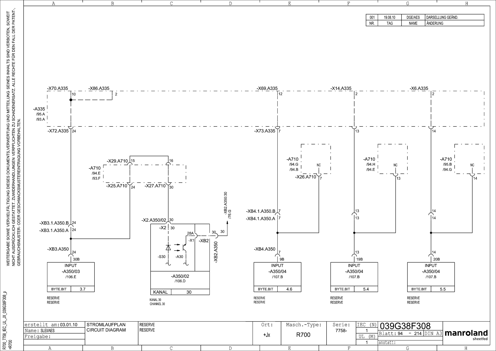

# +Jx — Sheet 94 of 214 — RESERVE

**RESERVE**

> Part of the manroland **R700** printing press IEC/UL circuit diagrams.
> Drawing class: **Stromlaufplan / Circuit diagram** (DIN A3).
> Document `+Jx` covers the **1st printing module + feed register** machine section.

## At a glance

| Field | Value |
|---|---|
| Document | `+Jx`  (039G38F308) |
| Sheet | **94** of 214 |
| Section (DE) | RESERVE |
| Section (EN) | RESERVE |
| Section type | CIRCUIT — Circuit diagram |
| Machine type | `R700` |
| Series | `7758` |
| Created | 03.01.10 |
| Replaces | — |
| Columns used | A, B, C, D, E, F, G, H |
| Path numbers | — |
| Labels on sheet | 123 |
| Cross-refs out | 16 |
| Cross-refs in | 46 |

**Previous:** [+Jx sheet 93](SHEET_0093.md) · **Next:** [+Jx sheet 95](SHEET_0095.md) · **Document TOC:** [_TOC.md](_TOC.md)  (+Jx) · **Master TOC:** [all sheets](../_MASTER_TOC.md)

## Sheet image (300 DPI, exact vector render)



_Rendered directly from the PDF vector layer at 300 DPI (1-bit), no OCR and no resampling. Use it to confirm anything ambiguous in the text below._

## Cross-references on this sheet

Each entry is a wire leaving this sheet. The printed token is `/sheet.column`; the link resolves to that sheet inside the same document.

| Ref | Target sheet | Col | Path | Destination on target | Target section | From col |
|---|---|---|---|---|---|---|
| `/95.A` | [+Jx sheet 95](SHEET_0095.md) | A | — | — | RESERVE | A |
| `/93.A` | [+Jx sheet 93](SHEET_0093.md) | A | — | — | RESERVE | A |
| `/95.B` | [+Jx sheet 95](SHEET_0095.md) | B | — | — | RESERVE | H |
| `/94.G` | [+Jx sheet 94](SHEET_0094.md) | G | — | — | RESERVE | H |
| `/94.G` | [+Jx sheet 94](SHEET_0094.md) | G | — | — | RESERVE | E |
| `/94.H` | [+Jx sheet 94](SHEET_0094.md) | H | — | — | RESERVE | F |
| `/94.E` | [+Jx sheet 94](SHEET_0094.md) | E | — | — | RESERVE | F |
| `/94.B` | [+Jx sheet 94](SHEET_0094.md) | B | — | — | RESERVE | E |
| `/94.E` | [+Jx sheet 94](SHEET_0094.md) | E | — | — | RESERVE | B |
| `/93.F` | [+Jx sheet 93](SHEET_0093.md) | F | — | — | RESERVE | B |
| `/76.G` | [+Jx sheet 76](SHEET_0076.md) | G | — | XB2.A350:30 | BUSVERBINDUNGEN: SICHERHEITSKREIS | D |
| `/106.E` | [+Jx sheet 106](SHEET_0106.md) | E | — | — | REFERENZMODUL | A |
| `/107.B` | [+Jx sheet 107](SHEET_0107.md) | B | — | — | REFERENZMODUL | E |
| `/107.B` | [+Jx sheet 107](SHEET_0107.md) | B | — | — | REFERENZMODUL | F |
| `/107.B` | [+Jx sheet 107](SHEET_0107.md) | B | — | — | REFERENZMODUL | G |
| `/106.D` | [+Jx sheet 106](SHEET_0106.md) | D | — | — | REFERENZMODUL | C |

### Incoming references (sheets that point here)

Every other sheet that sends a wire to this one. `Back-ref` is the token printed on *that* sheet; `Path` is its line number.

| From sheet | Cols | Back-ref | Path | Refs | What continues there |
|---|---|---|---|---|---|
| [+Jx#76](SHEET_0076.md) | G | `/76.G` | — | 1 | XB2.A350:30 |
| [+Jx#93](SHEET_0093.md) | A, F | `/93.A`, `/93.F` | — | 2 | — |
| [+Jx#94](SHEET_0094.md) | B, E, F, H | `/94.B`, `/94.E`, `/94.F`, `/94.H` | — | 6 | — |
| [+Jx#95](SHEET_0095.md) | A, B | `/95.A`, `/95.B` | — | 2 | — |
| [+Jx#106](SHEET_0106.md) | D, E | `/106.D`, `/106.E` | — | 2 | — |
| [+Jx#107](SHEET_0107.md) | B | `/107.B` | — | 3 | — |
| [+Jx#126](SHEET_0126.md) | F | `/126.F` | — | 2 | — |
| [+Jx#128](SHEET_0128.md) | C, D, F | `/128.C`, `/128.D`, `/128.F` | — | 3 | — |
| [+Jx#130](SHEET_0130.md) | A, B, D | `/130.A`, `/130.B`, `/130.D` | — | 9 | — |
| [+Jx#132](SHEET_0132.md) | G | `/132.G` | — | 1 | — |
| [+Jx#138](SHEET_0138.md) | C | `/138.C` | — | 1 | — |
| [+Jx#143](SHEET_0143.md) | A, F | `/143.A`, `/143.F` | — | 4 | — |
| [+Jx#144](SHEET_0144.md) | D | `/144.D` | — | 1 | — |
| [+Jx#147](SHEET_0147.md) | B | `/147.B` | — | 2 | — |
| [+Jx#152](SHEET_0152.md) | G | `/152.G` | — | 1 | — |
| [+Jx#153](SHEET_0153.md) | A, C, E | `/153.A`, `/153.C`, `/153.E` | — | 5 | — |
| [+Jx#156](SHEET_0156.md) | H | `/156.H` | — | 1 | — |


## Devices on this sheet

| Tag | Class | Class meaning (IEC) | Col | Sub | Terminal | Sign |
|---|---|---|---|---|---|---|
| `S30` | S | Schalter / switch | C | — | — | — |
| `A30` | A | Baugruppe / assembly, module, PC board | C | — | — | — |
| `X1` | X | Klemme / terminal, plug connector | C | — | — | — |
| `X2` | X | Klemme / terminal, plug connector | C | — | — | — |
| `XB2` | XB |  | D | — | — | — |
| `A350/02` | A | Baugruppe / assembly, module, PC board | C | 02 | — | — |
| `A350/03` | A | Baugruppe / assembly, module, PC board | A | 03 | — | — |
| `A710` | A | Baugruppe / assembly, module, PC board | B | — | — | — |
| `A350/04` | A | Baugruppe / assembly, module, PC board | E | 04 | — | — |
| `A710` | A | Baugruppe / assembly, module, PC board | E | — | — | — |
| `A350/04` | A | Baugruppe / assembly, module, PC board | F | 04 | — | — |
| `A710` | A | Baugruppe / assembly, module, PC board | F | — | — | — |
| `A350/04` | A | Baugruppe / assembly, module, PC board | G | 04 | — | — |
| `A710` | A | Baugruppe / assembly, module, PC board | H | — | — | — |
| `A335` | A | Baugruppe / assembly, module, PC board | A | — | — | — |
| `XB2.A350` | — | cross-device reference | D | — | — | — |
| `XB3.1.A350.B` | — | cross-device reference | A | — | — | — |
| `XB3.1.A350.A` | — | cross-device reference | A | — | — | — |
| `XB3.A350` | — | cross-device reference | A | — | — | — |
| `3.7` | — | cross-device reference | A | — | — | — |
| `X27.A710` | — | cross-device reference | C | — | — | — |
| `X29.A710` | — | cross-device reference | B | — | — | — |
| `X25.A710` | — | cross-device reference | B | — | — | — |
| `XB4.A350` | — | cross-device reference | E | — | — | — |
| `4.6` | — | cross-device reference | E | — | — | — |
| `XB4.1.A350.B` | — | cross-device reference | E | — | — | — |
| `XB4.1.A350.A` | — | cross-device reference | E | — | — | — |
| `X73.A335` | — | cross-device reference | E | — | — | — |
| `X26.A710` | — | cross-device reference | E | — | — | — |
| `5.4` | — | cross-device reference | F | — | — | — |
| `5.5` | — | cross-device reference | H | — | — | — |
| `X72.A335` | — | cross-device reference | A | — | — | — |
| `NR.` | — | cross-device reference | F | — | — | — |
| `19.08.10` | — | cross-device reference | G | — | — | — |
| `XB2.A350:30` | — | cross-device reference | D | — | 30 | — |
| `X69.A335` | — | cross-device reference | E | — | — | — |
| `X14.A335` | — | cross-device reference | F | — | — | — |
| `X6.A335` | — | cross-device reference | G | — | — | — |
| `X86.A335` | — | cross-device reference | B | — | — | — |
| `X70.A335` | — | cross-device reference | A | — | — | — |

## Potentials / nets

_No named potentials on this sheet._

## Wire-end annotations (grouped as printed)

A wire that continues elsewhere is annotated with a small cluster: the destination description, the path/line number `#NN`, and the `/sheet.column` cross reference. Each row below is one such cluster exactly as it is grouped on the drawing.

| Col | Y | Path | Cross-ref | Text on the wire |
|---|---|---|---|---|
| G | 38.5 | — | — | `001 19.08.10 DGE/AES DARSELLUNG GEÄND.` |
| G | 52.6 | — | — | `NR. TAG NAME ÄNDERUNG` |
| A | 207.2 | — | — | `X70.A335 X86.A335 2` |
| E | 207.2 | — | — | `X69.A335` |
| F | 207.2 | — | — | `X14.A335` |
| G | 207.2 | — | — | `X6.A335` |
| E | 221.4 | — | — | `12` |
| F | 221.4 | — | — | `2` |
| G | 221.4 | — | — | `2` |
| A | 222.1 | — | — | `10` |
| A | 256.8 | — | — | `A335` |
| A | 269.8 | — | `/95.A`, `/93.A` | — |
| A | 309.2 | — | — | `X72.A335 24` |
| E | 309.2 | — | — | `X73.A335 7` |
| F | 310.7 | — | — | `13` |
| G | 310.7 | — | — | `14` |
| E | 377.2 | — | — | `A710` |
| F | 377.2 | — | — | `A710` |
| H | 377.2 | — | — | `A710` |
| B | 381.5 | — | — | `X29.A710 15` |
| C | 381.5 | — | — | `16` |
| E | 390.3 | — | `/94.G` | — |
| F | 390.3 | — | `/94.H`, `/94.E` | — |
| H | 390.3 | — | `/95.B`, `/94.G` | — |
| E | 393.2 | — | — | `NC` |
| G | 393.2 | — | — | `NC` |
| H | 393.2 | — | — | `NC` |
| B | 398.5 | — | — | `A710` |
| E | 402.7 | — | `/94.B` | — |
| B | 411.6 | — | `/94.E` | — |
| E | 419.8 | — | — | `X26.A710 7` |
| B | 424.0 | — | `/93.F` | — |
| G | 424.1 | — | — | `13` |
| H | 424.1 | — | — | `14` |
| B | 441.0 | — | — | `X25.A710 24` |
| C | 441.0 | — | — | `X27.A710 30` |
| D | 460.1 | — | `/76.G` | `XB2.A350:30` |
| E | 502.0 | — | — | `XB4.1.A350.B 7` |
| F | 502.0 | — | — | `13` |
| G | 502.0 | — | — | `14` |
| E | 519.0 | — | — | `XB4.1.A350.A 7` |
| F | 519.0 | — | — | `13` |
| G | 519.0 | — | — | `14` |
| C | 523.2 | — | — | `X2.A350/02 30` |
| A | 530.3 | — | — | `XB3.1.A350.B 24` |
| C | 541.7 | — | — | `X2` |
| C | 543.1 | — | — | `30 30` |
| A | 547.4 | — | — | `XB3.1.A350.A 24` |
| D | 551.6 | — | — | `30` |
| C | 555.8 | — | — | `28A` |
| C | 572.8 | — | — | `X1` |
| D | 572.9 | — | — | `XB2` |
| D | 579.1 | — | — | `XB2.A350` |
| A | 592.7 | — | — | `XB3.A350 24` |
| E | 592.7 | — | — | `XB4.A350 7` |
| F | 601.2 | — | — | `13` |
| G | 601.2 | — | — | `14` |
| C | 611.8 | — | — | `S30 A30` |
| A | 618.2 | — | — | `30B` |
| E | 618.2 | — | — | `9B` |
| F | 618.2 | — | — | `19B` |
| G | 618.2 | — | — | `20B` |
| A | 632.7 | — | — | `INPUT` |
| E | 632.7 | — | — | `INPUT` |
| F | 632.7 | — | — | `INPUT` |
| G | 632.7 | — | — | `INPUT` |
| A | 646.5 | — | — | `A350/03` |
| E | 646.5 | — | — | `A350/04` |
| F | 646.5 | — | — | `A350/04` |
| G | 646.5 | — | — | `A350/04` |
| C | 657.9 | — | — | `A350/02` |
| A | 660.3 | — | `/106.E` | — |
| E | 660.3 | — | `/107.B` | — |
| F | 660.3 | — | `/107.B` | — |
| G | 660.3 | — | `/107.B` | — |
| C | 670.3 | — | `/106.D` | — |
| A | 689.4 | — | — | `BYTE.BIT 3.7` |
| E | 689.4 | — | — | `BYTE.BIT 4.6` |
| F | 689.4 | — | — | `BYTE.BIT 5.4` |
| G | 689.4 | — | — | `BYTE.BIT 5.5` |
| C | 696.1 | — | — | `KANAL 30` |
| A | 712.0 | — | — | `RESERVE RESERVE` |
| F | 712.0 | — | — | `RESERVE RESERVE` |
| G | 712.0 | — | — | `RESERVE RESERVE` |
| D | 712.2 | — | — | `RESERVE RESERVE` |
| C | 716.5 | — | — | `KANAL 30 CHANNEL 30` |


## Reconstructed tables

This sheet carries tabular content (pin map / terminal assignment / index). The grid below was rebuilt from the drawing's own rule lines, so each row is exactly one physical row of the table.

### Table 1 — 8 data rows × 21 columns (at x=113.4, y=239.5)

| X72.A335 | 24 |  |  |  |  |  |  |  |  | X73.A335 | 7 |  |  |  | 13 |  |  |  | 14 |  |
|---|---|---|---|---|---|---|---|---|---|---|---|---|---|---|---|---|---|---|---|---|
| `XB3.1.A350.B` | `24` | `X29.A710 A710 /94.E /93.F X25.A710` | `15 24` | `X27.A710 X2.A350/02` | `16 30 30` |  |  | `XB2.A350:30` | `/76.G` | `XB4.1.A350.B XB4.1.A350.A` | `A710 /94.G /94.B 7 7` | `NC X26.A710` | `7` |  | `A710 /94.H /94.E 13 13` | `NC` | `13` |  | `A710 /95.B /94.G 14 14` | `NC` |
| `XB3.1.A350.A` | `24` |  |  | `X2` | `30` |  |  | `30 30` |  |  |  |  |  |  |  |  |  |  |  |  |
|  |  |  |  |  |  | `28A` |  |  |  |  |  |  |  |  |  |  |  |  |  |  |
| `XB3.A350` | `24 30B` |  |  | `S30` | `A30` | `X1` | `XB2` | `XB2.A350` |  | `XB4.A350` | `7 9B` |  |  |  | `13 19B` |  |  |  | `14 20B` |  |
| `INPUT` |  |  |  |  |  |  |  |  |  | `INPUT` |  |  |  | `INPUT` |  |  |  | `INPUT` |  |  |
| `A350/03` | `/106.E` |  |  |  | `A350/02 /106.D` |  |  |  |  |  | `A350/04 /107.B` |  |  | `A350/04` | `/107.B` |  |  |  | `A350/04 /107.B` |  |
| `BYTE.BIT` | `3.7` |  |  |  |  |  |  |  |  | `BYTE.BIT` | `4.6` |  |  | `BYTE.BIT` | `5.4` |  |  | `BYTE.BIT` | `5.5` |  |
|  |  |  |  | `KANAL` |  | `30` |  |  |  |  |  |  |  |  |  |  |  |  |  |  |


## Notes and free text on this sheet

| Text | Col | Y (pt) |
|---|---|---|
| `KANAL 30` | C | 716.49 |
| `CHANNEL 30` | C | 726.43 |
| `28A` | C | 555.82 |
| `KANAL` | C | 696.14 |
| `X2.A350/02` | C | 523.23 |
| `30B` | A | 618.18 |
| `INPUT` | A | 632.7 |
| `BYTE.BIT` | A | 689.96 |
| `RESERVE` | A | 712.05 |
| `9B` | E | 618.17 |
| `INPUT` | E | 632.7 |
| `BYTE.BIT` | E | 689.96 |
| `RESERVE` | D | 712.24 |
| `19B` | F | 618.18 |
| `INPUT` | F | 632.7 |
| `BYTE.BIT` | F | 689.96 |
| `RESERVE` | F | 712.05 |
| `20B` | G | 618.18 |
| `INPUT` | G | 632.7 |
| `BYTE.BIT` | G | 689.96 |
| `RESERVE` | G | 712.05 |
| `TAG` | G | 52.75 |
| `NAME` | G | 52.73 |
| `ÄNDERUNG` | G | 52.76 |
| `DGE/AES` | G | 38.57 |
| `DARSELLUNG GEÄND.` | H | 38.58 |
| `NC` | E | 393.16 |
| `NC` | G | 393.16 |
| `NC` | H | 393.16 |

## Complete label inventory (exact text from the drawing)

Every text object inside the drawing area of this sheet, in DIN reading order (column A→H, then top→bottom). This is the authoritative list: if a string is not here it is not printed on this sheet.

| Col | Y | X | Dir | Type | Text |
|---|---|---|---|---|---|
| A | 207.2 | 113.1 | → | device ref | `X70.A335` |
| A | 222.1 | 172.1 | → | number | `10` |
| A | 256.8 | 79.7 | → | device tag | `A335` |
| A | 269.8 | 87.0 | → | cross-reference | `/95.A` |
| A | 282.2 | 87.0 | → | cross-reference | `/93.A` |
| A | 309.2 | 114.5 | → | device ref | `X72.A335` |
| A | 310.7 | 172.9 | → | number | `24` |
| A | 530.3 | 95.0 | → | device ref | `XB3.1.A350.B` |
| A | 530.3 | 172.9 | → | number | `24` |
| A | 547.4 | 172.9 | → | number | `24` |
| A | 548.0 | 94.4 | → | device ref | `XB3.1.A350.A` |
| A | 592.7 | 113.7 | → | device ref | `XB3.A350` |
| A | 601.2 | 172.9 | → | number | `24` |
| A | 618.2 | 175.5 | → | text | `30B` |
| A | 632.7 | 155.2 | → | text | `INPUT` |
| A | 646.5 | 148.5 | → | device tag | `A350/03` |
| A | 660.3 | 157.5 | → | cross-reference | `/106.E` |
| A | 689.4 | 191.6 | → | device ref | `3.7` |
| A | 690.0 | 123.3 | → | text | `BYTE.BIT` |
| A | 712.0 | 112.8 | → | text | `RESERVE` |
| A | 722.7 | 112.8 | → | text | `RESERVE` |
| B | 207.2 | 212.3 | → | device ref | `X86.A335` |
| B | 222.1 | 276.4 | → | number | `2` |
| B | 381.5 | 256.5 | → | device ref | `X29.A710` |
| B | 381.5 | 313.8 | → | number | `15` |
| B | 398.5 | 213.2 | → | device tag | `A710` |
| B | 411.6 | 220.5 | → | cross-reference | `/94.E` |
| B | 424.0 | 221.1 | → | cross-reference | `/93.F` |
| B | 441.0 | 255.1 | → | device ref | `X25.A710` |
| B | 445.3 | 314.6 | → | number | `24` |
| C | 381.5 | 405.9 | → | number | `16` |
| C | 441.0 | 347.2 | → | device ref | `X27.A710` |
| C | 445.3 | 406.5 | → | number | `30` |
| C | 523.2 | 339.9 | → | text | `X2.A350/02` |
| C | 523.3 | 406.5 | → | number | `30` |
| C | 541.7 | 382.4 | → | device tag | `X2` |
| C | 543.1 | 409.3 | → | number | `30` |
| C | 555.8 | 449.3 | → | text | `28A` |
| C | 572.8 | 452.7 | → | device tag | `X1` |
| C | 611.8 | 378.7 | → | device tag | `S30` |
| C | 611.8 | 421.2 | → | device tag | `A30` |
| C | 657.9 | 410.9 | → | device tag | `A350/02` |
| C | 670.3 | 419.5 | → | cross-reference | `/106.D` |
| C | 696.1 | 367.9 | → | text | `KANAL` |
| C | 696.1 | 447.7 | → | number | `30` |
| C | 716.5 | 359.4 | → | text | `KANAL 30` |
| C | 726.4 | 359.7 | → | text | `CHANNEL 30` |
| D | 460.1 | 537.4 | ↕ | device ref | `XB2.A350:30` |
| D | 502.9 | 547.3 | ↕ | cross-reference | `/76.G` |
| D | 551.6 | 529.2 | → | number | `30` |
| D | 553.0 | 508.5 | → | number | `30` |
| D | 572.8 | 477.4 | → | device tag | `XB2` |
| D | 579.1 | 513.3 | ↕ | device ref | `XB2.A350` |
| D | 712.2 | 608.9 | → | text | `RESERVE` |
| D | 722.2 | 608.9 | → | text | `RESERVE` |
| E | 207.2 | 616.3 | → | device ref | `X69.A335` |
| E | 221.4 | 668.1 | → | number | `12` |
| E | 309.2 | 610.6 | → | device ref | `X73.A335` |
| E | 310.7 | 668.7 | → | number | `7` |
| E | 377.2 | 688.0 | → | device tag | `A710` |
| E | 390.3 | 694.5 | → | cross-reference | `/94.G` |
| E | 393.2 | 760.7 | → | text | `NC` |
| E | 402.7 | 695.3 | → | cross-reference | `/94.B` |
| E | 419.8 | 708.7 | → | device ref | `X26.A710` |
| E | 502.0 | 591.0 | → | device ref | `XB4.1.A350.B` |
| E | 502.0 | 668.7 | → | number | `7` |
| E | 519.0 | 668.7 | → | number | `7` |
| E | 519.7 | 590.5 | → | device ref | `XB4.1.A350.A` |
| E | 592.7 | 609.7 | → | device ref | `XB4.A350` |
| E | 601.2 | 668.7 | → | number | `7` |
| E | 618.2 | 671.5 | → | text | `9B` |
| E | 632.7 | 651.3 | → | text | `INPUT` |
| E | 646.5 | 644.6 | → | device tag | `A350/04` |
| E | 660.3 | 653.5 | → | cross-reference | `/107.B` |
| E | 689.4 | 687.8 | → | device ref | `4.6` |
| E | 690.0 | 619.4 | → | text | `BYTE.BIT` |
| F | 38.5 | 887.6 | → | number | `001` |
| F | 52.6 | 886.8 | → | device ref | `NR.` |
| F | 207.2 | 793.4 | → | device ref | `X14.A335` |
| F | 221.4 | 853.2 | → | number | `2` |
| F | 310.7 | 852.4 | → | number | `13` |
| F | 377.2 | 872.2 | → | device tag | `A710` |
| F | 390.3 | 879.6 | → | cross-reference | `/94.H` |
| F | 402.7 | 879.6 | → | cross-reference | `/94.E` |
| F | 424.0 | 767.9 | → | number | `7` |
| F | 502.0 | 852.4 | → | number | `13` |
| F | 519.0 | 852.4 | → | number | `13` |
| F | 601.2 | 852.4 | → | number | `13` |
| F | 618.2 | 855.2 | → | text | `19B` |
| F | 632.7 | 835.5 | → | text | `INPUT` |
| F | 646.5 | 828.9 | → | device tag | `A350/04` |
| F | 660.3 | 837.8 | → | cross-reference | `/107.B` |
| F | 689.4 | 871.9 | → | device ref | `5.4` |
| F | 690.0 | 803.6 | → | text | `BYTE.BIT` |
| F | 712.0 | 793.1 | → | text | `RESERVE` |
| F | 722.7 | 793.1 | → | text | `RESERVE` |
| G | 38.6 | 921.5 | → | device ref | `19.08.10` |
| G | 38.6 | 976.4 | → | text | `DGE/AES` |
| G | 52.7 | 928.5 | → | text | `TAG` |
| G | 52.7 | 981.8 | → | text | `NAME` |
| G | 52.8 | 1024.0 | → | text | `ÄNDERUNG` |
| G | 207.2 | 983.6 | → | device ref | `X6.A335` |
| G | 221.4 | 1037.5 | → | number | `2` |
| G | 310.7 | 1036.6 | → | number | `14` |
| G | 393.2 | 944.9 | → | text | `NC` |
| G | 424.0 | 951.6 | → | number | `13` |
| G | 502.0 | 1036.6 | → | number | `14` |
| G | 519.0 | 1036.6 | → | number | `14` |
| G | 601.2 | 1036.6 | → | number | `14` |
| G | 618.2 | 1040.3 | → | text | `20B` |
| G | 632.7 | 1019.8 | → | text | `INPUT` |
| G | 646.5 | 1013.1 | → | device tag | `A350/04` |
| G | 660.3 | 1022.0 | → | cross-reference | `/107.B` |
| G | 690.0 | 987.9 | → | text | `BYTE.BIT` |
| G | 712.0 | 977.4 | → | text | `RESERVE` |
| G | 722.7 | 977.4 | → | text | `RESERVE` |
| H | 38.6 | 1023.4 | → | text | `DARSELLUNG GEÄND.` |
| H | 377.2 | 1056.5 | → | device tag | `A710` |
| H | 390.3 | 1063.8 | → | cross-reference | `/95.B` |
| H | 393.2 | 1129.2 | → | text | `NC` |
| H | 402.7 | 1063.0 | → | cross-reference | `/94.G` |
| H | 424.0 | 1135.8 | → | number | `14` |
| H | 689.4 | 1056.2 | → | device ref | `5.5` |

## Reading-order text block

The same content as a plain block, grouped by DIN column — convenient to paste or to match against a visual description.

```text
=== Column A ===
 207.2  113.1  devref       X70.A335
 222.1  172.1  numeric      10
 256.8   79.7  devtag       A335
 269.8   87.0  xref         /95.A
 282.2   87.0  xref         /93.A
 309.2  114.5  devref       X72.A335
 310.7  172.9  numeric      24
 530.3   95.0  devref       XB3.1.A350.B
 530.3  172.9  numeric      24
 547.4  172.9  numeric      24
 548.0   94.4  devref       XB3.1.A350.A
 592.7  113.7  devref       XB3.A350
 601.2  172.9  numeric      24
 618.2  175.5  text         30B
 632.7  155.2  text         INPUT
 646.5  148.5  devtag       A350/03
 660.3  157.5  xref         /106.E
 689.4  191.6  devref       3.7
 690.0  123.3  text         BYTE.BIT
 712.0  112.8  text         RESERVE
 722.7  112.8  text         RESERVE
=== Column B ===
 207.2  212.3  devref       X86.A335
 222.1  276.4  numeric      2
 381.5  256.5  devref       X29.A710
 381.5  313.8  numeric      15
 398.5  213.2  devtag       A710
 411.6  220.5  xref         /94.E
 424.0  221.1  xref         /93.F
 441.0  255.1  devref       X25.A710
 445.3  314.6  numeric      24
=== Column C ===
 381.5  405.9  numeric      16
 441.0  347.2  devref       X27.A710
 445.3  406.5  numeric      30
 523.2  339.9  text         X2.A350/02
 523.3  406.5  numeric      30
 541.7  382.4  devtag       X2
 543.1  409.3  numeric      30
 555.8  449.3  text         28A
 572.8  452.7  devtag       X1
 611.8  378.7  devtag       S30
 611.8  421.2  devtag       A30
 657.9  410.9  devtag       A350/02
 670.3  419.5  xref         /106.D
 696.1  367.9  text         KANAL
 696.1  447.7  numeric      30
 716.5  359.4  text         KANAL 30
 726.4  359.7  text         CHANNEL 30
=== Column D ===
 460.1  537.4  devref       XB2.A350:30
 502.9  547.3  xref         /76.G
 551.6  529.2  numeric      30
 553.0  508.5  numeric      30
 572.8  477.4  devtag       XB2
 579.1  513.3  devref       XB2.A350
 712.2  608.9  text         RESERVE
 722.2  608.9  text         RESERVE
=== Column E ===
 207.2  616.3  devref       X69.A335
 221.4  668.1  numeric      12
 309.2  610.6  devref       X73.A335
 310.7  668.7  numeric      7
 377.2  688.0  devtag       A710
 390.3  694.5  xref         /94.G
 393.2  760.7  text         NC
 402.7  695.3  xref         /94.B
 419.8  708.7  devref       X26.A710
 502.0  591.0  devref       XB4.1.A350.B
 502.0  668.7  numeric      7
 519.0  668.7  numeric      7
 519.7  590.5  devref       XB4.1.A350.A
 592.7  609.7  devref       XB4.A350
 601.2  668.7  numeric      7
 618.2  671.5  text         9B
 632.7  651.3  text         INPUT
 646.5  644.6  devtag       A350/04
 660.3  653.5  xref         /107.B
 689.4  687.8  devref       4.6
 690.0  619.4  text         BYTE.BIT
=== Column F ===
  38.5  887.6  numeric      001
  52.6  886.8  devref       NR.
 207.2  793.4  devref       X14.A335
 221.4  853.2  numeric      2
 310.7  852.4  numeric      13
 377.2  872.2  devtag       A710
 390.3  879.6  xref         /94.H
 402.7  879.6  xref         /94.E
 424.0  767.9  numeric      7
 502.0  852.4  numeric      13
 519.0  852.4  numeric      13
 601.2  852.4  numeric      13
 618.2  855.2  text         19B
 632.7  835.5  text         INPUT
 646.5  828.9  devtag       A350/04
 660.3  837.8  xref         /107.B
 689.4  871.9  devref       5.4
 690.0  803.6  text         BYTE.BIT
 712.0  793.1  text         RESERVE
 722.7  793.1  text         RESERVE
=== Column G ===
  38.6  921.5  devref       19.08.10
  38.6  976.4  text         DGE/AES
  52.7  928.5  text         TAG
  52.7  981.8  text         NAME
  52.8 1024.0  text         ÄNDERUNG
 207.2  983.6  devref       X6.A335
 221.4 1037.5  numeric      2
 310.7 1036.6  numeric      14
 393.2  944.9  text         NC
 424.0  951.6  numeric      13
 502.0 1036.6  numeric      14
 519.0 1036.6  numeric      14
 601.2 1036.6  numeric      14
 618.2 1040.3  text         20B
 632.7 1019.8  text         INPUT
 646.5 1013.1  devtag       A350/04
 660.3 1022.0  xref         /107.B
 690.0  987.9  text         BYTE.BIT
 712.0  977.4  text         RESERVE
 722.7  977.4  text         RESERVE
=== Column H ===
  38.6 1023.4  text         DARSELLUNG GEÄND.
 377.2 1056.5  devtag       A710
 390.3 1063.8  xref         /95.B
 393.2 1129.2  text         NC
 402.7 1063.0  xref         /94.G
 424.0 1135.8  numeric      14
 689.4 1056.2  devref       5.5
```

---
_Generated from the PDF vector text layer; no OCR. Source: `R700_7758_IEC_UL_JX_039G38F308_p`, sheet 94._
