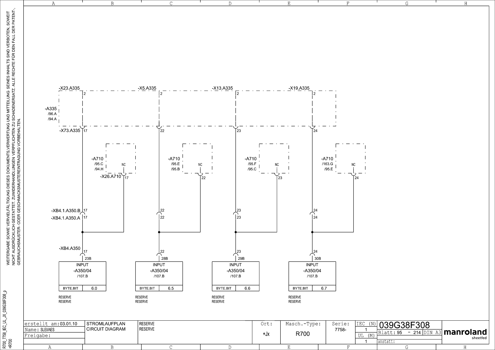

# +Jx — Sheet 95 of 214 — RESERVE

**RESERVE**

> Part of the manroland **R700** printing press IEC/UL circuit diagrams.
> Drawing class: **Stromlaufplan / Circuit diagram** (DIN A3).
> Document `+Jx` covers the **1st printing module + feed register** machine section.

## At a glance

| Field | Value |
|---|---|
| Document | `+Jx`  (039G38F308) |
| Sheet | **95** of 214 |
| Section (DE) | RESERVE |
| Section (EN) | RESERVE |
| Section type | CIRCUIT — Circuit diagram |
| Machine type | `R700` |
| Series | `7758` |
| Created | 03.01.10 |
| Replaces | — |
| Columns used | A, B, C, D, E, F |
| Path numbers | — |
| Labels on sheet | 84 |
| Cross-refs out | 14 |
| Cross-refs in | 38 |

**Previous:** [+Jx sheet 94](SHEET_0094.md) · **Next:** [+Jx sheet 96](SHEET_0096.md) · **Document TOC:** [_TOC.md](_TOC.md)  (+Jx) · **Master TOC:** [all sheets](../_MASTER_TOC.md)

## Sheet image (300 DPI, exact vector render)



_Rendered directly from the PDF vector layer at 300 DPI (1-bit), no OCR and no resampling. Use it to confirm anything ambiguous in the text below._

## Cross-references on this sheet

Each entry is a wire leaving this sheet. The printed token is `/sheet.column`; the link resolves to that sheet inside the same document.

| Ref | Target sheet | Col | Path | Destination on target | Target section | From col |
|---|---|---|---|---|---|---|
| `/96.A` | [+Jx sheet 96](SHEET_0096.md) | A | — | — | RESERVE | A |
| `/94.A` | [+Jx sheet 94](SHEET_0094.md) | A | — | — | RESERVE | A |
| `/95.E` | [+Jx sheet 95](SHEET_0095.md) | E | — | — | RESERVE | C |
| `/95.B` | [+Jx sheet 95](SHEET_0095.md) | B | — | — | RESERVE | C |
| `/95.F` | [+Jx sheet 95](SHEET_0095.md) | F | — | — | RESERVE | D |
| `/95.C` | [+Jx sheet 95](SHEET_0095.md) | C | — | — | RESERVE | D |
| `/95.C` | [+Jx sheet 95](SHEET_0095.md) | C | — | — | RESERVE | B |
| `/94.H` | [+Jx sheet 94](SHEET_0094.md) | H | — | — | RESERVE | B |
| `/163.G` | [+Jx sheet 163](SHEET_0163.md) | G | — | — | OPTION: | F |
| `/95.E` | [+Jx sheet 95](SHEET_0095.md) | E | — | — | RESERVE | F |
| `/107.B` | [+Jx sheet 107](SHEET_0107.md) | B | — | — | REFERENZMODUL | A |
| `/107.B` | [+Jx sheet 107](SHEET_0107.md) | B | — | — | REFERENZMODUL | C |
| `/107.B` | [+Jx sheet 107](SHEET_0107.md) | B | — | — | REFERENZMODUL | D |
| `/107.B` | [+Jx sheet 107](SHEET_0107.md) | B | — | — | REFERENZMODUL | E |

### Incoming references (sheets that point here)

Every other sheet that sends a wire to this one. `Back-ref` is the token printed on *that* sheet; `Path` is its line number.

| From sheet | Cols | Back-ref | Path | Refs | What continues there |
|---|---|---|---|---|---|
| [+Jx#94](SHEET_0094.md) | A, H | `/94.A`, `/94.H` | — | 2 | — |
| [+Jx#95](SHEET_0095.md) | B, C, D, F | `/95.B`, `/95.C`, `/95.D`, `/95.F` | — | 6 | — |
| [+Jx#96](SHEET_0096.md) | A | `/96.A` | — | 1 | — |
| [+Jx#107](SHEET_0107.md) | B | `/107.B` | — | 4 | — |
| [+Jx#130](SHEET_0130.md) | A, B, D | `/130.A`, `/130.B`, `/130.D` | — | 12 | — |
| [+Jx#131](SHEET_0131.md) | E | `/131.E` | — | 1 | — |
| [+Jx#138](SHEET_0138.md) | B | `/138.B` | — | 1 | — |
| [+Jx#141](SHEET_0141.md) | A | `/141.A` | — | 1 | — |
| [+Jx#142](SHEET_0142.md) | C | `/142.C` | — | 1 | — |
| [+Jx#143](SHEET_0143.md) | F | `/143.F` | — | 4 | — |
| [+Jx#153](SHEET_0153.md) | E | `/153.E` | — | 4 | — |
| [+Jx#163](SHEET_0163.md) | F | `/163.F` | — | 1 | — |


## Devices on this sheet

| Tag | Class | Class meaning (IEC) | Col | Sub | Terminal | Sign |
|---|---|---|---|---|---|---|
| `A350/04` | A | Baugruppe / assembly, module, PC board | A | 04 | — | — |
| `A350/04` | A | Baugruppe / assembly, module, PC board | C | 04 | — | — |
| `A335` | A | Baugruppe / assembly, module, PC board | A | — | — | — |
| `A350/04` | A | Baugruppe / assembly, module, PC board | D | 04 | — | — |
| `A350/04` | A | Baugruppe / assembly, module, PC board | E | 04 | — | — |
| `A710` | A | Baugruppe / assembly, module, PC board | B | — | — | — |
| `A710` | A | Baugruppe / assembly, module, PC board | C | — | — | — |
| `A710` | A | Baugruppe / assembly, module, PC board | D | — | — | — |
| `A710` | A | Baugruppe / assembly, module, PC board | F | — | — | — |
| `6.0` | — | cross-device reference | B | — | — | — |
| `XB4.A350` | — | cross-device reference | A | — | — | — |
| `6.5` | — | cross-device reference | C | — | — | — |
| `X73.A335` | — | cross-device reference | A | — | — | — |
| `6.6` | — | cross-device reference | D | — | — | — |
| `6.7` | — | cross-device reference | F | — | — | — |
| `XB4.1.A350.B` | — | cross-device reference | A | — | — | — |
| `XB4.1.A350.A` | — | cross-device reference | A | — | — | — |
| `X26.A710` | — | cross-device reference | B | — | — | — |
| `X23.A335` | — | cross-device reference | A | — | — | — |
| `X5.A335` | — | cross-device reference | C | — | — | — |
| `X13.A335` | — | cross-device reference | D | — | — | — |
| `X19.A335` | — | cross-device reference | E | — | — | — |

## Potentials / nets

_No named potentials on this sheet._

## Wire-end annotations (grouped as printed)

A wire that continues elsewhere is annotated with a small cluster: the destination description, the path/line number `#NN`, and the `/sheet.column` cross reference. Each row below is one such cluster exactly as it is grouped on the drawing.

| Col | Y | Path | Cross-ref | Text on the wire |
|---|---|---|---|---|
| C | 207.2 | — | — | `X23.A335 X5.A335 X13.A335 X19.A335` |
| B | 221.4 | — | — | `2 2` |
| D | 221.4 | — | — | `2` |
| E | 221.4 | — | — | `2` |
| A | 256.8 | — | — | `A335` |
| A | 269.8 | — | `/96.A`, `/94.A` | — |
| A | 309.2 | — | — | `X73.A335 17` |
| C | 310.7 | — | — | `22` |
| D | 310.7 | — | — | `23` |
| E | 310.7 | — | — | `24` |
| B | 377.2 | — | — | `A710` |
| C | 377.2 | — | — | `A710` |
| D | 377.2 | — | — | `A710` |
| F | 377.2 | — | — | `A710` |
| B | 390.3 | — | `/95.C`, `/94.H` | — |
| C | 390.3 | — | `/95.E`, `/95.B` | — |
| D | 390.3 | — | `/95.F`, `/95.C` | — |
| F | 390.3 | — | `/163.G` | — |
| D | 393.2 | — | — | `NC NC NC NC` |
| F | 402.7 | — | `/95.E` | — |
| B | 419.8 | — | — | `X26.A710 17` |
| D | 424.1 | — | — | `22` |
| E | 424.1 | — | — | `23` |
| F | 424.1 | — | — | `24` |
| A | 502.0 | — | — | `XB4.1.A350.B 17` |
| C | 502.0 | — | — | `22` |
| D | 502.0 | — | — | `23` |
| E | 502.0 | — | — | `24` |
| A | 519.0 | — | — | `XB4.1.A350.A 17` |
| C | 519.0 | — | — | `22` |
| D | 519.0 | — | — | `23` |
| E | 519.0 | — | — | `24` |
| A | 592.7 | — | — | `XB4.A350 17` |
| C | 601.2 | — | — | `22` |
| D | 601.2 | — | — | `23` |
| E | 601.2 | — | — | `24` |
| B | 618.2 | — | — | `23B` |
| C | 618.2 | — | — | `28B` |
| D | 618.2 | — | — | `29B` |
| E | 618.2 | — | — | `30B` |
| A | 632.7 | — | — | `INPUT` |
| C | 632.7 | — | — | `INPUT` |
| D | 632.7 | — | — | `INPUT` |
| E | 632.7 | — | — | `INPUT` |
| A | 646.5 | — | — | `A350/04` |
| C | 646.5 | — | — | `A350/04` |
| D | 646.5 | — | — | `A350/04` |
| E | 646.5 | — | — | `A350/04` |
| A | 660.3 | — | `/107.B` | — |
| C | 660.3 | — | `/107.B` | — |
| D | 660.3 | — | `/107.B` | — |
| E | 660.3 | — | `/107.B` | — |
| A | 689.4 | — | — | `BYTE.BIT 6.0` |
| C | 689.4 | — | — | `BYTE.BIT 6.5` |
| D | 689.4 | — | — | `BYTE.BIT 6.6` |
| E | 689.4 | — | — | `BYTE.BIT 6.7` |
| A | 712.0 | — | — | `RESERVE RESERVE` |
| C | 712.0 | — | — | `RESERVE RESERVE` |
| D | 712.0 | — | — | `RESERVE RESERVE` |
| E | 712.0 | — | — | `RESERVE RESERVE` |


## Reconstructed tables

This sheet carries tabular content (pin map / terminal assignment / index). The grid below was rebuilt from the drawing's own rule lines, so each row is exactly one physical row of the table.

### Table 1 — 2 data rows × 2 columns (at x=141.7, y=558.4)

| XB4.A350 | 17 23B |
|---|---|
| `INPUT` | `A350/04 /107.B` |
| `BYTE.BIT` | `6.0` |


### Table 2 — 1 data rows × 2 columns (at x=326.0, y=558.4) — **22 28B**

| INPUT A350/04 | /107.B |
|---|---|
| `BYTE.BIT` | `6.5` |


### Table 3 — 1 data rows × 2 columns (at x=510.2, y=558.4) — **23 29B**

| INPUT | A350/04 /107.B |
|---|---|
| `BYTE.BIT` | `6.6` |


### Table 4 — 1 data rows × 2 columns (at x=694.5, y=558.4) — **24 30B**

| INPUT A350/04 | /107.B |
|---|---|
| `BYTE.BIT` | `6.7` |


## Notes and free text on this sheet

| Text | Col | Y (pt) |
|---|---|---|
| `23B` | B | 618.18 |
| `INPUT` | A | 632.7 |
| `BYTE.BIT` | A | 689.96 |
| `RESERVE` | A | 712.05 |
| `28B` | C | 618.18 |
| `INPUT` | C | 632.7 |
| `BYTE.BIT` | C | 689.96 |
| `RESERVE` | C | 712.05 |
| `29B` | D | 618.18 |
| `INPUT` | D | 632.7 |
| `BYTE.BIT` | D | 689.96 |
| `RESERVE` | D | 712.05 |
| `30B` | E | 618.18 |
| `INPUT` | E | 632.7 |
| `BYTE.BIT` | E | 689.96 |
| `RESERVE` | E | 712.05 |
| `NC` | B | 393.16 |
| `NC` | C | 393.16 |
| `NC` | E | 393.16 |
| `NC` | F | 393.16 |

## Complete label inventory (exact text from the drawing)

Every text object inside the drawing area of this sheet, in DIN reading order (column A→H, then top→bottom). This is the authoritative list: if a string is not here it is not printed on this sheet.

| Col | Y | X | Dir | Type | Text |
|---|---|---|---|---|---|
| A | 207.2 | 141.4 | → | device ref | `X23.A335` |
| A | 256.8 | 108.0 | → | device tag | `A335` |
| A | 269.8 | 115.4 | → | cross-reference | `/96.A` |
| A | 282.2 | 115.4 | → | cross-reference | `/94.A` |
| A | 309.2 | 142.9 | → | device ref | `X73.A335` |
| A | 502.0 | 123.3 | → | device ref | `XB4.1.A350.B` |
| A | 519.7 | 122.7 | → | device ref | `XB4.1.A350.A` |
| A | 592.7 | 142.0 | → | device ref | `XB4.A350` |
| A | 632.7 | 183.5 | → | text | `INPUT` |
| A | 646.5 | 176.9 | → | device tag | `A350/04` |
| A | 660.3 | 185.8 | → | cross-reference | `/107.B` |
| A | 690.0 | 151.7 | → | text | `BYTE.BIT` |
| A | 712.0 | 141.2 | → | text | `RESERVE` |
| A | 722.7 | 141.2 | → | text | `RESERVE` |
| B | 221.4 | 201.3 | → | number | `2` |
| B | 310.7 | 200.4 | → | number | `17` |
| B | 377.2 | 220.3 | → | device tag | `A710` |
| B | 390.3 | 227.3 | → | cross-reference | `/95.C` |
| B | 393.2 | 292.9 | → | text | `NC` |
| B | 402.7 | 227.6 | → | cross-reference | `/94.H` |
| B | 419.8 | 240.9 | → | device ref | `X26.A710` |
| B | 424.0 | 299.6 | → | number | `17` |
| B | 502.0 | 200.4 | → | number | `17` |
| B | 519.0 | 200.4 | → | number | `17` |
| B | 601.2 | 200.4 | → | number | `17` |
| B | 618.2 | 204.1 | → | text | `23B` |
| B | 689.4 | 220.0 | → | device ref | `6.0` |
| C | 207.2 | 331.7 | → | device ref | `X5.A335` |
| C | 221.4 | 385.5 | → | number | `2` |
| C | 310.7 | 385.5 | → | number | `22` |
| C | 377.2 | 404.5 | → | device tag | `A710` |
| C | 390.3 | 411.9 | → | cross-reference | `/95.E` |
| C | 393.2 | 477.2 | → | text | `NC` |
| C | 402.7 | 411.9 | → | cross-reference | `/95.B` |
| C | 502.0 | 385.5 | → | number | `22` |
| C | 519.0 | 385.5 | → | number | `22` |
| C | 601.2 | 385.5 | → | number | `22` |
| C | 618.2 | 388.3 | → | text | `28B` |
| C | 632.7 | 367.8 | → | text | `INPUT` |
| C | 646.5 | 361.1 | → | device tag | `A350/04` |
| C | 660.3 | 370.1 | → | cross-reference | `/107.B` |
| C | 689.4 | 404.2 | → | device ref | `6.5` |
| C | 690.0 | 335.9 | → | text | `BYTE.BIT` |
| C | 712.0 | 325.4 | → | text | `RESERVE` |
| C | 722.7 | 325.4 | → | text | `RESERVE` |
| D | 207.2 | 510.0 | → | device ref | `X13.A335` |
| D | 221.4 | 569.8 | → | number | `2` |
| D | 310.7 | 569.8 | → | number | `23` |
| D | 377.2 | 588.8 | → | device tag | `A710` |
| D | 390.3 | 596.7 | → | cross-reference | `/95.F` |
| D | 402.7 | 595.8 | → | cross-reference | `/95.C` |
| D | 424.0 | 484.7 | → | number | `22` |
| D | 502.0 | 569.8 | → | number | `23` |
| D | 519.0 | 569.8 | → | number | `23` |
| D | 601.2 | 569.8 | → | number | `23` |
| D | 618.2 | 572.6 | → | text | `29B` |
| D | 632.7 | 552.0 | → | text | `INPUT` |
| D | 646.5 | 545.4 | → | device tag | `A350/04` |
| D | 660.3 | 554.3 | → | cross-reference | `/107.B` |
| D | 689.4 | 588.5 | → | device ref | `6.6` |
| D | 690.0 | 520.2 | → | text | `BYTE.BIT` |
| D | 712.0 | 509.7 | → | text | `RESERVE` |
| D | 722.7 | 509.7 | → | text | `RESERVE` |
| E | 207.2 | 694.2 | → | device ref | `X19.A335` |
| E | 221.4 | 754.0 | → | number | `2` |
| E | 310.7 | 754.0 | → | number | `24` |
| E | 393.2 | 661.4 | → | text | `NC` |
| E | 424.0 | 669.0 | → | number | `23` |
| E | 502.0 | 754.0 | → | number | `24` |
| E | 519.0 | 754.0 | → | number | `24` |
| E | 601.2 | 754.0 | → | number | `24` |
| E | 618.2 | 756.6 | → | text | `30B` |
| E | 632.7 | 736.3 | → | text | `INPUT` |
| E | 646.5 | 729.6 | → | device tag | `A350/04` |
| E | 660.3 | 738.6 | → | cross-reference | `/107.B` |
| E | 690.0 | 704.4 | → | text | `BYTE.BIT` |
| E | 712.0 | 693.9 | → | text | `RESERVE` |
| E | 722.7 | 693.9 | → | text | `RESERVE` |
| F | 377.2 | 773.0 | → | device tag | `A710` |
| F | 390.3 | 774.7 | → | cross-reference | `/163.G` |
| F | 393.2 | 845.7 | → | text | `NC` |
| F | 402.7 | 780.4 | → | cross-reference | `/95.E` |
| F | 424.0 | 853.2 | → | number | `24` |
| F | 689.4 | 772.7 | → | device ref | `6.7` |

## Reading-order text block

The same content as a plain block, grouped by DIN column — convenient to paste or to match against a visual description.

```text
=== Column A ===
 207.2  141.4  devref       X23.A335
 256.8  108.0  devtag       A335
 269.8  115.4  xref         /96.A
 282.2  115.4  xref         /94.A
 309.2  142.9  devref       X73.A335
 502.0  123.3  devref       XB4.1.A350.B
 519.7  122.7  devref       XB4.1.A350.A
 592.7  142.0  devref       XB4.A350
 632.7  183.5  text         INPUT
 646.5  176.9  devtag       A350/04
 660.3  185.8  xref         /107.B
 690.0  151.7  text         BYTE.BIT
 712.0  141.2  text         RESERVE
 722.7  141.2  text         RESERVE
=== Column B ===
 221.4  201.3  numeric      2
 310.7  200.4  numeric      17
 377.2  220.3  devtag       A710
 390.3  227.3  xref         /95.C
 393.2  292.9  text         NC
 402.7  227.6  xref         /94.H
 419.8  240.9  devref       X26.A710
 424.0  299.6  numeric      17
 502.0  200.4  numeric      17
 519.0  200.4  numeric      17
 601.2  200.4  numeric      17
 618.2  204.1  text         23B
 689.4  220.0  devref       6.0
=== Column C ===
 207.2  331.7  devref       X5.A335
 221.4  385.5  numeric      2
 310.7  385.5  numeric      22
 377.2  404.5  devtag       A710
 390.3  411.9  xref         /95.E
 393.2  477.2  text         NC
 402.7  411.9  xref         /95.B
 502.0  385.5  numeric      22
 519.0  385.5  numeric      22
 601.2  385.5  numeric      22
 618.2  388.3  text         28B
 632.7  367.8  text         INPUT
 646.5  361.1  devtag       A350/04
 660.3  370.1  xref         /107.B
 689.4  404.2  devref       6.5
 690.0  335.9  text         BYTE.BIT
 712.0  325.4  text         RESERVE
 722.7  325.4  text         RESERVE
=== Column D ===
 207.2  510.0  devref       X13.A335
 221.4  569.8  numeric      2
 310.7  569.8  numeric      23
 377.2  588.8  devtag       A710
 390.3  596.7  xref         /95.F
 402.7  595.8  xref         /95.C
 424.0  484.7  numeric      22
 502.0  569.8  numeric      23
 519.0  569.8  numeric      23
 601.2  569.8  numeric      23
 618.2  572.6  text         29B
 632.7  552.0  text         INPUT
 646.5  545.4  devtag       A350/04
 660.3  554.3  xref         /107.B
 689.4  588.5  devref       6.6
 690.0  520.2  text         BYTE.BIT
 712.0  509.7  text         RESERVE
 722.7  509.7  text         RESERVE
=== Column E ===
 207.2  694.2  devref       X19.A335
 221.4  754.0  numeric      2
 310.7  754.0  numeric      24
 393.2  661.4  text         NC
 424.0  669.0  numeric      23
 502.0  754.0  numeric      24
 519.0  754.0  numeric      24
 601.2  754.0  numeric      24
 618.2  756.6  text         30B
 632.7  736.3  text         INPUT
 646.5  729.6  devtag       A350/04
 660.3  738.6  xref         /107.B
 690.0  704.4  text         BYTE.BIT
 712.0  693.9  text         RESERVE
 722.7  693.9  text         RESERVE
=== Column F ===
 377.2  773.0  devtag       A710
 390.3  774.7  xref         /163.G
 393.2  845.7  text         NC
 402.7  780.4  xref         /95.E
 424.0  853.2  numeric      24
 689.4  772.7  devref       6.7
```

---
_Generated from the PDF vector text layer; no OCR. Source: `R700_7758_IEC_UL_JX_039G38F308_p`, sheet 95._
