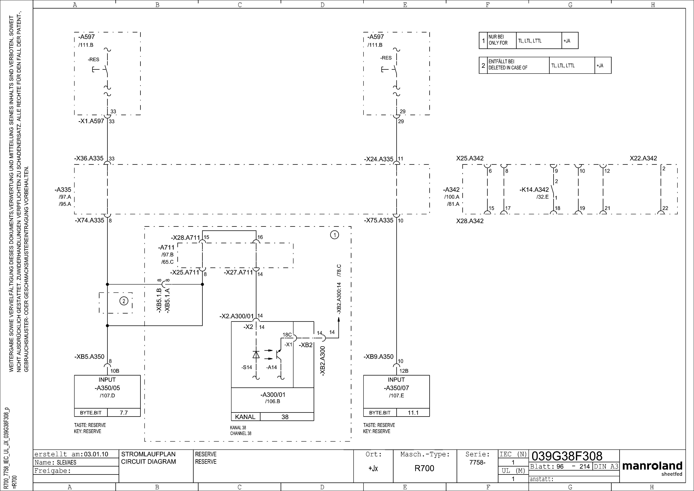

# +Jx — Sheet 96 of 214 — RESERVE

**RESERVE**

> Part of the manroland **R700** printing press IEC/UL circuit diagrams.
> Drawing class: **Stromlaufplan / Circuit diagram** (DIN A3).
> Document `+Jx` covers the **1st printing module + feed register** machine section.

## At a glance

| Field | Value |
|---|---|
| Document | `+Jx`  (039G38F308) |
| Sheet | **96** of 214 |
| Section (DE) | RESERVE |
| Section (EN) | RESERVE |
| Section type | CIRCUIT — Circuit diagram |
| Machine type | `R700` |
| Series | `7758` |
| Created | 03.01.10 |
| Replaces | — |
| Columns used | A, B, C, D, E, F, G, H |
| Path numbers | — |
| Labels on sheet | 110 |
| Cross-refs out | 13 |
| Cross-refs in | 41 |

**Previous:** [+Jx sheet 95](SHEET_0095.md) · **Next:** [+Jx sheet 97](SHEET_0097.md) · **Document TOC:** [_TOC.md](_TOC.md)  (+Jx) · **Master TOC:** [all sheets](../_MASTER_TOC.md)

## Sheet image (300 DPI, exact vector render)



_Rendered directly from the PDF vector layer at 300 DPI (1-bit), no OCR and no resampling. Use it to confirm anything ambiguous in the text below._

## Cross-references on this sheet

Each entry is a wire leaving this sheet. The printed token is `/sheet.column`; the link resolves to that sheet inside the same document.

| Ref | Target sheet | Col | Path | Destination on target | Target section | From col |
|---|---|---|---|---|---|---|
| `/111.B` | [+Jx sheet 111](SHEET_0111.md) | B | — | — | REFERENZMODUL | A |
| `/111.B` | [+Jx sheet 111](SHEET_0111.md) | B | — | — | REFERENZMODUL | E |
| `/97.A` | [+Jx sheet 97](SHEET_0097.md) | A | — | — | RESERVE | A |
| `/95.A` | [+Jx sheet 95](SHEET_0095.md) | A | — | — | RESERVE | A |
| `/32.E` | [+Jx sheet 32](SHEET_0032.md) | E | — | — | NOT AUS | G |
| `/100.A` | [+Jx sheet 100](SHEET_0100.md) | A | — | — | RESERVE | F |
| `/81.A` | [+Jx sheet 81](SHEET_0081.md) | A | — | — | BUSVERBINDUNGEN: SICHERHEITSKREIS | F |
| `/97.B` | [+Jx sheet 97](SHEET_0097.md) | B | — | — | RESERVE | B |
| `/65.C` | [+Jx sheet 65](SHEET_0065.md) | C | — | — | TROPFEINRICHTUNG | B |
| `/78.C` | [+Jx sheet 78](SHEET_0078.md) | C | — | XB2.A300:14 | BUSVERBINDUNGEN: SICHERHEITSKREIS | D |
| `/107.E` | [+Jx sheet 107](SHEET_0107.md) | E | — | — | REFERENZMODUL | E |
| `/107.D` | [+Jx sheet 107](SHEET_0107.md) | D | — | — | REFERENZMODUL | A |
| `/106.B` | [+Jx sheet 106](SHEET_0106.md) | B | — | — | REFERENZMODUL | C |

### Incoming references (sheets that point here)

Every other sheet that sends a wire to this one. `Back-ref` is the token printed on *that* sheet; `Path` is its line number.

| From sheet | Cols | Back-ref | Path | Refs | What continues there |
|---|---|---|---|---|---|
| [+Jx#32](SHEET_0032.md) | E | `/32.E` | — | 1 | — |
| [+Jx#65](SHEET_0065.md) | C | `/65.C` | — | 1 | — |
| [+Jx#78](SHEET_0078.md) | C | `/78.C` | — | 1 | XB2.A300:14 |
| [+Jx#81](SHEET_0081.md) | A | `/81.A` | — | 1 | — |
| [+Jx#95](SHEET_0095.md) | A | `/95.A` | — | 1 | — |
| [+Jx#97](SHEET_0097.md) | A, B | `/97.A`, `/97.B` | — | 2 | — |
| [+Jx#100](SHEET_0100.md) | A | `/100.A` | — | 1 | — |
| [+Jx#106](SHEET_0106.md) | B | `/106.B` | — | 1 | — |
| [+Jx#107](SHEET_0107.md) | D, E | `/107.D`, `/107.E` | — | 2 | — |
| [+Jx#111](SHEET_0111.md) | B | `/111.B` | — | 2 | — |
| [+Jx#115](SHEET_0115.md) | F | `/115.F` | — | 2 | — |
| [+Jx#124](SHEET_0124.md) | E, G | `/124.E`, `/124.G` | — | 2 | — |
| [+Jx#131](SHEET_0131.md) | A, B | `/131.A`, `/131.B` | — | 2 | — |
| [+Jx#132](SHEET_0132.md) | C | `/132.C` | — | 1 | — |
| [+Jx#134](SHEET_0134.md) | G | `/134.G` | — | 1 | — |
| [+Jx#142](SHEET_0142.md) | B, F, H | `/142.B`, `/142.F`, `/142.H` | — | 7 | — |
| [+Jx#143](SHEET_0143.md) | B | `/143.B` | — | 1 | — |
| [+Jx#144](SHEET_0144.md) | F | `/144.F` | — | 1 | — |
| [+Jx#145](SHEET_0145.md) | G | `/145.G` | — | 6 | — |
| [+Jx#146](SHEET_0146.md) | C | `/146.C` | — | 2 | — |
| [+Jx#149](SHEET_0149.md) | G | `/149.G` | — | 1 | — |
| [+Jx#154](SHEET_0154.md) | A | `/154.A` | — | 1 | — |
| [+Jx#155](SHEET_0155.md) | A | `/155.A` | — | 1 | — |


## Devices on this sheet

| Tag | Class | Class meaning (IEC) | Col | Sub | Terminal | Sign |
|---|---|---|---|---|---|---|
| `A350/05` | A | Baugruppe / assembly, module, PC board | A | 05 | — | — |
| `A350/07` | A | Baugruppe / assembly, module, PC board | E | 07 | — | — |
| `A711` | A | Baugruppe / assembly, module, PC board | B | — | — | — |
| `S14` | S | Schalter / switch | C | — | — | — |
| `A14` | A | Baugruppe / assembly, module, PC board | C | — | — | — |
| `X1` | X | Klemme / terminal, plug connector | D | — | — | — |
| `X2` | X | Klemme / terminal, plug connector | C | — | — | — |
| `XB2` | XB |  | D | — | — | — |
| `A300/01` | A | Baugruppe / assembly, module, PC board | C | 01 | — | — |
| `A597` | A | Baugruppe / assembly, module, PC board | A | — | — | — |
| `A335` | A | Baugruppe / assembly, module, PC board | A | — | — | — |
| `A597` | A | Baugruppe / assembly, module, PC board | E | — | — | — |
| `A342` | A | Baugruppe / assembly, module, PC board | F | — | — | — |
| `XB5.A350` | — | cross-device reference | A | — | — | — |
| `7.7` | — | cross-device reference | B | — | — | — |
| `11.1` | — | cross-device reference | E | — | — | — |
| `XB9.A350` | — | cross-device reference | E | — | — | — |
| `X28.A711` | — | cross-device reference | B | — | — | — |
| `X25.A711` | — | cross-device reference | B | — | — | — |
| `XB5.1.A` | — | cross-device reference | B | — | — | — |
| `XB5.1.B` | — | cross-device reference | B | — | — | — |
| `XB2.A300` | — | cross-device reference | D | — | — | — |
| `X27.A711` | — | cross-device reference | C | — | — | — |
| `X1.A597` | — | cross-device reference | A | — | — | — |
| `X74.A335` | — | cross-device reference | A | — | — | — |
| `X36.A335` | — | cross-device reference | A | — | — | — |
| `K14.A342` | — | cross-device reference | G | — | — | — |
| `X75.A335` | — | cross-device reference | E | — | — | — |
| `X24.A335` | — | cross-device reference | E | — | — | — |
| `XB2.A300:14` | — | cross-device reference | D | — | 14 | — |
| `X22.A342` | — | cross-device reference | H | — | — | — |
| `X25.A342` | — | cross-device reference | F | — | — | — |
| `X28.A342` | — | cross-device reference | F | — | — | — |

## Potentials / nets

_No named potentials on this sheet._

## Wire-end annotations (grouped as printed)

A wire that continues elsewhere is annotated with a small cluster: the destination description, the path/line number `#NN`, and the `/sheet.column` cross reference. Each row below is one such cluster exactly as it is grouped on the drawing.

| Col | Y | Path | Cross-ref | Text on the wire |
|---|---|---|---|---|
| A | 58.3 | — | — | `A597` |
| E | 58.3 | — | — | `A597` |
| F | 60.1 | — | — | `1 NUR BEI ONLY FOR TL, LTL, LTTL` |
| G | 67.2 | — | — | `+JA` |
| A | 73.2 | — | `/111.B` | — |
| E | 73.2 | — | `/111.B` | — |
| E | 95.7 | — | — | `RES` |
| A | 98.5 | — | — | `RES` |
| F | 102.6 | — | — | `2 ENTFÄLLT BEI DELETED IN CASE OF TL, LTL, LTTL` |
| G | 109.7 | — | — | `+JA` |
| A | 187.3 | — | — | `33` |
| E | 187.3 | — | — | `29` |
| A | 202.9 | — | — | `X1.A597 33` |
| E | 204.4 | — | — | `29` |
| A | 266.7 | — | — | `X36.A335 33` |
| G | 266.7 | — | — | `X25.A342 X22.A342` |
| E | 268.1 | — | — | `X24.A335 11` |
| H | 285.1 | — | — | `2` |
| F | 289.4 | — | — | `6` |
| F | 289.4 | — | — | `8` |
| G | 289.4 | — | — | `9` |
| G | 289.4 | — | — | `10` |
| G | 289.4 | — | — | `12` |
| G | 307.1 | — | — | `2` |
| A | 320.6 | — | — | `A335` |
| F | 320.6 | — | — | `A342` |
| G | 320.6 | — | — | `K14.A342 1` |
| A | 333.6 | — | `/97.A`, `/95.A` | — |
| F | 333.6 | — | `/100.A` | — |
| G | 333.6 | — | `/32.E` | — |
| F | 346.0 | — | `/81.A` | — |
| F | 353.2 | — | — | `15` |
| F | 353.2 | — | — | `17` |
| G | 353.2 | — | — | `18` |
| G | 353.2 | — | — | `19` |
| G | 353.2 | — | — | `21` |
| H | 353.2 | — | — | `22` |
| A | 373.0 | — | — | `X74.A335 8` |
| E | 373.0 | — | — | `X75.A335 10` |
| F | 374.4 | — | — | `X28.A342` |
| D | 399.5 | — | — | `1` |
| B | 402.8 | — | — | `X28.A711 15` |
| C | 402.8 | — | — | `16` |
| B | 419.8 | — | — | `A711` |
| B | 432.8 | — | `/97.B`, `/65.C` | — |
| D | 453.1 | — | `/78.C` | `XB2.A300:14` |
| B | 462.3 | — | — | `X25.A711 8` |
| C | 462.3 | — | — | `X27.A711 14` |
| B | 478.1 | — | — | `XB5.1.B 8` |
| B | 478.1 | — | — | `XB5.1.A 8` |
| B | 513.3 | — | — | `2` |
| C | 537.4 | — | — | `X2.A300/01 14` |
| C | 555.9 | — | — | `X2` |
| D | 557.3 | — | — | `14 14` |
| D | 565.8 | — | — | `14` |
| D | 570.0 | — | — | `18C` |
| D | 587.0 | — | — | `X1` |
| D | 587.0 | — | — | `XB2` |
| D | 593.3 | — | — | `XB2.A300` |
| A | 606.9 | — | — | `XB5.A350 8` |
| E | 606.9 | — | — | `XB9.A350 10` |
| C | 626.0 | — | — | `S14 A14` |
| A | 632.4 | — | — | `10B` |
| E | 632.4 | — | — | `12B` |
| A | 646.9 | — | — | `INPUT` |
| E | 646.9 | — | — | `INPUT` |
| A | 660.7 | — | — | `A350/05` |
| E | 660.7 | — | — | `A350/07` |
| C | 672.0 | — | — | `A300/01` |
| A | 674.5 | — | `/107.D` | — |
| E | 674.5 | — | `/107.E` | — |
| C | 684.4 | — | `/106.B` | — |
| A | 703.5 | — | — | `BYTE.BIT 7.7` |
| E | 703.6 | — | — | `BYTE.BIT 11.1` |
| C | 710.3 | — | — | `KANAL 38` |
| A | 726.2 | — | — | `KEY: RESERVE TASTE: RESERVE` |
| E | 726.2 | — | — | `KEY: RESERVE TASTE: RESERVE` |
| C | 730.7 | — | — | `KANAL 38 CHANNEL 38` |


## Reconstructed tables

This sheet carries tabular content (pin map / terminal assignment / index). The grid below was rebuilt from the drawing's own rule lines, so each row is exactly one physical row of the table.

### Table 1 — 8 data rows × 14 columns (at x=127.6, y=55.3)

| A597 /111.B RES | 33 |  |  |  |  |  |  |  |  | A597 /111.B RES | 29 | 1 2 | NUR BEI ONLY FOR ENTFÄLLT DELETED |
|---|---|---|---|---|---|---|---|---|---|---|---|---|---|
| `X1.A597 X36.A335 X74.A335` | `33 33 8` |  |  |  |  |  |  |  |  | `X24.A335 X75.A335` | `29 11 10` | `X25.A342 A342 /100.A /81.A X28.A342` | `6 15` |
|  |  | `X28.A711 A711 /97.B /65.C X25.A711 8 8` | `15 8` | `X27.A711` | `16 14` |  |  | `1` | `/78.C` |  |  |  |  |
|  | `2` | `XB5.1.B XB5.1.A` |  | `X2.A300/01` | `14` |  |  |  | `XB2.A300:14` |  |  |  |  |
| `XB5.A350` | `8 10B` |  |  | `X2 S14` | `14 A14` | `18C X1` | `XB2` | `14 14 XB2.A300` |  | `XB9.A350` | `10 12B` |  |  |
| `INPUT` |  |  |  |  |  |  |  |  |  | `INPUT` |  |  |  |
| `A350/05` | `/107.D` |  |  |  | `A300/01 /106.B` |  |  |  |  |  | `A350/07 /107.E` |  |  |
| `BYTE.BIT` | `7.7` |  |  |  |  |  |  |  |  | `BYTE.BIT` | `11.1` |  |  |
|  |  |  |  | `KANAL` |  | `38` |  |  |  |  |  |  |  |


## Notes and free text on this sheet

| Text | Col | Y (pt) |
|---|---|---|
| `10B` | A | 632.36 |
| `INPUT` | A | 646.87 |
| `BYTE.BIT` | A | 704.13 |
| `TASTE: RESERVE` | A | 726.23 |
| `KEY: RESERVE` | A | 736.85 |
| `12B` | E | 632.36 |
| `INPUT` | E | 646.87 |
| `BYTE.BIT` | E | 704.13 |
| `TASTE: RESERVE` | E | 726.23 |
| `KEY: RESERVE` | E | 736.85 |
| `KANAL 38` | C | 730.66 |
| `CHANNEL 38` | C | 740.6 |
| `18C` | D | 570.04 |
| `KANAL` | C | 710.31 |
| `X2.A300/01` | C | 537.41 |
| `RES` | A | 98.48 |
| `RES` | E | 95.65 |
| `NUR BEI` | F | 60.07 |
| `ONLY FOR` | F | 70.75 |
| `TL, LTL, LTTL` | G | 67.19 |
| `ENTFÄLLT BEI` | F | 102.59 |
| `DELETED IN CASE OF` | F | 113.25 |
| `+JA` | G | 109.67 |

## Complete label inventory (exact text from the drawing)

Every text object inside the drawing area of this sheet, in DIN reading order (column A→H, then top→bottom). This is the authoritative list: if a string is not here it is not printed on this sheet.

| Col | Y | X | Dir | Type | Text |
|---|---|---|---|---|---|
| A | 58.3 | 134.4 | → | device tag | `A597` |
| A | 73.2 | 134.6 | → | cross-reference | `/111.B` |
| A | 98.5 | 150.8 | → | text | `RES` |
| A | 187.4 | 189.6 | → | number | `33` |
| A | 202.9 | 134.6 | → | device ref | `X1.A597` |
| A | 204.4 | 186.8 | → | number | `33` |
| A | 266.7 | 127.3 | → | device ref | `X36.A335` |
| A | 268.1 | 186.8 | → | number | `33` |
| A | 320.5 | 93.8 | → | device tag | `A335` |
| A | 333.6 | 101.2 | → | cross-reference | `/97.A` |
| A | 346.0 | 101.2 | → | cross-reference | `/95.A` |
| A | 373.0 | 128.7 | → | device ref | `X74.A335` |
| A | 374.4 | 186.8 | → | number | `8` |
| A | 606.9 | 127.8 | → | device ref | `XB5.A350` |
| A | 615.4 | 186.8 | → | number | `8` |
| A | 632.4 | 189.1 | → | text | `10B` |
| A | 646.9 | 169.4 | → | text | `INPUT` |
| A | 660.7 | 162.7 | → | device tag | `A350/05` |
| A | 674.5 | 171.5 | → | cross-reference | `/107.D` |
| A | 704.1 | 137.5 | → | text | `BYTE.BIT` |
| A | 726.2 | 127.6 | → | text | `TASTE: RESERVE` |
| A | 736.8 | 127.0 | → | text | `KEY: RESERVE` |
| B | 402.8 | 293.4 | → | device ref | `X28.A711` |
| B | 419.8 | 271.3 | → | device tag | `A711` |
| B | 432.8 | 277.2 | → | cross-reference | `/97.B` |
| B | 445.3 | 276.9 | → | cross-reference | `/65.C` |
| B | 462.3 | 292.0 | → | device ref | `X25.A711` |
| B | 478.1 | 269.6 | ↕ | number | `8` |
| B | 478.1 | 283.7 | ↕ | number | `8` |
| B | 494.1 | 268.1 | ↕ | device ref | `XB5.1.B` |
| B | 494.6 | 282.3 | ↕ | device ref | `XB5.1.A` |
| B | 513.3 | 210.6 | → | number | `2` |
| B | 703.5 | 205.8 | → | device ref | `7.7` |
| C | 402.8 | 349.2 | → | number | `15` |
| C | 402.8 | 441.4 | → | number | `16` |
| C | 462.3 | 384.1 | → | device ref | `X27.A711` |
| C | 466.6 | 349.8 | → | number | `8` |
| C | 466.6 | 441.4 | → | number | `14` |
| C | 537.4 | 376.7 | → | text | `X2.A300/01` |
| C | 537.4 | 441.4 | → | number | `14` |
| C | 555.8 | 417.8 | → | device tag | `X2` |
| C | 557.3 | 444.2 | → | number | `14` |
| C | 626.0 | 414.1 | → | device tag | `S14` |
| C | 626.0 | 456.7 | → | device tag | `A14` |
| C | 672.0 | 447.0 | → | device tag | `A300/01` |
| C | 684.4 | 455.1 | → | cross-reference | `/106.B` |
| C | 710.3 | 403.4 | → | text | `KANAL` |
| C | 730.7 | 394.9 | → | text | `KANAL 38` |
| C | 740.6 | 395.1 | → | text | `CHANNEL 38` |
| D | 399.5 | 572.2 | → | number | `1` |
| D | 453.1 | 577.8 | ↕ | cross-reference | `/78.C` |
| D | 484.2 | 577.8 | ↕ | device ref | `XB2.A300:14` |
| D | 565.8 | 564.7 | → | number | `14` |
| D | 567.2 | 543.4 | → | number | `14` |
| D | 570.0 | 484.7 | → | text | `18C` |
| D | 587.0 | 488.1 | → | device tag | `X1` |
| D | 587.0 | 512.8 | → | device tag | `XB2` |
| D | 593.3 | 548.7 | ↕ | device ref | `XB2.A300` |
| D | 710.3 | 483.2 | → | number | `38` |
| E | 58.3 | 630.4 | → | device tag | `A597` |
| E | 73.2 | 630.7 | → | cross-reference | `/111.B` |
| E | 95.6 | 652.5 | → | text | `RES` |
| E | 187.4 | 686.0 | → | number | `29` |
| E | 204.4 | 683.1 | → | number | `29` |
| E | 268.1 | 624.8 | → | device ref | `X24.A335` |
| E | 268.1 | 682.3 | → | number | `11` |
| E | 373.0 | 624.8 | → | device ref | `X75.A335` |
| E | 374.4 | 682.3 | → | number | `10` |
| E | 606.9 | 623.9 | → | device ref | `XB9.A350` |
| E | 615.4 | 682.3 | → | number | `10` |
| E | 632.4 | 685.1 | → | text | `12B` |
| E | 646.9 | 665.4 | → | text | `INPUT` |
| E | 660.7 | 658.8 | → | device tag | `A350/07` |
| E | 674.5 | 667.7 | → | cross-reference | `/107.E` |
| E | 703.6 | 699.6 | → | device ref | `11.1` |
| E | 704.1 | 633.5 | → | text | `BYTE.BIT` |
| E | 726.2 | 623.6 | → | text | `TASTE: RESERVE` |
| E | 736.8 | 623.1 | → | text | `KEY: RESERVE` |
| F | 60.1 | 838.5 | → | text | `NUR BEI` |
| F | 65.4 | 826.6 | → | number | `1` |
| F | 70.8 | 838.8 | → | text | `ONLY FOR` |
| F | 102.6 | 838.5 | → | text | `ENTFÄLLT BEI` |
| F | 107.9 | 826.3 | → | number | `2` |
| F | 113.2 | 838.5 | → | text | `DELETED IN CASE OF` |
| F | 266.7 | 782.9 | → | device ref | `X25.A342` |
| F | 289.4 | 838.8 | → | number | `6` |
| F | 289.4 | 867.1 | → | number | `8` |
| F | 320.5 | 760.3 | → | device tag | `A342` |
| F | 333.6 | 762.5 | → | cross-reference | `/100.A` |
| F | 346.0 | 767.3 | → | cross-reference | `/81.A` |
| F | 353.2 | 838.2 | → | number | `15` |
| F | 353.2 | 866.6 | → | number | `17` |
| F | 374.4 | 782.9 | → | device ref | `X28.A342` |
| G | 67.1 | 967.0 | → | text | `+JA` |
| G | 67.2 | 889.4 | → | text | `TL, LTL, LTTL` |
| G | 109.7 | 946.1 | → | text | `TL, LTL, LTTL` |
| G | 109.7 | 1023.7 | → | text | `+JA` |
| G | 289.4 | 952.2 | → | number | `9` |
| G | 289.4 | 994.1 | → | number | `10` |
| G | 289.4 | 1036.6 | → | number | `12` |
| G | 307.1 | 952.4 | → | number | `2` |
| G | 320.6 | 891.5 | → | device ref | `K14.A342` |
| G | 333.6 | 920.7 | → | cross-reference | `/32.E` |
| G | 335.5 | 951.6 | → | number | `1` |
| G | 353.2 | 951.6 | → | number | `18` |
| G | 353.2 | 994.1 | → | number | `19` |
| G | 353.2 | 1037.5 | → | number | `21` |
| H | 266.7 | 1080.6 | → | device ref | `X22.A342` |
| H | 285.1 | 1136.7 | → | number | `2` |
| H | 353.2 | 1136.7 | → | number | `22` |

## Reading-order text block

The same content as a plain block, grouped by DIN column — convenient to paste or to match against a visual description.

```text
=== Column A ===
  58.3  134.4  devtag       A597
  73.2  134.6  xref         /111.B
  98.5  150.8  text         RES
 187.4  189.6  numeric      33
 202.9  134.6  devref       X1.A597
 204.4  186.8  numeric      33
 266.7  127.3  devref       X36.A335
 268.1  186.8  numeric      33
 320.5   93.8  devtag       A335
 333.6  101.2  xref         /97.A
 346.0  101.2  xref         /95.A
 373.0  128.7  devref       X74.A335
 374.4  186.8  numeric      8
 606.9  127.8  devref       XB5.A350
 615.4  186.8  numeric      8
 632.4  189.1  text         10B
 646.9  169.4  text         INPUT
 660.7  162.7  devtag       A350/05
 674.5  171.5  xref         /107.D
 704.1  137.5  text         BYTE.BIT
 726.2  127.6  text         TASTE: RESERVE
 736.8  127.0  text         KEY: RESERVE
=== Column B ===
 402.8  293.4  devref       X28.A711
 419.8  271.3  devtag       A711
 432.8  277.2  xref         /97.B
 445.3  276.9  xref         /65.C
 462.3  292.0  devref       X25.A711
 478.1  269.6  numeric      8
 478.1  283.7  numeric      8
 494.1  268.1  devref       XB5.1.B
 494.6  282.3  devref       XB5.1.A
 513.3  210.6  numeric      2
 703.5  205.8  devref       7.7
=== Column C ===
 402.8  349.2  numeric      15
 402.8  441.4  numeric      16
 462.3  384.1  devref       X27.A711
 466.6  349.8  numeric      8
 466.6  441.4  numeric      14
 537.4  376.7  text         X2.A300/01
 537.4  441.4  numeric      14
 555.8  417.8  devtag       X2
 557.3  444.2  numeric      14
 626.0  414.1  devtag       S14
 626.0  456.7  devtag       A14
 672.0  447.0  devtag       A300/01
 684.4  455.1  xref         /106.B
 710.3  403.4  text         KANAL
 730.7  394.9  text         KANAL 38
 740.6  395.1  text         CHANNEL 38
=== Column D ===
 399.5  572.2  numeric      1
 453.1  577.8  xref         /78.C
 484.2  577.8  devref       XB2.A300:14
 565.8  564.7  numeric      14
 567.2  543.4  numeric      14
 570.0  484.7  text         18C
 587.0  488.1  devtag       X1
 587.0  512.8  devtag       XB2
 593.3  548.7  devref       XB2.A300
 710.3  483.2  numeric      38
=== Column E ===
  58.3  630.4  devtag       A597
  73.2  630.7  xref         /111.B
  95.6  652.5  text         RES
 187.4  686.0  numeric      29
 204.4  683.1  numeric      29
 268.1  624.8  devref       X24.A335
 268.1  682.3  numeric      11
 373.0  624.8  devref       X75.A335
 374.4  682.3  numeric      10
 606.9  623.9  devref       XB9.A350
 615.4  682.3  numeric      10
 632.4  685.1  text         12B
 646.9  665.4  text         INPUT
 660.7  658.8  devtag       A350/07
 674.5  667.7  xref         /107.E
 703.6  699.6  devref       11.1
 704.1  633.5  text         BYTE.BIT
 726.2  623.6  text         TASTE: RESERVE
 736.8  623.1  text         KEY: RESERVE
=== Column F ===
  60.1  838.5  text         NUR BEI
  65.4  826.6  numeric      1
  70.8  838.8  text         ONLY FOR
 102.6  838.5  text         ENTFÄLLT BEI
 107.9  826.3  numeric      2
 113.2  838.5  text         DELETED IN CASE OF
 266.7  782.9  devref       X25.A342
 289.4  838.8  numeric      6
 289.4  867.1  numeric      8
 320.5  760.3  devtag       A342
 333.6  762.5  xref         /100.A
 346.0  767.3  xref         /81.A
 353.2  838.2  numeric      15
 353.2  866.6  numeric      17
 374.4  782.9  devref       X28.A342
=== Column G ===
  67.1  967.0  text         +JA
  67.2  889.4  text         TL, LTL, LTTL
 109.7  946.1  text         TL, LTL, LTTL
 109.7 1023.7  text         +JA
 289.4  952.2  numeric      9
 289.4  994.1  numeric      10
 289.4 1036.6  numeric      12
 307.1  952.4  numeric      2
 320.6  891.5  devref       K14.A342
 333.6  920.7  xref         /32.E
 335.5  951.6  numeric      1
 353.2  951.6  numeric      18
 353.2  994.1  numeric      19
 353.2 1037.5  numeric      21
=== Column H ===
 266.7 1080.6  devref       X22.A342
 285.1 1136.7  numeric      2
 353.2 1136.7  numeric      22
```

---
_Generated from the PDF vector text layer; no OCR. Source: `R700_7758_IEC_UL_JX_039G38F308_p`, sheet 96._
