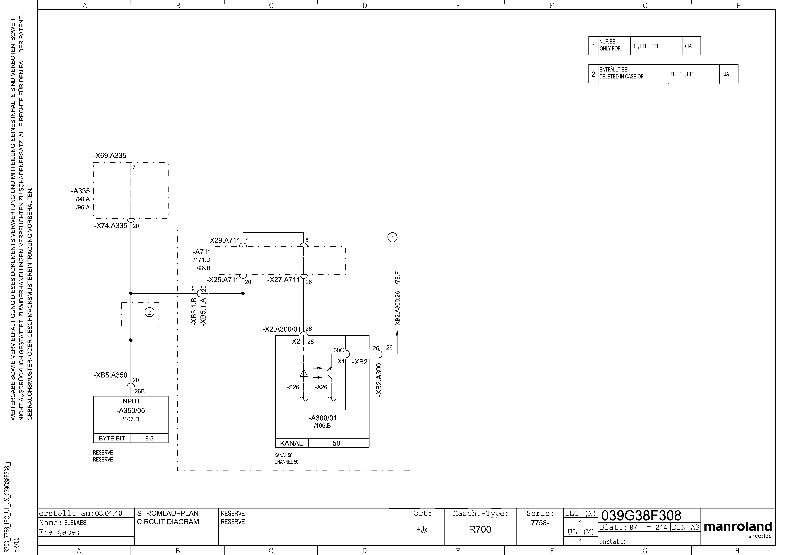

# +Jx — Sheet 97 of 214 — RESERVE

**RESERVE**

> Part of the manroland **R700** printing press IEC/UL circuit diagrams.
> Drawing class: **Stromlaufplan / Circuit diagram** (DIN A3).
> Document `+Jx` covers the **1st printing module + feed register** machine section.

## At a glance

| Field | Value |
|---|---|
| Document | `+Jx`  (039G38F308) |
| Sheet | **97** of 214 |
| Section (DE) | RESERVE |
| Section (EN) | RESERVE |
| Section type | CIRCUIT — Circuit diagram |
| Machine type | `R700` |
| Series | `7758` |
| Created | 03.01.10 |
| Replaces | — |
| Columns used | A, B, C, D, F, G, H |
| Path numbers | — |
| Labels on sheet | 63 |
| Cross-refs out | 7 |
| Cross-refs in | 18 |

**Previous:** [+Jx sheet 96](SHEET_0096.md) · **Next:** [+Jx sheet 98](SHEET_0098.md) · **Document TOC:** [_TOC.md](_TOC.md)  (+Jx) · **Master TOC:** [all sheets](../_MASTER_TOC.md)

## Sheet image (300 DPI, exact vector render)



_Rendered directly from the PDF vector layer at 300 DPI (1-bit), no OCR and no resampling. Use it to confirm anything ambiguous in the text below._

## Cross-references on this sheet

Each entry is a wire leaving this sheet. The printed token is `/sheet.column`; the link resolves to that sheet inside the same document.

| Ref | Target sheet | Col | Path | Destination on target | Target section | From col |
|---|---|---|---|---|---|---|
| `/98.A` | [+Jx sheet 98](SHEET_0098.md) | A | — | — | RESERVE | A |
| `/96.A` | [+Jx sheet 96](SHEET_0096.md) | A | — | — | RESERVE | A |
| `/171.D` | [+Jx sheet 171](SHEET_0171.md) | D | — | — | OPTION: AUTOMATISCHEM SPÜLEN | B |
| `/96.B` | [+Jx sheet 96](SHEET_0096.md) | B | — | — | RESERVE | B |
| `/78.F` | [+Jx sheet 78](SHEET_0078.md) | F | — | XB2.A300:26 | BUSVERBINDUNGEN: SICHERHEITSKREIS | D |
| `/107.D` | [+Jx sheet 107](SHEET_0107.md) | D | — | — | REFERENZMODUL | A |
| `/106.B` | [+Jx sheet 106](SHEET_0106.md) | B | — | — | REFERENZMODUL | D |

### Incoming references (sheets that point here)

Every other sheet that sends a wire to this one. `Back-ref` is the token printed on *that* sheet; `Path` is its line number.

| From sheet | Cols | Back-ref | Path | Refs | What continues there |
|---|---|---|---|---|---|
| [+Jx#78](SHEET_0078.md) | F | `/78.F` | — | 1 | XB2.A300:26 |
| [+Jx#96](SHEET_0096.md) | A, B | `/96.A`, `/96.B` | — | 2 | — |
| [+Jx#98](SHEET_0098.md) | A | `/98.A` | — | 1 | — |
| [+Jx#106](SHEET_0106.md) | B | `/106.B` | — | 1 | — |
| [+Jx#107](SHEET_0107.md) | D | `/107.D` | — | 1 | — |
| [+Jx#124](SHEET_0124.md) | F, H | `/124.F`, `/124.H` | — | 2 | — |
| [+Jx#131](SHEET_0131.md) | A, B | `/131.A`, `/131.B` | — | 2 | — |
| [+Jx#132](SHEET_0132.md) | C | `/132.C` | — | 1 | — |
| [+Jx#143](SHEET_0143.md) | B | `/143.B` | — | 1 | — |
| [+Jx#144](SHEET_0144.md) | G | `/144.G` | — | 1 | — |
| [+Jx#147](SHEET_0147.md) | D | `/147.D` | — | 2 | — |
| [+Jx#152](SHEET_0152.md) | G | `/152.G` | — | 1 | — |
| [+Jx#154](SHEET_0154.md) | A | `/154.A` | — | 1 | — |
| [+Jx#171](SHEET_0171.md) | C | `/171.C` | — | 1 | — |


## Devices on this sheet

| Tag | Class | Class meaning (IEC) | Col | Sub | Terminal | Sign |
|---|---|---|---|---|---|---|
| `A350/05` | A | Baugruppe / assembly, module, PC board | A | 05 | — | — |
| `A335` | A | Baugruppe / assembly, module, PC board | A | — | — | — |
| `A711` | A | Baugruppe / assembly, module, PC board | B | — | — | — |
| `S26` | S | Schalter / switch | C | — | — | — |
| `A26` | A | Baugruppe / assembly, module, PC board | D | — | — | — |
| `X1` | X | Klemme / terminal, plug connector | D | — | — | — |
| `X2` | X | Klemme / terminal, plug connector | C | — | — | — |
| `XB2` | XB |  | D | — | — | — |
| `A300/01` | A | Baugruppe / assembly, module, PC board | D | 01 | — | — |
| `9.3` | — | cross-device reference | B | — | — | — |
| `XB5.A350` | — | cross-device reference | A | — | — | — |
| `X74.A335` | — | cross-device reference | A | — | — | — |
| `X29.A711` | — | cross-device reference | B | — | — | — |
| `X25.A711` | — | cross-device reference | B | — | — | — |
| `XB5.1.A` | — | cross-device reference | B | — | — | — |
| `XB5.1.B` | — | cross-device reference | B | — | — | — |
| `XB2.A300` | — | cross-device reference | D | — | — | — |
| `X27.A711` | — | cross-device reference | C | — | — | — |
| `XB2.A300:26` | — | cross-device reference | D | — | 26 | — |
| `X69.A335` | — | cross-device reference | A | — | — | — |

## Potentials / nets

_No named potentials on this sheet._

## Wire-end annotations (grouped as printed)

A wire that continues elsewhere is annotated with a small cluster: the destination description, the path/line number `#NN`, and the `/sheet.column` cross reference. Each row below is one such cluster exactly as it is grouped on the drawing.

| Col | Y | Path | Cross-ref | Text on the wire |
|---|---|---|---|---|
| G | 60.1 | — | — | `1 NUR BEI ONLY FOR TL, LTL, LTTL` |
| G | 67.2 | — | — | `+JA` |
| G | 102.6 | — | — | `2 ENTFÄLLT BEI DELETED IN CASE OF TL, LTL, LTTL` |
| H | 109.7 | — | — | `+JA` |
| A | 231.3 | — | — | `X69.A335` |
| B | 249.7 | — | — | `7` |
| A | 285.1 | — | — | `A335` |
| A | 298.2 | — | `/98.A`, `/96.A` | — |
| A | 337.6 | — | — | `X74.A335 20` |
| D | 356.9 | — | — | `1` |
| C | 360.2 | — | — | `X29.A711 7` |
| C | 360.3 | — | — | `8` |
| B | 377.2 | — | — | `A711` |
| B | 390.4 | — | `/171.D` | — |
| B | 402.7 | — | `/96.B` | — |
| D | 411.4 | — | `/78.F` | `XB2.A300:26` |
| C | 419.8 | — | — | `X25.A711 20` |
| C | 419.8 | — | — | `X27.A711 26` |
| B | 433.0 | — | — | `XB5.1.B 20` |
| B | 433.0 | — | — | `XB5.1.A 20` |
| B | 470.8 | — | — | `2` |
| C | 494.9 | — | — | `X2.A300/01 26` |
| C | 513.3 | — | — | `X2` |
| D | 514.8 | — | — | `26 26` |
| D | 523.3 | — | — | `26` |
| D | 527.5 | — | — | `30C` |
| D | 544.5 | — | — | `X1` |
| D | 544.5 | — | — | `XB2` |
| D | 550.8 | — | — | `XB2.A300` |
| A | 564.3 | — | — | `XB5.A350 20` |
| C | 583.5 | — | — | `S26 A26` |
| B | 589.8 | — | — | `26B` |
| A | 604.4 | — | — | `INPUT` |
| A | 618.2 | — | — | `A350/05` |
| D | 629.5 | — | — | `A300/01` |
| A | 632.0 | — | `/107.D` | — |
| D | 641.9 | — | `/106.B` | — |
| A | 661.4 | — | — | `BYTE.BIT 9.3` |
| C | 667.8 | — | — | `KANAL 50` |
| A | 683.7 | — | — | `RESERVE RESERVE` |
| C | 688.1 | — | — | `KANAL 50 CHANNEL 50` |


## Reconstructed tables

This sheet carries tabular content (pin map / terminal assignment / index). The grid below was rebuilt from the drawing's own rule lines, so each row is exactly one physical row of the table.

### Table 1 — 2 data rows × 2 columns (at x=141.7, y=445.0) — **2**

| XB5.A350 | 20 26B |
|---|---|
| `INPUT` | `A350/05 /107.D` |
| `BYTE.BIT` | `9.3` |


### Table 2 — 4 data rows × 6 columns (at x=368.5, y=352.9)

| 7 20 | X27.A711 | 8 26 |  |  | 1 |
|---|---|---|---|---|---|
|  | `X2.A300/01` | `26` |  |  |  |
|  | `X2 S26` | `26 A26` | `30C X1` | `XB2` | `26 26 XB2.A300` |
|  |  | `A300/01 /106.B` |  |  |  |
|  | `KANAL` |  | `50` |  |  |


## Notes and free text on this sheet

| Text | Col | Y (pt) |
|---|---|---|
| `26B` | B | 589.84 |
| `INPUT` | A | 604.35 |
| `BYTE.BIT` | A | 661.35 |
| `RESERVE` | A | 683.7 |
| `KANAL 50` | C | 688.14 |
| `CHANNEL 50` | C | 698.09 |
| `30C` | D | 527.52 |
| `KANAL` | C | 667.79 |
| `X2.A300/01` | C | 494.89 |
| `NUR BEI` | G | 60.07 |
| `ONLY FOR` | G | 70.75 |
| `TL, LTL, LTTL` | G | 67.19 |
| `ENTFÄLLT BEI` | G | 102.59 |
| `DELETED IN CASE OF` | G | 113.25 |
| `+JA` | H | 109.67 |
| `+JA` | G | 67.15 |

## Complete label inventory (exact text from the drawing)

Every text object inside the drawing area of this sheet, in DIN reading order (column A→H, then top→bottom). This is the authoritative list: if a string is not here it is not printed on this sheet.

| Col | Y | X | Dir | Type | Text |
|---|---|---|---|---|---|
| A | 231.3 | 141.4 | → | device ref | `X69.A335` |
| A | 285.1 | 108.0 | → | device tag | `A335` |
| A | 298.2 | 115.4 | → | cross-reference | `/98.A` |
| A | 310.6 | 115.4 | → | cross-reference | `/96.A` |
| A | 337.6 | 142.9 | → | device ref | `X74.A335` |
| A | 564.3 | 142.0 | → | device ref | `XB5.A350` |
| A | 604.4 | 183.5 | → | text | `INPUT` |
| A | 618.2 | 176.9 | → | device tag | `A350/05` |
| A | 632.0 | 185.7 | → | cross-reference | `/107.D` |
| A | 661.3 | 150.0 | → | text | `BYTE.BIT` |
| A | 683.7 | 141.2 | → | text | `RESERVE` |
| A | 694.3 | 141.2 | → | text | `RESERVE` |
| B | 249.7 | 201.0 | → | number | `7` |
| B | 339.0 | 201.3 | → | number | `20` |
| B | 360.2 | 314.6 | → | device ref | `X29.A711` |
| B | 377.2 | 292.5 | → | device tag | `A711` |
| B | 390.4 | 293.4 | → | cross-reference | `/171.D` |
| B | 402.7 | 298.5 | → | cross-reference | `/96.B` |
| B | 419.8 | 313.2 | → | device ref | `X25.A711` |
| B | 433.0 | 290.8 | ↕ | number | `20` |
| B | 433.0 | 305.0 | ↕ | number | `20` |
| B | 451.6 | 289.4 | ↕ | device ref | `XB5.1.B` |
| B | 452.1 | 303.6 | ↕ | device ref | `XB5.1.A` |
| B | 470.8 | 224.8 | → | number | `2` |
| B | 572.9 | 201.3 | → | number | `20` |
| B | 589.8 | 204.1 | → | text | `26B` |
| B | 661.4 | 220.7 | → | device ref | `9.3` |
| C | 360.3 | 371.1 | → | number | `7` |
| C | 360.3 | 463.2 | → | number | `8` |
| C | 419.8 | 405.4 | → | device ref | `X27.A711` |
| C | 424.0 | 371.3 | → | number | `20` |
| C | 424.0 | 463.5 | → | number | `26` |
| C | 494.9 | 398.0 | → | text | `X2.A300/01` |
| C | 494.9 | 463.5 | → | number | `26` |
| C | 513.3 | 439.1 | → | device tag | `X2` |
| C | 514.8 | 466.3 | → | number | `26` |
| C | 583.5 | 435.4 | → | device tag | `S26` |
| C | 667.8 | 424.6 | → | text | `KANAL` |
| C | 688.1 | 416.1 | → | text | `KANAL 50` |
| C | 698.1 | 416.4 | → | text | `CHANNEL 50` |
| D | 356.9 | 593.4 | → | number | `1` |
| D | 411.4 | 599.0 | ↕ | cross-reference | `/78.F` |
| D | 441.6 | 599.0 | ↕ | device ref | `XB2.A300:26` |
| D | 523.3 | 585.9 | → | number | `26` |
| D | 524.7 | 565.5 | → | number | `26` |
| D | 527.5 | 506.0 | → | text | `30C` |
| D | 544.5 | 509.4 | → | device tag | `X1` |
| D | 544.5 | 534.0 | → | device tag | `XB2` |
| D | 550.8 | 570.0 | ↕ | device ref | `XB2.A300` |
| D | 583.5 | 477.9 | → | device tag | `A26` |
| D | 629.5 | 468.3 | → | device tag | `A300/01` |
| D | 641.9 | 476.4 | → | cross-reference | `/106.B` |
| D | 667.8 | 504.4 | → | number | `50` |
| F | 65.4 | 897.4 | → | number | `1` |
| F | 107.9 | 897.2 | → | number | `2` |
| G | 60.1 | 909.4 | → | text | `NUR BEI` |
| G | 67.1 | 1037.9 | → | text | `+JA` |
| G | 67.2 | 960.2 | → | text | `TL, LTL, LTTL` |
| G | 70.8 | 909.6 | → | text | `ONLY FOR` |
| G | 102.6 | 909.4 | → | text | `ENTFÄLLT BEI` |
| G | 109.7 | 1016.9 | → | text | `TL, LTL, LTTL` |
| G | 113.2 | 909.4 | → | text | `DELETED IN CASE OF` |
| H | 109.7 | 1094.6 | → | text | `+JA` |

## Reading-order text block

The same content as a plain block, grouped by DIN column — convenient to paste or to match against a visual description.

```text
=== Column A ===
 231.3  141.4  devref       X69.A335
 285.1  108.0  devtag       A335
 298.2  115.4  xref         /98.A
 310.6  115.4  xref         /96.A
 337.6  142.9  devref       X74.A335
 564.3  142.0  devref       XB5.A350
 604.4  183.5  text         INPUT
 618.2  176.9  devtag       A350/05
 632.0  185.7  xref         /107.D
 661.3  150.0  text         BYTE.BIT
 683.7  141.2  text         RESERVE
 694.3  141.2  text         RESERVE
=== Column B ===
 249.7  201.0  numeric      7
 339.0  201.3  numeric      20
 360.2  314.6  devref       X29.A711
 377.2  292.5  devtag       A711
 390.4  293.4  xref         /171.D
 402.7  298.5  xref         /96.B
 419.8  313.2  devref       X25.A711
 433.0  290.8  numeric      20
 433.0  305.0  numeric      20
 451.6  289.4  devref       XB5.1.B
 452.1  303.6  devref       XB5.1.A
 470.8  224.8  numeric      2
 572.9  201.3  numeric      20
 589.8  204.1  text         26B
 661.4  220.7  devref       9.3
=== Column C ===
 360.3  371.1  numeric      7
 360.3  463.2  numeric      8
 419.8  405.4  devref       X27.A711
 424.0  371.3  numeric      20
 424.0  463.5  numeric      26
 494.9  398.0  text         X2.A300/01
 494.9  463.5  numeric      26
 513.3  439.1  devtag       X2
 514.8  466.3  numeric      26
 583.5  435.4  devtag       S26
 667.8  424.6  text         KANAL
 688.1  416.1  text         KANAL 50
 698.1  416.4  text         CHANNEL 50
=== Column D ===
 356.9  593.4  numeric      1
 411.4  599.0  xref         /78.F
 441.6  599.0  devref       XB2.A300:26
 523.3  585.9  numeric      26
 524.7  565.5  numeric      26
 527.5  506.0  text         30C
 544.5  509.4  devtag       X1
 544.5  534.0  devtag       XB2
 550.8  570.0  devref       XB2.A300
 583.5  477.9  devtag       A26
 629.5  468.3  devtag       A300/01
 641.9  476.4  xref         /106.B
 667.8  504.4  numeric      50
=== Column F ===
  65.4  897.4  numeric      1
 107.9  897.2  numeric      2
=== Column G ===
  60.1  909.4  text         NUR BEI
  67.1 1037.9  text         +JA
  67.2  960.2  text         TL, LTL, LTTL
  70.8  909.6  text         ONLY FOR
 102.6  909.4  text         ENTFÄLLT BEI
 109.7 1016.9  text         TL, LTL, LTTL
 113.2  909.4  text         DELETED IN CASE OF
=== Column H ===
 109.7 1094.6  text         +JA
```

---
_Generated from the PDF vector text layer; no OCR. Source: `R700_7758_IEC_UL_JX_039G38F308_p`, sheet 97._
