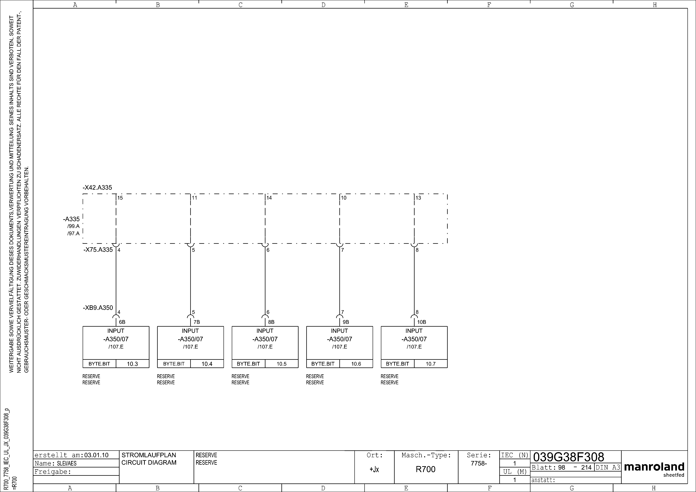

# +Jx — Sheet 98 of 214 — RESERVE

**RESERVE**

> Part of the manroland **R700** printing press IEC/UL circuit diagrams.
> Drawing class: **Stromlaufplan / Circuit diagram** (DIN A3).
> Document `+Jx` covers the **1st printing module + feed register** machine section.

## At a glance

| Field | Value |
|---|---|
| Document | `+Jx`  (039G38F308) |
| Sheet | **98** of 214 |
| Section (DE) | RESERVE |
| Section (EN) | RESERVE |
| Section type | CIRCUIT — Circuit diagram |
| Machine type | `R700` |
| Series | `7758` |
| Created | 03.01.10 |
| Replaces | — |
| Columns used | A, B, C, D, E |
| Path numbers | — |
| Labels on sheet | 61 |
| Cross-refs out | 7 |
| Cross-refs in | 22 |

**Previous:** [+Jx sheet 97](SHEET_0097.md) · **Next:** [+Jx sheet 99](SHEET_0099.md) · **Document TOC:** [_TOC.md](_TOC.md)  (+Jx) · **Master TOC:** [all sheets](../_MASTER_TOC.md)

## Sheet image (300 DPI, exact vector render)



_Rendered directly from the PDF vector layer at 300 DPI (1-bit), no OCR and no resampling. Use it to confirm anything ambiguous in the text below._

## Cross-references on this sheet

Each entry is a wire leaving this sheet. The printed token is `/sheet.column`; the link resolves to that sheet inside the same document.

| Ref | Target sheet | Col | Path | Destination on target | Target section | From col |
|---|---|---|---|---|---|---|
| `/99.A` | [+Jx sheet 99](SHEET_0099.md) | A | — | — | RESERVE | A |
| `/97.A` | [+Jx sheet 97](SHEET_0097.md) | A | — | — | RESERVE | A |
| `/107.E` | [+Jx sheet 107](SHEET_0107.md) | E | — | — | REFERENZMODUL | A |
| `/107.E` | [+Jx sheet 107](SHEET_0107.md) | E | — | — | REFERENZMODUL | B |
| `/107.E` | [+Jx sheet 107](SHEET_0107.md) | E | — | — | REFERENZMODUL | C |
| `/107.E` | [+Jx sheet 107](SHEET_0107.md) | E | — | — | REFERENZMODUL | D |
| `/107.E` | [+Jx sheet 107](SHEET_0107.md) | E | — | — | REFERENZMODUL | E |

### Incoming references (sheets that point here)

Every other sheet that sends a wire to this one. `Back-ref` is the token printed on *that* sheet; `Path` is its line number.

| From sheet | Cols | Back-ref | Path | Refs | What continues there |
|---|---|---|---|---|---|
| [+Jx#97](SHEET_0097.md) | A | `/97.A` | — | 1 | — |
| [+Jx#99](SHEET_0099.md) | A | `/99.A` | — | 1 | — |
| [+Jx#107](SHEET_0107.md) | E | `/107.E` | — | 5 | — |
| [+Jx#134](SHEET_0134.md) | G | `/134.G` | — | 5 | — |
| [+Jx#150](SHEET_0150.md) | C | `/150.C` | — | 5 | — |
| [+Jx#155](SHEET_0155.md) | A | `/155.A` | — | 5 | — |


## Devices on this sheet

| Tag | Class | Class meaning (IEC) | Col | Sub | Terminal | Sign |
|---|---|---|---|---|---|---|
| `A350/07` | A | Baugruppe / assembly, module, PC board | B | 07 | — | — |
| `A350/07` | A | Baugruppe / assembly, module, PC board | A | 07 | — | — |
| `A350/07` | A | Baugruppe / assembly, module, PC board | C | 07 | — | — |
| `A350/07` | A | Baugruppe / assembly, module, PC board | D | 07 | — | — |
| `A350/07` | A | Baugruppe / assembly, module, PC board | E | 07 | — | — |
| `A335` | A | Baugruppe / assembly, module, PC board | A | — | — | — |
| `10.4` | — | cross-device reference | C | — | — | — |
| `10.3` | — | cross-device reference | B | — | — | — |
| `XB9.A350` | — | cross-device reference | A | — | — | — |
| `X75.A335` | — | cross-device reference | A | — | — | — |
| `10.5` | — | cross-device reference | C | — | — | — |
| `10.6` | — | cross-device reference | D | — | — | — |
| `10.7` | — | cross-device reference | E | — | — | — |
| `X42.A335` | — | cross-device reference | A | — | — | — |

## Potentials / nets

_No named potentials on this sheet._

## Wire-end annotations (grouped as printed)

A wire that continues elsewhere is annotated with a small cluster: the destination description, the path/line number `#NN`, and the `/sheet.column` cross reference. Each row below is one such cluster exactly as it is grouped on the drawing.

| Col | Y | Path | Cross-ref | Text on the wire |
|---|---|---|---|---|
| A | 316.3 | — | — | `X42.A335` |
| B | 334.8 | — | — | `15` |
| B | 334.8 | — | — | `11` |
| C | 334.8 | — | — | `14` |
| D | 334.8 | — | — | `10` |
| E | 334.8 | — | — | `13` |
| A | 370.1 | — | — | `A335` |
| A | 383.2 | — | `/99.A`, `/97.A` | — |
| A | 422.6 | — | — | `X75.A335 4` |
| B | 424.1 | — | — | `5` |
| C | 424.1 | — | — | `6` |
| D | 424.1 | — | — | `7` |
| E | 424.1 | — | — | `8` |
| A | 521.8 | — | — | `XB9.A350 4` |
| B | 530.4 | — | — | `5` |
| C | 530.4 | — | — | `6` |
| D | 530.4 | — | — | `7` |
| E | 530.4 | — | — | `8` |
| B | 547.3 | — | — | `6B` |
| B | 547.3 | — | — | `7B` |
| C | 547.3 | — | — | `8B` |
| D | 547.3 | — | — | `9B` |
| E | 547.3 | — | — | `10B` |
| A | 561.8 | — | — | `INPUT` |
| B | 561.8 | — | — | `INPUT` |
| C | 561.8 | — | — | `INPUT` |
| D | 561.8 | — | — | `INPUT` |
| E | 561.8 | — | — | `INPUT` |
| A | 575.7 | — | — | `A350/07` |
| B | 575.7 | — | — | `A350/07` |
| C | 575.7 | — | — | `A350/07` |
| D | 575.7 | — | — | `A350/07` |
| E | 575.7 | — | — | `A350/07` |
| A | 589.5 | — | `/107.E` | — |
| B | 589.5 | — | `/107.E` | — |
| C | 589.5 | — | `/107.E` | — |
| D | 589.5 | — | `/107.E` | — |
| E | 589.5 | — | `/107.E` | — |
| A | 618.5 | — | — | `BYTE.BIT 10.3` |
| B | 618.5 | — | — | `BYTE.BIT 10.4` |
| C | 618.8 | — | — | `BYTE.BIT 10.5` |
| D | 618.8 | — | — | `BYTE.BIT 10.6` |
| E | 618.8 | — | — | `BYTE.BIT 10.7` |
| A | 641.2 | — | — | `RESERVE RESERVE` |
| B | 641.2 | — | — | `RESERVE RESERVE` |
| C | 641.2 | — | — | `RESERVE RESERVE` |
| D | 641.2 | — | — | `RESERVE RESERVE` |
| E | 641.2 | — | — | `RESERVE RESERVE` |


## Reconstructed tables

This sheet carries tabular content (pin map / terminal assignment / index). The grid below was rebuilt from the drawing's own rule lines, so each row is exactly one physical row of the table.

### Table 1 — 1 data rows × 2 columns (at x=141.7, y=558.4)

| INPUT | A350/07 /107.E |
|---|---|
| `BYTE.BIT` | `10.3` |


### Table 2 — 1 data rows × 2 columns (at x=269.3, y=558.4)

| INPUT A350/07 | /107.E |
|---|---|
| `BYTE.BIT` | `10.4` |


### Table 3 — 1 data rows × 2 columns (at x=396.9, y=558.4)

| INPUT | A350/07 /107.E |
|---|---|
| `BYTE.BIT` | `10.5` |


### Table 4 — 1 data rows × 2 columns (at x=524.4, y=558.4)

| INPUT | A350/07 /107.E |
|---|---|
| `BYTE.BIT` | `10.6` |


### Table 5 — 1 data rows × 2 columns (at x=652.0, y=558.4)

| INPUT A350/07 | /107.E |
|---|---|
| `BYTE.BIT` | `10.7` |


## Notes and free text on this sheet

| Text | Col | Y (pt) |
|---|---|---|
| `7B` | B | 547.3 |
| `INPUT` | B | 561.83 |
| `BYTE.BIT` | B | 619.09 |
| `RESERVE` | B | 641.18 |
| `6B` | B | 547.3 |
| `INPUT` | A | 561.83 |
| `BYTE.BIT` | A | 619.09 |
| `RESERVE` | A | 641.18 |
| `8B` | C | 547.3 |
| `INPUT` | C | 561.83 |
| `BYTE.BIT` | C | 618.83 |
| `RESERVE` | C | 641.18 |
| `9B` | D | 547.3 |
| `INPUT` | D | 561.83 |
| `BYTE.BIT` | D | 618.83 |
| `RESERVE` | D | 641.18 |
| `10B` | E | 547.32 |
| `INPUT` | E | 561.83 |
| `BYTE.BIT` | E | 618.83 |
| `RESERVE` | E | 641.18 |

## Complete label inventory (exact text from the drawing)

Every text object inside the drawing area of this sheet, in DIN reading order (column A→H, then top→bottom). This is the authoritative list: if a string is not here it is not printed on this sheet.

| Col | Y | X | Dir | Type | Text |
|---|---|---|---|---|---|
| A | 316.3 | 141.4 | → | device ref | `X42.A335` |
| A | 370.2 | 108.0 | → | device tag | `A335` |
| A | 383.2 | 115.4 | → | cross-reference | `/99.A` |
| A | 395.6 | 115.4 | → | cross-reference | `/97.A` |
| A | 422.6 | 142.9 | → | device ref | `X75.A335` |
| A | 521.8 | 142.0 | → | device ref | `XB9.A350` |
| A | 561.8 | 183.5 | → | text | `INPUT` |
| A | 575.7 | 176.9 | → | device tag | `A350/07` |
| A | 589.5 | 185.8 | → | cross-reference | `/107.E` |
| A | 619.1 | 151.7 | → | text | `BYTE.BIT` |
| A | 641.2 | 141.2 | → | text | `RESERVE` |
| A | 651.8 | 141.2 | → | text | `RESERVE` |
| B | 334.8 | 200.4 | → | number | `15` |
| B | 334.8 | 328.0 | → | number | `11` |
| B | 424.0 | 201.3 | → | number | `4` |
| B | 424.0 | 328.5 | → | number | `5` |
| B | 530.3 | 201.3 | → | number | `4` |
| B | 530.3 | 328.5 | → | number | `5` |
| B | 547.3 | 203.8 | → | text | `6B` |
| B | 547.3 | 331.4 | → | text | `7B` |
| B | 561.8 | 311.1 | → | text | `INPUT` |
| B | 575.7 | 304.4 | → | device tag | `A350/07` |
| B | 589.5 | 313.4 | → | cross-reference | `/107.E` |
| B | 618.5 | 217.0 | → | device ref | `10.3` |
| B | 619.1 | 279.2 | → | text | `BYTE.BIT` |
| B | 641.2 | 268.7 | → | text | `RESERVE` |
| B | 651.8 | 268.7 | → | text | `RESERVE` |
| C | 334.8 | 455.5 | → | number | `14` |
| C | 424.0 | 456.1 | → | number | `6` |
| C | 530.3 | 456.1 | → | number | `6` |
| C | 547.3 | 458.9 | → | text | `8B` |
| C | 561.8 | 438.7 | → | text | `INPUT` |
| C | 575.7 | 432.0 | → | device tag | `A350/07` |
| C | 589.5 | 440.9 | → | cross-reference | `/107.E` |
| C | 618.5 | 344.6 | → | device ref | `10.4` |
| C | 618.8 | 405.1 | → | text | `BYTE.BIT` |
| C | 618.9 | 473.1 | → | device ref | `10.5` |
| C | 641.2 | 396.3 | → | text | `RESERVE` |
| C | 651.8 | 396.3 | → | text | `RESERVE` |
| D | 334.8 | 583.1 | → | number | `10` |
| D | 424.0 | 583.7 | → | number | `7` |
| D | 530.3 | 583.7 | → | number | `7` |
| D | 547.3 | 586.5 | → | text | `9B` |
| D | 561.8 | 566.2 | → | text | `INPUT` |
| D | 575.7 | 559.6 | → | device tag | `A350/07` |
| D | 589.5 | 568.5 | → | cross-reference | `/107.E` |
| D | 618.8 | 532.6 | → | text | `BYTE.BIT` |
| D | 618.9 | 600.7 | → | device ref | `10.6` |
| D | 641.2 | 523.8 | → | text | `RESERVE` |
| D | 651.8 | 523.8 | → | text | `RESERVE` |
| E | 334.8 | 710.6 | → | number | `13` |
| E | 424.0 | 711.2 | → | number | `8` |
| E | 530.3 | 711.2 | → | number | `8` |
| E | 547.3 | 713.5 | → | text | `10B` |
| E | 561.8 | 693.8 | → | text | `INPUT` |
| E | 575.7 | 687.1 | → | device tag | `A350/07` |
| E | 589.5 | 696.0 | → | cross-reference | `/107.E` |
| E | 618.8 | 660.2 | → | text | `BYTE.BIT` |
| E | 618.9 | 728.2 | → | device ref | `10.7` |
| E | 641.2 | 651.4 | → | text | `RESERVE` |
| E | 651.8 | 651.4 | → | text | `RESERVE` |

## Reading-order text block

The same content as a plain block, grouped by DIN column — convenient to paste or to match against a visual description.

```text
=== Column A ===
 316.3  141.4  devref       X42.A335
 370.2  108.0  devtag       A335
 383.2  115.4  xref         /99.A
 395.6  115.4  xref         /97.A
 422.6  142.9  devref       X75.A335
 521.8  142.0  devref       XB9.A350
 561.8  183.5  text         INPUT
 575.7  176.9  devtag       A350/07
 589.5  185.8  xref         /107.E
 619.1  151.7  text         BYTE.BIT
 641.2  141.2  text         RESERVE
 651.8  141.2  text         RESERVE
=== Column B ===
 334.8  200.4  numeric      15
 334.8  328.0  numeric      11
 424.0  201.3  numeric      4
 424.0  328.5  numeric      5
 530.3  201.3  numeric      4
 530.3  328.5  numeric      5
 547.3  203.8  text         6B
 547.3  331.4  text         7B
 561.8  311.1  text         INPUT
 575.7  304.4  devtag       A350/07
 589.5  313.4  xref         /107.E
 618.5  217.0  devref       10.3
 619.1  279.2  text         BYTE.BIT
 641.2  268.7  text         RESERVE
 651.8  268.7  text         RESERVE
=== Column C ===
 334.8  455.5  numeric      14
 424.0  456.1  numeric      6
 530.3  456.1  numeric      6
 547.3  458.9  text         8B
 561.8  438.7  text         INPUT
 575.7  432.0  devtag       A350/07
 589.5  440.9  xref         /107.E
 618.5  344.6  devref       10.4
 618.8  405.1  text         BYTE.BIT
 618.9  473.1  devref       10.5
 641.2  396.3  text         RESERVE
 651.8  396.3  text         RESERVE
=== Column D ===
 334.8  583.1  numeric      10
 424.0  583.7  numeric      7
 530.3  583.7  numeric      7
 547.3  586.5  text         9B
 561.8  566.2  text         INPUT
 575.7  559.6  devtag       A350/07
 589.5  568.5  xref         /107.E
 618.8  532.6  text         BYTE.BIT
 618.9  600.7  devref       10.6
 641.2  523.8  text         RESERVE
 651.8  523.8  text         RESERVE
=== Column E ===
 334.8  710.6  numeric      13
 424.0  711.2  numeric      8
 530.3  711.2  numeric      8
 547.3  713.5  text         10B
 561.8  693.8  text         INPUT
 575.7  687.1  devtag       A350/07
 589.5  696.0  xref         /107.E
 618.8  660.2  text         BYTE.BIT
 618.9  728.2  devref       10.7
 641.2  651.4  text         RESERVE
 651.8  651.4  text         RESERVE
```

---
_Generated from the PDF vector text layer; no OCR. Source: `R700_7758_IEC_UL_JX_039G38F308_p`, sheet 98._
