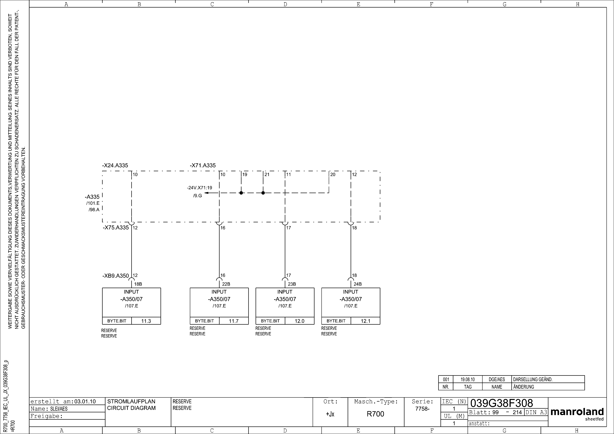

# +Jx — Sheet 99 of 214 — RESERVE

**RESERVE**

> Part of the manroland **R700** printing press IEC/UL circuit diagrams.
> Drawing class: **Stromlaufplan / Circuit diagram** (DIN A3).
> Document `+Jx` covers the **1st printing module + feed register** machine section.

## At a glance

| Field | Value |
|---|---|
| Document | `+Jx`  (039G38F308) |
| Sheet | **99** of 214 |
| Section (DE) | RESERVE |
| Section (EN) | RESERVE |
| Section type | CIRCUIT — Circuit diagram |
| Machine type | `R700` |
| Series | `7758` |
| Created | 03.01.10 |
| Replaces | — |
| Columns used | A, B, C, D, E, F, G |
| Path numbers | — |
| Labels on sheet | 64 |
| Cross-refs out | 7 |
| Cross-refs in | 22 |

**Previous:** [+Jx sheet 98](SHEET_0098.md) · **Next:** [+Jx sheet 100](SHEET_0100.md) · **Document TOC:** [_TOC.md](_TOC.md)  (+Jx) · **Master TOC:** [all sheets](../_MASTER_TOC.md)

## Sheet image (300 DPI, exact vector render)



_Rendered directly from the PDF vector layer at 300 DPI (1-bit), no OCR and no resampling. Use it to confirm anything ambiguous in the text below._

## Cross-references on this sheet

Each entry is a wire leaving this sheet. The printed token is `/sheet.column`; the link resolves to that sheet inside the same document.

| Ref | Target sheet | Col | Path | Destination on target | Target section | From col |
|---|---|---|---|---|---|---|
| `/9.G` | [+Jx sheet 9](SHEET_0009.md) | G | — | — | SPANNUNGSVERSORGUNG, SCHALTSCHRANKBELÜFTUNG | C |
| `/101.E` | [+Jx sheet 101](SHEET_0101.md) | E | — | — | RESERVE | A |
| `/98.A` | [+Jx sheet 98](SHEET_0098.md) | A | — | — | RESERVE | A |
| `/107.E` | [+Jx sheet 107](SHEET_0107.md) | E | — | — | REFERENZMODUL | B |
| `/107.E` | [+Jx sheet 107](SHEET_0107.md) | E | — | — | REFERENZMODUL | C |
| `/107.E` | [+Jx sheet 107](SHEET_0107.md) | E | — | — | REFERENZMODUL | D |
| `/107.E` | [+Jx sheet 107](SHEET_0107.md) | E | — | — | REFERENZMODUL | E |

### Incoming references (sheets that point here)

Every other sheet that sends a wire to this one. `Back-ref` is the token printed on *that* sheet; `Path` is its line number.

| From sheet | Cols | Back-ref | Path | Refs | What continues there |
|---|---|---|---|---|---|
| [+Jx#9](SHEET_0009.md) | G | `/9.G` | — | 1 | — |
| [+Jx#98](SHEET_0098.md) | A | `/98.A` | — | 1 | — |
| [+Jx#101](SHEET_0101.md) | E | `/101.E` | — | 1 | — |
| [+Jx#107](SHEET_0107.md) | E | `/107.E` | — | 4 | — |
| [+Jx#134](SHEET_0134.md) | G | `/134.G` | — | 4 | — |
| [+Jx#142](SHEET_0142.md) | F | `/142.F` | — | 1 | — |
| [+Jx#153](SHEET_0153.md) | B | `/153.B` | — | 6 | — |
| [+Jx#155](SHEET_0155.md) | A | `/155.A` | — | 4 | — |


## Devices on this sheet

| Tag | Class | Class meaning (IEC) | Col | Sub | Terminal | Sign |
|---|---|---|---|---|---|---|
| `A350/07` | A | Baugruppe / assembly, module, PC board | B | 07 | — | — |
| `A335` | A | Baugruppe / assembly, module, PC board | A | — | — | — |
| `A350/07` | A | Baugruppe / assembly, module, PC board | C | 07 | — | — |
| `A350/07` | A | Baugruppe / assembly, module, PC board | D | 07 | — | — |
| `A350/07` | A | Baugruppe / assembly, module, PC board | E | 07 | — | — |
| `11.3` | — | cross-device reference | B | — | — | — |
| `XB9.A350` | — | cross-device reference | B | — | — | — |
| `X75.A335` | — | cross-device reference | B | — | — | — |
| `11.7` | — | cross-device reference | C | — | — | — |
| `12.0` | — | cross-device reference | D | — | — | — |
| `12.1` | — | cross-device reference | E | — | — | — |
| `NR.` | — | cross-device reference | F | — | — | — |
| `19.08.10` | — | cross-device reference | F | — | — | — |
| `X24.A335` | — | cross-device reference | B | — | — | — |
| `X71.A335` | — | cross-device reference | C | — | — | — |

## Potentials / nets

| Potential | Count | Columns | Attached devices | Terminals |
|---|---|---|---|---|
| `24V` | 1 | C | `X71` | `19` |


A potential such as `L24+/4` or `M24+` is a named supply/return rail; every place it appears on this sheet is electrically common.

## Wire-end annotations (grouped as printed)

A wire that continues elsewhere is annotated with a small cluster: the destination description, the path/line number `#NN`, and the `/sheet.column` cross reference. Each row below is one such cluster exactly as it is grouped on the drawing.

| Col | Y | Path | Cross-ref | Text on the wire |
|---|---|---|---|---|
| B | 316.3 | — | — | `X24.A335 X71.A335` |
| B | 334.8 | — | — | `10` |
| D | 334.8 | — | — | `10 11 12` |
| D | 334.8 | — | — | `19 21 20` |
| C | 360.2 | — | — | `24V.X71:19` |
| C | 375.8 | — | `/9.G` | — |
| A | 377.2 | — | — | `A335` |
| A | 390.3 | — | `/101.E` | — |
| A | 402.7 | — | `/98.A` | — |
| B | 436.8 | — | — | `X75.A335 12` |
| D | 438.2 | — | — | `16 17 18` |
| B | 530.3 | — | — | `XB9.A350 12` |
| D | 530.4 | — | — | `16 17` |
| E | 530.4 | — | — | `18` |
| B | 547.3 | — | — | `18B` |
| C | 547.3 | — | — | `22B` |
| D | 547.3 | — | — | `23B` |
| E | 547.3 | — | — | `24B` |
| B | 561.8 | — | — | `INPUT` |
| C | 561.8 | — | — | `INPUT` |
| D | 561.8 | — | — | `INPUT` |
| E | 561.8 | — | — | `INPUT` |
| B | 575.7 | — | — | `A350/07` |
| C | 575.7 | — | — | `A350/07` |
| D | 575.7 | — | — | `A350/07` |
| E | 575.7 | — | — | `A350/07` |
| B | 589.5 | — | `/107.E` | — |
| C | 589.5 | — | `/107.E` | — |
| D | 589.5 | — | `/107.E` | — |
| E | 589.5 | — | `/107.E` | — |
| B | 618.5 | — | — | `BYTE.BIT 11.3` |
| C | 618.5 | — | — | `BYTE.BIT 11.7` |
| D | 618.5 | — | — | `BYTE.BIT 12.0` |
| E | 618.5 | — | — | `BYTE.BIT 12.1` |
| C | 634.1 | — | — | `RESERVE RESERVE` |
| D | 634.1 | — | — | `RESERVE RESERVE` |
| E | 634.1 | — | — | `RESERVE RESERVE` |
| B | 638.4 | — | — | `RESERVE RESERVE` |
| G | 733.0 | — | — | `001 19.08.10 DGE/AES DARSELLUNG GEÄND.` |
| G | 747.1 | — | — | `NR. TAG NAME ÄNDERUNG` |


## Reconstructed tables

This sheet carries tabular content (pin map / terminal assignment / index). The grid below was rebuilt from the drawing's own rule lines, so each row is exactly one physical row of the table.

### Table 1 — 2 data rows × 2 columns (at x=198.4, y=374.2)

| X75.A335 XB9.A350 | 12 12 18B |
|---|---|
| `INPUT` | `A350/07 /107.E` |
| `BYTE.BIT` | `11.3` |


### Table 2 — 2 data rows × 2 columns (at x=368.5, y=374.2)

| /9.G | 16 16 22B |
|---|---|
| `INPUT A350/07` | `/107.E` |
| `BYTE.BIT` | `11.7` |


### Table 3 — 1 data rows × 2 columns (at x=510.2, y=374.2) — **17 17 23B**

| INPUT A350/07 | /107.E |
|---|---|
| `BYTE.BIT` | `12.0` |


### Table 4 — 1 data rows × 2 columns (at x=637.8, y=374.2) — **18 18 24B**

| INPUT | A350/07 /107.E |
|---|---|
| `BYTE.BIT` | `12.1` |


## Notes and free text on this sheet

| Text | Col | Y (pt) |
|---|---|---|
| `18B` | B | 547.32 |
| `INPUT` | B | 561.83 |
| `BYTE.BIT` | B | 619.09 |
| `RESERVE` | B | 638.35 |
| `22B` | C | 547.32 |
| `INPUT` | C | 561.83 |
| `BYTE.BIT` | C | 619.09 |
| `RESERVE` | C | 634.1 |
| `23B` | D | 547.32 |
| `INPUT` | D | 561.83 |
| `BYTE.BIT` | D | 619.09 |
| `RESERVE` | D | 634.1 |
| `24B` | E | 547.32 |
| `INPUT` | E | 561.83 |
| `BYTE.BIT` | E | 619.09 |
| `RESERVE` | E | 634.1 |
| `TAG` | G | 747.23 |
| `NAME` | G | 747.22 |
| `ÄNDERUNG` | G | 747.25 |
| `DGE/AES` | G | 733.06 |
| `DARSELLUNG GEÄND.` | G | 733.07 |

## Complete label inventory (exact text from the drawing)

Every text object inside the drawing area of this sheet, in DIN reading order (column A→H, then top→bottom). This is the authoritative list: if a string is not here it is not printed on this sheet.

| Col | Y | X | Dir | Type | Text |
|---|---|---|---|---|---|
| A | 377.2 | 164.7 | → | device tag | `A335` |
| A | 390.3 | 167.5 | → | cross-reference | `/101.E` |
| A | 402.7 | 172.1 | → | cross-reference | `/98.A` |
| B | 316.3 | 198.1 | → | device ref | `X24.A335` |
| B | 334.8 | 257.1 | → | number | `10` |
| B | 436.8 | 199.6 | → | device ref | `X75.A335` |
| B | 438.2 | 257.1 | → | number | `12` |
| B | 530.3 | 198.7 | → | device ref | `XB9.A350` |
| B | 530.3 | 257.1 | → | number | `12` |
| B | 547.3 | 259.9 | → | text | `18B` |
| B | 561.8 | 240.2 | → | text | `INPUT` |
| B | 575.7 | 233.6 | → | device tag | `A350/07` |
| B | 589.5 | 242.5 | → | cross-reference | `/107.E` |
| B | 618.5 | 273.7 | → | device ref | `11.3` |
| B | 619.1 | 208.3 | → | text | `BYTE.BIT` |
| B | 638.3 | 196.4 | → | text | `RESERVE` |
| B | 649.0 | 196.4 | → | text | `RESERVE` |
| C | 316.3 | 368.2 | → | device ref | `X71.A335` |
| C | 334.8 | 427.2 | → | number | `10` |
| C | 334.8 | 469.7 | → | number | `19` |
| C | 360.2 | 362.6 | → | potential | `24V.X71:19` |
| C | 375.8 | 374.7 | → | cross-reference | `/9.G` |
| C | 438.2 | 427.2 | → | number | `16` |
| C | 530.3 | 427.2 | → | number | `16` |
| C | 547.3 | 430.9 | → | text | `22B` |
| C | 561.8 | 410.3 | → | text | `INPUT` |
| C | 575.7 | 403.7 | → | device tag | `A350/07` |
| C | 589.5 | 412.6 | → | cross-reference | `/107.E` |
| C | 618.5 | 443.8 | → | device ref | `11.7` |
| C | 619.1 | 378.4 | → | text | `BYTE.BIT` |
| C | 634.1 | 367.9 | → | text | `RESERVE` |
| C | 644.7 | 367.9 | → | text | `RESERVE` |
| D | 334.8 | 513.1 | → | number | `21` |
| D | 334.8 | 554.7 | → | number | `11` |
| D | 438.2 | 554.7 | → | number | `17` |
| D | 530.3 | 554.7 | → | number | `17` |
| D | 547.3 | 558.4 | → | text | `23B` |
| D | 561.8 | 537.9 | → | text | `INPUT` |
| D | 575.7 | 531.2 | → | device tag | `A350/07` |
| D | 589.5 | 540.1 | → | cross-reference | `/107.E` |
| D | 618.5 | 571.3 | → | device ref | `12.0` |
| D | 619.1 | 506.0 | → | text | `BYTE.BIT` |
| D | 634.1 | 495.5 | → | text | `RESERVE` |
| D | 644.7 | 495.5 | → | text | `RESERVE` |
| E | 334.8 | 640.6 | → | number | `20` |
| E | 334.8 | 682.3 | → | number | `12` |
| E | 438.2 | 682.3 | → | number | `18` |
| E | 530.3 | 682.3 | → | number | `18` |
| E | 547.3 | 686.0 | → | text | `24B` |
| E | 561.8 | 665.4 | → | text | `INPUT` |
| E | 575.7 | 658.8 | → | device tag | `A350/07` |
| E | 589.5 | 667.7 | → | cross-reference | `/107.E` |
| E | 618.5 | 699.6 | → | device ref | `12.1` |
| E | 619.1 | 633.5 | → | text | `BYTE.BIT` |
| E | 634.1 | 623.1 | → | text | `RESERVE` |
| E | 644.7 | 623.1 | → | text | `RESERVE` |
| F | 733.0 | 859.3 | → | number | `001` |
| F | 733.1 | 893.2 | → | device ref | `19.08.10` |
| F | 747.1 | 858.5 | → | device ref | `NR.` |
| G | 733.1 | 948.0 | → | text | `DGE/AES` |
| G | 733.1 | 995.1 | → | text | `DARSELLUNG GEÄND.` |
| G | 747.2 | 900.1 | → | text | `TAG` |
| G | 747.2 | 953.5 | → | text | `NAME` |
| G | 747.3 | 995.7 | → | text | `ÄNDERUNG` |

## Reading-order text block

The same content as a plain block, grouped by DIN column — convenient to paste or to match against a visual description.

```text
=== Column A ===
 377.2  164.7  devtag       A335
 390.3  167.5  xref         /101.E
 402.7  172.1  xref         /98.A
=== Column B ===
 316.3  198.1  devref       X24.A335
 334.8  257.1  numeric      10
 436.8  199.6  devref       X75.A335
 438.2  257.1  numeric      12
 530.3  198.7  devref       XB9.A350
 530.3  257.1  numeric      12
 547.3  259.9  text         18B
 561.8  240.2  text         INPUT
 575.7  233.6  devtag       A350/07
 589.5  242.5  xref         /107.E
 618.5  273.7  devref       11.3
 619.1  208.3  text         BYTE.BIT
 638.3  196.4  text         RESERVE
 649.0  196.4  text         RESERVE
=== Column C ===
 316.3  368.2  devref       X71.A335
 334.8  427.2  numeric      10
 334.8  469.7  numeric      19
 360.2  362.6  net          24V.X71:19
 375.8  374.7  xref         /9.G
 438.2  427.2  numeric      16
 530.3  427.2  numeric      16
 547.3  430.9  text         22B
 561.8  410.3  text         INPUT
 575.7  403.7  devtag       A350/07
 589.5  412.6  xref         /107.E
 618.5  443.8  devref       11.7
 619.1  378.4  text         BYTE.BIT
 634.1  367.9  text         RESERVE
 644.7  367.9  text         RESERVE
=== Column D ===
 334.8  513.1  numeric      21
 334.8  554.7  numeric      11
 438.2  554.7  numeric      17
 530.3  554.7  numeric      17
 547.3  558.4  text         23B
 561.8  537.9  text         INPUT
 575.7  531.2  devtag       A350/07
 589.5  540.1  xref         /107.E
 618.5  571.3  devref       12.0
 619.1  506.0  text         BYTE.BIT
 634.1  495.5  text         RESERVE
 644.7  495.5  text         RESERVE
=== Column E ===
 334.8  640.6  numeric      20
 334.8  682.3  numeric      12
 438.2  682.3  numeric      18
 530.3  682.3  numeric      18
 547.3  686.0  text         24B
 561.8  665.4  text         INPUT
 575.7  658.8  devtag       A350/07
 589.5  667.7  xref         /107.E
 618.5  699.6  devref       12.1
 619.1  633.5  text         BYTE.BIT
 634.1  623.1  text         RESERVE
 644.7  623.1  text         RESERVE
=== Column F ===
 733.0  859.3  numeric      001
 733.1  893.2  devref       19.08.10
 747.1  858.5  devref       NR.
=== Column G ===
 733.1  948.0  text         DGE/AES
 733.1  995.1  text         DARSELLUNG GEÄND.
 747.2  900.1  text         TAG
 747.2  953.5  text         NAME
 747.3  995.7  text         ÄNDERUNG
```

---
_Generated from the PDF vector text layer; no OCR. Source: `R700_7758_IEC_UL_JX_039G38F308_p`, sheet 99._
