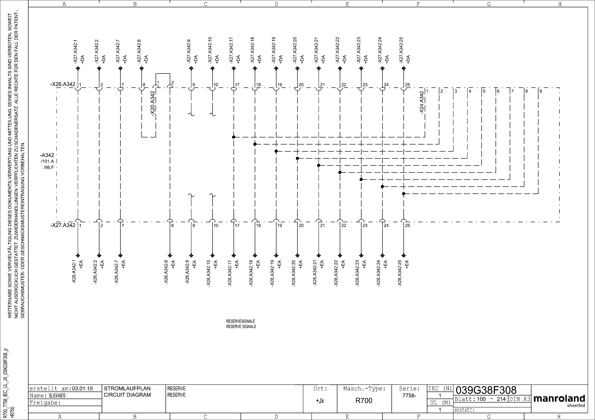

# +Jx — Sheet 100 of 214 — RESERVE

**RESERVE**

> Part of the manroland **R700** printing press IEC/UL circuit diagrams.
> Drawing class: **Stromlaufplan / Circuit diagram** (DIN A3).
> Document `+Jx` covers the **1st printing module + feed register** machine section.

## At a glance

| Field | Value |
|---|---|
| Document | `+Jx`  (039G38F308) |
| Sheet | **100** of 214 |
| Section (DE) | RESERVE |
| Section (EN) | RESERVE |
| Section type | CIRCUIT — Circuit diagram |
| Machine type | `R700` |
| Series | `7758` |
| Created | 03.01.10 |
| Replaces | — |
| Columns used | A, B, C, D, E, F, G, H |
| Path numbers | — |
| Labels on sheet | 110 |
| Cross-refs out | 2 |
| Cross-refs in | 43 |

**Previous:** [+Jx sheet 99](SHEET_0099.md) · **Next:** [+Jx sheet 101](SHEET_0101.md) · **Document TOC:** [_TOC.md](_TOC.md)  (+Jx) · **Master TOC:** [all sheets](../_MASTER_TOC.md)

## Sheet image (300 DPI, exact vector render)



_Rendered directly from the PDF vector layer at 300 DPI (1-bit), no OCR and no resampling. Use it to confirm anything ambiguous in the text below._

## Cross-references on this sheet

Each entry is a wire leaving this sheet. The printed token is `/sheet.column`; the link resolves to that sheet inside the same document.

| Ref | Target sheet | Col | Path | Destination on target | Target section | From col |
|---|---|---|---|---|---|---|
| `/101.A` | [+Jx sheet 101](SHEET_0101.md) | A | — | — | RESERVE | A |
| `/96.F` | [+Jx sheet 96](SHEET_0096.md) | F | — | — | RESERVE | A |

### Incoming references (sheets that point here)

Every other sheet that sends a wire to this one. `Back-ref` is the token printed on *that* sheet; `Path` is its line number.

| From sheet | Cols | Back-ref | Path | Refs | What continues there |
|---|---|---|---|---|---|
| [+Jx#96](SHEET_0096.md) | F | `/96.F` | — | 1 | — |
| [+Jx#101](SHEET_0101.md) | A | `/101.A` | — | 1 | — |
| [+Jx#141](SHEET_0141.md) | F | `/141.F` | — | 2 | — |
| [+Jx#142](SHEET_0142.md) | E | `/142.E` | — | 9 | — |
| [+Jx#143](SHEET_0143.md) | E | `/143.E` | — | 15 | — |
| [+Jx#144](SHEET_0144.md) | B | `/144.B` | — | 15 | — |


## Devices on this sheet

| Tag | Class | Class meaning (IEC) | Col | Sub | Terminal | Sign |
|---|---|---|---|---|---|---|
| `A342` | A | Baugruppe / assembly, module, PC board | A | — | — | — |
| `X27.A342:10` | — | cross-device reference | C | — | 10 | — |
| `X26.A342:10` | — | cross-device reference | C | — | 10 | — |
| `X27.A342:7` | — | cross-device reference | B | — | 7 | — |
| `X26.A342:7` | — | cross-device reference | B | — | 7 | — |
| `X27.A342:2` | — | cross-device reference | A | — | 2 | — |
| `X26.A342:2` | — | cross-device reference | A | — | 2 | — |
| `X27.A342:1` | — | cross-device reference | A | — | 1 | — |
| `X27.A342` | — | cross-device reference | A | — | — | — |
| `X26.A342:1` | — | cross-device reference | A | — | 1 | — |
| `X26.A342` | — | cross-device reference | A | — | — | — |
| `X26.A342:9` | — | cross-device reference | C | — | 9 | — |
| `X26.A342:8` | — | cross-device reference | B | — | 8 | — |
| `X27.A342:8` | — | cross-device reference | B | — | 8 | — |
| `X20.A342` | — | cross-device reference | B | — | — | — |
| `X27.A342:9` | — | cross-device reference | C | — | 9 | — |
| `X27.A342:17` | — | cross-device reference | C | — | 17 | — |
| `X27.A342:18` | — | cross-device reference | D | — | 18 | — |
| `X27.A342:19` | — | cross-device reference | D | — | 19 | — |
| `X27.A342:20` | — | cross-device reference | D | — | 20 | — |
| `X27.A342:21` | — | cross-device reference | E | — | 21 | — |
| `X27.A342:22` | — | cross-device reference | E | — | 22 | — |
| `X27.A342:23` | — | cross-device reference | E | — | 23 | — |
| `X27.A342:24` | — | cross-device reference | E | — | 24 | — |
| `X27.A342:25` | — | cross-device reference | F | — | 25 | — |
| `X26.A342:17` | — | cross-device reference | C | — | 17 | — |
| `X26.A342:18` | — | cross-device reference | D | — | 18 | — |
| `X26.A342:19` | — | cross-device reference | D | — | 19 | — |
| `X26.A342:20` | — | cross-device reference | D | — | 20 | — |
| `X26.A342:21` | — | cross-device reference | E | — | 21 | — |
| `X26.A342:22` | — | cross-device reference | E | — | 22 | — |
| `X26.A342:23` | — | cross-device reference | E | — | 23 | — |
| `X26.A342:24` | — | cross-device reference | E | — | 24 | — |
| `X26.A342:25` | — | cross-device reference | F | — | 25 | — |
| `X24.A342` | — | cross-device reference | F | — | — | — |

## Potentials / nets

_No named potentials on this sheet._

## Wire-end annotations (grouped as printed)

A wire that continues elsewhere is annotated with a small cluster: the destination description, the path/line number `#NN`, and the `/sheet.column` cross reference. Each row below is one such cluster exactly as it is grouped on the drawing.

| Col | Y | Path | Cross-ref | Text on the wire |
|---|---|---|---|---|
| C | 74.3 | — | — | `X27.A342:10` |
| C | 74.3 | — | — | `X27.A342:17` |
| D | 74.3 | — | — | `X27.A342:18` |
| D | 74.3 | — | — | `X27.A342:19` |
| D | 74.3 | — | — | `X27.A342:20` |
| E | 74.3 | — | — | `X27.A342:21` |
| E | 74.3 | — | — | `X27.A342:22` |
| E | 74.3 | — | — | `X27.A342:23` |
| E | 74.3 | — | — | `X27.A342:24` |
| F | 74.3 | — | — | `X27.A342:25` |
| A | 79.1 | — | — | `X27.A342:1` |
| A | 79.1 | — | — | `X27.A342:2` |
| B | 79.1 | — | — | `X27.A342:7` |
| B | 79.1 | — | — | `X27.A342:8` |
| C | 79.1 | — | — | `X27.A342:9` |
| A | 110.5 | — | — | `+DA` |
| B | 110.5 | — | — | `+DA` |
| B | 110.5 | — | — | `+DA` |
| B | 110.5 | — | — | `+DA` |
| C | 110.5 | — | — | `+DA` |
| C | 110.5 | — | — | `+DA` |
| C | 110.5 | — | — | `+DA` |
| D | 110.5 | — | — | `+DA` |
| D | 110.5 | — | — | `+DA` |
| D | 110.5 | — | — | `+DA` |
| E | 110.5 | — | — | `+DA` |
| E | 110.5 | — | — | `+DA` |
| E | 110.5 | — | — | `+DA` |
| F | 110.5 | — | — | `+DA` |
| F | 110.5 | — | — | `+DA` |
| B | 161.8 | — | — | `8 1` |
| C | 161.8 | — | — | `2` |
| A | 163.9 | — | — | `X26.A342 1` |
| B | 166.1 | — | — | `2` |
| B | 166.1 | — | — | `7` |
| C | 166.1 | — | — | `9` |
| C | 166.1 | — | — | `10` |
| E | 166.1 | — | — | `17 18 19 20 21 22 23 24 25 1 2 3 4 5 6 7 8` |
| H | 178.8 | — | — | `9` |
| B | 182.3 | — | — | `X20.A342` |
| F | 182.6 | — | — | `X24.A342` |
| A | 306.4 | — | — | `A342` |
| A | 319.5 | — | `/101.A` | — |
| A | 331.9 | — | `/96.F` | — |
| A | 446.7 | — | — | `X27.A342 1` |
| B | 448.1 | — | — | `2` |
| B | 448.1 | — | — | `7` |
| C | 448.1 | — | — | `8` |
| C | 448.1 | — | — | `9` |
| C | 448.1 | — | — | `10` |
| D | 448.1 | — | — | `17 18 19 20 21 22 23` |
| F | 448.1 | — | — | `24 25` |
| A | 520.2 | — | — | `X26.A342:1` |
| E | 520.2 | — | — | `X26.A342:21` |
| A | 521.3 | — | — | `X26.A342:2` |
| B | 521.3 | — | — | `X26.A342:7` |
| B | 521.3 | — | — | `X26.A342:8` |
| C | 521.3 | — | — | `X26.A342:9` |
| C | 521.3 | — | — | `X26.A342:10` |
| C | 521.3 | — | — | `X26.A342:17` |
| D | 521.3 | — | — | `X26.A342:18` |
| D | 521.3 | — | — | `X26.A342:19` |
| D | 521.3 | — | — | `X26.A342:20` |
| E | 521.3 | — | — | `X26.A342:22` |
| E | 521.3 | — | — | `X26.A342:23` |
| E | 521.3 | — | — | `X26.A342:24` |
| F | 521.3 | — | — | `X26.A342:25` |
| A | 521.6 | — | — | `+EA` |
| B | 521.6 | — | — | `+EA` |
| B | 521.6 | — | — | `+EA` |
| C | 521.6 | — | — | `+EA` |
| C | 521.6 | — | — | `+EA` |
| C | 521.6 | — | — | `+EA` |
| C | 521.6 | — | — | `+EA` |
| D | 521.6 | — | — | `+EA` |
| D | 521.6 | — | — | `+EA` |
| D | 521.6 | — | — | `+EA` |
| E | 521.6 | — | — | `+EA` |
| E | 521.6 | — | — | `+EA` |
| E | 521.6 | — | — | `+EA` |
| F | 521.6 | — | — | `+EA` |
| F | 521.6 | — | — | `+EA` |
| D | 641.2 | — | — | `RESERVESIGNALE RESERVE SIGNALS` |


## Notes and free text on this sheet

| Text | Col | Y (pt) |
|---|---|---|
| `+DA` | C | 110.55 |
| `+EA` | C | 521.58 |
| `+DA` | B | 110.55 |
| `+EA` | B | 521.58 |
| `+DA` | A | 110.55 |
| `+EA` | A | 521.58 |
| `+DA` | D | 110.55 |
| `+DA` | E | 110.55 |
| `+DA` | F | 110.55 |
| `+EA` | D | 521.58 |
| `+EA` | E | 521.58 |
| `+EA` | F | 521.58 |
| `RESERVESIGNALE` | C | 641.2 |
| `RESERVE SIGNALS` | D | 651.82 |

## Complete label inventory (exact text from the drawing)

Every text object inside the drawing area of this sheet, in DIN reading order (column A→H, then top→bottom). This is the authoritative list: if a string is not here it is not printed on this sheet.

| Col | Y | X | Dir | Type | Text |
|---|---|---|---|---|---|
| A | 79.1 | 146.9 | ↕ | device ref | `X27.A342:1` |
| A | 79.1 | 189.4 | ↕ | device ref | `X27.A342:2` |
| A | 110.6 | 161.1 | ↕ | text | `+DA` |
| A | 163.9 | 100.6 | → | device ref | `X26.A342` |
| A | 166.1 | 157.9 | → | number | `1` |
| A | 306.4 | 79.9 | → | device tag | `A342` |
| A | 319.5 | 82.2 | → | cross-reference | `/101.A` |
| A | 331.9 | 87.9 | → | cross-reference | `/96.F` |
| A | 446.7 | 100.6 | → | device ref | `X27.A342` |
| A | 448.1 | 157.9 | → | number | `1` |
| A | 520.2 | 144.1 | ↕ | device ref | `X26.A342:1` |
| A | 521.3 | 186.6 | ↕ | device ref | `X26.A342:2` |
| A | 521.6 | 158.2 | ↕ | text | `+EA` |
| B | 79.1 | 232.0 | ↕ | device ref | `X27.A342:7` |
| B | 79.1 | 274.5 | ↕ | device ref | `X27.A342:8` |
| B | 110.6 | 203.6 | ↕ | text | `+DA` |
| B | 110.6 | 246.1 | ↕ | text | `+DA` |
| B | 110.6 | 288.7 | ↕ | text | `+DA` |
| B | 161.8 | 313.8 | → | number | `1` |
| B | 166.1 | 201.3 | → | number | `2` |
| B | 166.1 | 243.5 | → | number | `7` |
| B | 166.1 | 286.0 | → | number | `8` |
| B | 182.3 | 300.7 | ↕ | device ref | `X20.A342` |
| B | 448.1 | 201.3 | → | number | `2` |
| B | 448.1 | 243.5 | → | number | `7` |
| B | 521.3 | 229.1 | ↕ | device ref | `X26.A342:7` |
| B | 521.3 | 328.3 | ↕ | device ref | `X26.A342:8` |
| B | 521.6 | 200.7 | ↕ | text | `+EA` |
| B | 521.6 | 243.3 | ↕ | text | `+EA` |
| C | 74.3 | 416.2 | ↕ | device ref | `X27.A342:10` |
| C | 74.3 | 458.7 | ↕ | device ref | `X27.A342:17` |
| C | 79.1 | 373.7 | ↕ | device ref | `X27.A342:9` |
| C | 110.6 | 387.9 | ↕ | text | `+DA` |
| C | 110.6 | 430.4 | ↕ | text | `+DA` |
| C | 110.6 | 472.9 | ↕ | text | `+DA` |
| C | 161.8 | 343.0 | → | number | `2` |
| C | 166.1 | 385.2 | → | number | `9` |
| C | 166.1 | 427.2 | → | number | `10` |
| C | 166.1 | 469.7 | → | number | `17` |
| C | 448.1 | 342.7 | → | number | `8` |
| C | 448.1 | 385.2 | → | number | `9` |
| C | 448.1 | 427.2 | → | number | `10` |
| C | 448.1 | 469.7 | → | number | `17` |
| C | 521.3 | 370.9 | ↕ | device ref | `X26.A342:9` |
| C | 521.3 | 413.4 | ↕ | device ref | `X26.A342:10` |
| C | 521.3 | 455.9 | ↕ | device ref | `X26.A342:17` |
| C | 521.6 | 342.5 | ↕ | text | `+EA` |
| C | 521.6 | 385.0 | ↕ | text | `+EA` |
| C | 521.6 | 427.5 | ↕ | text | `+EA` |
| C | 521.6 | 470.0 | ↕ | text | `+EA` |
| C | 641.2 | 453.0 | → | text | `RESERVESIGNALE` |
| D | 74.3 | 501.3 | ↕ | device ref | `X27.A342:18` |
| D | 74.3 | 543.8 | ↕ | device ref | `X27.A342:19` |
| D | 74.3 | 586.3 | ↕ | device ref | `X27.A342:20` |
| D | 110.6 | 515.4 | ↕ | text | `+DA` |
| D | 110.6 | 557.9 | ↕ | text | `+DA` |
| D | 110.6 | 600.5 | ↕ | text | `+DA` |
| D | 166.1 | 512.2 | → | number | `18` |
| D | 166.1 | 554.7 | → | number | `19` |
| D | 166.1 | 598.1 | → | number | `20` |
| D | 448.1 | 512.2 | → | number | `18` |
| D | 448.1 | 554.7 | → | number | `19` |
| D | 448.1 | 598.1 | → | number | `20` |
| D | 521.3 | 498.4 | ↕ | device ref | `X26.A342:18` |
| D | 521.3 | 540.9 | ↕ | device ref | `X26.A342:19` |
| D | 521.3 | 583.5 | ↕ | device ref | `X26.A342:20` |
| D | 521.6 | 512.6 | ↕ | text | `+EA` |
| D | 521.6 | 555.1 | ↕ | text | `+EA` |
| D | 521.6 | 597.6 | ↕ | text | `+EA` |
| D | 651.8 | 453.0 | → | text | `RESERVE SIGNALS` |
| E | 74.3 | 628.8 | ↕ | device ref | `X27.A342:21` |
| E | 74.3 | 671.3 | ↕ | device ref | `X27.A342:22` |
| E | 74.3 | 713.9 | ↕ | device ref | `X27.A342:23` |
| E | 74.3 | 756.4 | ↕ | device ref | `X27.A342:24` |
| E | 110.6 | 643.0 | ↕ | text | `+DA` |
| E | 110.6 | 685.5 | ↕ | text | `+DA` |
| E | 110.6 | 728.0 | ↕ | text | `+DA` |
| E | 166.1 | 640.6 | → | number | `21` |
| E | 166.1 | 683.1 | → | number | `22` |
| E | 166.1 | 725.7 | → | number | `23` |
| E | 448.1 | 640.6 | → | number | `21` |
| E | 448.1 | 683.1 | → | number | `22` |
| E | 448.1 | 725.7 | → | number | `23` |
| E | 520.2 | 626.0 | ↕ | device ref | `X26.A342:21` |
| E | 521.3 | 668.5 | ↕ | device ref | `X26.A342:22` |
| E | 521.3 | 711.0 | ↕ | device ref | `X26.A342:23` |
| E | 521.3 | 753.5 | ↕ | device ref | `X26.A342:24` |
| E | 521.6 | 640.1 | ↕ | text | `+EA` |
| E | 521.6 | 682.6 | ↕ | text | `+EA` |
| E | 521.6 | 725.2 | ↕ | text | `+EA` |
| F | 74.3 | 798.9 | ↕ | device ref | `X27.A342:25` |
| F | 110.6 | 770.5 | ↕ | text | `+DA` |
| F | 110.6 | 813.1 | ↕ | text | `+DA` |
| F | 166.1 | 768.2 | → | number | `24` |
| F | 166.1 | 810.7 | → | number | `25` |
| F | 178.9 | 852.4 | → | number | `1` |
| F | 178.9 | 881.6 | → | number | `2` |
| F | 182.6 | 839.6 | ↕ | device ref | `X24.A342` |
| F | 448.1 | 768.2 | → | number | `24` |
| F | 448.1 | 810.7 | → | number | `25` |
| F | 521.3 | 796.1 | ↕ | device ref | `X26.A342:25` |
| F | 521.6 | 767.7 | ↕ | text | `+EA` |
| F | 521.6 | 810.2 | ↕ | text | `+EA` |
| G | 178.9 | 909.6 | → | number | `3` |
| G | 178.9 | 938.3 | → | number | `4` |
| G | 178.9 | 966.3 | → | number | `5` |
| G | 178.9 | 994.7 | → | number | `6` |
| G | 178.9 | 1023.0 | → | number | `7` |
| H | 178.9 | 1051.4 | → | number | `8` |
| H | 178.9 | 1079.7 | → | number | `9` |

## Reading-order text block

The same content as a plain block, grouped by DIN column — convenient to paste or to match against a visual description.

```text
=== Column A ===
  79.1  146.9  devref       X27.A342:1
  79.1  189.4  devref       X27.A342:2
 110.6  161.1  text         +DA
 163.9  100.6  devref       X26.A342
 166.1  157.9  numeric      1
 306.4   79.9  devtag       A342
 319.5   82.2  xref         /101.A
 331.9   87.9  xref         /96.F
 446.7  100.6  devref       X27.A342
 448.1  157.9  numeric      1
 520.2  144.1  devref       X26.A342:1
 521.3  186.6  devref       X26.A342:2
 521.6  158.2  text         +EA
=== Column B ===
  79.1  232.0  devref       X27.A342:7
  79.1  274.5  devref       X27.A342:8
 110.6  203.6  text         +DA
 110.6  246.1  text         +DA
 110.6  288.7  text         +DA
 161.8  313.8  numeric      1
 166.1  201.3  numeric      2
 166.1  243.5  numeric      7
 166.1  286.0  numeric      8
 182.3  300.7  devref       X20.A342
 448.1  201.3  numeric      2
 448.1  243.5  numeric      7
 521.3  229.1  devref       X26.A342:7
 521.3  328.3  devref       X26.A342:8
 521.6  200.7  text         +EA
 521.6  243.3  text         +EA
=== Column C ===
  74.3  416.2  devref       X27.A342:10
  74.3  458.7  devref       X27.A342:17
  79.1  373.7  devref       X27.A342:9
 110.6  387.9  text         +DA
 110.6  430.4  text         +DA
 110.6  472.9  text         +DA
 161.8  343.0  numeric      2
 166.1  385.2  numeric      9
 166.1  427.2  numeric      10
 166.1  469.7  numeric      17
 448.1  342.7  numeric      8
 448.1  385.2  numeric      9
 448.1  427.2  numeric      10
 448.1  469.7  numeric      17
 521.3  370.9  devref       X26.A342:9
 521.3  413.4  devref       X26.A342:10
 521.3  455.9  devref       X26.A342:17
 521.6  342.5  text         +EA
 521.6  385.0  text         +EA
 521.6  427.5  text         +EA
 521.6  470.0  text         +EA
 641.2  453.0  text         RESERVESIGNALE
=== Column D ===
  74.3  501.3  devref       X27.A342:18
  74.3  543.8  devref       X27.A342:19
  74.3  586.3  devref       X27.A342:20
 110.6  515.4  text         +DA
 110.6  557.9  text         +DA
 110.6  600.5  text         +DA
 166.1  512.2  numeric      18
 166.1  554.7  numeric      19
 166.1  598.1  numeric      20
 448.1  512.2  numeric      18
 448.1  554.7  numeric      19
 448.1  598.1  numeric      20
 521.3  498.4  devref       X26.A342:18
 521.3  540.9  devref       X26.A342:19
 521.3  583.5  devref       X26.A342:20
 521.6  512.6  text         +EA
 521.6  555.1  text         +EA
 521.6  597.6  text         +EA
 651.8  453.0  text         RESERVE SIGNALS
=== Column E ===
  74.3  628.8  devref       X27.A342:21
  74.3  671.3  devref       X27.A342:22
  74.3  713.9  devref       X27.A342:23
  74.3  756.4  devref       X27.A342:24
 110.6  643.0  text         +DA
 110.6  685.5  text         +DA
 110.6  728.0  text         +DA
 166.1  640.6  numeric      21
 166.1  683.1  numeric      22
 166.1  725.7  numeric      23
 448.1  640.6  numeric      21
 448.1  683.1  numeric      22
 448.1  725.7  numeric      23
 520.2  626.0  devref       X26.A342:21
 521.3  668.5  devref       X26.A342:22
 521.3  711.0  devref       X26.A342:23
 521.3  753.5  devref       X26.A342:24
 521.6  640.1  text         +EA
 521.6  682.6  text         +EA
 521.6  725.2  text         +EA
=== Column F ===
  74.3  798.9  devref       X27.A342:25
 110.6  770.5  text         +DA
 110.6  813.1  text         +DA
 166.1  768.2  numeric      24
 166.1  810.7  numeric      25
 178.9  852.4  numeric      1
 178.9  881.6  numeric      2
 182.6  839.6  devref       X24.A342
 448.1  768.2  numeric      24
 448.1  810.7  numeric      25
 521.3  796.1  devref       X26.A342:25
 521.6  767.7  text         +EA
 521.6  810.2  text         +EA
=== Column G ===
 178.9  909.6  numeric      3
 178.9  938.3  numeric      4
 178.9  966.3  numeric      5
 178.9  994.7  numeric      6
 178.9 1023.0  numeric      7
=== Column H ===
 178.9 1051.4  numeric      8
 178.9 1079.7  numeric      9
```

---
_Generated from the PDF vector text layer; no OCR. Source: `R700_7758_IEC_UL_JX_039G38F308_p`, sheet 100._
