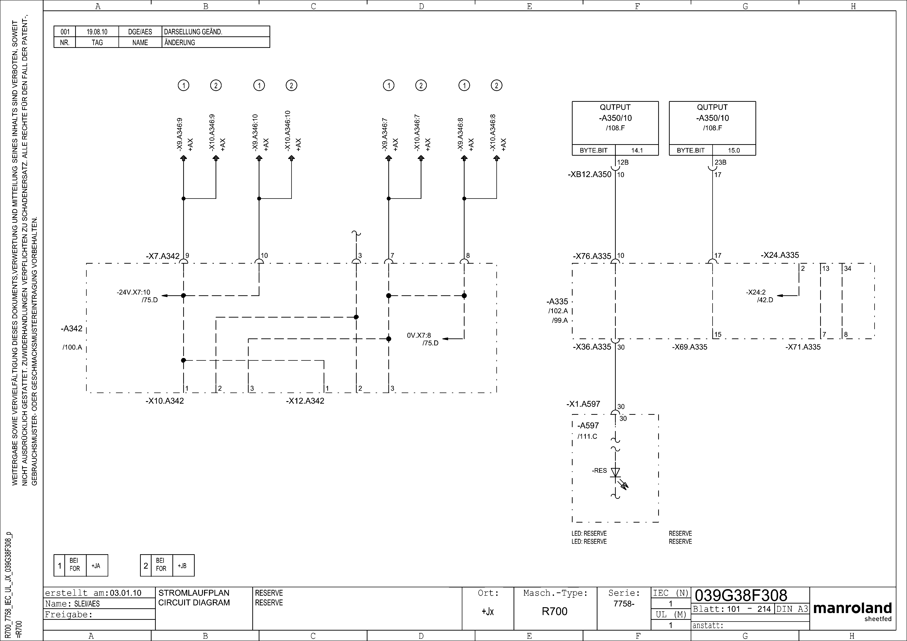

# +Jx — Sheet 101 of 214 — RESERVE

**RESERVE**

> Part of the manroland **R700** printing press IEC/UL circuit diagrams.
> Drawing class: **Stromlaufplan / Circuit diagram** (DIN A3).
> Document `+Jx` covers the **1st printing module + feed register** machine section.

## At a glance

| Field | Value |
|---|---|
| Document | `+Jx`  (039G38F308) |
| Sheet | **101** of 214 |
| Section (DE) | RESERVE |
| Section (EN) | RESERVE |
| Section type | CIRCUIT — Circuit diagram |
| Machine type | `R700` |
| Series | `7758` |
| Created | 03.01.10 |
| Replaces | — |
| Columns used | A, B, C, D, E, F, G, H |
| Path numbers | — |
| Labels on sheet | 104 |
| Cross-refs out | 9 |
| Cross-refs in | 32 |

**Previous:** [+Jx sheet 100](SHEET_0100.md) · **Next:** [+Jx sheet 102](SHEET_0102.md) · **Document TOC:** [_TOC.md](_TOC.md)  (+Jx) · **Master TOC:** [all sheets](../_MASTER_TOC.md)

## Sheet image (300 DPI, exact vector render)



_Rendered directly from the PDF vector layer at 300 DPI (1-bit), no OCR and no resampling. Use it to confirm anything ambiguous in the text below._

## Cross-references on this sheet

Each entry is a wire leaving this sheet. The printed token is `/sheet.column`; the link resolves to that sheet inside the same document.

| Ref | Target sheet | Col | Path | Destination on target | Target section | From col |
|---|---|---|---|---|---|---|
| `/108.F` | [+Jx sheet 108](SHEET_0108.md) | F | — | — | REFERENZMODUL | F |
| `/108.F` | [+Jx sheet 108](SHEET_0108.md) | F | — | — | REFERENZMODUL | G |
| `/75.D` | [+Jx sheet 75](SHEET_0075.md) | D | — | 24V.X7:10 | FEHLBOGENKONTROLLE | A |
| `/42.D` | [+Jx sheet 42](SHEET_0042.md) | D | — | X24:2 | LAUFKOMMANDOS | G |
| `/102.A` | [+Jx sheet 102](SHEET_0102.md) | A | — | — | RESERVE | E |
| `/99.A` | [+Jx sheet 99](SHEET_0099.md) | A | — | — | RESERVE | E |
| `/75.D` | [+Jx sheet 75](SHEET_0075.md) | D | — | 0V.X7:8 | FEHLBOGENKONTROLLE | D |
| `/100.A` | [+Jx sheet 100](SHEET_0100.md) | A | — | — | RESERVE | A |
| `/111.C` | [+Jx sheet 111](SHEET_0111.md) | C | — | — | REFERENZMODUL | F |

### Incoming references (sheets that point here)

Every other sheet that sends a wire to this one. `Back-ref` is the token printed on *that* sheet; `Path` is its line number.

| From sheet | Cols | Back-ref | Path | Refs | What continues there |
|---|---|---|---|---|---|
| [+Jx#42](SHEET_0042.md) | D | `/42.D` | — | 1 | — |
| [+Jx#75](SHEET_0075.md) | D | `/75.D` | — | 2 | — |
| [+Jx#99](SHEET_0099.md) | A | `/99.A` | — | 1 | — |
| [+Jx#100](SHEET_0100.md) | A | `/100.A` | — | 1 | — |
| [+Jx#102](SHEET_0102.md) | A | `/102.A` | — | 1 | — |
| [+Jx#108](SHEET_0108.md) | F | `/108.F` | — | 2 | — |
| [+Jx#111](SHEET_0111.md) | C | `/111.C` | — | 1 | — |
| [+Jx#115](SHEET_0115.md) | F | `/115.F` | — | 1 | — |
| [+Jx#133](SHEET_0133.md) | C | `/133.C` | — | 5 | — |
| [+Jx#135](SHEET_0135.md) | C | `/135.C` | — | 3 | — |
| [+Jx#137](SHEET_0137.md) | G, H | `/137.G`, `/137.H` | — | 5 | — |
| [+Jx#142](SHEET_0142.md) | F, G | `/142.F`, `/142.G` | — | 3 | — |
| [+Jx#149](SHEET_0149.md) | G | `/149.G` | — | 1 | — |
| [+Jx#152](SHEET_0152.md) | G | `/152.G` | — | 1 | — |
| [+Jx#153](SHEET_0153.md) | B | `/153.B` | — | 2 | — |
| [+Jx#155](SHEET_0155.md) | B | `/155.B` | — | 2 | — |


## Devices on this sheet

| Tag | Class | Class meaning (IEC) | Col | Sub | Terminal | Sign |
|---|---|---|---|---|---|---|
| `A342` | A | Baugruppe / assembly, module, PC board | A | — | — | — |
| `A350/10` | A | Baugruppe / assembly, module, PC board | F | 10 | — | — |
| `A350/10` | A | Baugruppe / assembly, module, PC board | G | 10 | — | — |
| `A597` | A | Baugruppe / assembly, module, PC board | F | — | — | — |
| `A335` | A | Baugruppe / assembly, module, PC board | E | — | — | — |
| `X24:2` | X | Klemme / terminal, plug connector | G | — | 2 | — |
| `X9.A346:9` | — | cross-device reference | B | — | 9 | — |
| `X7.A342` | — | cross-device reference | B | — | — | — |
| `X10.A346:9` | — | cross-device reference | B | — | 9 | — |
| `X9.A346:10` | — | cross-device reference | B | — | 10 | — |
| `X10.A346:10` | — | cross-device reference | C | — | 10 | — |
| `X9.A346:7` | — | cross-device reference | D | — | 7 | — |
| `X10.A346:7` | — | cross-device reference | D | — | 7 | — |
| `X9.A346:8` | — | cross-device reference | D | — | 8 | — |
| `X10.A346:8` | — | cross-device reference | E | — | 8 | — |
| `14.1` | — | cross-device reference | F | — | — | — |
| `XB12.A350` | — | cross-device reference | F | — | — | — |
| `15.0` | — | cross-device reference | G | — | — | — |
| `X76.A335` | — | cross-device reference | F | — | — | — |
| `X36.A335` | — | cross-device reference | F | — | — | — |
| `X1.A597` | — | cross-device reference | F | — | — | — |
| `NR.` | — | cross-device reference | A | — | — | — |
| `19.08.10` | — | cross-device reference | A | — | — | — |
| `X10.A342` | — | cross-device reference | B | — | — | — |
| `X12.A342` | — | cross-device reference | C | — | — | — |
| `X24.A335` | — | cross-device reference | G | — | — | — |
| `X71.A335` | — | cross-device reference | H | — | — | — |
| `X69.A335` | — | cross-device reference | F | — | — | — |

## Potentials / nets

| Potential | Count | Columns | Attached devices | Terminals |
|---|---|---|---|---|
| `0V` | 1 | D | `X7` | `8` |
| `24V` | 1 | A | `X7` | `10` |


A potential such as `L24+/4` or `M24+` is a named supply/return rail; every place it appears on this sheet is electrically common.

## Wire-end annotations (grouped as printed)

A wire that continues elsewhere is annotated with a small cluster: the destination description, the path/line number `#NN`, and the `/sheet.column` cross reference. Each row below is one such cluster exactly as it is grouped on the drawing.

| Col | Y | Path | Cross-ref | Text on the wire |
|---|---|---|---|---|
| A | 38.5 | — | — | `001 19.08.10 DGE/AES DARSELLUNG GEÄND.` |
| A | 52.6 | — | — | `NR. TAG NAME ÄNDERUNG` |
| B | 108.9 | — | — | `1 2 1 2` |
| D | 108.9 | — | — | `1 2 1 2` |
| F | 136.6 | — | — | `QUTPUT` |
| G | 136.6 | — | — | `QUTPUT` |
| C | 145.1 | — | — | `X10.A346:10` |
| B | 149.9 | — | — | `X10.A346:9` |
| B | 149.9 | — | — | `X9.A346:10` |
| D | 149.9 | — | — | `X10.A346:7` |
| E | 149.9 | — | — | `X10.A346:8` |
| F | 150.5 | — | — | `A350/10` |
| G | 150.5 | — | — | `A350/10` |
| B | 154.8 | — | — | `X9.A346:9` |
| D | 154.8 | — | — | `X9.A346:7` |
| D | 154.8 | — | — | `X9.A346:8` |
| F | 164.3 | — | `/108.F` | — |
| G | 164.3 | — | `/108.F` | — |
| B | 181.7 | — | — | `+AX` |
| B | 181.7 | — | — | `+AX` |
| C | 181.7 | — | — | `+AX` |
| C | 181.7 | — | — | `+AX` |
| D | 181.7 | — | — | `+AX` |
| D | 181.7 | — | — | `+AX` |
| D | 181.7 | — | — | `+AX` |
| E | 181.7 | — | — | `+AX` |
| F | 193.9 | — | — | `BYTE.BIT 14.1` |
| G | 193.9 | — | — | `BYTE.BIT 15.0` |
| F | 209.3 | — | — | `12B` |
| G | 209.3 | — | — | `23B` |
| F | 224.2 | — | — | `XB12.A350 10 17` |
| G | 330.5 | — | — | `X24.A335` |
| B | 331.9 | — | — | `X7.A342 9` |
| C | 331.9 | — | — | `10` |
| C | 331.9 | — | — | `3` |
| D | 331.9 | — | — | `7` |
| D | 331.9 | — | — | `8` |
| F | 331.9 | — | — | `X76.A335 10 17` |
| H | 348.9 | — | — | `2 13 34` |
| A | 380.1 | — | `/75.D` | `24V.X7:10` |
| G | 380.1 | — | `/42.D` | `X24:2` |
| E | 391.4 | — | — | `A335` |
| E | 404.5 | — | `/102.A` | — |
| E | 416.9 | — | `/99.A` | — |
| A | 426.9 | — | — | `A342` |
| G | 435.4 | — | — | `15` |
| H | 435.4 | — | — | `7 8` |
| D | 436.7 | — | `/75.D` | `0V.X7:8` |
| F | 450.9 | — | — | `X36.A335 30` |
| G | 451.6 | — | — | `X69.A335 X71.A335` |
| A | 452.3 | — | `/100.A` | — |
| B | 506.2 | — | — | `1` |
| B | 506.2 | — | — | `2 3` |
| C | 506.2 | — | — | `1 2` |
| D | 506.2 | — | — | `3` |
| B | 521.8 | — | — | `X10.A342` |
| C | 521.8 | — | — | `X12.A342` |
| F | 526.1 | — | — | `X1.A597 30` |
| F | 545.9 | — | — | `30` |
| F | 554.4 | — | — | `A597` |
| F | 569.3 | — | `/111.C` | — |
| F | 614.4 | — | — | `RES` |
| F | 697.9 | — | — | `LED: RESERVE LED: RESERVE` |
| F | 697.9 | — | — | `RESERVE RESERVE` |
| A | 733.2 | — | — | `1 BEI FOR +JA 2 BEI FOR +JB` |


## Reconstructed tables

This sheet carries tabular content (pin map / terminal assignment / index). The grid below was rebuilt from the drawing's own rule lines, so each row is exactly one physical row of the table.

### Table 1 — 8 data rows × 13 columns (at x=240.9, y=133.2)

| X10.A346:9 |  | X9.A346:10 | X10.A346:10 |  |  | X9.A346:7 | X10.A346:7 | X9.A346:8 | X10.A346:8 |  | QUTPUT | A350/10 /108.F |
|---|---|---|---|---|---|---|---|---|---|---|---|---|
| `+AX` | `+AX` |  | `+AX` | `+AX` |  |  | `+AX` | `+AX` | `+AX` | `+AX` | `BYTE.BIT` | `14.1` |
|  |  |  |  |  |  |  |  |  |  |  | `XB12.A350` | `12B 10` |
| `9` |  |  | `10` |  |  | `3` | `7` |  | `8` |  | `X76.A335` | `10` |
|  |  |  |  |  |  |  |  |  |  | `A335 /102.A` |  |  |
|  |  |  |  |  |  |  | `0V.X7:8` |  |  | `/99.A` |  |  |
|  |  |  |  |  |  |  |  | `/75.D` |  |  | `X36.A335` | `30` |
| `1` | `2` | `3` |  | `X12.A342` | `1` | `2` | `3` |  |  |  | `X1.A597` | `30` |
|  |  |  |  |  |  |  |  |  |  |  | `A597 /111.C RES` | `30` |


### Table 2 — 6 data rows × 5 columns (at x=878.7, y=133.2)

| QUTPUT | A350/10 /108.F |  |  |  |
|---|---|---|---|---|
| `BYTE.BIT` | `15.0` |  |  |  |
|  | `23B 17` |  |  |  |
|  | `17` | `X24.A335 X24:2` | `2` | `13` |
|  |  | `/42.D` |  |  |
|  | `15` |  |  | `7` |
| `X69.A335` |  |  | `X71.A335` |  |


## Notes and free text on this sheet

| Text | Col | Y (pt) |
|---|---|---|
| `+AX` | B | 181.7 |
| `+AX` | C | 181.7 |
| `+AX` | D | 181.7 |
| `+AX` | E | 181.7 |
| `12B` | F | 209.29 |
| `QUTPUT` | F | 136.61 |
| `BYTE.BIT` | F | 193.9 |
| `23B` | G | 209.29 |
| `QUTPUT` | G | 136.61 |
| `RESERVE` | F | 697.88 |
| `RES` | F | 614.39 |
| `LED: RESERVE` | F | 697.88 |
| `TAG` | A | 52.75 |
| `NAME` | A | 52.73 |
| `ÄNDERUNG` | B | 52.76 |
| `DGE/AES` | A | 38.57 |
| `DARSELLUNG GEÄND.` | B | 38.58 |
| `BEI` | B | 733.17 |
| `FOR` | B | 743.96 |
| `BEI` | A | 733.17 |
| `FOR` | A | 743.96 |
| `+JA` | A | 740.38 |
| `+JB` | B | 740.35 |

## Complete label inventory (exact text from the drawing)

Every text object inside the drawing area of this sheet, in DIN reading order (column A→H, then top→bottom). This is the authoritative list: if a string is not here it is not printed on this sheet.

| Col | Y | X | Dir | Type | Text |
|---|---|---|---|---|---|
| A | 38.5 | 79.7 | → | number | `001` |
| A | 38.6 | 113.6 | → | device ref | `19.08.10` |
| A | 38.6 | 168.5 | → | text | `DGE/AES` |
| A | 52.6 | 78.9 | → | device ref | `NR.` |
| A | 52.7 | 120.6 | → | text | `TAG` |
| A | 52.7 | 173.9 | → | text | `NAME` |
| A | 380.1 | 153.4 | → | potential | `24V.X7:10` |
| A | 390.0 | 186.2 | → | cross-reference | `/75.D` |
| A | 426.8 | 79.9 | → | device tag | `A342` |
| A | 452.3 | 82.2 | → | cross-reference | `/100.A` |
| A | 733.2 | 91.6 | → | text | `BEI` |
| A | 738.6 | 75.4 | → | number | `1` |
| A | 738.6 | 188.5 | → | number | `2` |
| A | 740.4 | 120.2 | → | text | `+JA` |
| A | 744.0 | 91.6 | → | text | `FOR` |
| B | 38.6 | 215.6 | → | text | `DARSELLUNG GEÄND.` |
| B | 52.8 | 216.1 | → | text | `ÄNDERUNG` |
| B | 108.9 | 239.1 | → | number | `1` |
| B | 109.4 | 281.5 | → | number | `2` |
| B | 150.0 | 274.5 | ↕ | device ref | `X10.A346:9` |
| B | 150.0 | 331.2 | ↕ | device ref | `X9.A346:10` |
| B | 154.8 | 232.0 | ↕ | device ref | `X9.A346:9` |
| B | 181.7 | 246.1 | ↕ | text | `+AX` |
| B | 181.7 | 288.6 | ↕ | text | `+AX` |
| B | 331.9 | 191.6 | → | device ref | `X7.A342` |
| B | 331.9 | 243.5 | → | number | `9` |
| B | 506.3 | 242.9 | → | number | `1` |
| B | 506.3 | 286.3 | → | number | `2` |
| B | 506.3 | 328.5 | → | number | `3` |
| B | 521.8 | 191.3 | → | device ref | `X10.A342` |
| B | 733.2 | 204.9 | → | text | `BEI` |
| B | 740.4 | 233.6 | → | text | `+JB` |
| B | 744.0 | 204.9 | → | text | `FOR` |
| C | 108.9 | 338.3 | → | number | `1` |
| C | 109.4 | 380.7 | → | number | `2` |
| C | 145.1 | 373.7 | ↕ | device ref | `X10.A346:10` |
| C | 181.7 | 345.3 | ↕ | text | `+AX` |
| C | 181.7 | 387.8 | ↕ | text | `+AX` |
| C | 331.9 | 342.1 | → | number | `10` |
| C | 331.9 | 470.3 | → | number | `3` |
| C | 506.3 | 427.2 | → | number | `1` |
| C | 506.3 | 470.6 | → | number | `2` |
| C | 521.8 | 375.6 | → | device ref | `X12.A342` |
| D | 108.9 | 508.4 | → | number | `1` |
| D | 108.9 | 607.6 | → | number | `1` |
| D | 109.4 | 550.8 | → | number | `2` |
| D | 150.0 | 543.8 | ↕ | device ref | `X10.A346:7` |
| D | 154.8 | 501.2 | ↕ | device ref | `X9.A346:7` |
| D | 154.8 | 600.5 | ↕ | device ref | `X9.A346:8` |
| D | 181.7 | 515.4 | ↕ | text | `+AX` |
| D | 181.7 | 557.9 | ↕ | text | `+AX` |
| D | 181.7 | 614.6 | ↕ | text | `+AX` |
| D | 331.9 | 512.8 | → | number | `7` |
| D | 331.9 | 612.0 | → | number | `8` |
| D | 436.7 | 534.3 | → | potential | `0V.X7:8` |
| D | 446.7 | 554.7 | → | cross-reference | `/75.D` |
| D | 506.3 | 512.8 | → | number | `3` |
| E | 109.4 | 650.0 | → | number | `2` |
| E | 150.0 | 643.0 | ↕ | device ref | `X10.A346:8` |
| E | 181.7 | 657.1 | ↕ | text | `+AX` |
| E | 391.4 | 717.4 | → | device tag | `A335` |
| E | 404.5 | 720.0 | → | cross-reference | `/102.A` |
| E | 416.9 | 724.8 | → | cross-reference | `/99.A` |
| F | 136.6 | 787.6 | → | text | `QUTPUT` |
| F | 150.5 | 786.5 | → | device tag | `A350/10` |
| F | 164.3 | 795.5 | → | cross-reference | `/108.F` |
| F | 193.9 | 761.1 | → | text | `BYTE.BIT` |
| F | 193.9 | 828.6 | → | device ref | `14.1` |
| F | 193.9 | 888.7 | → | text | `BYTE.BIT` |
| F | 209.3 | 809.9 | → | text | `12B` |
| F | 224.2 | 745.5 | → | device ref | `XB12.A350` |
| F | 225.6 | 809.9 | → | number | `10` |
| F | 331.9 | 752.3 | → | device ref | `X76.A335` |
| F | 331.9 | 809.9 | → | number | `10` |
| F | 450.9 | 752.3 | → | device ref | `X36.A335` |
| F | 451.5 | 882.4 | → | device ref | `X69.A335` |
| F | 452.4 | 810.4 | → | number | `30` |
| F | 526.1 | 743.8 | → | device ref | `X1.A597` |
| F | 530.3 | 810.4 | → | number | `30` |
| F | 545.9 | 813.3 | → | number | `30` |
| F | 554.4 | 758.0 | → | device tag | `A597` |
| F | 569.3 | 758.3 | → | cross-reference | `/111.C` |
| F | 614.4 | 777.3 | → | text | `RES` |
| F | 697.9 | 750.6 | → | text | `LED: RESERVE` |
| F | 697.9 | 878.2 | → | text | `RESERVE` |
| F | 708.5 | 750.6 | → | text | `LED: RESERVE` |
| F | 708.5 | 878.2 | → | text | `RESERVE` |
| G | 136.6 | 915.2 | → | text | `QUTPUT` |
| G | 150.5 | 914.0 | → | device tag | `A350/10` |
| G | 164.3 | 923.1 | → | cross-reference | `/108.F` |
| G | 193.9 | 955.6 | → | device ref | `15.0` |
| G | 209.3 | 938.3 | → | text | `23B` |
| G | 225.6 | 937.4 | → | number | `17` |
| G | 330.5 | 998.9 | → | device ref | `X24.A335` |
| G | 331.9 | 937.4 | → | number | `17` |
| G | 380.1 | 979.4 | → | device tag | `X24:2` |
| G | 390.0 | 994.1 | → | cross-reference | `/42.D` |
| G | 435.4 | 937.4 | → | number | `15` |
| H | 348.9 | 1051.7 | → | number | `2` |
| H | 348.9 | 1079.1 | → | number | `13` |
| H | 348.9 | 1108.1 | → | number | `34` |
| H | 435.4 | 1079.7 | → | number | `7` |
| H | 435.4 | 1108.1 | → | number | `8` |
| H | 451.5 | 1031.2 | → | device ref | `X71.A335` |

## Reading-order text block

The same content as a plain block, grouped by DIN column — convenient to paste or to match against a visual description.

```text
=== Column A ===
  38.5   79.7  numeric      001
  38.6  113.6  devref       19.08.10
  38.6  168.5  text         DGE/AES
  52.6   78.9  devref       NR.
  52.7  120.6  text         TAG
  52.7  173.9  text         NAME
 380.1  153.4  net          24V.X7:10
 390.0  186.2  xref         /75.D
 426.8   79.9  devtag       A342
 452.3   82.2  xref         /100.A
 733.2   91.6  text         BEI
 738.6   75.4  numeric      1
 738.6  188.5  numeric      2
 740.4  120.2  text         +JA
 744.0   91.6  text         FOR
=== Column B ===
  38.6  215.6  text         DARSELLUNG GEÄND.
  52.8  216.1  text         ÄNDERUNG
 108.9  239.1  numeric      1
 109.4  281.5  numeric      2
 150.0  274.5  devref       X10.A346:9
 150.0  331.2  devref       X9.A346:10
 154.8  232.0  devref       X9.A346:9
 181.7  246.1  text         +AX
 181.7  288.6  text         +AX
 331.9  191.6  devref       X7.A342
 331.9  243.5  numeric      9
 506.3  242.9  numeric      1
 506.3  286.3  numeric      2
 506.3  328.5  numeric      3
 521.8  191.3  devref       X10.A342
 733.2  204.9  text         BEI
 740.4  233.6  text         +JB
 744.0  204.9  text         FOR
=== Column C ===
 108.9  338.3  numeric      1
 109.4  380.7  numeric      2
 145.1  373.7  devref       X10.A346:10
 181.7  345.3  text         +AX
 181.7  387.8  text         +AX
 331.9  342.1  numeric      10
 331.9  470.3  numeric      3
 506.3  427.2  numeric      1
 506.3  470.6  numeric      2
 521.8  375.6  devref       X12.A342
=== Column D ===
 108.9  508.4  numeric      1
 108.9  607.6  numeric      1
 109.4  550.8  numeric      2
 150.0  543.8  devref       X10.A346:7
 154.8  501.2  devref       X9.A346:7
 154.8  600.5  devref       X9.A346:8
 181.7  515.4  text         +AX
 181.7  557.9  text         +AX
 181.7  614.6  text         +AX
 331.9  512.8  numeric      7
 331.9  612.0  numeric      8
 436.7  534.3  net          0V.X7:8
 446.7  554.7  xref         /75.D
 506.3  512.8  numeric      3
=== Column E ===
 109.4  650.0  numeric      2
 150.0  643.0  devref       X10.A346:8
 181.7  657.1  text         +AX
 391.4  717.4  devtag       A335
 404.5  720.0  xref         /102.A
 416.9  724.8  xref         /99.A
=== Column F ===
 136.6  787.6  text         QUTPUT
 150.5  786.5  devtag       A350/10
 164.3  795.5  xref         /108.F
 193.9  761.1  text         BYTE.BIT
 193.9  828.6  devref       14.1
 193.9  888.7  text         BYTE.BIT
 209.3  809.9  text         12B
 224.2  745.5  devref       XB12.A350
 225.6  809.9  numeric      10
 331.9  752.3  devref       X76.A335
 331.9  809.9  numeric      10
 450.9  752.3  devref       X36.A335
 451.5  882.4  devref       X69.A335
 452.4  810.4  numeric      30
 526.1  743.8  devref       X1.A597
 530.3  810.4  numeric      30
 545.9  813.3  numeric      30
 554.4  758.0  devtag       A597
 569.3  758.3  xref         /111.C
 614.4  777.3  text         RES
 697.9  750.6  text         LED: RESERVE
 697.9  878.2  text         RESERVE
 708.5  750.6  text         LED: RESERVE
 708.5  878.2  text         RESERVE
=== Column G ===
 136.6  915.2  text         QUTPUT
 150.5  914.0  devtag       A350/10
 164.3  923.1  xref         /108.F
 193.9  955.6  devref       15.0
 209.3  938.3  text         23B
 225.6  937.4  numeric      17
 330.5  998.9  devref       X24.A335
 331.9  937.4  numeric      17
 380.1  979.4  devtag       X24:2
 390.0  994.1  xref         /42.D
 435.4  937.4  numeric      15
=== Column H ===
 348.9 1051.7  numeric      2
 348.9 1079.1  numeric      13
 348.9 1108.1  numeric      34
 435.4 1079.7  numeric      7
 435.4 1108.1  numeric      8
 451.5 1031.2  devref       X71.A335
```

---
_Generated from the PDF vector text layer; no OCR. Source: `R700_7758_IEC_UL_JX_039G38F308_p`, sheet 101._
