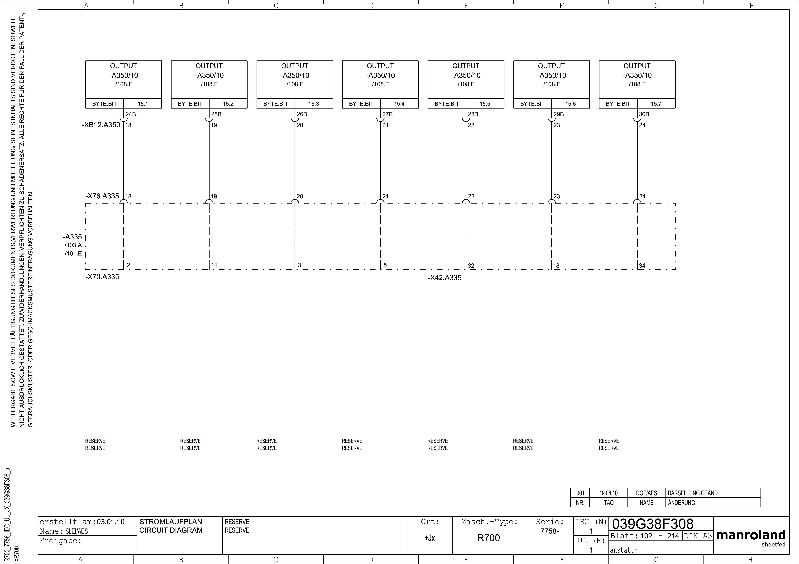

# +Jx — Sheet 102 of 214 — RESERVE

**RESERVE**

> Part of the manroland **R700** printing press IEC/UL circuit diagrams.
> Drawing class: **Stromlaufplan / Circuit diagram** (DIN A3).
> Document `+Jx` covers the **1st printing module + feed register** machine section.

## At a glance

| Field | Value |
|---|---|
| Document | `+Jx`  (039G38F308) |
| Sheet | **102** of 214 |
| Section (DE) | RESERVE |
| Section (EN) | RESERVE |
| Section type | CIRCUIT — Circuit diagram |
| Machine type | `R700` |
| Series | `7758` |
| Created | 03.01.10 |
| Replaces | — |
| Columns used | A, B, C, D, E, F, G |
| Path numbers | — |
| Labels on sheet | 92 |
| Cross-refs out | 9 |
| Cross-refs in | 30 |

**Previous:** [+Jx sheet 101](SHEET_0101.md) · **Next:** [+Jx sheet 103](SHEET_0103.md) · **Document TOC:** [_TOC.md](_TOC.md)  (+Jx) · **Master TOC:** [all sheets](../_MASTER_TOC.md)

## Sheet image (300 DPI, exact vector render)



_Rendered directly from the PDF vector layer at 300 DPI (1-bit), no OCR and no resampling. Use it to confirm anything ambiguous in the text below._

## Cross-references on this sheet

Each entry is a wire leaving this sheet. The printed token is `/sheet.column`; the link resolves to that sheet inside the same document.

| Ref | Target sheet | Col | Path | Destination on target | Target section | From col |
|---|---|---|---|---|---|---|
| `/108.F` | [+Jx sheet 108](SHEET_0108.md) | F | — | — | REFERENZMODUL | A |
| `/108.F` | [+Jx sheet 108](SHEET_0108.md) | F | — | — | REFERENZMODUL | B |
| `/108.F` | [+Jx sheet 108](SHEET_0108.md) | F | — | — | REFERENZMODUL | C |
| `/108.F` | [+Jx sheet 108](SHEET_0108.md) | F | — | — | REFERENZMODUL | D |
| `/108.F` | [+Jx sheet 108](SHEET_0108.md) | F | — | — | REFERENZMODUL | E |
| `/108.F` | [+Jx sheet 108](SHEET_0108.md) | F | — | — | REFERENZMODUL | F |
| `/108.F` | [+Jx sheet 108](SHEET_0108.md) | F | — | — | REFERENZMODUL | G |
| `/103.A` | [+Jx sheet 103](SHEET_0103.md) | A | — | — | RESERVE | A |
| `/101.E` | [+Jx sheet 101](SHEET_0101.md) | E | — | — | RESERVE | A |

### Incoming references (sheets that point here)

Every other sheet that sends a wire to this one. `Back-ref` is the token printed on *that* sheet; `Path` is its line number.

| From sheet | Cols | Back-ref | Path | Refs | What continues there |
|---|---|---|---|---|---|
| [+Jx#101](SHEET_0101.md) | E | `/101.E` | — | 1 | — |
| [+Jx#103](SHEET_0103.md) | A | `/103.A` | — | 1 | — |
| [+Jx#108](SHEET_0108.md) | F | `/108.F` | — | 7 | — |
| [+Jx#137](SHEET_0137.md) | H | `/137.H` | — | 7 | — |
| [+Jx#150](SHEET_0150.md) | C, D | `/150.C`, `/150.D` | — | 3 | — |
| [+Jx#153](SHEET_0153.md) | A | `/153.A` | — | 4 | — |
| [+Jx#155](SHEET_0155.md) | B | `/155.B` | — | 7 | — |


## Devices on this sheet

| Tag | Class | Class meaning (IEC) | Col | Sub | Terminal | Sign |
|---|---|---|---|---|---|---|
| `A350/10` | A | Baugruppe / assembly, module, PC board | C | 10 | — | — |
| `A350/10` | A | Baugruppe / assembly, module, PC board | D | 10 | — | — |
| `A350/10` | A | Baugruppe / assembly, module, PC board | E | 10 | — | — |
| `A350/10` | A | Baugruppe / assembly, module, PC board | F | 10 | — | — |
| `A350/10` | A | Baugruppe / assembly, module, PC board | G | 10 | — | — |
| `A350/10` | A | Baugruppe / assembly, module, PC board | B | 10 | — | — |
| `A350/10` | A | Baugruppe / assembly, module, PC board | A | 10 | — | — |
| `A335` | A | Baugruppe / assembly, module, PC board | A | — | — | — |
| `15.3` | — | cross-device reference | C | — | — | — |
| `15.4` | — | cross-device reference | D | — | — | — |
| `15.5` | — | cross-device reference | E | — | — | — |
| `15.6` | — | cross-device reference | F | — | — | — |
| `15.7` | — | cross-device reference | G | — | — | — |
| `15.2` | — | cross-device reference | B | — | — | — |
| `XB12.A350` | — | cross-device reference | A | — | — | — |
| `15.1` | — | cross-device reference | B | — | — | — |
| `X76.A335` | — | cross-device reference | A | — | — | — |
| `NR.` | — | cross-device reference | F | — | — | — |
| `19.08.10` | — | cross-device reference | F | — | — | — |
| `X42.A335` | — | cross-device reference | E | — | — | — |
| `X70.A335` | — | cross-device reference | A | — | — | — |

## Potentials / nets

_No named potentials on this sheet._

## Wire-end annotations (grouped as printed)

A wire that continues elsewhere is annotated with a small cluster: the destination description, the path/line number `#NN`, and the `/sheet.column` cross reference. Each row below is one such cluster exactly as it is grouped on the drawing.

| Col | Y | Path | Cross-ref | Text on the wire |
|---|---|---|---|---|
| A | 94.1 | — | — | `OUTPUT` |
| B | 94.1 | — | — | `OUTPUT` |
| C | 94.1 | — | — | `OUTPUT` |
| D | 94.1 | — | — | `OUTPUT` |
| E | 94.1 | — | — | `QUTPUT` |
| F | 94.1 | — | — | `QUTPUT` |
| G | 94.1 | — | — | `QUTPUT` |
| A | 108.0 | — | — | `A350/10` |
| B | 108.0 | — | — | `A350/10` |
| C | 108.0 | — | — | `A350/10` |
| D | 108.0 | — | — | `A350/10` |
| E | 108.0 | — | — | `A350/10` |
| F | 108.0 | — | — | `A350/10` |
| G | 108.0 | — | — | `A350/10` |
| A | 121.8 | — | `/108.F` | — |
| B | 121.8 | — | `/108.F` | — |
| C | 121.8 | — | `/108.F` | — |
| D | 121.8 | — | `/108.F` | — |
| E | 121.8 | — | `/108.F` | — |
| F | 121.8 | — | `/108.F` | — |
| G | 121.8 | — | `/108.F` | — |
| A | 151.4 | — | — | `BYTE.BIT 15.1` |
| B | 151.4 | — | — | `BYTE.BIT 15.2` |
| C | 151.4 | — | — | `BYTE.BIT 15.3` |
| D | 151.4 | — | — | `BYTE.BIT 15.4` |
| E | 151.4 | — | — | `BYTE.BIT 15.5` |
| F | 151.4 | — | — | `BYTE.BIT 15.6` |
| G | 151.4 | — | — | `BYTE.BIT 15.7` |
| A | 166.8 | — | — | `24B` |
| B | 166.8 | — | — | `25B` |
| C | 166.8 | — | — | `26B` |
| D | 166.8 | — | — | `27B` |
| E | 166.8 | — | — | `28B` |
| F | 166.8 | — | — | `29B` |
| G | 166.8 | — | — | `30B` |
| A | 181.7 | — | — | `XB12.A350 18` |
| B | 183.1 | — | — | `19` |
| C | 183.1 | — | — | `20` |
| D | 183.1 | — | — | `21` |
| E | 183.1 | — | — | `22` |
| F | 183.1 | — | — | `23` |
| G | 183.1 | — | — | `24` |
| B | 287.9 | — | — | `X76.A335 18 19` |
| D | 289.4 | — | — | `20 21` |
| F | 289.4 | — | — | `22 23 24` |
| A | 348.9 | — | — | `A335` |
| A | 362.0 | — | `/103.A`, `/101.E` | — |
| B | 392.2 | — | — | `2 11` |
| D | 392.2 | — | — | `3 5` |
| F | 392.9 | — | — | `32 18 34` |
| A | 408.4 | — | — | `X70.A335` |
| E | 409.8 | — | — | `X42.A335` |
| A | 655.4 | — | — | `RESERVE RESERVE` |
| B | 655.4 | — | — | `RESERVE RESERVE` |
| C | 655.4 | — | — | `RESERVE RESERVE` |
| D | 655.4 | — | — | `RESERVE RESERVE` |
| E | 655.4 | — | — | `RESERVE RESERVE` |
| F | 655.4 | — | — | `RESERVE RESERVE` |
| G | 655.4 | — | — | `RESERVE RESERVE` |
| G | 733.0 | — | — | `001 19.08.10 DGE/AES DARSELLUNG GEÄND.` |
| G | 747.1 | — | — | `NR. TAG NAME ÄNDERUNG` |


## Reconstructed tables

This sheet carries tabular content (pin map / terminal assignment / index). The grid below was rebuilt from the drawing's own rule lines, so each row is exactly one physical row of the table.

### Table 1 — 1 data rows × 2 columns (at x=127.6, y=90.7)

| OUTPUT | A350/10 /108.F |
|---|---|
| `BYTE.BIT` | `15.1` |


### Table 2 — 1 data rows × 2 columns (at x=255.1, y=90.7)

| OUTPUT | A350/10 /108.F |
|---|---|
| `BYTE.BIT` | `15.2` |


### Table 3 — 1 data rows × 2 columns (at x=382.7, y=90.7)

| OUTPUT | A350/10 /108.F |
|---|---|
| `BYTE.BIT` | `15.3` |


### Table 4 — 1 data rows × 2 columns (at x=510.2, y=90.7)

| OUTPUT | A350/10 /108.F |
|---|---|
| `BYTE.BIT` | `15.4` |


### Table 5 — 1 data rows × 2 columns (at x=637.8, y=90.7)

| QUTPUT | A350/10 /108.F |
|---|---|
| `BYTE.BIT` | `15.5` |


### Table 6 — 1 data rows × 2 columns (at x=765.4, y=90.7)

| QUTPUT | A350/10 /108.F |
|---|---|
| `BYTE.BIT` | `15.6` |


### Table 7 — 1 data rows × 2 columns (at x=892.9, y=90.7)

| QUTPUT | A350/10 /108.F |
|---|---|
| `BYTE.BIT` | `15.7` |


## Notes and free text on this sheet

| Text | Col | Y (pt) |
|---|---|---|
| `26B` | C | 166.77 |
| `OUTPUT` | C | 94.09 |
| `BYTE.BIT` | C | 151.38 |
| `RESERVE` | C | 655.36 |
| `27B` | D | 166.77 |
| `OUTPUT` | D | 94.09 |
| `BYTE.BIT` | D | 151.38 |
| `RESERVE` | D | 655.36 |
| `28B` | E | 166.77 |
| `QUTPUT` | E | 94.09 |
| `BYTE.BIT` | E | 151.38 |
| `RESERVE` | E | 655.36 |
| `29B` | F | 166.77 |
| `QUTPUT` | F | 94.09 |
| `BYTE.BIT` | F | 151.38 |
| `RESERVE` | F | 655.36 |
| `30B` | G | 166.77 |
| `QUTPUT` | G | 94.09 |
| `BYTE.BIT` | G | 151.38 |
| `RESERVE` | G | 655.36 |
| `25B` | B | 166.77 |
| `OUTPUT` | B | 94.09 |
| `BYTE.BIT` | B | 151.38 |
| `RESERVE` | B | 655.36 |
| `24B` | A | 166.77 |
| `OUTPUT` | A | 94.09 |
| `BYTE.BIT` | A | 151.38 |
| `RESERVE` | A | 655.36 |
| `TAG` | G | 747.23 |
| `NAME` | G | 747.22 |
| `ÄNDERUNG` | G | 747.25 |
| `DGE/AES` | G | 733.06 |
| `DARSELLUNG GEÄND.` | G | 733.07 |

## Complete label inventory (exact text from the drawing)

Every text object inside the drawing area of this sheet, in DIN reading order (column A→H, then top→bottom). This is the authoritative list: if a string is not here it is not printed on this sheet.

| Col | Y | X | Dir | Type | Text |
|---|---|---|---|---|---|
| A | 94.1 | 164.0 | → | text | `OUTPUT` |
| A | 108.0 | 162.9 | → | device tag | `A350/10` |
| A | 121.8 | 171.9 | → | cross-reference | `/108.F` |
| A | 151.4 | 137.5 | → | text | `BYTE.BIT` |
| A | 166.8 | 187.1 | → | text | `24B` |
| A | 181.7 | 121.9 | → | device ref | `XB12.A350` |
| A | 183.1 | 186.2 | → | number | `18` |
| A | 288.0 | 127.3 | → | device ref | `X76.A335` |
| A | 289.4 | 186.2 | → | number | `18` |
| A | 348.9 | 93.8 | → | device tag | `A335` |
| A | 362.0 | 96.4 | → | cross-reference | `/103.A` |
| A | 374.4 | 96.7 | → | cross-reference | `/101.E` |
| A | 392.2 | 189.1 | → | number | `2` |
| A | 408.4 | 127.3 | → | device ref | `X70.A335` |
| A | 655.4 | 127.0 | → | text | `RESERVE` |
| A | 666.0 | 127.0 | → | text | `RESERVE` |
| B | 94.1 | 291.5 | → | text | `OUTPUT` |
| B | 108.0 | 290.4 | → | device tag | `A350/10` |
| B | 121.8 | 299.5 | → | cross-reference | `/108.F` |
| B | 151.4 | 204.9 | → | device ref | `15.1` |
| B | 151.4 | 265.0 | → | text | `BYTE.BIT` |
| B | 151.4 | 331.9 | → | device ref | `15.2` |
| B | 166.8 | 314.6 | → | text | `25B` |
| B | 183.1 | 313.8 | → | number | `19` |
| B | 289.4 | 313.8 | → | number | `19` |
| B | 392.2 | 314.4 | → | number | `11` |
| B | 655.4 | 268.7 | → | text | `RESERVE` |
| B | 666.0 | 268.7 | → | text | `RESERVE` |
| C | 94.1 | 419.1 | → | text | `OUTPUT` |
| C | 108.0 | 418.0 | → | device tag | `A350/10` |
| C | 121.8 | 427.0 | → | cross-reference | `/108.F` |
| C | 151.4 | 392.6 | → | text | `BYTE.BIT` |
| C | 151.4 | 459.5 | → | device ref | `15.3` |
| C | 166.8 | 442.2 | → | text | `26B` |
| C | 183.1 | 442.2 | → | number | `20` |
| C | 289.4 | 442.2 | → | number | `20` |
| C | 392.2 | 444.0 | → | number | `3` |
| C | 655.4 | 382.1 | → | text | `RESERVE` |
| C | 666.0 | 382.1 | → | text | `RESERVE` |
| D | 94.1 | 546.7 | → | text | `OUTPUT` |
| D | 108.0 | 545.5 | → | device tag | `A350/10` |
| D | 121.8 | 554.6 | → | cross-reference | `/108.F` |
| D | 151.4 | 520.2 | → | text | `BYTE.BIT` |
| D | 151.4 | 587.1 | → | device ref | `15.4` |
| D | 166.8 | 569.8 | → | text | `27B` |
| D | 183.1 | 569.8 | → | number | `21` |
| D | 289.4 | 569.8 | → | number | `21` |
| D | 392.2 | 571.6 | → | number | `5` |
| D | 655.4 | 509.7 | → | text | `RESERVE` |
| D | 666.0 | 509.7 | → | text | `RESERVE` |
| E | 94.1 | 674.2 | → | text | `QUTPUT` |
| E | 108.0 | 673.1 | → | device tag | `A350/10` |
| E | 121.8 | 682.2 | → | cross-reference | `/108.F` |
| E | 151.4 | 647.7 | → | text | `BYTE.BIT` |
| E | 151.4 | 714.6 | → | device ref | `15.5` |
| E | 166.8 | 697.3 | → | text | `28B` |
| E | 183.1 | 697.3 | → | number | `22` |
| E | 289.4 | 697.3 | → | number | `22` |
| E | 392.9 | 697.0 | → | number | `32` |
| E | 409.8 | 637.5 | → | device ref | `X42.A335` |
| E | 655.4 | 637.2 | → | text | `RESERVE` |
| E | 666.0 | 637.2 | → | text | `RESERVE` |
| F | 94.1 | 801.8 | → | text | `QUTPUT` |
| F | 108.0 | 800.6 | → | device tag | `A350/10` |
| F | 121.8 | 809.7 | → | cross-reference | `/108.F` |
| F | 151.4 | 775.3 | → | text | `BYTE.BIT` |
| F | 151.4 | 842.2 | → | device ref | `15.6` |
| F | 166.8 | 824.9 | → | text | `29B` |
| F | 183.1 | 824.9 | → | number | `23` |
| F | 289.4 | 824.9 | → | number | `23` |
| F | 392.9 | 824.0 | → | number | `18` |
| F | 655.4 | 764.8 | → | text | `RESERVE` |
| F | 666.0 | 764.8 | → | text | `RESERVE` |
| F | 733.0 | 859.3 | → | number | `001` |
| F | 733.1 | 893.2 | → | device ref | `19.08.10` |
| F | 747.1 | 858.5 | → | device ref | `NR.` |
| G | 94.1 | 929.3 | → | text | `QUTPUT` |
| G | 108.0 | 928.2 | → | device tag | `A350/10` |
| G | 121.8 | 937.3 | → | cross-reference | `/108.F` |
| G | 151.4 | 902.8 | → | text | `BYTE.BIT` |
| G | 151.4 | 969.7 | → | device ref | `15.7` |
| G | 166.8 | 952.2 | → | text | `30B` |
| G | 183.1 | 952.4 | → | number | `24` |
| G | 289.4 | 952.4 | → | number | `24` |
| G | 392.9 | 952.2 | → | number | `34` |
| G | 655.4 | 892.3 | → | text | `RESERVE` |
| G | 666.0 | 892.3 | → | text | `RESERVE` |
| G | 733.1 | 948.0 | → | text | `DGE/AES` |
| G | 733.1 | 995.1 | → | text | `DARSELLUNG GEÄND.` |
| G | 747.2 | 900.1 | → | text | `TAG` |
| G | 747.2 | 953.5 | → | text | `NAME` |
| G | 747.3 | 995.7 | → | text | `ÄNDERUNG` |

## Reading-order text block

The same content as a plain block, grouped by DIN column — convenient to paste or to match against a visual description.

```text
=== Column A ===
  94.1  164.0  text         OUTPUT
 108.0  162.9  devtag       A350/10
 121.8  171.9  xref         /108.F
 151.4  137.5  text         BYTE.BIT
 166.8  187.1  text         24B
 181.7  121.9  devref       XB12.A350
 183.1  186.2  numeric      18
 288.0  127.3  devref       X76.A335
 289.4  186.2  numeric      18
 348.9   93.8  devtag       A335
 362.0   96.4  xref         /103.A
 374.4   96.7  xref         /101.E
 392.2  189.1  numeric      2
 408.4  127.3  devref       X70.A335
 655.4  127.0  text         RESERVE
 666.0  127.0  text         RESERVE
=== Column B ===
  94.1  291.5  text         OUTPUT
 108.0  290.4  devtag       A350/10
 121.8  299.5  xref         /108.F
 151.4  204.9  devref       15.1
 151.4  265.0  text         BYTE.BIT
 151.4  331.9  devref       15.2
 166.8  314.6  text         25B
 183.1  313.8  numeric      19
 289.4  313.8  numeric      19
 392.2  314.4  numeric      11
 655.4  268.7  text         RESERVE
 666.0  268.7  text         RESERVE
=== Column C ===
  94.1  419.1  text         OUTPUT
 108.0  418.0  devtag       A350/10
 121.8  427.0  xref         /108.F
 151.4  392.6  text         BYTE.BIT
 151.4  459.5  devref       15.3
 166.8  442.2  text         26B
 183.1  442.2  numeric      20
 289.4  442.2  numeric      20
 392.2  444.0  numeric      3
 655.4  382.1  text         RESERVE
 666.0  382.1  text         RESERVE
=== Column D ===
  94.1  546.7  text         OUTPUT
 108.0  545.5  devtag       A350/10
 121.8  554.6  xref         /108.F
 151.4  520.2  text         BYTE.BIT
 151.4  587.1  devref       15.4
 166.8  569.8  text         27B
 183.1  569.8  numeric      21
 289.4  569.8  numeric      21
 392.2  571.6  numeric      5
 655.4  509.7  text         RESERVE
 666.0  509.7  text         RESERVE
=== Column E ===
  94.1  674.2  text         QUTPUT
 108.0  673.1  devtag       A350/10
 121.8  682.2  xref         /108.F
 151.4  647.7  text         BYTE.BIT
 151.4  714.6  devref       15.5
 166.8  697.3  text         28B
 183.1  697.3  numeric      22
 289.4  697.3  numeric      22
 392.9  697.0  numeric      32
 409.8  637.5  devref       X42.A335
 655.4  637.2  text         RESERVE
 666.0  637.2  text         RESERVE
=== Column F ===
  94.1  801.8  text         QUTPUT
 108.0  800.6  devtag       A350/10
 121.8  809.7  xref         /108.F
 151.4  775.3  text         BYTE.BIT
 151.4  842.2  devref       15.6
 166.8  824.9  text         29B
 183.1  824.9  numeric      23
 289.4  824.9  numeric      23
 392.9  824.0  numeric      18
 655.4  764.8  text         RESERVE
 666.0  764.8  text         RESERVE
 733.0  859.3  numeric      001
 733.1  893.2  devref       19.08.10
 747.1  858.5  devref       NR.
=== Column G ===
  94.1  929.3  text         QUTPUT
 108.0  928.2  devtag       A350/10
 121.8  937.3  xref         /108.F
 151.4  902.8  text         BYTE.BIT
 151.4  969.7  devref       15.7
 166.8  952.2  text         30B
 183.1  952.4  numeric      24
 289.4  952.4  numeric      24
 392.9  952.2  numeric      34
 655.4  892.3  text         RESERVE
 666.0  892.3  text         RESERVE
 733.1  948.0  text         DGE/AES
 733.1  995.1  text         DARSELLUNG GEÄND.
 747.2  900.1  text         TAG
 747.2  953.5  text         NAME
 747.3  995.7  text         ÄNDERUNG
```

---
_Generated from the PDF vector text layer; no OCR. Source: `R700_7758_IEC_UL_JX_039G38F308_p`, sheet 102._
