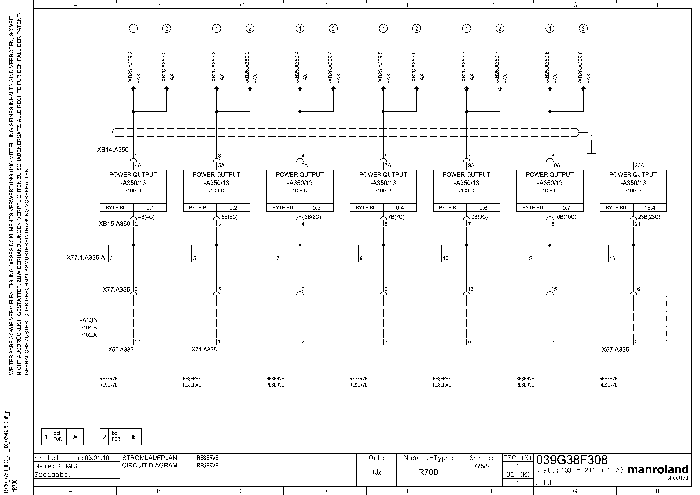

# +Jx — Sheet 103 of 214 — RESERVE

**RESERVE**

> Part of the manroland **R700** printing press IEC/UL circuit diagrams.
> Drawing class: **Stromlaufplan / Circuit diagram** (DIN A3).
> Document `+Jx` covers the **1st printing module + feed register** machine section.

## At a glance

| Field | Value |
|---|---|
| Document | `+Jx`  (039G38F308) |
| Sheet | **103** of 214 |
| Section (DE) | RESERVE |
| Section (EN) | RESERVE |
| Section type | CIRCUIT — Circuit diagram |
| Machine type | `R700` |
| Series | `7758` |
| Created | 03.01.10 |
| Replaces | — |
| Columns used | A, B, C, D, E, F, G, H |
| Path numbers | — |
| Labels on sheet | 151 |
| Cross-refs out | 9 |
| Cross-refs in | 43 |

**Previous:** [+Jx sheet 102](SHEET_0102.md) · **Next:** [+Jx sheet 104](SHEET_0104.md) · **Document TOC:** [_TOC.md](_TOC.md)  (+Jx) · **Master TOC:** [all sheets](../_MASTER_TOC.md)

## Sheet image (300 DPI, exact vector render)



_Rendered directly from the PDF vector layer at 300 DPI (1-bit), no OCR and no resampling. Use it to confirm anything ambiguous in the text below._

## Cross-references on this sheet

Each entry is a wire leaving this sheet. The printed token is `/sheet.column`; the link resolves to that sheet inside the same document.

| Ref | Target sheet | Col | Path | Destination on target | Target section | From col |
|---|---|---|---|---|---|---|
| `/109.D` | [+Jx sheet 109](SHEET_0109.md) | D | — | — | REFERENZMODUL | B |
| `/109.D` | [+Jx sheet 109](SHEET_0109.md) | D | — | — | REFERENZMODUL | C |
| `/109.D` | [+Jx sheet 109](SHEET_0109.md) | D | — | — | REFERENZMODUL | D |
| `/109.D` | [+Jx sheet 109](SHEET_0109.md) | D | — | — | REFERENZMODUL | E |
| `/109.D` | [+Jx sheet 109](SHEET_0109.md) | D | — | — | REFERENZMODUL | F |
| `/109.D` | [+Jx sheet 109](SHEET_0109.md) | D | — | — | REFERENZMODUL | G |
| `/109.D` | [+Jx sheet 109](SHEET_0109.md) | D | — | — | REFERENZMODUL | H |
| `/104.B` | [+Jx sheet 104](SHEET_0104.md) | B | — | — | RESERVE | A |
| `/102.A` | [+Jx sheet 102](SHEET_0102.md) | A | — | — | RESERVE | A |

### Incoming references (sheets that point here)

Every other sheet that sends a wire to this one. `Back-ref` is the token printed on *that* sheet; `Path` is its line number.

| From sheet | Cols | Back-ref | Path | Refs | What continues there |
|---|---|---|---|---|---|
| [+Jx#102](SHEET_0102.md) | A | `/102.A` | — | 1 | — |
| [+Jx#104](SHEET_0104.md) | B | `/104.B` | — | 1 | — |
| [+Jx#109](SHEET_0109.md) | D | `/109.D` | — | 7 | — |
| [+Jx#138](SHEET_0138.md) | E | `/138.E` | — | 6 | — |
| [+Jx#139](SHEET_0139.md) | B | `/139.B` | — | 7 | — |
| [+Jx#150](SHEET_0150.md) | H | `/150.H` | — | 1 | — |
| [+Jx#151](SHEET_0151.md) | F | `/151.F` | — | 1 | — |
| [+Jx#153](SHEET_0153.md) | B | `/153.B` | — | 5 | — |
| [+Jx#155](SHEET_0155.md) | D | `/155.D` | — | 7 | — |
| [+Jx#156](SHEET_0156.md) | A | `/156.A` | — | 7 | — |


## Devices on this sheet

| Tag | Class | Class meaning (IEC) | Col | Sub | Terminal | Sign |
|---|---|---|---|---|---|---|
| `A335` | A | Baugruppe / assembly, module, PC board | A | — | — | — |
| `A350/13` | A | Baugruppe / assembly, module, PC board | B | 13 | — | — |
| `A350/13` | A | Baugruppe / assembly, module, PC board | C | 13 | — | — |
| `A350/13` | A | Baugruppe / assembly, module, PC board | D | 13 | — | — |
| `A350/13` | A | Baugruppe / assembly, module, PC board | E | 13 | — | — |
| `A350/13` | A | Baugruppe / assembly, module, PC board | F | 13 | — | — |
| `A350/13` | A | Baugruppe / assembly, module, PC board | G | 13 | — | — |
| `A350/13` | A | Baugruppe / assembly, module, PC board | H | 13 | — | — |
| `XB25.A359:2` | — | cross-device reference | B | — | 2 | — |
| `XB26.A359:2` | — | cross-device reference | B | — | 2 | — |
| `XB25.A359:3` | — | cross-device reference | C | — | 3 | — |
| `XB26.A359:3` | — | cross-device reference | C | — | 3 | — |
| `XB25.A359:4` | — | cross-device reference | D | — | 4 | — |
| `XB26.A359:4` | — | cross-device reference | D | — | 4 | — |
| `XB25.A359:5` | — | cross-device reference | E | — | 5 | — |
| `XB26.A359:5` | — | cross-device reference | E | — | 5 | — |
| `XB15.A350` | — | cross-device reference | A | — | — | — |
| `0.1` | — | cross-device reference | B | — | — | — |
| `0.2` | — | cross-device reference | C | — | — | — |
| `0.3` | — | cross-device reference | D | — | — | — |
| `0.4` | — | cross-device reference | E | — | — | — |
| `XB14.A350` | — | cross-device reference | A | — | — | — |
| `X77.A335` | — | cross-device reference | A | — | — | — |
| `X77.1.A335.A` | — | cross-device reference | A | — | — | — |
| `XB25.A359:7` | — | cross-device reference | F | — | 7 | — |
| `XB26.A359:7` | — | cross-device reference | F | — | 7 | — |
| `XB25.A359:8` | — | cross-device reference | G | — | 8 | — |
| `XB26.A359:8` | — | cross-device reference | G | — | 8 | — |
| `0.6` | — | cross-device reference | F | — | — | — |
| `0.7` | — | cross-device reference | G | — | — | — |
| `18.4` | — | cross-device reference | H | — | — | — |
| `X71.A335` | — | cross-device reference | C | — | — | — |
| `X50.A335` | — | cross-device reference | B | — | — | — |
| `X57.A335` | — | cross-device reference | G | — | — | — |

## Potentials / nets

_No named potentials on this sheet._

## Wire-end annotations (grouped as printed)

A wire that continues elsewhere is annotated with a small cluster: the destination description, the path/line number `#NN`, and the `/sheet.column` cross reference. Each row below is one such cluster exactly as it is grouped on the drawing.

| Col | Y | Path | Cross-ref | Text on the wire |
|---|---|---|---|---|
| C | 45.1 | — | — | `1 2 1 2 1 2 1 2` |
| F | 45.1 | — | — | `1 2 1 2` |
| B | 87.3 | — | — | `XB25.A359:2` |
| B | 87.3 | — | — | `XB26.A359:2` |
| C | 87.3 | — | — | `XB25.A359:3` |
| C | 87.3 | — | — | `XB26.A359:3` |
| D | 87.3 | — | — | `XB25.A359:4` |
| D | 87.3 | — | — | `XB26.A359:4` |
| E | 87.3 | — | — | `XB25.A359:5` |
| E | 87.3 | — | — | `XB26.A359:5` |
| F | 87.3 | — | — | `XB25.A359:7` |
| F | 87.3 | — | — | `XB26.A359:7` |
| G | 87.3 | — | — | `XB25.A359:8` |
| G | 87.3 | — | — | `XB26.A359:8` |
| B | 125.0 | — | — | `+AX` |
| B | 125.0 | — | — | `+AX` |
| C | 125.0 | — | — | `+AX` |
| C | 125.0 | — | — | `+AX` |
| D | 125.0 | — | — | `+AX` |
| D | 125.0 | — | — | `+AX` |
| E | 125.0 | — | — | `+AX` |
| E | 125.0 | — | — | `+AX` |
| F | 125.0 | — | — | `+AX` |
| F | 125.0 | — | — | `+AX` |
| G | 125.0 | — | — | `+AX` |
| G | 125.0 | — | — | `+AX` |
| A | 249.7 | — | — | `XB14.A350 2` |
| D | 261.1 | — | — | `3 4 5` |
| F | 261.1 | — | — | `7 8` |
| B | 277.3 | — | — | `4A` |
| C | 277.3 | — | — | `5A` |
| D | 277.3 | — | — | `6A` |
| E | 277.3 | — | — | `7A` |
| F | 277.3 | — | — | `9A` |
| G | 277.3 | — | — | `10A` |
| H | 277.3 | — | — | `23A` |
| B | 292.5 | — | — | `POWER QUTPUT` |
| C | 292.5 | — | — | `POWER QUTPUT` |
| D | 292.5 | — | — | `POWER QUTPUT` |
| E | 292.5 | — | — | `POWER QUTPUT` |
| F | 292.5 | — | — | `POWER QUTPUT` |
| G | 292.5 | — | — | `POWER QUTPUT` |
| H | 292.5 | — | — | `POWER QUTPUT` |
| B | 306.4 | — | — | `A350/13` |
| C | 306.4 | — | — | `A350/13` |
| D | 306.4 | — | — | `A350/13` |
| E | 306.4 | — | — | `A350/13` |
| F | 306.4 | — | — | `A350/13` |
| G | 306.4 | — | — | `A350/13` |
| H | 306.4 | — | — | `A350/13` |
| B | 320.2 | — | `/109.D` | — |
| C | 320.2 | — | `/109.D` | — |
| D | 320.2 | — | `/109.D` | — |
| E | 320.2 | — | `/109.D` | — |
| F | 320.2 | — | `/109.D` | — |
| G | 320.2 | — | `/109.D` | — |
| H | 320.2 | — | `/109.D` | — |
| B | 349.2 | — | — | `BYTE.BIT 0.1` |
| C | 349.2 | — | — | `BYTE.BIT 0.2` |
| D | 349.2 | — | — | `BYTE.BIT 0.3` |
| E | 349.2 | — | — | `BYTE.BIT 0.4` |
| F | 349.2 | — | — | `BYTE.BIT 0.6` |
| G | 349.2 | — | — | `BYTE.BIT 0.7` |
| H | 349.2 | — | — | `BYTE.BIT 18.4` |
| B | 365.2 | — | — | `4B(4C)` |
| C | 365.2 | — | — | `5B(5C)` |
| D | 365.2 | — | — | `6B(6C)` |
| E | 365.2 | — | — | `7B(7C)` |
| F | 365.2 | — | — | `9B(9C)` |
| G | 365.2 | — | — | `10B(10C)` |
| H | 365.2 | — | — | `23B(23C)` |
| C | 375.8 | — | — | `XB15.A350 2 3 4 5` |
| F | 377.3 | — | — | `7 8` |
| H | 377.3 | — | — | `21` |
| C | 433.2 | — | — | `X77.1.A335.A 3 5 7 9` |
| F | 435.4 | — | — | `13 15` |
| G | 435.4 | — | — | `16` |
| C | 487.8 | — | — | `X77.A335 3 5 7 9` |
| F | 487.8 | — | — | `13 15` |
| H | 487.8 | — | — | `16` |
| A | 540.2 | — | — | `A335` |
| A | 553.3 | — | `/104.B`, `/102.A` | — |
| B | 577.1 | — | — | `12 1` |
| D | 577.1 | — | — | `2 3` |
| F | 577.1 | — | — | `5 6` |
| H | 577.1 | — | — | `2` |
| G | 589.8 | — | — | `X57.A335` |
| B | 590.2 | — | — | `X50.A335 X71.A335` |
| A | 641.2 | — | — | `RESERVE RESERVE` |
| B | 641.2 | — | — | `RESERVE RESERVE` |
| C | 641.2 | — | — | `RESERVE RESERVE` |
| D | 641.2 | — | — | `RESERVE RESERVE` |
| E | 641.2 | — | — | `RESERVE RESERVE` |
| F | 641.2 | — | — | `RESERVE RESERVE` |
| G | 641.2 | — | — | `RESERVE RESERVE` |
| A | 733.2 | — | — | `1 BEI FOR +JA` |
| B | 733.2 | — | — | `2 BEI FOR +JB` |


## Reconstructed tables

This sheet carries tabular content (pin map / terminal assignment / index). The grid below was rebuilt from the drawing's own rule lines, so each row is exactly one physical row of the table.

### Table 1 — 3 data rows × 2 columns (at x=170.1, y=189.9)

| XB14.A350 | 2 4A |
|---|---|
| `POWER A350/13` | `QUTPUT /109.D` |
| `BYTE.BIT` | `0.1` |
| `XB15.A350` | `4B(4C) 2` |


### Table 2 — 2 data rows × 2 columns (at x=311.8, y=189.9) — **3 5A**

| POWER | QUTPUT A350/13 /109.D |
|---|---|
| `BYTE.BIT` | `0.2` |
|  | `5B(5C) 3` |


### Table 3 — 2 data rows × 2 columns (at x=453.5, y=189.9) — **4 6A**

| POWER | QUTPUT A350/13 /109.D |
|---|---|
| `BYTE.BIT` | `0.3` |
|  | `6B(6C) 4` |


### Table 4 — 2 data rows × 2 columns (at x=595.3, y=189.9) — **5 7A**

| POWER A350/13 | QUTPUT /109.D |
|---|---|
| `BYTE.BIT` | `0.4` |
|  | `7B(7C) 5` |


### Table 5 — 2 data rows × 2 columns (at x=737.0, y=189.9) — **7 9A**

| POWER | QUTPUT A350/13 /109.D |
|---|---|
| `BYTE.BIT` | `0.6` |
|  | `9B(9C) 7` |


### Table 6 — 2 data rows × 2 columns (at x=878.7, y=189.9) — **8 10A**

| POWER | QUTPUT A350/13 /109.D |
|---|---|
| `BYTE.BIT` | `0.7` |
|  | `10B(10C) 8` |


### Table 7 — 2 data rows × 2 columns (at x=1020.5, y=189.9) — **23A**

| POWER A350/13 | QUTPUT /109.D |
|---|---|
| `BYTE.BIT` | `18.4` |
|  | `23B(23C) 21` |


## Notes and free text on this sheet

| Text | Col | Y (pt) |
|---|---|---|
| `+AX` | B | 125.01 |
| `+AX` | C | 125.01 |
| `+AX` | D | 125.01 |
| `+AX` | E | 125.01 |
| `4A` | B | 277.3 |
| `4B(4C)` | B | 365.22 |
| `POWER QUTPUT` | B | 292.47 |
| `BYTE.BIT` | A | 349.8 |
| `RESERVE` | A | 641.18 |
| `5A` | C | 277.3 |
| `5B(5C)` | C | 365.22 |
| `POWER QUTPUT` | C | 292.47 |
| `BYTE.BIT` | B | 349.8 |
| `RESERVE` | B | 641.18 |
| `6A` | D | 277.3 |
| `6B(6C)` | D | 365.22 |
| `POWER QUTPUT` | D | 292.47 |
| `BYTE.BIT` | C | 349.8 |
| `RESERVE` | C | 641.18 |
| `7A` | E | 277.3 |
| `7B(7C)` | E | 365.22 |
| `POWER QUTPUT` | E | 292.47 |
| `BYTE.BIT` | D | 349.8 |
| `RESERVE` | D | 641.18 |
| `+AX` | F | 125.01 |
| `+AX` | G | 125.01 |
| `9A` | F | 277.3 |
| `9B(9C)` | F | 365.22 |
| `POWER QUTPUT` | F | 292.47 |
| `BYTE.BIT` | E | 349.8 |
| `RESERVE` | E | 641.18 |
| `10A` | G | 277.32 |
| `10B(10C)` | G | 365.22 |
| `POWER QUTPUT` | G | 292.47 |
| `BYTE.BIT` | F | 349.8 |
| `RESERVE` | F | 641.18 |
| `23A` | H | 277.32 |
| `23B(23C)` | H | 365.22 |
| `POWER QUTPUT` | H | 292.47 |
| `BYTE.BIT` | G | 349.8 |
| `RESERVE` | G | 641.18 |
| `BEI` | A | 733.17 |
| `FOR` | A | 743.96 |
| `+JA` | A | 740.38 |
| `+JB` | B | 740.35 |

## Complete label inventory (exact text from the drawing)

Every text object inside the drawing area of this sheet, in DIN reading order (column A→H, then top→bottom). This is the authoritative list: if a string is not here it is not printed on this sheet.

| Col | Y | X | Dir | Type | Text |
|---|---|---|---|---|---|
| A | 249.7 | 161.6 | → | device ref | `XB14.A350` |
| A | 349.8 | 180.0 | → | text | `BYTE.BIT` |
| A | 375.8 | 164.4 | → | device ref | `XB15.A350` |
| A | 433.2 | 109.7 | → | device ref | `X77.1.A335.A` |
| A | 435.4 | 186.8 | → | number | `3` |
| A | 487.8 | 171.2 | → | device ref | `X77.A335` |
| A | 540.2 | 136.3 | → | device tag | `A335` |
| A | 553.3 | 139.2 | → | cross-reference | `/104.B` |
| A | 565.7 | 138.9 | → | cross-reference | `/102.A` |
| A | 641.2 | 169.5 | → | text | `RESERVE` |
| A | 651.8 | 169.5 | → | text | `RESERVE` |
| A | 733.2 | 91.6 | → | text | `BEI` |
| A | 733.2 | 190.8 | → | text | `BEI` |
| A | 738.6 | 75.4 | → | number | `1` |
| A | 738.6 | 174.3 | → | number | `2` |
| A | 740.4 | 120.2 | → | text | `+JA` |
| A | 744.0 | 91.6 | → | text | `FOR` |
| A | 744.0 | 190.8 | → | text | `FOR` |
| B | 45.1 | 224.9 | → | number | `1` |
| B | 45.6 | 281.5 | → | number | `2` |
| B | 87.3 | 217.8 | ↕ | device ref | `XB25.A359:2` |
| B | 87.3 | 274.5 | ↕ | device ref | `XB26.A359:2` |
| B | 125.0 | 231.9 | ↕ | text | `+AX` |
| B | 125.0 | 288.6 | ↕ | text | `+AX` |
| B | 261.1 | 229.6 | → | number | `2` |
| B | 277.3 | 229.6 | → | text | `4A` |
| B | 292.5 | 186.0 | → | text | `POWER QUTPUT` |
| B | 306.4 | 205.2 | → | device tag | `A350/13` |
| B | 320.2 | 214.0 | → | cross-reference | `/109.D` |
| B | 349.2 | 249.0 | → | device ref | `0.1` |
| B | 349.8 | 321.7 | → | text | `BYTE.BIT` |
| B | 365.2 | 235.3 | → | text | `4B(4C)` |
| B | 377.3 | 229.6 | → | number | `2` |
| B | 435.4 | 328.5 | → | number | `5` |
| B | 487.8 | 229.3 | → | number | `3` |
| B | 577.1 | 228.8 | → | number | `12` |
| B | 590.2 | 180.9 | → | device ref | `X50.A335` |
| B | 641.2 | 311.2 | → | text | `RESERVE` |
| B | 651.8 | 311.2 | → | text | `RESERVE` |
| B | 740.4 | 219.4 | → | text | `+JB` |
| C | 45.1 | 366.6 | → | number | `1` |
| C | 45.6 | 423.2 | → | number | `2` |
| C | 87.3 | 359.5 | ↕ | device ref | `XB25.A359:3` |
| C | 87.3 | 416.2 | ↕ | device ref | `XB26.A359:3` |
| C | 125.0 | 373.7 | ↕ | text | `+AX` |
| C | 125.0 | 430.3 | ↕ | text | `+AX` |
| C | 261.1 | 371.1 | → | number | `3` |
| C | 277.3 | 371.1 | → | text | `5A` |
| C | 292.5 | 327.7 | → | text | `POWER QUTPUT` |
| C | 306.4 | 347.0 | → | device tag | `A350/13` |
| C | 320.2 | 355.7 | → | cross-reference | `/109.D` |
| C | 349.2 | 390.0 | → | device ref | `0.2` |
| C | 349.8 | 463.5 | → | text | `BYTE.BIT` |
| C | 365.2 | 376.7 | → | text | `5B(5C)` |
| C | 377.3 | 371.1 | → | number | `3` |
| C | 435.4 | 470.3 | → | number | `7` |
| C | 487.8 | 371.1 | → | number | `5` |
| C | 577.1 | 370.5 | → | number | `1` |
| C | 590.2 | 322.6 | → | device ref | `X71.A335` |
| C | 641.2 | 453.0 | → | text | `RESERVE` |
| C | 651.8 | 453.0 | → | text | `RESERVE` |
| D | 45.1 | 508.4 | → | number | `1` |
| D | 45.6 | 564.9 | → | number | `2` |
| D | 87.3 | 501.2 | ↕ | device ref | `XB25.A359:4` |
| D | 87.3 | 557.9 | ↕ | device ref | `XB26.A359:4` |
| D | 125.0 | 515.4 | ↕ | text | `+AX` |
| D | 125.0 | 572.1 | ↕ | text | `+AX` |
| D | 261.1 | 513.1 | → | number | `4` |
| D | 277.3 | 512.8 | → | text | `6A` |
| D | 292.5 | 469.4 | → | text | `POWER QUTPUT` |
| D | 306.4 | 488.7 | → | device tag | `A350/13` |
| D | 320.2 | 497.5 | → | cross-reference | `/109.D` |
| D | 349.2 | 531.8 | → | device ref | `0.3` |
| D | 349.8 | 605.2 | → | text | `BYTE.BIT` |
| D | 365.2 | 518.5 | → | text | `6B(6C)` |
| D | 377.3 | 513.1 | → | number | `4` |
| D | 435.4 | 612.0 | → | number | `9` |
| D | 487.8 | 512.8 | → | number | `7` |
| D | 577.1 | 513.1 | → | number | `2` |
| D | 641.2 | 594.7 | → | text | `RESERVE` |
| D | 651.8 | 594.7 | → | text | `RESERVE` |
| E | 45.1 | 650.1 | → | number | `1` |
| E | 45.6 | 706.7 | → | number | `2` |
| E | 87.3 | 643.0 | ↕ | device ref | `XB25.A359:5` |
| E | 87.3 | 699.7 | ↕ | device ref | `XB26.A359:5` |
| E | 125.0 | 657.1 | ↕ | text | `+AX` |
| E | 125.0 | 713.8 | ↕ | text | `+AX` |
| E | 261.1 | 654.5 | → | number | `5` |
| E | 277.3 | 654.5 | → | text | `7A` |
| E | 292.5 | 611.1 | → | text | `POWER QUTPUT` |
| E | 306.4 | 630.4 | → | device tag | `A350/13` |
| E | 320.2 | 639.2 | → | cross-reference | `/109.D` |
| E | 349.2 | 673.5 | → | device ref | `0.4` |
| E | 349.8 | 746.9 | → | text | `BYTE.BIT` |
| E | 365.2 | 660.2 | → | text | `7B(7C)` |
| E | 377.3 | 654.5 | → | number | `5` |
| E | 435.4 | 753.2 | → | number | `13` |
| E | 487.8 | 654.5 | → | number | `9` |
| E | 577.1 | 654.5 | → | number | `3` |
| E | 641.2 | 736.4 | → | text | `RESERVE` |
| E | 651.8 | 736.4 | → | text | `RESERVE` |
| F | 45.1 | 791.8 | → | number | `1` |
| F | 45.6 | 848.4 | → | number | `2` |
| F | 87.3 | 784.7 | ↕ | device ref | `XB25.A359:7` |
| F | 87.3 | 841.4 | ↕ | device ref | `XB26.A359:7` |
| F | 125.0 | 798.9 | ↕ | text | `+AX` |
| F | 125.0 | 855.5 | ↕ | text | `+AX` |
| F | 261.1 | 796.3 | → | number | `7` |
| F | 277.3 | 796.3 | → | text | `9A` |
| F | 292.5 | 752.9 | → | text | `POWER QUTPUT` |
| F | 306.4 | 772.2 | → | device tag | `A350/13` |
| F | 320.2 | 780.9 | → | cross-reference | `/109.D` |
| F | 349.2 | 815.2 | → | device ref | `0.6` |
| F | 349.8 | 888.7 | → | text | `BYTE.BIT` |
| F | 365.2 | 801.9 | → | text | `9B(9C)` |
| F | 377.3 | 796.3 | → | number | `7` |
| F | 435.4 | 894.9 | → | number | `15` |
| F | 487.8 | 795.7 | → | number | `13` |
| F | 577.1 | 796.3 | → | number | `5` |
| F | 641.2 | 878.2 | → | text | `RESERVE` |
| F | 651.8 | 878.2 | → | text | `RESERVE` |
| G | 45.1 | 933.6 | → | number | `1` |
| G | 45.6 | 990.1 | → | number | `2` |
| G | 87.3 | 926.4 | ↕ | device ref | `XB25.A359:8` |
| G | 87.3 | 983.1 | ↕ | device ref | `XB26.A359:8` |
| G | 125.0 | 940.6 | ↕ | text | `+AX` |
| G | 125.0 | 997.3 | ↕ | text | `+AX` |
| G | 261.1 | 938.0 | → | number | `8` |
| G | 277.3 | 937.4 | → | text | `10A` |
| G | 292.5 | 894.6 | → | text | `POWER QUTPUT` |
| G | 306.4 | 913.9 | → | device tag | `A350/13` |
| G | 320.2 | 922.7 | → | cross-reference | `/109.D` |
| G | 349.2 | 957.0 | → | device ref | `0.7` |
| G | 349.8 | 1030.4 | → | text | `BYTE.BIT` |
| G | 365.2 | 943.1 | → | text | `10B(10C)` |
| G | 377.3 | 938.0 | → | number | `8` |
| G | 435.4 | 1036.6 | → | number | `16` |
| G | 487.8 | 937.4 | → | number | `15` |
| G | 577.1 | 938.0 | → | number | `6` |
| G | 589.8 | 1020.2 | → | device ref | `X57.A335` |
| G | 641.2 | 1019.9 | → | text | `RESERVE` |
| G | 651.8 | 1019.9 | → | text | `RESERVE` |
| H | 277.3 | 1080.0 | → | text | `23A` |
| H | 292.5 | 1036.3 | → | text | `POWER QUTPUT` |
| H | 306.4 | 1055.6 | → | device tag | `A350/13` |
| H | 320.2 | 1064.4 | → | cross-reference | `/109.D` |
| H | 349.2 | 1095.7 | → | device ref | `18.4` |
| H | 365.2 | 1085.7 | → | text | `23B(23C)` |
| H | 377.3 | 1080.0 | → | number | `21` |
| H | 487.8 | 1079.1 | → | number | `16` |
| H | 577.1 | 1080.0 | → | number | `2` |

## Reading-order text block

The same content as a plain block, grouped by DIN column — convenient to paste or to match against a visual description.

```text
=== Column A ===
 249.7  161.6  devref       XB14.A350
 349.8  180.0  text         BYTE.BIT
 375.8  164.4  devref       XB15.A350
 433.2  109.7  devref       X77.1.A335.A
 435.4  186.8  numeric      3
 487.8  171.2  devref       X77.A335
 540.2  136.3  devtag       A335
 553.3  139.2  xref         /104.B
 565.7  138.9  xref         /102.A
 641.2  169.5  text         RESERVE
 651.8  169.5  text         RESERVE
 733.2   91.6  text         BEI
 733.2  190.8  text         BEI
 738.6   75.4  numeric      1
 738.6  174.3  numeric      2
 740.4  120.2  text         +JA
 744.0   91.6  text         FOR
 744.0  190.8  text         FOR
=== Column B ===
  45.1  224.9  numeric      1
  45.6  281.5  numeric      2
  87.3  217.8  devref       XB25.A359:2
  87.3  274.5  devref       XB26.A359:2
 125.0  231.9  text         +AX
 125.0  288.6  text         +AX
 261.1  229.6  numeric      2
 277.3  229.6  text         4A
 292.5  186.0  text         POWER QUTPUT
 306.4  205.2  devtag       A350/13
 320.2  214.0  xref         /109.D
 349.2  249.0  devref       0.1
 349.8  321.7  text         BYTE.BIT
 365.2  235.3  text         4B(4C)
 377.3  229.6  numeric      2
 435.4  328.5  numeric      5
 487.8  229.3  numeric      3
 577.1  228.8  numeric      12
 590.2  180.9  devref       X50.A335
 641.2  311.2  text         RESERVE
 651.8  311.2  text         RESERVE
 740.4  219.4  text         +JB
=== Column C ===
  45.1  366.6  numeric      1
  45.6  423.2  numeric      2
  87.3  359.5  devref       XB25.A359:3
  87.3  416.2  devref       XB26.A359:3
 125.0  373.7  text         +AX
 125.0  430.3  text         +AX
 261.1  371.1  numeric      3
 277.3  371.1  text         5A
 292.5  327.7  text         POWER QUTPUT
 306.4  347.0  devtag       A350/13
 320.2  355.7  xref         /109.D
 349.2  390.0  devref       0.2
 349.8  463.5  text         BYTE.BIT
 365.2  376.7  text         5B(5C)
 377.3  371.1  numeric      3
 435.4  470.3  numeric      7
 487.8  371.1  numeric      5
 577.1  370.5  numeric      1
 590.2  322.6  devref       X71.A335
 641.2  453.0  text         RESERVE
 651.8  453.0  text         RESERVE
=== Column D ===
  45.1  508.4  numeric      1
  45.6  564.9  numeric      2
  87.3  501.2  devref       XB25.A359:4
  87.3  557.9  devref       XB26.A359:4
 125.0  515.4  text         +AX
 125.0  572.1  text         +AX
 261.1  513.1  numeric      4
 277.3  512.8  text         6A
 292.5  469.4  text         POWER QUTPUT
 306.4  488.7  devtag       A350/13
 320.2  497.5  xref         /109.D
 349.2  531.8  devref       0.3
 349.8  605.2  text         BYTE.BIT
 365.2  518.5  text         6B(6C)
 377.3  513.1  numeric      4
 435.4  612.0  numeric      9
 487.8  512.8  numeric      7
 577.1  513.1  numeric      2
 641.2  594.7  text         RESERVE
 651.8  594.7  text         RESERVE
=== Column E ===
  45.1  650.1  numeric      1
  45.6  706.7  numeric      2
  87.3  643.0  devref       XB25.A359:5
  87.3  699.7  devref       XB26.A359:5
 125.0  657.1  text         +AX
 125.0  713.8  text         +AX
 261.1  654.5  numeric      5
 277.3  654.5  text         7A
 292.5  611.1  text         POWER QUTPUT
 306.4  630.4  devtag       A350/13
 320.2  639.2  xref         /109.D
 349.2  673.5  devref       0.4
 349.8  746.9  text         BYTE.BIT
 365.2  660.2  text         7B(7C)
 377.3  654.5  numeric      5
 435.4  753.2  numeric      13
 487.8  654.5  numeric      9
 577.1  654.5  numeric      3
 641.2  736.4  text         RESERVE
 651.8  736.4  text         RESERVE
=== Column F ===
  45.1  791.8  numeric      1
  45.6  848.4  numeric      2
  87.3  784.7  devref       XB25.A359:7
  87.3  841.4  devref       XB26.A359:7
 125.0  798.9  text         +AX
 125.0  855.5  text         +AX
 261.1  796.3  numeric      7
 277.3  796.3  text         9A
 292.5  752.9  text         POWER QUTPUT
 306.4  772.2  devtag       A350/13
 320.2  780.9  xref         /109.D
 349.2  815.2  devref       0.6
 349.8  888.7  text         BYTE.BIT
 365.2  801.9  text         9B(9C)
 377.3  796.3  numeric      7
 435.4  894.9  numeric      15
 487.8  795.7  numeric      13
 577.1  796.3  numeric      5
 641.2  878.2  text         RESERVE
 651.8  878.2  text         RESERVE
=== Column G ===
  45.1  933.6  numeric      1
  45.6  990.1  numeric      2
  87.3  926.4  devref       XB25.A359:8
  87.3  983.1  devref       XB26.A359:8
 125.0  940.6  text         +AX
 125.0  997.3  text         +AX
 261.1  938.0  numeric      8
 277.3  937.4  text         10A
 292.5  894.6  text         POWER QUTPUT
 306.4  913.9  devtag       A350/13
 320.2  922.7  xref         /109.D
 349.2  957.0  devref       0.7
 349.8 1030.4  text         BYTE.BIT
 365.2  943.1  text         10B(10C)
 377.3  938.0  numeric      8
 435.4 1036.6  numeric      16
 487.8  937.4  numeric      15
 577.1  938.0  numeric      6
 589.8 1020.2  devref       X57.A335
 641.2 1019.9  text         RESERVE
 651.8 1019.9  text         RESERVE
=== Column H ===
 277.3 1080.0  text         23A
 292.5 1036.3  text         POWER QUTPUT
 306.4 1055.6  devtag       A350/13
 320.2 1064.4  xref         /109.D
 349.2 1095.7  devref       18.4
 365.2 1085.7  text         23B(23C)
 377.3 1080.0  numeric      21
 487.8 1079.1  numeric      16
 577.1 1080.0  numeric      2
```

---
_Generated from the PDF vector text layer; no OCR. Source: `R700_7758_IEC_UL_JX_039G38F308_p`, sheet 103._
