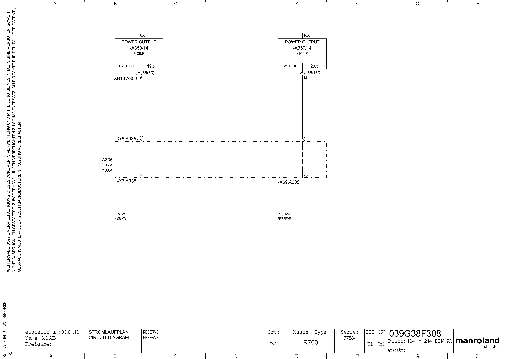

# +Jx — Sheet 104 of 214 — RESERVE

**RESERVE**

> Part of the manroland **R700** printing press IEC/UL circuit diagrams.
> Drawing class: **Stromlaufplan / Circuit diagram** (DIN A3).
> Document `+Jx` covers the **1st printing module + feed register** machine section.

## At a glance

| Field | Value |
|---|---|
| Document | `+Jx`  (039G38F308) |
| Sheet | **104** of 214 |
| Section (DE) | RESERVE |
| Section (EN) | RESERVE |
| Section type | CIRCUIT — Circuit diagram |
| Machine type | `R700` |
| Series | `7758` |
| Created | 03.01.10 |
| Replaces | — |
| Columns used | B, C, E |
| Path numbers | — |
| Labels on sheet | 31 |
| Cross-refs out | 4 |
| Cross-refs in | 10 |

**Previous:** [+Jx sheet 103](SHEET_0103.md) · **Next:** [+Jx sheet 105](SHEET_0105.md) · **Document TOC:** [_TOC.md](_TOC.md)  (+Jx) · **Master TOC:** [all sheets](../_MASTER_TOC.md)

## Sheet image (300 DPI, exact vector render)



_Rendered directly from the PDF vector layer at 300 DPI (1-bit), no OCR and no resampling. Use it to confirm anything ambiguous in the text below._

## Cross-references on this sheet

Each entry is a wire leaving this sheet. The printed token is `/sheet.column`; the link resolves to that sheet inside the same document.

| Ref | Target sheet | Col | Path | Destination on target | Target section | From col |
|---|---|---|---|---|---|---|
| `/109.F` | [+Jx sheet 109](SHEET_0109.md) | F | — | — | REFERENZMODUL | B |
| `/109.F` | [+Jx sheet 109](SHEET_0109.md) | F | — | — | REFERENZMODUL | E |
| `/105.A` | [+Jx sheet 105](SHEET_0105.md) | A | — | — | RESERVE | B |
| `/103.A` | [+Jx sheet 103](SHEET_0103.md) | A | — | — | RESERVE | B |

### Incoming references (sheets that point here)

Every other sheet that sends a wire to this one. `Back-ref` is the token printed on *that* sheet; `Path` is its line number.

| From sheet | Cols | Back-ref | Path | Refs | What continues there |
|---|---|---|---|---|---|
| [+Jx#103](SHEET_0103.md) | A | `/103.A` | — | 1 | — |
| [+Jx#105](SHEET_0105.md) | A | `/105.A` | — | 1 | — |
| [+Jx#109](SHEET_0109.md) | F | `/109.F` | — | 2 | — |
| [+Jx#133](SHEET_0133.md) | B | `/133.B` | — | 1 | — |
| [+Jx#139](SHEET_0139.md) | G | `/139.G` | — | 2 | — |
| [+Jx#152](SHEET_0152.md) | G | `/152.G` | — | 1 | — |
| [+Jx#156](SHEET_0156.md) | C | `/156.C` | — | 2 | — |


## Devices on this sheet

| Tag | Class | Class meaning (IEC) | Col | Sub | Terminal | Sign |
|---|---|---|---|---|---|---|
| `A350/14` | A | Baugruppe / assembly, module, PC board | B | 14 | — | — |
| `A350/14` | A | Baugruppe / assembly, module, PC board | E | 14 | — | — |
| `A335` | A | Baugruppe / assembly, module, PC board | B | — | — | — |
| `XB16.A350` | — | cross-device reference | B | — | — | — |
| `19.5` | — | cross-device reference | C | — | — | — |
| `X78.A335` | — | cross-device reference | B | — | — | — |
| `20.5` | — | cross-device reference | E | — | — | — |
| `X7.A335` | — | cross-device reference | B | — | — | — |
| `X69.A335` | — | cross-device reference | E | — | — | — |

## Potentials / nets

_No named potentials on this sheet._

## Wire-end annotations (grouped as printed)

A wire that continues elsewhere is annotated with a small cluster: the destination description, the path/line number `#NN`, and the `/sheet.column` cross reference. Each row below is one such cluster exactly as it is grouped on the drawing.

| Col | Y | Path | Cross-ref | Text on the wire |
|---|---|---|---|---|
| B | 78.9 | — | — | `8A` |
| E | 78.9 | — | — | `16A` |
| B | 94.0 | — | — | `POWER OUTPUT` |
| E | 94.0 | — | — | `POWER QUTPUT` |
| B | 108.0 | — | — | `A350/14` |
| E | 108.0 | — | — | `A350/14` |
| B | 121.8 | — | `/109.F` | — |
| E | 121.8 | — | `/109.F` | — |
| B | 150.8 | — | — | `BYTE.BIT 19.5` |
| E | 150.8 | — | — | `BYTE.BIT 20.5` |
| C | 166.8 | — | — | `8B(8C)` |
| E | 166.8 | — | — | `16B(16C)` |
| B | 178.8 | — | — | `XB16.A350 6` |
| E | 178.8 | — | — | `14` |
| B | 317.8 | — | — | `X78.A335 11` |
| E | 317.8 | — | — | `2` |
| B | 370.1 | — | — | `A335` |
| B | 383.2 | — | `/105.A`, `/103.A` | — |
| B | 407.0 | — | — | `2` |
| E | 407.0 | — | — | `23` |
| D | 419.8 | — | — | `X7.A335 X69.A335` |
| E | 499.4 | — | — | `RESERVE RESERVE` |
| B | 499.6 | — | — | `RESERVE RESERVE` |


## Reconstructed tables

This sheet carries tabular content (pin map / terminal assignment / index). The grid below was rebuilt from the drawing's own rule lines, so each row is exactly one physical row of the table.

### Table 1 — 1 data rows × 2 columns (at x=269.3, y=90.7)

| POWER A350/14 | OUTPUT /109.F |
|---|---|
| `BYTE.BIT` | `19.5` |


### Table 2 — 1 data rows × 2 columns (at x=652.0, y=90.7)

| POWER A350/14 | QUTPUT /109.F |
|---|---|
| `BYTE.BIT` | `20.5` |


## Notes and free text on this sheet

| Text | Col | Y (pt) |
|---|---|---|
| `8A` | B | 78.87 |
| `8B(8C)` | C | 166.8 |
| `POWER OUTPUT` | B | 94.04 |
| `BYTE.BIT` | B | 151.38 |
| `RESERVE` | B | 499.64 |
| `16A` | E | 78.89 |
| `16B(16C)` | E | 166.8 |
| `POWER QUTPUT` | E | 94.04 |
| `BYTE.BIT` | E | 151.38 |
| `RESERVE` | E | 499.45 |

## Complete label inventory (exact text from the drawing)

Every text object inside the drawing area of this sheet, in DIN reading order (column A→H, then top→bottom). This is the authoritative list: if a string is not here it is not printed on this sheet.

| Col | Y | X | Dir | Type | Text |
|---|---|---|---|---|---|
| B | 78.9 | 328.5 | → | text | `8A` |
| B | 94.0 | 285.2 | → | text | `POWER OUTPUT` |
| B | 108.0 | 304.4 | → | device tag | `A350/14` |
| B | 121.8 | 313.7 | → | cross-reference | `/109.F` |
| B | 151.4 | 279.2 | → | text | `BYTE.BIT` |
| B | 178.9 | 328.5 | → | number | `6` |
| B | 179.5 | 263.6 | → | device ref | `XB16.A350` |
| B | 317.7 | 328.0 | → | number | `11` |
| B | 320.6 | 269.0 | → | device ref | `X78.A335` |
| B | 370.2 | 235.6 | → | device tag | `A335` |
| B | 383.2 | 238.1 | → | cross-reference | `/105.A` |
| B | 395.6 | 238.1 | → | cross-reference | `/103.A` |
| B | 407.0 | 328.8 | → | number | `2` |
| B | 419.8 | 275.0 | → | device ref | `X7.A335` |
| B | 499.6 | 268.7 | → | text | `RESERVE` |
| B | 509.6 | 268.7 | → | text | `RESERVE` |
| C | 150.8 | 344.6 | → | device ref | `19.5` |
| C | 166.8 | 334.2 | → | text | `8B(8C)` |
| E | 78.9 | 710.6 | → | text | `16A` |
| E | 94.0 | 667.8 | → | text | `POWER QUTPUT` |
| E | 108.0 | 687.1 | → | device tag | `A350/14` |
| E | 121.8 | 696.3 | → | cross-reference | `/109.F` |
| E | 150.8 | 727.5 | → | device ref | `20.5` |
| E | 151.4 | 661.9 | → | text | `BYTE.BIT` |
| E | 166.8 | 716.3 | → | text | `16B(16C)` |
| E | 178.9 | 710.6 | → | number | `14` |
| E | 317.7 | 711.5 | → | number | `2` |
| E | 407.0 | 711.5 | → | number | `23` |
| E | 422.6 | 651.7 | → | device ref | `X69.A335` |
| E | 499.4 | 651.4 | → | text | `RESERVE` |
| E | 510.1 | 651.4 | → | text | `RESERVE` |

## Reading-order text block

The same content as a plain block, grouped by DIN column — convenient to paste or to match against a visual description.

```text
=== Column B ===
  78.9  328.5  text         8A
  94.0  285.2  text         POWER OUTPUT
 108.0  304.4  devtag       A350/14
 121.8  313.7  xref         /109.F
 151.4  279.2  text         BYTE.BIT
 178.9  328.5  numeric      6
 179.5  263.6  devref       XB16.A350
 317.7  328.0  numeric      11
 320.6  269.0  devref       X78.A335
 370.2  235.6  devtag       A335
 383.2  238.1  xref         /105.A
 395.6  238.1  xref         /103.A
 407.0  328.8  numeric      2
 419.8  275.0  devref       X7.A335
 499.6  268.7  text         RESERVE
 509.6  268.7  text         RESERVE
=== Column C ===
 150.8  344.6  devref       19.5
 166.8  334.2  text         8B(8C)
=== Column E ===
  78.9  710.6  text         16A
  94.0  667.8  text         POWER QUTPUT
 108.0  687.1  devtag       A350/14
 121.8  696.3  xref         /109.F
 150.8  727.5  devref       20.5
 151.4  661.9  text         BYTE.BIT
 166.8  716.3  text         16B(16C)
 178.9  710.6  numeric      14
 317.7  711.5  numeric      2
 407.0  711.5  numeric      23
 422.6  651.7  devref       X69.A335
 499.4  651.4  text         RESERVE
 510.1  651.4  text         RESERVE
```

---
_Generated from the PDF vector text layer; no OCR. Source: `R700_7758_IEC_UL_JX_039G38F308_p`, sheet 104._
