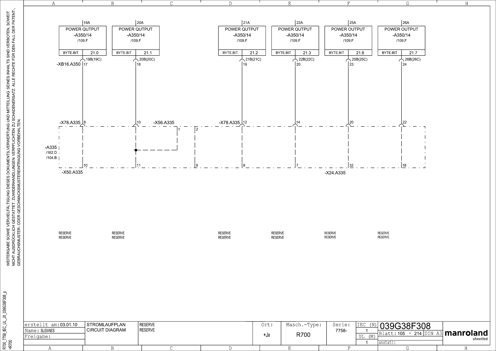

# +Jx — Sheet 105 of 214 — RESERVE

**RESERVE**

> Part of the manroland **R700** printing press IEC/UL circuit diagrams.
> Drawing class: **Stromlaufplan / Circuit diagram** (DIN A3).
> Document `+Jx` covers the **1st printing module + feed register** machine section.

## At a glance

| Field | Value |
|---|---|
| Document | `+Jx`  (039G38F308) |
| Sheet | **105** of 214 |
| Section (DE) | RESERVE |
| Section (EN) | RESERVE |
| Section type | CIRCUIT — Circuit diagram |
| Machine type | `R700` |
| Series | `7758` |
| Created | 03.01.10 |
| Replaces | — |
| Columns used | A, B, C, D, E, F, G |
| Path numbers | — |
| Labels on sheet | 84 |
| Cross-refs out | 8 |
| Cross-refs in | 29 |

**Previous:** [+Jx sheet 104](SHEET_0104.md) · **Next:** [+Jx sheet 106](SHEET_0106.md) · **Document TOC:** [_TOC.md](_TOC.md)  (+Jx) · **Master TOC:** [all sheets](../_MASTER_TOC.md)

## Sheet image (300 DPI, exact vector render)



_Rendered directly from the PDF vector layer at 300 DPI (1-bit), no OCR and no resampling. Use it to confirm anything ambiguous in the text below._

## Cross-references on this sheet

Each entry is a wire leaving this sheet. The printed token is `/sheet.column`; the link resolves to that sheet inside the same document.

| Ref | Target sheet | Col | Path | Destination on target | Target section | From col |
|---|---|---|---|---|---|---|
| `/109.F` | [+Jx sheet 109](SHEET_0109.md) | F | — | — | REFERENZMODUL | A |
| `/109.F` | [+Jx sheet 109](SHEET_0109.md) | F | — | — | REFERENZMODUL | B |
| `/109.F` | [+Jx sheet 109](SHEET_0109.md) | F | — | — | REFERENZMODUL | D |
| `/109.F` | [+Jx sheet 109](SHEET_0109.md) | F | — | — | REFERENZMODUL | E |
| `/109.F` | [+Jx sheet 109](SHEET_0109.md) | F | — | — | REFERENZMODUL | F |
| `/109.F` | [+Jx sheet 109](SHEET_0109.md) | F | — | — | REFERENZMODUL | G |
| `/162.D` | [+Jx sheet 162](SHEET_0162.md) | D | — | — | OPTION: | A |
| `/104.B` | [+Jx sheet 104](SHEET_0104.md) | B | — | — | RESERVE | A |

### Incoming references (sheets that point here)

Every other sheet that sends a wire to this one. `Back-ref` is the token printed on *that* sheet; `Path` is its line number.

| From sheet | Cols | Back-ref | Path | Refs | What continues there |
|---|---|---|---|---|---|
| [+Jx#104](SHEET_0104.md) | B | `/104.B` | — | 1 | — |
| [+Jx#109](SHEET_0109.md) | F | `/109.F` | — | 6 | — |
| [+Jx#139](SHEET_0139.md) | G | `/139.G` | — | 6 | — |
| [+Jx#142](SHEET_0142.md) | F, G | `/142.F`, `/142.G` | — | 2 | — |
| [+Jx#150](SHEET_0150.md) | H | `/150.H` | — | 5 | — |
| [+Jx#151](SHEET_0151.md) | E | `/151.E` | — | 2 | — |
| [+Jx#156](SHEET_0156.md) | C | `/156.C` | — | 6 | — |
| [+Jx#162](SHEET_0162.md) | D | `/162.D` | — | 1 | — |


## Devices on this sheet

| Tag | Class | Class meaning (IEC) | Col | Sub | Terminal | Sign |
|---|---|---|---|---|---|---|
| `A350/14` | A | Baugruppe / assembly, module, PC board | B | 14 | — | — |
| `A350/14` | A | Baugruppe / assembly, module, PC board | A | 14 | — | — |
| `A350/14` | A | Baugruppe / assembly, module, PC board | D | 14 | — | — |
| `A350/14` | A | Baugruppe / assembly, module, PC board | E | 14 | — | — |
| `A350/14` | A | Baugruppe / assembly, module, PC board | G | 14 | — | — |
| `A350/14` | A | Baugruppe / assembly, module, PC board | F | 14 | — | — |
| `A335` | A | Baugruppe / assembly, module, PC board | A | — | — | — |
| `21.1` | — | cross-device reference | C | — | — | — |
| `XB16.A350` | — | cross-device reference | A | — | — | — |
| `21.0` | — | cross-device reference | B | — | — | — |
| `21.2` | — | cross-device reference | D | — | — | — |
| `21.3` | — | cross-device reference | E | — | — | — |
| `21.7` | — | cross-device reference | G | — | — | — |
| `21.6` | — | cross-device reference | F | — | — | — |
| `X78.A335` | — | cross-device reference | A | — | — | — |
| `X78.A335` | — | cross-device reference | D | — | — | — |
| `X50.A335` | — | cross-device reference | A | — | — | — |
| `X56.A335` | — | cross-device reference | C | — | — | — |
| `X24.A335` | — | cross-device reference | F | — | — | — |

## Potentials / nets

_No named potentials on this sheet._

## Wire-end annotations (grouped as printed)

A wire that continues elsewhere is annotated with a small cluster: the destination description, the path/line number `#NN`, and the `/sheet.column` cross reference. Each row below is one such cluster exactly as it is grouped on the drawing.

| Col | Y | Path | Cross-ref | Text on the wire |
|---|---|---|---|---|
| B | 50.5 | — | — | `19A` |
| B | 50.5 | — | — | `20A` |
| D | 50.5 | — | — | `21A` |
| E | 50.5 | — | — | `22A` |
| F | 50.5 | — | — | `25A` |
| G | 50.5 | — | — | `26A` |
| A | 65.7 | — | — | `POWER QUTPUT` |
| B | 65.7 | — | — | `POWER QUTPUT` |
| D | 65.7 | — | — | `POWER QUTPUT` |
| E | 65.7 | — | — | `POWER QUTPUT` |
| F | 65.7 | — | — | `POWER OUTPUT` |
| G | 65.7 | — | — | `POWER OUTPUT` |
| A | 79.6 | — | — | `A350/14` |
| B | 79.6 | — | — | `A350/14` |
| D | 79.6 | — | — | `A350/14` |
| E | 79.6 | — | — | `A350/14` |
| F | 79.6 | — | — | `A350/14` |
| G | 79.6 | — | — | `A350/14` |
| A | 93.4 | — | `/109.F` | — |
| B | 93.4 | — | `/109.F` | — |
| D | 93.4 | — | `/109.F` | — |
| E | 93.4 | — | `/109.F` | — |
| F | 93.4 | — | `/109.F` | — |
| G | 93.4 | — | `/109.F` | — |
| A | 122.5 | — | — | `BYTE.BIT 21.0` |
| B | 122.5 | — | — | `BYTE.BIT 21.1` |
| D | 122.5 | — | — | `BYTE.BIT 21.2` |
| E | 122.5 | — | — | `BYTE.BIT 21.3` |
| F | 122.5 | — | — | `BYTE.BIT 21.6` |
| G | 122.5 | — | — | `BYTE.BIT 21.7` |
| B | 138.4 | — | — | `19B(19C)` |
| C | 138.4 | — | — | `20B(20C)` |
| D | 138.4 | — | — | `21B(21C)` |
| E | 138.4 | — | — | `22B(22C)` |
| F | 138.4 | — | — | `25B(25C)` |
| G | 138.4 | — | — | `26B(26C)` |
| A | 149.1 | — | — | `XB16.A350 17` |
| B | 150.5 | — | — | `18` |
| D | 150.5 | — | — | `19` |
| E | 150.5 | — | — | `20` |
| F | 150.5 | — | — | `23` |
| G | 150.5 | — | — | `24` |
| B | 289.4 | — | — | `X78.A335 8 10` |
| C | 289.4 | — | — | `X56.A335` |
| D | 289.4 | — | — | `X78.A335 12 14` |
| F | 289.4 | — | — | `20` |
| G | 289.4 | — | — | `22` |
| C | 306.4 | — | — | `1 2` |
| A | 348.9 | — | — | `A335` |
| A | 362.0 | — | `/162.D`, `/104.B` | — |
| B | 392.9 | — | — | `10 11` |
| D | 392.9 | — | — | `9 8 7` |
| F | 392.9 | — | — | `32 18` |
| A | 408.4 | — | — | `X50.A335` |
| F | 409.8 | — | — | `X24.A335` |
| A | 556.1 | — | — | `RESERVE RESERVE` |
| B | 556.1 | — | — | `RESERVE RESERVE` |
| D | 556.1 | — | — | `RESERVE RESERVE` |
| E | 556.1 | — | — | `RESERVE RESERVE` |
| F | 556.3 | — | — | `RESERVE RESERVE` |
| G | 556.3 | — | — | `RESERVE RESERVE` |


## Reconstructed tables

This sheet carries tabular content (pin map / terminal assignment / index). The grid below was rebuilt from the drawing's own rule lines, so each row is exactly one physical row of the table.

### Table 1 — 2 data rows × 2 columns (at x=141.7, y=62.4)

| POWER | QUTPUT A350/14 /109.F |
|---|---|
| `BYTE.BIT` | `21.0` |
| `XB16.A350 X78.A335` | `19B(19C) 17 8` |


### Table 2 — 2 data rows × 7 columns (at x=269.3, y=62.4)

| POWER A350/14 | QUTPUT /109.F |  |  |  | POWER | QUTPUT A350/14 /109.F |
|---|---|---|---|---|---|---|
| `BYTE.BIT` | `21.1` |  |  |  | `BYTE.BIT` | `21.2` |
|  | `20B(20C) 18 10` | `X56.A335` | `1` | `2` | `X78.A335` | `21B(21C) 19 12` |


### Table 3 — 2 data rows × 2 columns (at x=652.0, y=62.4)

| POWER A350/14 | QUTPUT /109.F |
|---|---|
| `BYTE.BIT` | `21.3` |
|  | `22B(22C) 20 14` |


### Table 4 — 2 data rows × 2 columns (at x=779.5, y=62.4)

| POWER | OUTPUT A350/14 /109.F |
|---|---|
| `BYTE.BIT` | `21.6` |
|  | `25B(25C) 23 20` |


### Table 5 — 2 data rows × 2 columns (at x=907.1, y=62.4)

| POWER A350/14 | OUTPUT /109.F |
|---|---|
| `BYTE.BIT` | `21.7` |
|  | `26B(26C) 24 22` |


## Notes and free text on this sheet

| Text | Col | Y (pt) |
|---|---|---|
| `20A` | B | 50.54 |
| `20B(20C)` | C | 138.45 |
| `POWER QUTPUT` | B | 65.69 |
| `BYTE.BIT` | B | 123.03 |
| `RESERVE` | B | 556.14 |
| `19A` | B | 50.54 |
| `19B(19C)` | B | 138.45 |
| `POWER QUTPUT` | A | 65.69 |
| `BYTE.BIT` | A | 123.03 |
| `RESERVE` | A | 556.14 |
| `21A` | D | 50.54 |
| `21B(21C)` | D | 138.45 |
| `POWER QUTPUT` | D | 65.69 |
| `BYTE.BIT` | D | 123.03 |
| `RESERVE` | D | 556.14 |
| `22A` | E | 50.54 |
| `22B(22C)` | E | 138.45 |
| `POWER QUTPUT` | E | 65.69 |
| `BYTE.BIT` | E | 123.03 |
| `RESERVE` | E | 556.14 |
| `26A` | G | 50.54 |
| `26B(26C)` | G | 138.45 |
| `POWER OUTPUT` | G | 65.69 |
| `BYTE.BIT` | G | 123.03 |
| `RESERVE` | G | 556.33 |
| `25A` | F | 50.54 |
| `25B(25C)` | F | 138.45 |
| `POWER OUTPUT` | F | 65.69 |
| `BYTE.BIT` | F | 123.03 |
| `RESERVE` | F | 556.33 |

## Complete label inventory (exact text from the drawing)

Every text object inside the drawing area of this sheet, in DIN reading order (column A→H, then top→bottom). This is the authoritative list: if a string is not here it is not printed on this sheet.

| Col | Y | X | Dir | Type | Text |
|---|---|---|---|---|---|
| A | 65.7 | 157.6 | → | text | `POWER QUTPUT` |
| A | 79.6 | 176.9 | → | device tag | `A350/14` |
| A | 93.4 | 186.1 | → | cross-reference | `/109.F` |
| A | 123.0 | 151.7 | → | text | `BYTE.BIT` |
| A | 149.1 | 136.1 | → | device ref | `XB16.A350` |
| A | 289.4 | 142.9 | → | device ref | `X78.A335` |
| A | 348.9 | 108.0 | → | device tag | `A335` |
| A | 362.0 | 110.6 | → | cross-reference | `/162.D` |
| A | 374.4 | 110.8 | → | cross-reference | `/104.B` |
| A | 408.4 | 148.5 | → | device ref | `X50.A335` |
| A | 556.1 | 141.2 | → | text | `RESERVE` |
| A | 566.8 | 141.2 | → | text | `RESERVE` |
| B | 50.5 | 200.4 | → | text | `19A` |
| B | 50.5 | 328.8 | → | text | `20A` |
| B | 65.7 | 285.2 | → | text | `POWER QUTPUT` |
| B | 79.6 | 304.4 | → | device tag | `A350/14` |
| B | 93.4 | 313.7 | → | cross-reference | `/109.F` |
| B | 122.5 | 217.3 | → | device ref | `21.0` |
| B | 123.0 | 279.2 | → | text | `BYTE.BIT` |
| B | 138.5 | 206.1 | → | text | `19B(19C)` |
| B | 150.5 | 200.4 | → | number | `17` |
| B | 150.5 | 328.0 | → | number | `18` |
| B | 289.4 | 201.0 | → | number | `8` |
| B | 289.4 | 328.0 | → | number | `10` |
| B | 392.9 | 200.4 | → | number | `10` |
| B | 392.9 | 328.0 | → | number | `11` |
| B | 556.1 | 268.7 | → | text | `RESERVE` |
| B | 566.8 | 268.7 | → | text | `RESERVE` |
| C | 122.5 | 345.5 | → | device ref | `21.1` |
| C | 138.5 | 334.5 | → | text | `20B(20C)` |
| C | 289.4 | 368.2 | → | device ref | `X56.A335` |
| C | 306.4 | 427.2 | → | number | `1` |
| C | 306.4 | 470.6 | → | number | `2` |
| C | 392.9 | 470.3 | → | number | `9` |
| D | 50.5 | 583.9 | → | text | `21A` |
| D | 65.7 | 540.3 | → | text | `POWER QUTPUT` |
| D | 79.6 | 559.6 | → | device tag | `A350/14` |
| D | 93.4 | 568.8 | → | cross-reference | `/109.F` |
| D | 122.5 | 600.0 | → | device ref | `21.2` |
| D | 123.0 | 534.3 | → | text | `BYTE.BIT` |
| D | 138.5 | 589.6 | → | text | `21B(21C)` |
| D | 150.5 | 583.1 | → | number | `19` |
| D | 289.4 | 525.5 | → | device ref | `X78.A335` |
| D | 289.4 | 583.1 | → | number | `12` |
| D | 392.9 | 583.7 | → | number | `8` |
| D | 556.1 | 523.8 | → | text | `RESERVE` |
| D | 566.8 | 523.8 | → | text | `RESERVE` |
| E | 50.5 | 711.5 | → | text | `22A` |
| E | 65.7 | 667.8 | → | text | `POWER QUTPUT` |
| E | 79.6 | 687.1 | → | device tag | `A350/14` |
| E | 93.4 | 696.3 | → | cross-reference | `/109.F` |
| E | 122.5 | 727.5 | → | device ref | `21.3` |
| E | 123.0 | 661.9 | → | text | `BYTE.BIT` |
| E | 138.5 | 717.2 | → | text | `22B(22C)` |
| E | 150.5 | 711.5 | → | number | `20` |
| E | 289.4 | 710.6 | → | number | `14` |
| E | 392.9 | 711.2 | → | number | `7` |
| E | 556.1 | 651.4 | → | text | `RESERVE` |
| E | 566.8 | 651.4 | → | text | `RESERVE` |
| F | 50.5 | 839.1 | → | text | `25A` |
| F | 65.7 | 795.4 | → | text | `POWER OUTPUT` |
| F | 79.6 | 814.7 | → | device tag | `A350/14` |
| F | 93.4 | 823.9 | → | cross-reference | `/109.F` |
| F | 122.5 | 855.1 | → | device ref | `21.6` |
| F | 123.0 | 789.4 | → | text | `BYTE.BIT` |
| F | 138.5 | 844.7 | → | text | `25B(25C)` |
| F | 150.5 | 839.1 | → | number | `23` |
| F | 289.4 | 839.1 | → | number | `20` |
| F | 392.9 | 838.8 | → | number | `32` |
| F | 409.8 | 779.2 | → | device ref | `X24.A335` |
| F | 556.3 | 779.0 | → | text | `RESERVE` |
| F | 566.3 | 779.0 | → | text | `RESERVE` |
| G | 50.5 | 966.6 | → | text | `26A` |
| G | 65.7 | 923.0 | → | text | `POWER OUTPUT` |
| G | 79.6 | 942.2 | → | device tag | `A350/14` |
| G | 93.4 | 951.4 | → | cross-reference | `/109.F` |
| G | 122.5 | 982.6 | → | device ref | `21.7` |
| G | 123.0 | 917.0 | → | text | `BYTE.BIT` |
| G | 138.5 | 972.3 | → | text | `26B(26C)` |
| G | 150.5 | 966.6 | → | number | `24` |
| G | 289.4 | 966.6 | → | number | `22` |
| G | 392.9 | 965.8 | → | number | `18` |
| G | 556.3 | 906.5 | → | text | `RESERVE` |
| G | 566.3 | 906.5 | → | text | `RESERVE` |

## Reading-order text block

The same content as a plain block, grouped by DIN column — convenient to paste or to match against a visual description.

```text
=== Column A ===
  65.7  157.6  text         POWER QUTPUT
  79.6  176.9  devtag       A350/14
  93.4  186.1  xref         /109.F
 123.0  151.7  text         BYTE.BIT
 149.1  136.1  devref       XB16.A350
 289.4  142.9  devref       X78.A335
 348.9  108.0  devtag       A335
 362.0  110.6  xref         /162.D
 374.4  110.8  xref         /104.B
 408.4  148.5  devref       X50.A335
 556.1  141.2  text         RESERVE
 566.8  141.2  text         RESERVE
=== Column B ===
  50.5  200.4  text         19A
  50.5  328.8  text         20A
  65.7  285.2  text         POWER QUTPUT
  79.6  304.4  devtag       A350/14
  93.4  313.7  xref         /109.F
 122.5  217.3  devref       21.0
 123.0  279.2  text         BYTE.BIT
 138.5  206.1  text         19B(19C)
 150.5  200.4  numeric      17
 150.5  328.0  numeric      18
 289.4  201.0  numeric      8
 289.4  328.0  numeric      10
 392.9  200.4  numeric      10
 392.9  328.0  numeric      11
 556.1  268.7  text         RESERVE
 566.8  268.7  text         RESERVE
=== Column C ===
 122.5  345.5  devref       21.1
 138.5  334.5  text         20B(20C)
 289.4  368.2  devref       X56.A335
 306.4  427.2  numeric      1
 306.4  470.6  numeric      2
 392.9  470.3  numeric      9
=== Column D ===
  50.5  583.9  text         21A
  65.7  540.3  text         POWER QUTPUT
  79.6  559.6  devtag       A350/14
  93.4  568.8  xref         /109.F
 122.5  600.0  devref       21.2
 123.0  534.3  text         BYTE.BIT
 138.5  589.6  text         21B(21C)
 150.5  583.1  numeric      19
 289.4  525.5  devref       X78.A335
 289.4  583.1  numeric      12
 392.9  583.7  numeric      8
 556.1  523.8  text         RESERVE
 566.8  523.8  text         RESERVE
=== Column E ===
  50.5  711.5  text         22A
  65.7  667.8  text         POWER QUTPUT
  79.6  687.1  devtag       A350/14
  93.4  696.3  xref         /109.F
 122.5  727.5  devref       21.3
 123.0  661.9  text         BYTE.BIT
 138.5  717.2  text         22B(22C)
 150.5  711.5  numeric      20
 289.4  710.6  numeric      14
 392.9  711.2  numeric      7
 556.1  651.4  text         RESERVE
 566.8  651.4  text         RESERVE
=== Column F ===
  50.5  839.1  text         25A
  65.7  795.4  text         POWER OUTPUT
  79.6  814.7  devtag       A350/14
  93.4  823.9  xref         /109.F
 122.5  855.1  devref       21.6
 123.0  789.4  text         BYTE.BIT
 138.5  844.7  text         25B(25C)
 150.5  839.1  numeric      23
 289.4  839.1  numeric      20
 392.9  838.8  numeric      32
 409.8  779.2  devref       X24.A335
 556.3  779.0  text         RESERVE
 566.3  779.0  text         RESERVE
=== Column G ===
  50.5  966.6  text         26A
  65.7  923.0  text         POWER OUTPUT
  79.6  942.2  devtag       A350/14
  93.4  951.4  xref         /109.F
 122.5  982.6  devref       21.7
 123.0  917.0  text         BYTE.BIT
 138.5  972.3  text         26B(26C)
 150.5  966.6  numeric      24
 289.4  966.6  numeric      22
 392.9  965.8  numeric      18
 556.3  906.5  text         RESERVE
 566.3  906.5  text         RESERVE
```

---
_Generated from the PDF vector text layer; no OCR. Source: `R700_7758_IEC_UL_JX_039G38F308_p`, sheet 105._
