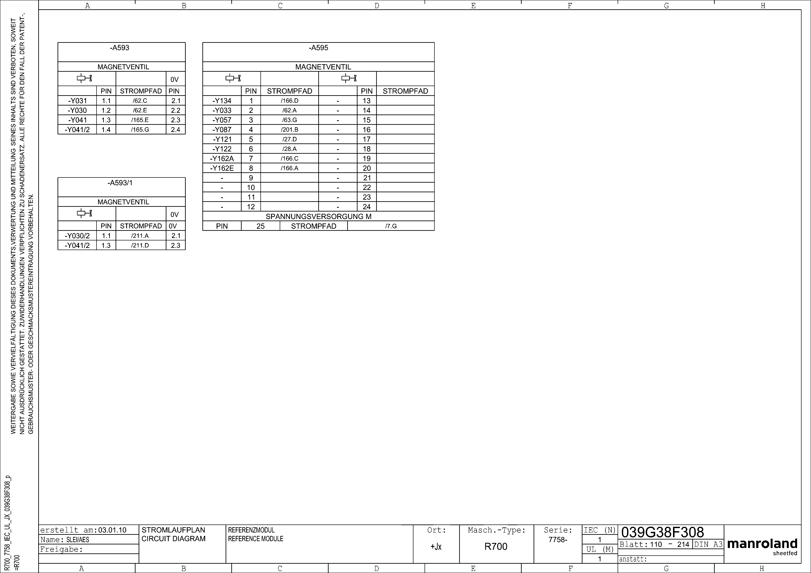

# +Jx — Sheet 110 of 214 — REFERENZMODUL

**REFERENCE MODULE**

> Part of the manroland **R700** printing press IEC/UL circuit diagrams.
> Drawing class: **Stromlaufplan / Circuit diagram** (DIN A3).
> Document `+Jx` covers the **1st printing module + feed register** machine section.

## At a glance

| Field | Value |
|---|---|
| Document | `+Jx`  (039G38F308) |
| Sheet | **110** of 214 |
| Section (DE) | REFERENZMODUL |
| Section (EN) | REFERENCE MODULE |
| Section type | REFERENCE_MODULE — Reference module |
| Machine type | `R700` |
| Series | `7758` |
| Created | 03.01.10 |
| Replaces | — |
| Columns used | A, B, C, D |
| Path numbers | — |
| Labels on sheet | 87 |
| Cross-refs out | 15 |
| Cross-refs in | 15 |

**Previous:** [+Jx sheet 109](SHEET_0109.md) · **Next:** [+Jx sheet 111](SHEET_0111.md) · **Document TOC:** [_TOC.md](_TOC.md)  (+Jx) · **Master TOC:** [all sheets](../_MASTER_TOC.md)

## Sheet image (300 DPI, exact vector render)



_Rendered directly from the PDF vector layer at 300 DPI (1-bit), no OCR and no resampling. Use it to confirm anything ambiguous in the text below._

## Cross-references on this sheet

Each entry is a wire leaving this sheet. The printed token is `/sheet.column`; the link resolves to that sheet inside the same document.

| Ref | Target sheet | Col | Path | Destination on target | Target section | From col |
|---|---|---|---|---|---|---|
| `/62.C` | [+Jx sheet 62](SHEET_0062.md) | C | — | — | GTW | B |
| `/166.D` | [+Jx sheet 166](SHEET_0166.md) | D | — | — | OPTION: | C |
| `/62.E` | [+Jx sheet 62](SHEET_0062.md) | E | — | — | GTW | B |
| `/62.A` | [+Jx sheet 62](SHEET_0062.md) | A | — | — | GTW | C |
| `/165.E` | [+Jx sheet 165](SHEET_0165.md) | E | — | — | OPTION: | B |
| `/63.G` | [+Jx sheet 63](SHEET_0063.md) | G | — | — | LACKAUFTRAGSWALZE | C |
| `/201.B` | [+Jx sheet 201](SHEET_0201.md) | B | — | — | OPTION: LPPL ANDRÜCKROLLE | C |
| `/165.G` | [+Jx sheet 165](SHEET_0165.md) | G | — | — | OPTION: | B |
| `/27.D` | [+Jx sheet 27](SHEET_0027.md) | D | — | — | KAMMERRAKEL | C |
| `/28.A` | [+Jx sheet 28](SHEET_0028.md) | A | — | — | KAMMERRAKEL | C |
| `/166.C` | [+Jx sheet 166](SHEET_0166.md) | C | — | — | OPTION: | C |
| `/166.A` | [+Jx sheet 166](SHEET_0166.md) | A | — | — | OPTION: | C |
| `/7.G` | [+Jx sheet 7](SHEET_0007.md) | G | — | — | SPANNUNGSVERSORGUNG, SCHALTSCHRANKBELÜFTUNG | D |
| `/211.A` | [+Jx sheet 211](SHEET_0211.md) | A | — | — | OPTION: WASCHMITTELWECHSELBETRIEB | B |
| `/211.D` | [+Jx sheet 211](SHEET_0211.md) | D | — | — | OPTION: WASCHMITTELWECHSELBETRIEB | B |

### Incoming references (sheets that point here)

Every other sheet that sends a wire to this one. `Back-ref` is the token printed on *that* sheet; `Path` is its line number.

| From sheet | Cols | Back-ref | Path | Refs | What continues there |
|---|---|---|---|---|---|
| [+Jx#7](SHEET_0007.md) | G | `/7.G` | — | 1 | A595 |
| [+Jx#27](SHEET_0027.md) | D | `/27.D` | — | 1 | — |
| [+Jx#28](SHEET_0028.md) | A | `/28.A` | — | 1 | — |
| [+Jx#62](SHEET_0062.md) | A, C, E | `/62.A`, `/62.C`, `/62.E` | — | 3 | — |
| [+Jx#63](SHEET_0063.md) | G | `/63.G` | — | 1 | — |
| [+Jx#165](SHEET_0165.md) | E, G | `/165.E`, `/165.G` | — | 2 | — |
| [+Jx#166](SHEET_0166.md) | A, C, D | `/166.A`, `/166.C`, `/166.D` | — | 3 | A595 |
| [+Jx#201](SHEET_0201.md) | B | `/201.B` | — | 1 | — |
| [+Jx#211](SHEET_0211.md) | A, D | `/211.A`, `/211.D` | — | 2 | A593/1 |


## Devices on this sheet

| Tag | Class | Class meaning (IEC) | Col | Sub | Terminal | Sign |
|---|---|---|---|---|---|---|
| `Y031` | Y | Magnetventil / solenoid valve, actuator | A | — | — | — |
| `Y030` | Y | Magnetventil / solenoid valve, actuator | A | — | — | — |
| `Y041` | Y | Magnetventil / solenoid valve, actuator | A | — | — | — |
| `Y041/2` | Y | Magnetventil / solenoid valve, actuator | A | 2 | — | — |
| `A593` | A | Baugruppe / assembly, module, PC board | A | — | — | — |
| `Y134` | Y | Magnetventil / solenoid valve, actuator | B | — | — | — |
| `Y033` | Y | Magnetventil / solenoid valve, actuator | B | — | — | — |
| `Y057` | Y | Magnetventil / solenoid valve, actuator | B | — | — | — |
| `Y087` | Y | Magnetventil / solenoid valve, actuator | B | — | — | — |
| `Y121` | Y | Magnetventil / solenoid valve, actuator | B | — | — | — |
| `Y122` | Y | Magnetventil / solenoid valve, actuator | B | — | — | — |
| `A595` | A | Baugruppe / assembly, module, PC board | C | — | — | — |
| `Y030/2` | Y | Magnetventil / solenoid valve, actuator | A | 2 | — | — |
| `Y041/2` | Y | Magnetventil / solenoid valve, actuator | A | 2 | — | — |
| `A593/1` | A | Baugruppe / assembly, module, PC board | A | 1 | — | — |
| `1.1` | — | cross-device reference | A | — | — | — |
| `1.2` | — | cross-device reference | A | — | — | — |
| `1.3` | — | cross-device reference | A | — | — | — |
| `1.4` | — | cross-device reference | A | — | — | — |
| `2.1` | — | cross-device reference | B | — | — | — |
| `2.2` | — | cross-device reference | B | — | — | — |
| `2.3` | — | cross-device reference | B | — | — | — |
| `2.4` | — | cross-device reference | B | — | — | — |
| `1.1` | — | cross-device reference | A | — | — | — |
| `1.3` | — | cross-device reference | A | — | — | — |
| `2.1` | — | cross-device reference | B | — | — | — |
| `2.3` | — | cross-device reference | B | — | — | — |

## Potentials / nets

| Potential | Count | Columns | Attached devices | Terminals |
|---|---|---|---|---|
| `0V` | 3 | B | — | — |


A potential such as `L24+/4` or `M24+` is a named supply/return rail; every place it appears on this sheet is electrically common.

## Wire-end annotations (grouped as printed)

A wire that continues elsewhere is annotated with a small cluster: the destination description, the path/line number `#NN`, and the `/sheet.column` cross reference. Each row below is one such cluster exactly as it is grouped on the drawing.

| Col | Y | Path | Cross-ref | Text on the wire |
|---|---|---|---|---|
| A | 65.4 | — | — | `A593` |
| C | 65.4 | — | — | `A595` |
| C | 93.8 | — | — | `MAGNETVENTIL` |
| A | 94.1 | — | — | `MAGNETVENTIL` |
| B | 112.5 | — | — | `0V` |
| D | 129.2 | — | — | `SPANNUNGSVERSORGUNG M 13 14 15 16 17 19 18 23 24 20 22 21 STROMPFAD` |
| C | 129.2 | — | — | `STROMPFAD` |
| C | 129.3 | — | — | `PIN PIN` |
| A | 129.5 | — | — | `Y030 Y031 STROMPFAD` |
| A | 129.6 | — | — | `PIN` |
| B | 129.6 | — | — | `PIN` |
| C | 143.3 | — | — | `10 12 11 3 5 6 7 9 2 4 8 1` |
| B | 143.5 | — | — | `Y134 Y033 Y057 Y087` |
| A | 143.7 | — | — | `1.2 1.3 1.4 1.1` |
| B | 143.7 | — | — | `2.2 2.3 2.4 2.1` |
| B | 144.1 | — | `/62.C` | — |
| C | 144.1 | — | `/166.D` | — |
| B | 158.2 | — | `/62.E` | — |
| C | 158.2 | — | `/62.A` | — |
| A | 171.8 | — | — | `Y041/2 Y041` |
| B | 172.4 | — | `/165.E` | — |
| C | 172.4 | — | `/63.G` | — |
| B | 186.6 | — | `/165.G` | — |
| C | 186.6 | — | `/201.B` | — |
| B | 200.2 | — | — | `Y162A Y162E Y122 Y121` |
| C | 200.8 | — | `/27.D` | — |
| C | 214.9 | — | `/28.A` | — |
| C | 229.1 | — | `/166.C` | — |
| C | 243.3 | — | `/166.A` | — |
| A | 263.9 | — | — | `A593/1` |
| A | 292.5 | — | — | `MAGNETVENTIL` |
| B | 311.0 | — | — | `0V` |
| C | 327.6 | — | — | `PIN 25 STROMPFAD` |
| A | 327.9 | — | — | `Y030/2 Y041/2 STROMPFAD` |
| A | 328.0 | — | — | `PIN` |
| B | 328.0 | — | — | `0V 2.3 2.1` |
| D | 328.3 | — | `/7.G` | — |
| A | 342.1 | — | — | `1.3 1.1` |
| B | 342.5 | — | `/211.A` | — |
| B | 356.7 | — | `/211.D` | — |


## Reconstructed tables

This sheet carries tabular content (pin map / terminal assignment / index). The grid below was rebuilt from the drawing's own rule lines, so each row is exactly one physical row of the table.

### Table 1 — 10 data rows × 4 columns (at x=85.0, y=62.4) — **A593 MAGNETVENTIL 0V**

|  | PIN | STROMPFAD | PIN |
|---|---|---|---|
| `Y031` | `1.1` | `/62.C` | `2.1` |
| `Y030` | `1.2` | `/62.E` | `2.2` |
| `Y041` | `1.3` | `/165.E` | `2.3` |
| `Y041/2` | `1.4` | `/165.G` | `2.4` |
|  |  | `A593/1` |  |
|  |  | `MAGNETVENTIL` |  |
|  |  |  | `0V` |
|  | `PIN` | `STROMPFAD` | `0V` |
| `Y030/2` | `1.1` | `/211.A` | `2.1` |
| `Y041/2` | `1.3` | `/211.D` | `2.3` |


### Table 2 — 14 data rows × 6 columns (at x=297.6, y=62.4) — **A595 MAGNETVENTIL**

|  | PIN | STROMPFAD |  | PIN | STROMPFAD |
|---|---|---|---|---|---|
| `Y134` | `1` | `/166.D` |  | `13` |  |
| `Y033` | `2` | `/62.A` |  | `14` |  |
| `Y057` | `3` | `/63.G` |  | `15` |  |
| `Y087` | `4` | `/201.B` |  | `16` |  |
| `Y121` | `5` | `/27.D` |  | `17` |  |
| `Y122` | `6` | `/28.A` |  | `18` |  |
| `Y162A` | `7` | `/166.C` |  | `19` |  |
| `Y162E` | `8` | `/166.A` |  | `20` |  |
|  | `9` |  |  | `21` |  |
|  | `10` |  |  | `22` |  |
|  | `11` |  |  | `23` |  |
|  | `12` |  |  | `24` |  |
|  |  | `SPANNUNGSVERSORGUNG` |  | `M` |  |
| `PIN` | `25` | `STROMPFAD` |  |  | `/7.G` |


## Notes and free text on this sheet

| Text | Col | Y (pt) |
|---|---|---|
| `PIN` | A | 129.57 |
| `PIN` | B | 129.57 |
| `MAGNETVENTIL` | A | 94.1 |
| `STROMPFAD` | B | 129.52 |
| `Y162A` | B | 228.49 |
| `Y162E` | B | 242.66 |
| `STROMPFAD` | C | 129.21 |
| `STROMPFAD` | D | 129.21 |
| `SPANNUNGSVERSORGUNG M` | C | 313.48 |
| `MAGNETVENTIL` | C | 93.8 |
| `PIN` | C | 129.31 |
| `PIN` | D | 129.31 |

## Complete label inventory (exact text from the drawing)

Every text object inside the drawing area of this sheet, in DIN reading order (column A→H, then top→bottom). This is the authoritative list: if a string is not here it is not printed on this sheet.

| Col | Y | X | Dir | Type | Text |
|---|---|---|---|---|---|
| A | 65.4 | 161.6 | → | device tag | `A593` |
| A | 94.1 | 143.3 | → | text | `MAGNETVENTIL` |
| A | 129.6 | 147.8 | → | text | `PIN` |
| A | 143.5 | 100.3 | → | device tag | `Y031` |
| A | 143.7 | 149.5 | → | device ref | `1.1` |
| A | 157.6 | 99.6 | → | device tag | `Y030` |
| A | 157.9 | 148.8 | → | device ref | `1.2` |
| A | 171.8 | 100.3 | → | device tag | `Y041` |
| A | 172.0 | 148.8 | → | device ref | `1.3` |
| A | 186.0 | 95.2 | → | device tag | `Y041/2` |
| A | 186.2 | 148.8 | → | device ref | `1.4` |
| A | 263.9 | 158.0 | → | device tag | `A593/1` |
| A | 292.5 | 143.3 | → | text | `MAGNETVENTIL` |
| A | 328.0 | 147.8 | → | text | `PIN` |
| A | 341.9 | 95.2 | → | device tag | `Y030/2` |
| A | 342.1 | 149.5 | → | device ref | `1.1` |
| A | 356.1 | 95.2 | → | device tag | `Y041/2` |
| A | 356.3 | 148.8 | → | device ref | `1.3` |
| B | 112.5 | 250.4 | → | potential | `0V` |
| B | 129.5 | 176.3 | → | text | `STROMPFAD` |
| B | 129.6 | 247.5 | → | text | `PIN` |
| B | 143.5 | 312.1 | → | device tag | `Y134` |
| B | 143.7 | 251.9 | → | device ref | `2.1` |
| B | 144.1 | 195.2 | → | cross-reference | `/62.C` |
| B | 157.6 | 312.1 | → | device tag | `Y033` |
| B | 157.9 | 251.1 | → | device ref | `2.2` |
| B | 158.2 | 195.3 | → | cross-reference | `/62.E` |
| B | 171.8 | 312.1 | → | device tag | `Y057` |
| B | 172.0 | 251.1 | → | device ref | `2.3` |
| B | 172.4 | 192.9 | → | cross-reference | `/165.E` |
| B | 186.0 | 312.1 | → | device tag | `Y087` |
| B | 186.2 | 251.1 | → | device ref | `2.4` |
| B | 186.6 | 192.5 | → | cross-reference | `/165.G` |
| B | 200.2 | 312.9 | → | device tag | `Y121` |
| B | 214.3 | 312.2 | → | device tag | `Y122` |
| B | 228.5 | 308.4 | → | text | `Y162A` |
| B | 242.7 | 308.7 | → | text | `Y162E` |
| B | 311.0 | 250.4 | → | potential | `0V` |
| B | 327.7 | 317.3 | → | text | `PIN` |
| B | 327.9 | 176.3 | → | text | `STROMPFAD` |
| B | 328.0 | 247.7 | → | potential | `0V` |
| B | 342.1 | 251.9 | → | device ref | `2.1` |
| B | 342.5 | 192.8 | → | cross-reference | `/211.A` |
| B | 356.3 | 251.1 | → | device ref | `2.3` |
| B | 356.7 | 192.8 | → | cross-reference | `/211.D` |
| C | 65.4 | 453.5 | → | device tag | `A595` |
| C | 93.8 | 433.6 | → | text | `MAGNETVENTIL` |
| C | 129.2 | 392.0 | → | text | `STROMPFAD` |
| C | 129.3 | 359.9 | → | text | `PIN` |
| C | 143.4 | 366.0 | → | number | `1` |
| C | 144.1 | 412.4 | → | cross-reference | `/166.D` |
| C | 157.5 | 365.7 | → | number | `2` |
| C | 158.2 | 414.9 | → | cross-reference | `/62.A` |
| C | 171.7 | 365.5 | → | number | `3` |
| C | 172.4 | 414.6 | → | cross-reference | `/63.G` |
| C | 185.9 | 365.7 | → | number | `4` |
| C | 186.6 | 412.6 | → | cross-reference | `/201.B` |
| C | 200.0 | 365.5 | → | number | `5` |
| C | 200.8 | 414.9 | → | cross-reference | `/27.D` |
| C | 214.2 | 365.5 | → | number | `6` |
| C | 214.9 | 414.9 | → | cross-reference | `/28.A` |
| C | 228.4 | 365.5 | → | number | `7` |
| C | 229.1 | 412.4 | → | cross-reference | `/166.C` |
| C | 242.6 | 365.7 | → | number | `8` |
| C | 243.3 | 412.4 | → | cross-reference | `/166.A` |
| C | 256.7 | 365.5 | → | number | `9` |
| C | 270.9 | 362.3 | → | number | `10` |
| C | 285.1 | 363.0 | → | number | `11` |
| C | 299.3 | 362.3 | → | number | `12` |
| C | 313.5 | 390.2 | → | text | `SPANNUNGSVERSORGUNG M` |
| C | 327.6 | 376.7 | → | number | `25` |
| C | 327.6 | 427.5 | → | text | `STROMPFAD` |
| D | 129.2 | 562.1 | → | text | `STROMPFAD` |
| D | 129.3 | 529.9 | → | text | `PIN` |
| D | 143.4 | 532.2 | → | number | `13` |
| D | 157.5 | 532.2 | → | number | `14` |
| D | 171.7 | 532.2 | → | number | `15` |
| D | 185.9 | 532.2 | → | number | `16` |
| D | 200.0 | 532.2 | → | number | `17` |
| D | 214.2 | 532.3 | → | number | `18` |
| D | 228.4 | 532.2 | → | number | `19` |
| D | 242.6 | 532.8 | → | number | `20` |
| D | 256.7 | 533.5 | → | number | `21` |
| D | 270.9 | 532.8 | → | number | `22` |
| D | 285.1 | 532.6 | → | number | `23` |
| D | 299.3 | 532.6 | → | number | `24` |
| D | 328.3 | 565.8 | → | cross-reference | `/7.G` |

## Reading-order text block

The same content as a plain block, grouped by DIN column — convenient to paste or to match against a visual description.

```text
=== Column A ===
  65.4  161.6  devtag       A593
  94.1  143.3  text         MAGNETVENTIL
 129.6  147.8  text         PIN
 143.5  100.3  devtag       Y031
 143.7  149.5  devref       1.1
 157.6   99.6  devtag       Y030
 157.9  148.8  devref       1.2
 171.8  100.3  devtag       Y041
 172.0  148.8  devref       1.3
 186.0   95.2  devtag       Y041/2
 186.2  148.8  devref       1.4
 263.9  158.0  devtag       A593/1
 292.5  143.3  text         MAGNETVENTIL
 328.0  147.8  text         PIN
 341.9   95.2  devtag       Y030/2
 342.1  149.5  devref       1.1
 356.1   95.2  devtag       Y041/2
 356.3  148.8  devref       1.3
=== Column B ===
 112.5  250.4  net          0V
 129.5  176.3  text         STROMPFAD
 129.6  247.5  text         PIN
 143.5  312.1  devtag       Y134
 143.7  251.9  devref       2.1
 144.1  195.2  xref         /62.C
 157.6  312.1  devtag       Y033
 157.9  251.1  devref       2.2
 158.2  195.3  xref         /62.E
 171.8  312.1  devtag       Y057
 172.0  251.1  devref       2.3
 172.4  192.9  xref         /165.E
 186.0  312.1  devtag       Y087
 186.2  251.1  devref       2.4
 186.6  192.5  xref         /165.G
 200.2  312.9  devtag       Y121
 214.3  312.2  devtag       Y122
 228.5  308.4  text         Y162A
 242.7  308.7  text         Y162E
 311.0  250.4  net          0V
 327.7  317.3  text         PIN
 327.9  176.3  text         STROMPFAD
 328.0  247.7  net          0V
 342.1  251.9  devref       2.1
 342.5  192.8  xref         /211.A
 356.3  251.1  devref       2.3
 356.7  192.8  xref         /211.D
=== Column C ===
  65.4  453.5  devtag       A595
  93.8  433.6  text         MAGNETVENTIL
 129.2  392.0  text         STROMPFAD
 129.3  359.9  text         PIN
 143.4  366.0  numeric      1
 144.1  412.4  xref         /166.D
 157.5  365.7  numeric      2
 158.2  414.9  xref         /62.A
 171.7  365.5  numeric      3
 172.4  414.6  xref         /63.G
 185.9  365.7  numeric      4
 186.6  412.6  xref         /201.B
 200.0  365.5  numeric      5
 200.8  414.9  xref         /27.D
 214.2  365.5  numeric      6
 214.9  414.9  xref         /28.A
 228.4  365.5  numeric      7
 229.1  412.4  xref         /166.C
 242.6  365.7  numeric      8
 243.3  412.4  xref         /166.A
 256.7  365.5  numeric      9
 270.9  362.3  numeric      10
 285.1  363.0  numeric      11
 299.3  362.3  numeric      12
 313.5  390.2  text         SPANNUNGSVERSORGUNG M
 327.6  376.7  numeric      25
 327.6  427.5  text         STROMPFAD
=== Column D ===
 129.2  562.1  text         STROMPFAD
 129.3  529.9  text         PIN
 143.4  532.2  numeric      13
 157.5  532.2  numeric      14
 171.7  532.2  numeric      15
 185.9  532.2  numeric      16
 200.0  532.2  numeric      17
 214.2  532.3  numeric      18
 228.4  532.2  numeric      19
 242.6  532.8  numeric      20
 256.7  533.5  numeric      21
 270.9  532.8  numeric      22
 285.1  532.6  numeric      23
 299.3  532.6  numeric      24
 328.3  565.8  xref         /7.G
```

---
_Generated from the PDF vector text layer; no OCR. Source: `R700_7758_IEC_UL_JX_039G38F308_p`, sheet 110._
