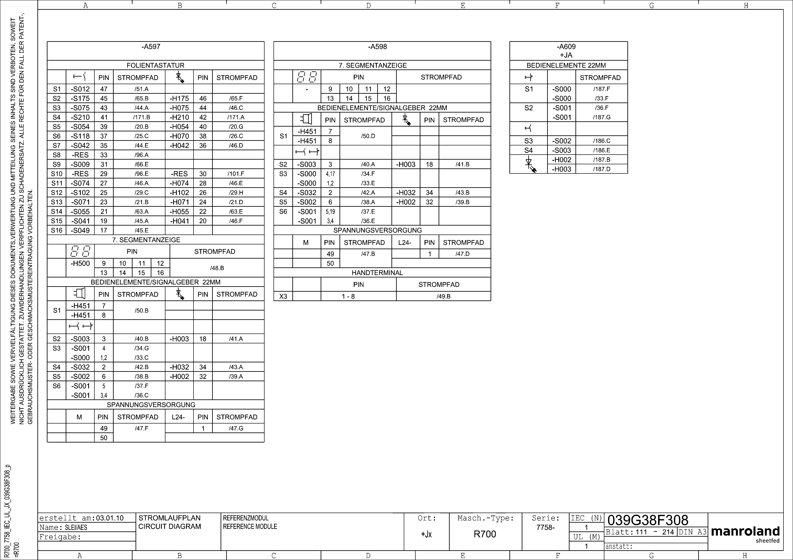

# +Jx — Sheet 111 of 214 — REFERENZMODUL

**REFERENCE MODULE**

> Part of the manroland **R700** printing press IEC/UL circuit diagrams.
> Drawing class: **Stromlaufplan / Circuit diagram** (DIN A3).
> Document `+Jx` covers the **1st printing module + feed register** machine section.

## At a glance

| Field | Value |
|---|---|
| Document | `+Jx`  (039G38F308) |
| Sheet | **111** of 214 |
| Section (DE) | REFERENZMODUL |
| Section (EN) | REFERENCE MODULE |
| Section type | REFERENCE_MODULE — Reference module |
| Machine type | `R700` |
| Series | `7758` |
| Created | 03.01.10 |
| Replaces | — |
| Columns used | A, B, C, D, E, F |
| Path numbers | — |
| Labels on sheet | 277 |
| Cross-refs out | 64 |
| Cross-refs in | 64 |

**Previous:** [+Jx sheet 110](SHEET_0110.md) · **Next:** [+Jx sheet 112](SHEET_0112.md) · **Document TOC:** [_TOC.md](_TOC.md)  (+Jx) · **Master TOC:** [all sheets](../_MASTER_TOC.md)

## Sheet image (300 DPI, exact vector render)



_Rendered directly from the PDF vector layer at 300 DPI (1-bit), no OCR and no resampling. Use it to confirm anything ambiguous in the text below._

## Cross-references on this sheet

Each entry is a wire leaving this sheet. The printed token is `/sheet.column`; the link resolves to that sheet inside the same document.

| Ref | Target sheet | Col | Path | Destination on target | Target section | From col |
|---|---|---|---|---|---|---|
| `/51.A` | [+Jx sheet 51](SHEET_0051.md) | A | — | — | SIGNALGEBER: AKUSTISCHE WARNSIGNALE | B |
| `/187.F` | [+Jx sheet 187](SHEET_0187.md) | F | — | — | OPTION: TRANSFERMODUL 1 + 2 | F |
| `/65.B` | [+Jx sheet 65](SHEET_0065.md) | B | — | — | TROPFEINRICHTUNG | B |
| `/65.F` | [+Jx sheet 65](SHEET_0065.md) | F | — | — | TROPFEINRICHTUNG | C |
| `/33.F` | [+Jx sheet 33](SHEET_0033.md) | F | — | — | NOT AUS | F |
| `/44.A` | [+Jx sheet 44](SHEET_0044.md) | A | — | — | MASCHINENBEDIENUNG | B |
| `/36.F` | [+Jx sheet 36](SHEET_0036.md) | F | — | — | STOP SICHERN | F |
| `/46.C` | [+Jx sheet 46](SHEET_0046.md) | C | — | — | MASCHINENBEDIENUNG | C |
| `/171.B` | [+Jx sheet 171](SHEET_0171.md) | B | — | — | OPTION: AUTOMATISCHEM SPÜLEN | B |
| `/171.A` | [+Jx sheet 171](SHEET_0171.md) | A | — | — | OPTION: AUTOMATISCHEM SPÜLEN | C |
| `/187.G` | [+Jx sheet 187](SHEET_0187.md) | G | — | — | OPTION: TRANSFERMODUL 1 + 2 | F |
| `/20.B` | [+Jx sheet 20](SHEET_0020.md) | B | — | — | LACKPUMPE | B |
| `/20.G` | [+Jx sheet 20](SHEET_0020.md) | G | — | — | LACKPUMPE | C |
| `/25.C` | [+Jx sheet 25](SHEET_0025.md) | C | — | — | HILFSANTRIEB, LACKDOSIER /AUFTRAGSWALZEN | B |
| `/26.C` | [+Jx sheet 26](SHEET_0026.md) | C | — | — | HILFSANTRIEB, LACKDOSIER /AUFTRAGSWALZEN | C |
| `/50.D` | [+Jx sheet 50](SHEET_0050.md) | D | — | — | SIGNALGEBER: AKUSTISCHE WARNSIGNALE | D |
| `/186.C` | [+Jx sheet 186](SHEET_0186.md) | C | — | — | OPTION: TRANSFERMODUL 1 + 2 | F |
| `/44.E` | [+Jx sheet 44](SHEET_0044.md) | E | — | — | MASCHINENBEDIENUNG | B |
| `/46.D` | [+Jx sheet 46](SHEET_0046.md) | D | — | — | MASCHINENBEDIENUNG | C |
| `/186.E` | [+Jx sheet 186](SHEET_0186.md) | E | — | — | OPTION: TRANSFERMODUL 1 + 2 | F |
| `/96.A` | [+Jx sheet 96](SHEET_0096.md) | A | — | — | RESERVE | B |
| `/187.B` | [+Jx sheet 187](SHEET_0187.md) | B | — | — | OPTION: TRANSFERMODUL 1 + 2 | F |
| `/66.E` | [+Jx sheet 66](SHEET_0066.md) | E | — | — | DRUCKANSTELLUNG | B |
| `/40.A` | [+Jx sheet 40](SHEET_0040.md) | A | — | — | LAUFKOMMANDOS | D |
| `/41.B` | [+Jx sheet 41](SHEET_0041.md) | B | — | — | LAUFKOMMANDOS | E |
| `/187.D` | [+Jx sheet 187](SHEET_0187.md) | D | — | — | OPTION: TRANSFERMODUL 1 + 2 | F |
| `/96.E` | [+Jx sheet 96](SHEET_0096.md) | E | — | — | RESERVE | B |
| `/34.F` | [+Jx sheet 34](SHEET_0034.md) | F | — | — | NOT AUS | D |
| `/101.F` | [+Jx sheet 101](SHEET_0101.md) | F | — | — | RESERVE | C |
| `/46.A` | [+Jx sheet 46](SHEET_0046.md) | A | — | — | MASCHINENBEDIENUNG | B |
| `/46.E` | [+Jx sheet 46](SHEET_0046.md) | E | — | — | MASCHINENBEDIENUNG | C |
| `/33.E` | [+Jx sheet 33](SHEET_0033.md) | E | — | — | NOT AUS | D |
| `/42.A` | [+Jx sheet 42](SHEET_0042.md) | A | — | — | LAUFKOMMANDOS | D |
| `/43.B` | [+Jx sheet 43](SHEET_0043.md) | B | — | — | LAUFKOMMANDOS | E |
| `/29.C` | [+Jx sheet 29](SHEET_0029.md) | C | — | — | KAMMERRAKEL | B |
| `/29.H` | [+Jx sheet 29](SHEET_0029.md) | H | — | — | KAMMERRAKEL | C |
| `/21.B` | [+Jx sheet 21](SHEET_0021.md) | B | — | — | LACKPUMPE | B |
| `/38.A` | [+Jx sheet 38](SHEET_0038.md) | A | — | — | LAUFKOMMANDOS | D |
| `/39.B` | [+Jx sheet 39](SHEET_0039.md) | B | — | — | LAUFKOMMANDOS | E |
| `/21.D` | [+Jx sheet 21](SHEET_0021.md) | D | — | — | LACKPUMPE | C |
| `/63.A` | [+Jx sheet 63](SHEET_0063.md) | A | — | — | LACKAUFTRAGSWALZE | B |
| `/63.E` | [+Jx sheet 63](SHEET_0063.md) | E | — | — | LACKAUFTRAGSWALZE | C |
| `/37.E` | [+Jx sheet 37](SHEET_0037.md) | E | — | — | STOP SICHERN | D |
| `/45.A` | [+Jx sheet 45](SHEET_0045.md) | A | — | — | MASCHINENBEDIENUNG | B |
| `/36.E` | [+Jx sheet 36](SHEET_0036.md) | E | — | — | STOP SICHERN | D |
| `/46.F` | [+Jx sheet 46](SHEET_0046.md) | F | — | — | MASCHINENBEDIENUNG | C |
| `/45.E` | [+Jx sheet 45](SHEET_0045.md) | E | — | — | MASCHINENBEDIENUNG | B |
| `/47.B` | [+Jx sheet 47](SHEET_0047.md) | B | — | — | MASCHINENBEDIENUNG: SPANNUNGSVERSORGUNG | E |
| `/47.D` | [+Jx sheet 47](SHEET_0047.md) | D | — | — | MASCHINENBEDIENUNG: SPANNUNGSVERSORGUNG | E |
| `/48.B` | [+Jx sheet 48](SHEET_0048.md) | B | — | — | 7 SEGMENTANZEIGE | B |
| `/49.B` | [+Jx sheet 49](SHEET_0049.md) | B | — | — | HANDTERMINAL | E |
| `/50.B` | [+Jx sheet 50](SHEET_0050.md) | B | — | — | SIGNALGEBER: AKUSTISCHE WARNSIGNALE | B |
| `/40.B` | [+Jx sheet 40](SHEET_0040.md) | B | — | — | LAUFKOMMANDOS | B |
| `/41.A` | [+Jx sheet 41](SHEET_0041.md) | A | — | — | LAUFKOMMANDOS | C |
| `/34.G` | [+Jx sheet 34](SHEET_0034.md) | G | — | — | NOT AUS | B |
| `/33.C` | [+Jx sheet 33](SHEET_0033.md) | C | — | — | NOT AUS | B |
| `/42.B` | [+Jx sheet 42](SHEET_0042.md) | B | — | — | LAUFKOMMANDOS | B |
| `/43.A` | [+Jx sheet 43](SHEET_0043.md) | A | — | — | LAUFKOMMANDOS | C |
| `/38.B` | [+Jx sheet 38](SHEET_0038.md) | B | — | — | LAUFKOMMANDOS | B |
| `/39.A` | [+Jx sheet 39](SHEET_0039.md) | A | — | — | LAUFKOMMANDOS | C |
| `/37.F` | [+Jx sheet 37](SHEET_0037.md) | F | — | — | STOP SICHERN | B |
| `/36.C` | [+Jx sheet 36](SHEET_0036.md) | C | — | — | STOP SICHERN | B |
| `/47.F` | [+Jx sheet 47](SHEET_0047.md) | F | — | — | MASCHINENBEDIENUNG: SPANNUNGSVERSORGUNG | B |
| `/47.G` | [+Jx sheet 47](SHEET_0047.md) | G | — | — | MASCHINENBEDIENUNG: SPANNUNGSVERSORGUNG | B |

### Incoming references (sheets that point here)

Every other sheet that sends a wire to this one. `Back-ref` is the token printed on *that* sheet; `Path` is its line number.

| From sheet | Cols | Back-ref | Path | Refs | What continues there |
|---|---|---|---|---|---|
| [+Jx#20](SHEET_0020.md) | B, G | `/20.B`, `/20.G` | — | 2 | — |
| [+Jx#21](SHEET_0021.md) | B, D | `/21.B`, `/21.D` | — | 2 | — |
| [+Jx#25](SHEET_0025.md) | C | `/25.C` | — | 1 | — |
| [+Jx#26](SHEET_0026.md) | C | `/26.C` | — | 1 | — |
| [+Jx#29](SHEET_0029.md) | C, H | `/29.C`, `/29.H` | — | 2 | — |
| [+Jx#33](SHEET_0033.md) | C, E, F | `/33.C`, `/33.E`, `/33.F` | — | 3 | A597; A598 |
| [+Jx#34](SHEET_0034.md) | F, G | `/34.F`, `/34.G` | — | 2 | — |
| [+Jx#36](SHEET_0036.md) | C, E, F | `/36.C`, `/36.E`, `/36.F` | — | 3 | A597; A598 |
| [+Jx#37](SHEET_0037.md) | E, F | `/37.E`, `/37.F` | — | 2 | — |
| [+Jx#38](SHEET_0038.md) | A, B | `/38.A`, `/38.B` | — | 2 | — |
| [+Jx#39](SHEET_0039.md) | A, B | `/39.A`, `/39.B` | — | 2 | — |
| [+Jx#40](SHEET_0040.md) | A, B | `/40.A`, `/40.B` | — | 2 | — |
| [+Jx#41](SHEET_0041.md) | A, B | `/41.A`, `/41.B` | — | 2 | — |
| [+Jx#42](SHEET_0042.md) | A, B | `/42.A`, `/42.B` | — | 2 | — |
| [+Jx#43](SHEET_0043.md) | A, B | `/43.A`, `/43.B` | — | 2 | — |
| [+Jx#44](SHEET_0044.md) | A, E | `/44.A`, `/44.E` | — | 2 | — |
| [+Jx#45](SHEET_0045.md) | A, E | `/45.A`, `/45.E` | — | 2 | — |
| [+Jx#46](SHEET_0046.md) | A, C, D, E, F | `/46.A`, `/46.C`, `/46.D`, `/46.E`, `/46.F` | — | 5 | — |
| [+Jx#47](SHEET_0047.md) | B, D, F, G | `/47.B`, `/47.D`, `/47.F`, `/47.G` | — | 4 | — |
| [+Jx#48](SHEET_0048.md) | B | `/48.B` | — | 1 | — |
| [+Jx#49](SHEET_0049.md) | B | `/49.B` | — | 1 | A598 |
| [+Jx#50](SHEET_0050.md) | B, D | `/50.B`, `/50.D` | — | 2 | A598 |
| [+Jx#51](SHEET_0051.md) | B | `/51.B` | — | 1 | — |
| [+Jx#63](SHEET_0063.md) | A, E | `/63.A`, `/63.E` | — | 2 | — |
| [+Jx#65](SHEET_0065.md) | B, F | `/65.B`, `/65.F` | — | 2 | A597 |
| [+Jx#66](SHEET_0066.md) | E | `/66.E` | — | 1 | — |
| [+Jx#96](SHEET_0096.md) | A, E | `/96.A`, `/96.E` | — | 2 | — |
| [+Jx#101](SHEET_0101.md) | F | `/101.F` | — | 1 | — |
| [+Jx#171](SHEET_0171.md) | A, B | `/171.A`, `/171.B` | — | 2 | A597 |
| [+Jx#186](SHEET_0186.md) | C, E | `/186.C`, `/186.E` | — | 2 | — |
| [+Jx#187](SHEET_0187.md) | B, D, F, G | `/187.B`, `/187.D`, `/187.F`, `/187.G` | — | 4 | — |


## Devices on this sheet

| Tag | Class | Class meaning (IEC) | Col | Sub | Terminal | Sign |
|---|---|---|---|---|---|---|
| `S1` | S | Schalter / switch | C | — | — | — |
| `S2` | S | Schalter / switch | C | — | — | — |
| `S3` | S | Schalter / switch | C | — | — | — |
| `S003` | S | Schalter / switch | C | — | — | — |
| `S000` | S | Schalter / switch | C | — | — | — |
| `S4` | S | Schalter / switch | C | — | — | — |
| `S5` | S | Schalter / switch | C | — | — | — |
| `S6` | S | Schalter / switch | C | — | — | — |
| `S000` | S | Schalter / switch | C | — | — | — |
| `S032` | S | Schalter / switch | C | — | — | — |
| `S002` | S | Schalter / switch | C | — | — | — |
| `S001` | S | Schalter / switch | C | — | — | — |
| `X3` | X | Klemme / terminal, plug connector | C | — | — | — |
| `S001` | S | Schalter / switch | C | — | — | — |
| `A598` | A | Baugruppe / assembly, module, PC board | D | — | — | — |
| `S1` | S | Schalter / switch | A | — | — | — |
| `S2` | S | Schalter / switch | A | — | — | — |
| `S3` | S | Schalter / switch | A | — | — | — |
| `S4` | S | Schalter / switch | A | — | — | — |
| `S5` | S | Schalter / switch | A | — | — | — |
| `S6` | S | Schalter / switch | A | — | — | — |
| `S7` | S | Schalter / switch | A | — | — | — |
| `S8` | S | Schalter / switch | A | — | — | — |
| `S9` | S | Schalter / switch | A | — | — | — |
| `S10` | S | Schalter / switch | A | — | — | — |
| `S11` | S | Schalter / switch | A | — | — | — |
| `S12` | S | Schalter / switch | A | — | — | — |
| `S13` | S | Schalter / switch | A | — | — | — |
| `S14` | S | Schalter / switch | A | — | — | — |
| `S15` | S | Schalter / switch | A | — | — | — |
| `S16` | S | Schalter / switch | A | — | — | — |
| `S1` | S | Schalter / switch | A | — | — | — |
| `S2` | S | Schalter / switch | A | — | — | — |
| `S3` | S | Schalter / switch | A | — | — | — |
| `S012` | S | Schalter / switch | A | — | — | — |
| `S175` | S | Schalter / switch | A | — | — | — |
| `S075` | S | Schalter / switch | A | — | — | — |
| `S210` | S | Schalter / switch | A | — | — | — |
| `S054` | S | Schalter / switch | A | — | — | — |
| `S118` | S | Schalter / switch | A | — | — | — |
| `S042` | S | Schalter / switch | A | — | — | — |
| `S009` | S | Schalter / switch | A | — | — | — |
| `S074` | S | Schalter / switch | A | — | — | — |
| `S102` | S | Schalter / switch | A | — | — | — |
| `S071` | S | Schalter / switch | A | — | — | — |
| `S055` | S | Schalter / switch | A | — | — | — |
| `S041` | S | Schalter / switch | A | — | — | — |
| `S049` | S | Schalter / switch | A | — | — | — |
| `S003` | S | Schalter / switch | A | — | — | — |
| `S001` | S | Schalter / switch | A | — | — | — |
| `S4` | S | Schalter / switch | A | — | — | — |
| `S5` | S | Schalter / switch | A | — | — | — |
| `S6` | S | Schalter / switch | A | — | — | — |
| `S000` | S | Schalter / switch | A | — | — | — |
| `S032` | S | Schalter / switch | A | — | — | — |
| `S002` | S | Schalter / switch | A | — | — | — |
| `S001` | S | Schalter / switch | A | — | — | — |
| `S001` | S | Schalter / switch | A | — | — | — |
| `A597` | A | Baugruppe / assembly, module, PC board | B | — | — | — |
| `S1` | S | Schalter / switch | F | — | — | — |
| `S000` | S | Schalter / switch | F | — | — | — |
| `S2` | S | Schalter / switch | F | — | — | — |
| `S001` | S | Schalter / switch | F | — | — | — |
| `S3` | S | Schalter / switch | F | — | — | — |
| `S4` | S | Schalter / switch | F | — | — | — |
| `S002` | S | Schalter / switch | F | — | — | — |
| `S003` | S | Schalter / switch | F | — | — | — |
| `S001` | S | Schalter / switch | F | — | — | — |
| `S000` | S | Schalter / switch | F | — | — | — |
| `A609` | A | Baugruppe / assembly, module, PC board | F | — | — | — |

## Potentials / nets

| Potential | Count | Columns | Attached devices | Terminals |
|---|---|---|---|---|
| `H002` | 3 | B, D, F | — | — |
| `H003` | 3 | B, D, F | — | — |
| `H032` | 2 | B, D | — | — |
| `H041` | 1 | B | — | — |
| `H042` | 1 | B | — | — |
| `H054` | 1 | B | — | — |
| `H055` | 1 | B | — | — |
| `H070` | 1 | B | — | — |
| `H071` | 1 | B | — | — |
| `H074` | 1 | B | — | — |
| `H075` | 1 | B | — | — |
| `H102` | 1 | B | — | — |
| `H175` | 1 | B | — | — |
| `H210` | 1 | B | — | — |
| `H451` | 4 | A, C | — | — |
| `H500` | 1 | A | — | — |
| `L24` | 2 | B, D | — | — |


A potential such as `L24+/4` or `M24+` is a named supply/return rail; every place it appears on this sheet is electrically common.

## Wire-end annotations (grouped as printed)

A wire that continues elsewhere is annotated with a small cluster: the destination description, the path/line number `#NN`, and the `/sheet.column` cross reference. Each row below is one such cluster exactly as it is grouped on the drawing.

| Col | Y | Path | Cross-ref | Text on the wire |
|---|---|---|---|---|
| B | 65.4 | — | — | `A597` |
| D | 65.4 | — | — | `A598` |
| F | 65.4 | — | — | `A609` |
| F | 78.1 | — | — | `+JA` |
| B | 94.1 | — | — | `FOLIENTASTATUR` |
| D | 94.1 | — | — | `7. SEGMENTANZEIGE` |
| F | 94.1 | — | — | `BEDIENELEMENTE 22MM` |
| D | 111.8 | — | — | `PIN` |
| E | 111.8 | — | — | `STROMPFAD` |
| A | 112.5 | — | — | `PIN STROMPFAD` |
| C | 112.5 | — | — | `PIN STROMPFAD` |
| F | 112.5 | — | — | `STROMPFAD` |
| A | 129.2 | — | — | `S175 S075 S054 S012 S210 S118 S042` |
| F | 129.2 | — | — | `S1 S000` |
| A | 129.6 | — | — | `S10 S2 S3 S4 S5 S6 S7 S8 S9 S1` |
| A | 129.6 | — | — | `19 17 39 37 35 33 29 27 25 23 47 45 43 31 21 41` |
| D | 129.6 | — | — | `13 10 14 15 11 12 16` |
| D | 129.6 | — | — | `9` |
| B | 129.9 | — | `/51.A` | — |
| F | 129.9 | — | `/187.F` | — |
| B | 143.4 | — | — | `H175 H075 H054 H210 H070 H042` |
| F | 143.4 | — | — | `S000` |
| B | 143.7 | — | — | `38 36 46 44 42 40` |
| B | 144.1 | — | `/65.B` | — |
| C | 144.1 | — | `/65.F` | — |
| F | 144.1 | — | `/33.F` | — |
| F | 157.5 | — | — | `S2 S001` |
| D | 157.9 | — | — | `BEDIENELEMENTE/SIGNALGEBER 22MM` |
| B | 158.2 | — | `/44.A` | — |
| F | 158.2 | — | `/36.F` | — |
| C | 158.3 | — | `/46.C` | — |
| F | 171.7 | — | — | `S001` |
| B | 172.4 | — | `/171.B` | — |
| C | 172.4 | — | `/171.A` | — |
| F | 172.4 | — | `/187.G` | — |
| D | 176.0 | — | — | `PIN PIN STROMPFAD` |
| D | 176.3 | — | — | `STROMPFAD` |
| B | 186.6 | — | `/20.B` | — |
| C | 186.6 | — | `/20.G` | — |
| C | 193.0 | — | — | `H451 H451` |
| C | 193.3 | — | — | `S1 7 8` |
| B | 200.8 | — | `/25.C` | — |
| C | 200.8 | — | `/26.C` | — |
| D | 200.8 | — | `/50.D` | — |
| F | 207.2 | — | — | `S3 S4` |
| F | 207.2 | — | — | `H003 H002 S003 S002` |
| F | 207.9 | — | `/186.C` | — |
| B | 214.9 | — | `/44.E` | — |
| C | 214.9 | — | `/46.D` | — |
| F | 222.0 | — | `/186.E` | — |
| A | 228.4 | — | — | `S009 RES` |
| B | 229.1 | — | `/96.A` | — |
| F | 236.2 | — | `/187.B` | — |
| C | 242.6 | — | — | `S003 S000` |
| D | 242.6 | — | — | `H003` |
| C | 242.9 | — | — | `S2 S3` |
| D | 242.9 | — | — | `3` |
| E | 242.9 | — | — | `18` |
| B | 243.3 | — | `/66.E` | — |
| D | 243.3 | — | `/40.A` | — |
| E | 243.3 | — | `/41.B` | — |
| F | 250.4 | — | `/187.D` | — |
| A | 256.8 | — | — | `S074 S102 RES` |
| B | 256.8 | — | — | `H074 H102 RES` |
| B | 257.1 | — | — | `30 28 26 24 22 20` |
| B | 257.4 | — | `/96.E` | — |
| D | 257.4 | — | `/34.F` | — |
| C | 257.5 | — | `/101.F` | — |
| D | 258.3 | — | — | `4,17` |
| D | 270.9 | — | — | `S000 S032 S002 5,19 1,2 34 32` |
| A | 271.3 | — | — | `S12 S13 S14 S15 S16 S11` |
| B | 271.6 | — | `/46.A` | — |
| C | 271.6 | — | `/46.E` | — |
| D | 271.6 | — | `/33.E` | — |
| D | 285.1 | — | — | `H032 H002` |
| C | 285.4 | — | — | `S4 S5 S6` |
| D | 285.5 | — | — | `2 6` |
| B | 285.8 | — | `/29.C` | — |
| C | 285.8 | — | `/29.H` | — |
| D | 285.8 | — | `/42.A` | — |
| E | 285.8 | — | `/43.B` | — |
| A | 299.3 | — | — | `S055 S071` |
| B | 299.3 | — | — | `H055 H071` |
| B | 300.0 | — | `/21.B` | — |
| C | 300.0 | — | `/21.D` | — |
| D | 300.0 | — | `/38.A` | — |
| E | 300.0 | — | `/39.B` | — |
| C | 313.5 | — | — | `S001` |
| B | 314.1 | — | `/63.A` | — |
| C | 314.1 | — | `/63.E` | — |
| D | 314.1 | — | `/37.E` | — |
| A | 327.6 | — | — | `S049 S041` |
| B | 327.6 | — | — | `H041` |
| C | 327.6 | — | — | `S001 3,4` |
| B | 328.3 | — | `/45.A` | — |
| C | 328.3 | — | `/46.F` | — |
| D | 328.3 | — | `/36.E` | — |
| D | 342.1 | — | — | `SPANNUNGSVERSORGUNG` |
| B | 342.5 | — | `/45.E` | — |
| B | 356.3 | — | — | `7. SEGMENTANZEIGE` |
| D | 360.5 | — | — | `M PIN STROMPFAD L24 PIN STROMPFAD` |
| B | 374.0 | — | — | `STROMPFAD` |
| A | 374.1 | — | — | `PIN` |
| D | 377.6 | — | — | `50 49 HANDTERMINAL 1` |
| E | 377.9 | — | `/47.B`, `/47.D` | — |
| A | 391.4 | — | — | `H500` |
| A | 391.8 | — | — | `13 10 14 15 11 12 16` |
| A | 391.8 | — | — | `9` |
| B | 399.2 | — | `/48.B` | — |
| B | 420.1 | — | — | `BEDIENELEMENTE/SIGNALGEBER 22MM` |
| D | 423.6 | — | — | `PIN STROMPFAD` |
| B | 438.2 | — | — | `PIN PIN STROMPFAD` |
| B | 438.5 | — | — | `STROMPFAD` |
| D | 441.3 | — | — | `1 8` |
| C | 441.4 | — | — | `X3` |
| E | 441.7 | — | `/49.B` | — |
| A | 455.2 | — | — | `H451 H451` |
| A | 455.6 | — | — | `S1 7 8` |
| B | 462.9 | — | `/50.B` | — |
| A | 504.8 | — | — | `S003` |
| B | 504.8 | — | — | `H003` |
| A | 505.1 | — | — | `S2 S3` |
| A | 505.2 | — | — | `3` |
| B | 505.2 | — | — | `18` |
| B | 505.5 | — | `/40.B` | — |
| C | 505.5 | — | `/41.A` | — |
| A | 519.0 | — | — | `S001` |
| B | 519.7 | — | `/34.G` | — |
| A | 520.5 | — | — | `4` |
| A | 533.1 | — | — | `S000 S032 S002` |
| B | 533.9 | — | `/33.C` | — |
| A | 534.6 | — | — | `1,2` |
| B | 547.3 | — | — | `H032 H002` |
| A | 547.7 | — | — | `S4 S5 S6` |
| A | 547.7 | — | — | `2 6` |
| B | 547.7 | — | — | `5 34 32` |
| B | 548.0 | — | `/42.B` | — |
| C | 548.0 | — | `/43.A` | — |
| B | 562.2 | — | `/38.B` | — |
| C | 562.2 | — | `/39.A` | — |
| A | 575.7 | — | — | `S001 S001` |
| B | 576.4 | — | `/37.F` | — |
| B | 590.5 | — | `/36.C` | — |
| A | 591.3 | — | — | `3,4` |
| B | 604.3 | — | — | `SPANNUNGSVERSORGUNG` |
| B | 622.7 | — | — | `M PIN STROMPFAD L24 PIN STROMPFAD` |
| B | 639.8 | — | — | `50 49 1` |
| B | 640.1 | — | `/47.F`, `/47.G` | — |


## Reconstructed tables

This sheet carries tabular content (pin map / terminal assignment / index). The grid below was rebuilt from the drawing's own rule lines, so each row is exactly one physical row of the table.

### Table 1 — 24 data rows × 2 columns (at x=70.9, y=62.4)

| S1 | S012 |
|---|---|
| `S2` | `S175` |
| `S3` | `S075` |
| `S4` | `S210` |
| `S5` | `S054` |
| `S6` | `S118` |
| `S7` | `S042` |
| `S8` | `RES` |
| `S9` | `S009` |
| `S10` | `RES` |
| `S11` | `S074` |
| `S12` | `S102` |
| `S13` | `S071` |
| `S14` | `S055` |
| `S15` | `S041` |
| `S16` | `S049` |
|  | `H500` |
|  | `H451` |
| `S1` | `H451` |
| `S2` | `S003` |
| `S3` | `S001 S000` |
| `S4` | `S032` |
| `S5` | `S002` |
| `S6` | `S001 S001` |
|  | `M` |


### Table 2 — 33 data rows × 4 columns (at x=141.7, y=62.4) — **A597 FOLIENTASTATUR**

| PIN |  | STROMPFAD |  |
|---|---|---|---|
| `47` |  | `/51.A` |  |
| `45` |  | `/65.B` |  |
| `43` |  | `/44.A` |  |
| `41` |  | `/171.B` |  |
| `39` |  | `/20.B` |  |
| `37` |  | `/25.C` |  |
| `35` |  | `/44.E` |  |
| `33` |  | `/96.A` |  |
| `31` |  | `/66.E` |  |
| `29` |  | `/96.E` |  |
| `27` |  | `/46.A` |  |
| `25` |  | `/29.C` |  |
| `23` |  | `/21.B` |  |
| `21` |  | `/63.A` |  |
| `19` |  | `/45.A` |  |
| `17` |  | `/45.E` |  |
|  | `7.` | `SEGMENTANZEIGE` |  |
|  |  | `PIN` |  |
| `9` | `10` | `11` | `12` |
| `13` | `14` | `15` | `16` |
|  |  | `BEDIENELEMENTE/SIGNALGEBER` |  |
| `PIN` |  | `STROMPFAD` |  |
| `7` |  |  |  |
| `8` |  | `/50.B` |  |
| `3` |  | `/40.B` |  |
| `4 1,2` |  | `/34.G /33.C` |  |
| `2` |  | `/42.B` |  |
| `6` |  | `/38.B` |  |
| `5 3,4` |  | `/37.F /36.C` |  |
|  |  |  | `SPANNUNGSVERSORGUNG` |
| `PIN` |  | `STROMPFAD` |  |
| `49` |  | `/47.F` |  |
| `50` |  |  |  |


### Table 3 — 21 data rows × 3 columns (at x=255.1, y=62.4)

|  | PIN | STROMPFAD |
|---|---|---|
| `H175` | `46` | `/65.F` |
| `H075` | `44` | `/46.C` |
| `H210` | `42` | `/171.A` |
| `H054` | `40` | `/20.G` |
| `H070` | `38` | `/26.C` |
| `H042` | `36` | `/46.D` |
| `RES` | `30` | `/101.F` |
| `H074` | `28` | `/46.E` |
| `H102` | `26` | `/29.H` |
| `H071` | `24` | `/21.D` |
| `H055` | `22` | `/63.E` |
| `H041` | `20` | `/46.F` |
|  |  | `STROMPFAD` |
|  |  | `/48.B` |
|  | `22MM` |  |
|  | `PIN` | `STROMPFAD` |
| `H003` | `18` | `/41.A` |
| `H032` | `34` | `/43.A` |
| `H002` | `32` | `/39.A` |
| `L24` | `PIN` | `STROMPFAD` |
|  | `1` | `/47.G` |


### Table 4 — 8 data rows × 2 columns (at x=411.0, y=62.4) — **H451 S1**

| S2 | S003 |
|---|---|
| `S3` | `S000` |
|  | `S000` |
| `S4` | `S032` |
| `S5` | `S002` |
| `S6` | `S001` |
|  | `S001` |
|  | `M` |
| `X3` |  |


### Table 5 — 17 data rows × 4 columns (at x=481.9, y=62.4) — **A598 7. SEGMENTANZEIGE PIN 9 10 11 12 13 14 15 16 BEDIENELEMENTE/SIGNALGEBER**

| PIN |  | STROMPFAD |  |
|---|---|---|---|
| `7` |  |  |  |
|  |  | `/50.D` |  |
| `8` |  |  |  |
| `3` |  | `/40.A` |  |
| `4,17` |  | `/34.F` |  |
| `1,2` |  | `/33.E` |  |
| `2` |  | `/42.A` |  |
| `6` |  | `/38.A` |  |
| `5,19` |  | `/37.E` |  |
| `3,4` |  | `/36.E` |  |
|  |  |  | `SPANNUNGSVERSORGUNG` |
| `PIN` |  | `STROMPFAD` |  |
| `49` |  | `/47.B` |  |
| `50` |  |  |  |
|  |  | `HANDTERMINAL` |  |
|  | `PIN` |  |  |
|  | `1 8` |  |  |


### Table 6 — 9 data rows × 3 columns (at x=595.3, y=62.4)

|  |  | STROMPFAD |
|---|---|---|
|  | `22MM` |  |
|  | `PIN` | `STROMPFAD` |
| `H003` | `18` | `/41.B` |
| `H032` | `34` | `/43.B` |
| `H002` | `32` | `/39.B` |
| `L24` | `PIN` | `STROMPFAD` |
|  | `1` | `/47.D` |
|  |  | `STROMPFAD` |
|  |  | `/49.B` |


### Table 7 — 8 data rows × 3 columns (at x=793.7, y=62.4) — **A609 +JA BEDIENELEMENTE 22MM**

|  |  | STROMPFAD |
|---|---|---|
| `S1` | `S000` | `/187.F` |
|  | `S000` | `/33.F` |
| `S2` | `S001` | `/36.F` |
|  | `S001` | `/187.G` |
| `S3` | `S002` | `/186.C` |
| `S4` | `S003` | `/186.E` |
|  | `H002` | `/187.B` |
|  | `H003` | `/187.D` |


## Notes and free text on this sheet

| Text | Col | Y (pt) |
|---|---|---|
| `7. SEGMENTANZEIGE` | D | 94.09 |
| `PIN` | D | 111.85 |
| `BEDIENELEMENTE/SIGNALGEBER 22MM` | D | 157.87 |
| `STROMPFAD` | D | 176.3 |
| `PIN` | E | 176.34 |
| `STROMPFAD` | E | 176.01 |
| `SPANNUNGSVERSORGUNG` | D | 342.12 |
| `M` | C | 360.52 |
| `HANDTERMINAL` | D | 405.91 |
| `PIN` | A | 112.56 |
| `STROMPFAD` | B | 112.52 |
| `FOLIENTASTATUR` | B | 94.11 |
| `PIN` | B | 112.56 |
| `STROMPFAD` | C | 112.52 |
| `7. SEGMENTANZEIGE` | B | 356.3 |
| `BEDIENELEMENTE/SIGNALGEBER 22MM` | B | 420.08 |
| `RES` | A | 228.45 |
| `RES` | B | 256.79 |
| `SPANNUNGSVERSORGUNG` | B | 604.32 |
| `M` | A | 622.73 |
| `STROMPFAD` | F | 112.52 |
| `BEDIENELEMENTE 22MM` | F | 94.1 |
| `+JA` | F | 78.1 |

## Complete label inventory (exact text from the drawing)

Every text object inside the drawing area of this sheet, in DIN reading order (column A→H, then top→bottom). This is the authoritative list: if a string is not here it is not printed on this sheet.

| Col | Y | X | Dir | Type | Text |
|---|---|---|---|---|---|
| A | 112.6 | 147.8 | → | text | `PIN` |
| A | 129.2 | 106.4 | → | device tag | `S012` |
| A | 129.5 | 79.8 | → | device tag | `S1` |
| A | 129.6 | 150.7 | → | number | `47` |
| A | 143.4 | 106.3 | → | device tag | `S175` |
| A | 143.7 | 79.1 | → | device tag | `S2` |
| A | 143.7 | 150.7 | → | number | `45` |
| A | 157.6 | 106.3 | → | device tag | `S075` |
| A | 157.9 | 79.1 | → | device tag | `S3` |
| A | 157.9 | 150.7 | → | number | `43` |
| A | 171.7 | 106.4 | → | device tag | `S210` |
| A | 172.1 | 79.1 | → | device tag | `S4` |
| A | 172.1 | 151.4 | → | number | `41` |
| A | 185.9 | 106.3 | → | device tag | `S054` |
| A | 186.2 | 79.1 | → | device tag | `S5` |
| A | 186.3 | 150.5 | → | number | `39` |
| A | 200.1 | 106.4 | → | device tag | `S118` |
| A | 200.4 | 79.1 | → | device tag | `S6` |
| A | 200.4 | 150.5 | → | number | `37` |
| A | 214.2 | 106.4 | → | device tag | `S042` |
| A | 214.6 | 79.1 | → | device tag | `S7` |
| A | 214.6 | 150.5 | → | number | `35` |
| A | 228.4 | 108.0 | → | text | `RES` |
| A | 228.8 | 79.1 | → | device tag | `S8` |
| A | 228.8 | 150.5 | → | number | `33` |
| A | 242.6 | 106.3 | → | device tag | `S009` |
| A | 242.9 | 79.1 | → | device tag | `S9` |
| A | 243.0 | 151.2 | → | number | `31` |
| A | 256.8 | 108.0 | → | text | `RES` |
| A | 257.1 | 76.4 | → | device tag | `S10` |
| A | 257.1 | 150.5 | → | number | `29` |
| A | 270.9 | 106.3 | → | device tag | `S074` |
| A | 271.3 | 77.1 | → | device tag | `S11` |
| A | 271.3 | 150.5 | → | number | `27` |
| A | 285.1 | 106.4 | → | device tag | `S102` |
| A | 285.5 | 76.4 | → | device tag | `S12` |
| A | 285.5 | 150.5 | → | number | `25` |
| A | 299.3 | 107.1 | → | device tag | `S071` |
| A | 299.6 | 76.4 | → | device tag | `S13` |
| A | 299.6 | 150.5 | → | number | `23` |
| A | 313.5 | 106.3 | → | device tag | `S055` |
| A | 313.8 | 76.4 | → | device tag | `S14` |
| A | 313.8 | 151.2 | → | number | `21` |
| A | 327.6 | 107.1 | → | device tag | `S041` |
| A | 328.0 | 76.4 | → | device tag | `S15` |
| A | 328.0 | 150.2 | → | number | `19` |
| A | 341.8 | 106.3 | → | device tag | `S049` |
| A | 342.2 | 76.4 | → | device tag | `S16` |
| A | 342.2 | 150.2 | → | number | `17` |
| A | 374.1 | 190.3 | → | text | `PIN` |
| A | 391.4 | 106.2 | → | potential | `H500` |
| A | 391.8 | 153.2 | → | number | `9` |
| A | 391.8 | 178.6 | → | number | `10` |
| A | 405.9 | 150.2 | → | number | `13` |
| A | 405.9 | 178.6 | → | number | `14` |
| A | 438.5 | 147.8 | → | text | `PIN` |
| A | 455.2 | 106.9 | → | potential | `H451` |
| A | 455.6 | 153.2 | → | number | `7` |
| A | 462.6 | 79.8 | → | device tag | `S1` |
| A | 469.4 | 106.9 | → | potential | `H451` |
| A | 469.7 | 153.2 | → | number | `8` |
| A | 504.8 | 106.3 | → | device tag | `S003` |
| A | 505.1 | 79.1 | → | device tag | `S2` |
| A | 505.2 | 153.2 | → | number | `3` |
| A | 519.0 | 107.1 | → | device tag | `S001` |
| A | 519.3 | 79.1 | → | device tag | `S3` |
| A | 520.5 | 154.1 | → | number | `4` |
| A | 533.1 | 106.4 | → | device tag | `S000` |
| A | 534.6 | 150.6 | → | number | `1,2` |
| A | 547.3 | 106.4 | → | device tag | `S032` |
| A | 547.7 | 79.1 | → | device tag | `S4` |
| A | 547.7 | 153.2 | → | number | `2` |
| A | 561.5 | 106.4 | → | device tag | `S002` |
| A | 561.8 | 79.1 | → | device tag | `S5` |
| A | 561.9 | 153.2 | → | number | `6` |
| A | 575.7 | 107.1 | → | device tag | `S001` |
| A | 576.0 | 79.1 | → | device tag | `S6` |
| A | 577.1 | 153.9 | → | number | `5` |
| A | 589.8 | 107.1 | → | device tag | `S001` |
| A | 591.3 | 151.0 | → | number | `3,4` |
| A | 622.7 | 114.9 | → | text | `M` |
| A | 622.8 | 146.4 | → | text | `PIN` |
| A | 639.8 | 150.7 | → | number | `49` |
| A | 654.0 | 150.5 | → | number | `50` |
| B | 65.4 | 212.6 | → | device tag | `A597` |
| B | 94.1 | 190.2 | → | text | `FOLIENTASTATUR` |
| B | 112.5 | 176.3 | → | text | `STROMPFAD` |
| B | 112.6 | 296.6 | → | text | `PIN` |
| B | 129.9 | 202.3 | → | cross-reference | `/51.A` |
| B | 143.4 | 254.8 | → | potential | `H175` |
| B | 143.7 | 299.5 | → | number | `46` |
| B | 144.1 | 202.4 | → | cross-reference | `/65.B` |
| B | 157.6 | 254.8 | → | potential | `H075` |
| B | 157.9 | 299.5 | → | number | `44` |
| B | 158.2 | 202.3 | → | cross-reference | `/44.A` |
| B | 171.7 | 255.0 | → | potential | `H210` |
| B | 172.1 | 299.5 | → | number | `42` |
| B | 172.4 | 200.0 | → | cross-reference | `/171.B` |
| B | 185.9 | 254.8 | → | potential | `H054` |
| B | 186.3 | 299.5 | → | number | `40` |
| B | 186.6 | 202.4 | → | cross-reference | `/20.B` |
| B | 200.1 | 255.0 | → | potential | `H070` |
| B | 200.4 | 299.3 | → | number | `38` |
| B | 200.8 | 202.3 | → | cross-reference | `/25.C` |
| B | 214.3 | 255.0 | → | potential | `H042` |
| B | 214.6 | 299.3 | → | number | `36` |
| B | 214.9 | 202.4 | → | cross-reference | `/44.E` |
| B | 229.1 | 202.3 | → | cross-reference | `/96.A` |
| B | 243.3 | 202.4 | → | cross-reference | `/66.E` |
| B | 256.8 | 256.8 | → | text | `RES` |
| B | 257.1 | 299.3 | → | number | `30` |
| B | 257.4 | 202.4 | → | cross-reference | `/96.E` |
| B | 270.9 | 254.8 | → | potential | `H074` |
| B | 271.3 | 299.3 | → | number | `28` |
| B | 271.6 | 202.3 | → | cross-reference | `/46.A` |
| B | 285.1 | 255.0 | → | potential | `H102` |
| B | 285.5 | 299.3 | → | number | `26` |
| B | 285.8 | 202.3 | → | cross-reference | `/29.C` |
| B | 299.3 | 255.7 | → | potential | `H071` |
| B | 299.6 | 299.3 | → | number | `24` |
| B | 300.0 | 202.4 | → | cross-reference | `/21.B` |
| B | 313.5 | 254.8 | → | potential | `H055` |
| B | 313.8 | 299.3 | → | number | `22` |
| B | 314.1 | 202.3 | → | cross-reference | `/63.A` |
| B | 327.6 | 255.7 | → | potential | `H041` |
| B | 328.0 | 299.3 | → | number | `20` |
| B | 328.3 | 202.3 | → | cross-reference | `/45.A` |
| B | 342.5 | 202.4 | → | cross-reference | `/45.E` |
| B | 356.3 | 168.5 | → | text | `7. SEGMENTANZEIGE` |
| B | 374.0 | 291.8 | → | text | `STROMPFAD` |
| B | 391.8 | 207.6 | → | number | `11` |
| B | 391.8 | 235.3 | → | number | `12` |
| B | 399.2 | 315.8 | → | cross-reference | `/48.B` |
| B | 405.9 | 206.9 | → | number | `15` |
| B | 405.9 | 235.3 | → | number | `16` |
| B | 420.1 | 136.5 | → | text | `BEDIENELEMENTE/SIGNALGEBER 22MM` |
| B | 438.5 | 176.3 | → | text | `STROMPFAD` |
| B | 438.5 | 296.6 | → | text | `PIN` |
| B | 462.9 | 202.4 | → | cross-reference | `/50.B` |
| B | 504.8 | 254.8 | → | potential | `H003` |
| B | 505.2 | 299.1 | → | number | `18` |
| B | 505.5 | 202.4 | → | cross-reference | `/40.B` |
| B | 519.7 | 202.0 | → | cross-reference | `/34.G` |
| B | 533.8 | 202.3 | → | cross-reference | `/33.C` |
| B | 547.3 | 255.0 | → | potential | `H032` |
| B | 547.7 | 299.3 | → | number | `34` |
| B | 548.0 | 202.4 | → | cross-reference | `/42.B` |
| B | 561.5 | 255.0 | → | potential | `H002` |
| B | 561.9 | 299.3 | → | number | `32` |
| B | 562.2 | 202.4 | → | cross-reference | `/38.B` |
| B | 576.3 | 202.7 | → | cross-reference | `/37.F` |
| B | 590.5 | 202.3 | → | cross-reference | `/36.C` |
| B | 604.3 | 160.4 | → | text | `SPANNUNGSVERSORGUNG` |
| B | 622.8 | 176.3 | → | text | `STROMPFAD` |
| B | 622.8 | 258.0 | → | potential | `L24` |
| B | 622.8 | 296.6 | → | text | `PIN` |
| B | 639.8 | 302.5 | → | number | `1` |
| B | 640.1 | 202.7 | → | cross-reference | `/47.F` |
| C | 112.5 | 325.1 | → | text | `STROMPFAD` |
| C | 144.1 | 344.4 | → | cross-reference | `/65.F` |
| C | 158.3 | 344.0 | → | cross-reference | `/46.C` |
| C | 172.4 | 341.6 | → | cross-reference | `/171.A` |
| C | 186.6 | 343.7 | → | cross-reference | `/20.G` |
| C | 193.0 | 447.0 | → | potential | `H451` |
| C | 200.4 | 420.0 | → | device tag | `S1` |
| C | 200.8 | 344.0 | → | cross-reference | `/26.C` |
| C | 207.2 | 447.0 | → | potential | `H451` |
| C | 214.9 | 344.0 | → | cross-reference | `/46.D` |
| C | 242.6 | 446.5 | → | device tag | `S003` |
| C | 242.9 | 419.2 | → | device tag | `S2` |
| C | 256.8 | 446.6 | → | device tag | `S000` |
| C | 257.1 | 419.2 | → | device tag | `S3` |
| C | 257.5 | 342.0 | → | cross-reference | `/101.F` |
| C | 270.9 | 446.6 | → | device tag | `S000` |
| C | 271.6 | 344.1 | → | cross-reference | `/46.E` |
| C | 285.1 | 446.6 | → | device tag | `S032` |
| C | 285.5 | 419.2 | → | device tag | `S4` |
| C | 285.8 | 344.1 | → | cross-reference | `/29.H` |
| C | 299.3 | 446.6 | → | device tag | `S002` |
| C | 299.6 | 419.2 | → | device tag | `S5` |
| C | 300.0 | 344.0 | → | cross-reference | `/21.D` |
| C | 313.5 | 447.3 | → | device tag | `S001` |
| C | 313.8 | 419.2 | → | device tag | `S6` |
| C | 314.1 | 344.1 | → | cross-reference | `/63.E` |
| C | 327.6 | 447.3 | → | device tag | `S001` |
| C | 328.3 | 344.4 | → | cross-reference | `/46.F` |
| C | 360.5 | 455.1 | → | text | `M` |
| C | 438.2 | 325.1 | → | text | `STROMPFAD` |
| C | 441.4 | 419.4 | → | device tag | `X3` |
| C | 505.5 | 344.0 | → | cross-reference | `/41.A` |
| C | 548.0 | 344.0 | → | cross-reference | `/43.A` |
| C | 562.2 | 344.0 | → | cross-reference | `/39.A` |
| C | 622.8 | 325.1 | → | text | `STROMPFAD` |
| C | 640.1 | 343.7 | → | cross-reference | `/47.G` |
| D | 65.4 | 552.9 | → | device tag | `A598` |
| D | 94.1 | 508.7 | → | text | `7. SEGMENTANZEIGE` |
| D | 111.8 | 530.5 | → | text | `PIN` |
| D | 129.6 | 493.4 | → | number | `9` |
| D | 129.6 | 518.7 | → | number | `10` |
| D | 129.6 | 547.8 | → | number | `11` |
| D | 129.6 | 575.4 | → | number | `12` |
| D | 143.7 | 490.4 | → | number | `13` |
| D | 143.7 | 518.7 | → | number | `14` |
| D | 143.7 | 547.1 | → | number | `15` |
| D | 143.7 | 575.4 | → | number | `16` |
| D | 157.9 | 476.6 | → | text | `BEDIENELEMENTE/SIGNALGEBER 22MM` |
| D | 176.3 | 488.0 | → | text | `PIN` |
| D | 176.3 | 516.5 | → | text | `STROMPFAD` |
| D | 193.3 | 493.4 | → | number | `7` |
| D | 200.8 | 542.4 | → | cross-reference | `/50.D` |
| D | 207.5 | 493.4 | → | number | `8` |
| D | 242.6 | 595.0 | → | potential | `H003` |
| D | 243.0 | 493.4 | → | number | `3` |
| D | 243.3 | 542.4 | → | cross-reference | `/40.A` |
| D | 257.4 | 542.8 | → | cross-reference | `/34.F` |
| D | 258.3 | 489.4 | → | number | `4,17` |
| D | 271.6 | 542.6 | → | cross-reference | `/33.E` |
| D | 272.4 | 490.8 | → | number | `1,2` |
| D | 285.1 | 595.1 | → | potential | `H032` |
| D | 285.5 | 493.4 | → | number | `2` |
| D | 285.8 | 542.4 | → | cross-reference | `/42.A` |
| D | 299.3 | 595.1 | → | potential | `H002` |
| D | 299.6 | 493.4 | → | number | `6` |
| D | 300.0 | 542.4 | → | cross-reference | `/38.A` |
| D | 314.1 | 542.6 | → | cross-reference | `/37.E` |
| D | 315.0 | 489.2 | → | number | `5,19` |
| D | 328.3 | 542.6 | → | cross-reference | `/36.E` |
| D | 329.1 | 491.2 | → | number | `3,4` |
| D | 342.1 | 500.6 | → | text | `SPANNUNGSVERSORGUNG` |
| D | 360.5 | 516.5 | → | text | `STROMPFAD` |
| D | 360.6 | 486.6 | → | text | `PIN` |
| D | 360.6 | 598.1 | → | potential | `L24` |
| D | 377.6 | 490.8 | → | number | `49` |
| D | 377.9 | 542.6 | → | cross-reference | `/47.B` |
| D | 391.8 | 490.7 | → | number | `50` |
| D | 405.9 | 528.2 | → | text | `HANDTERMINAL` |
| D | 423.7 | 530.5 | → | text | `PIN` |
| D | 441.3 | 512.9 | → | number | `1 8` |
| E | 111.8 | 632.0 | → | text | `STROMPFAD` |
| E | 176.0 | 665.3 | → | text | `STROMPFAD` |
| E | 176.3 | 636.8 | → | text | `PIN` |
| E | 243.0 | 639.2 | → | number | `18` |
| E | 243.3 | 684.3 | → | cross-reference | `/41.B` |
| E | 285.5 | 639.5 | → | number | `34` |
| E | 285.8 | 684.3 | → | cross-reference | `/43.B` |
| E | 299.6 | 639.5 | → | number | `32` |
| E | 300.0 | 684.3 | → | cross-reference | `/39.B` |
| E | 360.5 | 665.3 | → | text | `STROMPFAD` |
| E | 360.6 | 636.8 | → | text | `PIN` |
| E | 377.6 | 642.6 | → | number | `1` |
| E | 377.9 | 684.1 | → | cross-reference | `/47.D` |
| E | 423.6 | 628.4 | → | text | `STROMPFAD` |
| E | 441.7 | 655.9 | → | cross-reference | `/49.B` |
| F | 65.4 | 836.2 | → | device tag | `A609` |
| F | 78.1 | 840.8 | → | text | `+JA` |
| F | 94.1 | 790.9 | → | text | `BEDIENELEMENTE 22MM` |
| F | 112.5 | 870.8 | → | text | `STROMPFAD` |
| F | 129.2 | 788.0 | → | device tag | `S1` |
| F | 129.2 | 829.3 | → | device tag | `S000` |
| F | 129.9 | 891.2 | → | cross-reference | `/187.F` |
| F | 143.4 | 829.3 | → | device tag | `S000` |
| F | 144.1 | 893.6 | → | cross-reference | `/33.F` |
| F | 157.5 | 787.3 | → | device tag | `S2` |
| F | 157.6 | 830.0 | → | device tag | `S001` |
| F | 158.2 | 893.6 | → | cross-reference | `/36.F` |
| F | 171.7 | 830.0 | → | device tag | `S001` |
| F | 172.4 | 890.5 | → | cross-reference | `/187.G` |
| F | 207.1 | 787.2 | → | device tag | `S3` |
| F | 207.2 | 829.3 | → | device tag | `S002` |
| F | 207.9 | 890.8 | → | cross-reference | `/186.C` |
| F | 221.3 | 787.2 | → | device tag | `S4` |
| F | 221.3 | 829.1 | → | device tag | `S003` |
| F | 222.0 | 890.9 | → | cross-reference | `/186.E` |
| F | 235.5 | 829.0 | → | potential | `H002` |
| F | 236.2 | 890.9 | → | cross-reference | `/187.B` |
| F | 249.7 | 828.9 | → | potential | `H003` |
| F | 250.4 | 890.8 | → | cross-reference | `/187.D` |

## Reading-order text block

The same content as a plain block, grouped by DIN column — convenient to paste or to match against a visual description.

```text
=== Column A ===
 112.6  147.8  text         PIN
 129.2  106.4  devtag       S012
 129.5   79.8  devtag       S1
 129.6  150.7  numeric      47
 143.4  106.3  devtag       S175
 143.7   79.1  devtag       S2
 143.7  150.7  numeric      45
 157.6  106.3  devtag       S075
 157.9   79.1  devtag       S3
 157.9  150.7  numeric      43
 171.7  106.4  devtag       S210
 172.1   79.1  devtag       S4
 172.1  151.4  numeric      41
 185.9  106.3  devtag       S054
 186.2   79.1  devtag       S5
 186.3  150.5  numeric      39
 200.1  106.4  devtag       S118
 200.4   79.1  devtag       S6
 200.4  150.5  numeric      37
 214.2  106.4  devtag       S042
 214.6   79.1  devtag       S7
 214.6  150.5  numeric      35
 228.4  108.0  text         RES
 228.8   79.1  devtag       S8
 228.8  150.5  numeric      33
 242.6  106.3  devtag       S009
 242.9   79.1  devtag       S9
 243.0  151.2  numeric      31
 256.8  108.0  text         RES
 257.1   76.4  devtag       S10
 257.1  150.5  numeric      29
 270.9  106.3  devtag       S074
 271.3   77.1  devtag       S11
 271.3  150.5  numeric      27
 285.1  106.4  devtag       S102
 285.5   76.4  devtag       S12
 285.5  150.5  numeric      25
 299.3  107.1  devtag       S071
 299.6   76.4  devtag       S13
 299.6  150.5  numeric      23
 313.5  106.3  devtag       S055
 313.8   76.4  devtag       S14
 313.8  151.2  numeric      21
 327.6  107.1  devtag       S041
 328.0   76.4  devtag       S15
 328.0  150.2  numeric      19
 341.8  106.3  devtag       S049
 342.2   76.4  devtag       S16
 342.2  150.2  numeric      17
 374.1  190.3  text         PIN
 391.4  106.2  net          H500
 391.8  153.2  numeric      9
 391.8  178.6  numeric      10
 405.9  150.2  numeric      13
 405.9  178.6  numeric      14
 438.5  147.8  text         PIN
 455.2  106.9  net          H451
 455.6  153.2  numeric      7
 462.6   79.8  devtag       S1
 469.4  106.9  net          H451
 469.7  153.2  numeric      8
 504.8  106.3  devtag       S003
 505.1   79.1  devtag       S2
 505.2  153.2  numeric      3
 519.0  107.1  devtag       S001
 519.3   79.1  devtag       S3
 520.5  154.1  numeric      4
 533.1  106.4  devtag       S000
 534.6  150.6  numeric      1,2
 547.3  106.4  devtag       S032
 547.7   79.1  devtag       S4
 547.7  153.2  numeric      2
 561.5  106.4  devtag       S002
 561.8   79.1  devtag       S5
 561.9  153.2  numeric      6
 575.7  107.1  devtag       S001
 576.0   79.1  devtag       S6
 577.1  153.9  numeric      5
 589.8  107.1  devtag       S001
 591.3  151.0  numeric      3,4
 622.7  114.9  text         M
 622.8  146.4  text         PIN
 639.8  150.7  numeric      49
 654.0  150.5  numeric      50
=== Column B ===
  65.4  212.6  devtag       A597
  94.1  190.2  text         FOLIENTASTATUR
 112.5  176.3  text         STROMPFAD
 112.6  296.6  text         PIN
 129.9  202.3  xref         /51.A
 143.4  254.8  net          H175
 143.7  299.5  numeric      46
 144.1  202.4  xref         /65.B
 157.6  254.8  net          H075
 157.9  299.5  numeric      44
 158.2  202.3  xref         /44.A
 171.7  255.0  net          H210
 172.1  299.5  numeric      42
 172.4  200.0  xref         /171.B
 185.9  254.8  net          H054
 186.3  299.5  numeric      40
 186.6  202.4  xref         /20.B
 200.1  255.0  net          H070
 200.4  299.3  numeric      38
 200.8  202.3  xref         /25.C
 214.3  255.0  net          H042
 214.6  299.3  numeric      36
 214.9  202.4  xref         /44.E
 229.1  202.3  xref         /96.A
 243.3  202.4  xref         /66.E
 256.8  256.8  text         RES
 257.1  299.3  numeric      30
 257.4  202.4  xref         /96.E
 270.9  254.8  net          H074
 271.3  299.3  numeric      28
 271.6  202.3  xref         /46.A
 285.1  255.0  net          H102
 285.5  299.3  numeric      26
 285.8  202.3  xref         /29.C
 299.3  255.7  net          H071
 299.6  299.3  numeric      24
 300.0  202.4  xref         /21.B
 313.5  254.8  net          H055
 313.8  299.3  numeric      22
 314.1  202.3  xref         /63.A
 327.6  255.7  net          H041
 328.0  299.3  numeric      20
 328.3  202.3  xref         /45.A
 342.5  202.4  xref         /45.E
 356.3  168.5  text         7. SEGMENTANZEIGE
 374.0  291.8  text         STROMPFAD
 391.8  207.6  numeric      11
 391.8  235.3  numeric      12
 399.2  315.8  xref         /48.B
 405.9  206.9  numeric      15
 405.9  235.3  numeric      16
 420.1  136.5  text         BEDIENELEMENTE/SIGNALGEBER 22MM
 438.5  176.3  text         STROMPFAD
 438.5  296.6  text         PIN
 462.9  202.4  xref         /50.B
 504.8  254.8  net          H003
 505.2  299.1  numeric      18
 505.5  202.4  xref         /40.B
 519.7  202.0  xref         /34.G
 533.8  202.3  xref         /33.C
 547.3  255.0  net          H032
 547.7  299.3  numeric      34
 548.0  202.4  xref         /42.B
 561.5  255.0  net          H002
 561.9  299.3  numeric      32
 562.2  202.4  xref         /38.B
 576.3  202.7  xref         /37.F
 590.5  202.3  xref         /36.C
 604.3  160.4  text         SPANNUNGSVERSORGUNG
 622.8  176.3  text         STROMPFAD
 622.8  258.0  net          L24
 622.8  296.6  text         PIN
 639.8  302.5  numeric      1
 640.1  202.7  xref         /47.F
=== Column C ===
 112.5  325.1  text         STROMPFAD
 144.1  344.4  xref         /65.F
 158.3  344.0  xref         /46.C
 172.4  341.6  xref         /171.A
 186.6  343.7  xref         /20.G
 193.0  447.0  net          H451
 200.4  420.0  devtag       S1
 200.8  344.0  xref         /26.C
 207.2  447.0  net          H451
 214.9  344.0  xref         /46.D
 242.6  446.5  devtag       S003
 242.9  419.2  devtag       S2
 256.8  446.6  devtag       S000
 257.1  419.2  devtag       S3
 257.5  342.0  xref         /101.F
 270.9  446.6  devtag       S000
 271.6  344.1  xref         /46.E
 285.1  446.6  devtag       S032
 285.5  419.2  devtag       S4
 285.8  344.1  xref         /29.H
 299.3  446.6  devtag       S002
 299.6  419.2  devtag       S5
 300.0  344.0  xref         /21.D
 313.5  447.3  devtag       S001
 313.8  419.2  devtag       S6
 314.1  344.1  xref         /63.E
 327.6  447.3  devtag       S001
 328.3  344.4  xref         /46.F
 360.5  455.1  text         M
 438.2  325.1  text         STROMPFAD
 441.4  419.4  devtag       X3
 505.5  344.0  xref         /41.A
 548.0  344.0  xref         /43.A
 562.2  344.0  xref         /39.A
 622.8  325.1  text         STROMPFAD
 640.1  343.7  xref         /47.G
=== Column D ===
  65.4  552.9  devtag       A598
  94.1  508.7  text         7. SEGMENTANZEIGE
 111.8  530.5  text         PIN
 129.6  493.4  numeric      9
 129.6  518.7  numeric      10
 129.6  547.8  numeric      11
 129.6  575.4  numeric      12
 143.7  490.4  numeric      13
 143.7  518.7  numeric      14
 143.7  547.1  numeric      15
 143.7  575.4  numeric      16
 157.9  476.6  text         BEDIENELEMENTE/SIGNALGEBER 22MM
 176.3  488.0  text         PIN
 176.3  516.5  text         STROMPFAD
 193.3  493.4  numeric      7
 200.8  542.4  xref         /50.D
 207.5  493.4  numeric      8
 242.6  595.0  net          H003
 243.0  493.4  numeric      3
 243.3  542.4  xref         /40.A
 257.4  542.8  xref         /34.F
 258.3  489.4  numeric      4,17
 271.6  542.6  xref         /33.E
 272.4  490.8  numeric      1,2
 285.1  595.1  net          H032
 285.5  493.4  numeric      2
 285.8  542.4  xref         /42.A
 299.3  595.1  net          H002
 299.6  493.4  numeric      6
 300.0  542.4  xref         /38.A
 314.1  542.6  xref         /37.E
 315.0  489.2  numeric      5,19
 328.3  542.6  xref         /36.E
 329.1  491.2  numeric      3,4
 342.1  500.6  text         SPANNUNGSVERSORGUNG
 360.5  516.5  text         STROMPFAD
 360.6  486.6  text         PIN
 360.6  598.1  net          L24
 377.6  490.8  numeric      49
 377.9  542.6  xref         /47.B
 391.8  490.7  numeric      50
 405.9  528.2  text         HANDTERMINAL
 423.7  530.5  text         PIN
 441.3  512.9  numeric      1 8
=== Column E ===
 111.8  632.0  text         STROMPFAD
 176.0  665.3  text         STROMPFAD
 176.3  636.8  text         PIN
 243.0  639.2  numeric      18
 243.3  684.3  xref         /41.B
 285.5  639.5  numeric      34
 285.8  684.3  xref         /43.B
 299.6  639.5  numeric      32
 300.0  684.3  xref         /39.B
 360.5  665.3  text         STROMPFAD
 360.6  636.8  text         PIN
 377.6  642.6  numeric      1
 377.9  684.1  xref         /47.D
 423.6  628.4  text         STROMPFAD
 441.7  655.9  xref         /49.B
=== Column F ===
  65.4  836.2  devtag       A609
  78.1  840.8  text         +JA
  94.1  790.9  text         BEDIENELEMENTE 22MM
 112.5  870.8  text         STROMPFAD
 129.2  788.0  devtag       S1
 129.2  829.3  devtag       S000
 129.9  891.2  xref         /187.F
 143.4  829.3  devtag       S000
 144.1  893.6  xref         /33.F
 157.5  787.3  devtag       S2
 157.6  830.0  devtag       S001
 158.2  893.6  xref         /36.F
 171.7  830.0  devtag       S001
 172.4  890.5  xref         /187.G
 207.1  787.2  devtag       S3
 207.2  829.3  devtag       S002
 207.9  890.8  xref         /186.C
 221.3  787.2  devtag       S4
 221.3  829.1  devtag       S003
 222.0  890.9  xref         /186.E
 235.5  829.0  net          H002
 236.2  890.9  xref         /187.B
 249.7  828.9  net          H003
 250.4  890.8  xref         /187.D
```

---
_Generated from the PDF vector text layer; no OCR. Source: `R700_7758_IEC_UL_JX_039G38F308_p`, sheet 111._
