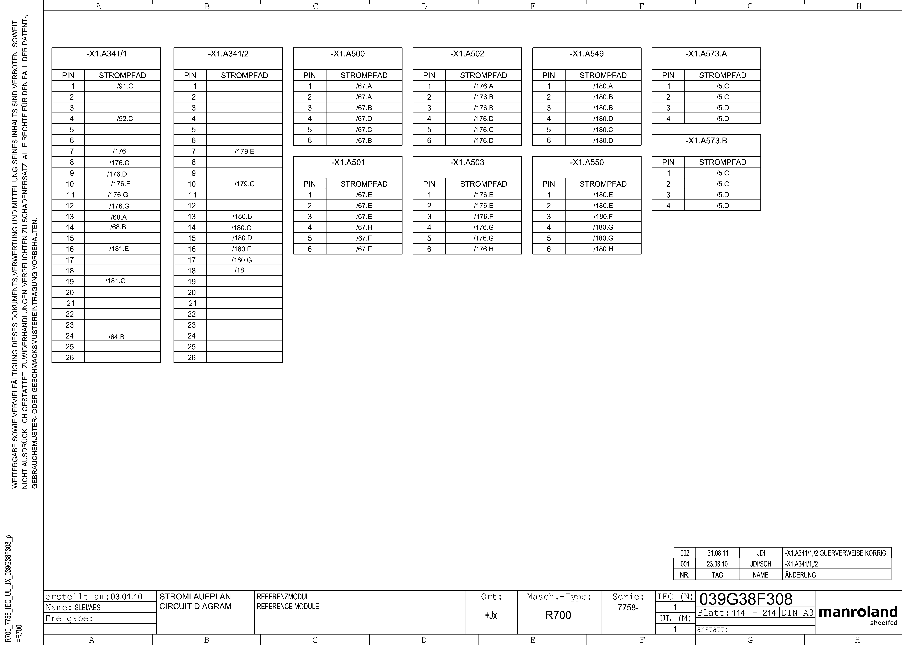

# +Jx — Sheet 114 of 214 — REFERENZMODUL

**REFERENCE MODULE**

> Part of the manroland **R700** printing press IEC/UL circuit diagrams.
> Drawing class: **Stromlaufplan / Circuit diagram** (DIN A3).
> Document `+Jx` covers the **1st printing module + feed register** machine section.

## At a glance

| Field | Value |
|---|---|
| Document | `+Jx`  (039G38F308) |
| Sheet | **114** of 214 |
| Section (DE) | REFERENZMODUL |
| Section (EN) | REFERENCE MODULE |
| Section type | REFERENCE_MODULE — Reference module |
| Machine type | `R700` |
| Series | `7758` |
| Created | 03.01.10 |
| Replaces | — |
| Columns used | A, B, C, D, E, F, G, H |
| Path numbers | — |
| Labels on sheet | 203 |
| Cross-refs out | 63 |
| Cross-refs in | 0 |

**Previous:** [+Jx sheet 113](SHEET_0113.md) · **Next:** [+Jx sheet 115](SHEET_0115.md) · **Document TOC:** [_TOC.md](_TOC.md)  (+Jx) · **Master TOC:** [all sheets](../_MASTER_TOC.md)

## Sheet image (300 DPI, exact vector render)



_Rendered directly from the PDF vector layer at 300 DPI (1-bit), no OCR and no resampling. Use it to confirm anything ambiguous in the text below._

## Cross-references on this sheet

Each entry is a wire leaving this sheet. The printed token is `/sheet.column`; the link resolves to that sheet inside the same document.

| Ref | Target sheet | Col | Path | Destination on target | Target section | From col |
|---|---|---|---|---|---|---|
| `/67.A` | [+Jx sheet 67](SHEET_0067.md) | A | — | — | BOGENFÜHRUNG | C |
| `/176.A` | [+Jx sheet 176](SHEET_0176.md) | A | — | — | OPTION: TRANSFERMODUL 1 NACH | E |
| `/180.A` | [+Jx sheet 180](SHEET_0180.md) | A | — | — | OPTION: TRANSFERMODUL 2 | F |
| `/5.C` | [+Jx sheet 5](SHEET_0005.md) | C | — | — | SPANNUNGSVERSORGUNG, SCHALTSCHRANKBELÜFTUNG | G |
| `/91.C` | [+Jx sheet 91](SHEET_0091.md) | C | — | — | BOGENFÜHRUNG (BLASROHRE) | A |
| `/67.A` | [+Jx sheet 67](SHEET_0067.md) | A | — | — | BOGENFÜHRUNG | C |
| `/176.B` | [+Jx sheet 176](SHEET_0176.md) | B | — | — | OPTION: TRANSFERMODUL 1 NACH | E |
| `/180.B` | [+Jx sheet 180](SHEET_0180.md) | B | — | — | OPTION: TRANSFERMODUL 2 | F |
| `/5.C` | [+Jx sheet 5](SHEET_0005.md) | C | — | — | SPANNUNGSVERSORGUNG, SCHALTSCHRANKBELÜFTUNG | G |
| `/67.B` | [+Jx sheet 67](SHEET_0067.md) | B | — | — | BOGENFÜHRUNG | C |
| `/176.B` | [+Jx sheet 176](SHEET_0176.md) | B | — | — | OPTION: TRANSFERMODUL 1 NACH | E |
| `/180.B` | [+Jx sheet 180](SHEET_0180.md) | B | — | — | OPTION: TRANSFERMODUL 2 | F |
| `/5.D` | [+Jx sheet 5](SHEET_0005.md) | D | — | — | SPANNUNGSVERSORGUNG, SCHALTSCHRANKBELÜFTUNG | G |
| `/5.D` | [+Jx sheet 5](SHEET_0005.md) | D | — | — | SPANNUNGSVERSORGUNG, SCHALTSCHRANKBELÜFTUNG | G |
| `/92.C` | [+Jx sheet 92](SHEET_0092.md) | C | — | — | BOGENFÜHRUNG (BLASROHRE) | A |
| `/67.D` | [+Jx sheet 67](SHEET_0067.md) | D | — | — | BOGENFÜHRUNG | C |
| `/176.D` | [+Jx sheet 176](SHEET_0176.md) | D | — | — | OPTION: TRANSFERMODUL 1 NACH | E |
| `/180.D` | [+Jx sheet 180](SHEET_0180.md) | D | — | — | OPTION: TRANSFERMODUL 2 | F |
| `/67.C` | [+Jx sheet 67](SHEET_0067.md) | C | — | — | BOGENFÜHRUNG | C |
| `/176.C` | [+Jx sheet 176](SHEET_0176.md) | C | — | — | OPTION: TRANSFERMODUL 1 NACH | E |
| `/180.C` | [+Jx sheet 180](SHEET_0180.md) | C | — | — | OPTION: TRANSFERMODUL 2 | F |
| `/67.B` | [+Jx sheet 67](SHEET_0067.md) | B | — | — | BOGENFÜHRUNG | C |
| `/176.D` | [+Jx sheet 176](SHEET_0176.md) | D | — | — | OPTION: TRANSFERMODUL 1 NACH | E |
| `/180.D` | [+Jx sheet 180](SHEET_0180.md) | D | — | — | OPTION: TRANSFERMODUL 2 | F |
| `/179.E` | [+Jx sheet 179](SHEET_0179.md) | E | — | — | OPTION: TRANSFERMODUL 1 NACH | B |
| `/176.C` | [+Jx sheet 176](SHEET_0176.md) | C | — | — | OPTION: TRANSFERMODUL 1 NACH | A |
| `/5.C` | [+Jx sheet 5](SHEET_0005.md) | C | — | — | SPANNUNGSVERSORGUNG, SCHALTSCHRANKBELÜFTUNG | G |
| `/176.D` | [+Jx sheet 176](SHEET_0176.md) | D | — | — | OPTION: TRANSFERMODUL 1 NACH | A |
| `/176.F` | [+Jx sheet 176](SHEET_0176.md) | F | — | — | OPTION: TRANSFERMODUL 1 NACH | A |
| `/5.C` | [+Jx sheet 5](SHEET_0005.md) | C | — | — | SPANNUNGSVERSORGUNG, SCHALTSCHRANKBELÜFTUNG | G |
| `/179.G` | [+Jx sheet 179](SHEET_0179.md) | G | — | — | OPTION: TRANSFERMODUL 1 NACH | B |
| `/67.E` | [+Jx sheet 67](SHEET_0067.md) | E | — | — | BOGENFÜHRUNG | C |
| `/176.E` | [+Jx sheet 176](SHEET_0176.md) | E | — | — | OPTION: TRANSFERMODUL 1 NACH | E |
| `/180.E` | [+Jx sheet 180](SHEET_0180.md) | E | — | — | OPTION: TRANSFERMODUL 2 | F |
| `/5.D` | [+Jx sheet 5](SHEET_0005.md) | D | — | — | SPANNUNGSVERSORGUNG, SCHALTSCHRANKBELÜFTUNG | G |
| `/176.G` | [+Jx sheet 176](SHEET_0176.md) | G | — | — | OPTION: TRANSFERMODUL 1 NACH | A |
| `/67.E` | [+Jx sheet 67](SHEET_0067.md) | E | — | — | BOGENFÜHRUNG | C |
| `/176.E` | [+Jx sheet 176](SHEET_0176.md) | E | — | — | OPTION: TRANSFERMODUL 1 NACH | E |
| `/180.E` | [+Jx sheet 180](SHEET_0180.md) | E | — | — | OPTION: TRANSFERMODUL 2 | F |
| `/5.D` | [+Jx sheet 5](SHEET_0005.md) | D | — | — | SPANNUNGSVERSORGUNG, SCHALTSCHRANKBELÜFTUNG | G |
| `/176.G` | [+Jx sheet 176](SHEET_0176.md) | G | — | — | OPTION: TRANSFERMODUL 1 NACH | A |
| `/180.B` | [+Jx sheet 180](SHEET_0180.md) | B | — | — | OPTION: TRANSFERMODUL 2 | B |
| `/67.E` | [+Jx sheet 67](SHEET_0067.md) | E | — | — | BOGENFÜHRUNG | C |
| `/176.F` | [+Jx sheet 176](SHEET_0176.md) | F | — | — | OPTION: TRANSFERMODUL 1 NACH | E |
| `/180.F` | [+Jx sheet 180](SHEET_0180.md) | F | — | — | OPTION: TRANSFERMODUL 2 | F |
| `/68.A` | [+Jx sheet 68](SHEET_0068.md) | A | — | — | BLAS/SAUGLUFT MIT MOTORVENTILEINSTELLUNG | A |
| `/68.B` | [+Jx sheet 68](SHEET_0068.md) | B | — | — | BLAS/SAUGLUFT MIT MOTORVENTILEINSTELLUNG | A |
| `/67.H` | [+Jx sheet 67](SHEET_0067.md) | H | — | — | BOGENFÜHRUNG | C |
| `/176.G` | [+Jx sheet 176](SHEET_0176.md) | G | — | — | OPTION: TRANSFERMODUL 1 NACH | E |
| `/180.G` | [+Jx sheet 180](SHEET_0180.md) | G | — | — | OPTION: TRANSFERMODUL 2 | F |
| `/180.C` | [+Jx sheet 180](SHEET_0180.md) | C | — | — | OPTION: TRANSFERMODUL 2 | B |
| `/180.D` | [+Jx sheet 180](SHEET_0180.md) | D | — | — | OPTION: TRANSFERMODUL 2 | B |
| `/67.F` | [+Jx sheet 67](SHEET_0067.md) | F | — | — | BOGENFÜHRUNG | C |
| `/176.G` | [+Jx sheet 176](SHEET_0176.md) | G | — | — | OPTION: TRANSFERMODUL 1 NACH | E |
| `/180.G` | [+Jx sheet 180](SHEET_0180.md) | G | — | — | OPTION: TRANSFERMODUL 2 | F |
| `/181.E` | [+Jx sheet 181](SHEET_0181.md) | E | — | — | OPTION: TRANSFERMODUL 2 | A |
| `/180.F` | [+Jx sheet 180](SHEET_0180.md) | F | — | — | OPTION: TRANSFERMODUL 2 | B |
| `/67.E` | [+Jx sheet 67](SHEET_0067.md) | E | — | — | BOGENFÜHRUNG | C |
| `/176.H` | [+Jx sheet 176](SHEET_0176.md) | H | — | — | OPTION: TRANSFERMODUL 1 NACH | E |
| `/180.H` | [+Jx sheet 180](SHEET_0180.md) | H | — | — | OPTION: TRANSFERMODUL 2 | F |
| `/180.G` | [+Jx sheet 180](SHEET_0180.md) | G | — | — | OPTION: TRANSFERMODUL 2 | B |
| `/181.G` | [+Jx sheet 181](SHEET_0181.md) | G | — | — | OPTION: TRANSFERMODUL 2 | A |
| `/64.B` | [+Jx sheet 64](SHEET_0064.md) | B | — | — | TROPFEINRICHTUNG | A |

## Devices on this sheet

| Tag | Class | Class meaning (IEC) | Col | Sub | Terminal | Sign |
|---|---|---|---|---|---|---|
| `/176.` | — | cross-device reference | A | — | — | — |
| `X1.A500` | — | cross-device reference | C | — | — | — |
| `X1.A501` | — | cross-device reference | C | — | — | — |
| `X1.A502` | — | cross-device reference | D | — | — | — |
| `X1.A503` | — | cross-device reference | D | — | — | — |
| `X1.A549` | — | cross-device reference | F | — | — | — |
| `X1.A550` | — | cross-device reference | F | — | — | — |
| `X1.A573.A` | — | cross-device reference | G | — | — | — |
| `X1.A573.B` | — | cross-device reference | G | — | — | — |
| `NR.` | — | cross-device reference | F | — | — | — |
| `23.08.10` | — | cross-device reference | G | — | — | — |
| `31.08.11` | — | cross-device reference | G | — | — | — |

## Potentials / nets

_No named potentials on this sheet._

## Wire-end annotations (grouped as printed)

A wire that continues elsewhere is annotated with a small cluster: the destination description, the path/line number `#NN`, and the `/sheet.column` cross reference. Each row below is one such cluster exactly as it is grouped on the drawing.

| Col | Y | Path | Cross-ref | Text on the wire |
|---|---|---|---|---|
| A | 65.4 | — | — | `X1.A341/1` |
| B | 65.4 | — | — | `X1.A341/2` |
| C | 65.4 | — | — | `X1.A500` |
| D | 65.4 | — | — | `X1.A502` |
| F | 65.4 | — | — | `X1.A549` |
| G | 65.5 | — | — | `X1.A573.A` |
| A | 94.1 | — | — | `PIN STROMPFAD` |
| B | 94.1 | — | — | `PIN STROMPFAD` |
| C | 94.1 | — | — | `PIN 2 3 5 6 4 1 STROMPFAD` |
| D | 94.1 | — | — | `PIN 2 3 5 6 4 1 STROMPFAD` |
| E | 94.1 | — | — | `PIN 2 3 5 6 4 1 STROMPFAD` |
| G | 94.1 | — | — | `PIN 2 3 4 1 STROMPFAD` |
| A | 108.3 | — | — | `2 3 4 5 6 7 8 9 1` |
| B | 108.3 | — | — | `2 3 4 5 6 7 8 9 1` |
| C | 108.6 | — | `/67.A` | — |
| E | 108.6 | — | `/176.A` | — |
| F | 108.6 | — | `/180.A` | — |
| G | 108.6 | — | `/5.C` | — |
| A | 108.7 | — | `/91.C` | — |
| C | 122.8 | — | `/67.A` | — |
| E | 122.8 | — | `/176.B` | — |
| F | 122.8 | — | `/180.B` | — |
| G | 122.8 | — | `/5.C` | — |
| C | 137.0 | — | `/67.B` | — |
| E | 137.0 | — | `/176.B` | — |
| F | 137.0 | — | `/180.B` | — |
| G | 137.0 | — | `/5.D` | — |
| A | 151.2 | — | `/92.C` | — |
| C | 151.2 | — | `/67.D` | — |
| E | 151.2 | — | `/176.D` | — |
| F | 151.2 | — | `/180.D` | — |
| G | 151.2 | — | `/5.D` | — |
| C | 165.3 | — | `/67.C` | — |
| E | 165.3 | — | `/176.C` | — |
| F | 165.3 | — | `/180.C` | — |
| G | 178.8 | — | — | `X1.A573.B` |
| C | 179.5 | — | `/67.B` | — |
| E | 179.5 | — | `/176.D` | — |
| F | 179.5 | — | `/180.D` | — |
| A | 193.6 | — | — | `/176.` |
| B | 193.7 | — | `/179.E` | — |
| C | 207.2 | — | — | `X1.A501` |
| D | 207.2 | — | — | `X1.A503` |
| F | 207.2 | — | — | `X1.A550` |
| G | 207.5 | — | — | `PIN 2 3 4 1 STROMPFAD` |
| A | 208.6 | — | `/176.C` | — |
| G | 222.0 | — | `/5.C` | — |
| A | 223.6 | — | `/176.D` | — |
| C | 235.8 | — | — | `PIN 2 3 5 6 4 1 STROMPFAD` |
| D | 235.8 | — | — | `PIN 2 3 5 6 4 1 STROMPFAD` |
| E | 235.8 | — | — | `PIN 2 3 5 6 4 1 STROMPFAD` |
| A | 235.9 | — | — | `10 12 13 14 15 16 17 18 19 20 11` |
| B | 235.9 | — | — | `10 12 13 14 15 16 17 18 19 20 11` |
| A | 236.0 | — | `/176.F` | — |
| B | 236.2 | — | `/179.G` | — |
| G | 236.2 | — | `/5.C` | — |
| C | 250.3 | — | `/67.E` | — |
| A | 250.4 | — | `/176.G` | — |
| E | 250.4 | — | `/176.E` | — |
| F | 250.4 | — | `/180.E` | — |
| G | 250.4 | — | `/5.D` | — |
| C | 264.5 | — | `/67.E` | — |
| E | 264.5 | — | `/176.E` | — |
| F | 264.5 | — | `/180.E` | — |
| G | 264.5 | — | `/5.D` | — |
| A | 265.4 | — | `/176.G` | — |
| B | 278.4 | — | `/180.B` | — |
| C | 278.7 | — | `/67.E` | — |
| E | 278.7 | — | `/176.F` | — |
| F | 278.7 | — | `/180.F` | — |
| A | 279.7 | — | `/68.A`, `/68.B` | — |
| C | 292.9 | — | `/67.H` | — |
| E | 292.9 | — | `/176.G` | — |
| F | 292.9 | — | `/180.G` | — |
| B | 293.7 | — | `/180.C` | — |
| B | 306.8 | — | `/180.D` | — |
| C | 307.1 | — | `/67.F` | — |
| E | 307.1 | — | `/176.G` | — |
| F | 307.1 | — | `/180.G` | — |
| A | 320.8 | — | `/181.E` | — |
| B | 321.1 | — | `/180.F` | — |
| C | 321.2 | — | `/67.E` | — |
| E | 321.3 | — | `/176.H` | — |
| F | 321.3 | — | `/180.H` | — |
| B | 335.5 | — | `/180.G` | — |
| B | 348.9 | — | — | `/18` |
| A | 362.6 | — | `/181.G` | — |
| A | 391.8 | — | — | `22 23 24 25 26 21` |
| B | 391.8 | — | — | `22 23 24 25 26 21` |
| A | 435.9 | — | `/64.B` | — |
| G | 718.7 | — | — | `002 31.08.11 JDI X1.A341/1,/2 QUERVERWEISE KORRIG.` |
| G | 733.0 | — | — | `001 23.08.10 JDI/SCH X1.A341/1,/2` |
| G | 747.1 | — | — | `NR. TAG NAME ÄNDERUNG` |


## Reconstructed tables

This sheet carries tabular content (pin map / terminal assignment / index). The grid below was rebuilt from the drawing's own rule lines, so each row is exactly one physical row of the table.

### Table 1 — 26 data rows × 2 columns (at x=67.7, y=62.4) — **X1.A341/1**

| PIN | STROMPFAD |
|---|---|
| `1` | `/91.C` |
| `2` |  |
| `3` |  |
| `4` | `/92.C` |
| `5` |  |
| `6` |  |
| `7` | `/176.` |
| `8` | `/176.C` |
| `9` | `/176.D` |
| `10` | `/176.F` |
| `11` | `/176.G` |
| `12` | `/176.G` |
| `13` | `/68.A` |
| `14` | `/68.B` |
| `15` |  |
| `16` | `/181.E` |
| `17` |  |
| `18` |  |
| `19` | `/181.G` |
| `20` |  |
| `21` |  |
| `22` |  |
| `23` |  |
| `24` | `/64.B` |
| `25` |  |
| `26` |  |


### Table 2 — 26 data rows × 2 columns (at x=226.8, y=62.4) — **X1.A341/2**

| PIN | STROMPFAD |
|---|---|
| `1` |  |
| `2` |  |
| `3` |  |
| `4` |  |
| `5` |  |
| `6` |  |
| `7` | `/179.E` |
| `8` |  |
| `9` |  |
| `10` | `/179.G` |
| `11` |  |
| `12` |  |
| `13` | `/180.B` |
| `14` | `/180.C` |
| `15` | `/180.D` |
| `16` | `/180.F` |
| `17` | `/180.G` |
| `18` | `/18` |
| `19` |  |
| `20` |  |
| `21` |  |
| `22` |  |
| `23` |  |
| `24` |  |
| `25` |  |
| `26` |  |


### Table 3 — 14 data rows × 2 columns (at x=382.7, y=62.4) — **X1.A500**

| PIN | STROMPFAD |
|---|---|
| `1` | `/67.A` |
| `2` | `/67.A` |
| `3` | `/67.B` |
| `4` | `/67.D` |
| `5` | `/67.C` |
| `6` | `/67.B` |
|  | `X1.A501` |
| `PIN` | `STROMPFAD` |
| `1` | `/67.E` |
| `2` | `/67.E` |
| `3` | `/67.E` |
| `4` | `/67.H` |
| `5` | `/67.F` |
| `6` | `/67.E` |


### Table 4 — 14 data rows × 2 columns (at x=538.6, y=62.4) — **X1.A502**

| PIN | STROMPFAD |
|---|---|
| `1` | `/176.A` |
| `2` | `/176.B` |
| `3` | `/176.B` |
| `4` | `/176.D` |
| `5` | `/176.C` |
| `6` | `/176.D` |
|  | `X1.A503` |
| `PIN` | `STROMPFAD` |
| `1` | `/176.E` |
| `2` | `/176.E` |
| `3` | `/176.F` |
| `4` | `/176.G` |
| `5` | `/176.G` |
| `6` | `/176.H` |


### Table 5 — 14 data rows × 2 columns (at x=694.5, y=62.4) — **X1.A549**

| PIN | STROMPFAD |
|---|---|
| `1` | `/180.A` |
| `2` | `/180.B` |
| `3` | `/180.B` |
| `4` | `/180.D` |
| `5` | `/180.C` |
| `6` | `/180.D` |
|  | `X1.A550` |
| `PIN` | `STROMPFAD` |
| `1` | `/180.E` |
| `2` | `/180.E` |
| `3` | `/180.F` |
| `4` | `/180.G` |
| `5` | `/180.G` |
| `6` | `/180.H` |


### Table 6 — 10 data rows × 2 columns (at x=850.4, y=62.4) — **X1.A573.A**

| PIN | STROMPFAD |
|---|---|
| `1` | `/5.C` |
| `2` | `/5.C` |
| `3` | `/5.D` |
| `4` | `/5.D` |
|  | `X1.A573.B` |
| `PIN` | `STROMPFAD` |
| `1` | `/5.C` |
| `2` | `/5.C` |
| `3` | `/5.D` |
| `4` | `/5.D` |


## Notes and free text on this sheet

| Text | Col | Y (pt) |
|---|---|---|
| `PIN` | A | 94.13 |
| `STROMPFAD` | A | 94.09 |
| `X1.A341/1` | A | 65.44 |
| `PIN` | B | 94.13 |
| `STROMPFAD` | B | 94.09 |
| `X1.A341/2` | B | 65.44 |
| `PIN` | C | 94.13 |
| `STROMPFAD` | C | 94.09 |
| `PIN` | D | 94.13 |
| `STROMPFAD` | E | 94.09 |
| `PIN` | E | 94.13 |
| `STROMPFAD` | F | 94.09 |
| `PIN` | F | 94.13 |
| `STROMPFAD` | G | 94.09 |
| `TAG` | G | 747.23 |
| `NAME` | G | 747.22 |
| `ÄNDERUNG` | G | 747.25 |
| `JDI/SCH` | G | 733.05 |
| `X1.A341/1,/2` | G | 733.07 |
| `JDI` | G | 718.7 |
| `X1.A341/1,/2 QUERVERWEISE KORRIG.` | H | 718.78 |

## Complete label inventory (exact text from the drawing)

Every text object inside the drawing area of this sheet, in DIN reading order (column A→H, then top→bottom). This is the authoritative list: if a string is not here it is not printed on this sheet.

| Col | Y | X | Dir | Type | Text |
|---|---|---|---|---|---|
| A | 65.4 | 112.9 | → | text | `X1.A341/1` |
| A | 94.1 | 80.8 | → | text | `PIN` |
| A | 94.1 | 129.2 | → | text | `STROMPFAD` |
| A | 108.3 | 92.3 | → | number | `1` |
| A | 108.7 | 152.6 | → | cross-reference | `/91.C` |
| A | 122.5 | 90.9 | → | number | `2` |
| A | 136.7 | 90.9 | → | number | `3` |
| A | 150.8 | 90.9 | → | number | `4` |
| A | 151.2 | 152.6 | → | cross-reference | `/92.C` |
| A | 165.0 | 90.9 | → | number | `5` |
| A | 179.2 | 90.9 | → | number | `6` |
| A | 193.3 | 90.9 | → | number | `7` |
| A | 193.6 | 147.2 | → | device ref | `/176.` |
| A | 207.5 | 90.9 | → | number | `8` |
| A | 208.6 | 142.8 | → | cross-reference | `/176.C` |
| A | 221.7 | 90.9 | → | number | `9` |
| A | 223.6 | 139.7 | → | cross-reference | `/176.D` |
| A | 235.9 | 85.5 | → | number | `10` |
| A | 236.0 | 144.8 | → | cross-reference | `/176.F` |
| A | 250.0 | 86.9 | → | number | `11` |
| A | 250.4 | 140.7 | → | cross-reference | `/176.G` |
| A | 264.2 | 85.5 | → | number | `12` |
| A | 265.3 | 142.6 | → | cross-reference | `/176.G` |
| A | 278.4 | 85.5 | → | number | `13` |
| A | 279.7 | 144.6 | → | cross-reference | `/68.A` |
| A | 292.4 | 143.8 | → | cross-reference | `/68.B` |
| A | 292.6 | 85.5 | → | number | `14` |
| A | 306.7 | 85.5 | → | number | `15` |
| A | 320.8 | 142.7 | → | cross-reference | `/181.E` |
| A | 320.9 | 85.5 | → | number | `16` |
| A | 335.1 | 85.5 | → | number | `17` |
| A | 349.3 | 85.5 | → | number | `18` |
| A | 362.6 | 137.6 | → | cross-reference | `/181.G` |
| A | 363.4 | 85.5 | → | number | `19` |
| A | 377.6 | 85.5 | → | number | `20` |
| A | 391.8 | 86.9 | → | number | `21` |
| A | 405.9 | 85.5 | → | number | `22` |
| A | 420.1 | 85.5 | → | number | `23` |
| A | 434.3 | 85.5 | → | number | `24` |
| A | 435.9 | 141.6 | → | cross-reference | `/64.B` |
| A | 448.5 | 85.5 | → | number | `25` |
| A | 462.6 | 85.5 | → | number | `26` |
| B | 65.4 | 271.3 | → | text | `X1.A341/2` |
| B | 94.1 | 240.0 | → | text | `PIN` |
| B | 94.1 | 288.3 | → | text | `STROMPFAD` |
| B | 108.3 | 251.4 | → | number | `1` |
| B | 122.5 | 250.0 | → | number | `2` |
| B | 136.7 | 250.0 | → | number | `3` |
| B | 150.8 | 250.0 | → | number | `4` |
| B | 165.0 | 250.0 | → | number | `5` |
| B | 179.2 | 250.0 | → | number | `6` |
| B | 193.3 | 250.0 | → | number | `7` |
| B | 193.7 | 306.3 | → | cross-reference | `/179.E` |
| B | 207.5 | 250.0 | → | number | `8` |
| B | 221.7 | 250.0 | → | number | `9` |
| B | 235.9 | 244.6 | → | number | `10` |
| B | 236.2 | 305.9 | → | cross-reference | `/179.G` |
| B | 250.0 | 246.0 | → | number | `11` |
| B | 264.2 | 244.6 | → | number | `12` |
| B | 278.4 | 244.6 | → | number | `13` |
| B | 278.4 | 303.3 | → | cross-reference | `/180.B` |
| B | 292.6 | 244.6 | → | number | `14` |
| B | 293.7 | 301.9 | → | cross-reference | `/180.C` |
| B | 306.7 | 244.6 | → | number | `15` |
| B | 306.8 | 303.1 | → | cross-reference | `/180.D` |
| B | 320.9 | 244.6 | → | number | `16` |
| B | 321.2 | 302.6 | → | cross-reference | `/180.F` |
| B | 335.1 | 244.6 | → | number | `17` |
| B | 335.5 | 302.2 | → | cross-reference | `/180.G` |
| B | 348.9 | 306.2 | → | number | `/18` |
| B | 349.3 | 244.6 | → | number | `18` |
| B | 363.4 | 244.6 | → | number | `19` |
| B | 377.6 | 244.6 | → | number | `20` |
| B | 391.8 | 246.0 | → | number | `21` |
| B | 405.9 | 244.6 | → | number | `22` |
| B | 420.1 | 244.6 | → | number | `23` |
| B | 434.3 | 244.6 | → | number | `24` |
| B | 448.5 | 244.6 | → | number | `25` |
| B | 462.6 | 244.6 | → | number | `26` |
| C | 65.4 | 431.6 | → | device ref | `X1.A500` |
| C | 94.1 | 395.9 | → | text | `PIN` |
| C | 94.1 | 444.2 | → | text | `STROMPFAD` |
| C | 108.3 | 401.7 | → | number | `1` |
| C | 108.6 | 464.5 | → | cross-reference | `/67.A` |
| C | 122.5 | 401.2 | → | number | `2` |
| C | 122.8 | 464.5 | → | cross-reference | `/67.A` |
| C | 136.7 | 401.2 | → | number | `3` |
| C | 137.0 | 464.6 | → | cross-reference | `/67.B` |
| C | 150.8 | 401.4 | → | number | `4` |
| C | 151.2 | 464.5 | → | cross-reference | `/67.D` |
| C | 165.0 | 401.2 | → | number | `5` |
| C | 165.3 | 464.5 | → | cross-reference | `/67.C` |
| C | 179.2 | 401.2 | → | number | `6` |
| C | 179.5 | 464.6 | → | cross-reference | `/67.B` |
| C | 207.2 | 432.3 | → | device ref | `X1.A501` |
| C | 235.8 | 444.2 | → | text | `STROMPFAD` |
| C | 235.9 | 395.9 | → | text | `PIN` |
| C | 250.0 | 401.7 | → | number | `1` |
| C | 250.3 | 464.6 | → | cross-reference | `/67.E` |
| C | 264.2 | 401.2 | → | number | `2` |
| C | 264.5 | 464.6 | → | cross-reference | `/67.E` |
| C | 278.4 | 401.2 | → | number | `3` |
| C | 278.7 | 464.6 | → | cross-reference | `/67.E` |
| C | 292.6 | 401.4 | → | number | `4` |
| C | 292.9 | 464.6 | → | cross-reference | `/67.H` |
| C | 306.7 | 401.2 | → | number | `5` |
| C | 307.1 | 464.9 | → | cross-reference | `/67.F` |
| C | 320.9 | 401.2 | → | number | `6` |
| C | 321.2 | 464.6 | → | cross-reference | `/67.E` |
| D | 65.4 | 587.5 | → | device ref | `X1.A502` |
| D | 94.1 | 551.8 | → | text | `PIN` |
| D | 108.3 | 557.6 | → | number | `1` |
| D | 122.5 | 557.1 | → | number | `2` |
| D | 136.7 | 557.1 | → | number | `3` |
| D | 150.8 | 557.3 | → | number | `4` |
| D | 165.0 | 557.1 | → | number | `5` |
| D | 179.2 | 557.1 | → | number | `6` |
| D | 207.2 | 587.3 | → | device ref | `X1.A503` |
| D | 235.9 | 551.8 | → | text | `PIN` |
| D | 250.0 | 557.6 | → | number | `1` |
| D | 264.2 | 557.1 | → | number | `2` |
| D | 278.4 | 557.1 | → | number | `3` |
| D | 292.6 | 557.3 | → | number | `4` |
| D | 306.7 | 557.1 | → | number | `5` |
| D | 320.9 | 557.1 | → | number | `6` |
| E | 94.1 | 600.1 | → | text | `STROMPFAD` |
| E | 94.1 | 707.7 | → | text | `PIN` |
| E | 108.3 | 713.5 | → | number | `1` |
| E | 108.6 | 618.0 | → | cross-reference | `/176.A` |
| E | 122.5 | 713.1 | → | number | `2` |
| E | 122.8 | 618.1 | → | cross-reference | `/176.B` |
| E | 136.7 | 713.1 | → | number | `3` |
| E | 137.0 | 618.1 | → | cross-reference | `/176.B` |
| E | 150.8 | 713.2 | → | number | `4` |
| E | 151.2 | 618.0 | → | cross-reference | `/176.D` |
| E | 165.0 | 713.1 | → | number | `5` |
| E | 165.4 | 618.0 | → | cross-reference | `/176.C` |
| E | 179.2 | 713.1 | → | number | `6` |
| E | 179.5 | 618.0 | → | cross-reference | `/176.D` |
| E | 235.8 | 600.1 | → | text | `STROMPFAD` |
| E | 235.9 | 707.7 | → | text | `PIN` |
| E | 250.0 | 713.5 | → | number | `1` |
| E | 250.4 | 618.1 | → | cross-reference | `/176.E` |
| E | 264.2 | 713.1 | → | number | `2` |
| E | 264.5 | 618.1 | → | cross-reference | `/176.E` |
| E | 278.4 | 713.1 | → | number | `3` |
| E | 278.7 | 618.4 | → | cross-reference | `/176.F` |
| E | 292.6 | 713.2 | → | number | `4` |
| E | 292.9 | 617.7 | → | cross-reference | `/176.G` |
| E | 306.7 | 713.1 | → | number | `5` |
| E | 307.1 | 617.7 | → | cross-reference | `/176.G` |
| E | 320.9 | 713.1 | → | number | `6` |
| E | 321.3 | 618.1 | → | cross-reference | `/176.H` |
| F | 65.4 | 743.2 | → | device ref | `X1.A549` |
| F | 94.1 | 756.0 | → | text | `STROMPFAD` |
| F | 94.1 | 863.6 | → | text | `PIN` |
| F | 108.3 | 869.4 | → | number | `1` |
| F | 108.6 | 773.9 | → | cross-reference | `/180.A` |
| F | 122.5 | 869.0 | → | number | `2` |
| F | 122.8 | 774.0 | → | cross-reference | `/180.B` |
| F | 136.7 | 869.0 | → | number | `3` |
| F | 137.0 | 774.0 | → | cross-reference | `/180.B` |
| F | 150.8 | 869.1 | → | number | `4` |
| F | 151.2 | 773.9 | → | cross-reference | `/180.D` |
| F | 165.4 | 773.9 | → | cross-reference | `/180.C` |
| F | 179.5 | 773.9 | → | cross-reference | `/180.D` |
| F | 207.2 | 743.4 | → | device ref | `X1.A550` |
| F | 207.5 | 863.6 | → | text | `PIN` |
| F | 221.7 | 869.4 | → | number | `1` |
| F | 235.8 | 756.0 | → | text | `STROMPFAD` |
| F | 235.9 | 869.0 | → | number | `2` |
| F | 250.0 | 869.0 | → | number | `3` |
| F | 250.4 | 774.0 | → | cross-reference | `/180.E` |
| F | 264.2 | 869.1 | → | number | `4` |
| F | 264.5 | 774.0 | → | cross-reference | `/180.E` |
| F | 278.7 | 774.3 | → | cross-reference | `/180.F` |
| F | 292.9 | 773.6 | → | cross-reference | `/180.G` |
| F | 307.1 | 773.6 | → | cross-reference | `/180.G` |
| F | 321.3 | 774.0 | → | cross-reference | `/180.H` |
| F | 718.8 | 887.4 | → | number | `002` |
| F | 733.0 | 887.6 | → | number | `001` |
| F | 747.1 | 886.8 | → | device ref | `NR.` |
| G | 65.4 | 894.0 | → | device ref | `X1.A573.A` |
| G | 94.1 | 911.9 | → | text | `STROMPFAD` |
| G | 108.6 | 934.6 | → | cross-reference | `/5.C` |
| G | 122.8 | 934.6 | → | cross-reference | `/5.C` |
| G | 137.0 | 934.6 | → | cross-reference | `/5.D` |
| G | 151.2 | 934.6 | → | cross-reference | `/5.D` |
| G | 178.8 | 894.3 | → | device ref | `X1.A573.B` |
| G | 207.5 | 911.9 | → | text | `STROMPFAD` |
| G | 222.0 | 934.6 | → | cross-reference | `/5.C` |
| G | 236.2 | 934.6 | → | cross-reference | `/5.C` |
| G | 250.4 | 934.6 | → | cross-reference | `/5.D` |
| G | 264.5 | 934.6 | → | cross-reference | `/5.D` |
| G | 718.7 | 987.3 | → | text | `JDI` |
| G | 718.8 | 922.6 | → | device ref | `31.08.11` |
| G | 733.1 | 921.9 | → | device ref | `23.08.10` |
| G | 733.1 | 978.6 | → | text | `JDI/SCH` |
| G | 733.1 | 1023.7 | → | text | `X1.A341/1,/2` |
| G | 747.2 | 928.5 | → | text | `TAG` |
| G | 747.2 | 981.8 | → | text | `NAME` |
| G | 747.3 | 1024.0 | → | text | `ÄNDERUNG` |
| H | 718.8 | 1024.0 | → | text | `X1.A341/1,/2 QUERVERWEISE KORRIG.` |

## Reading-order text block

The same content as a plain block, grouped by DIN column — convenient to paste or to match against a visual description.

```text
=== Column A ===
  65.4  112.9  text         X1.A341/1
  94.1   80.8  text         PIN
  94.1  129.2  text         STROMPFAD
 108.3   92.3  numeric      1
 108.7  152.6  xref         /91.C
 122.5   90.9  numeric      2
 136.7   90.9  numeric      3
 150.8   90.9  numeric      4
 151.2  152.6  xref         /92.C
 165.0   90.9  numeric      5
 179.2   90.9  numeric      6
 193.3   90.9  numeric      7
 193.6  147.2  devref       /176.
 207.5   90.9  numeric      8
 208.6  142.8  xref         /176.C
 221.7   90.9  numeric      9
 223.6  139.7  xref         /176.D
 235.9   85.5  numeric      10
 236.0  144.8  xref         /176.F
 250.0   86.9  numeric      11
 250.4  140.7  xref         /176.G
 264.2   85.5  numeric      12
 265.3  142.6  xref         /176.G
 278.4   85.5  numeric      13
 279.7  144.6  xref         /68.A
 292.4  143.8  xref         /68.B
 292.6   85.5  numeric      14
 306.7   85.5  numeric      15
 320.8  142.7  xref         /181.E
 320.9   85.5  numeric      16
 335.1   85.5  numeric      17
 349.3   85.5  numeric      18
 362.6  137.6  xref         /181.G
 363.4   85.5  numeric      19
 377.6   85.5  numeric      20
 391.8   86.9  numeric      21
 405.9   85.5  numeric      22
 420.1   85.5  numeric      23
 434.3   85.5  numeric      24
 435.9  141.6  xref         /64.B
 448.5   85.5  numeric      25
 462.6   85.5  numeric      26
=== Column B ===
  65.4  271.3  text         X1.A341/2
  94.1  240.0  text         PIN
  94.1  288.3  text         STROMPFAD
 108.3  251.4  numeric      1
 122.5  250.0  numeric      2
 136.7  250.0  numeric      3
 150.8  250.0  numeric      4
 165.0  250.0  numeric      5
 179.2  250.0  numeric      6
 193.3  250.0  numeric      7
 193.7  306.3  xref         /179.E
 207.5  250.0  numeric      8
 221.7  250.0  numeric      9
 235.9  244.6  numeric      10
 236.2  305.9  xref         /179.G
 250.0  246.0  numeric      11
 264.2  244.6  numeric      12
 278.4  244.6  numeric      13
 278.4  303.3  xref         /180.B
 292.6  244.6  numeric      14
 293.7  301.9  xref         /180.C
 306.7  244.6  numeric      15
 306.8  303.1  xref         /180.D
 320.9  244.6  numeric      16
 321.2  302.6  xref         /180.F
 335.1  244.6  numeric      17
 335.5  302.2  xref         /180.G
 348.9  306.2  numeric      /18
 349.3  244.6  numeric      18
 363.4  244.6  numeric      19
 377.6  244.6  numeric      20
 391.8  246.0  numeric      21
 405.9  244.6  numeric      22
 420.1  244.6  numeric      23
 434.3  244.6  numeric      24
 448.5  244.6  numeric      25
 462.6  244.6  numeric      26
=== Column C ===
  65.4  431.6  devref       X1.A500
  94.1  395.9  text         PIN
  94.1  444.2  text         STROMPFAD
 108.3  401.7  numeric      1
 108.6  464.5  xref         /67.A
 122.5  401.2  numeric      2
 122.8  464.5  xref         /67.A
 136.7  401.2  numeric      3
 137.0  464.6  xref         /67.B
 150.8  401.4  numeric      4
 151.2  464.5  xref         /67.D
 165.0  401.2  numeric      5
 165.3  464.5  xref         /67.C
 179.2  401.2  numeric      6
 179.5  464.6  xref         /67.B
 207.2  432.3  devref       X1.A501
 235.8  444.2  text         STROMPFAD
 235.9  395.9  text         PIN
 250.0  401.7  numeric      1
 250.3  464.6  xref         /67.E
 264.2  401.2  numeric      2
 264.5  464.6  xref         /67.E
 278.4  401.2  numeric      3
 278.7  464.6  xref         /67.E
 292.6  401.4  numeric      4
 292.9  464.6  xref         /67.H
 306.7  401.2  numeric      5
 307.1  464.9  xref         /67.F
 320.9  401.2  numeric      6
 321.2  464.6  xref         /67.E
=== Column D ===
  65.4  587.5  devref       X1.A502
  94.1  551.8  text         PIN
 108.3  557.6  numeric      1
 122.5  557.1  numeric      2
 136.7  557.1  numeric      3
 150.8  557.3  numeric      4
 165.0  557.1  numeric      5
 179.2  557.1  numeric      6
 207.2  587.3  devref       X1.A503
 235.9  551.8  text         PIN
 250.0  557.6  numeric      1
 264.2  557.1  numeric      2
 278.4  557.1  numeric      3
 292.6  557.3  numeric      4
 306.7  557.1  numeric      5
 320.9  557.1  numeric      6
=== Column E ===
  94.1  600.1  text         STROMPFAD
  94.1  707.7  text         PIN
 108.3  713.5  numeric      1
 108.6  618.0  xref         /176.A
 122.5  713.1  numeric      2
 122.8  618.1  xref         /176.B
 136.7  713.1  numeric      3
 137.0  618.1  xref         /176.B
 150.8  713.2  numeric      4
 151.2  618.0  xref         /176.D
 165.0  713.1  numeric      5
 165.4  618.0  xref         /176.C
 179.2  713.1  numeric      6
 179.5  618.0  xref         /176.D
 235.8  600.1  text         STROMPFAD
 235.9  707.7  text         PIN
 250.0  713.5  numeric      1
 250.4  618.1  xref         /176.E
 264.2  713.1  numeric      2
 264.5  618.1  xref         /176.E
 278.4  713.1  numeric      3
 278.7  618.4  xref         /176.F
 292.6  713.2  numeric      4
 292.9  617.7  xref         /176.G
 306.7  713.1  numeric      5
 307.1  617.7  xref         /176.G
 320.9  713.1  numeric      6
 321.3  618.1  xref         /176.H
=== Column F ===
  65.4  743.2  devref       X1.A549
  94.1  756.0  text         STROMPFAD
  94.1  863.6  text         PIN
 108.3  869.4  numeric      1
 108.6  773.9  xref         /180.A
 122.5  869.0  numeric      2
 122.8  774.0  xref         /180.B
 136.7  869.0  numeric      3
 137.0  774.0  xref         /180.B
 150.8  869.1  numeric      4
 151.2  773.9  xref         /180.D
 165.4  773.9  xref         /180.C
 179.5  773.9  xref         /180.D
 207.2  743.4  devref       X1.A550
 207.5  863.6  text         PIN
 221.7  869.4  numeric      1
 235.8  756.0  text         STROMPFAD
 235.9  869.0  numeric      2
 250.0  869.0  numeric      3
 250.4  774.0  xref         /180.E
 264.2  869.1  numeric      4
 264.5  774.0  xref         /180.E
 278.7  774.3  xref         /180.F
 292.9  773.6  xref         /180.G
 307.1  773.6  xref         /180.G
 321.3  774.0  xref         /180.H
 718.8  887.4  numeric      002
 733.0  887.6  numeric      001
 747.1  886.8  devref       NR.
=== Column G ===
  65.4  894.0  devref       X1.A573.A
  94.1  911.9  text         STROMPFAD
 108.6  934.6  xref         /5.C
 122.8  934.6  xref         /5.C
 137.0  934.6  xref         /5.D
 151.2  934.6  xref         /5.D
 178.8  894.3  devref       X1.A573.B
 207.5  911.9  text         STROMPFAD
 222.0  934.6  xref         /5.C
 236.2  934.6  xref         /5.C
 250.4  934.6  xref         /5.D
 264.5  934.6  xref         /5.D
 718.7  987.3  text         JDI
 718.8  922.6  devref       31.08.11
 733.1  921.9  devref       23.08.10
 733.1  978.6  text         JDI/SCH
 733.1 1023.7  text         X1.A341/1,/2
 747.2  928.5  text         TAG
 747.2  981.8  text         NAME
 747.3 1024.0  text         ÄNDERUNG
=== Column H ===
 718.8 1024.0  text         X1.A341/1,/2 QUERVERWEISE KORRIG.
```

---
_Generated from the PDF vector text layer; no OCR. Source: `R700_7758_IEC_UL_JX_039G38F308_p`, sheet 114._
