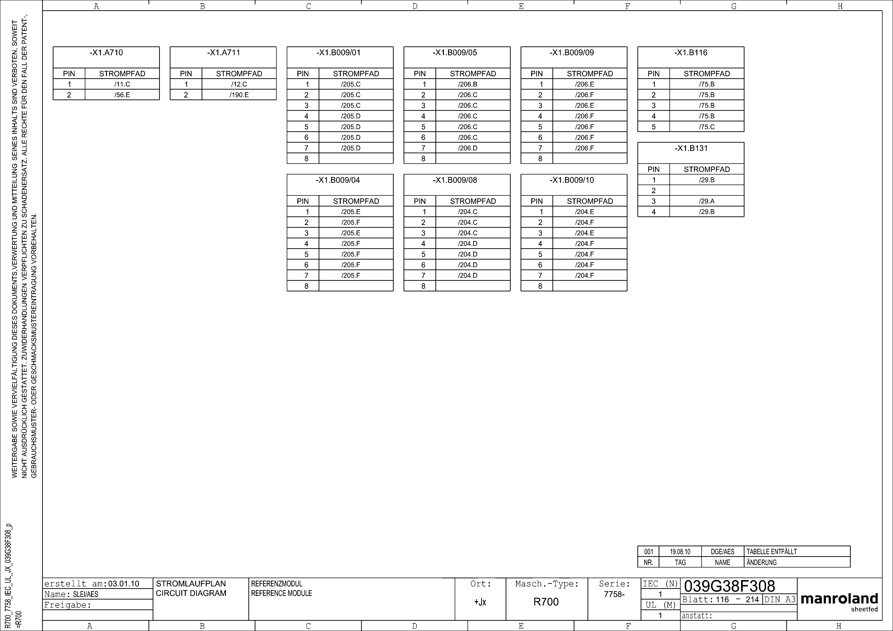

# +Jx — Sheet 116 of 214 — REFERENZMODUL

**REFERENCE MODULE**

> Part of the manroland **R700** printing press IEC/UL circuit diagrams.
> Drawing class: **Stromlaufplan / Circuit diagram** (DIN A3).
> Document `+Jx` covers the **1st printing module + feed register** machine section.

## At a glance

| Field | Value |
|---|---|
| Document | `+Jx`  (039G38F308) |
| Sheet | **116** of 214 |
| Section (DE) | REFERENZMODUL |
| Section (EN) | REFERENCE MODULE |
| Section type | REFERENCE_MODULE — Reference module |
| Machine type | `R700` |
| Series | `7758` |
| Created | 03.01.10 |
| Replaces | — |
| Columns used | A, B, C, D, E, F, G |
| Path numbers | — |
| Labels on sheet | 153 |
| Cross-refs out | 54 |
| Cross-refs in | 0 |

**Previous:** [+Jx sheet 115](SHEET_0115.md) · **Next:** [+Jx sheet 117](SHEET_0117.md) · **Document TOC:** [_TOC.md](_TOC.md)  (+Jx) · **Master TOC:** [all sheets](../_MASTER_TOC.md)

## Sheet image (300 DPI, exact vector render)



_Rendered directly from the PDF vector layer at 300 DPI (1-bit), no OCR and no resampling. Use it to confirm anything ambiguous in the text below._

## Cross-references on this sheet

Each entry is a wire leaving this sheet. The printed token is `/sheet.column`; the link resolves to that sheet inside the same document.

| Ref | Target sheet | Col | Path | Destination on target | Target section | From col |
|---|---|---|---|---|---|---|
| `/75.B` | [+Jx sheet 75](SHEET_0075.md) | B | — | — | FEHLBOGENKONTROLLE | G |
| `/206.B` | [+Jx sheet 206](SHEET_0206.md) | B | — | — | OPTION: INLINEOBSERVER | E |
| `/206.E` | [+Jx sheet 206](SHEET_0206.md) | E | — | — | OPTION: INLINEOBSERVER | F |
| `/11.C` | [+Jx sheet 11](SHEET_0011.md) | C | — | — | SPANNUNGSVERSORGUNG, SCHALTSCHRANKBELÜFTUNG | A |
| `/12.C` | [+Jx sheet 12](SHEET_0012.md) | C | — | — | SPANNUNGSVERSORGUNG, SCHALTSCHRANKBELÜFTUNG | B |
| `/205.C` | [+Jx sheet 205](SHEET_0205.md) | C | — | — | OPTION: INLINEOBSERVER | C |
| `/56.E` | [+Jx sheet 56](SHEET_0056.md) | E | — | — | SCHUTZEINRICHTUNGEN | A |
| `/75.B` | [+Jx sheet 75](SHEET_0075.md) | B | — | — | FEHLBOGENKONTROLLE | G |
| `/190.E` | [+Jx sheet 190](SHEET_0190.md) | E | — | — | OPTION: ZWISCHENTROCKNER, VORBEREITUNG | B |
| `/206.F` | [+Jx sheet 206](SHEET_0206.md) | F | — | — | OPTION: INLINEOBSERVER | F |
| `/205.C` | [+Jx sheet 205](SHEET_0205.md) | C | — | — | OPTION: INLINEOBSERVER | C |
| `/206.C` | [+Jx sheet 206](SHEET_0206.md) | C | — | — | OPTION: INLINEOBSERVER | E |
| `/75.B` | [+Jx sheet 75](SHEET_0075.md) | B | — | — | FEHLBOGENKONTROLLE | G |
| `/206.E` | [+Jx sheet 206](SHEET_0206.md) | E | — | — | OPTION: INLINEOBSERVER | F |
| `/205.C` | [+Jx sheet 205](SHEET_0205.md) | C | — | — | OPTION: INLINEOBSERVER | C |
| `/206.C` | [+Jx sheet 206](SHEET_0206.md) | C | — | — | OPTION: INLINEOBSERVER | E |
| `/75.B` | [+Jx sheet 75](SHEET_0075.md) | B | — | — | FEHLBOGENKONTROLLE | G |
| `/206.F` | [+Jx sheet 206](SHEET_0206.md) | F | — | — | OPTION: INLINEOBSERVER | F |
| `/205.D` | [+Jx sheet 205](SHEET_0205.md) | D | — | — | OPTION: INLINEOBSERVER | C |
| `/206.C` | [+Jx sheet 206](SHEET_0206.md) | C | — | — | OPTION: INLINEOBSERVER | E |
| `/206.F` | [+Jx sheet 206](SHEET_0206.md) | F | — | — | OPTION: INLINEOBSERVER | F |
| `/75.C` | [+Jx sheet 75](SHEET_0075.md) | C | — | — | FEHLBOGENKONTROLLE | G |
| `/205.D` | [+Jx sheet 205](SHEET_0205.md) | D | — | — | OPTION: INLINEOBSERVER | C |
| `/206.C` | [+Jx sheet 206](SHEET_0206.md) | C | — | — | OPTION: INLINEOBSERVER | E |
| `/206.F` | [+Jx sheet 206](SHEET_0206.md) | F | — | — | OPTION: INLINEOBSERVER | F |
| `/205.D` | [+Jx sheet 205](SHEET_0205.md) | D | — | — | OPTION: INLINEOBSERVER | C |
| `/206.C` | [+Jx sheet 206](SHEET_0206.md) | C | — | — | OPTION: INLINEOBSERVER | E |
| `/206.F` | [+Jx sheet 206](SHEET_0206.md) | F | — | — | OPTION: INLINEOBSERVER | F |
| `/205.D` | [+Jx sheet 205](SHEET_0205.md) | D | — | — | OPTION: INLINEOBSERVER | C |
| `/206.D` | [+Jx sheet 206](SHEET_0206.md) | D | — | — | OPTION: INLINEOBSERVER | E |
| `/29.B` | [+Jx sheet 29](SHEET_0029.md) | B | — | — | KAMMERRAKEL | G |
| `/29.A` | [+Jx sheet 29](SHEET_0029.md) | A | — | — | KAMMERRAKEL | G |
| `/29.B` | [+Jx sheet 29](SHEET_0029.md) | B | — | — | KAMMERRAKEL | G |
| `/205.E` | [+Jx sheet 205](SHEET_0205.md) | E | — | — | OPTION: INLINEOBSERVER | C |
| `/204.E` | [+Jx sheet 204](SHEET_0204.md) | E | — | — | OPTION: INLINEOBSERVER | F |
| `/204.C` | [+Jx sheet 204](SHEET_0204.md) | C | — | — | OPTION: INLINEOBSERVER | E |
| `/205.F` | [+Jx sheet 205](SHEET_0205.md) | F | — | — | OPTION: INLINEOBSERVER | C |
| `/204.F` | [+Jx sheet 204](SHEET_0204.md) | F | — | — | OPTION: INLINEOBSERVER | F |
| `/204.C` | [+Jx sheet 204](SHEET_0204.md) | C | — | — | OPTION: INLINEOBSERVER | E |
| `/205.E` | [+Jx sheet 205](SHEET_0205.md) | E | — | — | OPTION: INLINEOBSERVER | C |
| `/204.E` | [+Jx sheet 204](SHEET_0204.md) | E | — | — | OPTION: INLINEOBSERVER | F |
| `/204.C` | [+Jx sheet 204](SHEET_0204.md) | C | — | — | OPTION: INLINEOBSERVER | E |
| `/205.F` | [+Jx sheet 205](SHEET_0205.md) | F | — | — | OPTION: INLINEOBSERVER | C |
| `/204.F` | [+Jx sheet 204](SHEET_0204.md) | F | — | — | OPTION: INLINEOBSERVER | F |
| `/204.D` | [+Jx sheet 204](SHEET_0204.md) | D | — | — | OPTION: INLINEOBSERVER | E |
| `/205.F` | [+Jx sheet 205](SHEET_0205.md) | F | — | — | OPTION: INLINEOBSERVER | C |
| `/204.F` | [+Jx sheet 204](SHEET_0204.md) | F | — | — | OPTION: INLINEOBSERVER | F |
| `/204.D` | [+Jx sheet 204](SHEET_0204.md) | D | — | — | OPTION: INLINEOBSERVER | E |
| `/205.F` | [+Jx sheet 205](SHEET_0205.md) | F | — | — | OPTION: INLINEOBSERVER | C |
| `/204.F` | [+Jx sheet 204](SHEET_0204.md) | F | — | — | OPTION: INLINEOBSERVER | F |
| `/204.D` | [+Jx sheet 204](SHEET_0204.md) | D | — | — | OPTION: INLINEOBSERVER | E |
| `/205.F` | [+Jx sheet 205](SHEET_0205.md) | F | — | — | OPTION: INLINEOBSERVER | C |
| `/204.F` | [+Jx sheet 204](SHEET_0204.md) | F | — | — | OPTION: INLINEOBSERVER | F |
| `/204.D` | [+Jx sheet 204](SHEET_0204.md) | D | — | — | OPTION: INLINEOBSERVER | E |

## Devices on this sheet

| Tag | Class | Class meaning (IEC) | Col | Sub | Terminal | Sign |
|---|---|---|---|---|---|---|
| `X1.B116` | — | cross-device reference | G | — | — | — |
| `X1.B131` | — | cross-device reference | G | — | — | — |
| `X1.A710` | — | cross-device reference | A | — | — | — |
| `X1.A711` | — | cross-device reference | B | — | — | — |
| `NR.` | — | cross-device reference | F | — | — | — |
| `19.08.10` | — | cross-device reference | F | — | — | — |

## Potentials / nets

_No named potentials on this sheet._

## Wire-end annotations (grouped as printed)

A wire that continues elsewhere is annotated with a small cluster: the destination description, the path/line number `#NN`, and the `/sheet.column` cross reference. Each row below is one such cluster exactly as it is grouped on the drawing.

| Col | Y | Path | Cross-ref | Text on the wire |
|---|---|---|---|---|
| A | 65.4 | — | — | `X1.A710` |
| B | 65.4 | — | — | `X1.A711` |
| C | 65.4 | — | — | `X1.B009/01` |
| D | 65.4 | — | — | `X1.B009/05` |
| E | 65.4 | — | — | `X1.B009/09` |
| G | 65.4 | — | — | `X1.B116` |
| A | 94.1 | — | — | `PIN 2 1 STROMPFAD` |
| B | 94.1 | — | — | `PIN 2 1 STROMPFAD` |
| C | 94.1 | — | — | `PIN 2 3 4 5 6 7 8 1 STROMPFAD` |
| D | 94.1 | — | — | `PIN 2 3 4 5 6 7 8 1 STROMPFAD` |
| E | 94.1 | — | — | `PIN 2 3 4 5 6 7 8 1 STROMPFAD` |
| G | 94.1 | — | — | `PIN 2 3 5 4 1 STROMPFAD` |
| E | 108.6 | — | `/206.B` | — |
| F | 108.6 | — | `/206.E` | — |
| G | 108.6 | — | `/75.B` | — |
| A | 108.7 | — | `/11.C` | — |
| B | 108.7 | — | `/12.C` | — |
| C | 108.7 | — | `/205.C` | — |
| A | 122.8 | — | `/56.E` | — |
| B | 122.8 | — | `/190.E` | — |
| C | 122.8 | — | `/205.C` | — |
| E | 122.8 | — | `/206.C` | — |
| F | 122.8 | — | `/206.F` | — |
| G | 122.8 | — | `/75.B` | — |
| C | 137.0 | — | `/205.C` | — |
| E | 137.0 | — | `/206.C` | — |
| F | 137.0 | — | `/206.E` | — |
| G | 137.0 | — | `/75.B` | — |
| G | 151.1 | — | `/75.B` | — |
| C | 151.2 | — | `/205.D` | — |
| E | 151.2 | — | `/206.C` | — |
| F | 151.2 | — | `/206.F` | — |
| C | 165.3 | — | `/205.D` | — |
| E | 165.3 | — | `/206.C` | — |
| F | 165.3 | — | `/206.F` | — |
| G | 165.3 | — | `/75.C` | — |
| C | 179.5 | — | `/205.D` | — |
| E | 179.5 | — | `/206.C` | — |
| F | 179.5 | — | `/206.F` | — |
| G | 193.0 | — | — | `X1.B131` |
| C | 193.7 | — | `/205.D` | — |
| E | 193.7 | — | `/206.D` | — |
| F | 193.7 | — | `/206.F` | — |
| G | 221.7 | — | — | `PIN 2 3 4 1 STROMPFAD` |
| C | 235.5 | — | — | `X1.B009/04` |
| D | 235.5 | — | — | `X1.B009/08` |
| E | 235.5 | — | — | `X1.B009/10` |
| G | 236.2 | — | `/29.B` | — |
| C | 264.2 | — | — | `PIN 2 3 4 5 6 7 8 1 STROMPFAD` |
| D | 264.2 | — | — | `PIN 2 3 4 5 6 7 8 1 STROMPFAD` |
| E | 264.2 | — | — | `PIN 2 3 4 5 6 7 8 1 STROMPFAD` |
| G | 264.5 | — | `/29.A` | — |
| C | 278.7 | — | `/205.E` | — |
| E | 278.7 | — | `/204.C` | — |
| F | 278.7 | — | `/204.E` | — |
| G | 278.7 | — | `/29.B` | — |
| C | 292.9 | — | `/205.F` | — |
| E | 292.9 | — | `/204.C` | — |
| F | 292.9 | — | `/204.F` | — |
| C | 307.1 | — | `/205.E` | — |
| E | 307.1 | — | `/204.C` | — |
| F | 307.1 | — | `/204.E` | — |
| C | 321.2 | — | `/205.F` | — |
| F | 321.2 | — | `/204.F` | — |
| E | 321.3 | — | `/204.D` | — |
| C | 335.4 | — | `/205.F` | — |
| E | 335.4 | — | `/204.D` | — |
| F | 335.4 | — | `/204.F` | — |
| C | 349.6 | — | `/205.F` | — |
| E | 349.6 | — | `/204.D` | — |
| F | 349.6 | — | `/204.F` | — |
| C | 363.8 | — | `/205.F` | — |
| E | 363.8 | — | `/204.D` | — |
| F | 363.8 | — | `/204.F` | — |
| G | 733.0 | — | — | `001 19.08.10 DGE/AES TABELLE ENTFÄLLT` |
| G | 747.1 | — | — | `NR. TAG NAME ÄNDERUNG` |


## Reconstructed tables

This sheet carries tabular content (pin map / terminal assignment / index). The grid below was rebuilt from the drawing's own rule lines, so each row is exactly one physical row of the table.

### Table 1 — 2 data rows × 2 columns (at x=70.9, y=62.4) — **X1.A710**

| PIN | STROMPFAD |
|---|---|
| `1` | `/11.C` |
| `2` | `/56.E` |


### Table 2 — 2 data rows × 2 columns (at x=226.8, y=62.4) — **X1.A711**

| PIN | STROMPFAD |
|---|---|
| `1` | `/12.C` |
| `2` | `/190.E` |


### Table 3 — 18 data rows × 2 columns (at x=382.7, y=62.4) — **X1.B009/01**

| PIN | STROMPFAD |
|---|---|
| `1` | `/205.C` |
| `2` | `/205.C` |
| `3` | `/205.C` |
| `4` | `/205.D` |
| `5` | `/205.D` |
| `6` | `/205.D` |
| `7` | `/205.D` |
| `8` |  |
|  | `X1.B009/04` |
| `PIN` | `STROMPFAD` |
| `1` | `/205.E` |
| `2` | `/205.F` |
| `3` | `/205.E` |
| `4` | `/205.F` |
| `5` | `/205.F` |
| `6` | `/205.F` |
| `7` | `/205.F` |
| `8` |  |


### Table 4 — 18 data rows × 2 columns (at x=538.6, y=62.4) — **X1.B009/05**

| PIN | STROMPFAD |
|---|---|
| `1` | `/206.B` |
| `2` | `/206.C` |
| `3` | `/206.C` |
| `4` | `/206.C` |
| `5` | `/206.C` |
| `6` | `/206.C` |
| `7` | `/206.D` |
| `8` |  |
|  | `X1.B009/08` |
| `PIN` | `STROMPFAD` |
| `1` | `/204.C` |
| `2` | `/204.C` |
| `3` | `/204.C` |
| `4` | `/204.D` |
| `5` | `/204.D` |
| `6` | `/204.D` |
| `7` | `/204.D` |
| `8` |  |


### Table 5 — 18 data rows × 2 columns (at x=694.5, y=62.4) — **X1.B009/09**

| PIN | STROMPFAD |
|---|---|
| `1` | `/206.E` |
| `2` | `/206.F` |
| `3` | `/206.E` |
| `4` | `/206.F` |
| `5` | `/206.F` |
| `6` | `/206.F` |
| `7` | `/206.F` |
| `8` |  |
|  | `X1.B009/10` |
| `PIN` | `STROMPFAD` |
| `1` | `/204.E` |
| `2` | `/204.F` |
| `3` | `/204.E` |
| `4` | `/204.F` |
| `5` | `/204.F` |
| `6` | `/204.F` |
| `7` | `/204.F` |
| `8` |  |


### Table 6 — 11 data rows × 2 columns (at x=850.4, y=62.4) — **X1.B116**

| PIN | STROMPFAD |
|---|---|
| `1` | `/75.B` |
| `2` | `/75.B` |
| `3` | `/75.B` |
| `4` | `/75.B` |
| `5` | `/75.C` |
|  | `X1.B131` |
| `PIN` | `STROMPFAD` |
| `1` | `/29.B` |
| `2` |  |
| `3` | `/29.A` |
| `4` | `/29.B` |


## Notes and free text on this sheet

| Text | Col | Y (pt) |
|---|---|---|
| `PIN` | C | 94.13 |
| `STROMPFAD` | C | 94.09 |
| `X1.B009/01` | C | 65.44 |
| `X1.B009/04` | C | 235.52 |
| `PIN` | D | 94.13 |
| `STROMPFAD` | E | 94.09 |
| `X1.B009/05` | D | 65.44 |
| `X1.B009/08` | D | 235.52 |
| `PIN` | E | 94.13 |
| `STROMPFAD` | F | 94.09 |
| `X1.B009/09` | E | 65.44 |
| `X1.B009/10` | E | 235.52 |
| `PIN` | F | 94.13 |
| `STROMPFAD` | G | 94.09 |
| `PIN` | A | 94.13 |
| `STROMPFAD` | A | 94.09 |
| `PIN` | B | 94.13 |
| `STROMPFAD` | B | 94.09 |
| `TAG` | G | 747.23 |
| `NAME` | G | 747.22 |
| `ÄNDERUNG` | G | 747.25 |
| `DGE/AES` | G | 733.06 |
| `TABELLE ENTFÄLLT` | G | 733.11 |

## Complete label inventory (exact text from the drawing)

Every text object inside the drawing area of this sheet, in DIN reading order (column A→H, then top→bottom). This is the authoritative list: if a string is not here it is not printed on this sheet.

| Col | Y | X | Dir | Type | Text |
|---|---|---|---|---|---|
| A | 65.4 | 119.8 | → | device ref | `X1.A710` |
| A | 94.1 | 84.0 | → | text | `PIN` |
| A | 94.1 | 132.4 | → | text | `STROMPFAD` |
| A | 108.3 | 89.9 | → | number | `1` |
| A | 108.7 | 152.6 | → | cross-reference | `/11.C` |
| A | 122.5 | 89.4 | → | number | `2` |
| A | 122.8 | 152.8 | → | cross-reference | `/56.E` |
| B | 65.4 | 276.4 | → | device ref | `X1.A711` |
| B | 94.1 | 240.0 | → | text | `PIN` |
| B | 94.1 | 288.3 | → | text | `STROMPFAD` |
| B | 108.3 | 245.8 | → | number | `1` |
| B | 108.7 | 308.6 | → | cross-reference | `/12.C` |
| B | 122.5 | 245.3 | → | number | `2` |
| B | 122.8 | 306.3 | → | cross-reference | `/190.E` |
| C | 65.4 | 422.1 | → | text | `X1.B009/01` |
| C | 94.1 | 395.9 | → | text | `PIN` |
| C | 94.1 | 444.2 | → | text | `STROMPFAD` |
| C | 108.3 | 407.3 | → | number | `1` |
| C | 108.7 | 455.0 | → | cross-reference | `/205.C` |
| C | 122.5 | 405.9 | → | number | `2` |
| C | 122.8 | 455.0 | → | cross-reference | `/205.C` |
| C | 136.7 | 405.9 | → | number | `3` |
| C | 137.0 | 455.0 | → | cross-reference | `/205.C` |
| C | 150.8 | 405.9 | → | number | `4` |
| C | 151.2 | 455.0 | → | cross-reference | `/205.D` |
| C | 165.0 | 405.9 | → | number | `5` |
| C | 165.4 | 455.0 | → | cross-reference | `/205.D` |
| C | 179.2 | 405.9 | → | number | `6` |
| C | 179.5 | 455.0 | → | cross-reference | `/205.D` |
| C | 193.3 | 405.9 | → | number | `7` |
| C | 193.7 | 455.0 | → | cross-reference | `/205.D` |
| C | 207.5 | 405.9 | → | number | `8` |
| C | 235.5 | 421.2 | → | text | `X1.B009/04` |
| C | 264.2 | 395.9 | → | text | `PIN` |
| C | 264.2 | 444.2 | → | text | `STROMPFAD` |
| C | 278.4 | 407.3 | → | number | `1` |
| C | 278.7 | 455.1 | → | cross-reference | `/205.E` |
| C | 292.6 | 405.9 | → | number | `2` |
| C | 292.9 | 455.4 | → | cross-reference | `/205.F` |
| C | 306.7 | 405.9 | → | number | `3` |
| C | 307.1 | 455.1 | → | cross-reference | `/205.E` |
| C | 320.9 | 405.9 | → | number | `4` |
| C | 321.2 | 455.4 | → | cross-reference | `/205.F` |
| C | 335.1 | 405.9 | → | number | `5` |
| C | 335.4 | 455.4 | → | cross-reference | `/205.F` |
| C | 349.3 | 405.9 | → | number | `6` |
| C | 349.6 | 455.4 | → | cross-reference | `/205.F` |
| C | 363.4 | 405.9 | → | number | `7` |
| C | 363.8 | 455.4 | → | cross-reference | `/205.F` |
| C | 377.6 | 405.9 | → | number | `8` |
| D | 65.4 | 577.1 | → | text | `X1.B009/05` |
| D | 94.1 | 551.8 | → | text | `PIN` |
| D | 108.3 | 563.2 | → | number | `1` |
| D | 122.5 | 561.8 | → | number | `2` |
| D | 136.7 | 561.8 | → | number | `3` |
| D | 150.8 | 561.8 | → | number | `4` |
| D | 165.0 | 561.8 | → | number | `5` |
| D | 179.2 | 561.8 | → | number | `6` |
| D | 193.3 | 561.8 | → | number | `7` |
| D | 207.5 | 561.8 | → | number | `8` |
| D | 235.5 | 577.3 | → | text | `X1.B009/08` |
| D | 264.2 | 551.8 | → | text | `PIN` |
| D | 278.4 | 563.2 | → | number | `1` |
| D | 292.6 | 561.8 | → | number | `2` |
| D | 306.7 | 561.8 | → | number | `3` |
| D | 320.9 | 561.8 | → | number | `4` |
| D | 335.1 | 561.8 | → | number | `5` |
| D | 349.3 | 561.8 | → | number | `6` |
| D | 363.4 | 561.8 | → | number | `7` |
| D | 377.6 | 561.8 | → | number | `8` |
| E | 65.4 | 733.0 | → | text | `X1.B009/09` |
| E | 94.1 | 600.1 | → | text | `STROMPFAD` |
| E | 94.1 | 707.7 | → | text | `PIN` |
| E | 108.3 | 719.1 | → | number | `1` |
| E | 108.6 | 611.0 | → | cross-reference | `/206.B` |
| E | 122.5 | 717.7 | → | number | `2` |
| E | 122.8 | 610.9 | → | cross-reference | `/206.C` |
| E | 136.7 | 717.7 | → | number | `3` |
| E | 137.0 | 610.9 | → | cross-reference | `/206.C` |
| E | 150.8 | 717.7 | → | number | `4` |
| E | 151.2 | 610.9 | → | cross-reference | `/206.C` |
| E | 165.0 | 717.7 | → | number | `5` |
| E | 165.4 | 610.9 | → | cross-reference | `/206.C` |
| E | 179.2 | 717.7 | → | number | `6` |
| E | 179.5 | 610.9 | → | cross-reference | `/206.C` |
| E | 193.3 | 717.7 | → | number | `7` |
| E | 193.7 | 610.9 | → | cross-reference | `/206.D` |
| E | 207.5 | 717.7 | → | number | `8` |
| E | 235.5 | 733.2 | → | text | `X1.B009/10` |
| E | 264.2 | 600.1 | → | text | `STROMPFAD` |
| E | 264.2 | 707.7 | → | text | `PIN` |
| E | 278.4 | 719.1 | → | number | `1` |
| E | 278.7 | 610.9 | → | cross-reference | `/204.C` |
| E | 292.6 | 717.7 | → | number | `2` |
| E | 292.9 | 610.9 | → | cross-reference | `/204.C` |
| E | 306.7 | 717.7 | → | number | `3` |
| E | 307.1 | 610.9 | → | cross-reference | `/204.C` |
| E | 320.9 | 717.7 | → | number | `4` |
| E | 321.3 | 610.9 | → | cross-reference | `/204.D` |
| E | 335.1 | 717.7 | → | number | `5` |
| E | 335.4 | 610.9 | → | cross-reference | `/204.D` |
| E | 349.3 | 717.7 | → | number | `6` |
| E | 349.6 | 610.9 | → | cross-reference | `/204.D` |
| E | 363.4 | 717.7 | → | number | `7` |
| E | 363.8 | 610.9 | → | cross-reference | `/204.D` |
| E | 377.6 | 717.7 | → | number | `8` |
| F | 94.1 | 756.0 | → | text | `STROMPFAD` |
| F | 94.1 | 863.6 | → | text | `PIN` |
| F | 108.3 | 869.4 | → | number | `1` |
| F | 108.6 | 766.9 | → | cross-reference | `/206.E` |
| F | 122.5 | 869.0 | → | number | `2` |
| F | 122.8 | 767.2 | → | cross-reference | `/206.F` |
| F | 136.7 | 869.0 | → | number | `3` |
| F | 137.0 | 766.9 | → | cross-reference | `/206.E` |
| F | 150.8 | 869.1 | → | number | `4` |
| F | 151.2 | 767.2 | → | cross-reference | `/206.F` |
| F | 165.0 | 869.0 | → | number | `5` |
| F | 165.3 | 767.2 | → | cross-reference | `/206.F` |
| F | 179.5 | 767.2 | → | cross-reference | `/206.F` |
| F | 193.7 | 767.2 | → | cross-reference | `/206.F` |
| F | 221.7 | 863.6 | → | text | `PIN` |
| F | 235.9 | 869.4 | → | number | `1` |
| F | 250.0 | 869.0 | → | number | `2` |
| F | 264.2 | 756.0 | → | text | `STROMPFAD` |
| F | 264.2 | 869.0 | → | number | `3` |
| F | 278.4 | 869.1 | → | number | `4` |
| F | 278.7 | 766.9 | → | cross-reference | `/204.E` |
| F | 292.9 | 767.2 | → | cross-reference | `/204.F` |
| F | 307.1 | 766.9 | → | cross-reference | `/204.E` |
| F | 321.2 | 767.2 | → | cross-reference | `/204.F` |
| F | 335.4 | 767.2 | → | cross-reference | `/204.F` |
| F | 349.6 | 767.2 | → | cross-reference | `/204.F` |
| F | 363.8 | 767.2 | → | cross-reference | `/204.F` |
| F | 733.0 | 859.3 | → | number | `001` |
| F | 733.1 | 893.2 | → | device ref | `19.08.10` |
| F | 747.1 | 858.5 | → | device ref | `NR.` |
| G | 65.4 | 899.1 | → | device ref | `X1.B116` |
| G | 94.1 | 911.9 | → | text | `STROMPFAD` |
| G | 108.6 | 932.3 | → | cross-reference | `/75.B` |
| G | 122.8 | 932.3 | → | cross-reference | `/75.B` |
| G | 137.0 | 932.3 | → | cross-reference | `/75.B` |
| G | 151.1 | 932.3 | → | cross-reference | `/75.B` |
| G | 165.3 | 932.2 | → | cross-reference | `/75.C` |
| G | 193.0 | 900.0 | → | device ref | `X1.B131` |
| G | 221.7 | 911.9 | → | text | `STROMPFAD` |
| G | 236.2 | 932.3 | → | cross-reference | `/29.B` |
| G | 264.5 | 932.2 | → | cross-reference | `/29.A` |
| G | 278.7 | 932.3 | → | cross-reference | `/29.B` |
| G | 733.1 | 948.0 | → | text | `DGE/AES` |
| G | 733.1 | 995.7 | → | text | `TABELLE ENTFÄLLT` |
| G | 747.2 | 900.1 | → | text | `TAG` |
| G | 747.2 | 953.5 | → | text | `NAME` |
| G | 747.3 | 995.7 | → | text | `ÄNDERUNG` |

## Reading-order text block

The same content as a plain block, grouped by DIN column — convenient to paste or to match against a visual description.

```text
=== Column A ===
  65.4  119.8  devref       X1.A710
  94.1   84.0  text         PIN
  94.1  132.4  text         STROMPFAD
 108.3   89.9  numeric      1
 108.7  152.6  xref         /11.C
 122.5   89.4  numeric      2
 122.8  152.8  xref         /56.E
=== Column B ===
  65.4  276.4  devref       X1.A711
  94.1  240.0  text         PIN
  94.1  288.3  text         STROMPFAD
 108.3  245.8  numeric      1
 108.7  308.6  xref         /12.C
 122.5  245.3  numeric      2
 122.8  306.3  xref         /190.E
=== Column C ===
  65.4  422.1  text         X1.B009/01
  94.1  395.9  text         PIN
  94.1  444.2  text         STROMPFAD
 108.3  407.3  numeric      1
 108.7  455.0  xref         /205.C
 122.5  405.9  numeric      2
 122.8  455.0  xref         /205.C
 136.7  405.9  numeric      3
 137.0  455.0  xref         /205.C
 150.8  405.9  numeric      4
 151.2  455.0  xref         /205.D
 165.0  405.9  numeric      5
 165.4  455.0  xref         /205.D
 179.2  405.9  numeric      6
 179.5  455.0  xref         /205.D
 193.3  405.9  numeric      7
 193.7  455.0  xref         /205.D
 207.5  405.9  numeric      8
 235.5  421.2  text         X1.B009/04
 264.2  395.9  text         PIN
 264.2  444.2  text         STROMPFAD
 278.4  407.3  numeric      1
 278.7  455.1  xref         /205.E
 292.6  405.9  numeric      2
 292.9  455.4  xref         /205.F
 306.7  405.9  numeric      3
 307.1  455.1  xref         /205.E
 320.9  405.9  numeric      4
 321.2  455.4  xref         /205.F
 335.1  405.9  numeric      5
 335.4  455.4  xref         /205.F
 349.3  405.9  numeric      6
 349.6  455.4  xref         /205.F
 363.4  405.9  numeric      7
 363.8  455.4  xref         /205.F
 377.6  405.9  numeric      8
=== Column D ===
  65.4  577.1  text         X1.B009/05
  94.1  551.8  text         PIN
 108.3  563.2  numeric      1
 122.5  561.8  numeric      2
 136.7  561.8  numeric      3
 150.8  561.8  numeric      4
 165.0  561.8  numeric      5
 179.2  561.8  numeric      6
 193.3  561.8  numeric      7
 207.5  561.8  numeric      8
 235.5  577.3  text         X1.B009/08
 264.2  551.8  text         PIN
 278.4  563.2  numeric      1
 292.6  561.8  numeric      2
 306.7  561.8  numeric      3
 320.9  561.8  numeric      4
 335.1  561.8  numeric      5
 349.3  561.8  numeric      6
 363.4  561.8  numeric      7
 377.6  561.8  numeric      8
=== Column E ===
  65.4  733.0  text         X1.B009/09
  94.1  600.1  text         STROMPFAD
  94.1  707.7  text         PIN
 108.3  719.1  numeric      1
 108.6  611.0  xref         /206.B
 122.5  717.7  numeric      2
 122.8  610.9  xref         /206.C
 136.7  717.7  numeric      3
 137.0  610.9  xref         /206.C
 150.8  717.7  numeric      4
 151.2  610.9  xref         /206.C
 165.0  717.7  numeric      5
 165.4  610.9  xref         /206.C
 179.2  717.7  numeric      6
 179.5  610.9  xref         /206.C
 193.3  717.7  numeric      7
 193.7  610.9  xref         /206.D
 207.5  717.7  numeric      8
 235.5  733.2  text         X1.B009/10
 264.2  600.1  text         STROMPFAD
 264.2  707.7  text         PIN
 278.4  719.1  numeric      1
 278.7  610.9  xref         /204.C
 292.6  717.7  numeric      2
 292.9  610.9  xref         /204.C
 306.7  717.7  numeric      3
 307.1  610.9  xref         /204.C
 320.9  717.7  numeric      4
 321.3  610.9  xref         /204.D
 335.1  717.7  numeric      5
 335.4  610.9  xref         /204.D
 349.3  717.7  numeric      6
 349.6  610.9  xref         /204.D
 363.4  717.7  numeric      7
 363.8  610.9  xref         /204.D
 377.6  717.7  numeric      8
=== Column F ===
  94.1  756.0  text         STROMPFAD
  94.1  863.6  text         PIN
 108.3  869.4  numeric      1
 108.6  766.9  xref         /206.E
 122.5  869.0  numeric      2
 122.8  767.2  xref         /206.F
 136.7  869.0  numeric      3
 137.0  766.9  xref         /206.E
 150.8  869.1  numeric      4
 151.2  767.2  xref         /206.F
 165.0  869.0  numeric      5
 165.3  767.2  xref         /206.F
 179.5  767.2  xref         /206.F
 193.7  767.2  xref         /206.F
 221.7  863.6  text         PIN
 235.9  869.4  numeric      1
 250.0  869.0  numeric      2
 264.2  756.0  text         STROMPFAD
 264.2  869.0  numeric      3
 278.4  869.1  numeric      4
 278.7  766.9  xref         /204.E
 292.9  767.2  xref         /204.F
 307.1  766.9  xref         /204.E
 321.2  767.2  xref         /204.F
 335.4  767.2  xref         /204.F
 349.6  767.2  xref         /204.F
 363.8  767.2  xref         /204.F
 733.0  859.3  numeric      001
 733.1  893.2  devref       19.08.10
 747.1  858.5  devref       NR.
=== Column G ===
  65.4  899.1  devref       X1.B116
  94.1  911.9  text         STROMPFAD
 108.6  932.3  xref         /75.B
 122.8  932.3  xref         /75.B
 137.0  932.3  xref         /75.B
 151.1  932.3  xref         /75.B
 165.3  932.2  xref         /75.C
 193.0  900.0  devref       X1.B131
 221.7  911.9  text         STROMPFAD
 236.2  932.3  xref         /29.B
 264.5  932.2  xref         /29.A
 278.7  932.3  xref         /29.B
 733.1  948.0  text         DGE/AES
 733.1  995.7  text         TABELLE ENTFÄLLT
 747.2  900.1  text         TAG
 747.2  953.5  text         NAME
 747.3  995.7  text         ÄNDERUNG
```

---
_Generated from the PDF vector text layer; no OCR. Source: `R700_7758_IEC_UL_JX_039G38F308_p`, sheet 116._
