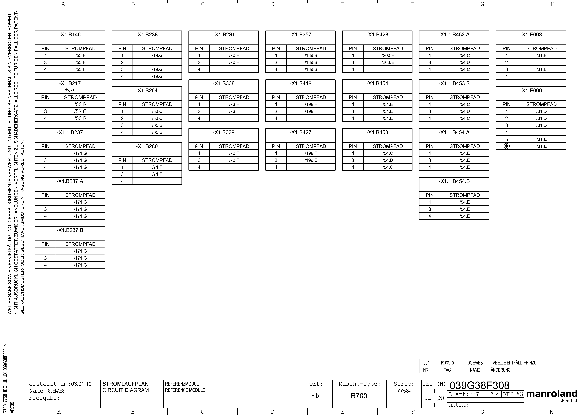

# +Jx — Sheet 117 of 214 — REFERENZMODUL

**REFERENCE MODULE**

> Part of the manroland **R700** printing press IEC/UL circuit diagrams.
> Drawing class: **Stromlaufplan / Circuit diagram** (DIN A3).
> Document `+Jx` covers the **1st printing module + feed register** machine section.

## At a glance

| Field | Value |
|---|---|
| Document | `+Jx`  (039G38F308) |
| Sheet | **117** of 214 |
| Section (DE) | REFERENZMODUL |
| Section (EN) | REFERENCE MODULE |
| Section type | REFERENCE_MODULE — Reference module |
| Machine type | `R700` |
| Series | `7758` |
| Created | 03.01.10 |
| Replaces | — |
| Columns used | A, B, C, D, E, F, G, H |
| Path numbers | — |
| Labels on sheet | 216 |
| Cross-refs out | 64 |
| Cross-refs in | 0 |

**Previous:** [+Jx sheet 116](SHEET_0116.md) · **Next:** [+Jx sheet 118](SHEET_0118.md) · **Document TOC:** [_TOC.md](_TOC.md)  (+Jx) · **Master TOC:** [all sheets](../_MASTER_TOC.md)

## Sheet image (300 DPI, exact vector render)



_Rendered directly from the PDF vector layer at 300 DPI (1-bit), no OCR and no resampling. Use it to confirm anything ambiguous in the text below._

## Cross-references on this sheet

Each entry is a wire leaving this sheet. The printed token is `/sheet.column`; the link resolves to that sheet inside the same document.

| Ref | Target sheet | Col | Path | Destination on target | Target section | From col |
|---|---|---|---|---|---|---|
| `/31.B` | [+Jx sheet 31](SHEET_0031.md) | B | — | — | BELEUCHTUNG | H |
| `/53.F` | [+Jx sheet 53](SHEET_0053.md) | F | — | — | SCHUTZEINRICHTUNGEN | A |
| `/70.F` | [+Jx sheet 70](SHEET_0070.md) | F | — | — | MOTOR: UMFANGSREGISTER | C |
| `/189.B` | [+Jx sheet 189](SHEET_0189.md) | B | — | — | OPTION: ZWISCHENTROCKNER, VORBEREITUNG | E |
| `/19.G` | [+Jx sheet 19](SHEET_0019.md) | G | — | — | LACKPUMPE | B |
| `/200.F` | [+Jx sheet 200](SHEET_0200.md) | F | — | — | OPTION: | F |
| `/54.C` | [+Jx sheet 54](SHEET_0054.md) | C | — | — | SCHUTZEINRICHTUNGEN | G |
| `/53.F` | [+Jx sheet 53](SHEET_0053.md) | F | — | — | SCHUTZEINRICHTUNGEN | A |
| `/70.F` | [+Jx sheet 70](SHEET_0070.md) | F | — | — | MOTOR: UMFANGSREGISTER | C |
| `/189.B` | [+Jx sheet 189](SHEET_0189.md) | B | — | — | OPTION: ZWISCHENTROCKNER, VORBEREITUNG | E |
| `/200.E` | [+Jx sheet 200](SHEET_0200.md) | E | — | — | OPTION: | F |
| `/54.D` | [+Jx sheet 54](SHEET_0054.md) | D | — | — | SCHUTZEINRICHTUNGEN | G |
| `/31.B` | [+Jx sheet 31](SHEET_0031.md) | B | — | — | BELEUCHTUNG | H |
| `/53.F` | [+Jx sheet 53](SHEET_0053.md) | F | — | — | SCHUTZEINRICHTUNGEN | A |
| `/19.G` | [+Jx sheet 19](SHEET_0019.md) | G | — | — | LACKPUMPE | B |
| `/189.B` | [+Jx sheet 189](SHEET_0189.md) | B | — | — | OPTION: ZWISCHENTROCKNER, VORBEREITUNG | E |
| `/54.C` | [+Jx sheet 54](SHEET_0054.md) | C | — | — | SCHUTZEINRICHTUNGEN | G |
| `/19.G` | [+Jx sheet 19](SHEET_0019.md) | G | — | — | LACKPUMPE | B |
| `/53.B` | [+Jx sheet 53](SHEET_0053.md) | B | — | — | SCHUTZEINRICHTUNGEN | A |
| `/53.C` | [+Jx sheet 53](SHEET_0053.md) | C | — | — | SCHUTZEINRICHTUNGEN | A |
| `/53.B` | [+Jx sheet 53](SHEET_0053.md) | B | — | — | SCHUTZEINRICHTUNGEN | A |
| `/54.E` | [+Jx sheet 54](SHEET_0054.md) | E | — | — | SCHUTZEINRICHTUNGEN | F |
| `/73.F` | [+Jx sheet 73](SHEET_0073.md) | F | — | — | BEDRUCKSTOFFEINSTELLUNG | C |
| `/198.F` | [+Jx sheet 198](SHEET_0198.md) | F | — | — | OPTION: | E |
| `/54.C` | [+Jx sheet 54](SHEET_0054.md) | C | — | — | SCHUTZEINRICHTUNGEN | G |
| `/54.E` | [+Jx sheet 54](SHEET_0054.md) | E | — | — | SCHUTZEINRICHTUNGEN | F |
| `/73.F` | [+Jx sheet 73](SHEET_0073.md) | F | — | — | BEDRUCKSTOFFEINSTELLUNG | C |
| `/198.F` | [+Jx sheet 198](SHEET_0198.md) | F | — | — | OPTION: | E |
| `/30.C` | [+Jx sheet 30](SHEET_0030.md) | C | — | — | LACKNIVEAUÜBERWACHUNG | B |
| `/54.D` | [+Jx sheet 54](SHEET_0054.md) | D | — | — | SCHUTZEINRICHTUNGEN | G |
| `/31.D` | [+Jx sheet 31](SHEET_0031.md) | D | — | — | BELEUCHTUNG | H |
| `/54.E` | [+Jx sheet 54](SHEET_0054.md) | E | — | — | SCHUTZEINRICHTUNGEN | F |
| `/30.C` | [+Jx sheet 30](SHEET_0030.md) | C | — | — | LACKNIVEAUÜBERWACHUNG | B |
| `/54.C` | [+Jx sheet 54](SHEET_0054.md) | C | — | — | SCHUTZEINRICHTUNGEN | G |
| `/31.D` | [+Jx sheet 31](SHEET_0031.md) | D | — | — | BELEUCHTUNG | H |
| `/30.B` | [+Jx sheet 30](SHEET_0030.md) | B | — | — | LACKNIVEAUÜBERWACHUNG | B |
| `/31.D` | [+Jx sheet 31](SHEET_0031.md) | D | — | — | BELEUCHTUNG | H |
| `/30.B` | [+Jx sheet 30](SHEET_0030.md) | B | — | — | LACKNIVEAUÜBERWACHUNG | B |
| `/31.E` | [+Jx sheet 31](SHEET_0031.md) | E | — | — | BELEUCHTUNG | H |
| `/31.E` | [+Jx sheet 31](SHEET_0031.md) | E | — | — | BELEUCHTUNG | H |
| `/54.E` | [+Jx sheet 54](SHEET_0054.md) | E | — | — | SCHUTZEINRICHTUNGEN | G |
| `/72.F` | [+Jx sheet 72](SHEET_0072.md) | F | — | — | MOTOR: SCHRÄGREGISTER | C |
| `/171.G` | [+Jx sheet 171](SHEET_0171.md) | G | — | — | OPTION: AUTOMATISCHEM SPÜLEN | A |
| `/199.F` | [+Jx sheet 199](SHEET_0199.md) | F | — | — | OPTION: | E |
| `/54.C` | [+Jx sheet 54](SHEET_0054.md) | C | — | — | SCHUTZEINRICHTUNGEN | F |
| `/54.E` | [+Jx sheet 54](SHEET_0054.md) | E | — | — | SCHUTZEINRICHTUNGEN | G |
| `/72.F` | [+Jx sheet 72](SHEET_0072.md) | F | — | — | MOTOR: SCHRÄGREGISTER | C |
| `/199.E` | [+Jx sheet 199](SHEET_0199.md) | E | — | — | OPTION: | E |
| `/171.G` | [+Jx sheet 171](SHEET_0171.md) | G | — | — | OPTION: AUTOMATISCHEM SPÜLEN | A |
| `/54.D` | [+Jx sheet 54](SHEET_0054.md) | D | — | — | SCHUTZEINRICHTUNGEN | F |
| `/54.E` | [+Jx sheet 54](SHEET_0054.md) | E | — | — | SCHUTZEINRICHTUNGEN | G |
| `/71.F` | [+Jx sheet 71](SHEET_0071.md) | F | — | — | MOTOR: SEITENREGISTER | B |
| `/171.G` | [+Jx sheet 171](SHEET_0171.md) | G | — | — | OPTION: AUTOMATISCHEM SPÜLEN | A |
| `/54.C` | [+Jx sheet 54](SHEET_0054.md) | C | — | — | SCHUTZEINRICHTUNGEN | F |
| `/71.F` | [+Jx sheet 71](SHEET_0071.md) | F | — | — | MOTOR: SEITENREGISTER | B |
| `/54.E` | [+Jx sheet 54](SHEET_0054.md) | E | — | — | SCHUTZEINRICHTUNGEN | G |
| `/171.G` | [+Jx sheet 171](SHEET_0171.md) | G | — | — | OPTION: AUTOMATISCHEM SPÜLEN | A |
| `/54.E` | [+Jx sheet 54](SHEET_0054.md) | E | — | — | SCHUTZEINRICHTUNGEN | G |
| `/171.G` | [+Jx sheet 171](SHEET_0171.md) | G | — | — | OPTION: AUTOMATISCHEM SPÜLEN | A |
| `/54.E` | [+Jx sheet 54](SHEET_0054.md) | E | — | — | SCHUTZEINRICHTUNGEN | G |
| `/171.G` | [+Jx sheet 171](SHEET_0171.md) | G | — | — | OPTION: AUTOMATISCHEM SPÜLEN | A |
| `/171.G` | [+Jx sheet 171](SHEET_0171.md) | G | — | — | OPTION: AUTOMATISCHEM SPÜLEN | A |
| `/171.G` | [+Jx sheet 171](SHEET_0171.md) | G | — | — | OPTION: AUTOMATISCHEM SPÜLEN | A |
| `/171.G` | [+Jx sheet 171](SHEET_0171.md) | G | — | — | OPTION: AUTOMATISCHEM SPÜLEN | A |

## Devices on this sheet

| Tag | Class | Class meaning (IEC) | Col | Sub | Terminal | Sign |
|---|---|---|---|---|---|---|
| `X1.B146` | — | cross-device reference | A | — | — | — |
| `X1.E003` | — | cross-device reference | H | — | — | — |
| `X1.E009` | — | cross-device reference | H | — | — | — |
| `NR.` | — | cross-device reference | F | — | — | — |
| `19.08.10` | — | cross-device reference | F | — | — | — |
| `X1.1.B237` | — | cross-device reference | A | — | — | — |
| `X1.B237.A` | — | cross-device reference | A | — | — | — |
| `X1.B237.B` | — | cross-device reference | A | — | — | — |
| `X1.B238` | — | cross-device reference | B | — | — | — |
| `X1.B264` | — | cross-device reference | B | — | — | — |
| `X1.B280` | — | cross-device reference | B | — | — | — |
| `X1.B281` | — | cross-device reference | C | — | — | — |
| `X1.B338` | — | cross-device reference | C | — | — | — |
| `X1.B339` | — | cross-device reference | C | — | — | — |
| `X1.B357` | — | cross-device reference | D | — | — | — |
| `X1.B418` | — | cross-device reference | D | — | — | — |
| `X1.B427` | — | cross-device reference | D | — | — | — |
| `X1.B428` | — | cross-device reference | F | — | — | — |
| `X1.B454` | — | cross-device reference | F | — | — | — |
| `X1.B453` | — | cross-device reference | F | — | — | — |
| `X1.1.B453.A` | — | cross-device reference | G | — | — | — |
| `X1.1.B453.B` | — | cross-device reference | G | — | — | — |
| `X1.1.B454.A` | — | cross-device reference | G | — | — | — |
| `X1.1.B454.B` | — | cross-device reference | G | — | — | — |
| `X1.B217` | — | cross-device reference | A | — | — | — |

## Potentials / nets

_No named potentials on this sheet._

## Wire-end annotations (grouped as printed)

A wire that continues elsewhere is annotated with a small cluster: the destination description, the path/line number `#NN`, and the `/sheet.column` cross reference. Each row below is one such cluster exactly as it is grouped on the drawing.

| Col | Y | Path | Cross-ref | Text on the wire |
|---|---|---|---|---|
| A | 65.4 | — | — | `X1.B146` |
| B | 65.4 | — | — | `X1.B238` |
| C | 65.4 | — | — | `X1.B281` |
| D | 65.4 | — | — | `X1.B357` |
| F | 65.4 | — | — | `X1.B428` |
| H | 65.4 | — | — | `X1.E003` |
| G | 65.5 | — | — | `X1.1.B453.A` |
| A | 94.1 | — | — | `PIN 3 4 1 STROMPFAD` |
| B | 94.1 | — | — | `PIN 2 3 4 1 STROMPFAD` |
| C | 94.1 | — | — | `PIN 3 4 1 STROMPFAD` |
| D | 94.1 | — | — | `PIN 3 4 1 STROMPFAD` |
| E | 94.1 | — | — | `PIN 3 4 1 STROMPFAD` |
| G | 94.1 | — | — | `PIN 3 4 1 STROMPFAD` |
| H | 94.1 | — | — | `PIN 2 3 4 1 STROMPFAD` |
| A | 108.6 | — | `/53.F` | — |
| B | 108.6 | — | `/19.G` | — |
| C | 108.6 | — | `/70.F` | — |
| E | 108.6 | — | `/189.B` | — |
| F | 108.6 | — | `/200.F` | — |
| H | 108.6 | — | `/31.B` | — |
| G | 108.7 | — | `/54.C` | — |
| A | 122.8 | — | `/53.F` | — |
| C | 122.8 | — | `/70.F` | — |
| E | 122.8 | — | `/189.B` | — |
| F | 122.8 | — | `/200.E` | — |
| G | 122.8 | — | `/54.D` | — |
| A | 137.0 | — | `/53.F` | — |
| B | 137.0 | — | `/19.G` | — |
| E | 137.0 | — | `/189.B` | — |
| G | 137.0 | — | `/54.C` | — |
| H | 137.0 | — | `/31.B` | — |
| B | 151.2 | — | `/19.G` | — |
| A | 164.7 | — | — | `X1.B217` |
| C | 164.7 | — | — | `X1.B338` |
| D | 164.7 | — | — | `X1.B418` |
| F | 164.7 | — | — | `X1.B454` |
| G | 164.7 | — | — | `X1.1.B453.B` |
| A | 177.3 | — | — | `+JA` |
| B | 178.8 | — | — | `X1.B264` |
| H | 178.8 | — | — | `X1.E009` |
| A | 193.0 | — | — | `PIN 3 4 1 STROMPFAD` |
| C | 193.3 | — | — | `PIN 3 4 1 STROMPFAD` |
| D | 193.3 | — | — | `PIN 3 4 1 STROMPFAD` |
| E | 193.3 | — | — | `PIN 3 4 1 STROMPFAD` |
| G | 193.3 | — | — | `PIN 3 4 1 STROMPFAD` |
| A | 207.2 | — | `/53.B`, `/53.C`, `/53.B` | — |
| B | 207.5 | — | — | `PIN 2 3 4 1 STROMPFAD` |
| H | 207.5 | — | — | `PIN 2 3 5 4 1 STROMPFAD` |
| C | 207.8 | — | `/73.F` | — |
| E | 207.8 | — | `/198.F` | — |
| F | 207.8 | — | `/54.E` | — |
| G | 207.9 | — | `/54.C` | — |
| B | 222.0 | — | `/30.C` | — |
| C | 222.0 | — | `/73.F` | — |
| E | 222.0 | — | `/198.F` | — |
| F | 222.0 | — | `/54.E` | — |
| G | 222.0 | — | `/54.D` | — |
| H | 222.0 | — | `/31.D` | — |
| B | 236.2 | — | `/30.C` | — |
| F | 236.2 | — | `/54.E` | — |
| G | 236.2 | — | `/54.C` | — |
| H | 236.2 | — | `/31.D` | — |
| B | 250.3 | — | `/30.B` | — |
| H | 250.4 | — | `/31.D` | — |
| A | 263.9 | — | — | `X1.1.B237` |
| C | 263.9 | — | — | `X1.B339` |
| D | 263.9 | — | — | `X1.B427` |
| F | 263.9 | — | — | `X1.B453` |
| G | 263.9 | — | — | `X1.1.B454.A` |
| B | 264.5 | — | `/30.B` | — |
| H | 278.7 | — | `/31.E` | — |
| B | 292.2 | — | — | `X1.B280` |
| A | 292.5 | — | — | `PIN 3 4 1 STROMPFAD` |
| C | 292.5 | — | — | `PIN 3 4 1 STROMPFAD` |
| D | 292.5 | — | — | `PIN 3 4 1 STROMPFAD` |
| E | 292.5 | — | — | `PIN 3 4 1 STROMPFAD` |
| G | 292.5 | — | — | `PIN 3 4 1 STROMPFAD` |
| H | 292.9 | — | `/31.E` | — |
| G | 307.0 | — | `/54.E` | — |
| A | 307.1 | — | `/171.G` | — |
| C | 307.1 | — | `/72.F` | — |
| E | 307.1 | — | `/199.F` | — |
| F | 307.1 | — | `/54.C` | — |
| B | 320.9 | — | — | `PIN 3 4 1 STROMPFAD` |
| A | 321.2 | — | `/171.G` | — |
| C | 321.2 | — | `/72.F` | — |
| E | 321.2 | — | `/199.E` | — |
| F | 321.2 | — | `/54.D` | — |
| G | 321.2 | — | `/54.E` | — |
| A | 335.4 | — | `/171.G` | — |
| B | 335.4 | — | `/71.F` | — |
| F | 335.4 | — | `/54.C` | — |
| G | 335.4 | — | `/54.E` | — |
| B | 349.6 | — | `/71.F` | — |
| A | 363.1 | — | — | `X1.B237.A` |
| G | 363.1 | — | — | `X1.1.B454.B` |
| A | 391.7 | — | — | `PIN 3 4 1 STROMPFAD` |
| G | 391.7 | — | — | `PIN 3 4 1 STROMPFAD` |
| G | 406.2 | — | `/54.E` | — |
| A | 406.3 | — | `/171.G` | — |
| G | 420.4 | — | `/54.E` | — |
| A | 420.5 | — | `/171.G` | — |
| A | 434.6 | — | `/171.G` | — |
| G | 434.6 | — | `/54.E` | — |
| A | 462.3 | — | — | `X1.B237.B` |
| A | 490.9 | — | — | `PIN 3 4 1 STROMPFAD` |
| A | 505.5 | — | `/171.G` | — |
| A | 519.7 | — | `/171.G` | — |
| A | 533.9 | — | `/171.G` | — |
| G | 733.0 | — | — | `001 19.08.10 DGE/AES TABELLE ENTFÄLLT+HINZU` |
| G | 747.1 | — | — | `NR. TAG NAME ÄNDERUNG` |


## Reconstructed tables

This sheet carries tabular content (pin map / terminal assignment / index). The grid below was rebuilt from the drawing's own rule lines, so each row is exactly one physical row of the table.

### Table 1 — 24 data rows × 2 columns (at x=70.9, y=62.4) — **X1.B146**

| PIN | STROMPFAD |
|---|---|
| `1` | `/53.F` |
| `3` | `/53.F` |
| `4` | `/53.F` |
|  | `X1.B217` |
|  | `+JA` |
| `PIN` | `STROMPFAD` |
| `1` | `/53.B` |
| `3` | `/53.C` |
| `4` | `/53.B` |
|  | `X1.1.B237` |
| `PIN` | `STROMPFAD` |
| `1` | `/171.G` |
| `3` | `/171.G` |
| `4` | `/171.G` |
|  | `X1.B237.A` |
| `PIN` | `STROMPFAD` |
| `1` | `/171.G` |
| `3` | `/171.G` |
| `4` | `/171.G` |
|  | `X1.B237.B` |
| `PIN` | `STROMPFAD` |
| `1` | `/171.G` |
| `3` | `/171.G` |
| `4` | `/171.G` |


### Table 2 — 15 data rows × 2 columns (at x=226.8, y=62.4) — **X1.B238**

| PIN | STROMPFAD |
|---|---|
| `1` | `/19.G` |
| `2` |  |
| `3` | `/19.G` |
| `4` | `/19.G` |
|  | `X1.B264` |
| `PIN` | `STROMPFAD` |
| `1` | `/30.C` |
| `2` | `/30.C` |
| `3` | `/30.B` |
| `4` | `/30.B` |
|  | `X1.B280` |
| `PIN` | `STROMPFAD` |
| `1` | `/71.F` |
| `3` | `/71.F` |
| `4` |  |


### Table 3 — 13 data rows × 2 columns (at x=382.7, y=62.4) — **X1.B281**

| PIN | STROMPFAD |
|---|---|
| `1` | `/70.F` |
| `3` | `/70.F` |
| `4` |  |
|  | `X1.B338` |
| `PIN` | `STROMPFAD` |
| `1` | `/73.F` |
| `3` | `/73.F` |
| `4` |  |
|  | `X1.B339` |
| `PIN` | `STROMPFAD` |
| `1` | `/72.F` |
| `3` | `/72.F` |
| `4` |  |


### Table 4 — 13 data rows × 2 columns (at x=538.6, y=62.4) — **X1.B357**

| PIN | STROMPFAD |
|---|---|
| `1` | `/189.B` |
| `3` | `/189.B` |
| `4` | `/189.B` |
|  | `X1.B418` |
| `PIN` | `STROMPFAD` |
| `1` | `/198.F` |
| `3` | `/198.F` |
| `4` |  |
|  | `X1.B427` |
| `PIN` | `STROMPFAD` |
| `1` | `/199.F` |
| `3` | `/199.E` |
| `4` |  |


### Table 5 — 13 data rows × 2 columns (at x=694.5, y=62.4) — **X1.B428**

| PIN | STROMPFAD |
|---|---|
| `1` | `/200.F` |
| `3` | `/200.E` |
| `4` |  |
|  | `X1.B454` |
| `PIN` | `STROMPFAD` |
| `1` | `/54.E` |
| `3` | `/54.E` |
| `4` | `/54.E` |
|  | `X1.B453` |
| `PIN` | `STROMPFAD` |
| `1` | `/54.C` |
| `3` | `/54.D` |
| `4` | `/54.C` |


### Table 6 — 18 data rows × 2 columns (at x=850.4, y=62.4) — **X1.1.B453.A**

| PIN | STROMPFAD |
|---|---|
| `1` | `/54.C` |
| `3` | `/54.D` |
| `4` | `/54.C` |
|  | `X1.1.B453.B` |
| `PIN` | `STROMPFAD` |
| `1` | `/54.C` |
| `3` | `/54.D` |
| `4` | `/54.C` |
|  | `X1.1.B454.A` |
| `PIN` | `STROMPFAD` |
| `1` | `/54.E` |
| `3` | `/54.E` |
| `4` | `/54.E` |
|  | `X1.1.B454.B` |
| `PIN` | `STROMPFAD` |
| `1` | `/54.E` |
| `3` | `/54.E` |
| `4` | `/54.E` |


### Table 7 — 12 data rows × 2 columns (at x=1006.3, y=62.4) — **X1.E003**

| PIN | STROMPFAD |
|---|---|
| `1` | `/31.B` |
| `2` |  |
| `3` | `/31.B` |
| `4` |  |
|  | `X1.E009` |
| `PIN` | `STROMPFAD` |
| `1` | `/31.D` |
| `2` | `/31.D` |
| `3` | `/31.D` |
| `4` |  |
| `5` | `/31.E` |
|  | `/31.E` |


## Notes and free text on this sheet

| Text | Col | Y (pt) |
|---|---|---|
| `PIN` | A | 94.13 |
| `STROMPFAD` | A | 94.09 |
| `PIN` | G | 94.13 |
| `STROMPFAD` | H | 94.09 |
| `TAG` | G | 747.23 |
| `NAME` | G | 747.22 |
| `ÄNDERUNG` | G | 747.25 |
| `DGE/AES` | G | 733.06 |
| `TABELLE ENTFÄLLT+HINZU` | G | 733.1 |
| `PIN` | B | 94.13 |
| `STROMPFAD` | B | 94.09 |
| `PIN` | C | 94.13 |
| `STROMPFAD` | C | 94.09 |
| `PIN` | D | 94.13 |
| `STROMPFAD` | E | 94.09 |
| `PIN` | E | 94.13 |
| `STROMPFAD` | F | 94.09 |
| `PIN` | F | 94.13 |
| `STROMPFAD` | G | 94.09 |
| `+JA` | A | 177.31 |

## Complete label inventory (exact text from the drawing)

Every text object inside the drawing area of this sheet, in DIN reading order (column A→H, then top→bottom). This is the authoritative list: if a string is not here it is not printed on this sheet.

| Col | Y | X | Dir | Type | Text |
|---|---|---|---|---|---|
| A | 65.4 | 119.6 | → | device ref | `X1.B146` |
| A | 94.1 | 84.0 | → | text | `PIN` |
| A | 94.1 | 132.4 | → | text | `STROMPFAD` |
| A | 108.3 | 89.9 | → | number | `1` |
| A | 108.6 | 153.1 | → | cross-reference | `/53.F` |
| A | 122.5 | 89.4 | → | number | `3` |
| A | 122.8 | 153.1 | → | cross-reference | `/53.F` |
| A | 136.7 | 89.6 | → | number | `4` |
| A | 137.0 | 153.1 | → | cross-reference | `/53.F` |
| A | 164.6 | 119.6 | → | device ref | `X1.B217` |
| A | 177.3 | 132.1 | → | text | `+JA` |
| A | 193.0 | 129.8 | → | text | `STROMPFAD` |
| A | 193.1 | 83.5 | → | text | `PIN` |
| A | 207.1 | 89.6 | → | number | `1` |
| A | 207.2 | 150.9 | → | cross-reference | `/53.B` |
| A | 221.3 | 89.1 | → | number | `3` |
| A | 221.4 | 150.5 | → | cross-reference | `/53.C` |
| A | 235.5 | 89.3 | → | number | `4` |
| A | 235.5 | 150.9 | → | cross-reference | `/53.B` |
| A | 263.9 | 115.2 | → | device ref | `X1.1.B237` |
| A | 292.5 | 132.4 | → | text | `STROMPFAD` |
| A | 292.6 | 84.0 | → | text | `PIN` |
| A | 306.7 | 89.9 | → | number | `1` |
| A | 307.1 | 150.0 | → | cross-reference | `/171.G` |
| A | 320.9 | 89.4 | → | number | `3` |
| A | 321.2 | 150.0 | → | cross-reference | `/171.G` |
| A | 335.1 | 89.6 | → | number | `4` |
| A | 335.4 | 150.0 | → | cross-reference | `/171.G` |
| A | 363.1 | 114.5 | → | device ref | `X1.B237.A` |
| A | 391.7 | 132.4 | → | text | `STROMPFAD` |
| A | 391.8 | 84.0 | → | text | `PIN` |
| A | 405.9 | 89.9 | → | number | `1` |
| A | 406.3 | 150.0 | → | cross-reference | `/171.G` |
| A | 420.1 | 89.4 | → | number | `3` |
| A | 420.5 | 150.0 | → | cross-reference | `/171.G` |
| A | 434.3 | 89.6 | → | number | `4` |
| A | 434.6 | 150.0 | → | cross-reference | `/171.G` |
| A | 462.3 | 114.8 | → | device ref | `X1.B237.B` |
| A | 490.9 | 132.4 | → | text | `STROMPFAD` |
| A | 491.0 | 84.0 | → | text | `PIN` |
| A | 505.2 | 89.9 | → | number | `1` |
| A | 505.5 | 150.0 | → | cross-reference | `/171.G` |
| A | 519.3 | 89.4 | → | number | `3` |
| A | 519.7 | 150.0 | → | cross-reference | `/171.G` |
| A | 533.5 | 89.6 | → | number | `4` |
| A | 533.8 | 150.0 | → | cross-reference | `/171.G` |
| B | 65.4 | 275.7 | → | device ref | `X1.B238` |
| B | 94.1 | 240.0 | → | text | `PIN` |
| B | 94.1 | 288.3 | → | text | `STROMPFAD` |
| B | 108.3 | 245.8 | → | number | `1` |
| B | 108.6 | 308.3 | → | cross-reference | `/19.G` |
| B | 122.5 | 245.3 | → | number | `2` |
| B | 136.7 | 245.3 | → | number | `3` |
| B | 137.0 | 308.3 | → | cross-reference | `/19.G` |
| B | 150.8 | 245.5 | → | number | `4` |
| B | 151.2 | 308.3 | → | cross-reference | `/19.G` |
| B | 178.8 | 275.5 | → | device ref | `X1.B264` |
| B | 207.5 | 240.0 | → | text | `PIN` |
| B | 207.5 | 288.3 | → | text | `STROMPFAD` |
| B | 221.7 | 245.8 | → | number | `1` |
| B | 222.0 | 308.6 | → | cross-reference | `/30.C` |
| B | 235.9 | 245.3 | → | number | `2` |
| B | 236.2 | 308.6 | → | cross-reference | `/30.C` |
| B | 250.0 | 245.3 | → | number | `3` |
| B | 250.3 | 308.7 | → | cross-reference | `/30.B` |
| B | 264.2 | 245.5 | → | number | `4` |
| B | 264.5 | 308.7 | → | cross-reference | `/30.B` |
| B | 292.2 | 275.7 | → | device ref | `X1.B280` |
| B | 320.9 | 240.0 | → | text | `PIN` |
| B | 320.9 | 288.3 | → | text | `STROMPFAD` |
| B | 335.1 | 245.8 | → | number | `1` |
| B | 335.4 | 309.0 | → | cross-reference | `/71.F` |
| B | 349.3 | 245.3 | → | number | `3` |
| B | 349.6 | 309.0 | → | cross-reference | `/71.F` |
| B | 363.4 | 245.5 | → | number | `4` |
| C | 65.4 | 432.3 | → | device ref | `X1.B281` |
| C | 94.1 | 395.9 | → | text | `PIN` |
| C | 94.1 | 444.2 | → | text | `STROMPFAD` |
| C | 108.3 | 401.7 | → | number | `1` |
| C | 108.6 | 464.9 | → | cross-reference | `/70.F` |
| C | 122.5 | 401.2 | → | number | `3` |
| C | 122.8 | 464.9 | → | cross-reference | `/70.F` |
| C | 136.7 | 401.4 | → | number | `4` |
| C | 164.6 | 431.6 | → | device ref | `X1.B338` |
| C | 193.3 | 395.9 | → | text | `PIN` |
| C | 193.3 | 444.2 | → | text | `STROMPFAD` |
| C | 207.5 | 401.7 | → | number | `1` |
| C | 207.8 | 464.9 | → | cross-reference | `/73.F` |
| C | 221.7 | 401.2 | → | number | `3` |
| C | 222.0 | 464.9 | → | cross-reference | `/73.F` |
| C | 235.9 | 401.4 | → | number | `4` |
| C | 263.9 | 431.4 | → | device ref | `X1.B339` |
| C | 292.5 | 444.2 | → | text | `STROMPFAD` |
| C | 292.6 | 395.9 | → | text | `PIN` |
| C | 306.7 | 401.7 | → | number | `1` |
| C | 307.1 | 464.9 | → | cross-reference | `/72.F` |
| C | 320.9 | 401.2 | → | number | `3` |
| C | 321.2 | 464.9 | → | cross-reference | `/72.F` |
| C | 335.1 | 401.4 | → | number | `4` |
| D | 65.4 | 587.3 | → | device ref | `X1.B357` |
| D | 94.1 | 551.8 | → | text | `PIN` |
| D | 108.3 | 557.6 | → | number | `1` |
| D | 122.5 | 557.1 | → | number | `3` |
| D | 136.7 | 557.3 | → | number | `4` |
| D | 164.6 | 587.5 | → | device ref | `X1.B418` |
| D | 193.3 | 551.8 | → | text | `PIN` |
| D | 207.5 | 557.6 | → | number | `1` |
| D | 221.7 | 557.1 | → | number | `3` |
| D | 235.9 | 557.3 | → | number | `4` |
| D | 263.9 | 587.3 | → | device ref | `X1.B427` |
| D | 292.6 | 551.8 | → | text | `PIN` |
| D | 306.7 | 557.6 | → | number | `1` |
| D | 320.9 | 557.1 | → | number | `3` |
| D | 335.1 | 557.3 | → | number | `4` |
| E | 94.1 | 600.1 | → | text | `STROMPFAD` |
| E | 94.1 | 707.7 | → | text | `PIN` |
| E | 108.3 | 713.5 | → | number | `1` |
| E | 108.6 | 618.1 | → | cross-reference | `/189.B` |
| E | 122.5 | 713.1 | → | number | `3` |
| E | 122.8 | 618.1 | → | cross-reference | `/189.B` |
| E | 136.7 | 713.2 | → | number | `4` |
| E | 137.0 | 618.1 | → | cross-reference | `/189.B` |
| E | 193.3 | 600.1 | → | text | `STROMPFAD` |
| E | 193.3 | 707.7 | → | text | `PIN` |
| E | 207.5 | 713.5 | → | number | `1` |
| E | 207.9 | 618.4 | → | cross-reference | `/198.F` |
| E | 221.7 | 713.1 | → | number | `3` |
| E | 222.0 | 618.4 | → | cross-reference | `/198.F` |
| E | 235.9 | 713.2 | → | number | `4` |
| E | 292.5 | 600.1 | → | text | `STROMPFAD` |
| E | 292.6 | 707.7 | → | text | `PIN` |
| E | 306.7 | 713.5 | → | number | `1` |
| E | 307.1 | 618.4 | → | cross-reference | `/199.F` |
| E | 320.9 | 713.1 | → | number | `3` |
| E | 321.2 | 618.1 | → | cross-reference | `/199.E` |
| E | 335.1 | 713.2 | → | number | `4` |
| F | 65.4 | 743.4 | → | device ref | `X1.B428` |
| F | 94.1 | 756.0 | → | text | `STROMPFAD` |
| F | 94.1 | 863.6 | → | text | `PIN` |
| F | 108.3 | 869.4 | → | number | `1` |
| F | 108.6 | 774.3 | → | cross-reference | `/200.F` |
| F | 122.5 | 869.0 | → | number | `3` |
| F | 122.8 | 774.0 | → | cross-reference | `/200.E` |
| F | 136.7 | 869.1 | → | number | `4` |
| F | 164.6 | 743.2 | → | device ref | `X1.B454` |
| F | 193.3 | 756.0 | → | text | `STROMPFAD` |
| F | 193.3 | 863.6 | → | text | `PIN` |
| F | 207.5 | 869.4 | → | number | `1` |
| F | 207.8 | 776.4 | → | cross-reference | `/54.E` |
| F | 221.7 | 869.0 | → | number | `3` |
| F | 222.0 | 776.4 | → | cross-reference | `/54.E` |
| F | 235.9 | 869.1 | → | number | `4` |
| F | 236.2 | 776.4 | → | cross-reference | `/54.E` |
| F | 263.9 | 743.2 | → | device ref | `X1.B453` |
| F | 292.5 | 756.0 | → | text | `STROMPFAD` |
| F | 292.6 | 863.6 | → | text | `PIN` |
| F | 306.7 | 869.4 | → | number | `1` |
| F | 307.1 | 776.3 | → | cross-reference | `/54.C` |
| F | 320.9 | 869.0 | → | number | `3` |
| F | 321.2 | 776.3 | → | cross-reference | `/54.D` |
| F | 335.1 | 869.1 | → | number | `4` |
| F | 335.4 | 776.3 | → | cross-reference | `/54.C` |
| F | 391.8 | 863.6 | → | text | `PIN` |
| F | 405.9 | 869.4 | → | number | `1` |
| F | 420.1 | 869.0 | → | number | `3` |
| F | 434.3 | 869.1 | → | number | `4` |
| F | 733.0 | 859.3 | → | number | `001` |
| F | 733.1 | 893.2 | → | device ref | `19.08.10` |
| F | 747.1 | 858.5 | → | device ref | `NR.` |
| G | 65.4 | 889.7 | → | device ref | `X1.1.B453.A` |
| G | 94.1 | 911.9 | → | text | `STROMPFAD` |
| G | 94.1 | 1019.5 | → | text | `PIN` |
| G | 108.3 | 1025.3 | → | number | `1` |
| G | 108.7 | 932.2 | → | cross-reference | `/54.C` |
| G | 122.5 | 1024.9 | → | number | `2` |
| G | 122.8 | 932.2 | → | cross-reference | `/54.D` |
| G | 136.7 | 1024.9 | → | number | `3` |
| G | 137.0 | 932.2 | → | cross-reference | `/54.C` |
| G | 150.8 | 1025.0 | → | number | `4` |
| G | 164.7 | 889.9 | → | device ref | `X1.1.B453.B` |
| G | 193.3 | 911.9 | → | text | `STROMPFAD` |
| G | 207.5 | 1019.5 | → | text | `PIN` |
| G | 207.9 | 932.2 | → | cross-reference | `/54.C` |
| G | 221.7 | 1025.3 | → | number | `1` |
| G | 222.0 | 932.2 | → | cross-reference | `/54.D` |
| G | 235.9 | 1024.9 | → | number | `2` |
| G | 236.2 | 932.2 | → | cross-reference | `/54.C` |
| G | 250.0 | 1024.9 | → | number | `3` |
| G | 263.9 | 889.7 | → | device ref | `X1.1.B454.A` |
| G | 264.2 | 1025.0 | → | number | `4` |
| G | 278.4 | 1024.9 | → | number | `5` |
| G | 292.5 | 911.9 | → | text | `STROMPFAD` |
| G | 307.0 | 932.3 | → | cross-reference | `/54.E` |
| G | 321.2 | 932.3 | → | cross-reference | `/54.E` |
| G | 335.4 | 932.3 | → | cross-reference | `/54.E` |
| G | 363.1 | 889.9 | → | device ref | `X1.1.B454.B` |
| G | 391.7 | 911.9 | → | text | `STROMPFAD` |
| G | 406.3 | 932.3 | → | cross-reference | `/54.E` |
| G | 420.4 | 932.3 | → | cross-reference | `/54.E` |
| G | 434.6 | 932.3 | → | cross-reference | `/54.E` |
| G | 733.1 | 948.0 | → | text | `DGE/AES` |
| G | 733.1 | 995.7 | → | text | `TABELLE ENTFÄLLT+HINZU` |
| G | 747.2 | 900.1 | → | text | `TAG` |
| G | 747.2 | 953.5 | → | text | `NAME` |
| G | 747.3 | 995.7 | → | text | `ÄNDERUNG` |
| H | 65.4 | 1055.1 | → | device ref | `X1.E003` |
| H | 94.1 | 1067.8 | → | text | `STROMPFAD` |
| H | 108.6 | 1088.2 | → | cross-reference | `/31.B` |
| H | 137.0 | 1088.2 | → | cross-reference | `/31.B` |
| H | 178.8 | 1055.1 | → | device ref | `X1.E009` |
| H | 207.5 | 1067.8 | → | text | `STROMPFAD` |
| H | 222.0 | 1088.1 | → | cross-reference | `/31.D` |
| H | 236.2 | 1088.1 | → | cross-reference | `/31.D` |
| H | 250.4 | 1088.1 | → | cross-reference | `/31.D` |
| H | 278.7 | 1088.2 | → | cross-reference | `/31.E` |
| H | 292.9 | 1088.2 | → | cross-reference | `/31.E` |

## Reading-order text block

The same content as a plain block, grouped by DIN column — convenient to paste or to match against a visual description.

```text
=== Column A ===
  65.4  119.6  devref       X1.B146
  94.1   84.0  text         PIN
  94.1  132.4  text         STROMPFAD
 108.3   89.9  numeric      1
 108.6  153.1  xref         /53.F
 122.5   89.4  numeric      3
 122.8  153.1  xref         /53.F
 136.7   89.6  numeric      4
 137.0  153.1  xref         /53.F
 164.6  119.6  devref       X1.B217
 177.3  132.1  text         +JA
 193.0  129.8  text         STROMPFAD
 193.1   83.5  text         PIN
 207.1   89.6  numeric      1
 207.2  150.9  xref         /53.B
 221.3   89.1  numeric      3
 221.4  150.5  xref         /53.C
 235.5   89.3  numeric      4
 235.5  150.9  xref         /53.B
 263.9  115.2  devref       X1.1.B237
 292.5  132.4  text         STROMPFAD
 292.6   84.0  text         PIN
 306.7   89.9  numeric      1
 307.1  150.0  xref         /171.G
 320.9   89.4  numeric      3
 321.2  150.0  xref         /171.G
 335.1   89.6  numeric      4
 335.4  150.0  xref         /171.G
 363.1  114.5  devref       X1.B237.A
 391.7  132.4  text         STROMPFAD
 391.8   84.0  text         PIN
 405.9   89.9  numeric      1
 406.3  150.0  xref         /171.G
 420.1   89.4  numeric      3
 420.5  150.0  xref         /171.G
 434.3   89.6  numeric      4
 434.6  150.0  xref         /171.G
 462.3  114.8  devref       X1.B237.B
 490.9  132.4  text         STROMPFAD
 491.0   84.0  text         PIN
 505.2   89.9  numeric      1
 505.5  150.0  xref         /171.G
 519.3   89.4  numeric      3
 519.7  150.0  xref         /171.G
 533.5   89.6  numeric      4
 533.8  150.0  xref         /171.G
=== Column B ===
  65.4  275.7  devref       X1.B238
  94.1  240.0  text         PIN
  94.1  288.3  text         STROMPFAD
 108.3  245.8  numeric      1
 108.6  308.3  xref         /19.G
 122.5  245.3  numeric      2
 136.7  245.3  numeric      3
 137.0  308.3  xref         /19.G
 150.8  245.5  numeric      4
 151.2  308.3  xref         /19.G
 178.8  275.5  devref       X1.B264
 207.5  240.0  text         PIN
 207.5  288.3  text         STROMPFAD
 221.7  245.8  numeric      1
 222.0  308.6  xref         /30.C
 235.9  245.3  numeric      2
 236.2  308.6  xref         /30.C
 250.0  245.3  numeric      3
 250.3  308.7  xref         /30.B
 264.2  245.5  numeric      4
 264.5  308.7  xref         /30.B
 292.2  275.7  devref       X1.B280
 320.9  240.0  text         PIN
 320.9  288.3  text         STROMPFAD
 335.1  245.8  numeric      1
 335.4  309.0  xref         /71.F
 349.3  245.3  numeric      3
 349.6  309.0  xref         /71.F
 363.4  245.5  numeric      4
=== Column C ===
  65.4  432.3  devref       X1.B281
  94.1  395.9  text         PIN
  94.1  444.2  text         STROMPFAD
 108.3  401.7  numeric      1
 108.6  464.9  xref         /70.F
 122.5  401.2  numeric      3
 122.8  464.9  xref         /70.F
 136.7  401.4  numeric      4
 164.6  431.6  devref       X1.B338
 193.3  395.9  text         PIN
 193.3  444.2  text         STROMPFAD
 207.5  401.7  numeric      1
 207.8  464.9  xref         /73.F
 221.7  401.2  numeric      3
 222.0  464.9  xref         /73.F
 235.9  401.4  numeric      4
 263.9  431.4  devref       X1.B339
 292.5  444.2  text         STROMPFAD
 292.6  395.9  text         PIN
 306.7  401.7  numeric      1
 307.1  464.9  xref         /72.F
 320.9  401.2  numeric      3
 321.2  464.9  xref         /72.F
 335.1  401.4  numeric      4
=== Column D ===
  65.4  587.3  devref       X1.B357
  94.1  551.8  text         PIN
 108.3  557.6  numeric      1
 122.5  557.1  numeric      3
 136.7  557.3  numeric      4
 164.6  587.5  devref       X1.B418
 193.3  551.8  text         PIN
 207.5  557.6  numeric      1
 221.7  557.1  numeric      3
 235.9  557.3  numeric      4
 263.9  587.3  devref       X1.B427
 292.6  551.8  text         PIN
 306.7  557.6  numeric      1
 320.9  557.1  numeric      3
 335.1  557.3  numeric      4
=== Column E ===
  94.1  600.1  text         STROMPFAD
  94.1  707.7  text         PIN
 108.3  713.5  numeric      1
 108.6  618.1  xref         /189.B
 122.5  713.1  numeric      3
 122.8  618.1  xref         /189.B
 136.7  713.2  numeric      4
 137.0  618.1  xref         /189.B
 193.3  600.1  text         STROMPFAD
 193.3  707.7  text         PIN
 207.5  713.5  numeric      1
 207.9  618.4  xref         /198.F
 221.7  713.1  numeric      3
 222.0  618.4  xref         /198.F
 235.9  713.2  numeric      4
 292.5  600.1  text         STROMPFAD
 292.6  707.7  text         PIN
 306.7  713.5  numeric      1
 307.1  618.4  xref         /199.F
 320.9  713.1  numeric      3
 321.2  618.1  xref         /199.E
 335.1  713.2  numeric      4
=== Column F ===
  65.4  743.4  devref       X1.B428
  94.1  756.0  text         STROMPFAD
  94.1  863.6  text         PIN
 108.3  869.4  numeric      1
 108.6  774.3  xref         /200.F
 122.5  869.0  numeric      3
 122.8  774.0  xref         /200.E
 136.7  869.1  numeric      4
 164.6  743.2  devref       X1.B454
 193.3  756.0  text         STROMPFAD
 193.3  863.6  text         PIN
 207.5  869.4  numeric      1
 207.8  776.4  xref         /54.E
 221.7  869.0  numeric      3
 222.0  776.4  xref         /54.E
 235.9  869.1  numeric      4
 236.2  776.4  xref         /54.E
 263.9  743.2  devref       X1.B453
 292.5  756.0  text         STROMPFAD
 292.6  863.6  text         PIN
 306.7  869.4  numeric      1
 307.1  776.3  xref         /54.C
 320.9  869.0  numeric      3
 321.2  776.3  xref         /54.D
 335.1  869.1  numeric      4
 335.4  776.3  xref         /54.C
 391.8  863.6  text         PIN
 405.9  869.4  numeric      1
 420.1  869.0  numeric      3
 434.3  869.1  numeric      4
 733.0  859.3  numeric      001
 733.1  893.2  devref       19.08.10
 747.1  858.5  devref       NR.
=== Column G ===
  65.4  889.7  devref       X1.1.B453.A
  94.1  911.9  text         STROMPFAD
  94.1 1019.5  text         PIN
 108.3 1025.3  numeric      1
 108.7  932.2  xref         /54.C
 122.5 1024.9  numeric      2
 122.8  932.2  xref         /54.D
 136.7 1024.9  numeric      3
 137.0  932.2  xref         /54.C
 150.8 1025.0  numeric      4
 164.7  889.9  devref       X1.1.B453.B
 193.3  911.9  text         STROMPFAD
 207.5 1019.5  text         PIN
 207.9  932.2  xref         /54.C
 221.7 1025.3  numeric      1
 222.0  932.2  xref         /54.D
 235.9 1024.9  numeric      2
 236.2  932.2  xref         /54.C
 250.0 1024.9  numeric      3
 263.9  889.7  devref       X1.1.B454.A
 264.2 1025.0  numeric      4
 278.4 1024.9  numeric      5
 292.5  911.9  text         STROMPFAD
 307.0  932.3  xref         /54.E
 321.2  932.3  xref         /54.E
 335.4  932.3  xref         /54.E
 363.1  889.9  devref       X1.1.B454.B
 391.7  911.9  text         STROMPFAD
 406.3  932.3  xref         /54.E
 420.4  932.3  xref         /54.E
 434.6  932.3  xref         /54.E
 733.1  948.0  text         DGE/AES
 733.1  995.7  text         TABELLE ENTFÄLLT+HINZU
 747.2  900.1  text         TAG
 747.2  953.5  text         NAME
 747.3  995.7  text         ÄNDERUNG
=== Column H ===
  65.4 1055.1  devref       X1.E003
  94.1 1067.8  text         STROMPFAD
 108.6 1088.2  xref         /31.B
 137.0 1088.2  xref         /31.B
 178.8 1055.1  devref       X1.E009
 207.5 1067.8  text         STROMPFAD
 222.0 1088.1  xref         /31.D
 236.2 1088.1  xref         /31.D
 250.4 1088.1  xref         /31.D
 278.7 1088.2  xref         /31.E
 292.9 1088.2  xref         /31.E
```

---
_Generated from the PDF vector text layer; no OCR. Source: `R700_7758_IEC_UL_JX_039G38F308_p`, sheet 117._
