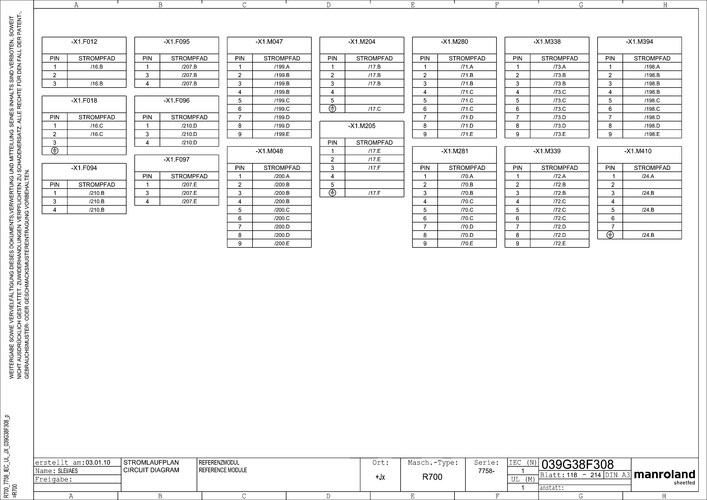

# +Jx — Sheet 118 of 214 — REFERENZMODUL

**REFERENCE MODULE**

> Part of the manroland **R700** printing press IEC/UL circuit diagrams.
> Drawing class: **Stromlaufplan / Circuit diagram** (DIN A3).
> Document `+Jx` covers the **1st printing module + feed register** machine section.

## At a glance

| Field | Value |
|---|---|
| Document | `+Jx`  (039G38F308) |
| Sheet | **118** of 214 |
| Section (DE) | REFERENZMODUL |
| Section (EN) | REFERENCE MODULE |
| Section type | REFERENCE_MODULE — Reference module |
| Machine type | `R700` |
| Series | `7758` |
| Created | 03.01.10 |
| Replaces | — |
| Columns used | A, B, C, D, E, F, G, H |
| Path numbers | — |
| Labels on sheet | 237 |
| Cross-refs out | 91 |
| Cross-refs in | 0 |

**Previous:** [+Jx sheet 117](SHEET_0117.md) · **Next:** [+Jx sheet 119](SHEET_0119.md) · **Document TOC:** [_TOC.md](_TOC.md)  (+Jx) · **Master TOC:** [all sheets](../_MASTER_TOC.md)

## Sheet image (300 DPI, exact vector render)



_Rendered directly from the PDF vector layer at 300 DPI (1-bit), no OCR and no resampling. Use it to confirm anything ambiguous in the text below._

## Cross-references on this sheet

Each entry is a wire leaving this sheet. The printed token is `/sheet.column`; the link resolves to that sheet inside the same document.

| Ref | Target sheet | Col | Path | Destination on target | Target section | From col |
|---|---|---|---|---|---|---|
| `/16.B` | [+Jx sheet 16](SHEET_0016.md) | B | — | — | ÖLUMLAUFSCHMIERUNG | A |
| `/17.B` | [+Jx sheet 17](SHEET_0017.md) | B | — | — | LACKPUMPE | E |
| `/71.A` | [+Jx sheet 71](SHEET_0071.md) | A | — | — | MOTOR: SEITENREGISTER | F |
| `/73.A` | [+Jx sheet 73](SHEET_0073.md) | A | — | — | BEDRUCKSTOFFEINSTELLUNG | G |
| `/207.B` | [+Jx sheet 207](SHEET_0207.md) | B | — | — | OPTION: ZWISCHENTROCKNER, VORBEREITUNG | B |
| `/199.A` | [+Jx sheet 199](SHEET_0199.md) | A | — | — | OPTION: | C |
| `/198.A` | [+Jx sheet 198](SHEET_0198.md) | A | — | — | OPTION: | H |
| `/17.B` | [+Jx sheet 17](SHEET_0017.md) | B | — | — | LACKPUMPE | E |
| `/71.B` | [+Jx sheet 71](SHEET_0071.md) | B | — | — | MOTOR: SEITENREGISTER | F |
| `/73.B` | [+Jx sheet 73](SHEET_0073.md) | B | — | — | BEDRUCKSTOFFEINSTELLUNG | G |
| `/207.B` | [+Jx sheet 207](SHEET_0207.md) | B | — | — | OPTION: ZWISCHENTROCKNER, VORBEREITUNG | B |
| `/199.B` | [+Jx sheet 199](SHEET_0199.md) | B | — | — | OPTION: | C |
| `/198.B` | [+Jx sheet 198](SHEET_0198.md) | B | — | — | OPTION: | H |
| `/16.B` | [+Jx sheet 16](SHEET_0016.md) | B | — | — | ÖLUMLAUFSCHMIERUNG | A |
| `/17.B` | [+Jx sheet 17](SHEET_0017.md) | B | — | — | LACKPUMPE | E |
| `/71.B` | [+Jx sheet 71](SHEET_0071.md) | B | — | — | MOTOR: SEITENREGISTER | F |
| `/73.B` | [+Jx sheet 73](SHEET_0073.md) | B | — | — | BEDRUCKSTOFFEINSTELLUNG | G |
| `/207.B` | [+Jx sheet 207](SHEET_0207.md) | B | — | — | OPTION: ZWISCHENTROCKNER, VORBEREITUNG | B |
| `/199.B` | [+Jx sheet 199](SHEET_0199.md) | B | — | — | OPTION: | C |
| `/198.B` | [+Jx sheet 198](SHEET_0198.md) | B | — | — | OPTION: | H |
| `/199.B` | [+Jx sheet 199](SHEET_0199.md) | B | — | — | OPTION: | C |
| `/198.B` | [+Jx sheet 198](SHEET_0198.md) | B | — | — | OPTION: | H |
| `/71.C` | [+Jx sheet 71](SHEET_0071.md) | C | — | — | MOTOR: SEITENREGISTER | F |
| `/73.C` | [+Jx sheet 73](SHEET_0073.md) | C | — | — | BEDRUCKSTOFFEINSTELLUNG | G |
| `/71.C` | [+Jx sheet 71](SHEET_0071.md) | C | — | — | MOTOR: SEITENREGISTER | F |
| `/73.C` | [+Jx sheet 73](SHEET_0073.md) | C | — | — | BEDRUCKSTOFFEINSTELLUNG | G |
| `/199.C` | [+Jx sheet 199](SHEET_0199.md) | C | — | — | OPTION: | C |
| `/198.C` | [+Jx sheet 198](SHEET_0198.md) | C | — | — | OPTION: | H |
| `/199.C` | [+Jx sheet 199](SHEET_0199.md) | C | — | — | OPTION: | C |
| `/17.C` | [+Jx sheet 17](SHEET_0017.md) | C | — | — | LACKPUMPE | E |
| `/71.C` | [+Jx sheet 71](SHEET_0071.md) | C | — | — | MOTOR: SEITENREGISTER | F |
| `/73.C` | [+Jx sheet 73](SHEET_0073.md) | C | — | — | BEDRUCKSTOFFEINSTELLUNG | G |
| `/198.C` | [+Jx sheet 198](SHEET_0198.md) | C | — | — | OPTION: | H |
| `/71.D` | [+Jx sheet 71](SHEET_0071.md) | D | — | — | MOTOR: SEITENREGISTER | F |
| `/73.D` | [+Jx sheet 73](SHEET_0073.md) | D | — | — | BEDRUCKSTOFFEINSTELLUNG | G |
| `/199.D` | [+Jx sheet 199](SHEET_0199.md) | D | — | — | OPTION: | C |
| `/198.D` | [+Jx sheet 198](SHEET_0198.md) | D | — | — | OPTION: | H |
| `/16.C` | [+Jx sheet 16](SHEET_0016.md) | C | — | — | ÖLUMLAUFSCHMIERUNG | A |
| `/71.D` | [+Jx sheet 71](SHEET_0071.md) | D | — | — | MOTOR: SEITENREGISTER | F |
| `/73.D` | [+Jx sheet 73](SHEET_0073.md) | D | — | — | BEDRUCKSTOFFEINSTELLUNG | G |
| `/210.D` | [+Jx sheet 210](SHEET_0210.md) | D | — | — | OPTION: WASCHMITTELWECHSELBETRIEB | B |
| `/199.D` | [+Jx sheet 199](SHEET_0199.md) | D | — | — | OPTION: | C |
| `/198.D` | [+Jx sheet 198](SHEET_0198.md) | D | — | — | OPTION: | H |
| `/71.E` | [+Jx sheet 71](SHEET_0071.md) | E | — | — | MOTOR: SEITENREGISTER | F |
| `/73.E` | [+Jx sheet 73](SHEET_0073.md) | E | — | — | BEDRUCKSTOFFEINSTELLUNG | G |
| `/199.E` | [+Jx sheet 199](SHEET_0199.md) | E | — | — | OPTION: | C |
| `/198.E` | [+Jx sheet 198](SHEET_0198.md) | E | — | — | OPTION: | H |
| `/16.C` | [+Jx sheet 16](SHEET_0016.md) | C | — | — | ÖLUMLAUFSCHMIERUNG | A |
| `/210.D` | [+Jx sheet 210](SHEET_0210.md) | D | — | — | OPTION: WASCHMITTELWECHSELBETRIEB | B |
| `/210.D` | [+Jx sheet 210](SHEET_0210.md) | D | — | — | OPTION: WASCHMITTELWECHSELBETRIEB | B |
| `/17.E` | [+Jx sheet 17](SHEET_0017.md) | E | — | — | LACKPUMPE | E |
| `/17.E` | [+Jx sheet 17](SHEET_0017.md) | E | — | — | LACKPUMPE | E |
| `/17.F` | [+Jx sheet 17](SHEET_0017.md) | F | — | — | LACKPUMPE | E |
| `/70.A` | [+Jx sheet 70](SHEET_0070.md) | A | — | — | MOTOR: UMFANGSREGISTER | F |
| `/72.A` | [+Jx sheet 72](SHEET_0072.md) | A | — | — | MOTOR: SCHRÄGREGISTER | G |
| `/24.A` | [+Jx sheet 24](SHEET_0024.md) | A | — | — | HILFSANTRIEB, LACKDOSIER /AUFTRAGSWALZEN | H |
| `/200.A` | [+Jx sheet 200](SHEET_0200.md) | A | — | — | OPTION: | C |
| `/70.B` | [+Jx sheet 70](SHEET_0070.md) | B | — | — | MOTOR: UMFANGSREGISTER | F |
| `/72.B` | [+Jx sheet 72](SHEET_0072.md) | B | — | — | MOTOR: SCHRÄGREGISTER | G |
| `/207.E` | [+Jx sheet 207](SHEET_0207.md) | E | — | — | OPTION: ZWISCHENTROCKNER, VORBEREITUNG | B |
| `/200.B` | [+Jx sheet 200](SHEET_0200.md) | B | — | — | OPTION: | C |
| `/70.B` | [+Jx sheet 70](SHEET_0070.md) | B | — | — | MOTOR: UMFANGSREGISTER | F |
| `/72.B` | [+Jx sheet 72](SHEET_0072.md) | B | — | — | MOTOR: SCHRÄGREGISTER | G |
| `/24.B` | [+Jx sheet 24](SHEET_0024.md) | B | — | — | HILFSANTRIEB, LACKDOSIER /AUFTRAGSWALZEN | H |
| `/210.B` | [+Jx sheet 210](SHEET_0210.md) | B | — | — | OPTION: WASCHMITTELWECHSELBETRIEB | A |
| `/207.E` | [+Jx sheet 207](SHEET_0207.md) | E | — | — | OPTION: ZWISCHENTROCKNER, VORBEREITUNG | B |
| `/200.B` | [+Jx sheet 200](SHEET_0200.md) | B | — | — | OPTION: | C |
| `/17.F` | [+Jx sheet 17](SHEET_0017.md) | F | — | — | LACKPUMPE | E |
| `/210.B` | [+Jx sheet 210](SHEET_0210.md) | B | — | — | OPTION: WASCHMITTELWECHSELBETRIEB | A |
| `/207.E` | [+Jx sheet 207](SHEET_0207.md) | E | — | — | OPTION: ZWISCHENTROCKNER, VORBEREITUNG | B |
| `/200.B` | [+Jx sheet 200](SHEET_0200.md) | B | — | — | OPTION: | C |
| `/70.C` | [+Jx sheet 70](SHEET_0070.md) | C | — | — | MOTOR: UMFANGSREGISTER | F |
| `/72.C` | [+Jx sheet 72](SHEET_0072.md) | C | — | — | MOTOR: SCHRÄGREGISTER | G |
| `/24.B` | [+Jx sheet 24](SHEET_0024.md) | B | — | — | HILFSANTRIEB, LACKDOSIER /AUFTRAGSWALZEN | H |
| `/210.B` | [+Jx sheet 210](SHEET_0210.md) | B | — | — | OPTION: WASCHMITTELWECHSELBETRIEB | A |
| `/200.C` | [+Jx sheet 200](SHEET_0200.md) | C | — | — | OPTION: | C |
| `/70.C` | [+Jx sheet 70](SHEET_0070.md) | C | — | — | MOTOR: UMFANGSREGISTER | F |
| `/72.C` | [+Jx sheet 72](SHEET_0072.md) | C | — | — | MOTOR: SCHRÄGREGISTER | G |
| `/70.C` | [+Jx sheet 70](SHEET_0070.md) | C | — | — | MOTOR: UMFANGSREGISTER | F |
| `/72.C` | [+Jx sheet 72](SHEET_0072.md) | C | — | — | MOTOR: SCHRÄGREGISTER | G |
| `/200.C` | [+Jx sheet 200](SHEET_0200.md) | C | — | — | OPTION: | C |
| `/70.D` | [+Jx sheet 70](SHEET_0070.md) | D | — | — | MOTOR: UMFANGSREGISTER | F |
| `/72.D` | [+Jx sheet 72](SHEET_0072.md) | D | — | — | MOTOR: SCHRÄGREGISTER | G |
| `/200.D` | [+Jx sheet 200](SHEET_0200.md) | D | — | — | OPTION: | C |
| `/24.B` | [+Jx sheet 24](SHEET_0024.md) | B | — | — | HILFSANTRIEB, LACKDOSIER /AUFTRAGSWALZEN | H |
| `/200.D` | [+Jx sheet 200](SHEET_0200.md) | D | — | — | OPTION: | C |
| `/70.D` | [+Jx sheet 70](SHEET_0070.md) | D | — | — | MOTOR: UMFANGSREGISTER | F |
| `/72.D` | [+Jx sheet 72](SHEET_0072.md) | D | — | — | MOTOR: SCHRÄGREGISTER | G |
| `/70.E` | [+Jx sheet 70](SHEET_0070.md) | E | — | — | MOTOR: UMFANGSREGISTER | F |
| `/72.E` | [+Jx sheet 72](SHEET_0072.md) | E | — | — | MOTOR: SCHRÄGREGISTER | G |
| `/200.E` | [+Jx sheet 200](SHEET_0200.md) | E | — | — | OPTION: | C |

## Devices on this sheet

| Tag | Class | Class meaning (IEC) | Col | Sub | Terminal | Sign |
|---|---|---|---|---|---|---|
| `X1.F012` | — | cross-device reference | A | — | — | — |
| `X1.F018` | — | cross-device reference | A | — | — | — |
| `X1.F094` | — | cross-device reference | A | — | — | — |
| `X1.F095` | — | cross-device reference | B | — | — | — |
| `X1.F096` | — | cross-device reference | B | — | — | — |
| `X1.F097` | — | cross-device reference | B | — | — | — |
| `X1.M047` | — | cross-device reference | C | — | — | — |
| `X1.M048` | — | cross-device reference | C | — | — | — |
| `X1.M204` | — | cross-device reference | D | — | — | — |
| `X1.M205` | — | cross-device reference | D | — | — | — |
| `X1.M280` | — | cross-device reference | F | — | — | — |
| `X1.M281` | — | cross-device reference | F | — | — | — |
| `X1.M338` | — | cross-device reference | G | — | — | — |
| `X1.M339` | — | cross-device reference | G | — | — | — |
| `X1.M394` | — | cross-device reference | H | — | — | — |
| `X1.M410` | — | cross-device reference | H | — | — | — |

## Potentials / nets

_No named potentials on this sheet._

## Wire-end annotations (grouped as printed)

A wire that continues elsewhere is annotated with a small cluster: the destination description, the path/line number `#NN`, and the `/sheet.column` cross reference. Each row below is one such cluster exactly as it is grouped on the drawing.

| Col | Y | Path | Cross-ref | Text on the wire |
|---|---|---|---|---|
| A | 65.4 | — | — | `X1.F012` |
| B | 65.4 | — | — | `X1.F095` |
| C | 65.4 | — | — | `X1.M047` |
| D | 65.4 | — | — | `X1.M204` |
| F | 65.4 | — | — | `X1.M280` |
| G | 65.4 | — | — | `X1.M338` |
| H | 65.4 | — | — | `X1.M394` |
| A | 94.1 | — | — | `PIN 2 3 1 STROMPFAD` |
| B | 94.1 | — | — | `PIN 3 4 1 STROMPFAD` |
| C | 94.1 | — | — | `PIN 2 3 5 6 7 8 9 4 1 STROMPFAD` |
| D | 94.1 | — | — | `PIN 2 3 5 4 1 STROMPFAD` |
| E | 94.1 | — | — | `PIN 2 3 5 6 7 8 9 4 1 STROMPFAD` |
| G | 94.1 | — | — | `PIN 2 3 5 6 7 8 9 4 1 STROMPFAD` |
| H | 94.1 | — | — | `PIN 2 3 5 6 7 8 9 4 1 STROMPFAD` |
| A | 108.6 | — | `/16.B` | — |
| B | 108.6 | — | `/207.B` | — |
| C | 108.6 | — | `/199.A` | — |
| E | 108.6 | — | `/17.B` | — |
| F | 108.6 | — | `/71.A` | — |
| G | 108.6 | — | `/73.A` | — |
| H | 108.6 | — | `/198.A` | — |
| B | 122.8 | — | `/207.B` | — |
| C | 122.8 | — | `/199.B` | — |
| E | 122.8 | — | `/17.B` | — |
| F | 122.8 | — | `/71.B` | — |
| G | 122.8 | — | `/73.B` | — |
| H | 122.8 | — | `/198.B` | — |
| A | 137.0 | — | `/16.B` | — |
| B | 137.0 | — | `/207.B` | — |
| C | 137.0 | — | `/199.B` | — |
| E | 137.0 | — | `/17.B` | — |
| F | 137.0 | — | `/71.B` | — |
| G | 137.0 | — | `/73.B` | — |
| H | 137.0 | — | `/198.B` | — |
| C | 151.2 | — | `/199.B` | — |
| F | 151.2 | — | `/71.C` | — |
| G | 151.2 | — | `/73.C` | — |
| H | 151.2 | — | `/198.B` | — |
| A | 164.7 | — | — | `X1.F018` |
| B | 164.7 | — | — | `X1.F096` |
| C | 165.3 | — | `/199.C` | — |
| F | 165.3 | — | `/71.C` | — |
| G | 165.3 | — | `/73.C` | — |
| H | 165.3 | — | `/198.C` | — |
| C | 179.5 | — | `/199.C` | — |
| E | 179.5 | — | `/17.C` | — |
| F | 179.5 | — | `/71.C` | — |
| G | 179.5 | — | `/73.C` | — |
| H | 179.5 | — | `/198.C` | — |
| A | 193.3 | — | — | `PIN 2 3 1 STROMPFAD` |
| B | 193.3 | — | — | `PIN 3 4 1 STROMPFAD` |
| C | 193.7 | — | `/199.D` | — |
| F | 193.7 | — | `/71.D` | — |
| G | 193.7 | — | `/73.D` | — |
| H | 193.7 | — | `/198.D` | — |
| D | 207.2 | — | — | `X1.M205` |
| A | 207.9 | — | `/16.C` | — |
| B | 207.9 | — | `/210.D` | — |
| C | 207.9 | — | `/199.D` | — |
| F | 207.9 | — | `/71.D` | — |
| G | 207.9 | — | `/73.D` | — |
| H | 207.9 | — | `/198.D` | — |
| A | 222.0 | — | `/16.C` | — |
| B | 222.0 | — | `/210.D` | — |
| C | 222.0 | — | `/199.E` | — |
| F | 222.0 | — | `/71.E` | — |
| G | 222.0 | — | `/73.E` | — |
| H | 222.0 | — | `/198.E` | — |
| D | 235.8 | — | — | `PIN 2 3 5 4 1 STROMPFAD` |
| B | 236.2 | — | `/210.D` | — |
| C | 249.7 | — | — | `X1.M048` |
| F | 249.7 | — | — | `X1.M281` |
| G | 249.7 | — | — | `X1.M339` |
| H | 249.7 | — | — | `X1.M410` |
| E | 250.3 | — | `/17.E` | — |
| B | 263.9 | — | — | `X1.F097` |
| E | 264.5 | — | `/17.E` | — |
| A | 278.0 | — | — | `X1.F094` |
| C | 278.3 | — | — | `PIN 2 3 5 6 7 8 9 4 1 STROMPFAD` |
| E | 278.3 | — | — | `PIN 2 3 5 6 7 8 9 4 1 STROMPFAD` |
| G | 278.3 | — | — | `PIN 2 3 5 6 7 8 9 4 1 STROMPFAD` |
| H | 278.3 | — | — | `PIN 2 3 4 5 6 7 1 STROMPFAD` |
| E | 278.7 | — | `/17.F` | — |
| B | 292.5 | — | — | `PIN 3 4 1 STROMPFAD` |
| C | 292.9 | — | `/200.A` | — |
| F | 292.9 | — | `/70.A` | — |
| G | 292.9 | — | `/72.A` | — |
| H | 292.9 | — | `/24.A` | — |
| A | 306.7 | — | — | `PIN 3 4 1 STROMPFAD` |
| F | 307.0 | — | `/70.B` | — |
| G | 307.0 | — | `/72.B` | — |
| B | 307.1 | — | `/207.E` | — |
| C | 307.1 | — | `/200.B` | — |
| A | 321.2 | — | `/210.B` | — |
| B | 321.2 | — | `/207.E` | — |
| C | 321.2 | — | `/200.B` | — |
| E | 321.2 | — | `/17.F` | — |
| F | 321.2 | — | `/70.B` | — |
| G | 321.2 | — | `/72.B` | — |
| H | 321.2 | — | `/24.B` | — |
| A | 335.4 | — | `/210.B` | — |
| B | 335.4 | — | `/207.E` | — |
| C | 335.4 | — | `/200.B` | — |
| F | 335.4 | — | `/70.C` | — |
| G | 335.4 | — | `/72.C` | — |
| A | 349.6 | — | `/210.B` | — |
| C | 349.6 | — | `/200.C` | — |
| F | 349.6 | — | `/70.C` | — |
| G | 349.6 | — | `/72.C` | — |
| H | 349.6 | — | `/24.B` | — |
| C | 363.8 | — | `/200.C` | — |
| F | 363.8 | — | `/70.C` | — |
| G | 363.8 | — | `/72.C` | — |
| C | 377.9 | — | `/200.D` | — |
| F | 377.9 | — | `/70.D` | — |
| G | 377.9 | — | `/72.D` | — |
| C | 392.1 | — | `/200.D` | — |
| F | 392.1 | — | `/70.D` | — |
| G | 392.1 | — | `/72.D` | — |
| H | 392.1 | — | `/24.B` | — |
| F | 406.2 | — | `/70.E` | — |
| G | 406.2 | — | `/72.E` | — |
| C | 406.3 | — | `/200.E` | — |


## Reconstructed tables

This sheet carries tabular content (pin map / terminal assignment / index). The grid below was rebuilt from the drawing's own rule lines, so each row is exactly one physical row of the table.

### Table 1 — 13 data rows × 2 columns (at x=70.9, y=62.4) — **X1.F012**

| PIN | STROMPFAD |
|---|---|
| `1` | `/16.B` |
| `2` |  |
| `3` | `/16.B` |
|  | `X1.F018` |
| `PIN` | `STROMPFAD` |
| `1` | `/16.C` |
| `2` | `/16.C` |
| `3` |  |
|  | `X1.F094` |
| `PIN` | `STROMPFAD` |
| `1` | `/210.B` |
| `3` | `/210.B` |
| `4` | `/210.B` |


### Table 2 — 13 data rows × 2 columns (at x=226.8, y=62.4) — **X1.F095**

| PIN | STROMPFAD |
|---|---|
| `1` | `/207.B` |
| `3` | `/207.B` |
| `4` | `/207.B` |
|  | `X1.F096` |
| `PIN` | `STROMPFAD` |
| `1` | `/210.D` |
| `3` | `/210.D` |
| `4` | `/210.D` |
|  | `X1.F097` |
| `PIN` | `STROMPFAD` |
| `1` | `/207.E` |
| `3` | `/207.E` |
| `4` | `/207.E` |


### Table 3 — 20 data rows × 2 columns (at x=382.7, y=62.4) — **X1.M047**

| PIN | STROMPFAD |
|---|---|
| `1` | `/199.A` |
| `2` | `/199.B` |
| `3` | `/199.B` |
| `4` | `/199.B` |
| `5` | `/199.C` |
| `6` | `/199.C` |
| `7` | `/199.D` |
| `8` | `/199.D` |
| `9` | `/199.E` |
|  | `X1.M048` |
| `PIN` | `STROMPFAD` |
| `1` | `/200.A` |
| `2` | `/200.B` |
| `3` | `/200.B` |
| `4` | `/200.B` |
| `5` | `/200.C` |
| `6` | `/200.C` |
| `7` | `/200.D` |
| `8` | `/200.D` |
| `9` | `/200.E` |


### Table 4 — 14 data rows × 2 columns (at x=538.6, y=62.4) — **X1.M204**

| PIN | STROMPFAD |
|---|---|
| `1` | `/17.B` |
| `2` | `/17.B` |
| `3` | `/17.B` |
| `4` |  |
| `5` |  |
|  | `/17.C` |
|  | `X1.M205` |
| `PIN` | `STROMPFAD` |
| `1` | `/17.E` |
| `2` | `/17.E` |
| `3` | `/17.F` |
| `4` |  |
| `5` |  |
|  | `/17.F` |


### Table 5 — 20 data rows × 2 columns (at x=694.5, y=62.4) — **X1.M280**

| PIN | STROMPFAD |
|---|---|
| `1` | `/71.A` |
| `2` | `/71.B` |
| `3` | `/71.B` |
| `4` | `/71.C` |
| `5` | `/71.C` |
| `6` | `/71.C` |
| `7` | `/71.D` |
| `8` | `/71.D` |
| `9` | `/71.E` |
|  | `X1.M281` |
| `PIN` | `STROMPFAD` |
| `1` | `/70.A` |
| `2` | `/70.B` |
| `3` | `/70.B` |
| `4` | `/70.C` |
| `5` | `/70.C` |
| `6` | `/70.C` |
| `7` | `/70.D` |
| `8` | `/70.D` |
| `9` | `/70.E` |


### Table 6 — 20 data rows × 2 columns (at x=850.4, y=62.4) — **X1.M338**

| PIN | STROMPFAD |
|---|---|
| `1` | `/73.A` |
| `2` | `/73.B` |
| `3` | `/73.B` |
| `4` | `/73.C` |
| `5` | `/73.C` |
| `6` | `/73.C` |
| `7` | `/73.D` |
| `8` | `/73.D` |
| `9` | `/73.E` |
|  | `X1.M339` |
| `PIN` | `STROMPFAD` |
| `1` | `/72.A` |
| `2` | `/72.B` |
| `3` | `/72.B` |
| `4` | `/72.C` |
| `5` | `/72.C` |
| `6` | `/72.C` |
| `7` | `/72.D` |
| `8` | `/72.D` |
| `9` | `/72.E` |


### Table 7 — 19 data rows × 2 columns (at x=1006.3, y=62.4) — **X1.M394**

| PIN | STROMPFAD |
|---|---|
| `1` | `/198.A` |
| `2` | `/198.B` |
| `3` | `/198.B` |
| `4` | `/198.B` |
| `5` | `/198.C` |
| `6` | `/198.C` |
| `7` | `/198.D` |
| `8` | `/198.D` |
| `9` | `/198.E` |
|  | `X1.M410` |
| `PIN` | `STROMPFAD` |
| `1` | `/24.A` |
| `2` |  |
| `3` | `/24.B` |
| `4` |  |
| `5` | `/24.B` |
| `6` |  |
| `7` |  |
|  | `/24.B` |


## Notes and free text on this sheet

| Text | Col | Y (pt) |
|---|---|---|
| `PIN` | A | 94.13 |
| `STROMPFAD` | A | 94.09 |
| `PIN` | B | 94.13 |
| `STROMPFAD` | B | 94.09 |
| `PIN` | C | 94.13 |
| `STROMPFAD` | C | 94.09 |
| `PIN` | D | 94.13 |
| `STROMPFAD` | E | 94.09 |
| `PIN` | E | 94.13 |
| `STROMPFAD` | F | 94.09 |
| `PIN` | F | 94.13 |
| `STROMPFAD` | G | 94.09 |
| `PIN` | G | 94.13 |
| `STROMPFAD` | H | 94.09 |

## Complete label inventory (exact text from the drawing)

Every text object inside the drawing area of this sheet, in DIN reading order (column A→H, then top→bottom). This is the authoritative list: if a string is not here it is not printed on this sheet.

| Col | Y | X | Dir | Type | Text |
|---|---|---|---|---|---|
| A | 65.4 | 120.0 | → | device ref | `X1.F012` |
| A | 94.1 | 84.0 | → | text | `PIN` |
| A | 94.1 | 132.4 | → | text | `STROMPFAD` |
| A | 108.3 | 89.9 | → | number | `1` |
| A | 108.6 | 152.8 | → | cross-reference | `/16.B` |
| A | 122.5 | 89.4 | → | number | `2` |
| A | 136.7 | 89.4 | → | number | `3` |
| A | 137.0 | 152.8 | → | cross-reference | `/16.B` |
| A | 164.6 | 120.0 | → | device ref | `X1.F018` |
| A | 193.3 | 84.0 | → | text | `PIN` |
| A | 193.3 | 132.4 | → | text | `STROMPFAD` |
| A | 207.5 | 89.9 | → | number | `1` |
| A | 207.9 | 152.6 | → | cross-reference | `/16.C` |
| A | 221.7 | 89.4 | → | number | `2` |
| A | 222.0 | 152.6 | → | cross-reference | `/16.C` |
| A | 235.9 | 89.4 | → | number | `3` |
| A | 278.0 | 119.9 | → | device ref | `X1.F094` |
| A | 306.7 | 84.0 | → | text | `PIN` |
| A | 306.7 | 132.4 | → | text | `STROMPFAD` |
| A | 320.9 | 89.9 | → | number | `1` |
| A | 321.2 | 150.4 | → | cross-reference | `/210.B` |
| A | 335.1 | 89.4 | → | number | `3` |
| A | 335.4 | 150.4 | → | cross-reference | `/210.B` |
| A | 349.3 | 89.6 | → | number | `4` |
| A | 349.6 | 150.4 | → | cross-reference | `/210.B` |
| B | 65.4 | 275.8 | → | device ref | `X1.F095` |
| B | 94.1 | 240.0 | → | text | `PIN` |
| B | 94.1 | 288.3 | → | text | `STROMPFAD` |
| B | 108.3 | 245.8 | → | number | `1` |
| B | 108.6 | 306.3 | → | cross-reference | `/207.B` |
| B | 122.5 | 245.3 | → | number | `3` |
| B | 122.8 | 306.3 | → | cross-reference | `/207.B` |
| B | 136.7 | 245.5 | → | number | `4` |
| B | 137.0 | 306.3 | → | cross-reference | `/207.B` |
| B | 164.6 | 275.8 | → | device ref | `X1.F096` |
| B | 193.3 | 240.0 | → | text | `PIN` |
| B | 193.3 | 288.3 | → | text | `STROMPFAD` |
| B | 207.5 | 245.8 | → | number | `1` |
| B | 207.9 | 306.1 | → | cross-reference | `/210.D` |
| B | 221.7 | 245.3 | → | number | `3` |
| B | 222.0 | 306.1 | → | cross-reference | `/210.D` |
| B | 235.9 | 245.5 | → | number | `4` |
| B | 236.2 | 306.1 | → | cross-reference | `/210.D` |
| B | 263.9 | 275.8 | → | device ref | `X1.F097` |
| B | 292.5 | 288.3 | → | text | `STROMPFAD` |
| B | 292.6 | 240.0 | → | text | `PIN` |
| B | 306.7 | 245.8 | → | number | `1` |
| B | 307.1 | 306.3 | → | cross-reference | `/207.E` |
| B | 320.9 | 245.3 | → | number | `3` |
| B | 321.2 | 306.3 | → | cross-reference | `/207.E` |
| B | 335.1 | 245.5 | → | number | `4` |
| B | 335.4 | 306.3 | → | cross-reference | `/207.E` |
| C | 65.4 | 430.6 | → | device ref | `X1.M047` |
| C | 94.1 | 395.9 | → | text | `PIN` |
| C | 94.1 | 444.2 | → | text | `STROMPFAD` |
| C | 108.3 | 401.7 | → | number | `1` |
| C | 108.6 | 462.0 | → | cross-reference | `/199.A` |
| C | 122.5 | 401.2 | → | number | `2` |
| C | 122.8 | 462.2 | → | cross-reference | `/199.B` |
| C | 136.7 | 401.2 | → | number | `3` |
| C | 137.0 | 462.2 | → | cross-reference | `/199.B` |
| C | 150.8 | 401.4 | → | number | `4` |
| C | 151.2 | 462.2 | → | cross-reference | `/199.B` |
| C | 165.0 | 401.2 | → | number | `5` |
| C | 165.4 | 462.0 | → | cross-reference | `/199.C` |
| C | 179.2 | 401.2 | → | number | `6` |
| C | 179.5 | 462.0 | → | cross-reference | `/199.C` |
| C | 193.3 | 401.2 | → | number | `7` |
| C | 193.7 | 462.0 | → | cross-reference | `/199.D` |
| C | 207.5 | 401.2 | → | number | `8` |
| C | 207.9 | 462.0 | → | cross-reference | `/199.D` |
| C | 221.7 | 401.2 | → | number | `9` |
| C | 222.0 | 462.2 | → | cross-reference | `/199.E` |
| C | 249.7 | 430.7 | → | device ref | `X1.M048` |
| C | 278.3 | 444.2 | → | text | `STROMPFAD` |
| C | 278.4 | 395.9 | → | text | `PIN` |
| C | 292.6 | 401.7 | → | number | `1` |
| C | 292.9 | 462.0 | → | cross-reference | `/200.A` |
| C | 306.7 | 401.2 | → | number | `2` |
| C | 307.1 | 462.2 | → | cross-reference | `/200.B` |
| C | 320.9 | 401.2 | → | number | `3` |
| C | 321.2 | 462.2 | → | cross-reference | `/200.B` |
| C | 335.1 | 401.4 | → | number | `4` |
| C | 335.4 | 462.2 | → | cross-reference | `/200.B` |
| C | 349.3 | 401.2 | → | number | `5` |
| C | 349.6 | 462.0 | → | cross-reference | `/200.C` |
| C | 363.4 | 401.2 | → | number | `6` |
| C | 363.8 | 462.0 | → | cross-reference | `/200.C` |
| C | 377.6 | 401.2 | → | number | `7` |
| C | 377.9 | 462.0 | → | cross-reference | `/200.D` |
| C | 391.8 | 401.2 | → | number | `8` |
| C | 392.1 | 462.0 | → | cross-reference | `/200.D` |
| C | 405.9 | 401.2 | → | number | `9` |
| C | 406.3 | 462.2 | → | cross-reference | `/200.E` |
| D | 65.4 | 586.5 | → | device ref | `X1.M204` |
| D | 94.1 | 551.8 | → | text | `PIN` |
| D | 108.3 | 557.6 | → | number | `1` |
| D | 122.5 | 557.1 | → | number | `2` |
| D | 136.7 | 557.1 | → | number | `3` |
| D | 150.8 | 557.3 | → | number | `4` |
| D | 165.0 | 557.1 | → | number | `5` |
| D | 207.2 | 586.5 | → | device ref | `X1.M205` |
| D | 235.9 | 551.8 | → | text | `PIN` |
| D | 250.0 | 557.6 | → | number | `1` |
| D | 264.2 | 557.1 | → | number | `2` |
| D | 278.4 | 557.1 | → | number | `3` |
| D | 292.6 | 557.3 | → | number | `4` |
| D | 306.7 | 557.1 | → | number | `5` |
| E | 94.1 | 600.1 | → | text | `STROMPFAD` |
| E | 94.1 | 707.7 | → | text | `PIN` |
| E | 108.3 | 713.5 | → | number | `1` |
| E | 108.6 | 620.5 | → | cross-reference | `/17.B` |
| E | 122.5 | 713.1 | → | number | `2` |
| E | 122.8 | 620.5 | → | cross-reference | `/17.B` |
| E | 136.7 | 713.1 | → | number | `3` |
| E | 137.0 | 620.5 | → | cross-reference | `/17.B` |
| E | 150.8 | 713.2 | → | number | `4` |
| E | 165.0 | 713.1 | → | number | `5` |
| E | 179.2 | 713.1 | → | number | `6` |
| E | 179.5 | 620.4 | → | cross-reference | `/17.C` |
| E | 193.3 | 713.1 | → | number | `7` |
| E | 207.5 | 713.1 | → | number | `8` |
| E | 221.7 | 713.1 | → | number | `9` |
| E | 235.8 | 600.1 | → | text | `STROMPFAD` |
| E | 250.3 | 620.5 | → | cross-reference | `/17.E` |
| E | 264.5 | 620.5 | → | cross-reference | `/17.E` |
| E | 278.4 | 707.7 | → | text | `PIN` |
| E | 278.7 | 620.8 | → | cross-reference | `/17.F` |
| E | 292.6 | 713.5 | → | number | `1` |
| E | 306.7 | 713.1 | → | number | `2` |
| E | 320.9 | 713.1 | → | number | `3` |
| E | 321.2 | 620.8 | → | cross-reference | `/17.F` |
| E | 335.1 | 713.2 | → | number | `4` |
| E | 349.3 | 713.1 | → | number | `5` |
| E | 363.4 | 713.1 | → | number | `6` |
| E | 377.6 | 713.1 | → | number | `7` |
| E | 391.8 | 713.1 | → | number | `8` |
| E | 405.9 | 713.1 | → | number | `9` |
| F | 65.4 | 742.5 | → | device ref | `X1.M280` |
| F | 94.1 | 756.0 | → | text | `STROMPFAD` |
| F | 94.1 | 863.6 | → | text | `PIN` |
| F | 108.3 | 869.4 | → | number | `1` |
| F | 108.6 | 776.3 | → | cross-reference | `/71.A` |
| F | 122.5 | 869.0 | → | number | `2` |
| F | 122.8 | 776.4 | → | cross-reference | `/71.B` |
| F | 136.7 | 869.0 | → | number | `3` |
| F | 137.0 | 776.4 | → | cross-reference | `/71.B` |
| F | 150.8 | 869.1 | → | number | `4` |
| F | 151.2 | 776.3 | → | cross-reference | `/71.C` |
| F | 165.0 | 869.0 | → | number | `5` |
| F | 165.3 | 776.3 | → | cross-reference | `/71.C` |
| F | 179.2 | 869.0 | → | number | `6` |
| F | 179.5 | 776.3 | → | cross-reference | `/71.C` |
| F | 193.3 | 869.0 | → | number | `7` |
| F | 193.7 | 776.3 | → | cross-reference | `/71.D` |
| F | 207.5 | 869.0 | → | number | `8` |
| F | 207.9 | 776.3 | → | cross-reference | `/71.D` |
| F | 221.7 | 869.0 | → | number | `9` |
| F | 222.0 | 776.4 | → | cross-reference | `/71.E` |
| F | 249.7 | 743.2 | → | device ref | `X1.M281` |
| F | 278.3 | 756.0 | → | text | `STROMPFAD` |
| F | 278.4 | 863.6 | → | text | `PIN` |
| F | 292.6 | 869.4 | → | number | `1` |
| F | 292.9 | 776.3 | → | cross-reference | `/70.A` |
| F | 306.7 | 869.0 | → | number | `2` |
| F | 307.0 | 776.4 | → | cross-reference | `/70.B` |
| F | 320.9 | 869.0 | → | number | `3` |
| F | 321.2 | 776.4 | → | cross-reference | `/70.B` |
| F | 335.1 | 869.1 | → | number | `4` |
| F | 335.4 | 776.3 | → | cross-reference | `/70.C` |
| F | 349.3 | 869.0 | → | number | `5` |
| F | 349.6 | 776.3 | → | cross-reference | `/70.C` |
| F | 363.4 | 869.0 | → | number | `6` |
| F | 363.8 | 776.3 | → | cross-reference | `/70.C` |
| F | 377.6 | 869.0 | → | number | `7` |
| F | 377.9 | 776.3 | → | cross-reference | `/70.D` |
| F | 391.8 | 869.0 | → | number | `8` |
| F | 392.1 | 776.3 | → | cross-reference | `/70.D` |
| F | 405.9 | 869.0 | → | number | `9` |
| F | 406.3 | 776.4 | → | cross-reference | `/70.E` |
| G | 65.4 | 898.4 | → | device ref | `X1.M338` |
| G | 94.1 | 911.9 | → | text | `STROMPFAD` |
| G | 94.1 | 1019.5 | → | text | `PIN` |
| G | 108.3 | 1025.3 | → | number | `1` |
| G | 108.6 | 932.2 | → | cross-reference | `/73.A` |
| G | 122.5 | 1024.9 | → | number | `2` |
| G | 122.8 | 932.3 | → | cross-reference | `/73.B` |
| G | 136.7 | 1024.9 | → | number | `3` |
| G | 137.0 | 932.3 | → | cross-reference | `/73.B` |
| G | 150.8 | 1025.0 | → | number | `4` |
| G | 151.2 | 932.2 | → | cross-reference | `/73.C` |
| G | 165.0 | 1024.9 | → | number | `5` |
| G | 165.3 | 932.2 | → | cross-reference | `/73.C` |
| G | 179.2 | 1024.9 | → | number | `6` |
| G | 179.5 | 932.2 | → | cross-reference | `/73.C` |
| G | 193.3 | 1024.9 | → | number | `7` |
| G | 193.7 | 932.2 | → | cross-reference | `/73.D` |
| G | 207.5 | 1024.9 | → | number | `8` |
| G | 207.9 | 932.2 | → | cross-reference | `/73.D` |
| G | 221.7 | 1024.9 | → | number | `9` |
| G | 222.0 | 932.3 | → | cross-reference | `/73.E` |
| G | 249.7 | 898.3 | → | device ref | `X1.M339` |
| G | 278.3 | 911.9 | → | text | `STROMPFAD` |
| G | 278.4 | 1019.5 | → | text | `PIN` |
| G | 292.6 | 1031.0 | → | number | `1` |
| G | 292.9 | 932.2 | → | cross-reference | `/72.A` |
| G | 306.7 | 1029.5 | → | number | `2` |
| G | 307.0 | 932.3 | → | cross-reference | `/72.B` |
| G | 320.9 | 1029.5 | → | number | `3` |
| G | 321.2 | 932.3 | → | cross-reference | `/72.B` |
| G | 335.1 | 1029.5 | → | number | `4` |
| G | 335.4 | 932.2 | → | cross-reference | `/72.C` |
| G | 349.3 | 1029.5 | → | number | `5` |
| G | 349.6 | 932.2 | → | cross-reference | `/72.C` |
| G | 363.4 | 1029.5 | → | number | `6` |
| G | 363.8 | 932.2 | → | cross-reference | `/72.C` |
| G | 377.6 | 1029.5 | → | number | `7` |
| G | 377.9 | 932.2 | → | cross-reference | `/72.D` |
| G | 392.1 | 932.2 | → | cross-reference | `/72.D` |
| G | 406.3 | 932.3 | → | cross-reference | `/72.E` |
| H | 65.4 | 1054.2 | → | device ref | `X1.M394` |
| H | 94.1 | 1067.8 | → | text | `STROMPFAD` |
| H | 108.6 | 1085.7 | → | cross-reference | `/198.A` |
| H | 122.8 | 1085.8 | → | cross-reference | `/198.B` |
| H | 137.0 | 1085.8 | → | cross-reference | `/198.B` |
| H | 151.2 | 1085.8 | → | cross-reference | `/198.B` |
| H | 165.4 | 1085.7 | → | cross-reference | `/198.C` |
| H | 179.5 | 1085.7 | → | cross-reference | `/198.C` |
| H | 193.7 | 1085.7 | → | cross-reference | `/198.D` |
| H | 207.9 | 1085.7 | → | cross-reference | `/198.D` |
| H | 222.0 | 1085.8 | → | cross-reference | `/198.E` |
| H | 249.7 | 1051.5 | → | device ref | `X1.M410` |
| H | 278.3 | 1067.8 | → | text | `STROMPFAD` |
| H | 292.9 | 1081.0 | → | cross-reference | `/24.A` |
| H | 321.2 | 1081.1 | → | cross-reference | `/24.B` |
| H | 349.6 | 1081.1 | → | cross-reference | `/24.B` |
| H | 392.1 | 1081.1 | → | cross-reference | `/24.B` |

## Reading-order text block

The same content as a plain block, grouped by DIN column — convenient to paste or to match against a visual description.

```text
=== Column A ===
  65.4  120.0  devref       X1.F012
  94.1   84.0  text         PIN
  94.1  132.4  text         STROMPFAD
 108.3   89.9  numeric      1
 108.6  152.8  xref         /16.B
 122.5   89.4  numeric      2
 136.7   89.4  numeric      3
 137.0  152.8  xref         /16.B
 164.6  120.0  devref       X1.F018
 193.3   84.0  text         PIN
 193.3  132.4  text         STROMPFAD
 207.5   89.9  numeric      1
 207.9  152.6  xref         /16.C
 221.7   89.4  numeric      2
 222.0  152.6  xref         /16.C
 235.9   89.4  numeric      3
 278.0  119.9  devref       X1.F094
 306.7   84.0  text         PIN
 306.7  132.4  text         STROMPFAD
 320.9   89.9  numeric      1
 321.2  150.4  xref         /210.B
 335.1   89.4  numeric      3
 335.4  150.4  xref         /210.B
 349.3   89.6  numeric      4
 349.6  150.4  xref         /210.B
=== Column B ===
  65.4  275.8  devref       X1.F095
  94.1  240.0  text         PIN
  94.1  288.3  text         STROMPFAD
 108.3  245.8  numeric      1
 108.6  306.3  xref         /207.B
 122.5  245.3  numeric      3
 122.8  306.3  xref         /207.B
 136.7  245.5  numeric      4
 137.0  306.3  xref         /207.B
 164.6  275.8  devref       X1.F096
 193.3  240.0  text         PIN
 193.3  288.3  text         STROMPFAD
 207.5  245.8  numeric      1
 207.9  306.1  xref         /210.D
 221.7  245.3  numeric      3
 222.0  306.1  xref         /210.D
 235.9  245.5  numeric      4
 236.2  306.1  xref         /210.D
 263.9  275.8  devref       X1.F097
 292.5  288.3  text         STROMPFAD
 292.6  240.0  text         PIN
 306.7  245.8  numeric      1
 307.1  306.3  xref         /207.E
 320.9  245.3  numeric      3
 321.2  306.3  xref         /207.E
 335.1  245.5  numeric      4
 335.4  306.3  xref         /207.E
=== Column C ===
  65.4  430.6  devref       X1.M047
  94.1  395.9  text         PIN
  94.1  444.2  text         STROMPFAD
 108.3  401.7  numeric      1
 108.6  462.0  xref         /199.A
 122.5  401.2  numeric      2
 122.8  462.2  xref         /199.B
 136.7  401.2  numeric      3
 137.0  462.2  xref         /199.B
 150.8  401.4  numeric      4
 151.2  462.2  xref         /199.B
 165.0  401.2  numeric      5
 165.4  462.0  xref         /199.C
 179.2  401.2  numeric      6
 179.5  462.0  xref         /199.C
 193.3  401.2  numeric      7
 193.7  462.0  xref         /199.D
 207.5  401.2  numeric      8
 207.9  462.0  xref         /199.D
 221.7  401.2  numeric      9
 222.0  462.2  xref         /199.E
 249.7  430.7  devref       X1.M048
 278.3  444.2  text         STROMPFAD
 278.4  395.9  text         PIN
 292.6  401.7  numeric      1
 292.9  462.0  xref         /200.A
 306.7  401.2  numeric      2
 307.1  462.2  xref         /200.B
 320.9  401.2  numeric      3
 321.2  462.2  xref         /200.B
 335.1  401.4  numeric      4
 335.4  462.2  xref         /200.B
 349.3  401.2  numeric      5
 349.6  462.0  xref         /200.C
 363.4  401.2  numeric      6
 363.8  462.0  xref         /200.C
 377.6  401.2  numeric      7
 377.9  462.0  xref         /200.D
 391.8  401.2  numeric      8
 392.1  462.0  xref         /200.D
 405.9  401.2  numeric      9
 406.3  462.2  xref         /200.E
=== Column D ===
  65.4  586.5  devref       X1.M204
  94.1  551.8  text         PIN
 108.3  557.6  numeric      1
 122.5  557.1  numeric      2
 136.7  557.1  numeric      3
 150.8  557.3  numeric      4
 165.0  557.1  numeric      5
 207.2  586.5  devref       X1.M205
 235.9  551.8  text         PIN
 250.0  557.6  numeric      1
 264.2  557.1  numeric      2
 278.4  557.1  numeric      3
 292.6  557.3  numeric      4
 306.7  557.1  numeric      5
=== Column E ===
  94.1  600.1  text         STROMPFAD
  94.1  707.7  text         PIN
 108.3  713.5  numeric      1
 108.6  620.5  xref         /17.B
 122.5  713.1  numeric      2
 122.8  620.5  xref         /17.B
 136.7  713.1  numeric      3
 137.0  620.5  xref         /17.B
 150.8  713.2  numeric      4
 165.0  713.1  numeric      5
 179.2  713.1  numeric      6
 179.5  620.4  xref         /17.C
 193.3  713.1  numeric      7
 207.5  713.1  numeric      8
 221.7  713.1  numeric      9
 235.8  600.1  text         STROMPFAD
 250.3  620.5  xref         /17.E
 264.5  620.5  xref         /17.E
 278.4  707.7  text         PIN
 278.7  620.8  xref         /17.F
 292.6  713.5  numeric      1
 306.7  713.1  numeric      2
 320.9  713.1  numeric      3
 321.2  620.8  xref         /17.F
 335.1  713.2  numeric      4
 349.3  713.1  numeric      5
 363.4  713.1  numeric      6
 377.6  713.1  numeric      7
 391.8  713.1  numeric      8
 405.9  713.1  numeric      9
=== Column F ===
  65.4  742.5  devref       X1.M280
  94.1  756.0  text         STROMPFAD
  94.1  863.6  text         PIN
 108.3  869.4  numeric      1
 108.6  776.3  xref         /71.A
 122.5  869.0  numeric      2
 122.8  776.4  xref         /71.B
 136.7  869.0  numeric      3
 137.0  776.4  xref         /71.B
 150.8  869.1  numeric      4
 151.2  776.3  xref         /71.C
 165.0  869.0  numeric      5
 165.3  776.3  xref         /71.C
 179.2  869.0  numeric      6
 179.5  776.3  xref         /71.C
 193.3  869.0  numeric      7
 193.7  776.3  xref         /71.D
 207.5  869.0  numeric      8
 207.9  776.3  xref         /71.D
 221.7  869.0  numeric      9
 222.0  776.4  xref         /71.E
 249.7  743.2  devref       X1.M281
 278.3  756.0  text         STROMPFAD
 278.4  863.6  text         PIN
 292.6  869.4  numeric      1
 292.9  776.3  xref         /70.A
 306.7  869.0  numeric      2
 307.0  776.4  xref         /70.B
 320.9  869.0  numeric      3
 321.2  776.4  xref         /70.B
 335.1  869.1  numeric      4
 335.4  776.3  xref         /70.C
 349.3  869.0  numeric      5
 349.6  776.3  xref         /70.C
 363.4  869.0  numeric      6
 363.8  776.3  xref         /70.C
 377.6  869.0  numeric      7
 377.9  776.3  xref         /70.D
 391.8  869.0  numeric      8
 392.1  776.3  xref         /70.D
 405.9  869.0  numeric      9
 406.3  776.4  xref         /70.E
=== Column G ===
  65.4  898.4  devref       X1.M338
  94.1  911.9  text         STROMPFAD
  94.1 1019.5  text         PIN
 108.3 1025.3  numeric      1
 108.6  932.2  xref         /73.A
 122.5 1024.9  numeric      2
 122.8  932.3  xref         /73.B
 136.7 1024.9  numeric      3
 137.0  932.3  xref         /73.B
 150.8 1025.0  numeric      4
 151.2  932.2  xref         /73.C
 165.0 1024.9  numeric      5
 165.3  932.2  xref         /73.C
 179.2 1024.9  numeric      6
 179.5  932.2  xref         /73.C
 193.3 1024.9  numeric      7
 193.7  932.2  xref         /73.D
 207.5 1024.9  numeric      8
 207.9  932.2  xref         /73.D
 221.7 1024.9  numeric      9
 222.0  932.3  xref         /73.E
 249.7  898.3  devref       X1.M339
 278.3  911.9  text         STROMPFAD
 278.4 1019.5  text         PIN
 292.6 1031.0  numeric      1
 292.9  932.2  xref         /72.A
 306.7 1029.5  numeric      2
 307.0  932.3  xref         /72.B
 320.9 1029.5  numeric      3
 321.2  932.3  xref         /72.B
 335.1 1029.5  numeric      4
 335.4  932.2  xref         /72.C
 349.3 1029.5  numeric      5
 349.6  932.2  xref         /72.C
 363.4 1029.5  numeric      6
 363.8  932.2  xref         /72.C
 377.6 1029.5  numeric      7
 377.9  932.2  xref         /72.D
 392.1  932.2  xref         /72.D
 406.3  932.3  xref         /72.E
=== Column H ===
  65.4 1054.2  devref       X1.M394
  94.1 1067.8  text         STROMPFAD
 108.6 1085.7  xref         /198.A
 122.8 1085.8  xref         /198.B
 137.0 1085.8  xref         /198.B
 151.2 1085.8  xref         /198.B
 165.4 1085.7  xref         /198.C
 179.5 1085.7  xref         /198.C
 193.7 1085.7  xref         /198.D
 207.9 1085.7  xref         /198.D
 222.0 1085.8  xref         /198.E
 249.7 1051.5  devref       X1.M410
 278.3 1067.8  text         STROMPFAD
 292.9 1081.0  xref         /24.A
 321.2 1081.1  xref         /24.B
 349.6 1081.1  xref         /24.B
 392.1 1081.1  xref         /24.B
```

---
_Generated from the PDF vector text layer; no OCR. Source: `R700_7758_IEC_UL_JX_039G38F308_p`, sheet 118._
