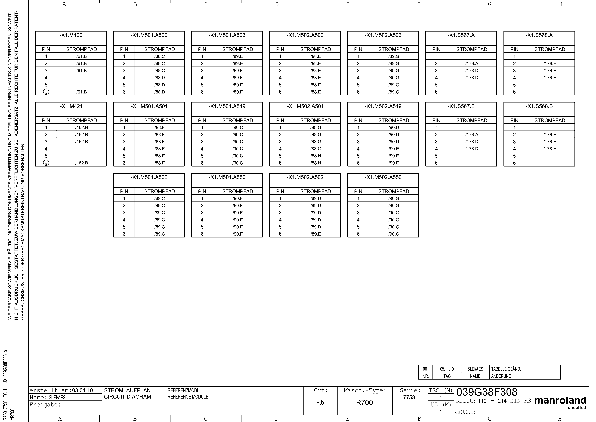

# +Jx — Sheet 119 of 214 — REFERENZMODUL

**REFERENCE MODULE**

> Part of the manroland **R700** printing press IEC/UL circuit diagrams.
> Drawing class: **Stromlaufplan / Circuit diagram** (DIN A3).
> Document `+Jx` covers the **1st printing module + feed register** machine section.

## At a glance

| Field | Value |
|---|---|
| Document | `+Jx`  (039G38F308) |
| Sheet | **119** of 214 |
| Section (DE) | REFERENZMODUL |
| Section (EN) | REFERENCE MODULE |
| Section type | REFERENCE_MODULE — Reference module |
| Machine type | `R700` |
| Series | `7758` |
| Created | 03.01.10 |
| Replaces | — |
| Columns used | A, B, C, D, E, F, G, H |
| Path numbers | — |
| Labels on sheet | 260 |
| Cross-refs out | 92 |
| Cross-refs in | 0 |

**Previous:** [+Jx sheet 118](SHEET_0118.md) · **Next:** [+Jx sheet 120](SHEET_0120.md) · **Document TOC:** [_TOC.md](_TOC.md)  (+Jx) · **Master TOC:** [all sheets](../_MASTER_TOC.md)

## Sheet image (300 DPI, exact vector render)



_Rendered directly from the PDF vector layer at 300 DPI (1-bit), no OCR and no resampling. Use it to confirm anything ambiguous in the text below._

## Cross-references on this sheet

Each entry is a wire leaving this sheet. The printed token is `/sheet.column`; the link resolves to that sheet inside the same document.

| Ref | Target sheet | Col | Path | Destination on target | Target section | From col |
|---|---|---|---|---|---|---|
| `/61.B` | [+Jx sheet 61](SHEET_0061.md) | B | — | — | GTW | A |
| `/89.E` | [+Jx sheet 89](SHEET_0089.md) | E | — | — | BOGENFÜHRUNG, NACH WENDUNG | C |
| `/88.E` | [+Jx sheet 88](SHEET_0088.md) | E | — | — | BOGENFÜHRUNG, NACH WENDUNG | E |
| `/89.G` | [+Jx sheet 89](SHEET_0089.md) | G | — | — | BOGENFÜHRUNG, NACH WENDUNG | F |
| `/88.C` | [+Jx sheet 88](SHEET_0088.md) | C | — | — | BOGENFÜHRUNG, NACH WENDUNG | B |
| `/61.B` | [+Jx sheet 61](SHEET_0061.md) | B | — | — | GTW | A |
| `/89.E` | [+Jx sheet 89](SHEET_0089.md) | E | — | — | BOGENFÜHRUNG, NACH WENDUNG | C |
| `/88.E` | [+Jx sheet 88](SHEET_0088.md) | E | — | — | BOGENFÜHRUNG, NACH WENDUNG | E |
| `/89.G` | [+Jx sheet 89](SHEET_0089.md) | G | — | — | BOGENFÜHRUNG, NACH WENDUNG | F |
| `/178.A` | [+Jx sheet 178](SHEET_0178.md) | A | — | — | OPTION: TRANSFERMODUL 1 NACH | G |
| `/178.E` | [+Jx sheet 178](SHEET_0178.md) | E | — | — | OPTION: TRANSFERMODUL 1 NACH | H |
| `/88.C` | [+Jx sheet 88](SHEET_0088.md) | C | — | — | BOGENFÜHRUNG, NACH WENDUNG | B |
| `/61.B` | [+Jx sheet 61](SHEET_0061.md) | B | — | — | GTW | A |
| `/88.E` | [+Jx sheet 88](SHEET_0088.md) | E | — | — | BOGENFÜHRUNG, NACH WENDUNG | E |
| `/89.F` | [+Jx sheet 89](SHEET_0089.md) | F | — | — | BOGENFÜHRUNG, NACH WENDUNG | C |
| `/89.G` | [+Jx sheet 89](SHEET_0089.md) | G | — | — | BOGENFÜHRUNG, NACH WENDUNG | F |
| `/88.C` | [+Jx sheet 88](SHEET_0088.md) | C | — | — | BOGENFÜHRUNG, NACH WENDUNG | B |
| `/178.D` | [+Jx sheet 178](SHEET_0178.md) | D | — | — | OPTION: TRANSFERMODUL 1 NACH | G |
| `/178.H` | [+Jx sheet 178](SHEET_0178.md) | H | — | — | OPTION: TRANSFERMODUL 1 NACH | H |
| `/88.E` | [+Jx sheet 88](SHEET_0088.md) | E | — | — | BOGENFÜHRUNG, NACH WENDUNG | E |
| `/89.F` | [+Jx sheet 89](SHEET_0089.md) | F | — | — | BOGENFÜHRUNG, NACH WENDUNG | C |
| `/89.G` | [+Jx sheet 89](SHEET_0089.md) | G | — | — | BOGENFÜHRUNG, NACH WENDUNG | F |
| `/88.D` | [+Jx sheet 88](SHEET_0088.md) | D | — | — | BOGENFÜHRUNG, NACH WENDUNG | B |
| `/178.D` | [+Jx sheet 178](SHEET_0178.md) | D | — | — | OPTION: TRANSFERMODUL 1 NACH | G |
| `/178.H` | [+Jx sheet 178](SHEET_0178.md) | H | — | — | OPTION: TRANSFERMODUL 1 NACH | H |
| `/88.E` | [+Jx sheet 88](SHEET_0088.md) | E | — | — | BOGENFÜHRUNG, NACH WENDUNG | E |
| `/89.F` | [+Jx sheet 89](SHEET_0089.md) | F | — | — | BOGENFÜHRUNG, NACH WENDUNG | C |
| `/89.G` | [+Jx sheet 89](SHEET_0089.md) | G | — | — | BOGENFÜHRUNG, NACH WENDUNG | F |
| `/88.D` | [+Jx sheet 88](SHEET_0088.md) | D | — | — | BOGENFÜHRUNG, NACH WENDUNG | B |
| `/61.B` | [+Jx sheet 61](SHEET_0061.md) | B | — | — | GTW | A |
| `/88.E` | [+Jx sheet 88](SHEET_0088.md) | E | — | — | BOGENFÜHRUNG, NACH WENDUNG | E |
| `/89.F` | [+Jx sheet 89](SHEET_0089.md) | F | — | — | BOGENFÜHRUNG, NACH WENDUNG | C |
| `/89.G` | [+Jx sheet 89](SHEET_0089.md) | G | — | — | BOGENFÜHRUNG, NACH WENDUNG | F |
| `/88.D` | [+Jx sheet 88](SHEET_0088.md) | D | — | — | BOGENFÜHRUNG, NACH WENDUNG | B |
| `/162.B` | [+Jx sheet 162](SHEET_0162.md) | B | — | — | OPTION: | A |
| `/88.F` | [+Jx sheet 88](SHEET_0088.md) | F | — | — | BOGENFÜHRUNG, NACH WENDUNG | B |
| `/88.G` | [+Jx sheet 88](SHEET_0088.md) | G | — | — | BOGENFÜHRUNG, NACH WENDUNG | E |
| `/90.C` | [+Jx sheet 90](SHEET_0090.md) | C | — | — | BOGENFÜHRUNG, NACH WENDUNG | C |
| `/90.D` | [+Jx sheet 90](SHEET_0090.md) | D | — | — | BOGENFÜHRUNG, NACH WENDUNG | F |
| `/88.F` | [+Jx sheet 88](SHEET_0088.md) | F | — | — | BOGENFÜHRUNG, NACH WENDUNG | B |
| `/162.B` | [+Jx sheet 162](SHEET_0162.md) | B | — | — | OPTION: | A |
| `/88.G` | [+Jx sheet 88](SHEET_0088.md) | G | — | — | BOGENFÜHRUNG, NACH WENDUNG | E |
| `/178.A` | [+Jx sheet 178](SHEET_0178.md) | A | — | — | OPTION: TRANSFERMODUL 1 NACH | G |
| `/178.E` | [+Jx sheet 178](SHEET_0178.md) | E | — | — | OPTION: TRANSFERMODUL 1 NACH | H |
| `/90.C` | [+Jx sheet 90](SHEET_0090.md) | C | — | — | BOGENFÜHRUNG, NACH WENDUNG | C |
| `/90.D` | [+Jx sheet 90](SHEET_0090.md) | D | — | — | BOGENFÜHRUNG, NACH WENDUNG | F |
| `/162.B` | [+Jx sheet 162](SHEET_0162.md) | B | — | — | OPTION: | A |
| `/88.F` | [+Jx sheet 88](SHEET_0088.md) | F | — | — | BOGENFÜHRUNG, NACH WENDUNG | B |
| `/88.G` | [+Jx sheet 88](SHEET_0088.md) | G | — | — | BOGENFÜHRUNG, NACH WENDUNG | E |
| `/90.C` | [+Jx sheet 90](SHEET_0090.md) | C | — | — | BOGENFÜHRUNG, NACH WENDUNG | C |
| `/90.D` | [+Jx sheet 90](SHEET_0090.md) | D | — | — | BOGENFÜHRUNG, NACH WENDUNG | F |
| `/178.D` | [+Jx sheet 178](SHEET_0178.md) | D | — | — | OPTION: TRANSFERMODUL 1 NACH | G |
| `/178.H` | [+Jx sheet 178](SHEET_0178.md) | H | — | — | OPTION: TRANSFERMODUL 1 NACH | H |
| `/90.E` | [+Jx sheet 90](SHEET_0090.md) | E | — | — | BOGENFÜHRUNG, NACH WENDUNG | F |
| `/88.F` | [+Jx sheet 88](SHEET_0088.md) | F | — | — | BOGENFÜHRUNG, NACH WENDUNG | B |
| `/88.G` | [+Jx sheet 88](SHEET_0088.md) | G | — | — | BOGENFÜHRUNG, NACH WENDUNG | E |
| `/90.C` | [+Jx sheet 90](SHEET_0090.md) | C | — | — | BOGENFÜHRUNG, NACH WENDUNG | C |
| `/178.D` | [+Jx sheet 178](SHEET_0178.md) | D | — | — | OPTION: TRANSFERMODUL 1 NACH | G |
| `/178.H` | [+Jx sheet 178](SHEET_0178.md) | H | — | — | OPTION: TRANSFERMODUL 1 NACH | H |
| `/90.E` | [+Jx sheet 90](SHEET_0090.md) | E | — | — | BOGENFÜHRUNG, NACH WENDUNG | F |
| `/88.F` | [+Jx sheet 88](SHEET_0088.md) | F | — | — | BOGENFÜHRUNG, NACH WENDUNG | B |
| `/90.C` | [+Jx sheet 90](SHEET_0090.md) | C | — | — | BOGENFÜHRUNG, NACH WENDUNG | C |
| `/88.H` | [+Jx sheet 88](SHEET_0088.md) | H | — | — | BOGENFÜHRUNG, NACH WENDUNG | E |
| `/90.E` | [+Jx sheet 90](SHEET_0090.md) | E | — | — | BOGENFÜHRUNG, NACH WENDUNG | F |
| `/162.B` | [+Jx sheet 162](SHEET_0162.md) | B | — | — | OPTION: | A |
| `/88.F` | [+Jx sheet 88](SHEET_0088.md) | F | — | — | BOGENFÜHRUNG, NACH WENDUNG | B |
| `/90.C` | [+Jx sheet 90](SHEET_0090.md) | C | — | — | BOGENFÜHRUNG, NACH WENDUNG | C |
| `/88.H` | [+Jx sheet 88](SHEET_0088.md) | H | — | — | BOGENFÜHRUNG, NACH WENDUNG | E |
| `/90.F` | [+Jx sheet 90](SHEET_0090.md) | F | — | — | BOGENFÜHRUNG, NACH WENDUNG | C |
| `/90.G` | [+Jx sheet 90](SHEET_0090.md) | G | — | — | BOGENFÜHRUNG, NACH WENDUNG | F |
| `/89.C` | [+Jx sheet 89](SHEET_0089.md) | C | — | — | BOGENFÜHRUNG, NACH WENDUNG | B |
| `/89.D` | [+Jx sheet 89](SHEET_0089.md) | D | — | — | BOGENFÜHRUNG, NACH WENDUNG | E |
| `/90.F` | [+Jx sheet 90](SHEET_0090.md) | F | — | — | BOGENFÜHRUNG, NACH WENDUNG | C |
| `/90.G` | [+Jx sheet 90](SHEET_0090.md) | G | — | — | BOGENFÜHRUNG, NACH WENDUNG | F |
| `/89.C` | [+Jx sheet 89](SHEET_0089.md) | C | — | — | BOGENFÜHRUNG, NACH WENDUNG | B |
| `/89.D` | [+Jx sheet 89](SHEET_0089.md) | D | — | — | BOGENFÜHRUNG, NACH WENDUNG | E |
| `/90.F` | [+Jx sheet 90](SHEET_0090.md) | F | — | — | BOGENFÜHRUNG, NACH WENDUNG | C |
| `/90.G` | [+Jx sheet 90](SHEET_0090.md) | G | — | — | BOGENFÜHRUNG, NACH WENDUNG | F |
| `/89.C` | [+Jx sheet 89](SHEET_0089.md) | C | — | — | BOGENFÜHRUNG, NACH WENDUNG | B |
| `/89.D` | [+Jx sheet 89](SHEET_0089.md) | D | — | — | BOGENFÜHRUNG, NACH WENDUNG | E |
| `/90.F` | [+Jx sheet 90](SHEET_0090.md) | F | — | — | BOGENFÜHRUNG, NACH WENDUNG | C |
| `/90.G` | [+Jx sheet 90](SHEET_0090.md) | G | — | — | BOGENFÜHRUNG, NACH WENDUNG | F |
| `/89.C` | [+Jx sheet 89](SHEET_0089.md) | C | — | — | BOGENFÜHRUNG, NACH WENDUNG | B |
| `/89.D` | [+Jx sheet 89](SHEET_0089.md) | D | — | — | BOGENFÜHRUNG, NACH WENDUNG | E |
| `/90.F` | [+Jx sheet 90](SHEET_0090.md) | F | — | — | BOGENFÜHRUNG, NACH WENDUNG | C |
| `/90.G` | [+Jx sheet 90](SHEET_0090.md) | G | — | — | BOGENFÜHRUNG, NACH WENDUNG | F |
| `/89.C` | [+Jx sheet 89](SHEET_0089.md) | C | — | — | BOGENFÜHRUNG, NACH WENDUNG | B |
| `/89.D` | [+Jx sheet 89](SHEET_0089.md) | D | — | — | BOGENFÜHRUNG, NACH WENDUNG | E |
| `/89.E` | [+Jx sheet 89](SHEET_0089.md) | E | — | — | BOGENFÜHRUNG, NACH WENDUNG | E |
| `/90.F` | [+Jx sheet 90](SHEET_0090.md) | F | — | — | BOGENFÜHRUNG, NACH WENDUNG | C |
| `/90.G` | [+Jx sheet 90](SHEET_0090.md) | G | — | — | BOGENFÜHRUNG, NACH WENDUNG | F |
| `/89.C` | [+Jx sheet 89](SHEET_0089.md) | C | — | — | BOGENFÜHRUNG, NACH WENDUNG | B |

## Devices on this sheet

| Tag | Class | Class meaning (IEC) | Col | Sub | Terminal | Sign |
|---|---|---|---|---|---|---|
| `X1.S567.A` | — | cross-device reference | G | — | — | — |
| `X1.S567.B` | — | cross-device reference | G | — | — | — |
| `X1.S568.A` | — | cross-device reference | H | — | — | — |
| `X1.S568.B` | — | cross-device reference | H | — | — | — |
| `X1.M420` | — | cross-device reference | A | — | — | — |
| `X1.M421` | — | cross-device reference | A | — | — | — |
| `X1.M501.A500` | — | cross-device reference | B | — | — | — |
| `X1.M501.A501` | — | cross-device reference | B | — | — | — |
| `X1.M501.A502` | — | cross-device reference | B | — | — | — |
| `X1.M501.A503` | — | cross-device reference | C | — | — | — |
| `X1.M501.A549` | — | cross-device reference | C | — | — | — |
| `X1.M501.A550` | — | cross-device reference | C | — | — | — |
| `X1.M502.A500` | — | cross-device reference | D | — | — | — |
| `X1.M502.A501` | — | cross-device reference | D | — | — | — |
| `X1.M502.A502` | — | cross-device reference | D | — | — | — |
| `X1.M502.A503` | — | cross-device reference | F | — | — | — |
| `X1.M502.A549` | — | cross-device reference | F | — | — | — |
| `X1.M502.A550` | — | cross-device reference | F | — | — | — |
| `NR.` | — | cross-device reference | F | — | — | — |
| `05.11.10` | — | cross-device reference | F | — | — | — |

## Potentials / nets

_No named potentials on this sheet._

## Wire-end annotations (grouped as printed)

A wire that continues elsewhere is annotated with a small cluster: the destination description, the path/line number `#NN`, and the `/sheet.column` cross reference. Each row below is one such cluster exactly as it is grouped on the drawing.

| Col | Y | Path | Cross-ref | Text on the wire |
|---|---|---|---|---|
| A | 65.4 | — | — | `X1.M420` |
| B | 65.4 | — | — | `X1.M501.A500` |
| C | 65.4 | — | — | `X1.M501.A503` |
| D | 65.4 | — | — | `X1.M502.A500` |
| F | 65.4 | — | — | `X1.M502.A503` |
| G | 65.5 | — | — | `X1.S567.A` |
| H | 65.5 | — | — | `X1.S568.A` |
| A | 94.1 | — | — | `PIN 2 3 5 4 1 STROMPFAD` |
| B | 94.1 | — | — | `PIN 2 3 5 6 4 1 STROMPFAD` |
| C | 94.1 | — | — | `PIN 2 3 5 6 4 1 STROMPFAD` |
| D | 94.1 | — | — | `PIN 2 3 5 6 4 1 STROMPFAD` |
| E | 94.1 | — | — | `PIN 2 3 5 6 4 1 STROMPFAD` |
| G | 94.1 | — | — | `PIN 2 3 5 6 4 1 STROMPFAD` |
| H | 94.1 | — | — | `PIN 2 3 5 6 4 1 STROMPFAD` |
| A | 108.6 | — | `/61.B` | — |
| C | 108.6 | — | `/89.E` | — |
| E | 108.6 | — | `/88.E` | — |
| F | 108.6 | — | `/89.G` | — |
| B | 108.7 | — | `/88.C` | — |
| A | 122.8 | — | `/61.B` | — |
| B | 122.8 | — | `/88.C` | — |
| C | 122.8 | — | `/89.E` | — |
| E | 122.8 | — | `/88.E` | — |
| F | 122.8 | — | `/89.G` | — |
| G | 122.8 | — | `/178.A` | — |
| H | 122.8 | — | `/178.E` | — |
| A | 137.0 | — | `/61.B` | — |
| B | 137.0 | — | `/88.C` | — |
| C | 137.0 | — | `/89.F` | — |
| E | 137.0 | — | `/88.E` | — |
| F | 137.0 | — | `/89.G` | — |
| G | 137.0 | — | `/178.D` | — |
| H | 137.0 | — | `/178.H` | — |
| E | 151.1 | — | `/88.E` | — |
| B | 151.2 | — | `/88.D` | — |
| C | 151.2 | — | `/89.F` | — |
| F | 151.2 | — | `/89.G` | — |
| G | 151.2 | — | `/178.D` | — |
| H | 151.2 | — | `/178.H` | — |
| B | 165.3 | — | `/88.D` | — |
| C | 165.3 | — | `/89.F` | — |
| E | 165.3 | — | `/88.E` | — |
| F | 165.3 | — | `/89.G` | — |
| A | 179.5 | — | `/61.B` | — |
| B | 179.5 | — | `/88.D` | — |
| C | 179.5 | — | `/89.F` | — |
| E | 179.5 | — | `/88.E` | — |
| F | 179.5 | — | `/89.G` | — |
| A | 207.2 | — | — | `X1.M421` |
| B | 207.2 | — | — | `X1.M501.A501` |
| C | 207.2 | — | — | `X1.M501.A549` |
| D | 207.2 | — | — | `X1.M502.A501` |
| F | 207.2 | — | — | `X1.M502.A549` |
| G | 207.2 | — | — | `X1.S567.B` |
| H | 207.2 | — | — | `X1.S568.B` |
| A | 235.8 | — | — | `PIN 2 3 5 4 1 STROMPFAD` |
| B | 235.8 | — | — | `PIN 2 3 5 6 4 1 STROMPFAD` |
| C | 235.8 | — | — | `PIN 2 3 5 6 4 1 STROMPFAD` |
| D | 235.8 | — | — | `PIN 2 3 5 6 4 1 STROMPFAD` |
| E | 235.8 | — | — | `PIN 2 3 5 6 4 1 STROMPFAD` |
| G | 235.8 | — | — | `PIN 2 3 5 6 4 1 STROMPFAD` |
| H | 235.8 | — | — | `PIN 2 3 5 6 4 1 STROMPFAD` |
| A | 250.4 | — | `/162.B` | — |
| B | 250.4 | — | `/88.F` | — |
| C | 250.4 | — | `/90.C` | — |
| E | 250.4 | — | `/88.G` | — |
| F | 250.4 | — | `/90.D` | — |
| A | 264.5 | — | `/162.B` | — |
| B | 264.5 | — | `/88.F` | — |
| E | 264.5 | — | `/88.G` | — |
| G | 264.5 | — | `/178.A` | — |
| H | 264.5 | — | `/178.E` | — |
| C | 264.6 | — | `/90.C` | — |
| F | 264.6 | — | `/90.D` | — |
| A | 278.7 | — | `/162.B` | — |
| B | 278.7 | — | `/88.F` | — |
| C | 278.7 | — | `/90.C` | — |
| E | 278.7 | — | `/88.G` | — |
| F | 278.7 | — | `/90.D` | — |
| G | 278.7 | — | `/178.D` | — |
| H | 278.7 | — | `/178.H` | — |
| B | 292.9 | — | `/88.F` | — |
| C | 292.9 | — | `/90.C` | — |
| E | 292.9 | — | `/88.G` | — |
| F | 292.9 | — | `/90.E` | — |
| G | 292.9 | — | `/178.D` | — |
| H | 292.9 | — | `/178.H` | — |
| F | 307.0 | — | `/90.E` | — |
| B | 307.1 | — | `/88.F` | — |
| C | 307.1 | — | `/90.C` | — |
| E | 307.1 | — | `/88.H` | — |
| A | 321.2 | — | `/162.B` | — |
| B | 321.2 | — | `/88.F` | — |
| C | 321.2 | — | `/90.C` | — |
| E | 321.2 | — | `/88.H` | — |
| F | 321.2 | — | `/90.E` | — |
| B | 348.9 | — | — | `X1.M501.A502` |
| C | 348.9 | — | — | `X1.M501.A550` |
| D | 348.9 | — | — | `X1.M502.A502` |
| F | 348.9 | — | — | `X1.M502.A550` |
| B | 377.6 | — | — | `PIN 2 3 5 6 4 1 STROMPFAD` |
| C | 377.6 | — | — | `PIN 2 3 5 6 4 1 STROMPFAD` |
| D | 377.6 | — | — | `PIN 2 3 5 6 4 1 STROMPFAD` |
| E | 377.6 | — | — | `PIN 2 3 5 6 4 1 STROMPFAD` |
| B | 392.1 | — | `/89.C` | — |
| C | 392.1 | — | `/90.F` | — |
| E | 392.1 | — | `/89.D` | — |
| F | 392.1 | — | `/90.G` | — |
| B | 406.3 | — | `/89.C` | — |
| C | 406.3 | — | `/90.F` | — |
| E | 406.3 | — | `/89.D` | — |
| F | 406.3 | — | `/90.G` | — |
| C | 420.4 | — | `/90.F` | — |
| F | 420.4 | — | `/90.G` | — |
| B | 420.5 | — | `/89.C` | — |
| E | 420.5 | — | `/89.D` | — |
| B | 434.6 | — | `/89.C` | — |
| C | 434.6 | — | `/90.F` | — |
| E | 434.6 | — | `/89.D` | — |
| F | 434.6 | — | `/90.G` | — |
| B | 448.8 | — | `/89.C` | — |
| C | 448.8 | — | `/90.F` | — |
| E | 448.8 | — | `/89.D` | — |
| F | 448.8 | — | `/90.G` | — |
| E | 462.9 | — | `/89.E` | — |
| B | 463.0 | — | `/89.C` | — |
| C | 463.0 | — | `/90.F` | — |
| F | 463.0 | — | `/90.G` | — |
| G | 733.0 | — | — | `001 05.11.10 SLEI/AES TABELLE GEÄND.` |
| G | 747.1 | — | — | `NR. TAG NAME ÄNDERUNG` |


## Reconstructed tables

This sheet carries tabular content (pin map / terminal assignment / index). The grid below was rebuilt from the drawing's own rule lines, so each row is exactly one physical row of the table.

### Table 1 — 14 data rows × 2 columns (at x=70.9, y=62.4) — **X1.M420**

| PIN | STROMPFAD |
|---|---|
| `1` | `/61.B` |
| `2` | `/61.B` |
| `3` | `/61.B` |
| `4` |  |
| `5` |  |
|  | `/61.B` |
|  | `X1.M421` |
| `PIN` | `STROMPFAD` |
| `1` | `/162.B` |
| `2` | `/162.B` |
| `3` | `/162.B` |
| `4` |  |
| `5` |  |
|  | `/162.B` |


### Table 2 — 22 data rows × 2 columns (at x=226.8, y=62.4) — **X1.M501.A500**

| PIN | STROMPFAD |
|---|---|
| `1` | `/88.C` |
| `2` | `/88.C` |
| `3` | `/88.C` |
| `4` | `/88.D` |
| `5` | `/88.D` |
| `6` | `/88.D` |
|  | `X1.M501.A501` |
| `PIN` | `STROMPFAD` |
| `1` | `/88.F` |
| `2` | `/88.F` |
| `3` | `/88.F` |
| `4` | `/88.F` |
| `5` | `/88.F` |
| `6` | `/88.F` |
|  | `X1.M501.A502` |
| `PIN` | `STROMPFAD` |
| `1` | `/89.C` |
| `2` | `/89.C` |
| `3` | `/89.C` |
| `4` | `/89.C` |
| `5` | `/89.C` |
| `6` | `/89.C` |


### Table 3 — 22 data rows × 2 columns (at x=382.7, y=62.4) — **X1.M501.A503**

| PIN | STROMPFAD |
|---|---|
| `1` | `/89.E` |
| `2` | `/89.E` |
| `3` | `/89.F` |
| `4` | `/89.F` |
| `5` | `/89.F` |
| `6` | `/89.F` |
|  | `X1.M501.A549` |
| `PIN` | `STROMPFAD` |
| `1` | `/90.C` |
| `2` | `/90.C` |
| `3` | `/90.C` |
| `4` | `/90.C` |
| `5` | `/90.C` |
| `6` | `/90.C` |
|  | `X1.M501.A550` |
| `PIN` | `STROMPFAD` |
| `1` | `/90.F` |
| `2` | `/90.F` |
| `3` | `/90.F` |
| `4` | `/90.F` |
| `5` | `/90.F` |
| `6` | `/90.F` |


### Table 4 — 22 data rows × 2 columns (at x=538.6, y=62.4) — **X1.M502.A500**

| PIN | STROMPFAD |
|---|---|
| `1` | `/88.E` |
| `2` | `/88.E` |
| `3` | `/88.E` |
| `4` | `/88.E` |
| `5` | `/88.E` |
| `6` | `/88.E` |
|  | `X1.M502.A501` |
| `PIN` | `STROMPFAD` |
| `1` | `/88.G` |
| `2` | `/88.G` |
| `3` | `/88.G` |
| `4` | `/88.G` |
| `5` | `/88.H` |
| `6` | `/88.H` |
|  | `X1.M502.A502` |
| `PIN` | `STROMPFAD` |
| `1` | `/89.D` |
| `2` | `/89.D` |
| `3` | `/89.D` |
| `4` | `/89.D` |
| `5` | `/89.D` |
| `6` | `/89.E` |


### Table 5 — 22 data rows × 2 columns (at x=694.5, y=62.4) — **X1.M502.A503**

| PIN | STROMPFAD |
|---|---|
| `1` | `/89.G` |
| `2` | `/89.G` |
| `3` | `/89.G` |
| `4` | `/89.G` |
| `5` | `/89.G` |
| `6` | `/89.G` |
|  | `X1.M502.A549` |
| `PIN` | `STROMPFAD` |
| `1` | `/90.D` |
| `2` | `/90.D` |
| `3` | `/90.D` |
| `4` | `/90.E` |
| `5` | `/90.E` |
| `6` | `/90.E` |
|  | `X1.M502.A550` |
| `PIN` | `STROMPFAD` |
| `1` | `/90.G` |
| `2` | `/90.G` |
| `3` | `/90.G` |
| `4` | `/90.G` |
| `5` | `/90.G` |
| `6` | `/90.G` |


### Table 6 — 14 data rows × 2 columns (at x=850.4, y=62.4) — **X1.S567.A**

| PIN | STROMPFAD |
|---|---|
| `1` |  |
| `2` | `/178.A` |
| `3` | `/178.D` |
| `4` | `/178.D` |
| `5` |  |
| `6` |  |
|  | `X1.S567.B` |
| `PIN` | `STROMPFAD` |
| `1` |  |
| `2` | `/178.A` |
| `3` | `/178.D` |
| `4` | `/178.D` |
| `5` |  |
| `6` |  |


### Table 7 — 14 data rows × 2 columns (at x=1006.3, y=62.4) — **X1.S568.A**

| PIN | STROMPFAD |
|---|---|
| `1` |  |
| `2` | `/178.E` |
| `3` | `/178.H` |
| `4` | `/178.H` |
| `5` |  |
| `6` |  |
|  | `X1.S568.B` |
| `PIN` | `STROMPFAD` |
| `1` |  |
| `2` | `/178.E` |
| `3` | `/178.H` |
| `4` | `/178.H` |
| `5` |  |
| `6` |  |


## Notes and free text on this sheet

| Text | Col | Y (pt) |
|---|---|---|
| `PIN` | F | 94.13 |
| `STROMPFAD` | G | 94.09 |
| `PIN` | G | 94.13 |
| `STROMPFAD` | H | 94.09 |
| `PIN` | A | 94.13 |
| `STROMPFAD` | A | 94.09 |
| `PIN` | B | 94.13 |
| `STROMPFAD` | B | 94.09 |
| `PIN` | C | 94.13 |
| `STROMPFAD` | C | 94.09 |
| `PIN` | D | 94.13 |
| `STROMPFAD` | E | 94.09 |
| `PIN` | E | 94.13 |
| `STROMPFAD` | F | 94.09 |
| `TAG` | F | 747.23 |
| `NAME` | G | 747.22 |
| `ÄNDERUNG` | G | 747.25 |
| `SLEI/AES` | G | 733.09 |
| `TABELLE GEÄND.` | G | 733.08 |

## Complete label inventory (exact text from the drawing)

Every text object inside the drawing area of this sheet, in DIN reading order (column A→H, then top→bottom). This is the authoritative list: if a string is not here it is not printed on this sheet.

| Col | Y | X | Dir | Type | Text |
|---|---|---|---|---|---|
| A | 65.4 | 118.9 | → | device ref | `X1.M420` |
| A | 94.1 | 84.0 | → | text | `PIN` |
| A | 94.1 | 132.4 | → | text | `STROMPFAD` |
| A | 108.3 | 89.9 | → | number | `1` |
| A | 108.6 | 152.8 | → | cross-reference | `/61.B` |
| A | 122.5 | 89.4 | → | number | `2` |
| A | 122.8 | 152.8 | → | cross-reference | `/61.B` |
| A | 136.7 | 89.4 | → | number | `3` |
| A | 137.0 | 152.8 | → | cross-reference | `/61.B` |
| A | 150.8 | 89.6 | → | number | `4` |
| A | 165.0 | 89.4 | → | number | `5` |
| A | 179.5 | 152.8 | → | cross-reference | `/61.B` |
| A | 207.2 | 119.6 | → | device ref | `X1.M421` |
| A | 235.8 | 132.4 | → | text | `STROMPFAD` |
| A | 235.9 | 84.0 | → | text | `PIN` |
| A | 250.0 | 89.9 | → | number | `1` |
| A | 250.4 | 150.4 | → | cross-reference | `/162.B` |
| A | 264.2 | 89.4 | → | number | `2` |
| A | 264.5 | 150.4 | → | cross-reference | `/162.B` |
| A | 278.4 | 89.4 | → | number | `3` |
| A | 278.7 | 150.4 | → | cross-reference | `/162.B` |
| A | 292.6 | 89.6 | → | number | `4` |
| A | 306.7 | 89.4 | → | number | `5` |
| A | 321.2 | 150.4 | → | cross-reference | `/162.B` |
| B | 65.4 | 260.9 | → | device ref | `X1.M501.A500` |
| B | 94.1 | 240.0 | → | text | `PIN` |
| B | 94.1 | 288.3 | → | text | `STROMPFAD` |
| B | 108.3 | 245.8 | → | number | `1` |
| B | 108.7 | 308.6 | → | cross-reference | `/88.C` |
| B | 122.5 | 245.3 | → | number | `2` |
| B | 122.8 | 308.6 | → | cross-reference | `/88.C` |
| B | 136.7 | 245.3 | → | number | `3` |
| B | 137.0 | 308.6 | → | cross-reference | `/88.C` |
| B | 150.8 | 245.5 | → | number | `4` |
| B | 151.2 | 308.6 | → | cross-reference | `/88.D` |
| B | 165.0 | 245.3 | → | number | `5` |
| B | 165.3 | 308.6 | → | cross-reference | `/88.D` |
| B | 179.2 | 245.3 | → | number | `6` |
| B | 179.5 | 308.6 | → | cross-reference | `/88.D` |
| B | 207.2 | 261.6 | → | device ref | `X1.M501.A501` |
| B | 235.8 | 288.3 | → | text | `STROMPFAD` |
| B | 235.9 | 240.0 | → | text | `PIN` |
| B | 250.0 | 245.8 | → | number | `1` |
| B | 250.4 | 309.0 | → | cross-reference | `/88.F` |
| B | 264.2 | 245.3 | → | number | `2` |
| B | 264.5 | 309.0 | → | cross-reference | `/88.F` |
| B | 278.4 | 245.3 | → | number | `3` |
| B | 278.7 | 309.0 | → | cross-reference | `/88.F` |
| B | 292.6 | 245.5 | → | number | `4` |
| B | 292.9 | 309.0 | → | cross-reference | `/88.F` |
| B | 306.7 | 245.3 | → | number | `5` |
| B | 307.1 | 309.0 | → | cross-reference | `/88.F` |
| B | 320.9 | 245.3 | → | number | `6` |
| B | 321.2 | 309.0 | → | cross-reference | `/88.F` |
| B | 348.9 | 260.9 | → | device ref | `X1.M501.A502` |
| B | 377.6 | 240.0 | → | text | `PIN` |
| B | 377.6 | 288.3 | → | text | `STROMPFAD` |
| B | 391.8 | 245.8 | → | number | `1` |
| B | 392.1 | 308.6 | → | cross-reference | `/89.C` |
| B | 405.9 | 245.3 | → | number | `2` |
| B | 406.3 | 308.6 | → | cross-reference | `/89.C` |
| B | 420.1 | 245.3 | → | number | `3` |
| B | 420.5 | 308.6 | → | cross-reference | `/89.C` |
| B | 434.3 | 245.5 | → | number | `4` |
| B | 434.6 | 308.6 | → | cross-reference | `/89.C` |
| B | 448.5 | 245.3 | → | number | `5` |
| B | 448.8 | 308.6 | → | cross-reference | `/89.C` |
| B | 462.6 | 245.3 | → | number | `6` |
| B | 463.0 | 308.6 | → | cross-reference | `/89.C` |
| C | 65.4 | 416.7 | → | device ref | `X1.M501.A503` |
| C | 94.1 | 395.9 | → | text | `PIN` |
| C | 94.1 | 444.2 | → | text | `STROMPFAD` |
| C | 108.3 | 401.7 | → | number | `1` |
| C | 108.6 | 464.6 | → | cross-reference | `/89.E` |
| C | 122.5 | 401.2 | → | number | `2` |
| C | 122.8 | 464.6 | → | cross-reference | `/89.E` |
| C | 136.7 | 401.2 | → | number | `3` |
| C | 137.0 | 464.9 | → | cross-reference | `/89.F` |
| C | 150.8 | 401.4 | → | number | `4` |
| C | 151.1 | 464.9 | → | cross-reference | `/89.F` |
| C | 165.0 | 401.2 | → | number | `5` |
| C | 165.3 | 464.9 | → | cross-reference | `/89.F` |
| C | 179.2 | 401.2 | → | number | `6` |
| C | 179.5 | 464.9 | → | cross-reference | `/89.F` |
| C | 207.2 | 416.7 | → | device ref | `X1.M501.A549` |
| C | 235.8 | 444.2 | → | text | `STROMPFAD` |
| C | 235.9 | 395.9 | → | text | `PIN` |
| C | 250.0 | 401.7 | → | number | `1` |
| C | 250.4 | 464.5 | → | cross-reference | `/90.C` |
| C | 264.2 | 401.2 | → | number | `2` |
| C | 264.6 | 464.5 | → | cross-reference | `/90.C` |
| C | 278.4 | 401.2 | → | number | `3` |
| C | 278.7 | 464.5 | → | cross-reference | `/90.C` |
| C | 292.6 | 401.4 | → | number | `4` |
| C | 292.9 | 464.5 | → | cross-reference | `/90.C` |
| C | 306.7 | 401.2 | → | number | `5` |
| C | 307.1 | 464.5 | → | cross-reference | `/90.C` |
| C | 320.9 | 401.2 | → | number | `6` |
| C | 321.2 | 464.5 | → | cross-reference | `/90.C` |
| C | 348.9 | 416.8 | → | device ref | `X1.M501.A550` |
| C | 377.6 | 395.9 | → | text | `PIN` |
| C | 377.6 | 444.2 | → | text | `STROMPFAD` |
| C | 391.8 | 401.7 | → | number | `1` |
| C | 392.1 | 464.9 | → | cross-reference | `/90.F` |
| C | 405.9 | 401.2 | → | number | `2` |
| C | 406.3 | 464.9 | → | cross-reference | `/90.F` |
| C | 420.1 | 401.2 | → | number | `3` |
| C | 420.4 | 464.9 | → | cross-reference | `/90.F` |
| C | 434.3 | 401.4 | → | number | `4` |
| C | 434.6 | 464.9 | → | cross-reference | `/90.F` |
| C | 448.5 | 401.2 | → | number | `5` |
| C | 448.8 | 464.9 | → | cross-reference | `/90.F` |
| C | 462.6 | 401.2 | → | number | `6` |
| C | 463.0 | 464.9 | → | cross-reference | `/90.F` |
| D | 65.4 | 572.7 | → | device ref | `X1.M502.A500` |
| D | 94.1 | 551.8 | → | text | `PIN` |
| D | 108.3 | 557.6 | → | number | `1` |
| D | 122.5 | 557.1 | → | number | `2` |
| D | 136.7 | 557.1 | → | number | `3` |
| D | 150.8 | 557.3 | → | number | `4` |
| D | 165.0 | 557.1 | → | number | `5` |
| D | 179.2 | 557.1 | → | number | `6` |
| D | 207.2 | 573.4 | → | device ref | `X1.M502.A501` |
| D | 235.9 | 551.8 | → | text | `PIN` |
| D | 250.0 | 557.6 | → | number | `1` |
| D | 264.2 | 557.1 | → | number | `2` |
| D | 278.4 | 557.1 | → | number | `3` |
| D | 292.6 | 557.3 | → | number | `4` |
| D | 306.7 | 557.1 | → | number | `5` |
| D | 320.9 | 557.1 | → | number | `6` |
| D | 348.9 | 572.7 | → | device ref | `X1.M502.A502` |
| D | 377.6 | 551.8 | → | text | `PIN` |
| D | 391.8 | 557.6 | → | number | `1` |
| D | 405.9 | 557.1 | → | number | `2` |
| D | 420.1 | 557.1 | → | number | `3` |
| D | 434.3 | 557.3 | → | number | `4` |
| D | 448.5 | 557.1 | → | number | `5` |
| D | 462.6 | 557.1 | → | number | `6` |
| E | 94.1 | 600.1 | → | text | `STROMPFAD` |
| E | 94.1 | 707.7 | → | text | `PIN` |
| E | 108.3 | 713.5 | → | number | `1` |
| E | 108.6 | 620.5 | → | cross-reference | `/88.E` |
| E | 122.5 | 713.1 | → | number | `2` |
| E | 122.8 | 620.5 | → | cross-reference | `/88.E` |
| E | 136.7 | 713.1 | → | number | `3` |
| E | 137.0 | 620.5 | → | cross-reference | `/88.E` |
| E | 150.8 | 713.2 | → | number | `4` |
| E | 151.1 | 620.5 | → | cross-reference | `/88.E` |
| E | 165.0 | 713.1 | → | number | `5` |
| E | 165.3 | 620.5 | → | cross-reference | `/88.E` |
| E | 179.2 | 713.1 | → | number | `6` |
| E | 179.5 | 620.5 | → | cross-reference | `/88.E` |
| E | 235.8 | 600.1 | → | text | `STROMPFAD` |
| E | 235.9 | 707.7 | → | text | `PIN` |
| E | 250.0 | 713.5 | → | number | `1` |
| E | 250.4 | 620.1 | → | cross-reference | `/88.G` |
| E | 264.2 | 713.1 | → | number | `2` |
| E | 264.5 | 620.1 | → | cross-reference | `/88.G` |
| E | 278.4 | 713.1 | → | number | `3` |
| E | 278.7 | 620.1 | → | cross-reference | `/88.G` |
| E | 292.6 | 713.2 | → | number | `4` |
| E | 292.9 | 620.1 | → | cross-reference | `/88.G` |
| E | 306.7 | 713.1 | → | number | `5` |
| E | 307.1 | 620.5 | → | cross-reference | `/88.H` |
| E | 320.9 | 713.1 | → | number | `6` |
| E | 321.2 | 620.5 | → | cross-reference | `/88.H` |
| E | 377.6 | 600.1 | → | text | `STROMPFAD` |
| E | 377.6 | 707.7 | → | text | `PIN` |
| E | 391.8 | 713.5 | → | number | `1` |
| E | 392.1 | 620.4 | → | cross-reference | `/89.D` |
| E | 405.9 | 713.1 | → | number | `2` |
| E | 406.3 | 620.4 | → | cross-reference | `/89.D` |
| E | 420.1 | 713.1 | → | number | `3` |
| E | 420.5 | 620.4 | → | cross-reference | `/89.D` |
| E | 434.3 | 713.2 | → | number | `4` |
| E | 434.6 | 620.4 | → | cross-reference | `/89.D` |
| E | 448.5 | 713.1 | → | number | `5` |
| E | 448.8 | 620.4 | → | cross-reference | `/89.D` |
| E | 462.6 | 713.1 | → | number | `6` |
| E | 462.9 | 620.5 | → | cross-reference | `/89.E` |
| F | 65.4 | 728.5 | → | device ref | `X1.M502.A503` |
| F | 94.1 | 756.0 | → | text | `STROMPFAD` |
| F | 94.1 | 863.6 | → | text | `PIN` |
| F | 108.3 | 869.4 | → | number | `1` |
| F | 108.6 | 776.0 | → | cross-reference | `/89.G` |
| F | 122.5 | 869.0 | → | number | `2` |
| F | 122.8 | 776.0 | → | cross-reference | `/89.G` |
| F | 136.7 | 869.0 | → | number | `3` |
| F | 137.0 | 776.0 | → | cross-reference | `/89.G` |
| F | 150.8 | 869.1 | → | number | `4` |
| F | 151.2 | 776.0 | → | cross-reference | `/89.G` |
| F | 165.0 | 869.0 | → | number | `5` |
| F | 165.3 | 776.0 | → | cross-reference | `/89.G` |
| F | 179.2 | 869.0 | → | number | `6` |
| F | 179.5 | 776.0 | → | cross-reference | `/89.G` |
| F | 207.2 | 728.5 | → | device ref | `X1.M502.A549` |
| F | 235.8 | 756.0 | → | text | `STROMPFAD` |
| F | 235.9 | 863.6 | → | text | `PIN` |
| F | 250.0 | 869.4 | → | number | `1` |
| F | 250.4 | 776.3 | → | cross-reference | `/90.D` |
| F | 264.2 | 869.0 | → | number | `2` |
| F | 264.6 | 776.3 | → | cross-reference | `/90.D` |
| F | 278.4 | 869.0 | → | number | `3` |
| F | 278.7 | 776.3 | → | cross-reference | `/90.D` |
| F | 292.6 | 869.1 | → | number | `4` |
| F | 292.9 | 776.4 | → | cross-reference | `/90.E` |
| F | 306.7 | 869.0 | → | number | `5` |
| F | 307.0 | 776.4 | → | cross-reference | `/90.E` |
| F | 320.9 | 869.0 | → | number | `6` |
| F | 321.2 | 776.4 | → | cross-reference | `/90.E` |
| F | 348.9 | 728.6 | → | device ref | `X1.M502.A550` |
| F | 377.6 | 756.0 | → | text | `STROMPFAD` |
| F | 392.1 | 776.0 | → | cross-reference | `/90.G` |
| F | 406.3 | 776.0 | → | cross-reference | `/90.G` |
| F | 420.4 | 776.0 | → | cross-reference | `/90.G` |
| F | 434.6 | 776.0 | → | cross-reference | `/90.G` |
| F | 448.8 | 776.0 | → | cross-reference | `/90.G` |
| F | 463.0 | 776.0 | → | cross-reference | `/90.G` |
| F | 733.0 | 845.1 | → | number | `001` |
| F | 733.1 | 879.3 | → | device ref | `05.11.10` |
| F | 747.1 | 844.3 | → | device ref | `NR.` |
| F | 747.2 | 886.0 | → | text | `TAG` |
| G | 65.4 | 894.0 | → | device ref | `X1.S567.A` |
| G | 94.1 | 911.9 | → | text | `STROMPFAD` |
| G | 94.1 | 1019.5 | → | text | `PIN` |
| G | 108.3 | 1025.3 | → | number | `1` |
| G | 122.5 | 1024.9 | → | number | `2` |
| G | 122.8 | 929.8 | → | cross-reference | `/178.A` |
| G | 136.7 | 1024.9 | → | number | `3` |
| G | 137.0 | 929.8 | → | cross-reference | `/178.D` |
| G | 150.8 | 1025.0 | → | number | `4` |
| G | 151.2 | 929.8 | → | cross-reference | `/178.D` |
| G | 165.0 | 1024.9 | → | number | `5` |
| G | 179.2 | 1024.9 | → | number | `6` |
| G | 207.2 | 894.3 | → | device ref | `X1.S567.B` |
| G | 235.8 | 911.9 | → | text | `STROMPFAD` |
| G | 235.9 | 1019.5 | → | text | `PIN` |
| G | 250.0 | 1025.3 | → | number | `1` |
| G | 264.2 | 1024.9 | → | number | `2` |
| G | 264.5 | 929.8 | → | cross-reference | `/178.A` |
| G | 278.4 | 1024.9 | → | number | `3` |
| G | 278.7 | 929.8 | → | cross-reference | `/178.D` |
| G | 292.6 | 1025.0 | → | number | `4` |
| G | 292.9 | 929.8 | → | cross-reference | `/178.D` |
| G | 306.7 | 1024.9 | → | number | `5` |
| G | 320.9 | 1024.9 | → | number | `6` |
| G | 733.1 | 934.1 | → | text | `SLEI/AES` |
| G | 733.1 | 981.5 | → | text | `TABELLE GEÄND.` |
| G | 747.2 | 939.3 | → | text | `NAME` |
| G | 747.3 | 981.5 | → | text | `ÄNDERUNG` |
| H | 65.4 | 1050.0 | → | device ref | `X1.S568.A` |
| H | 94.1 | 1067.8 | → | text | `STROMPFAD` |
| H | 122.8 | 1085.8 | → | cross-reference | `/178.E` |
| H | 137.0 | 1085.8 | → | cross-reference | `/178.H` |
| H | 151.2 | 1085.8 | → | cross-reference | `/178.H` |
| H | 207.2 | 1050.2 | → | device ref | `X1.S568.B` |
| H | 235.8 | 1067.8 | → | text | `STROMPFAD` |
| H | 264.5 | 1085.8 | → | cross-reference | `/178.E` |
| H | 278.7 | 1085.8 | → | cross-reference | `/178.H` |
| H | 292.9 | 1085.8 | → | cross-reference | `/178.H` |

## Reading-order text block

The same content as a plain block, grouped by DIN column — convenient to paste or to match against a visual description.

```text
=== Column A ===
  65.4  118.9  devref       X1.M420
  94.1   84.0  text         PIN
  94.1  132.4  text         STROMPFAD
 108.3   89.9  numeric      1
 108.6  152.8  xref         /61.B
 122.5   89.4  numeric      2
 122.8  152.8  xref         /61.B
 136.7   89.4  numeric      3
 137.0  152.8  xref         /61.B
 150.8   89.6  numeric      4
 165.0   89.4  numeric      5
 179.5  152.8  xref         /61.B
 207.2  119.6  devref       X1.M421
 235.8  132.4  text         STROMPFAD
 235.9   84.0  text         PIN
 250.0   89.9  numeric      1
 250.4  150.4  xref         /162.B
 264.2   89.4  numeric      2
 264.5  150.4  xref         /162.B
 278.4   89.4  numeric      3
 278.7  150.4  xref         /162.B
 292.6   89.6  numeric      4
 306.7   89.4  numeric      5
 321.2  150.4  xref         /162.B
=== Column B ===
  65.4  260.9  devref       X1.M501.A500
  94.1  240.0  text         PIN
  94.1  288.3  text         STROMPFAD
 108.3  245.8  numeric      1
 108.7  308.6  xref         /88.C
 122.5  245.3  numeric      2
 122.8  308.6  xref         /88.C
 136.7  245.3  numeric      3
 137.0  308.6  xref         /88.C
 150.8  245.5  numeric      4
 151.2  308.6  xref         /88.D
 165.0  245.3  numeric      5
 165.3  308.6  xref         /88.D
 179.2  245.3  numeric      6
 179.5  308.6  xref         /88.D
 207.2  261.6  devref       X1.M501.A501
 235.8  288.3  text         STROMPFAD
 235.9  240.0  text         PIN
 250.0  245.8  numeric      1
 250.4  309.0  xref         /88.F
 264.2  245.3  numeric      2
 264.5  309.0  xref         /88.F
 278.4  245.3  numeric      3
 278.7  309.0  xref         /88.F
 292.6  245.5  numeric      4
 292.9  309.0  xref         /88.F
 306.7  245.3  numeric      5
 307.1  309.0  xref         /88.F
 320.9  245.3  numeric      6
 321.2  309.0  xref         /88.F
 348.9  260.9  devref       X1.M501.A502
 377.6  240.0  text         PIN
 377.6  288.3  text         STROMPFAD
 391.8  245.8  numeric      1
 392.1  308.6  xref         /89.C
 405.9  245.3  numeric      2
 406.3  308.6  xref         /89.C
 420.1  245.3  numeric      3
 420.5  308.6  xref         /89.C
 434.3  245.5  numeric      4
 434.6  308.6  xref         /89.C
 448.5  245.3  numeric      5
 448.8  308.6  xref         /89.C
 462.6  245.3  numeric      6
 463.0  308.6  xref         /89.C
=== Column C ===
  65.4  416.7  devref       X1.M501.A503
  94.1  395.9  text         PIN
  94.1  444.2  text         STROMPFAD
 108.3  401.7  numeric      1
 108.6  464.6  xref         /89.E
 122.5  401.2  numeric      2
 122.8  464.6  xref         /89.E
 136.7  401.2  numeric      3
 137.0  464.9  xref         /89.F
 150.8  401.4  numeric      4
 151.1  464.9  xref         /89.F
 165.0  401.2  numeric      5
 165.3  464.9  xref         /89.F
 179.2  401.2  numeric      6
 179.5  464.9  xref         /89.F
 207.2  416.7  devref       X1.M501.A549
 235.8  444.2  text         STROMPFAD
 235.9  395.9  text         PIN
 250.0  401.7  numeric      1
 250.4  464.5  xref         /90.C
 264.2  401.2  numeric      2
 264.6  464.5  xref         /90.C
 278.4  401.2  numeric      3
 278.7  464.5  xref         /90.C
 292.6  401.4  numeric      4
 292.9  464.5  xref         /90.C
 306.7  401.2  numeric      5
 307.1  464.5  xref         /90.C
 320.9  401.2  numeric      6
 321.2  464.5  xref         /90.C
 348.9  416.8  devref       X1.M501.A550
 377.6  395.9  text         PIN
 377.6  444.2  text         STROMPFAD
 391.8  401.7  numeric      1
 392.1  464.9  xref         /90.F
 405.9  401.2  numeric      2
 406.3  464.9  xref         /90.F
 420.1  401.2  numeric      3
 420.4  464.9  xref         /90.F
 434.3  401.4  numeric      4
 434.6  464.9  xref         /90.F
 448.5  401.2  numeric      5
 448.8  464.9  xref         /90.F
 462.6  401.2  numeric      6
 463.0  464.9  xref         /90.F
=== Column D ===
  65.4  572.7  devref       X1.M502.A500
  94.1  551.8  text         PIN
 108.3  557.6  numeric      1
 122.5  557.1  numeric      2
 136.7  557.1  numeric      3
 150.8  557.3  numeric      4
 165.0  557.1  numeric      5
 179.2  557.1  numeric      6
 207.2  573.4  devref       X1.M502.A501
 235.9  551.8  text         PIN
 250.0  557.6  numeric      1
 264.2  557.1  numeric      2
 278.4  557.1  numeric      3
 292.6  557.3  numeric      4
 306.7  557.1  numeric      5
 320.9  557.1  numeric      6
 348.9  572.7  devref       X1.M502.A502
 377.6  551.8  text         PIN
 391.8  557.6  numeric      1
 405.9  557.1  numeric      2
 420.1  557.1  numeric      3
 434.3  557.3  numeric      4
 448.5  557.1  numeric      5
 462.6  557.1  numeric      6
=== Column E ===
  94.1  600.1  text         STROMPFAD
  94.1  707.7  text         PIN
 108.3  713.5  numeric      1
 108.6  620.5  xref         /88.E
 122.5  713.1  numeric      2
 122.8  620.5  xref         /88.E
 136.7  713.1  numeric      3
 137.0  620.5  xref         /88.E
 150.8  713.2  numeric      4
 151.1  620.5  xref         /88.E
 165.0  713.1  numeric      5
 165.3  620.5  xref         /88.E
 179.2  713.1  numeric      6
 179.5  620.5  xref         /88.E
 235.8  600.1  text         STROMPFAD
 235.9  707.7  text         PIN
 250.0  713.5  numeric      1
 250.4  620.1  xref         /88.G
 264.2  713.1  numeric      2
 264.5  620.1  xref         /88.G
 278.4  713.1  numeric      3
 278.7  620.1  xref         /88.G
 292.6  713.2  numeric      4
 292.9  620.1  xref         /88.G
 306.7  713.1  numeric      5
 307.1  620.5  xref         /88.H
 320.9  713.1  numeric      6
 321.2  620.5  xref         /88.H
 377.6  600.1  text         STROMPFAD
 377.6  707.7  text         PIN
 391.8  713.5  numeric      1
 392.1  620.4  xref         /89.D
 405.9  713.1  numeric      2
 406.3  620.4  xref         /89.D
 420.1  713.1  numeric      3
 420.5  620.4  xref         /89.D
 434.3  713.2  numeric      4
 434.6  620.4  xref         /89.D
 448.5  713.1  numeric      5
 448.8  620.4  xref         /89.D
 462.6  713.1  numeric      6
 462.9  620.5  xref         /89.E
=== Column F ===
  65.4  728.5  devref       X1.M502.A503
  94.1  756.0  text         STROMPFAD
  94.1  863.6  text         PIN
 108.3  869.4  numeric      1
 108.6  776.0  xref         /89.G
 122.5  869.0  numeric      2
 122.8  776.0  xref         /89.G
 136.7  869.0  numeric      3
 137.0  776.0  xref         /89.G
 150.8  869.1  numeric      4
 151.2  776.0  xref         /89.G
 165.0  869.0  numeric      5
 165.3  776.0  xref         /89.G
 179.2  869.0  numeric      6
 179.5  776.0  xref         /89.G
 207.2  728.5  devref       X1.M502.A549
 235.8  756.0  text         STROMPFAD
 235.9  863.6  text         PIN
 250.0  869.4  numeric      1
 250.4  776.3  xref         /90.D
 264.2  869.0  numeric      2
 264.6  776.3  xref         /90.D
 278.4  869.0  numeric      3
 278.7  776.3  xref         /90.D
 292.6  869.1  numeric      4
 292.9  776.4  xref         /90.E
 306.7  869.0  numeric      5
 307.0  776.4  xref         /90.E
 320.9  869.0  numeric      6
 321.2  776.4  xref         /90.E
 348.9  728.6  devref       X1.M502.A550
 377.6  756.0  text         STROMPFAD
 392.1  776.0  xref         /90.G
 406.3  776.0  xref         /90.G
 420.4  776.0  xref         /90.G
 434.6  776.0  xref         /90.G
 448.8  776.0  xref         /90.G
 463.0  776.0  xref         /90.G
 733.0  845.1  numeric      001
 733.1  879.3  devref       05.11.10
 747.1  844.3  devref       NR.
 747.2  886.0  text         TAG
=== Column G ===
  65.4  894.0  devref       X1.S567.A
  94.1  911.9  text         STROMPFAD
  94.1 1019.5  text         PIN
 108.3 1025.3  numeric      1
 122.5 1024.9  numeric      2
 122.8  929.8  xref         /178.A
 136.7 1024.9  numeric      3
 137.0  929.8  xref         /178.D
 150.8 1025.0  numeric      4
 151.2  929.8  xref         /178.D
 165.0 1024.9  numeric      5
 179.2 1024.9  numeric      6
 207.2  894.3  devref       X1.S567.B
 235.8  911.9  text         STROMPFAD
 235.9 1019.5  text         PIN
 250.0 1025.3  numeric      1
 264.2 1024.9  numeric      2
 264.5  929.8  xref         /178.A
 278.4 1024.9  numeric      3
 278.7  929.8  xref         /178.D
 292.6 1025.0  numeric      4
 292.9  929.8  xref         /178.D
 306.7 1024.9  numeric      5
 320.9 1024.9  numeric      6
 733.1  934.1  text         SLEI/AES
 733.1  981.5  text         TABELLE GEÄND.
 747.2  939.3  text         NAME
 747.3  981.5  text         ÄNDERUNG
=== Column H ===
  65.4 1050.0  devref       X1.S568.A
  94.1 1067.8  text         STROMPFAD
 122.8 1085.8  xref         /178.E
 137.0 1085.8  xref         /178.H
 151.2 1085.8  xref         /178.H
 207.2 1050.2  devref       X1.S568.B
 235.8 1067.8  text         STROMPFAD
 264.5 1085.8  xref         /178.E
 278.7 1085.8  xref         /178.H
 292.9 1085.8  xref         /178.H
```

---
_Generated from the PDF vector text layer; no OCR. Source: `R700_7758_IEC_UL_JX_039G38F308_p`, sheet 119._
