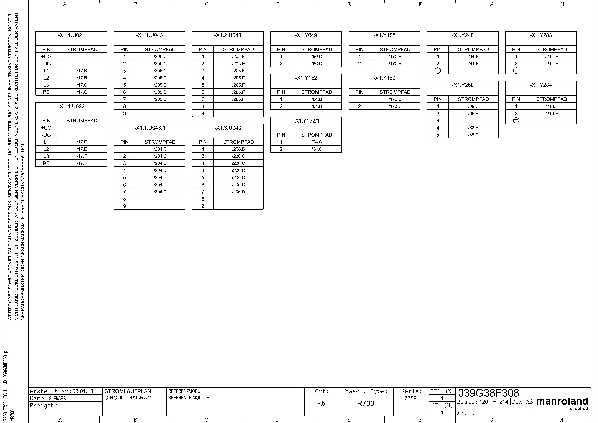

# +Jx — Sheet 120 of 214 — REFERENZMODUL

**REFERENCE MODULE**

> Part of the manroland **R700** printing press IEC/UL circuit diagrams.
> Drawing class: **Stromlaufplan / Circuit diagram** (DIN A3).
> Document `+Jx` covers the **1st printing module + feed register** machine section.

## At a glance

| Field | Value |
|---|---|
| Document | `+Jx`  (039G38F308) |
| Sheet | **120** of 214 |
| Section (DE) | REFERENZMODUL |
| Section (EN) | REFERENCE MODULE |
| Section type | REFERENCE_MODULE — Reference module |
| Machine type | `R700` |
| Series | `7758` |
| Created | 03.01.10 |
| Replaces | — |
| Columns used | A, B, C, D, E, F, G, H |
| Path numbers | — |
| Labels on sheet | 170 |
| Cross-refs out | 56 |
| Cross-refs in | 0 |

**Previous:** [+Jx sheet 119](SHEET_0119.md) · **Next:** [+Jx sheet 121](SHEET_0121.md) · **Document TOC:** [_TOC.md](_TOC.md)  (+Jx) · **Master TOC:** [all sheets](../_MASTER_TOC.md)

## Sheet image (300 DPI, exact vector render)



_Rendered directly from the PDF vector layer at 300 DPI (1-bit), no OCR and no resampling. Use it to confirm anything ambiguous in the text below._

## Cross-references on this sheet

Each entry is a wire leaving this sheet. The printed token is `/sheet.column`; the link resolves to that sheet inside the same document.

| Ref | Target sheet | Col | Path | Destination on target | Target section | From col |
|---|---|---|---|---|---|---|
| `/205.E` | [+Jx sheet 205](SHEET_0205.md) | E | — | — | OPTION: INLINEOBSERVER | C |
| `/170.B` | [+Jx sheet 170](SHEET_0170.md) | B | — | — | OPTION: AUTOMATISCHEM SPÜLEN | F |
| `/64.F` | [+Jx sheet 64](SHEET_0064.md) | F | — | — | TROPFEINRICHTUNG | G |
| `/214.E` | [+Jx sheet 214](SHEET_0214.md) | E | — | — | OPTION: FZW | H |
| `/66.C` | [+Jx sheet 66](SHEET_0066.md) | C | — | — | DRUCKANSTELLUNG | E |
| `/205.C` | [+Jx sheet 205](SHEET_0205.md) | C | — | — | OPTION: INLINEOBSERVER | B |
| `/64.F` | [+Jx sheet 64](SHEET_0064.md) | F | — | — | TROPFEINRICHTUNG | G |
| `/205.E` | [+Jx sheet 205](SHEET_0205.md) | E | — | — | OPTION: INLINEOBSERVER | C |
| `/170.B` | [+Jx sheet 170](SHEET_0170.md) | B | — | — | OPTION: AUTOMATISCHEM SPÜLEN | F |
| `/214.E` | [+Jx sheet 214](SHEET_0214.md) | E | — | — | OPTION: FZW | H |
| `/66.C` | [+Jx sheet 66](SHEET_0066.md) | C | — | — | DRUCKANSTELLUNG | E |
| `/205.C` | [+Jx sheet 205](SHEET_0205.md) | C | — | — | OPTION: INLINEOBSERVER | B |
| `/17.B` | [+Jx sheet 17](SHEET_0017.md) | B | — | — | LACKPUMPE | A |
| `/205.F` | [+Jx sheet 205](SHEET_0205.md) | F | — | — | OPTION: INLINEOBSERVER | C |
| `/205.C` | [+Jx sheet 205](SHEET_0205.md) | C | — | — | OPTION: INLINEOBSERVER | B |
| `/17.B` | [+Jx sheet 17](SHEET_0017.md) | B | — | — | LACKPUMPE | A |
| `/205.F` | [+Jx sheet 205](SHEET_0205.md) | F | — | — | OPTION: INLINEOBSERVER | C |
| `/205.D` | [+Jx sheet 205](SHEET_0205.md) | D | — | — | OPTION: INLINEOBSERVER | B |
| `/205.F` | [+Jx sheet 205](SHEET_0205.md) | F | — | — | OPTION: INLINEOBSERVER | C |
| `/17.C` | [+Jx sheet 17](SHEET_0017.md) | C | — | — | LACKPUMPE | A |
| `/205.D` | [+Jx sheet 205](SHEET_0205.md) | D | — | — | OPTION: INLINEOBSERVER | B |
| `/205.F` | [+Jx sheet 205](SHEET_0205.md) | F | — | — | OPTION: INLINEOBSERVER | C |
| `/17.C` | [+Jx sheet 17](SHEET_0017.md) | C | — | — | LACKPUMPE | A |
| `/205.D` | [+Jx sheet 205](SHEET_0205.md) | D | — | — | OPTION: INLINEOBSERVER | B |
| `/64.B` | [+Jx sheet 64](SHEET_0064.md) | B | — | — | TROPFEINRICHTUNG | E |
| `/205.F` | [+Jx sheet 205](SHEET_0205.md) | F | — | — | OPTION: INLINEOBSERVER | C |
| `/205.D` | [+Jx sheet 205](SHEET_0205.md) | D | — | — | OPTION: INLINEOBSERVER | B |
| `/170.C` | [+Jx sheet 170](SHEET_0170.md) | C | — | — | OPTION: AUTOMATISCHEM SPÜLEN | F |
| `/64.B` | [+Jx sheet 64](SHEET_0064.md) | B | — | — | TROPFEINRICHTUNG | E |
| `/214.F` | [+Jx sheet 214](SHEET_0214.md) | F | — | — | OPTION: FZW | H |
| `/68.C` | [+Jx sheet 68](SHEET_0068.md) | C | — | — | BLAS/SAUGLUFT MIT MOTORVENTILEINSTELLUNG | G |
| `/170.C` | [+Jx sheet 170](SHEET_0170.md) | C | — | — | OPTION: AUTOMATISCHEM SPÜLEN | F |
| `/68.B` | [+Jx sheet 68](SHEET_0068.md) | B | — | — | BLAS/SAUGLUFT MIT MOTORVENTILEINSTELLUNG | G |
| `/214.F` | [+Jx sheet 214](SHEET_0214.md) | F | — | — | OPTION: FZW | H |
| `/68.A` | [+Jx sheet 68](SHEET_0068.md) | A | — | — | BLAS/SAUGLUFT MIT MOTORVENTILEINSTELLUNG | G |
| `/68.D` | [+Jx sheet 68](SHEET_0068.md) | D | — | — | BLAS/SAUGLUFT MIT MOTORVENTILEINSTELLUNG | G |
| `/17.E` | [+Jx sheet 17](SHEET_0017.md) | E | — | — | LACKPUMPE | A |
| `/64.C` | [+Jx sheet 64](SHEET_0064.md) | C | — | — | TROPFEINRICHTUNG | E |
| `/17.E` | [+Jx sheet 17](SHEET_0017.md) | E | — | — | LACKPUMPE | A |
| `/206.B` | [+Jx sheet 206](SHEET_0206.md) | B | — | — | OPTION: INLINEOBSERVER | C |
| `/64.C` | [+Jx sheet 64](SHEET_0064.md) | C | — | — | TROPFEINRICHTUNG | E |
| `/204.C` | [+Jx sheet 204](SHEET_0204.md) | C | — | — | OPTION: INLINEOBSERVER | B |
| `/17.F` | [+Jx sheet 17](SHEET_0017.md) | F | — | — | LACKPUMPE | A |
| `/204.C` | [+Jx sheet 204](SHEET_0204.md) | C | — | — | OPTION: INLINEOBSERVER | B |
| `/206.C` | [+Jx sheet 206](SHEET_0206.md) | C | — | — | OPTION: INLINEOBSERVER | C |
| `/17.F` | [+Jx sheet 17](SHEET_0017.md) | F | — | — | LACKPUMPE | A |
| `/204.C` | [+Jx sheet 204](SHEET_0204.md) | C | — | — | OPTION: INLINEOBSERVER | B |
| `/206.C` | [+Jx sheet 206](SHEET_0206.md) | C | — | — | OPTION: INLINEOBSERVER | C |
| `/204.D` | [+Jx sheet 204](SHEET_0204.md) | D | — | — | OPTION: INLINEOBSERVER | B |
| `/206.C` | [+Jx sheet 206](SHEET_0206.md) | C | — | — | OPTION: INLINEOBSERVER | C |
| `/204.D` | [+Jx sheet 204](SHEET_0204.md) | D | — | — | OPTION: INLINEOBSERVER | B |
| `/206.C` | [+Jx sheet 206](SHEET_0206.md) | C | — | — | OPTION: INLINEOBSERVER | C |
| `/204.D` | [+Jx sheet 204](SHEET_0204.md) | D | — | — | OPTION: INLINEOBSERVER | B |
| `/206.C` | [+Jx sheet 206](SHEET_0206.md) | C | — | — | OPTION: INLINEOBSERVER | C |
| `/204.D` | [+Jx sheet 204](SHEET_0204.md) | D | — | — | OPTION: INLINEOBSERVER | B |
| `/206.D` | [+Jx sheet 206](SHEET_0206.md) | D | — | — | OPTION: INLINEOBSERVER | C |

## Devices on this sheet

| Tag | Class | Class meaning (IEC) | Col | Sub | Terminal | Sign |
|---|---|---|---|---|---|---|
| `X1.1.U043` | — | cross-device reference | B | — | — | — |
| `X1.1.U021` | — | cross-device reference | A | — | — | — |
| `X1.1.U022` | — | cross-device reference | A | — | — | — |
| `X1.2.U043` | — | cross-device reference | C | — | — | — |
| `X1.3.U043` | — | cross-device reference | C | — | — | — |
| `X1.Y049` | — | cross-device reference | D | — | — | — |
| `X1.Y152` | — | cross-device reference | D | — | — | — |
| `X1.Y188` | — | cross-device reference | F | — | — | — |
| `X1.Y189` | — | cross-device reference | F | — | — | — |
| `X1.Y248` | — | cross-device reference | G | — | — | — |
| `X1.Y268` | — | cross-device reference | G | — | — | — |
| `X1.Y283` | — | cross-device reference | H | — | — | — |
| `X1.Y284` | — | cross-device reference | H | — | — | — |

## Potentials / nets

| Potential | Count | Columns | Attached devices | Terminals |
|---|---|---|---|---|
| `L1` | 2 | A | — | — |
| `L2` | 2 | A | — | — |
| `L3` | 2 | A | — | — |
| `PE` | 2 | A | — | — |


A potential such as `L24+/4` or `M24+` is a named supply/return rail; every place it appears on this sheet is electrically common.

## Wire-end annotations (grouped as printed)

A wire that continues elsewhere is annotated with a small cluster: the destination description, the path/line number `#NN`, and the `/sheet.column` cross reference. Each row below is one such cluster exactly as it is grouped on the drawing.

| Col | Y | Path | Cross-ref | Text on the wire |
|---|---|---|---|---|
| A | 65.4 | — | — | `X1.1.U021` |
| B | 65.4 | — | — | `X1.1.U043` |
| C | 65.4 | — | — | `X1.2.U043` |
| D | 65.5 | — | — | `X1.Y049` |
| F | 65.5 | — | — | `X1.Y188` |
| G | 65.5 | — | — | `X1.Y248` |
| H | 65.5 | — | — | `X1.Y283` |
| A | 94.1 | — | — | `+UG PIN STROMPFAD` |
| B | 94.1 | — | — | `PIN 2 3 5 6 7 8 9 4 1 STROMPFAD` |
| C | 94.1 | — | — | `PIN 2 3 5 6 7 8 9 4 1 STROMPFAD` |
| D | 94.1 | — | — | `PIN 2 1 STROMPFAD` |
| E | 94.1 | — | — | `PIN 2 1 STROMPFAD` |
| G | 94.1 | — | — | `PIN 2 1 STROMPFAD` |
| H | 94.1 | — | — | `PIN 2 1 STROMPFAD` |
| C | 108.6 | — | `/205.E` | — |
| F | 108.6 | — | `/170.B` | — |
| G | 108.6 | — | `/64.F` | — |
| H | 108.6 | — | `/214.E` | — |
| B | 108.7 | — | `/205.C` | — |
| E | 108.7 | — | `/66.C` | — |
| A | 122.4 | — | — | `UG` |
| B | 122.8 | — | `/205.C` | — |
| C | 122.8 | — | `/205.E` | — |
| E | 122.8 | — | `/66.C` | — |
| F | 122.8 | — | `/170.B` | — |
| G | 122.8 | — | `/64.F` | — |
| H | 122.8 | — | `/214.E` | — |
| A | 136.7 | — | — | `PE L2 L3 L1` |
| A | 137.0 | — | `/17.B` | — |
| B | 137.0 | — | `/205.C` | — |
| C | 137.0 | — | `/205.F` | — |
| D | 150.5 | — | — | `X1.Y152` |
| F | 150.5 | — | — | `X1.Y189` |
| A | 151.1 | — | `/17.B` | — |
| B | 151.2 | — | `/205.D` | — |
| C | 151.2 | — | `/205.F` | — |
| G | 164.7 | — | — | `X1.Y268` |
| H | 164.7 | — | — | `X1.Y284` |
| A | 165.3 | — | `/17.C` | — |
| B | 165.3 | — | `/205.D` | — |
| C | 165.3 | — | `/205.F` | — |
| D | 179.1 | — | — | `PIN 2 1 STROMPFAD` |
| E | 179.1 | — | — | `PIN 2 1 STROMPFAD` |
| A | 179.5 | — | `/17.C` | — |
| B | 179.5 | — | `/205.D` | — |
| C | 179.5 | — | `/205.F` | — |
| G | 193.3 | — | — | `PIN 2 3 5 4 1 STROMPFAD` |
| H | 193.3 | — | — | `PIN 2 1 STROMPFAD` |
| B | 193.7 | — | `/205.D` | — |
| C | 193.7 | — | `/205.F` | — |
| E | 193.7 | — | `/64.B` | — |
| F | 193.7 | — | `/170.C` | — |
| A | 207.2 | — | — | `X1.1.U022` |
| E | 207.8 | — | `/64.B` | — |
| H | 207.8 | — | `/214.F` | — |
| F | 207.9 | — | `/170.C` | — |
| G | 207.9 | — | `/68.C` | — |
| G | 222.0 | — | `/68.B` | — |
| H | 222.0 | — | `/214.F` | — |
| D | 235.6 | — | — | `X1.Y152/1` |
| A | 235.8 | — | — | `+UG PIN STROMPFAD` |
| B | 249.7 | — | — | `X1.1.U043/1` |
| C | 249.7 | — | — | `X1.3.U043` |
| G | 250.3 | — | `/68.A` | — |
| A | 264.1 | — | — | `UG` |
| D | 264.2 | — | — | `PIN 2 1 STROMPFAD` |
| G | 264.6 | — | `/68.D` | — |
| B | 278.3 | — | — | `PIN 2 3 5 6 7 8 9 4 1 STROMPFAD` |
| C | 278.3 | — | — | `PIN 2 3 5 6 7 8 9 4 1 STROMPFAD` |
| A | 278.4 | — | — | `PE L2 L3 L1` |
| A | 278.7 | — | `/17.E` | — |
| E | 278.7 | — | `/64.C` | — |
| A | 292.9 | — | `/17.E` | — |
| B | 292.9 | — | `/204.C` | — |
| C | 292.9 | — | `/206.B` | — |
| E | 292.9 | — | `/64.C` | — |
| A | 307.1 | — | `/17.F` | — |
| B | 307.1 | — | `/204.C` | — |
| C | 307.1 | — | `/206.C` | — |
| A | 321.2 | — | `/17.F` | — |
| B | 321.3 | — | `/204.C` | — |
| C | 321.3 | — | `/206.C` | — |
| B | 335.4 | — | `/204.D` | — |
| C | 335.4 | — | `/206.C` | — |
| B | 349.6 | — | `/204.D` | — |
| C | 349.6 | — | `/206.C` | — |
| B | 363.8 | — | `/204.D` | — |
| C | 363.8 | — | `/206.C` | — |
| B | 377.9 | — | `/204.D` | — |
| C | 377.9 | — | `/206.D` | — |


## Reconstructed tables

This sheet carries tabular content (pin map / terminal assignment / index). The grid below was rebuilt from the drawing's own rule lines, so each row is exactly one physical row of the table.

### Table 1 — 14 data rows × 2 columns (at x=70.9, y=62.4) — **X1.1.U021**

| PIN | STROMPFAD |
|---|---|
| `+UG` |  |
| `UG` |  |
| `L1` | `/17.B` |
| `L2` | `/17.B` |
| `L3` | `/17.C` |
| `PE` | `/17.C` |
|  | `X1.1.U022` |
| `PIN` | `STROMPFAD` |
| `+UG` |  |
| `UG` |  |
| `L1` | `/17.E` |
| `L2` | `/17.E` |
| `L3` | `/17.F` |
| `PE` | `/17.F` |


### Table 2 — 20 data rows × 2 columns (at x=226.8, y=62.4) — **X1.1.U043**

| PIN | STROMPFAD |
|---|---|
| `1` | `/205.C` |
| `2` | `/205.C` |
| `3` | `/205.C` |
| `4` | `/205.D` |
| `5` | `/205.D` |
| `6` | `/205.D` |
| `7` | `/205.D` |
| `8` |  |
| `9` |  |
|  | `X1.1.U043/1` |
| `PIN` | `STROMPFAD` |
| `1` | `/204.C` |
| `2` | `/204.C` |
| `3` | `/204.C` |
| `4` | `/204.D` |
| `5` | `/204.D` |
| `6` | `/204.D` |
| `7` | `/204.D` |
| `8` |  |
| `9` |  |


### Table 3 — 20 data rows × 2 columns (at x=382.7, y=62.4) — **X1.2.U043**

| PIN | STROMPFAD |
|---|---|
| `1` | `/205.E` |
| `2` | `/205.E` |
| `3` | `/205.F` |
| `4` | `/205.F` |
| `5` | `/205.F` |
| `6` | `/205.F` |
| `7` | `/205.F` |
| `8` |  |
| `9` |  |
|  | `X1.3.U043` |
| `PIN` | `STROMPFAD` |
| `1` | `/206.B` |
| `2` | `/206.C` |
| `3` | `/206.C` |
| `4` | `/206.C` |
| `5` | `/206.C` |
| `6` | `/206.C` |
| `7` | `/206.D` |
| `8` |  |
| `9` |  |


### Table 4 — 10 data rows × 2 columns (at x=538.6, y=62.4) — **X1.Y049**

| PIN | STROMPFAD |
|---|---|
| `1` | `/66.C` |
| `2` | `/66.C` |
|  | `X1.Y152` |
| `PIN` | `STROMPFAD` |
| `1` | `/64.B` |
| `2` | `/64.B` |
|  | `X1.Y152/1` |
| `PIN` | `STROMPFAD` |
| `1` | `/64.C` |
| `2` | `/64.C` |


### Table 5 — 6 data rows × 2 columns (at x=694.5, y=62.4) — **X1.Y188**

| PIN | STROMPFAD |
|---|---|
| `1` | `/170.B` |
| `2` | `/170.B` |
|  | `X1.Y189` |
| `PIN` | `STROMPFAD` |
| `1` | `/170.C` |
| `2` | `/170.C` |


### Table 6 — 9 data rows × 2 columns (at x=850.4, y=62.4) — **X1.Y248**

| PIN | STROMPFAD |
|---|---|
| `1` | `/64.F` |
| `2` | `/64.F` |
|  | `X1.Y268` |
| `PIN` | `STROMPFAD` |
| `1` | `/68.C` |
| `2` | `/68.B` |
| `3` |  |
| `4` | `/68.A` |
| `5` | `/68.D` |


### Table 7 — 6 data rows × 2 columns (at x=1006.3, y=62.4) — **X1.Y283**

| PIN | STROMPFAD |
|---|---|
| `1` | `/214.E` |
| `2` | `/214.E` |
|  | `X1.Y284` |
| `PIN` | `STROMPFAD` |
| `1` | `/214.F` |
| `2` | `/214.F` |


## Notes and free text on this sheet

| Text | Col | Y (pt) |
|---|---|---|
| `PIN` | B | 94.13 |
| `STROMPFAD` | B | 94.09 |
| `X1.1.U043/1` | B | 249.7 |
| `PIN` | A | 94.13 |
| `STROMPFAD` | A | 94.09 |
| `+UG` | A | 108.27 |
| `UG` | A | 122.4 |
| `PIN` | C | 94.13 |
| `STROMPFAD` | C | 94.09 |
| `PIN` | D | 94.13 |
| `STROMPFAD` | E | 94.09 |
| `X1.Y152/1` | D | 235.56 |
| `PIN` | E | 94.13 |
| `STROMPFAD` | F | 94.09 |
| `PIN` | F | 94.13 |
| `STROMPFAD` | G | 94.09 |
| `PIN` | G | 94.13 |
| `STROMPFAD` | H | 94.09 |

## Complete label inventory (exact text from the drawing)

Every text object inside the drawing area of this sheet, in DIN reading order (column A→H, then top→bottom). This is the authoritative list: if a string is not here it is not printed on this sheet.

| Col | Y | X | Dir | Type | Text |
|---|---|---|---|---|---|
| A | 65.4 | 115.8 | → | device ref | `X1.1.U021` |
| A | 94.1 | 84.0 | → | text | `PIN` |
| A | 94.1 | 132.4 | → | text | `STROMPFAD` |
| A | 108.3 | 81.9 | → | text | `+UG` |
| A | 122.4 | 83.2 | → | text | `UG` |
| A | 136.7 | 87.3 | → | potential | `L1` |
| A | 137.0 | 152.8 | → | cross-reference | `/17.B` |
| A | 150.8 | 86.6 | → | potential | `L2` |
| A | 151.1 | 152.8 | → | cross-reference | `/17.B` |
| A | 165.0 | 86.6 | → | potential | `L3` |
| A | 165.3 | 152.6 | → | cross-reference | `/17.C` |
| A | 179.1 | 85.5 | → | potential | `PE` |
| A | 179.5 | 152.6 | → | cross-reference | `/17.C` |
| A | 207.2 | 115.1 | → | device ref | `X1.1.U022` |
| A | 235.8 | 132.4 | → | text | `STROMPFAD` |
| A | 235.9 | 84.0 | → | text | `PIN` |
| A | 250.0 | 81.9 | → | text | `+UG` |
| A | 264.1 | 83.2 | → | text | `UG` |
| A | 278.4 | 87.3 | → | potential | `L1` |
| A | 278.7 | 152.8 | → | cross-reference | `/17.E` |
| A | 292.6 | 86.6 | → | potential | `L2` |
| A | 292.9 | 152.8 | → | cross-reference | `/17.E` |
| A | 306.7 | 86.6 | → | potential | `L3` |
| A | 307.1 | 153.1 | → | cross-reference | `/17.F` |
| A | 320.9 | 85.5 | → | potential | `PE` |
| A | 321.2 | 153.1 | → | cross-reference | `/17.F` |
| B | 65.4 | 270.9 | → | device ref | `X1.1.U043` |
| B | 94.1 | 240.0 | → | text | `PIN` |
| B | 94.1 | 288.3 | → | text | `STROMPFAD` |
| B | 108.3 | 245.8 | → | number | `1` |
| B | 108.7 | 306.1 | → | cross-reference | `/205.C` |
| B | 122.5 | 245.3 | → | number | `2` |
| B | 122.8 | 306.1 | → | cross-reference | `/205.C` |
| B | 136.7 | 245.3 | → | number | `3` |
| B | 137.0 | 306.1 | → | cross-reference | `/205.C` |
| B | 150.8 | 245.5 | → | number | `4` |
| B | 151.2 | 306.1 | → | cross-reference | `/205.D` |
| B | 165.0 | 245.3 | → | number | `5` |
| B | 165.4 | 306.1 | → | cross-reference | `/205.D` |
| B | 179.2 | 245.3 | → | number | `6` |
| B | 179.5 | 306.1 | → | cross-reference | `/205.D` |
| B | 193.3 | 245.3 | → | number | `7` |
| B | 193.7 | 306.1 | → | cross-reference | `/205.D` |
| B | 207.5 | 245.3 | → | number | `8` |
| B | 221.7 | 245.3 | → | number | `9` |
| B | 249.7 | 267.3 | → | text | `X1.1.U043/1` |
| B | 278.3 | 288.3 | → | text | `STROMPFAD` |
| B | 278.4 | 240.0 | → | text | `PIN` |
| B | 292.6 | 245.8 | → | number | `1` |
| B | 292.9 | 306.1 | → | cross-reference | `/204.C` |
| B | 306.7 | 245.3 | → | number | `2` |
| B | 307.1 | 306.1 | → | cross-reference | `/204.C` |
| B | 320.9 | 245.3 | → | number | `3` |
| B | 321.3 | 306.1 | → | cross-reference | `/204.C` |
| B | 335.1 | 245.5 | → | number | `4` |
| B | 335.4 | 306.1 | → | cross-reference | `/204.D` |
| B | 349.3 | 245.3 | → | number | `5` |
| B | 349.6 | 306.1 | → | cross-reference | `/204.D` |
| B | 363.4 | 245.3 | → | number | `6` |
| B | 363.8 | 306.1 | → | cross-reference | `/204.D` |
| B | 377.6 | 245.3 | → | number | `7` |
| B | 377.9 | 306.1 | → | cross-reference | `/204.D` |
| B | 391.8 | 245.3 | → | number | `8` |
| B | 405.9 | 245.3 | → | number | `9` |
| C | 65.4 | 426.8 | → | device ref | `X1.2.U043` |
| C | 94.1 | 395.9 | → | text | `PIN` |
| C | 94.1 | 444.2 | → | text | `STROMPFAD` |
| C | 108.3 | 401.7 | → | number | `1` |
| C | 108.6 | 462.2 | → | cross-reference | `/205.E` |
| C | 122.5 | 401.2 | → | number | `2` |
| C | 122.8 | 462.2 | → | cross-reference | `/205.E` |
| C | 136.7 | 401.2 | → | number | `3` |
| C | 137.0 | 462.5 | → | cross-reference | `/205.F` |
| C | 150.8 | 401.4 | → | number | `4` |
| C | 151.2 | 462.5 | → | cross-reference | `/205.F` |
| C | 165.0 | 401.2 | → | number | `5` |
| C | 165.3 | 462.5 | → | cross-reference | `/205.F` |
| C | 179.2 | 401.2 | → | number | `6` |
| C | 179.5 | 462.5 | → | cross-reference | `/205.F` |
| C | 193.3 | 401.2 | → | number | `7` |
| C | 193.7 | 462.5 | → | cross-reference | `/205.F` |
| C | 207.5 | 401.2 | → | number | `8` |
| C | 221.7 | 401.2 | → | number | `9` |
| C | 249.7 | 426.8 | → | device ref | `X1.3.U043` |
| C | 278.3 | 444.2 | → | text | `STROMPFAD` |
| C | 278.4 | 395.9 | → | text | `PIN` |
| C | 292.6 | 401.7 | → | number | `1` |
| C | 292.9 | 462.2 | → | cross-reference | `/206.B` |
| C | 306.7 | 401.2 | → | number | `2` |
| C | 307.1 | 462.0 | → | cross-reference | `/206.C` |
| C | 320.9 | 401.2 | → | number | `3` |
| C | 321.3 | 462.0 | → | cross-reference | `/206.C` |
| C | 335.1 | 401.4 | → | number | `4` |
| C | 335.4 | 462.0 | → | cross-reference | `/206.C` |
| C | 349.3 | 401.2 | → | number | `5` |
| C | 349.6 | 462.0 | → | cross-reference | `/206.C` |
| C | 363.4 | 401.2 | → | number | `6` |
| C | 363.8 | 462.0 | → | cross-reference | `/206.C` |
| C | 377.6 | 401.2 | → | number | `7` |
| C | 377.9 | 462.0 | → | cross-reference | `/206.D` |
| C | 391.8 | 401.2 | → | number | `8` |
| C | 405.9 | 401.2 | → | number | `9` |
| D | 65.5 | 587.6 | → | device ref | `X1.Y049` |
| D | 94.1 | 551.8 | → | text | `PIN` |
| D | 108.3 | 557.6 | → | number | `1` |
| D | 122.5 | 557.1 | → | number | `2` |
| D | 150.5 | 587.8 | → | device ref | `X1.Y152` |
| D | 179.2 | 551.8 | → | text | `PIN` |
| D | 193.3 | 557.6 | → | number | `1` |
| D | 207.5 | 557.1 | → | number | `2` |
| D | 235.6 | 584.1 | → | text | `X1.Y152/1` |
| D | 264.2 | 551.8 | → | text | `PIN` |
| D | 278.4 | 557.6 | → | number | `1` |
| D | 292.6 | 557.1 | → | number | `2` |
| E | 94.1 | 600.1 | → | text | `STROMPFAD` |
| E | 94.1 | 707.7 | → | text | `PIN` |
| E | 108.3 | 713.5 | → | number | `1` |
| E | 108.7 | 620.4 | → | cross-reference | `/66.C` |
| E | 122.5 | 713.1 | → | number | `2` |
| E | 122.8 | 620.4 | → | cross-reference | `/66.C` |
| E | 179.1 | 600.1 | → | text | `STROMPFAD` |
| E | 179.2 | 707.7 | → | text | `PIN` |
| E | 193.3 | 713.5 | → | number | `1` |
| E | 193.7 | 620.5 | → | cross-reference | `/64.B` |
| E | 207.5 | 713.1 | → | number | `2` |
| E | 207.8 | 620.5 | → | cross-reference | `/64.B` |
| E | 264.2 | 600.1 | → | text | `STROMPFAD` |
| E | 278.7 | 620.4 | → | cross-reference | `/64.C` |
| E | 292.9 | 620.4 | → | cross-reference | `/64.C` |
| F | 65.5 | 743.7 | → | device ref | `X1.Y188` |
| F | 94.1 | 756.0 | → | text | `STROMPFAD` |
| F | 94.1 | 863.6 | → | text | `PIN` |
| F | 108.3 | 869.4 | → | number | `1` |
| F | 108.6 | 774.0 | → | cross-reference | `/170.B` |
| F | 122.5 | 869.0 | → | number | `2` |
| F | 122.8 | 774.0 | → | cross-reference | `/170.B` |
| F | 150.5 | 743.5 | → | device ref | `X1.Y189` |
| F | 179.1 | 756.0 | → | text | `STROMPFAD` |
| F | 193.3 | 863.6 | → | text | `PIN` |
| F | 193.7 | 773.9 | → | cross-reference | `/170.C` |
| F | 207.5 | 869.4 | → | number | `1` |
| F | 207.9 | 773.9 | → | cross-reference | `/170.C` |
| F | 221.7 | 869.0 | → | number | `2` |
| F | 235.9 | 869.0 | → | number | `3` |
| F | 250.0 | 869.1 | → | number | `4` |
| F | 264.2 | 869.0 | → | number | `5` |
| G | 65.5 | 899.6 | → | device ref | `X1.Y248` |
| G | 94.1 | 911.9 | → | text | `STROMPFAD` |
| G | 94.1 | 1019.5 | → | text | `PIN` |
| G | 108.3 | 1025.3 | → | number | `1` |
| G | 108.6 | 932.6 | → | cross-reference | `/64.F` |
| G | 122.5 | 1024.9 | → | number | `2` |
| G | 122.8 | 932.6 | → | cross-reference | `/64.F` |
| G | 164.7 | 899.6 | → | device ref | `X1.Y268` |
| G | 193.3 | 911.9 | → | text | `STROMPFAD` |
| G | 193.3 | 1019.5 | → | text | `PIN` |
| G | 207.5 | 1025.3 | → | number | `1` |
| G | 207.9 | 932.2 | → | cross-reference | `/68.C` |
| G | 221.7 | 1024.9 | → | number | `2` |
| G | 222.0 | 932.3 | → | cross-reference | `/68.B` |
| G | 250.3 | 932.2 | → | cross-reference | `/68.A` |
| G | 264.6 | 932.2 | → | cross-reference | `/68.D` |
| H | 65.5 | 1055.3 | → | device ref | `X1.Y283` |
| H | 94.1 | 1067.8 | → | text | `STROMPFAD` |
| H | 108.6 | 1085.8 | → | cross-reference | `/214.E` |
| H | 122.8 | 1085.8 | → | cross-reference | `/214.E` |
| H | 164.7 | 1055.3 | → | device ref | `X1.Y284` |
| H | 193.3 | 1067.8 | → | text | `STROMPFAD` |
| H | 207.9 | 1086.1 | → | cross-reference | `/214.F` |
| H | 222.0 | 1086.1 | → | cross-reference | `/214.F` |

## Reading-order text block

The same content as a plain block, grouped by DIN column — convenient to paste or to match against a visual description.

```text
=== Column A ===
  65.4  115.8  devref       X1.1.U021
  94.1   84.0  text         PIN
  94.1  132.4  text         STROMPFAD
 108.3   81.9  text         +UG
 122.4   83.2  text         UG
 136.7   87.3  net          L1
 137.0  152.8  xref         /17.B
 150.8   86.6  net          L2
 151.1  152.8  xref         /17.B
 165.0   86.6  net          L3
 165.3  152.6  xref         /17.C
 179.1   85.5  net          PE
 179.5  152.6  xref         /17.C
 207.2  115.1  devref       X1.1.U022
 235.8  132.4  text         STROMPFAD
 235.9   84.0  text         PIN
 250.0   81.9  text         +UG
 264.1   83.2  text         UG
 278.4   87.3  net          L1
 278.7  152.8  xref         /17.E
 292.6   86.6  net          L2
 292.9  152.8  xref         /17.E
 306.7   86.6  net          L3
 307.1  153.1  xref         /17.F
 320.9   85.5  net          PE
 321.2  153.1  xref         /17.F
=== Column B ===
  65.4  270.9  devref       X1.1.U043
  94.1  240.0  text         PIN
  94.1  288.3  text         STROMPFAD
 108.3  245.8  numeric      1
 108.7  306.1  xref         /205.C
 122.5  245.3  numeric      2
 122.8  306.1  xref         /205.C
 136.7  245.3  numeric      3
 137.0  306.1  xref         /205.C
 150.8  245.5  numeric      4
 151.2  306.1  xref         /205.D
 165.0  245.3  numeric      5
 165.4  306.1  xref         /205.D
 179.2  245.3  numeric      6
 179.5  306.1  xref         /205.D
 193.3  245.3  numeric      7
 193.7  306.1  xref         /205.D
 207.5  245.3  numeric      8
 221.7  245.3  numeric      9
 249.7  267.3  text         X1.1.U043/1
 278.3  288.3  text         STROMPFAD
 278.4  240.0  text         PIN
 292.6  245.8  numeric      1
 292.9  306.1  xref         /204.C
 306.7  245.3  numeric      2
 307.1  306.1  xref         /204.C
 320.9  245.3  numeric      3
 321.3  306.1  xref         /204.C
 335.1  245.5  numeric      4
 335.4  306.1  xref         /204.D
 349.3  245.3  numeric      5
 349.6  306.1  xref         /204.D
 363.4  245.3  numeric      6
 363.8  306.1  xref         /204.D
 377.6  245.3  numeric      7
 377.9  306.1  xref         /204.D
 391.8  245.3  numeric      8
 405.9  245.3  numeric      9
=== Column C ===
  65.4  426.8  devref       X1.2.U043
  94.1  395.9  text         PIN
  94.1  444.2  text         STROMPFAD
 108.3  401.7  numeric      1
 108.6  462.2  xref         /205.E
 122.5  401.2  numeric      2
 122.8  462.2  xref         /205.E
 136.7  401.2  numeric      3
 137.0  462.5  xref         /205.F
 150.8  401.4  numeric      4
 151.2  462.5  xref         /205.F
 165.0  401.2  numeric      5
 165.3  462.5  xref         /205.F
 179.2  401.2  numeric      6
 179.5  462.5  xref         /205.F
 193.3  401.2  numeric      7
 193.7  462.5  xref         /205.F
 207.5  401.2  numeric      8
 221.7  401.2  numeric      9
 249.7  426.8  devref       X1.3.U043
 278.3  444.2  text         STROMPFAD
 278.4  395.9  text         PIN
 292.6  401.7  numeric      1
 292.9  462.2  xref         /206.B
 306.7  401.2  numeric      2
 307.1  462.0  xref         /206.C
 320.9  401.2  numeric      3
 321.3  462.0  xref         /206.C
 335.1  401.4  numeric      4
 335.4  462.0  xref         /206.C
 349.3  401.2  numeric      5
 349.6  462.0  xref         /206.C
 363.4  401.2  numeric      6
 363.8  462.0  xref         /206.C
 377.6  401.2  numeric      7
 377.9  462.0  xref         /206.D
 391.8  401.2  numeric      8
 405.9  401.2  numeric      9
=== Column D ===
  65.5  587.6  devref       X1.Y049
  94.1  551.8  text         PIN
 108.3  557.6  numeric      1
 122.5  557.1  numeric      2
 150.5  587.8  devref       X1.Y152
 179.2  551.8  text         PIN
 193.3  557.6  numeric      1
 207.5  557.1  numeric      2
 235.6  584.1  text         X1.Y152/1
 264.2  551.8  text         PIN
 278.4  557.6  numeric      1
 292.6  557.1  numeric      2
=== Column E ===
  94.1  600.1  text         STROMPFAD
  94.1  707.7  text         PIN
 108.3  713.5  numeric      1
 108.7  620.4  xref         /66.C
 122.5  713.1  numeric      2
 122.8  620.4  xref         /66.C
 179.1  600.1  text         STROMPFAD
 179.2  707.7  text         PIN
 193.3  713.5  numeric      1
 193.7  620.5  xref         /64.B
 207.5  713.1  numeric      2
 207.8  620.5  xref         /64.B
 264.2  600.1  text         STROMPFAD
 278.7  620.4  xref         /64.C
 292.9  620.4  xref         /64.C
=== Column F ===
  65.5  743.7  devref       X1.Y188
  94.1  756.0  text         STROMPFAD
  94.1  863.6  text         PIN
 108.3  869.4  numeric      1
 108.6  774.0  xref         /170.B
 122.5  869.0  numeric      2
 122.8  774.0  xref         /170.B
 150.5  743.5  devref       X1.Y189
 179.1  756.0  text         STROMPFAD
 193.3  863.6  text         PIN
 193.7  773.9  xref         /170.C
 207.5  869.4  numeric      1
 207.9  773.9  xref         /170.C
 221.7  869.0  numeric      2
 235.9  869.0  numeric      3
 250.0  869.1  numeric      4
 264.2  869.0  numeric      5
=== Column G ===
  65.5  899.6  devref       X1.Y248
  94.1  911.9  text         STROMPFAD
  94.1 1019.5  text         PIN
 108.3 1025.3  numeric      1
 108.6  932.6  xref         /64.F
 122.5 1024.9  numeric      2
 122.8  932.6  xref         /64.F
 164.7  899.6  devref       X1.Y268
 193.3  911.9  text         STROMPFAD
 193.3 1019.5  text         PIN
 207.5 1025.3  numeric      1
 207.9  932.2  xref         /68.C
 221.7 1024.9  numeric      2
 222.0  932.3  xref         /68.B
 250.3  932.2  xref         /68.A
 264.6  932.2  xref         /68.D
=== Column H ===
  65.5 1055.3  devref       X1.Y283
  94.1 1067.8  text         STROMPFAD
 108.6 1085.8  xref         /214.E
 122.8 1085.8  xref         /214.E
 164.7 1055.3  devref       X1.Y284
 193.3 1067.8  text         STROMPFAD
 207.9 1086.1  xref         /214.F
 222.0 1086.1  xref         /214.F
```

---
_Generated from the PDF vector text layer; no OCR. Source: `R700_7758_IEC_UL_JX_039G38F308_p`, sheet 120._
