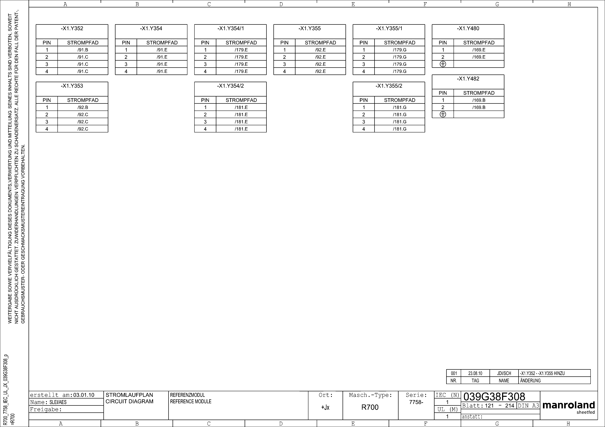

# +Jx — Sheet 121 of 214 — REFERENZMODUL

**REFERENCE MODULE**

> Part of the manroland **R700** printing press IEC/UL circuit diagrams.
> Drawing class: **Stromlaufplan / Circuit diagram** (DIN A3).
> Document `+Jx` covers the **1st printing module + feed register** machine section.

## At a glance

| Field | Value |
|---|---|
| Document | `+Jx`  (039G38F308) |
| Sheet | **121** of 214 |
| Section (DE) | REFERENZMODUL |
| Section (EN) | REFERENCE MODULE |
| Section type | REFERENCE_MODULE — Reference module |
| Machine type | `R700` |
| Series | `7758` |
| Created | 03.01.10 |
| Replaces | — |
| Columns used | A, B, C, D, E, F, G, H |
| Path numbers | — |
| Labels on sheet | 110 |
| Cross-refs out | 36 |
| Cross-refs in | 0 |

**Previous:** [+Jx sheet 120](SHEET_0120.md) · **Next:** [+Jx sheet 122](SHEET_0122.md) · **Document TOC:** [_TOC.md](_TOC.md)  (+Jx) · **Master TOC:** [all sheets](../_MASTER_TOC.md)

## Sheet image (300 DPI, exact vector render)



_Rendered directly from the PDF vector layer at 300 DPI (1-bit), no OCR and no resampling. Use it to confirm anything ambiguous in the text below._

## Cross-references on this sheet

Each entry is a wire leaving this sheet. The printed token is `/sheet.column`; the link resolves to that sheet inside the same document.

| Ref | Target sheet | Col | Path | Destination on target | Target section | From col |
|---|---|---|---|---|---|---|
| `/91.B` | [+Jx sheet 91](SHEET_0091.md) | B | — | — | BOGENFÜHRUNG (BLASROHRE) | A |
| `/91.E` | [+Jx sheet 91](SHEET_0091.md) | E | — | — | BOGENFÜHRUNG (BLASROHRE) | B |
| `/92.E` | [+Jx sheet 92](SHEET_0092.md) | E | — | — | BOGENFÜHRUNG (BLASROHRE) | E |
| `/179.E` | [+Jx sheet 179](SHEET_0179.md) | E | — | — | OPTION: TRANSFERMODUL 1 NACH | C |
| `/169.E` | [+Jx sheet 169](SHEET_0169.md) | E | — | — | OPTION: BOGENFÜHRUNG ÜBER DRUCKZYLINDER / | G |
| `/179.G` | [+Jx sheet 179](SHEET_0179.md) | G | — | — | OPTION: TRANSFERMODUL 1 NACH | F |
| `/91.E` | [+Jx sheet 91](SHEET_0091.md) | E | — | — | BOGENFÜHRUNG (BLASROHRE) | B |
| `/92.E` | [+Jx sheet 92](SHEET_0092.md) | E | — | — | BOGENFÜHRUNG (BLASROHRE) | E |
| `/179.E` | [+Jx sheet 179](SHEET_0179.md) | E | — | — | OPTION: TRANSFERMODUL 1 NACH | C |
| `/169.E` | [+Jx sheet 169](SHEET_0169.md) | E | — | — | OPTION: BOGENFÜHRUNG ÜBER DRUCKZYLINDER / | G |
| `/91.C` | [+Jx sheet 91](SHEET_0091.md) | C | — | — | BOGENFÜHRUNG (BLASROHRE) | A |
| `/179.G` | [+Jx sheet 179](SHEET_0179.md) | G | — | — | OPTION: TRANSFERMODUL 1 NACH | F |
| `/91.E` | [+Jx sheet 91](SHEET_0091.md) | E | — | — | BOGENFÜHRUNG (BLASROHRE) | B |
| `/92.E` | [+Jx sheet 92](SHEET_0092.md) | E | — | — | BOGENFÜHRUNG (BLASROHRE) | E |
| `/179.E` | [+Jx sheet 179](SHEET_0179.md) | E | — | — | OPTION: TRANSFERMODUL 1 NACH | C |
| `/91.C` | [+Jx sheet 91](SHEET_0091.md) | C | — | — | BOGENFÜHRUNG (BLASROHRE) | A |
| `/179.G` | [+Jx sheet 179](SHEET_0179.md) | G | — | — | OPTION: TRANSFERMODUL 1 NACH | F |
| `/91.E` | [+Jx sheet 91](SHEET_0091.md) | E | — | — | BOGENFÜHRUNG (BLASROHRE) | B |
| `/92.E` | [+Jx sheet 92](SHEET_0092.md) | E | — | — | BOGENFÜHRUNG (BLASROHRE) | E |
| `/179.E` | [+Jx sheet 179](SHEET_0179.md) | E | — | — | OPTION: TRANSFERMODUL 1 NACH | C |
| `/179.G` | [+Jx sheet 179](SHEET_0179.md) | G | — | — | OPTION: TRANSFERMODUL 1 NACH | F |
| `/91.C` | [+Jx sheet 91](SHEET_0091.md) | C | — | — | BOGENFÜHRUNG (BLASROHRE) | A |
| `/169.B` | [+Jx sheet 169](SHEET_0169.md) | B | — | — | OPTION: BOGENFÜHRUNG ÜBER DRUCKZYLINDER / | G |
| `/92.B` | [+Jx sheet 92](SHEET_0092.md) | B | — | — | BOGENFÜHRUNG (BLASROHRE) | A |
| `/181.E` | [+Jx sheet 181](SHEET_0181.md) | E | — | — | OPTION: TRANSFERMODUL 2 | C |
| `/169.B` | [+Jx sheet 169](SHEET_0169.md) | B | — | — | OPTION: BOGENFÜHRUNG ÜBER DRUCKZYLINDER / | G |
| `/181.G` | [+Jx sheet 181](SHEET_0181.md) | G | — | — | OPTION: TRANSFERMODUL 2 | F |
| `/181.E` | [+Jx sheet 181](SHEET_0181.md) | E | — | — | OPTION: TRANSFERMODUL 2 | C |
| `/181.G` | [+Jx sheet 181](SHEET_0181.md) | G | — | — | OPTION: TRANSFERMODUL 2 | F |
| `/92.C` | [+Jx sheet 92](SHEET_0092.md) | C | — | — | BOGENFÜHRUNG (BLASROHRE) | A |
| `/181.E` | [+Jx sheet 181](SHEET_0181.md) | E | — | — | OPTION: TRANSFERMODUL 2 | C |
| `/92.C` | [+Jx sheet 92](SHEET_0092.md) | C | — | — | BOGENFÜHRUNG (BLASROHRE) | A |
| `/181.G` | [+Jx sheet 181](SHEET_0181.md) | G | — | — | OPTION: TRANSFERMODUL 2 | F |
| `/181.E` | [+Jx sheet 181](SHEET_0181.md) | E | — | — | OPTION: TRANSFERMODUL 2 | C |
| `/92.C` | [+Jx sheet 92](SHEET_0092.md) | C | — | — | BOGENFÜHRUNG (BLASROHRE) | A |
| `/181.G` | [+Jx sheet 181](SHEET_0181.md) | G | — | — | OPTION: TRANSFERMODUL 2 | F |

## Devices on this sheet

| Tag | Class | Class meaning (IEC) | Col | Sub | Terminal | Sign |
|---|---|---|---|---|---|---|
| `X1.Y352` | — | cross-device reference | A | — | — | — |
| `X1.Y353` | — | cross-device reference | A | — | — | — |
| `X1.Y354` | — | cross-device reference | B | — | — | — |
| `X1.Y355` | — | cross-device reference | D | — | — | — |
| `X1.Y480` | — | cross-device reference | G | — | — | — |
| `X1.Y482` | — | cross-device reference | G | — | — | — |
| `NR.` | — | cross-device reference | F | — | — | — |
| `23.08.10` | — | cross-device reference | G | — | — | — |

## Potentials / nets

_No named potentials on this sheet._

## Wire-end annotations (grouped as printed)

A wire that continues elsewhere is annotated with a small cluster: the destination description, the path/line number `#NN`, and the `/sheet.column` cross reference. Each row below is one such cluster exactly as it is grouped on the drawing.

| Col | Y | Path | Cross-ref | Text on the wire |
|---|---|---|---|---|
| A | 51.3 | — | — | `X1.Y352` |
| B | 51.3 | — | — | `X1.Y354` |
| C | 51.3 | — | — | `X1.Y354/1` |
| D | 51.3 | — | — | `X1.Y355` |
| F | 51.3 | — | — | `X1.Y355/1` |
| G | 51.3 | — | — | `X1.Y480` |
| A | 79.9 | — | — | `PIN 2 3 4 1 STROMPFAD` |
| B | 79.9 | — | — | `PIN 2 3 4 1 STROMPFAD` |
| C | 79.9 | — | — | `PIN 2 3 4 1 STROMPFAD` |
| D | 79.9 | — | — | `PIN 2 3 4 1 STROMPFAD` |
| E | 79.9 | — | — | `PIN 2 3 4 1 STROMPFAD` |
| G | 79.9 | — | — | `PIN 2 1 STROMPFAD` |
| A | 94.4 | — | `/91.B` | — |
| B | 94.4 | — | `/91.E` | — |
| E | 94.4 | — | `/92.E` | — |
| C | 94.5 | — | `/179.E` | — |
| F | 94.5 | — | `/179.G` | — |
| G | 94.5 | — | `/169.E` | — |
| B | 108.6 | — | `/91.E` | — |
| C | 108.6 | — | `/179.E` | — |
| E | 108.6 | — | `/92.E` | — |
| G | 108.6 | — | `/169.E` | — |
| A | 108.7 | — | `/91.C` | — |
| F | 108.7 | — | `/179.G` | — |
| A | 122.8 | — | `/91.C` | — |
| B | 122.8 | — | `/91.E` | — |
| C | 122.8 | — | `/179.E` | — |
| E | 122.8 | — | `/92.E` | — |
| F | 122.8 | — | `/179.G` | — |
| A | 137.0 | — | `/91.C` | — |
| B | 137.0 | — | `/91.E` | — |
| C | 137.0 | — | `/179.E` | — |
| E | 137.0 | — | `/92.E` | — |
| F | 137.0 | — | `/179.G` | — |
| G | 150.5 | — | — | `X1.Y482` |
| A | 164.7 | — | — | `X1.Y353` |
| C | 164.7 | — | — | `X1.Y354/2` |
| F | 164.7 | — | — | `X1.Y355/2` |
| G | 179.1 | — | — | `PIN 2 1 STROMPFAD` |
| A | 193.3 | — | — | `PIN 2 3 4 1 STROMPFAD` |
| C | 193.3 | — | — | `PIN 2 3 4 1 STROMPFAD` |
| E | 193.3 | — | — | `PIN 2 3 4 1 STROMPFAD` |
| G | 193.7 | — | `/169.B` | — |
| A | 207.8 | — | `/92.B` | — |
| C | 207.8 | — | `/181.E` | — |
| G | 207.8 | — | `/169.B` | — |
| F | 207.9 | — | `/181.G` | — |
| A | 222.0 | — | `/92.C` | — |
| C | 222.0 | — | `/181.E` | — |
| F | 222.0 | — | `/181.G` | — |
| A | 236.2 | — | `/92.C` | — |
| C | 236.2 | — | `/181.E` | — |
| F | 236.2 | — | `/181.G` | — |
| A | 250.4 | — | `/92.C` | — |
| C | 250.4 | — | `/181.E` | — |
| F | 250.4 | — | `/181.G` | — |
| G | 733.0 | — | — | `001 23.08.10 JDI/SCH X1.Y352 X1.Y355 HINZU` |
| G | 747.1 | — | — | `NR. TAG NAME ÄNDERUNG` |


## Reconstructed tables

This sheet carries tabular content (pin map / terminal assignment / index). The grid below was rebuilt from the drawing's own rule lines, so each row is exactly one physical row of the table.

### Table 1 — 10 data rows × 2 columns (at x=70.9, y=48.2) — **X1.Y352**

| PIN | STROMPFAD |
|---|---|
| `1` | `/91.B` |
| `2` | `/91.C` |
| `3` | `/91.C` |
| `4` | `/91.C` |
|  | `X1.Y353` |
| `PIN` | `STROMPFAD` |
| `1` | `/92.B` |
| `2` | `/92.C` |
| `3` | `/92.C` |
| `4` | `/92.C` |


### Table 2 — 4 data rows × 2 columns (at x=226.8, y=48.2) — **X1.Y354**

| PIN | STROMPFAD |
|---|---|
| `1` | `/91.E` |
| `2` | `/91.E` |
| `3` | `/91.E` |
| `4` | `/91.E` |


### Table 3 — 10 data rows × 2 columns (at x=382.7, y=48.2) — **X1.Y354/1**

| PIN | STROMPFAD |
|---|---|
| `1` | `/179.E` |
| `2` | `/179.E` |
| `3` | `/179.E` |
| `4` | `/179.E` |
|  | `X1.Y354/2` |
| `PIN` | `STROMPFAD` |
| `1` | `/181.E` |
| `2` | `/181.E` |
| `3` | `/181.E` |
| `4` | `/181.E` |


### Table 4 — 4 data rows × 2 columns (at x=538.6, y=48.2) — **X1.Y355**

| PIN | STROMPFAD |
|---|---|
| `1` | `/92.E` |
| `2` | `/92.E` |
| `3` | `/92.E` |
| `4` | `/92.E` |


### Table 5 — 10 data rows × 2 columns (at x=694.5, y=48.2) — **X1.Y355/1**

| PIN | STROMPFAD |
|---|---|
| `1` | `/179.G` |
| `2` | `/179.G` |
| `3` | `/179.G` |
| `4` | `/179.G` |
|  | `X1.Y355/2` |
| `PIN` | `STROMPFAD` |
| `1` | `/181.G` |
| `2` | `/181.G` |
| `3` | `/181.G` |
| `4` | `/181.G` |


### Table 6 — 6 data rows × 2 columns (at x=850.4, y=48.2) — **X1.Y480**

| PIN | STROMPFAD |
|---|---|
| `1` | `/169.E` |
| `2` | `/169.E` |
|  | `X1.Y482` |
| `PIN` | `STROMPFAD` |
| `1` | `/169.B` |
| `2` | `/169.B` |


## Notes and free text on this sheet

| Text | Col | Y (pt) |
|---|---|---|
| `PIN` | A | 79.96 |
| `STROMPFAD` | A | 79.92 |
| `PIN` | B | 79.96 |
| `STROMPFAD` | B | 79.92 |
| `PIN` | D | 79.96 |
| `STROMPFAD` | E | 79.92 |
| `PIN` | C | 79.96 |
| `STROMPFAD` | C | 79.92 |
| `X1.Y354/1` | C | 51.31 |
| `X1.Y354/2` | C | 164.7 |
| `PIN` | E | 79.96 |
| `STROMPFAD` | F | 79.92 |
| `X1.Y355/1` | F | 51.31 |
| `X1.Y355/2` | F | 164.7 |
| `PIN` | F | 79.96 |
| `STROMPFAD` | G | 79.92 |
| `TAG` | G | 747.23 |
| `NAME` | G | 747.22 |
| `ÄNDERUNG` | G | 747.25 |
| `JDI/SCH` | G | 733.05 |
| `X1.Y352 X1.Y355 HINZU` | H | 733.08 |

## Complete label inventory (exact text from the drawing)

Every text object inside the drawing area of this sheet, in DIN reading order (column A→H, then top→bottom). This is the authoritative list: if a string is not here it is not printed on this sheet.

| Col | Y | X | Dir | Type | Text |
|---|---|---|---|---|---|
| A | 51.3 | 120.0 | → | device ref | `X1.Y352` |
| A | 79.9 | 132.4 | → | text | `STROMPFAD` |
| A | 80.0 | 84.0 | → | text | `PIN` |
| A | 94.1 | 89.9 | → | number | `1` |
| A | 94.4 | 152.8 | → | cross-reference | `/91.B` |
| A | 108.3 | 89.4 | → | number | `2` |
| A | 108.7 | 152.6 | → | cross-reference | `/91.C` |
| A | 122.5 | 89.4 | → | number | `3` |
| A | 122.8 | 152.6 | → | cross-reference | `/91.C` |
| A | 136.7 | 89.6 | → | number | `4` |
| A | 137.0 | 152.6 | → | cross-reference | `/91.C` |
| A | 164.7 | 119.9 | → | device ref | `X1.Y353` |
| A | 193.3 | 84.0 | → | text | `PIN` |
| A | 193.3 | 132.4 | → | text | `STROMPFAD` |
| A | 207.5 | 89.9 | → | number | `1` |
| A | 207.8 | 152.8 | → | cross-reference | `/92.B` |
| A | 221.7 | 89.4 | → | number | `2` |
| A | 222.0 | 152.6 | → | cross-reference | `/92.C` |
| A | 235.9 | 89.4 | → | number | `3` |
| A | 236.2 | 152.6 | → | cross-reference | `/92.C` |
| A | 250.0 | 89.6 | → | number | `4` |
| A | 250.4 | 152.6 | → | cross-reference | `/92.C` |
| B | 51.3 | 275.8 | → | device ref | `X1.Y354` |
| B | 79.9 | 288.3 | → | text | `STROMPFAD` |
| B | 80.0 | 240.0 | → | text | `PIN` |
| B | 94.1 | 245.8 | → | number | `1` |
| B | 94.4 | 308.7 | → | cross-reference | `/91.E` |
| B | 108.3 | 245.3 | → | number | `2` |
| B | 108.6 | 308.7 | → | cross-reference | `/91.E` |
| B | 122.5 | 245.3 | → | number | `3` |
| B | 122.8 | 308.7 | → | cross-reference | `/91.E` |
| B | 136.7 | 245.5 | → | number | `4` |
| B | 137.0 | 308.7 | → | cross-reference | `/91.E` |
| C | 51.3 | 428.2 | → | text | `X1.Y354/1` |
| C | 79.9 | 444.2 | → | text | `STROMPFAD` |
| C | 80.0 | 395.9 | → | text | `PIN` |
| C | 94.1 | 401.7 | → | number | `1` |
| C | 94.5 | 462.2 | → | cross-reference | `/179.E` |
| C | 108.3 | 401.2 | → | number | `2` |
| C | 108.6 | 462.2 | → | cross-reference | `/179.E` |
| C | 122.5 | 401.2 | → | number | `3` |
| C | 122.8 | 462.2 | → | cross-reference | `/179.E` |
| C | 136.7 | 401.4 | → | number | `4` |
| C | 137.0 | 462.2 | → | cross-reference | `/179.E` |
| C | 164.7 | 427.5 | → | text | `X1.Y354/2` |
| C | 193.3 | 395.9 | → | text | `PIN` |
| C | 193.3 | 444.2 | → | text | `STROMPFAD` |
| C | 207.5 | 401.7 | → | number | `1` |
| C | 207.8 | 462.2 | → | cross-reference | `/181.E` |
| C | 221.7 | 401.2 | → | number | `2` |
| C | 222.0 | 462.2 | → | cross-reference | `/181.E` |
| C | 235.9 | 401.2 | → | number | `3` |
| C | 236.2 | 462.2 | → | cross-reference | `/181.E` |
| C | 250.0 | 401.4 | → | number | `4` |
| C | 250.4 | 462.2 | → | cross-reference | `/181.E` |
| D | 51.3 | 587.6 | → | device ref | `X1.Y355` |
| D | 80.0 | 551.8 | → | text | `PIN` |
| D | 94.1 | 557.6 | → | number | `1` |
| D | 108.3 | 557.1 | → | number | `2` |
| D | 122.5 | 557.1 | → | number | `3` |
| D | 136.7 | 557.3 | → | number | `4` |
| E | 79.9 | 600.1 | → | text | `STROMPFAD` |
| E | 80.0 | 707.7 | → | text | `PIN` |
| E | 94.1 | 713.5 | → | number | `1` |
| E | 94.4 | 620.5 | → | cross-reference | `/92.E` |
| E | 108.3 | 713.1 | → | number | `2` |
| E | 108.6 | 620.5 | → | cross-reference | `/92.E` |
| E | 122.5 | 713.1 | → | number | `3` |
| E | 122.8 | 620.5 | → | cross-reference | `/92.E` |
| E | 136.7 | 713.2 | → | number | `4` |
| E | 137.0 | 620.5 | → | cross-reference | `/92.E` |
| E | 193.3 | 707.7 | → | text | `PIN` |
| E | 207.5 | 713.5 | → | number | `1` |
| E | 221.7 | 713.1 | → | number | `2` |
| E | 235.9 | 713.1 | → | number | `3` |
| E | 250.0 | 713.2 | → | number | `4` |
| F | 51.3 | 740.0 | → | text | `X1.Y355/1` |
| F | 79.9 | 756.0 | → | text | `STROMPFAD` |
| F | 80.0 | 863.6 | → | text | `PIN` |
| F | 94.1 | 869.4 | → | number | `1` |
| F | 94.5 | 773.6 | → | cross-reference | `/179.G` |
| F | 108.3 | 869.0 | → | number | `2` |
| F | 108.6 | 773.6 | → | cross-reference | `/179.G` |
| F | 122.8 | 773.6 | → | cross-reference | `/179.G` |
| F | 137.0 | 773.6 | → | cross-reference | `/179.G` |
| F | 164.7 | 739.3 | → | text | `X1.Y355/2` |
| F | 179.2 | 863.6 | → | text | `PIN` |
| F | 193.3 | 756.0 | → | text | `STROMPFAD` |
| F | 193.3 | 869.4 | → | number | `1` |
| F | 207.5 | 869.0 | → | number | `2` |
| F | 207.9 | 773.6 | → | cross-reference | `/181.G` |
| F | 222.0 | 773.6 | → | cross-reference | `/181.G` |
| F | 236.2 | 773.6 | → | cross-reference | `/181.G` |
| F | 250.4 | 773.6 | → | cross-reference | `/181.G` |
| F | 733.0 | 887.6 | → | number | `001` |
| F | 747.1 | 886.8 | → | device ref | `NR.` |
| G | 51.3 | 899.6 | → | device ref | `X1.Y480` |
| G | 79.9 | 911.9 | → | text | `STROMPFAD` |
| G | 94.5 | 929.9 | → | cross-reference | `/169.E` |
| G | 108.6 | 929.9 | → | cross-reference | `/169.E` |
| G | 150.5 | 899.6 | → | device ref | `X1.Y482` |
| G | 179.1 | 911.9 | → | text | `STROMPFAD` |
| G | 193.7 | 929.9 | → | cross-reference | `/169.B` |
| G | 207.8 | 929.9 | → | cross-reference | `/169.B` |
| G | 733.1 | 921.9 | → | device ref | `23.08.10` |
| G | 733.1 | 978.6 | → | text | `JDI/SCH` |
| G | 747.2 | 928.5 | → | text | `TAG` |
| G | 747.2 | 981.8 | → | text | `NAME` |
| G | 747.3 | 1024.0 | → | text | `ÄNDERUNG` |
| H | 733.1 | 1023.7 | → | text | `X1.Y352 X1.Y355 HINZU` |

## Reading-order text block

The same content as a plain block, grouped by DIN column — convenient to paste or to match against a visual description.

```text
=== Column A ===
  51.3  120.0  devref       X1.Y352
  79.9  132.4  text         STROMPFAD
  80.0   84.0  text         PIN
  94.1   89.9  numeric      1
  94.4  152.8  xref         /91.B
 108.3   89.4  numeric      2
 108.7  152.6  xref         /91.C
 122.5   89.4  numeric      3
 122.8  152.6  xref         /91.C
 136.7   89.6  numeric      4
 137.0  152.6  xref         /91.C
 164.7  119.9  devref       X1.Y353
 193.3   84.0  text         PIN
 193.3  132.4  text         STROMPFAD
 207.5   89.9  numeric      1
 207.8  152.8  xref         /92.B
 221.7   89.4  numeric      2
 222.0  152.6  xref         /92.C
 235.9   89.4  numeric      3
 236.2  152.6  xref         /92.C
 250.0   89.6  numeric      4
 250.4  152.6  xref         /92.C
=== Column B ===
  51.3  275.8  devref       X1.Y354
  79.9  288.3  text         STROMPFAD
  80.0  240.0  text         PIN
  94.1  245.8  numeric      1
  94.4  308.7  xref         /91.E
 108.3  245.3  numeric      2
 108.6  308.7  xref         /91.E
 122.5  245.3  numeric      3
 122.8  308.7  xref         /91.E
 136.7  245.5  numeric      4
 137.0  308.7  xref         /91.E
=== Column C ===
  51.3  428.2  text         X1.Y354/1
  79.9  444.2  text         STROMPFAD
  80.0  395.9  text         PIN
  94.1  401.7  numeric      1
  94.5  462.2  xref         /179.E
 108.3  401.2  numeric      2
 108.6  462.2  xref         /179.E
 122.5  401.2  numeric      3
 122.8  462.2  xref         /179.E
 136.7  401.4  numeric      4
 137.0  462.2  xref         /179.E
 164.7  427.5  text         X1.Y354/2
 193.3  395.9  text         PIN
 193.3  444.2  text         STROMPFAD
 207.5  401.7  numeric      1
 207.8  462.2  xref         /181.E
 221.7  401.2  numeric      2
 222.0  462.2  xref         /181.E
 235.9  401.2  numeric      3
 236.2  462.2  xref         /181.E
 250.0  401.4  numeric      4
 250.4  462.2  xref         /181.E
=== Column D ===
  51.3  587.6  devref       X1.Y355
  80.0  551.8  text         PIN
  94.1  557.6  numeric      1
 108.3  557.1  numeric      2
 122.5  557.1  numeric      3
 136.7  557.3  numeric      4
=== Column E ===
  79.9  600.1  text         STROMPFAD
  80.0  707.7  text         PIN
  94.1  713.5  numeric      1
  94.4  620.5  xref         /92.E
 108.3  713.1  numeric      2
 108.6  620.5  xref         /92.E
 122.5  713.1  numeric      3
 122.8  620.5  xref         /92.E
 136.7  713.2  numeric      4
 137.0  620.5  xref         /92.E
 193.3  707.7  text         PIN
 207.5  713.5  numeric      1
 221.7  713.1  numeric      2
 235.9  713.1  numeric      3
 250.0  713.2  numeric      4
=== Column F ===
  51.3  740.0  text         X1.Y355/1
  79.9  756.0  text         STROMPFAD
  80.0  863.6  text         PIN
  94.1  869.4  numeric      1
  94.5  773.6  xref         /179.G
 108.3  869.0  numeric      2
 108.6  773.6  xref         /179.G
 122.8  773.6  xref         /179.G
 137.0  773.6  xref         /179.G
 164.7  739.3  text         X1.Y355/2
 179.2  863.6  text         PIN
 193.3  756.0  text         STROMPFAD
 193.3  869.4  numeric      1
 207.5  869.0  numeric      2
 207.9  773.6  xref         /181.G
 222.0  773.6  xref         /181.G
 236.2  773.6  xref         /181.G
 250.4  773.6  xref         /181.G
 733.0  887.6  numeric      001
 747.1  886.8  devref       NR.
=== Column G ===
  51.3  899.6  devref       X1.Y480
  79.9  911.9  text         STROMPFAD
  94.5  929.9  xref         /169.E
 108.6  929.9  xref         /169.E
 150.5  899.6  devref       X1.Y482
 179.1  911.9  text         STROMPFAD
 193.7  929.9  xref         /169.B
 207.8  929.9  xref         /169.B
 733.1  921.9  devref       23.08.10
 733.1  978.6  text         JDI/SCH
 747.2  928.5  text         TAG
 747.2  981.8  text         NAME
 747.3 1024.0  text         ÄNDERUNG
=== Column H ===
 733.1 1023.7  text         X1.Y352 X1.Y355 HINZU
```

---
_Generated from the PDF vector text layer; no OCR. Source: `R700_7758_IEC_UL_JX_039G38F308_p`, sheet 121._
