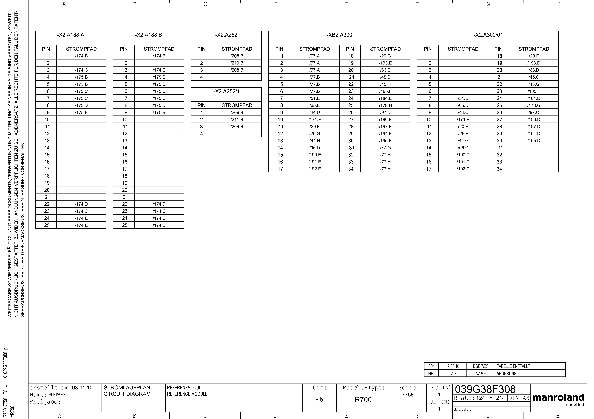

# +Jx — Sheet 124 of 214 — REFERENZMODUL

**REFERENCE MODULE**

> Part of the manroland **R700** printing press IEC/UL circuit diagrams.
> Drawing class: **Stromlaufplan / Circuit diagram** (DIN A3).
> Document `+Jx` covers the **1st printing module + feed register** machine section.

## At a glance

| Field | Value |
|---|---|
| Document | `+Jx`  (039G38F308) |
| Sheet | **124** of 214 |
| Section (DE) | REFERENZMODUL |
| Section (EN) | REFERENCE MODULE |
| Section type | REFERENCE_MODULE — Reference module |
| Machine type | `R700` |
| Series | `7758` |
| Created | 03.01.10 |
| Replaces | — |
| Columns used | A, B, C, D, E, F, G, H |
| Path numbers | — |
| Labels on sheet | 244 |
| Cross-refs out | 88 |
| Cross-refs in | 0 |

**Previous:** [+Jx sheet 123](SHEET_0123.md) · **Next:** [+Jx sheet 125](SHEET_0125.md) · **Document TOC:** [_TOC.md](_TOC.md)  (+Jx) · **Master TOC:** [all sheets](../_MASTER_TOC.md)

## Sheet image (300 DPI, exact vector render)



_Rendered directly from the PDF vector layer at 300 DPI (1-bit), no OCR and no resampling. Use it to confirm anything ambiguous in the text below._

## Cross-references on this sheet

Each entry is a wire leaving this sheet. The printed token is `/sheet.column`; the link resolves to that sheet inside the same document.

| Ref | Target sheet | Col | Path | Destination on target | Target section | From col |
|---|---|---|---|---|---|---|
| `/77.A` | [+Jx sheet 77](SHEET_0077.md) | A | — | — | BUSVERBINDUNGEN: SICHERHEITSKREIS | E |
| `/174.B` | [+Jx sheet 174](SHEET_0174.md) | B | — | — | OPTION: | A |
| `/174.B` | [+Jx sheet 174](SHEET_0174.md) | B | — | — | OPTION: | B |
| `/208.B` | [+Jx sheet 208](SHEET_0208.md) | B | — | — | OPTION: WASCHMITTELWECHSELBETRIEB | C |
| `/29.F` | [+Jx sheet 29](SHEET_0029.md) | F | — | — | KAMMERRAKEL | H |
| `/29.G` | [+Jx sheet 29](SHEET_0029.md) | G | — | — | KAMMERRAKEL | F |
| `/77.A` | [+Jx sheet 77](SHEET_0077.md) | A | — | — | BUSVERBINDUNGEN: SICHERHEITSKREIS | E |
| `/210.B` | [+Jx sheet 210](SHEET_0210.md) | B | — | — | OPTION: WASCHMITTELWECHSELBETRIEB | C |
| `/193.E` | [+Jx sheet 193](SHEET_0193.md) | E | — | — | OPTION: ZWISCHENTROCKNER, VORBEREITUNG | F |
| `/193.D` | [+Jx sheet 193](SHEET_0193.md) | D | — | — | OPTION: ZWISCHENTROCKNER, VORBEREITUNG | H |
| `/77.A` | [+Jx sheet 77](SHEET_0077.md) | A | — | — | BUSVERBINDUNGEN: SICHERHEITSKREIS | E |
| `/63.E` | [+Jx sheet 63](SHEET_0063.md) | E | — | — | LACKAUFTRAGSWALZE | F |
| `/208.B` | [+Jx sheet 208](SHEET_0208.md) | B | — | — | OPTION: WASCHMITTELWECHSELBETRIEB | C |
| `/63.D` | [+Jx sheet 63](SHEET_0063.md) | D | — | — | LACKAUFTRAGSWALZE | H |
| `/174.C` | [+Jx sheet 174](SHEET_0174.md) | C | — | — | OPTION: | A |
| `/174.C` | [+Jx sheet 174](SHEET_0174.md) | C | — | — | OPTION: | B |
| `/77.B` | [+Jx sheet 77](SHEET_0077.md) | B | — | — | BUSVERBINDUNGEN: SICHERHEITSKREIS | E |
| `/175.B` | [+Jx sheet 175](SHEET_0175.md) | B | — | — | OPTION: | A |
| `/175.B` | [+Jx sheet 175](SHEET_0175.md) | B | — | — | OPTION: | B |
| `/45.D` | [+Jx sheet 45](SHEET_0045.md) | D | — | — | MASCHINENBEDIENUNG | F |
| `/45.C` | [+Jx sheet 45](SHEET_0045.md) | C | — | — | MASCHINENBEDIENUNG | H |
| `/77.B` | [+Jx sheet 77](SHEET_0077.md) | B | — | — | BUSVERBINDUNGEN: SICHERHEITSKREIS | E |
| `/175.B` | [+Jx sheet 175](SHEET_0175.md) | B | — | — | OPTION: | A |
| `/175.B` | [+Jx sheet 175](SHEET_0175.md) | B | — | — | OPTION: | B |
| `/45.G` | [+Jx sheet 45](SHEET_0045.md) | G | — | — | MASCHINENBEDIENUNG | H |
| `/45.H` | [+Jx sheet 45](SHEET_0045.md) | H | — | — | MASCHINENBEDIENUNG | F |
| `/77.B` | [+Jx sheet 77](SHEET_0077.md) | B | — | — | BUSVERBINDUNGEN: SICHERHEITSKREIS | E |
| `/185.F` | [+Jx sheet 185](SHEET_0185.md) | F | — | — | OPTION: TRANSFERMODUL 1 + 2 | F |
| `/185.F` | [+Jx sheet 185](SHEET_0185.md) | F | — | — | OPTION: TRANSFERMODUL 1 + 2 | H |
| `/175.C` | [+Jx sheet 175](SHEET_0175.md) | C | — | — | OPTION: | A |
| `/175.C` | [+Jx sheet 175](SHEET_0175.md) | C | — | — | OPTION: | B |
| `/51.E` | [+Jx sheet 51](SHEET_0051.md) | E | — | — | SIGNALGEBER: AKUSTISCHE WARNSIGNALE | E |
| `/184.E` | [+Jx sheet 184](SHEET_0184.md) | E | — | — | OPTION: TRANSFERMODUL 1 + 2 | F |
| `/51.D` | [+Jx sheet 51](SHEET_0051.md) | D | — | — | SIGNALGEBER: AKUSTISCHE WARNSIGNALE | G |
| `/175.C` | [+Jx sheet 175](SHEET_0175.md) | C | — | — | OPTION: | A |
| `/175.C` | [+Jx sheet 175](SHEET_0175.md) | C | — | — | OPTION: | B |
| `/184.D` | [+Jx sheet 184](SHEET_0184.md) | D | — | — | OPTION: TRANSFERMODUL 1 + 2 | H |
| `/65.E` | [+Jx sheet 65](SHEET_0065.md) | E | — | — | TROPFEINRICHTUNG | E |
| `/65.D` | [+Jx sheet 65](SHEET_0065.md) | D | — | — | TROPFEINRICHTUNG | G |
| `/178.G` | [+Jx sheet 178](SHEET_0178.md) | G | — | — | OPTION: TRANSFERMODUL 1 NACH | H |
| `/175.D` | [+Jx sheet 175](SHEET_0175.md) | D | — | — | OPTION: | A |
| `/175.D` | [+Jx sheet 175](SHEET_0175.md) | D | — | — | OPTION: | B |
| `/178.H` | [+Jx sheet 178](SHEET_0178.md) | H | — | — | OPTION: TRANSFERMODUL 1 NACH | F |
| `/175.B` | [+Jx sheet 175](SHEET_0175.md) | B | — | — | OPTION: | A |
| `/175.B` | [+Jx sheet 175](SHEET_0175.md) | B | — | — | OPTION: | B |
| `/209.B` | [+Jx sheet 209](SHEET_0209.md) | B | — | — | OPTION: WASCHMITTELWECHSELBETRIEB | C |
| `/44.D` | [+Jx sheet 44](SHEET_0044.md) | D | — | — | MASCHINENBEDIENUNG | E |
| `/97.D` | [+Jx sheet 97](SHEET_0097.md) | D | — | — | RESERVE | F |
| `/44.C` | [+Jx sheet 44](SHEET_0044.md) | C | — | — | MASCHINENBEDIENUNG | G |
| `/97.C` | [+Jx sheet 97](SHEET_0097.md) | C | — | — | RESERVE | H |
| `/211.B` | [+Jx sheet 211](SHEET_0211.md) | B | — | — | OPTION: WASCHMITTELWECHSELBETRIEB | C |
| `/196.E` | [+Jx sheet 196](SHEET_0196.md) | E | — | — | OPTION: ZWISCHENTROCKNER, VORBEREITUNG | F |
| `/171.E` | [+Jx sheet 171](SHEET_0171.md) | E | — | — | OPTION: AUTOMATISCHEM SPÜLEN | G |
| `/171.F` | [+Jx sheet 171](SHEET_0171.md) | F | — | — | OPTION: AUTOMATISCHEM SPÜLEN | E |
| `/196.D` | [+Jx sheet 196](SHEET_0196.md) | D | — | — | OPTION: ZWISCHENTROCKNER, VORBEREITUNG | H |
| `/20.E` | [+Jx sheet 20](SHEET_0020.md) | E | — | — | LACKPUMPE | G |
| `/209.B` | [+Jx sheet 209](SHEET_0209.md) | B | — | — | OPTION: WASCHMITTELWECHSELBETRIEB | C |
| `/20.F` | [+Jx sheet 20](SHEET_0020.md) | F | — | — | LACKPUMPE | E |
| `/197.E` | [+Jx sheet 197](SHEET_0197.md) | E | — | — | OPTION: ZWISCHENTROCKNER, VORBEREITUNG | F |
| `/197.D` | [+Jx sheet 197](SHEET_0197.md) | D | — | — | OPTION: ZWISCHENTROCKNER, VORBEREITUNG | H |
| `/25.F` | [+Jx sheet 25](SHEET_0025.md) | F | — | — | HILFSANTRIEB, LACKDOSIER /AUFTRAGSWALZEN | G |
| `/25.G` | [+Jx sheet 25](SHEET_0025.md) | G | — | — | HILFSANTRIEB, LACKDOSIER /AUFTRAGSWALZEN | E |
| `/194.E` | [+Jx sheet 194](SHEET_0194.md) | E | — | — | OPTION: ZWISCHENTROCKNER, VORBEREITUNG | F |
| `/194.D` | [+Jx sheet 194](SHEET_0194.md) | D | — | — | OPTION: ZWISCHENTROCKNER, VORBEREITUNG | H |
| `/195.E` | [+Jx sheet 195](SHEET_0195.md) | E | — | — | OPTION: ZWISCHENTROCKNER, VORBEREITUNG | F |
| `/44.G` | [+Jx sheet 44](SHEET_0044.md) | G | — | — | MASCHINENBEDIENUNG | G |
| `/44.H` | [+Jx sheet 44](SHEET_0044.md) | H | — | — | MASCHINENBEDIENUNG | E |
| `/195.D` | [+Jx sheet 195](SHEET_0195.md) | D | — | — | OPTION: ZWISCHENTROCKNER, VORBEREITUNG | H |
| `/77.G` | [+Jx sheet 77](SHEET_0077.md) | G | — | — | BUSVERBINDUNGEN: SICHERHEITSKREIS | F |
| `/96.D` | [+Jx sheet 96](SHEET_0096.md) | D | — | — | RESERVE | E |
| `/96.C` | [+Jx sheet 96](SHEET_0096.md) | C | — | — | RESERVE | G |
| `/190.E` | [+Jx sheet 190](SHEET_0190.md) | E | — | — | OPTION: ZWISCHENTROCKNER, VORBEREITUNG | E |
| `/77.H` | [+Jx sheet 77](SHEET_0077.md) | H | — | — | BUSVERBINDUNGEN: SICHERHEITSKREIS | F |
| `/190.D` | [+Jx sheet 190](SHEET_0190.md) | D | — | — | OPTION: ZWISCHENTROCKNER, VORBEREITUNG | G |
| `/191.E` | [+Jx sheet 191](SHEET_0191.md) | E | — | — | OPTION: ZWISCHENTROCKNER, VORBEREITUNG | E |
| `/77.H` | [+Jx sheet 77](SHEET_0077.md) | H | — | — | BUSVERBINDUNGEN: SICHERHEITSKREIS | F |
| `/191.D` | [+Jx sheet 191](SHEET_0191.md) | D | — | — | OPTION: ZWISCHENTROCKNER, VORBEREITUNG | G |
| `/192.E` | [+Jx sheet 192](SHEET_0192.md) | E | — | — | OPTION: ZWISCHENTROCKNER, VORBEREITUNG | E |
| `/77.H` | [+Jx sheet 77](SHEET_0077.md) | H | — | — | BUSVERBINDUNGEN: SICHERHEITSKREIS | F |
| `/192.D` | [+Jx sheet 192](SHEET_0192.md) | D | — | — | OPTION: ZWISCHENTROCKNER, VORBEREITUNG | G |
| `/174.D` | [+Jx sheet 174](SHEET_0174.md) | D | — | — | OPTION: | A |
| `/174.D` | [+Jx sheet 174](SHEET_0174.md) | D | — | — | OPTION: | B |
| `/174.C` | [+Jx sheet 174](SHEET_0174.md) | C | — | — | OPTION: | A |
| `/174.C` | [+Jx sheet 174](SHEET_0174.md) | C | — | — | OPTION: | B |
| `/174.E` | [+Jx sheet 174](SHEET_0174.md) | E | — | — | OPTION: | A |
| `/174.E` | [+Jx sheet 174](SHEET_0174.md) | E | — | — | OPTION: | B |
| `/174.E` | [+Jx sheet 174](SHEET_0174.md) | E | — | — | OPTION: | A |
| `/174.E` | [+Jx sheet 174](SHEET_0174.md) | E | — | — | OPTION: | B |

## Devices on this sheet

| Tag | Class | Class meaning (IEC) | Col | Sub | Terminal | Sign |
|---|---|---|---|---|---|---|
| `X2.A188.A` | — | cross-device reference | A | — | — | — |
| `X2.A188.B` | — | cross-device reference | B | — | — | — |
| `NR.` | — | cross-device reference | F | — | — | — |
| `19.08.10` | — | cross-device reference | F | — | — | — |
| `X2.A252` | — | cross-device reference | C | — | — | — |
| `XB2.A300` | — | cross-device reference | E | — | — | — |

## Potentials / nets

_No named potentials on this sheet._

## Wire-end annotations (grouped as printed)

A wire that continues elsewhere is annotated with a small cluster: the destination description, the path/line number `#NN`, and the `/sheet.column` cross reference. Each row below is one such cluster exactly as it is grouped on the drawing.

| Col | Y | Path | Cross-ref | Text on the wire |
|---|---|---|---|---|
| C | 65.4 | — | — | `X2.A252` |
| E | 65.4 | — | — | `XB2.A300` |
| G | 65.4 | — | — | `X2.A300/01` |
| A | 65.5 | — | — | `X2.A188.A` |
| B | 65.5 | — | — | `X2.A188.B` |
| A | 94.1 | — | — | `PIN STROMPFAD` |
| B | 94.1 | — | — | `PIN STROMPFAD` |
| C | 94.1 | — | — | `PIN 2 3 4 1 STROMPFAD` |
| D | 94.1 | — | — | `PIN STROMPFAD` |
| E | 94.1 | — | — | `PIN 18 19 20 22 23 24 25 26 27 28 29 30 32 33 34 21 31 STROMPFAD` |
| F | 94.1 | — | — | `PIN STROMPFAD` |
| G | 94.1 | — | — | `PIN 18 19 20 22 23 24 25 26 27 28 29 30 32 33 34 21 31 STROMPFAD` |
| A | 108.3 | — | — | `2 3 4 5 6 7 8 9 1` |
| B | 108.3 | — | — | `2 3 4 5 6 7 8 9 1` |
| D | 108.3 | — | — | `2 3 4 5 6 7 8 9 1` |
| F | 108.3 | — | — | `2 3 4 5 6 7 8 9 1` |
| A | 108.6 | — | `/174.B` | — |
| B | 108.6 | — | `/174.B` | — |
| C | 108.6 | — | `/208.B` | — |
| E | 108.6 | — | `/77.A` | — |
| F | 108.6 | — | `/29.G` | — |
| H | 108.6 | — | `/29.F` | — |
| C | 122.8 | — | `/210.B` | — |
| E | 122.8 | — | `/77.A` | — |
| F | 122.8 | — | `/193.E` | — |
| H | 122.8 | — | `/193.D` | — |
| A | 137.0 | — | `/174.C` | — |
| B | 137.0 | — | `/174.C` | — |
| C | 137.0 | — | `/208.B` | — |
| E | 137.0 | — | `/77.A` | — |
| F | 137.0 | — | `/63.E` | — |
| H | 137.0 | — | `/63.D` | — |
| E | 151.1 | — | `/77.B` | — |
| A | 151.2 | — | `/175.B` | — |
| B | 151.2 | — | `/175.B` | — |
| F | 151.2 | — | `/45.D` | — |
| H | 151.2 | — | `/45.C` | — |
| A | 165.3 | — | `/175.B` | — |
| B | 165.3 | — | `/175.B` | — |
| E | 165.3 | — | `/77.B` | — |
| F | 165.3 | — | `/45.H` | — |
| H | 165.3 | — | `/45.G` | — |
| C | 178.8 | — | — | `X2.A252/1` |
| A | 179.5 | — | `/175.C` | — |
| B | 179.5 | — | `/175.C` | — |
| E | 179.5 | — | `/77.B` | — |
| F | 179.5 | — | `/185.F` | — |
| H | 179.5 | — | `/185.F` | — |
| A | 193.7 | — | `/175.C` | — |
| B | 193.7 | — | `/175.C` | — |
| E | 193.7 | — | `/51.E` | — |
| F | 193.7 | — | `/184.E` | — |
| G | 193.7 | — | `/51.D` | — |
| H | 193.7 | — | `/184.D` | — |
| C | 207.5 | — | — | `PIN 2 3 4 1 STROMPFAD` |
| E | 207.8 | — | `/65.E` | — |
| A | 207.9 | — | `/175.D` | — |
| B | 207.9 | — | `/175.D` | — |
| F | 207.9 | — | `/178.H` | — |
| G | 207.9 | — | `/65.D` | — |
| H | 207.9 | — | `/178.G` | — |
| A | 222.0 | — | `/175.B` | — |
| B | 222.0 | — | `/175.B` | — |
| C | 222.0 | — | `/209.B` | — |
| E | 222.0 | — | `/44.D` | — |
| F | 222.0 | — | `/97.D` | — |
| G | 222.0 | — | `/44.C` | — |
| H | 222.0 | — | `/97.C` | — |
| A | 235.9 | — | — | `10 12 13 14 15 16 17 18 19 20 11` |
| B | 235.9 | — | — | `10 12 13 14 15 16 17 18 19 20 11` |
| D | 235.9 | — | — | `10 12 13 14 15 16 17 11` |
| F | 235.9 | — | — | `10 12 13 14 15 16 17 11` |
| C | 236.2 | — | `/211.B` | — |
| E | 236.2 | — | `/171.F` | — |
| F | 236.2 | — | `/196.E` | — |
| G | 236.2 | — | `/171.E` | — |
| H | 236.2 | — | `/196.D` | — |
| G | 250.3 | — | `/20.E` | — |
| C | 250.4 | — | `/209.B` | — |
| E | 250.4 | — | `/20.F` | — |
| F | 250.4 | — | `/197.E` | — |
| H | 250.4 | — | `/197.D` | — |
| E | 264.5 | — | `/25.G` | — |
| F | 264.5 | — | `/194.E` | — |
| G | 264.5 | — | `/25.F` | — |
| H | 264.6 | — | `/194.D` | — |
| E | 278.7 | — | `/44.H` | — |
| F | 278.7 | — | `/195.E` | — |
| G | 278.7 | — | `/44.G` | — |
| H | 278.7 | — | `/195.D` | — |
| E | 292.9 | — | `/96.D` | — |
| F | 292.9 | — | `/77.G` | — |
| G | 292.9 | — | `/96.C` | — |
| E | 307.1 | — | `/190.E` | — |
| F | 307.1 | — | `/77.H` | — |
| G | 307.1 | — | `/190.D` | — |
| E | 321.2 | — | `/191.E` | — |
| F | 321.2 | — | `/77.H` | — |
| G | 321.3 | — | `/191.D` | — |
| E | 335.4 | — | `/192.E` | — |
| F | 335.4 | — | `/77.H` | — |
| G | 335.4 | — | `/192.D` | — |
| A | 391.8 | — | — | `22 23 24 25 21` |
| B | 391.8 | — | — | `22 23 24 25 21` |
| A | 406.3 | — | `/174.D` | — |
| B | 406.3 | — | `/174.D` | — |
| A | 420.5 | — | `/174.C` | — |
| B | 420.5 | — | `/174.C` | — |
| A | 434.6 | — | `/174.E` | — |
| B | 434.6 | — | `/174.E` | — |
| A | 448.8 | — | `/174.E` | — |
| B | 448.8 | — | `/174.E` | — |
| G | 733.0 | — | — | `001 19.08.10 DGE/AES TABELLE ENTFÄLLT` |
| G | 747.1 | — | — | `NR. TAG NAME ÄNDERUNG` |


## Reconstructed tables

This sheet carries tabular content (pin map / terminal assignment / index). The grid below was rebuilt from the drawing's own rule lines, so each row is exactly one physical row of the table.

### Table 1 — 25 data rows × 2 columns (at x=70.9, y=62.4) — **X2.A188.A**

| PIN | STROMPFAD |
|---|---|
| `1` | `/174.B` |
| `2` |  |
| `3` | `/174.C` |
| `4` | `/175.B` |
| `5` | `/175.B` |
| `6` | `/175.C` |
| `7` | `/175.C` |
| `8` | `/175.D` |
| `9` | `/175.B` |
| `10` |  |
| `11` |  |
| `12` |  |
| `13` |  |
| `14` |  |
| `15` |  |
| `16` |  |
| `17` |  |
| `18` |  |
| `19` |  |
| `20` |  |
| `21` |  |
| `22` | `/174.D` |
| `23` | `/174.C` |
| `24` | `/174.E` |
| `25` | `/174.E` |


### Table 2 — 25 data rows × 2 columns (at x=226.8, y=62.4) — **X2.A188.B**

| PIN | STROMPFAD |
|---|---|
| `1` | `/174.B` |
| `2` |  |
| `3` | `/174.C` |
| `4` | `/175.B` |
| `5` | `/175.B` |
| `6` | `/175.C` |
| `7` | `/175.C` |
| `8` | `/175.D` |
| `9` | `/175.B` |
| `10` |  |
| `11` |  |
| `12` |  |
| `13` |  |
| `14` |  |
| `15` |  |
| `16` |  |
| `17` |  |
| `18` |  |
| `19` |  |
| `20` |  |
| `21` |  |
| `22` | `/174.D` |
| `23` | `/174.C` |
| `24` | `/174.E` |
| `25` | `/174.E` |


### Table 3 — 10 data rows × 2 columns (at x=382.7, y=62.4) — **X2.A252**

| PIN | STROMPFAD |
|---|---|
| `1` | `/208.B` |
| `2` | `/210.B` |
| `3` | `/208.B` |
| `4` |  |
|  | `X2.A252/1` |
| `PIN` | `STROMPFAD` |
| `1` | `/209.B` |
| `2` | `/211.B` |
| `3` | `/209.B` |
| `4` |  |


### Table 4 — 17 data rows × 4 columns (at x=538.6, y=62.4) — **XB2.A300**

| PIN | STROMPFAD | PIN | STROMPFAD |
|---|---|---|---|
| `1` | `/77.A` | `18` | `/29.G` |
| `2` | `/77.A` | `19` | `/193.E` |
| `3` | `/77.A` | `20` | `/63.E` |
| `4` | `/77.B` | `21` | `/45.D` |
| `5` | `/77.B` | `22` | `/45.H` |
| `6` | `/77.B` | `23` | `/185.F` |
| `7` | `/51.E` | `24` | `/184.E` |
| `8` | `/65.E` | `25` | `/178.H` |
| `9` | `/44.D` | `26` | `/97.D` |
| `10` | `/171.F` | `27` | `/196.E` |
| `11` | `/20.F` | `28` | `/197.E` |
| `12` | `/25.G` | `29` | `/194.E` |
| `13` | `/44.H` | `30` | `/195.E` |
| `14` | `/96.D` | `31` | `/77.G` |
| `15` | `/190.E` | `32` | `/77.H` |
| `16` | `/191.E` | `33` | `/77.H` |
| `17` | `/192.E` | `34` | `/77.H` |


### Table 5 — 17 data rows × 4 columns (at x=836.2, y=62.4) — **X2.A300/01**

| PIN | STROMPFAD | PIN | STROMPFAD |
|---|---|---|---|
| `1` |  | `18` | `/29.F` |
| `2` |  | `19` | `/193.D` |
| `3` |  | `20` | `/63.D` |
| `4` |  | `21` | `/45.C` |
| `5` |  | `22` | `/45.G` |
| `6` |  | `23` | `/185.F` |
| `7` | `/51.D` | `24` | `/184.D` |
| `8` | `/65.D` | `25` | `/178.G` |
| `9` | `/44.C` | `26` | `/97.C` |
| `10` | `/171.E` | `27` | `/196.D` |
| `11` | `/20.E` | `28` | `/197.D` |
| `12` | `/25.F` | `29` | `/194.D` |
| `13` | `/44.G` | `30` | `/195.D` |
| `14` | `/96.C` | `31` |  |
| `15` | `/190.D` | `32` |  |
| `16` | `/191.D` | `33` |  |
| `17` | `/192.D` | `34` |  |


## Notes and free text on this sheet

| Text | Col | Y (pt) |
|---|---|---|
| `PIN` | A | 94.13 |
| `STROMPFAD` | A | 94.09 |
| `PIN` | B | 94.13 |
| `STROMPFAD` | B | 94.09 |
| `TAG` | G | 747.23 |
| `NAME` | G | 747.22 |
| `ÄNDERUNG` | G | 747.25 |
| `DGE/AES` | G | 733.06 |
| `TABELLE ENTFÄLLT` | G | 733.11 |
| `PIN` | C | 94.13 |
| `STROMPFAD` | C | 94.09 |
| `X2.A252/1` | C | 178.83 |
| `PIN` | D | 94.13 |
| `STROMPFAD` | E | 94.09 |
| `PIN` | E | 94.13 |
| `STROMPFAD` | F | 94.09 |
| `PIN` | F | 94.13 |
| `STROMPFAD` | G | 94.09 |
| `PIN` | G | 94.13 |
| `STROMPFAD` | H | 94.09 |
| `X2.A300/01` | G | 65.44 |

## Complete label inventory (exact text from the drawing)

Every text object inside the drawing area of this sheet, in DIN reading order (column A→H, then top→bottom). This is the authoritative list: if a string is not here it is not printed on this sheet.

| Col | Y | X | Dir | Type | Text |
|---|---|---|---|---|---|
| A | 65.4 | 114.5 | → | device ref | `X2.A188.A` |
| A | 94.1 | 84.0 | → | text | `PIN` |
| A | 94.1 | 132.4 | → | text | `STROMPFAD` |
| A | 108.3 | 95.5 | → | number | `1` |
| A | 108.6 | 150.4 | → | cross-reference | `/174.B` |
| A | 122.5 | 94.1 | → | number | `2` |
| A | 136.7 | 94.1 | → | number | `3` |
| A | 137.0 | 150.2 | → | cross-reference | `/174.C` |
| A | 150.8 | 94.1 | → | number | `4` |
| A | 151.2 | 150.4 | → | cross-reference | `/175.B` |
| A | 165.0 | 94.1 | → | number | `5` |
| A | 165.3 | 150.4 | → | cross-reference | `/175.B` |
| A | 179.2 | 94.1 | → | number | `6` |
| A | 179.5 | 150.2 | → | cross-reference | `/175.C` |
| A | 193.3 | 94.1 | → | number | `7` |
| A | 193.7 | 150.2 | → | cross-reference | `/175.C` |
| A | 207.5 | 94.1 | → | number | `8` |
| A | 207.9 | 150.2 | → | cross-reference | `/175.D` |
| A | 221.7 | 94.1 | → | number | `9` |
| A | 222.0 | 150.4 | → | cross-reference | `/175.B` |
| A | 235.9 | 88.7 | → | number | `10` |
| A | 250.0 | 90.1 | → | number | `11` |
| A | 264.2 | 88.7 | → | number | `12` |
| A | 278.4 | 88.7 | → | number | `13` |
| A | 292.6 | 88.7 | → | number | `14` |
| A | 306.7 | 88.7 | → | number | `15` |
| A | 320.9 | 88.7 | → | number | `16` |
| A | 335.1 | 88.7 | → | number | `17` |
| A | 349.3 | 88.7 | → | number | `18` |
| A | 363.4 | 88.7 | → | number | `19` |
| A | 377.6 | 88.7 | → | number | `20` |
| A | 391.8 | 90.1 | → | number | `21` |
| A | 405.9 | 88.7 | → | number | `22` |
| A | 406.3 | 150.2 | → | cross-reference | `/174.D` |
| A | 420.1 | 88.7 | → | number | `23` |
| A | 420.5 | 150.2 | → | cross-reference | `/174.C` |
| A | 434.3 | 88.7 | → | number | `24` |
| A | 434.6 | 150.4 | → | cross-reference | `/174.E` |
| A | 448.5 | 88.7 | → | number | `25` |
| A | 448.8 | 150.4 | → | cross-reference | `/174.E` |
| B | 65.4 | 270.7 | → | device ref | `X2.A188.B` |
| B | 94.1 | 240.0 | → | text | `PIN` |
| B | 94.1 | 288.3 | → | text | `STROMPFAD` |
| B | 108.3 | 251.4 | → | number | `1` |
| B | 108.6 | 306.3 | → | cross-reference | `/174.B` |
| B | 122.5 | 250.0 | → | number | `2` |
| B | 136.7 | 250.0 | → | number | `3` |
| B | 137.0 | 306.1 | → | cross-reference | `/174.C` |
| B | 150.8 | 250.0 | → | number | `4` |
| B | 151.2 | 306.3 | → | cross-reference | `/175.B` |
| B | 165.0 | 250.0 | → | number | `5` |
| B | 165.3 | 306.3 | → | cross-reference | `/175.B` |
| B | 179.2 | 250.0 | → | number | `6` |
| B | 179.5 | 306.1 | → | cross-reference | `/175.C` |
| B | 193.3 | 250.0 | → | number | `7` |
| B | 193.7 | 306.1 | → | cross-reference | `/175.C` |
| B | 207.5 | 250.0 | → | number | `8` |
| B | 207.9 | 306.1 | → | cross-reference | `/175.D` |
| B | 221.7 | 250.0 | → | number | `9` |
| B | 222.0 | 306.3 | → | cross-reference | `/175.B` |
| B | 235.9 | 244.6 | → | number | `10` |
| B | 250.0 | 246.0 | → | number | `11` |
| B | 264.2 | 244.6 | → | number | `12` |
| B | 278.4 | 244.6 | → | number | `13` |
| B | 292.6 | 244.6 | → | number | `14` |
| B | 306.7 | 244.6 | → | number | `15` |
| B | 320.9 | 244.6 | → | number | `16` |
| B | 335.1 | 244.6 | → | number | `17` |
| B | 349.3 | 244.6 | → | number | `18` |
| B | 363.4 | 244.6 | → | number | `19` |
| B | 377.6 | 244.6 | → | number | `20` |
| B | 391.8 | 246.0 | → | number | `21` |
| B | 405.9 | 244.6 | → | number | `22` |
| B | 406.3 | 306.1 | → | cross-reference | `/174.D` |
| B | 420.1 | 244.6 | → | number | `23` |
| B | 420.5 | 306.1 | → | cross-reference | `/174.C` |
| B | 434.3 | 244.6 | → | number | `24` |
| B | 434.6 | 306.3 | → | cross-reference | `/174.E` |
| B | 448.5 | 244.6 | → | number | `25` |
| B | 448.8 | 306.3 | → | cross-reference | `/174.E` |
| C | 65.4 | 431.6 | → | device ref | `X2.A252` |
| C | 94.1 | 395.9 | → | text | `PIN` |
| C | 94.1 | 444.2 | → | text | `STROMPFAD` |
| C | 108.3 | 401.7 | → | number | `1` |
| C | 108.6 | 462.2 | → | cross-reference | `/208.B` |
| C | 122.5 | 401.2 | → | number | `2` |
| C | 122.8 | 462.2 | → | cross-reference | `/210.B` |
| C | 136.7 | 401.2 | → | number | `3` |
| C | 137.0 | 462.2 | → | cross-reference | `/208.B` |
| C | 150.8 | 401.4 | → | number | `4` |
| C | 178.8 | 427.9 | → | text | `X2.A252/1` |
| C | 207.5 | 395.9 | → | text | `PIN` |
| C | 207.5 | 444.2 | → | text | `STROMPFAD` |
| C | 221.7 | 401.7 | → | number | `1` |
| C | 222.0 | 462.2 | → | cross-reference | `/209.B` |
| C | 235.9 | 401.2 | → | number | `2` |
| C | 236.2 | 462.2 | → | cross-reference | `/211.B` |
| C | 250.0 | 401.2 | → | number | `3` |
| C | 250.4 | 462.2 | → | cross-reference | `/209.B` |
| C | 264.2 | 401.4 | → | number | `4` |
| D | 94.1 | 551.8 | → | text | `PIN` |
| D | 108.3 | 563.2 | → | number | `1` |
| D | 122.5 | 561.8 | → | number | `2` |
| D | 136.7 | 561.8 | → | number | `3` |
| D | 150.8 | 561.8 | → | number | `4` |
| D | 165.0 | 561.8 | → | number | `5` |
| D | 179.2 | 561.8 | → | number | `6` |
| D | 193.3 | 561.8 | → | number | `7` |
| D | 207.5 | 561.8 | → | number | `8` |
| D | 221.7 | 561.8 | → | number | `9` |
| D | 235.9 | 556.4 | → | number | `10` |
| D | 250.0 | 557.9 | → | number | `11` |
| D | 264.2 | 556.4 | → | number | `12` |
| D | 278.4 | 556.4 | → | number | `13` |
| D | 292.6 | 556.4 | → | number | `14` |
| D | 306.7 | 556.4 | → | number | `15` |
| D | 320.9 | 556.4 | → | number | `16` |
| D | 335.1 | 556.4 | → | number | `17` |
| E | 65.4 | 654.8 | → | device ref | `XB2.A300` |
| E | 94.1 | 600.1 | → | text | `STROMPFAD` |
| E | 94.1 | 693.5 | → | text | `PIN` |
| E | 108.3 | 698.2 | → | number | `18` |
| E | 108.6 | 620.4 | → | cross-reference | `/77.A` |
| E | 122.5 | 698.2 | → | number | `19` |
| E | 122.8 | 620.4 | → | cross-reference | `/77.A` |
| E | 136.7 | 698.2 | → | number | `20` |
| E | 137.0 | 620.4 | → | cross-reference | `/77.A` |
| E | 150.8 | 699.6 | → | number | `21` |
| E | 151.1 | 620.5 | → | cross-reference | `/77.B` |
| E | 165.0 | 698.2 | → | number | `22` |
| E | 165.3 | 620.5 | → | cross-reference | `/77.B` |
| E | 179.2 | 698.2 | → | number | `23` |
| E | 179.5 | 620.5 | → | cross-reference | `/77.B` |
| E | 193.3 | 698.2 | → | number | `24` |
| E | 193.7 | 620.5 | → | cross-reference | `/51.E` |
| E | 207.5 | 698.2 | → | number | `25` |
| E | 207.8 | 620.5 | → | cross-reference | `/65.E` |
| E | 221.7 | 698.2 | → | number | `26` |
| E | 222.0 | 620.4 | → | cross-reference | `/44.D` |
| E | 235.9 | 698.2 | → | number | `27` |
| E | 236.2 | 618.4 | → | cross-reference | `/171.F` |
| E | 250.0 | 698.2 | → | number | `28` |
| E | 250.4 | 620.8 | → | cross-reference | `/20.F` |
| E | 264.2 | 698.2 | → | number | `29` |
| E | 264.5 | 620.1 | → | cross-reference | `/25.G` |
| E | 278.4 | 698.2 | → | number | `30` |
| E | 278.7 | 620.5 | → | cross-reference | `/44.H` |
| E | 292.6 | 699.6 | → | number | `31` |
| E | 292.9 | 620.4 | → | cross-reference | `/96.D` |
| E | 306.7 | 698.2 | → | number | `32` |
| E | 307.1 | 618.1 | → | cross-reference | `/190.E` |
| E | 320.9 | 698.2 | → | number | `33` |
| E | 321.2 | 618.1 | → | cross-reference | `/191.E` |
| E | 335.1 | 698.2 | → | number | `34` |
| E | 335.4 | 618.1 | → | cross-reference | `/192.E` |
| F | 94.1 | 741.8 | → | text | `STROMPFAD` |
| F | 94.1 | 849.4 | → | text | `PIN` |
| F | 108.3 | 860.9 | → | number | `1` |
| F | 108.6 | 761.8 | → | cross-reference | `/29.G` |
| F | 122.5 | 859.5 | → | number | `2` |
| F | 122.8 | 759.8 | → | cross-reference | `/193.E` |
| F | 136.7 | 859.5 | → | number | `3` |
| F | 137.0 | 762.2 | → | cross-reference | `/63.E` |
| F | 150.8 | 859.5 | → | number | `4` |
| F | 151.2 | 762.1 | → | cross-reference | `/45.D` |
| F | 165.0 | 859.5 | → | number | `5` |
| F | 165.3 | 762.2 | → | cross-reference | `/45.H` |
| F | 179.2 | 859.5 | → | number | `6` |
| F | 179.5 | 760.1 | → | cross-reference | `/185.F` |
| F | 193.3 | 859.5 | → | number | `7` |
| F | 193.7 | 759.8 | → | cross-reference | `/184.E` |
| F | 207.5 | 859.5 | → | number | `8` |
| F | 207.9 | 759.8 | → | cross-reference | `/178.H` |
| F | 221.7 | 859.5 | → | number | `9` |
| F | 222.0 | 762.1 | → | cross-reference | `/97.D` |
| F | 235.9 | 854.1 | → | number | `10` |
| F | 236.2 | 759.8 | → | cross-reference | `/196.E` |
| F | 250.0 | 855.5 | → | number | `11` |
| F | 250.4 | 759.8 | → | cross-reference | `/197.E` |
| F | 264.2 | 854.1 | → | number | `12` |
| F | 264.5 | 759.8 | → | cross-reference | `/194.E` |
| F | 278.4 | 854.1 | → | number | `13` |
| F | 278.7 | 759.8 | → | cross-reference | `/195.E` |
| F | 292.6 | 854.1 | → | number | `14` |
| F | 292.9 | 761.8 | → | cross-reference | `/77.G` |
| F | 306.7 | 854.1 | → | number | `15` |
| F | 307.1 | 762.2 | → | cross-reference | `/77.H` |
| F | 320.9 | 854.1 | → | number | `16` |
| F | 321.2 | 762.2 | → | cross-reference | `/77.H` |
| F | 335.1 | 854.1 | → | number | `17` |
| F | 335.4 | 762.2 | → | cross-reference | `/77.H` |
| F | 733.0 | 859.3 | → | number | `001` |
| F | 733.1 | 893.2 | → | device ref | `19.08.10` |
| F | 747.1 | 858.5 | → | device ref | `NR.` |
| G | 65.4 | 949.3 | → | text | `X2.A300/01` |
| G | 94.1 | 897.7 | → | text | `STROMPFAD` |
| G | 94.1 | 991.1 | → | text | `PIN` |
| G | 108.3 | 995.8 | → | number | `18` |
| G | 122.5 | 995.8 | → | number | `19` |
| G | 136.7 | 995.8 | → | number | `20` |
| G | 150.8 | 997.2 | → | number | `21` |
| G | 165.0 | 995.8 | → | number | `22` |
| G | 179.2 | 995.8 | → | number | `23` |
| G | 193.3 | 995.8 | → | number | `24` |
| G | 193.7 | 918.0 | → | cross-reference | `/51.D` |
| G | 207.5 | 995.8 | → | number | `25` |
| G | 207.9 | 918.0 | → | cross-reference | `/65.D` |
| G | 221.7 | 995.8 | → | number | `26` |
| G | 222.0 | 918.0 | → | cross-reference | `/44.C` |
| G | 235.9 | 995.8 | → | number | `27` |
| G | 236.2 | 915.7 | → | cross-reference | `/171.E` |
| G | 250.0 | 995.8 | → | number | `28` |
| G | 250.3 | 918.1 | → | cross-reference | `/20.E` |
| G | 264.2 | 995.8 | → | number | `29` |
| G | 264.5 | 918.4 | → | cross-reference | `/25.F` |
| G | 278.4 | 995.8 | → | number | `30` |
| G | 278.7 | 917.7 | → | cross-reference | `/44.G` |
| G | 292.6 | 997.2 | → | number | `31` |
| G | 292.9 | 918.0 | → | cross-reference | `/96.C` |
| G | 306.7 | 995.8 | → | number | `32` |
| G | 307.1 | 915.6 | → | cross-reference | `/190.D` |
| G | 320.9 | 995.8 | → | number | `33` |
| G | 321.3 | 915.6 | → | cross-reference | `/191.D` |
| G | 335.1 | 995.8 | → | number | `34` |
| G | 335.4 | 915.6 | → | cross-reference | `/192.D` |
| G | 733.1 | 948.0 | → | text | `DGE/AES` |
| G | 733.1 | 995.7 | → | text | `TABELLE ENTFÄLLT` |
| G | 747.2 | 900.1 | → | text | `TAG` |
| G | 747.2 | 953.5 | → | text | `NAME` |
| G | 747.3 | 995.7 | → | text | `ÄNDERUNG` |
| H | 94.1 | 1039.5 | → | text | `STROMPFAD` |
| H | 108.6 | 1060.2 | → | cross-reference | `/29.F` |
| H | 122.8 | 1057.3 | → | cross-reference | `/193.D` |
| H | 137.0 | 1059.7 | → | cross-reference | `/63.D` |
| H | 151.2 | 1059.7 | → | cross-reference | `/45.C` |
| H | 165.3 | 1059.4 | → | cross-reference | `/45.G` |
| H | 179.5 | 1057.7 | → | cross-reference | `/185.F` |
| H | 193.7 | 1057.3 | → | cross-reference | `/184.D` |
| H | 207.9 | 1057.0 | → | cross-reference | `/178.G` |
| H | 222.0 | 1059.7 | → | cross-reference | `/97.C` |
| H | 236.2 | 1057.3 | → | cross-reference | `/196.D` |
| H | 250.4 | 1057.3 | → | cross-reference | `/197.D` |
| H | 264.6 | 1057.3 | → | cross-reference | `/194.D` |
| H | 278.7 | 1057.3 | → | cross-reference | `/195.D` |

## Reading-order text block

The same content as a plain block, grouped by DIN column — convenient to paste or to match against a visual description.

```text
=== Column A ===
  65.4  114.5  devref       X2.A188.A
  94.1   84.0  text         PIN
  94.1  132.4  text         STROMPFAD
 108.3   95.5  numeric      1
 108.6  150.4  xref         /174.B
 122.5   94.1  numeric      2
 136.7   94.1  numeric      3
 137.0  150.2  xref         /174.C
 150.8   94.1  numeric      4
 151.2  150.4  xref         /175.B
 165.0   94.1  numeric      5
 165.3  150.4  xref         /175.B
 179.2   94.1  numeric      6
 179.5  150.2  xref         /175.C
 193.3   94.1  numeric      7
 193.7  150.2  xref         /175.C
 207.5   94.1  numeric      8
 207.9  150.2  xref         /175.D
 221.7   94.1  numeric      9
 222.0  150.4  xref         /175.B
 235.9   88.7  numeric      10
 250.0   90.1  numeric      11
 264.2   88.7  numeric      12
 278.4   88.7  numeric      13
 292.6   88.7  numeric      14
 306.7   88.7  numeric      15
 320.9   88.7  numeric      16
 335.1   88.7  numeric      17
 349.3   88.7  numeric      18
 363.4   88.7  numeric      19
 377.6   88.7  numeric      20
 391.8   90.1  numeric      21
 405.9   88.7  numeric      22
 406.3  150.2  xref         /174.D
 420.1   88.7  numeric      23
 420.5  150.2  xref         /174.C
 434.3   88.7  numeric      24
 434.6  150.4  xref         /174.E
 448.5   88.7  numeric      25
 448.8  150.4  xref         /174.E
=== Column B ===
  65.4  270.7  devref       X2.A188.B
  94.1  240.0  text         PIN
  94.1  288.3  text         STROMPFAD
 108.3  251.4  numeric      1
 108.6  306.3  xref         /174.B
 122.5  250.0  numeric      2
 136.7  250.0  numeric      3
 137.0  306.1  xref         /174.C
 150.8  250.0  numeric      4
 151.2  306.3  xref         /175.B
 165.0  250.0  numeric      5
 165.3  306.3  xref         /175.B
 179.2  250.0  numeric      6
 179.5  306.1  xref         /175.C
 193.3  250.0  numeric      7
 193.7  306.1  xref         /175.C
 207.5  250.0  numeric      8
 207.9  306.1  xref         /175.D
 221.7  250.0  numeric      9
 222.0  306.3  xref         /175.B
 235.9  244.6  numeric      10
 250.0  246.0  numeric      11
 264.2  244.6  numeric      12
 278.4  244.6  numeric      13
 292.6  244.6  numeric      14
 306.7  244.6  numeric      15
 320.9  244.6  numeric      16
 335.1  244.6  numeric      17
 349.3  244.6  numeric      18
 363.4  244.6  numeric      19
 377.6  244.6  numeric      20
 391.8  246.0  numeric      21
 405.9  244.6  numeric      22
 406.3  306.1  xref         /174.D
 420.1  244.6  numeric      23
 420.5  306.1  xref         /174.C
 434.3  244.6  numeric      24
 434.6  306.3  xref         /174.E
 448.5  244.6  numeric      25
 448.8  306.3  xref         /174.E
=== Column C ===
  65.4  431.6  devref       X2.A252
  94.1  395.9  text         PIN
  94.1  444.2  text         STROMPFAD
 108.3  401.7  numeric      1
 108.6  462.2  xref         /208.B
 122.5  401.2  numeric      2
 122.8  462.2  xref         /210.B
 136.7  401.2  numeric      3
 137.0  462.2  xref         /208.B
 150.8  401.4  numeric      4
 178.8  427.9  text         X2.A252/1
 207.5  395.9  text         PIN
 207.5  444.2  text         STROMPFAD
 221.7  401.7  numeric      1
 222.0  462.2  xref         /209.B
 235.9  401.2  numeric      2
 236.2  462.2  xref         /211.B
 250.0  401.2  numeric      3
 250.4  462.2  xref         /209.B
 264.2  401.4  numeric      4
=== Column D ===
  94.1  551.8  text         PIN
 108.3  563.2  numeric      1
 122.5  561.8  numeric      2
 136.7  561.8  numeric      3
 150.8  561.8  numeric      4
 165.0  561.8  numeric      5
 179.2  561.8  numeric      6
 193.3  561.8  numeric      7
 207.5  561.8  numeric      8
 221.7  561.8  numeric      9
 235.9  556.4  numeric      10
 250.0  557.9  numeric      11
 264.2  556.4  numeric      12
 278.4  556.4  numeric      13
 292.6  556.4  numeric      14
 306.7  556.4  numeric      15
 320.9  556.4  numeric      16
 335.1  556.4  numeric      17
=== Column E ===
  65.4  654.8  devref       XB2.A300
  94.1  600.1  text         STROMPFAD
  94.1  693.5  text         PIN
 108.3  698.2  numeric      18
 108.6  620.4  xref         /77.A
 122.5  698.2  numeric      19
 122.8  620.4  xref         /77.A
 136.7  698.2  numeric      20
 137.0  620.4  xref         /77.A
 150.8  699.6  numeric      21
 151.1  620.5  xref         /77.B
 165.0  698.2  numeric      22
 165.3  620.5  xref         /77.B
 179.2  698.2  numeric      23
 179.5  620.5  xref         /77.B
 193.3  698.2  numeric      24
 193.7  620.5  xref         /51.E
 207.5  698.2  numeric      25
 207.8  620.5  xref         /65.E
 221.7  698.2  numeric      26
 222.0  620.4  xref         /44.D
 235.9  698.2  numeric      27
 236.2  618.4  xref         /171.F
 250.0  698.2  numeric      28
 250.4  620.8  xref         /20.F
 264.2  698.2  numeric      29
 264.5  620.1  xref         /25.G
 278.4  698.2  numeric      30
 278.7  620.5  xref         /44.H
 292.6  699.6  numeric      31
 292.9  620.4  xref         /96.D
 306.7  698.2  numeric      32
 307.1  618.1  xref         /190.E
 320.9  698.2  numeric      33
 321.2  618.1  xref         /191.E
 335.1  698.2  numeric      34
 335.4  618.1  xref         /192.E
=== Column F ===
  94.1  741.8  text         STROMPFAD
  94.1  849.4  text         PIN
 108.3  860.9  numeric      1
 108.6  761.8  xref         /29.G
 122.5  859.5  numeric      2
 122.8  759.8  xref         /193.E
 136.7  859.5  numeric      3
 137.0  762.2  xref         /63.E
 150.8  859.5  numeric      4
 151.2  762.1  xref         /45.D
 165.0  859.5  numeric      5
 165.3  762.2  xref         /45.H
 179.2  859.5  numeric      6
 179.5  760.1  xref         /185.F
 193.3  859.5  numeric      7
 193.7  759.8  xref         /184.E
 207.5  859.5  numeric      8
 207.9  759.8  xref         /178.H
 221.7  859.5  numeric      9
 222.0  762.1  xref         /97.D
 235.9  854.1  numeric      10
 236.2  759.8  xref         /196.E
 250.0  855.5  numeric      11
 250.4  759.8  xref         /197.E
 264.2  854.1  numeric      12
 264.5  759.8  xref         /194.E
 278.4  854.1  numeric      13
 278.7  759.8  xref         /195.E
 292.6  854.1  numeric      14
 292.9  761.8  xref         /77.G
 306.7  854.1  numeric      15
 307.1  762.2  xref         /77.H
 320.9  854.1  numeric      16
 321.2  762.2  xref         /77.H
 335.1  854.1  numeric      17
 335.4  762.2  xref         /77.H
 733.0  859.3  numeric      001
 733.1  893.2  devref       19.08.10
 747.1  858.5  devref       NR.
=== Column G ===
  65.4  949.3  text         X2.A300/01
  94.1  897.7  text         STROMPFAD
  94.1  991.1  text         PIN
 108.3  995.8  numeric      18
 122.5  995.8  numeric      19
 136.7  995.8  numeric      20
 150.8  997.2  numeric      21
 165.0  995.8  numeric      22
 179.2  995.8  numeric      23
 193.3  995.8  numeric      24
 193.7  918.0  xref         /51.D
 207.5  995.8  numeric      25
 207.9  918.0  xref         /65.D
 221.7  995.8  numeric      26
 222.0  918.0  xref         /44.C
 235.9  995.8  numeric      27
 236.2  915.7  xref         /171.E
 250.0  995.8  numeric      28
 250.3  918.1  xref         /20.E
 264.2  995.8  numeric      29
 264.5  918.4  xref         /25.F
 278.4  995.8  numeric      30
 278.7  917.7  xref         /44.G
 292.6  997.2  numeric      31
 292.9  918.0  xref         /96.C
 306.7  995.8  numeric      32
 307.1  915.6  xref         /190.D
 320.9  995.8  numeric      33
 321.3  915.6  xref         /191.D
 335.1  995.8  numeric      34
 335.4  915.6  xref         /192.D
 733.1  948.0  text         DGE/AES
 733.1  995.7  text         TABELLE ENTFÄLLT
 747.2  900.1  text         TAG
 747.2  953.5  text         NAME
 747.3  995.7  text         ÄNDERUNG
=== Column H ===
  94.1 1039.5  text         STROMPFAD
 108.6 1060.2  xref         /29.F
 122.8 1057.3  xref         /193.D
 137.0 1059.7  xref         /63.D
 151.2 1059.7  xref         /45.C
 165.3 1059.4  xref         /45.G
 179.5 1057.7  xref         /185.F
 193.7 1057.3  xref         /184.D
 207.9 1057.0  xref         /178.G
 222.0 1059.7  xref         /97.C
 236.2 1057.3  xref         /196.D
 250.4 1057.3  xref         /197.D
 264.6 1057.3  xref         /194.D
 278.7 1057.3  xref         /195.D
```

---
_Generated from the PDF vector text layer; no OCR. Source: `R700_7758_IEC_UL_JX_039G38F308_p`, sheet 124._
