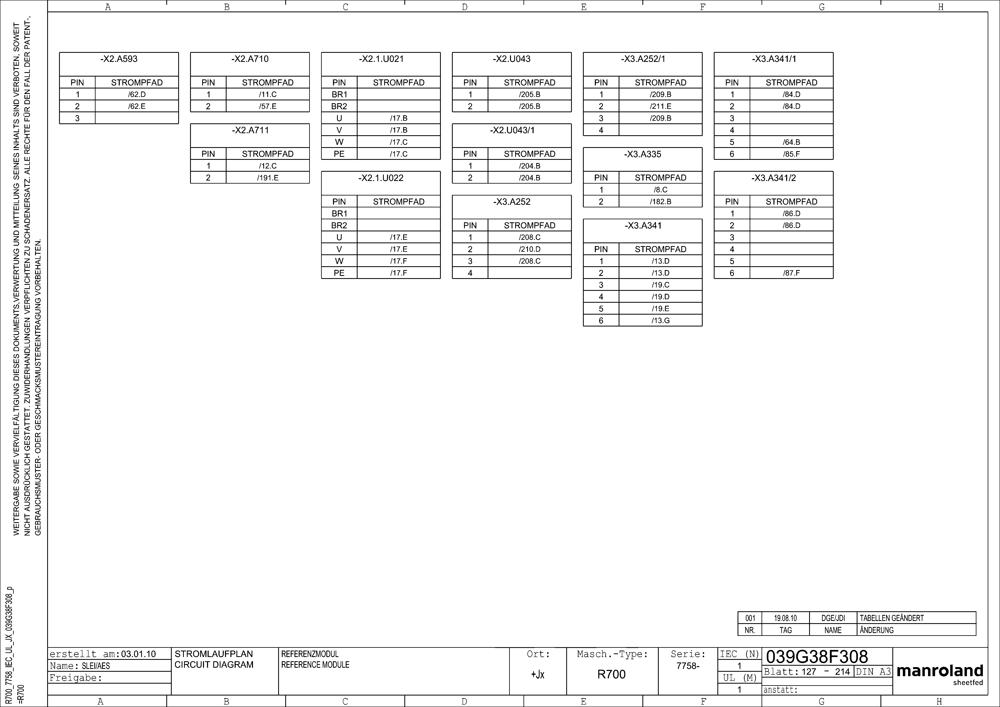

# +Jx — Sheet 127 of 214 — REFERENZMODUL

**REFERENCE MODULE**

> Part of the manroland **R700** printing press IEC/UL circuit diagrams.
> Drawing class: **Stromlaufplan / Circuit diagram** (DIN A3).
> Document `+Jx` covers the **1st printing module + feed register** machine section.

## At a glance

| Field | Value |
|---|---|
| Document | `+Jx`  (039G38F308) |
| Sheet | **127** of 214 |
| Section (DE) | REFERENZMODUL |
| Section (EN) | REFERENCE MODULE |
| Section type | REFERENCE_MODULE — Reference module |
| Machine type | `R700` |
| Series | `7758` |
| Created | 03.01.10 |
| Replaces | — |
| Columns used | A, B, C, D, E, F, G, H |
| Path numbers | — |
| Labels on sheet | 137 |
| Cross-refs out | 39 |
| Cross-refs in | 0 |

**Previous:** [+Jx sheet 126](SHEET_0126.md) · **Next:** [+Jx sheet 128](SHEET_0128.md) · **Document TOC:** [_TOC.md](_TOC.md)  (+Jx) · **Master TOC:** [all sheets](../_MASTER_TOC.md)

## Sheet image (300 DPI, exact vector render)



_Rendered directly from the PDF vector layer at 300 DPI (1-bit), no OCR and no resampling. Use it to confirm anything ambiguous in the text below._

## Cross-references on this sheet

Each entry is a wire leaving this sheet. The printed token is `/sheet.column`; the link resolves to that sheet inside the same document.

| Ref | Target sheet | Col | Path | Destination on target | Target section | From col |
|---|---|---|---|---|---|---|
| `/205.B` | [+Jx sheet 205](SHEET_0205.md) | B | — | — | OPTION: INLINEOBSERVER | E |
| `/209.B` | [+Jx sheet 209](SHEET_0209.md) | B | — | — | OPTION: WASCHMITTELWECHSELBETRIEB | F |
| `/62.D` | [+Jx sheet 62](SHEET_0062.md) | D | — | — | GTW | A |
| `/11.C` | [+Jx sheet 11](SHEET_0011.md) | C | — | — | SPANNUNGSVERSORGUNG, SCHALTSCHRANKBELÜFTUNG | B |
| `/84.D` | [+Jx sheet 84](SHEET_0084.md) | D | — | — | BOGENFÜHRUNG | G |
| `/62.E` | [+Jx sheet 62](SHEET_0062.md) | E | — | — | GTW | A |
| `/57.E` | [+Jx sheet 57](SHEET_0057.md) | E | — | — | SCHUTZEINRICHTUNGEN | B |
| `/205.B` | [+Jx sheet 205](SHEET_0205.md) | B | — | — | OPTION: INLINEOBSERVER | E |
| `/211.E` | [+Jx sheet 211](SHEET_0211.md) | E | — | — | OPTION: WASCHMITTELWECHSELBETRIEB | F |
| `/84.D` | [+Jx sheet 84](SHEET_0084.md) | D | — | — | BOGENFÜHRUNG | G |
| `/17.B` | [+Jx sheet 17](SHEET_0017.md) | B | — | — | LACKPUMPE | C |
| `/209.B` | [+Jx sheet 209](SHEET_0209.md) | B | — | — | OPTION: WASCHMITTELWECHSELBETRIEB | F |
| `/17.B` | [+Jx sheet 17](SHEET_0017.md) | B | — | — | LACKPUMPE | C |
| `/64.B` | [+Jx sheet 64](SHEET_0064.md) | B | — | — | TROPFEINRICHTUNG | G |
| `/17.C` | [+Jx sheet 17](SHEET_0017.md) | C | — | — | LACKPUMPE | C |
| `/85.F` | [+Jx sheet 85](SHEET_0085.md) | F | — | — | BOGENFÜHRUNG | G |
| `/17.C` | [+Jx sheet 17](SHEET_0017.md) | C | — | — | LACKPUMPE | C |
| `/204.B` | [+Jx sheet 204](SHEET_0204.md) | B | — | — | OPTION: INLINEOBSERVER | E |
| `/12.C` | [+Jx sheet 12](SHEET_0012.md) | C | — | — | SPANNUNGSVERSORGUNG, SCHALTSCHRANKBELÜFTUNG | B |
| `/191.E` | [+Jx sheet 191](SHEET_0191.md) | E | — | — | OPTION: ZWISCHENTROCKNER, VORBEREITUNG | B |
| `/204.B` | [+Jx sheet 204](SHEET_0204.md) | B | — | — | OPTION: INLINEOBSERVER | E |
| `/8.C` | [+Jx sheet 8](SHEET_0008.md) | C | — | — | SPANNUNGSVERSORGUNG, SCHALTSCHRANKBELÜFTUNG | F |
| `/182.B` | [+Jx sheet 182](SHEET_0182.md) | B | — | — | OPTION: TRANSFERMODUL 2 | F |
| `/86.D` | [+Jx sheet 86](SHEET_0086.md) | D | — | — | BOGENFÜHRUNG | G |
| `/86.D` | [+Jx sheet 86](SHEET_0086.md) | D | — | — | BOGENFÜHRUNG | G |
| `/17.E` | [+Jx sheet 17](SHEET_0017.md) | E | — | — | LACKPUMPE | C |
| `/208.C` | [+Jx sheet 208](SHEET_0208.md) | C | — | — | OPTION: WASCHMITTELWECHSELBETRIEB | E |
| `/17.E` | [+Jx sheet 17](SHEET_0017.md) | E | — | — | LACKPUMPE | C |
| `/210.D` | [+Jx sheet 210](SHEET_0210.md) | D | — | — | OPTION: WASCHMITTELWECHSELBETRIEB | E |
| `/17.F` | [+Jx sheet 17](SHEET_0017.md) | F | — | — | LACKPUMPE | C |
| `/208.C` | [+Jx sheet 208](SHEET_0208.md) | C | — | — | OPTION: WASCHMITTELWECHSELBETRIEB | E |
| `/13.D` | [+Jx sheet 13](SHEET_0013.md) | D | — | — | SPANNUNGSVERSORGUNG, SCHALTSCHRANKBELÜFTUNG | F |
| `/17.F` | [+Jx sheet 17](SHEET_0017.md) | F | — | — | LACKPUMPE | C |
| `/87.F` | [+Jx sheet 87](SHEET_0087.md) | F | — | — | BOGENFÜHRUNG | G |
| `/13.D` | [+Jx sheet 13](SHEET_0013.md) | D | — | — | SPANNUNGSVERSORGUNG, SCHALTSCHRANKBELÜFTUNG | F |
| `/19.C` | [+Jx sheet 19](SHEET_0019.md) | C | — | — | LACKPUMPE | F |
| `/19.D` | [+Jx sheet 19](SHEET_0019.md) | D | — | — | LACKPUMPE | F |
| `/19.E` | [+Jx sheet 19](SHEET_0019.md) | E | — | — | LACKPUMPE | F |
| `/13.G` | [+Jx sheet 13](SHEET_0013.md) | G | — | — | SPANNUNGSVERSORGUNG, SCHALTSCHRANKBELÜFTUNG | F |

## Devices on this sheet

| Tag | Class | Class meaning (IEC) | Col | Sub | Terminal | Sign |
|---|---|---|---|---|---|---|
| `BR1` | BR |  | C | — | — | — |
| `BR2` | BR |  | C | — | — | — |
| `BR1` | BR |  | C | — | — | — |
| `BR2` | BR |  | C | — | — | — |
| `X2.A593` | — | cross-device reference | A | — | — | — |
| `X2.1.U021` | — | cross-device reference | C | — | — | — |
| `X2.1.U022` | — | cross-device reference | C | — | — | — |
| `X2.U043` | — | cross-device reference | D | — | — | — |
| `X3.A252` | — | cross-device reference | D | — | — | — |
| `X3.A335` | — | cross-device reference | F | — | — | — |
| `X3.A341` | — | cross-device reference | F | — | — | — |
| `X2.A711` | — | cross-device reference | B | — | — | — |
| `X2.A710` | — | cross-device reference | B | — | — | — |
| `NR.` | — | cross-device reference | F | — | — | — |
| `19.08.10` | — | cross-device reference | G | — | — | — |

## Potentials / nets

| Potential | Count | Columns | Attached devices | Terminals |
|---|---|---|---|---|
| `PE` | 2 | C | — | — |


A potential such as `L24+/4` or `M24+` is a named supply/return rail; every place it appears on this sheet is electrically common.

## Wire-end annotations (grouped as printed)

A wire that continues elsewhere is annotated with a small cluster: the destination description, the path/line number `#NN`, and the `/sheet.column` cross reference. Each row below is one such cluster exactly as it is grouped on the drawing.

| Col | Y | Path | Cross-ref | Text on the wire |
|---|---|---|---|---|
| A | 65.4 | — | — | `X2.A593` |
| B | 65.4 | — | — | `X2.A710` |
| C | 65.4 | — | — | `X2.1.U021` |
| D | 65.4 | — | — | `X2.U043` |
| F | 65.4 | — | — | `X3.A252/1` |
| G | 65.4 | — | — | `X3.A341/1` |
| A | 94.1 | — | — | `PIN 2 3 1 STROMPFAD` |
| B | 94.1 | — | — | `PIN 2 1 STROMPFAD` |
| C | 94.1 | — | — | `BR2 BR1 PIN STROMPFAD` |
| D | 94.1 | — | — | `PIN 2 1 STROMPFAD` |
| E | 94.1 | — | — | `PIN 2 3 4 1 STROMPFAD` |
| G | 94.1 | — | — | `PIN 2 3 5 6 4 1 STROMPFAD` |
| E | 108.6 | — | `/205.B` | — |
| F | 108.6 | — | `/209.B` | — |
| A | 108.7 | — | `/62.D` | — |
| B | 108.7 | — | `/11.C` | — |
| G | 108.7 | — | `/84.D` | — |
| A | 122.8 | — | `/62.E` | — |
| B | 122.8 | — | `/57.E` | — |
| E | 122.8 | — | `/205.B` | — |
| F | 122.8 | — | `/211.E` | — |
| G | 122.8 | — | `/84.D` | — |
| C | 136.6 | — | — | `PE W U V` |
| C | 137.0 | — | `/17.B` | — |
| F | 137.0 | — | `/209.B` | — |
| B | 150.5 | — | — | `X2.A711` |
| D | 150.5 | — | — | `X2.U043/1` |
| C | 151.1 | — | `/17.B` | — |
| C | 165.3 | — | `/17.C` | — |
| G | 165.3 | — | `/64.B` | — |
| F | 178.8 | — | — | `X3.A335` |
| B | 179.1 | — | — | `PIN 2 1 STROMPFAD` |
| D | 179.1 | — | — | `PIN 2 1 STROMPFAD` |
| C | 179.5 | — | `/17.C` | — |
| G | 179.5 | — | `/85.F` | — |
| B | 193.7 | — | `/12.C` | — |
| E | 193.7 | — | `/204.B` | — |
| C | 207.2 | — | — | `X2.1.U022` |
| G | 207.2 | — | — | `X3.A341/2` |
| E | 207.5 | — | — | `PIN 2 1 STROMPFAD` |
| B | 207.8 | — | `/191.E` | — |
| E | 207.8 | — | `/204.B` | — |
| F | 222.0 | — | `/8.C` | — |
| D | 235.5 | — | — | `X3.A252` |
| C | 235.8 | — | — | `BR2 BR1 PIN STROMPFAD` |
| G | 235.8 | — | — | `PIN 2 3 5 6 4 1 STROMPFAD` |
| F | 236.2 | — | `/182.B` | — |
| G | 250.4 | — | `/86.D` | — |
| F | 263.9 | — | — | `X3.A341` |
| D | 264.2 | — | — | `PIN 2 3 4 1 STROMPFAD` |
| G | 264.6 | — | `/86.D` | — |
| C | 278.3 | — | — | `PE W U V` |
| C | 278.7 | — | `/17.E` | — |
| E | 278.7 | — | `/208.C` | — |
| E | 292.5 | — | — | `PIN 2 3 5 6 4 1 STROMPFAD` |
| C | 292.9 | — | `/17.E` | — |
| E | 292.9 | — | `/210.D` | — |
| C | 307.1 | — | `/17.F` | — |
| E | 307.1 | — | `/208.C` | — |
| F | 307.1 | — | `/13.D` | — |
| C | 321.2 | — | `/17.F` | — |
| F | 321.2 | — | `/13.D` | — |
| G | 321.2 | — | `/87.F` | — |
| F | 335.4 | — | `/19.C` | — |
| F | 349.6 | — | `/19.D` | — |
| F | 363.7 | — | `/19.E` | — |
| F | 377.9 | — | `/13.G` | — |
| G | 733.0 | — | — | `001 19.08.10 DGE/JDI TABELLEN GEÄNDERT` |
| G | 747.1 | — | — | `NR. TAG NAME ÄNDERUNG` |


## Reconstructed tables

This sheet carries tabular content (pin map / terminal assignment / index). The grid below was rebuilt from the drawing's own rule lines, so each row is exactly one physical row of the table.

### Table 1 — 3 data rows × 2 columns (at x=70.9, y=62.4) — **X2.A593**

| PIN | STROMPFAD |
|---|---|
| `1` | `/62.D` |
| `2` | `/62.E` |
| `3` |  |


### Table 2 — 6 data rows × 2 columns (at x=226.8, y=62.4) — **X2.A710**

| PIN | STROMPFAD |
|---|---|
| `1` | `/11.C` |
| `2` | `/57.E` |
|  | `X2.A711` |
| `PIN` | `STROMPFAD` |
| `1` | `/12.C` |
| `2` | `/191.E` |


### Table 3 — 14 data rows × 2 columns (at x=382.7, y=62.4) — **X2.1.U021**

| PIN | STROMPFAD |
|---|---|
| `BR1` |  |
| `BR2` |  |
| `U` | `/17.B` |
| `V` | `/17.B` |
| `W` | `/17.C` |
| `PE` | `/17.C` |
|  | `X2.1.U022` |
| `PIN` | `STROMPFAD` |
| `BR1` |  |
| `BR2` |  |
| `U` | `/17.E` |
| `V` | `/17.E` |
| `W` | `/17.F` |
| `PE` | `/17.F` |


### Table 4 — 12 data rows × 2 columns (at x=538.6, y=62.4) — **X2.U043**

| PIN | STROMPFAD |
|---|---|
| `1` | `/205.B` |
| `2` | `/205.B` |
|  | `X2.U043/1` |
| `PIN` | `STROMPFAD` |
| `1` | `/204.B` |
| `2` | `/204.B` |
|  | `X3.A252` |
| `PIN` | `STROMPFAD` |
| `1` | `/208.C` |
| `2` | `/210.D` |
| `3` | `/208.C` |
| `4` |  |


### Table 5 — 16 data rows × 2 columns (at x=694.5, y=62.4) — **X3.A252/1**

| PIN | STROMPFAD |
|---|---|
| `1` | `/209.B` |
| `2` | `/211.E` |
| `3` | `/209.B` |
| `4` |  |
|  | `X3.A335` |
| `PIN` | `STROMPFAD` |
| `1` | `/8.C` |
| `2` | `/182.B` |
|  | `X3.A341` |
| `PIN` | `STROMPFAD` |
| `1` | `/13.D` |
| `2` | `/13.D` |
| `3` | `/19.C` |
| `4` | `/19.D` |
| `5` | `/19.E` |
| `6` | `/13.G` |


### Table 6 — 14 data rows × 2 columns (at x=850.4, y=62.4) — **X3.A341/1**

| PIN | STROMPFAD |
|---|---|
| `1` | `/84.D` |
| `2` | `/84.D` |
| `3` |  |
| `4` |  |
| `5` | `/64.B` |
| `6` | `/85.F` |
|  | `X3.A341/2` |
| `PIN` | `STROMPFAD` |
| `1` | `/86.D` |
| `2` | `/86.D` |
| `3` |  |
| `4` |  |
| `5` |  |
| `6` | `/87.F` |


## Notes and free text on this sheet

| Text | Col | Y (pt) |
|---|---|---|
| `PIN` | A | 94.13 |
| `STROMPFAD` | A | 94.09 |
| `PIN` | C | 94.13 |
| `STROMPFAD` | C | 94.09 |
| `U` | C | 136.6 |
| `V` | C | 150.79 |
| `W` | C | 164.57 |
| `PIN` | D | 94.13 |
| `STROMPFAD` | E | 94.09 |
| `X2.U043/1` | D | 150.48 |
| `PIN` | E | 94.13 |
| `STROMPFAD` | F | 94.09 |
| `X3.A252/1` | F | 65.44 |
| `PIN` | F | 94.13 |
| `STROMPFAD` | G | 94.09 |
| `X3.A341/1` | G | 65.44 |
| `X3.A341/2` | G | 207.17 |
| `PIN` | B | 179.17 |
| `STROMPFAD` | B | 179.13 |
| `TAG` | G | 747.23 |
| `NAME` | G | 747.22 |
| `ÄNDERUNG` | G | 747.25 |
| `DGE/JDI` | G | 733.03 |
| `TABELLEN GEÄNDERT` | H | 733.1 |

## Complete label inventory (exact text from the drawing)

Every text object inside the drawing area of this sheet, in DIN reading order (column A→H, then top→bottom). This is the authoritative list: if a string is not here it is not printed on this sheet.

| Col | Y | X | Dir | Type | Text |
|---|---|---|---|---|---|
| A | 65.4 | 119.6 | → | device ref | `X2.A593` |
| A | 94.1 | 84.0 | → | text | `PIN` |
| A | 94.1 | 132.4 | → | text | `STROMPFAD` |
| A | 108.3 | 89.9 | → | number | `1` |
| A | 108.7 | 152.6 | → | cross-reference | `/62.D` |
| A | 122.5 | 89.4 | → | number | `2` |
| A | 122.8 | 152.8 | → | cross-reference | `/62.E` |
| A | 136.7 | 89.4 | → | number | `3` |
| B | 65.4 | 275.7 | → | device ref | `X2.A710` |
| B | 94.1 | 240.0 | → | text | `PIN` |
| B | 94.1 | 288.3 | → | text | `STROMPFAD` |
| B | 108.3 | 245.8 | → | number | `1` |
| B | 108.7 | 308.6 | → | cross-reference | `/11.C` |
| B | 122.5 | 245.3 | → | number | `2` |
| B | 122.8 | 308.7 | → | cross-reference | `/57.E` |
| B | 150.5 | 276.4 | → | device ref | `X2.A711` |
| B | 179.1 | 288.3 | → | text | `STROMPFAD` |
| B | 179.2 | 240.0 | → | text | `PIN` |
| B | 193.3 | 245.8 | → | number | `1` |
| B | 193.7 | 308.6 | → | cross-reference | `/12.C` |
| B | 207.5 | 245.3 | → | number | `2` |
| B | 207.8 | 306.3 | → | cross-reference | `/191.E` |
| C | 65.4 | 427.6 | → | device ref | `X2.1.U021` |
| C | 94.1 | 395.9 | → | text | `PIN` |
| C | 94.1 | 444.2 | → | text | `STROMPFAD` |
| C | 108.3 | 395.0 | → | device tag | `BR1` |
| C | 122.5 | 394.3 | → | device tag | `BR2` |
| C | 136.6 | 400.4 | → | text | `U` |
| C | 137.0 | 464.6 | → | cross-reference | `/17.B` |
| C | 150.8 | 400.7 | → | text | `V` |
| C | 151.1 | 464.6 | → | cross-reference | `/17.B` |
| C | 164.6 | 398.8 | → | text | `W` |
| C | 165.3 | 464.5 | → | cross-reference | `/17.C` |
| C | 179.1 | 397.3 | → | potential | `PE` |
| C | 179.5 | 464.5 | → | cross-reference | `/17.C` |
| C | 207.2 | 426.9 | → | device ref | `X2.1.U022` |
| C | 235.8 | 444.2 | → | text | `STROMPFAD` |
| C | 235.9 | 395.9 | → | text | `PIN` |
| C | 250.0 | 395.0 | → | device tag | `BR1` |
| C | 264.2 | 394.3 | → | device tag | `BR2` |
| C | 278.3 | 400.4 | → | text | `U` |
| C | 278.7 | 464.6 | → | cross-reference | `/17.E` |
| C | 292.5 | 400.7 | → | text | `V` |
| C | 292.9 | 464.6 | → | cross-reference | `/17.E` |
| C | 306.3 | 398.8 | → | text | `W` |
| C | 307.1 | 464.9 | → | cross-reference | `/17.F` |
| C | 320.9 | 397.3 | → | potential | `PE` |
| C | 321.2 | 464.9 | → | cross-reference | `/17.F` |
| D | 65.4 | 587.1 | → | device ref | `X2.U043` |
| D | 94.1 | 551.8 | → | text | `PIN` |
| D | 108.3 | 557.6 | → | number | `1` |
| D | 122.5 | 557.1 | → | number | `2` |
| D | 150.5 | 583.5 | → | text | `X2.U043/1` |
| D | 179.2 | 551.8 | → | text | `PIN` |
| D | 193.3 | 557.6 | → | number | `1` |
| D | 207.5 | 557.1 | → | number | `2` |
| D | 235.5 | 587.5 | → | device ref | `X3.A252` |
| D | 264.2 | 551.8 | → | text | `PIN` |
| D | 278.4 | 557.6 | → | number | `1` |
| D | 292.6 | 557.1 | → | number | `2` |
| D | 306.7 | 557.1 | → | number | `3` |
| D | 320.9 | 557.3 | → | number | `4` |
| E | 94.1 | 600.1 | → | text | `STROMPFAD` |
| E | 94.1 | 707.7 | → | text | `PIN` |
| E | 108.3 | 713.5 | → | number | `1` |
| E | 108.6 | 618.1 | → | cross-reference | `/205.B` |
| E | 122.5 | 713.1 | → | number | `2` |
| E | 122.8 | 618.1 | → | cross-reference | `/205.B` |
| E | 136.7 | 713.1 | → | number | `3` |
| E | 150.8 | 713.2 | → | number | `4` |
| E | 179.1 | 600.1 | → | text | `STROMPFAD` |
| E | 193.7 | 618.1 | → | cross-reference | `/204.B` |
| E | 207.5 | 707.7 | → | text | `PIN` |
| E | 207.8 | 618.1 | → | cross-reference | `/204.B` |
| E | 221.7 | 713.5 | → | number | `1` |
| E | 235.9 | 713.1 | → | number | `2` |
| E | 264.2 | 600.1 | → | text | `STROMPFAD` |
| E | 278.7 | 618.0 | → | cross-reference | `/208.C` |
| E | 292.6 | 707.7 | → | text | `PIN` |
| E | 292.9 | 618.0 | → | cross-reference | `/210.D` |
| E | 306.7 | 713.5 | → | number | `1` |
| E | 307.1 | 618.0 | → | cross-reference | `/208.C` |
| E | 320.9 | 713.1 | → | number | `2` |
| E | 335.1 | 713.1 | → | number | `3` |
| E | 349.3 | 713.2 | → | number | `4` |
| E | 363.4 | 713.1 | → | number | `5` |
| E | 377.6 | 713.1 | → | number | `6` |
| F | 65.4 | 739.7 | → | text | `X3.A252/1` |
| F | 94.1 | 756.0 | → | text | `STROMPFAD` |
| F | 94.1 | 863.6 | → | text | `PIN` |
| F | 108.3 | 869.4 | → | number | `1` |
| F | 108.6 | 774.0 | → | cross-reference | `/209.B` |
| F | 122.5 | 869.0 | → | number | `2` |
| F | 122.8 | 774.0 | → | cross-reference | `/211.E` |
| F | 136.7 | 869.0 | → | number | `3` |
| F | 137.0 | 774.0 | → | cross-reference | `/209.B` |
| F | 150.8 | 869.1 | → | number | `4` |
| F | 165.0 | 869.0 | → | number | `5` |
| F | 178.8 | 743.2 | → | device ref | `X3.A335` |
| F | 179.2 | 869.0 | → | number | `6` |
| F | 207.5 | 756.0 | → | text | `STROMPFAD` |
| F | 222.0 | 778.7 | → | cross-reference | `/8.C` |
| F | 235.9 | 863.6 | → | text | `PIN` |
| F | 236.2 | 774.0 | → | cross-reference | `/182.B` |
| F | 250.0 | 869.4 | → | number | `1` |
| F | 263.9 | 744.1 | → | device ref | `X3.A341` |
| F | 264.2 | 869.0 | → | number | `2` |
| F | 278.4 | 869.0 | → | number | `3` |
| F | 292.5 | 756.0 | → | text | `STROMPFAD` |
| F | 292.6 | 869.1 | → | number | `4` |
| F | 306.7 | 869.0 | → | number | `5` |
| F | 307.1 | 776.3 | → | cross-reference | `/13.D` |
| F | 320.9 | 869.0 | → | number | `6` |
| F | 321.2 | 776.3 | → | cross-reference | `/13.D` |
| F | 335.4 | 776.3 | → | cross-reference | `/19.C` |
| F | 349.6 | 776.3 | → | cross-reference | `/19.D` |
| F | 363.7 | 776.4 | → | cross-reference | `/19.E` |
| F | 377.9 | 776.0 | → | cross-reference | `/13.G` |
| F | 733.0 | 887.6 | → | number | `001` |
| F | 747.1 | 886.8 | → | device ref | `NR.` |
| G | 65.4 | 895.6 | → | text | `X3.A341/1` |
| G | 94.1 | 911.9 | → | text | `STROMPFAD` |
| G | 108.7 | 932.2 | → | cross-reference | `/84.D` |
| G | 122.8 | 932.2 | → | cross-reference | `/84.D` |
| G | 165.3 | 932.3 | → | cross-reference | `/64.B` |
| G | 179.5 | 932.6 | → | cross-reference | `/85.F` |
| G | 207.2 | 894.9 | → | text | `X3.A341/2` |
| G | 235.8 | 911.9 | → | text | `STROMPFAD` |
| G | 250.4 | 932.2 | → | cross-reference | `/86.D` |
| G | 264.6 | 932.2 | → | cross-reference | `/86.D` |
| G | 321.2 | 932.6 | → | cross-reference | `/87.F` |
| G | 733.0 | 978.3 | → | text | `DGE/JDI` |
| G | 733.1 | 921.5 | → | device ref | `19.08.10` |
| G | 747.2 | 928.5 | → | text | `TAG` |
| G | 747.2 | 981.8 | → | text | `NAME` |
| G | 747.3 | 1024.0 | → | text | `ÄNDERUNG` |
| H | 733.1 | 1024.0 | → | text | `TABELLEN GEÄNDERT` |

## Reading-order text block

The same content as a plain block, grouped by DIN column — convenient to paste or to match against a visual description.

```text
=== Column A ===
  65.4  119.6  devref       X2.A593
  94.1   84.0  text         PIN
  94.1  132.4  text         STROMPFAD
 108.3   89.9  numeric      1
 108.7  152.6  xref         /62.D
 122.5   89.4  numeric      2
 122.8  152.8  xref         /62.E
 136.7   89.4  numeric      3
=== Column B ===
  65.4  275.7  devref       X2.A710
  94.1  240.0  text         PIN
  94.1  288.3  text         STROMPFAD
 108.3  245.8  numeric      1
 108.7  308.6  xref         /11.C
 122.5  245.3  numeric      2
 122.8  308.7  xref         /57.E
 150.5  276.4  devref       X2.A711
 179.1  288.3  text         STROMPFAD
 179.2  240.0  text         PIN
 193.3  245.8  numeric      1
 193.7  308.6  xref         /12.C
 207.5  245.3  numeric      2
 207.8  306.3  xref         /191.E
=== Column C ===
  65.4  427.6  devref       X2.1.U021
  94.1  395.9  text         PIN
  94.1  444.2  text         STROMPFAD
 108.3  395.0  devtag       BR1
 122.5  394.3  devtag       BR2
 136.6  400.4  text         U
 137.0  464.6  xref         /17.B
 150.8  400.7  text         V
 151.1  464.6  xref         /17.B
 164.6  398.8  text         W
 165.3  464.5  xref         /17.C
 179.1  397.3  net          PE
 179.5  464.5  xref         /17.C
 207.2  426.9  devref       X2.1.U022
 235.8  444.2  text         STROMPFAD
 235.9  395.9  text         PIN
 250.0  395.0  devtag       BR1
 264.2  394.3  devtag       BR2
 278.3  400.4  text         U
 278.7  464.6  xref         /17.E
 292.5  400.7  text         V
 292.9  464.6  xref         /17.E
 306.3  398.8  text         W
 307.1  464.9  xref         /17.F
 320.9  397.3  net          PE
 321.2  464.9  xref         /17.F
=== Column D ===
  65.4  587.1  devref       X2.U043
  94.1  551.8  text         PIN
 108.3  557.6  numeric      1
 122.5  557.1  numeric      2
 150.5  583.5  text         X2.U043/1
 179.2  551.8  text         PIN
 193.3  557.6  numeric      1
 207.5  557.1  numeric      2
 235.5  587.5  devref       X3.A252
 264.2  551.8  text         PIN
 278.4  557.6  numeric      1
 292.6  557.1  numeric      2
 306.7  557.1  numeric      3
 320.9  557.3  numeric      4
=== Column E ===
  94.1  600.1  text         STROMPFAD
  94.1  707.7  text         PIN
 108.3  713.5  numeric      1
 108.6  618.1  xref         /205.B
 122.5  713.1  numeric      2
 122.8  618.1  xref         /205.B
 136.7  713.1  numeric      3
 150.8  713.2  numeric      4
 179.1  600.1  text         STROMPFAD
 193.7  618.1  xref         /204.B
 207.5  707.7  text         PIN
 207.8  618.1  xref         /204.B
 221.7  713.5  numeric      1
 235.9  713.1  numeric      2
 264.2  600.1  text         STROMPFAD
 278.7  618.0  xref         /208.C
 292.6  707.7  text         PIN
 292.9  618.0  xref         /210.D
 306.7  713.5  numeric      1
 307.1  618.0  xref         /208.C
 320.9  713.1  numeric      2
 335.1  713.1  numeric      3
 349.3  713.2  numeric      4
 363.4  713.1  numeric      5
 377.6  713.1  numeric      6
=== Column F ===
  65.4  739.7  text         X3.A252/1
  94.1  756.0  text         STROMPFAD
  94.1  863.6  text         PIN
 108.3  869.4  numeric      1
 108.6  774.0  xref         /209.B
 122.5  869.0  numeric      2
 122.8  774.0  xref         /211.E
 136.7  869.0  numeric      3
 137.0  774.0  xref         /209.B
 150.8  869.1  numeric      4
 165.0  869.0  numeric      5
 178.8  743.2  devref       X3.A335
 179.2  869.0  numeric      6
 207.5  756.0  text         STROMPFAD
 222.0  778.7  xref         /8.C
 235.9  863.6  text         PIN
 236.2  774.0  xref         /182.B
 250.0  869.4  numeric      1
 263.9  744.1  devref       X3.A341
 264.2  869.0  numeric      2
 278.4  869.0  numeric      3
 292.5  756.0  text         STROMPFAD
 292.6  869.1  numeric      4
 306.7  869.0  numeric      5
 307.1  776.3  xref         /13.D
 320.9  869.0  numeric      6
 321.2  776.3  xref         /13.D
 335.4  776.3  xref         /19.C
 349.6  776.3  xref         /19.D
 363.7  776.4  xref         /19.E
 377.9  776.0  xref         /13.G
 733.0  887.6  numeric      001
 747.1  886.8  devref       NR.
=== Column G ===
  65.4  895.6  text         X3.A341/1
  94.1  911.9  text         STROMPFAD
 108.7  932.2  xref         /84.D
 122.8  932.2  xref         /84.D
 165.3  932.3  xref         /64.B
 179.5  932.6  xref         /85.F
 207.2  894.9  text         X3.A341/2
 235.8  911.9  text         STROMPFAD
 250.4  932.2  xref         /86.D
 264.6  932.2  xref         /86.D
 321.2  932.6  xref         /87.F
 733.0  978.3  text         DGE/JDI
 733.1  921.5  devref       19.08.10
 747.2  928.5  text         TAG
 747.2  981.8  text         NAME
 747.3 1024.0  text         ÄNDERUNG
=== Column H ===
 733.1 1024.0  text         TABELLEN GEÄNDERT
```

---
_Generated from the PDF vector text layer; no OCR. Source: `R700_7758_IEC_UL_JX_039G38F308_p`, sheet 127._
