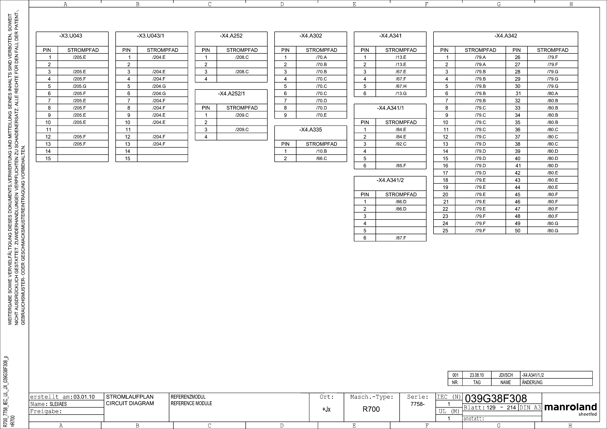

# +Jx — Sheet 129 of 214 — REFERENZMODUL

**REFERENCE MODULE**

> Part of the manroland **R700** printing press IEC/UL circuit diagrams.
> Drawing class: **Stromlaufplan / Circuit diagram** (DIN A3).
> Document `+Jx` covers the **1st printing module + feed register** machine section.

## At a glance

| Field | Value |
|---|---|
| Document | `+Jx`  (039G38F308) |
| Sheet | **129** of 214 |
| Section (DE) | REFERENZMODUL |
| Section (EN) | REFERENCE MODULE |
| Section type | REFERENCE_MODULE — Reference module |
| Machine type | `R700` |
| Series | `7758` |
| Created | 03.01.10 |
| Replaces | — |
| Columns used | A, B, C, D, E, F, G, H |
| Path numbers | — |
| Labels on sheet | 257 |
| Cross-refs out | 100 |
| Cross-refs in | 0 |

**Previous:** [+Jx sheet 128](SHEET_0128.md) · **Next:** [+Jx sheet 130](SHEET_0130.md) · **Document TOC:** [_TOC.md](_TOC.md)  (+Jx) · **Master TOC:** [all sheets](../_MASTER_TOC.md)

## Sheet image (300 DPI, exact vector render)



_Rendered directly from the PDF vector layer at 300 DPI (1-bit), no OCR and no resampling. Use it to confirm anything ambiguous in the text below._

## Cross-references on this sheet

Each entry is a wire leaving this sheet. The printed token is `/sheet.column`; the link resolves to that sheet inside the same document.

| Ref | Target sheet | Col | Path | Destination on target | Target section | From col |
|---|---|---|---|---|---|---|
| `/70.A` | [+Jx sheet 70](SHEET_0070.md) | A | — | — | MOTOR: UMFANGSREGISTER | E |
| `/13.E` | [+Jx sheet 13](SHEET_0013.md) | E | — | — | SPANNUNGSVERSORGUNG, SCHALTSCHRANKBELÜFTUNG | F |
| `/79.A` | [+Jx sheet 79](SHEET_0079.md) | A | — | — | BUSVERBINDUNGEN: SICHERHEITSKREIS | G |
| `/205.E` | [+Jx sheet 205](SHEET_0205.md) | E | — | — | OPTION: INLINEOBSERVER | A |
| `/204.E` | [+Jx sheet 204](SHEET_0204.md) | E | — | — | OPTION: INLINEOBSERVER | B |
| `/79.F` | [+Jx sheet 79](SHEET_0079.md) | F | — | — | BUSVERBINDUNGEN: SICHERHEITSKREIS | H |
| `/208.C` | [+Jx sheet 208](SHEET_0208.md) | C | — | — | OPTION: WASCHMITTELWECHSELBETRIEB | C |
| `/70.B` | [+Jx sheet 70](SHEET_0070.md) | B | — | — | MOTOR: UMFANGSREGISTER | E |
| `/13.E` | [+Jx sheet 13](SHEET_0013.md) | E | — | — | SPANNUNGSVERSORGUNG, SCHALTSCHRANKBELÜFTUNG | F |
| `/79.A` | [+Jx sheet 79](SHEET_0079.md) | A | — | — | BUSVERBINDUNGEN: SICHERHEITSKREIS | G |
| `/79.F` | [+Jx sheet 79](SHEET_0079.md) | F | — | — | BUSVERBINDUNGEN: SICHERHEITSKREIS | H |
| `/70.B` | [+Jx sheet 70](SHEET_0070.md) | B | — | — | MOTOR: UMFANGSREGISTER | E |
| `/67.E` | [+Jx sheet 67](SHEET_0067.md) | E | — | — | BOGENFÜHRUNG | F |
| `/79.B` | [+Jx sheet 79](SHEET_0079.md) | B | — | — | BUSVERBINDUNGEN: SICHERHEITSKREIS | G |
| `/205.E` | [+Jx sheet 205](SHEET_0205.md) | E | — | — | OPTION: INLINEOBSERVER | A |
| `/204.E` | [+Jx sheet 204](SHEET_0204.md) | E | — | — | OPTION: INLINEOBSERVER | B |
| `/79.G` | [+Jx sheet 79](SHEET_0079.md) | G | — | — | BUSVERBINDUNGEN: SICHERHEITSKREIS | H |
| `/208.C` | [+Jx sheet 208](SHEET_0208.md) | C | — | — | OPTION: WASCHMITTELWECHSELBETRIEB | C |
| `/79.B` | [+Jx sheet 79](SHEET_0079.md) | B | — | — | BUSVERBINDUNGEN: SICHERHEITSKREIS | G |
| `/67.F` | [+Jx sheet 67](SHEET_0067.md) | F | — | — | BOGENFÜHRUNG | F |
| `/205.F` | [+Jx sheet 205](SHEET_0205.md) | F | — | — | OPTION: INLINEOBSERVER | A |
| `/204.F` | [+Jx sheet 204](SHEET_0204.md) | F | — | — | OPTION: INLINEOBSERVER | B |
| `/79.G` | [+Jx sheet 79](SHEET_0079.md) | G | — | — | BUSVERBINDUNGEN: SICHERHEITSKREIS | H |
| `/70.C` | [+Jx sheet 70](SHEET_0070.md) | C | — | — | MOTOR: UMFANGSREGISTER | E |
| `/79.B` | [+Jx sheet 79](SHEET_0079.md) | B | — | — | BUSVERBINDUNGEN: SICHERHEITSKREIS | G |
| `/79.G` | [+Jx sheet 79](SHEET_0079.md) | G | — | — | BUSVERBINDUNGEN: SICHERHEITSKREIS | H |
| `/205.G` | [+Jx sheet 205](SHEET_0205.md) | G | — | — | OPTION: INLINEOBSERVER | A |
| `/204.G` | [+Jx sheet 204](SHEET_0204.md) | G | — | — | OPTION: INLINEOBSERVER | B |
| `/70.C` | [+Jx sheet 70](SHEET_0070.md) | C | — | — | MOTOR: UMFANGSREGISTER | E |
| `/67.H` | [+Jx sheet 67](SHEET_0067.md) | H | — | — | BOGENFÜHRUNG | F |
| `/79.B` | [+Jx sheet 79](SHEET_0079.md) | B | — | — | BUSVERBINDUNGEN: SICHERHEITSKREIS | G |
| `/80.A` | [+Jx sheet 80](SHEET_0080.md) | A | — | — | BUSVERBINDUNGEN: SICHERHEITSKREIS | H |
| `/13.G` | [+Jx sheet 13](SHEET_0013.md) | G | — | — | SPANNUNGSVERSORGUNG, SCHALTSCHRANKBELÜFTUNG | F |
| `/205.F` | [+Jx sheet 205](SHEET_0205.md) | F | — | — | OPTION: INLINEOBSERVER | A |
| `/204.G` | [+Jx sheet 204](SHEET_0204.md) | G | — | — | OPTION: INLINEOBSERVER | B |
| `/70.C` | [+Jx sheet 70](SHEET_0070.md) | C | — | — | MOTOR: UMFANGSREGISTER | E |
| `/79.B` | [+Jx sheet 79](SHEET_0079.md) | B | — | — | BUSVERBINDUNGEN: SICHERHEITSKREIS | G |
| `/80.B` | [+Jx sheet 80](SHEET_0080.md) | B | — | — | BUSVERBINDUNGEN: SICHERHEITSKREIS | H |
| `/205.E` | [+Jx sheet 205](SHEET_0205.md) | E | — | — | OPTION: INLINEOBSERVER | A |
| `/204.F` | [+Jx sheet 204](SHEET_0204.md) | F | — | — | OPTION: INLINEOBSERVER | B |
| `/70.D` | [+Jx sheet 70](SHEET_0070.md) | D | — | — | MOTOR: UMFANGSREGISTER | E |
| `/80.B` | [+Jx sheet 80](SHEET_0080.md) | B | — | — | BUSVERBINDUNGEN: SICHERHEITSKREIS | H |
| `/205.F` | [+Jx sheet 205](SHEET_0205.md) | F | — | — | OPTION: INLINEOBSERVER | A |
| `/204.F` | [+Jx sheet 204](SHEET_0204.md) | F | — | — | OPTION: INLINEOBSERVER | B |
| `/70.D` | [+Jx sheet 70](SHEET_0070.md) | D | — | — | MOTOR: UMFANGSREGISTER | E |
| `/79.C` | [+Jx sheet 79](SHEET_0079.md) | C | — | — | BUSVERBINDUNGEN: SICHERHEITSKREIS | G |
| `/70.E` | [+Jx sheet 70](SHEET_0070.md) | E | — | — | MOTOR: UMFANGSREGISTER | E |
| `/80.B` | [+Jx sheet 80](SHEET_0080.md) | B | — | — | BUSVERBINDUNGEN: SICHERHEITSKREIS | H |
| `/205.E` | [+Jx sheet 205](SHEET_0205.md) | E | — | — | OPTION: INLINEOBSERVER | A |
| `/204.E` | [+Jx sheet 204](SHEET_0204.md) | E | — | — | OPTION: INLINEOBSERVER | B |
| `/209.C` | [+Jx sheet 209](SHEET_0209.md) | C | — | — | OPTION: WASCHMITTELWECHSELBETRIEB | C |
| `/79.C` | [+Jx sheet 79](SHEET_0079.md) | C | — | — | BUSVERBINDUNGEN: SICHERHEITSKREIS | G |
| `/80.B` | [+Jx sheet 80](SHEET_0080.md) | B | — | — | BUSVERBINDUNGEN: SICHERHEITSKREIS | H |
| `/205.E` | [+Jx sheet 205](SHEET_0205.md) | E | — | — | OPTION: INLINEOBSERVER | A |
| `/204.E` | [+Jx sheet 204](SHEET_0204.md) | E | — | — | OPTION: INLINEOBSERVER | B |
| `/79.C` | [+Jx sheet 79](SHEET_0079.md) | C | — | — | BUSVERBINDUNGEN: SICHERHEITSKREIS | G |
| `/84.E` | [+Jx sheet 84](SHEET_0084.md) | E | — | — | BOGENFÜHRUNG | F |
| `/79.C` | [+Jx sheet 79](SHEET_0079.md) | C | — | — | BUSVERBINDUNGEN: SICHERHEITSKREIS | G |
| `/80.C` | [+Jx sheet 80](SHEET_0080.md) | C | — | — | BUSVERBINDUNGEN: SICHERHEITSKREIS | H |
| `/209.C` | [+Jx sheet 209](SHEET_0209.md) | C | — | — | OPTION: WASCHMITTELWECHSELBETRIEB | C |
| `/84.E` | [+Jx sheet 84](SHEET_0084.md) | E | — | — | BOGENFÜHRUNG | F |
| `/205.F` | [+Jx sheet 205](SHEET_0205.md) | F | — | — | OPTION: INLINEOBSERVER | A |
| `/204.F` | [+Jx sheet 204](SHEET_0204.md) | F | — | — | OPTION: INLINEOBSERVER | B |
| `/79.C` | [+Jx sheet 79](SHEET_0079.md) | C | — | — | BUSVERBINDUNGEN: SICHERHEITSKREIS | G |
| `/80.C` | [+Jx sheet 80](SHEET_0080.md) | C | — | — | BUSVERBINDUNGEN: SICHERHEITSKREIS | H |
| `/205.F` | [+Jx sheet 205](SHEET_0205.md) | F | — | — | OPTION: INLINEOBSERVER | A |
| `/204.F` | [+Jx sheet 204](SHEET_0204.md) | F | — | — | OPTION: INLINEOBSERVER | B |
| `/92.C` | [+Jx sheet 92](SHEET_0092.md) | C | — | — | BOGENFÜHRUNG (BLASROHRE) | F |
| `/79.D` | [+Jx sheet 79](SHEET_0079.md) | D | — | — | BUSVERBINDUNGEN: SICHERHEITSKREIS | G |
| `/80.C` | [+Jx sheet 80](SHEET_0080.md) | C | — | — | BUSVERBINDUNGEN: SICHERHEITSKREIS | H |
| `/10.B` | [+Jx sheet 10](SHEET_0010.md) | B | — | — | SPANNUNGSVERSORGUNG, SCHALTSCHRANKBELÜFTUNG | E |
| `/79.D` | [+Jx sheet 79](SHEET_0079.md) | D | — | — | BUSVERBINDUNGEN: SICHERHEITSKREIS | G |
| `/80.D` | [+Jx sheet 80](SHEET_0080.md) | D | — | — | BUSVERBINDUNGEN: SICHERHEITSKREIS | H |
| `/66.C` | [+Jx sheet 66](SHEET_0066.md) | C | — | — | DRUCKANSTELLUNG | E |
| `/79.D` | [+Jx sheet 79](SHEET_0079.md) | D | — | — | BUSVERBINDUNGEN: SICHERHEITSKREIS | G |
| `/80.D` | [+Jx sheet 80](SHEET_0080.md) | D | — | — | BUSVERBINDUNGEN: SICHERHEITSKREIS | H |
| `/85.F` | [+Jx sheet 85](SHEET_0085.md) | F | — | — | BOGENFÜHRUNG | F |
| `/79.D` | [+Jx sheet 79](SHEET_0079.md) | D | — | — | BUSVERBINDUNGEN: SICHERHEITSKREIS | G |
| `/80.D` | [+Jx sheet 80](SHEET_0080.md) | D | — | — | BUSVERBINDUNGEN: SICHERHEITSKREIS | H |
| `/80.E` | [+Jx sheet 80](SHEET_0080.md) | E | — | — | BUSVERBINDUNGEN: SICHERHEITSKREIS | H |
| `/79.D` | [+Jx sheet 79](SHEET_0079.md) | D | — | — | BUSVERBINDUNGEN: SICHERHEITSKREIS | G |
| `/79.E` | [+Jx sheet 79](SHEET_0079.md) | E | — | — | BUSVERBINDUNGEN: SICHERHEITSKREIS | G |
| `/80.E` | [+Jx sheet 80](SHEET_0080.md) | E | — | — | BUSVERBINDUNGEN: SICHERHEITSKREIS | H |
| `/79.E` | [+Jx sheet 79](SHEET_0079.md) | E | — | — | BUSVERBINDUNGEN: SICHERHEITSKREIS | G |
| `/80.E` | [+Jx sheet 80](SHEET_0080.md) | E | — | — | BUSVERBINDUNGEN: SICHERHEITSKREIS | H |
| `/79.E` | [+Jx sheet 79](SHEET_0079.md) | E | — | — | BUSVERBINDUNGEN: SICHERHEITSKREIS | G |
| `/80.F` | [+Jx sheet 80](SHEET_0080.md) | F | — | — | BUSVERBINDUNGEN: SICHERHEITSKREIS | H |
| `/79.E` | [+Jx sheet 79](SHEET_0079.md) | E | — | — | BUSVERBINDUNGEN: SICHERHEITSKREIS | G |
| `/80.F` | [+Jx sheet 80](SHEET_0080.md) | F | — | — | BUSVERBINDUNGEN: SICHERHEITSKREIS | H |
| `/86.D` | [+Jx sheet 86](SHEET_0086.md) | D | — | — | BOGENFÜHRUNG | F |
| `/79.E` | [+Jx sheet 79](SHEET_0079.md) | E | — | — | BUSVERBINDUNGEN: SICHERHEITSKREIS | G |
| `/80.F` | [+Jx sheet 80](SHEET_0080.md) | F | — | — | BUSVERBINDUNGEN: SICHERHEITSKREIS | H |
| `/86.D` | [+Jx sheet 86](SHEET_0086.md) | D | — | — | BOGENFÜHRUNG | F |
| `/79.F` | [+Jx sheet 79](SHEET_0079.md) | F | — | — | BUSVERBINDUNGEN: SICHERHEITSKREIS | G |
| `/80.F` | [+Jx sheet 80](SHEET_0080.md) | F | — | — | BUSVERBINDUNGEN: SICHERHEITSKREIS | H |
| `/79.F` | [+Jx sheet 79](SHEET_0079.md) | F | — | — | BUSVERBINDUNGEN: SICHERHEITSKREIS | G |
| `/80.G` | [+Jx sheet 80](SHEET_0080.md) | G | — | — | BUSVERBINDUNGEN: SICHERHEITSKREIS | H |
| `/79.F` | [+Jx sheet 79](SHEET_0079.md) | F | — | — | BUSVERBINDUNGEN: SICHERHEITSKREIS | G |
| `/80.G` | [+Jx sheet 80](SHEET_0080.md) | G | — | — | BUSVERBINDUNGEN: SICHERHEITSKREIS | H |
| `/87.F` | [+Jx sheet 87](SHEET_0087.md) | F | — | — | BOGENFÜHRUNG | F |

## Devices on this sheet

| Tag | Class | Class meaning (IEC) | Col | Sub | Terminal | Sign |
|---|---|---|---|---|---|---|
| `X3.U043` | — | cross-device reference | A | — | — | — |
| `X4.A302` | — | cross-device reference | D | — | — | — |
| `X4.A252` | — | cross-device reference | C | — | — | — |
| `X4.A342` | — | cross-device reference | G | — | — | — |
| `X4.A335` | — | cross-device reference | D | — | — | — |
| `X4.A341` | — | cross-device reference | F | — | — | — |
| `NR.` | — | cross-device reference | F | — | — | — |
| `23.08.10` | — | cross-device reference | G | — | — | — |

## Potentials / nets

_No named potentials on this sheet._

## Wire-end annotations (grouped as printed)

A wire that continues elsewhere is annotated with a small cluster: the destination description, the path/line number `#NN`, and the `/sheet.column` cross reference. Each row below is one such cluster exactly as it is grouped on the drawing.

| Col | Y | Path | Cross-ref | Text on the wire |
|---|---|---|---|---|
| A | 65.4 | — | — | `X3.U043` |
| B | 65.4 | — | — | `X3.U043/1` |
| C | 65.4 | — | — | `X4.A252` |
| D | 65.4 | — | — | `X4.A302` |
| F | 65.4 | — | — | `X4.A341` |
| G | 65.4 | — | — | `X4.A342` |
| A | 94.1 | — | — | `PIN 10 12 13 14 15 11 2 3 4 5 6 7 8 9 1 STROMPFAD` |
| B | 94.1 | — | — | `PIN 10 12 13 14 15 11 2 3 4 5 6 7 8 9 1 STROMPFAD` |
| C | 94.1 | — | — | `PIN 2 3 4 1 STROMPFAD` |
| D | 94.1 | — | — | `PIN 2 3 5 6 7 8 9 4 1 STROMPFAD` |
| E | 94.1 | — | — | `PIN 2 3 5 6 4 1 STROMPFAD` |
| G | 94.1 | — | — | `PIN STROMPFAD` |
| H | 94.1 | — | — | `PIN STROMPFAD` |
| F | 108.3 | — | — | `2 3 4 5 6 7 8 9 1` |
| G | 108.3 | — | — | `26 27 28 29 30 32 33 34 35 36 37 38 39 40 42 43 44 45 46 47 48 49 50 31 41` |
| A | 108.6 | — | `/205.E` | — |
| B | 108.6 | — | `/204.E` | — |
| E | 108.6 | — | `/70.A` | — |
| F | 108.6 | — | `/13.E` | — |
| G | 108.6 | — | `/79.A` | — |
| H | 108.6 | — | `/79.F` | — |
| C | 108.7 | — | `/208.C` | — |
| E | 122.8 | — | `/70.B` | — |
| F | 122.8 | — | `/13.E` | — |
| G | 122.8 | — | `/79.A` | — |
| H | 122.8 | — | `/79.F` | — |
| A | 137.0 | — | `/205.E` | — |
| B | 137.0 | — | `/204.E` | — |
| C | 137.0 | — | `/208.C` | — |
| E | 137.0 | — | `/70.B` | — |
| F | 137.0 | — | `/67.E` | — |
| G | 137.0 | — | `/79.B` | — |
| H | 137.0 | — | `/79.G` | — |
| G | 151.1 | — | `/79.B` | — |
| A | 151.2 | — | `/205.F` | — |
| B | 151.2 | — | `/204.F` | — |
| E | 151.2 | — | `/70.C` | — |
| F | 151.2 | — | `/67.F` | — |
| H | 151.2 | — | `/79.G` | — |
| A | 165.3 | — | `/205.G` | — |
| B | 165.3 | — | `/204.G` | — |
| E | 165.3 | — | `/70.C` | — |
| F | 165.3 | — | `/67.H` | — |
| G | 165.3 | — | `/79.B` | — |
| H | 165.3 | — | `/79.G` | — |
| C | 178.8 | — | — | `X4.A252/1` |
| A | 179.5 | — | `/205.F` | — |
| B | 179.5 | — | `/204.G` | — |
| E | 179.5 | — | `/70.C` | — |
| F | 179.5 | — | `/13.G` | — |
| G | 179.5 | — | `/79.B` | — |
| H | 179.5 | — | `/80.A` | — |
| A | 193.7 | — | `/205.E` | — |
| B | 193.7 | — | `/204.F` | — |
| E | 193.7 | — | `/70.D` | — |
| G | 193.7 | — | `/79.B` | — |
| H | 193.7 | — | `/80.B` | — |
| F | 207.2 | — | — | `X4.A341/1` |
| C | 207.5 | — | — | `PIN 2 3 4 1 STROMPFAD` |
| A | 207.8 | — | `/205.F` | — |
| B | 207.8 | — | `/204.F` | — |
| H | 207.8 | — | `/80.B` | — |
| E | 207.9 | — | `/70.D` | — |
| G | 207.9 | — | `/79.C` | — |
| A | 222.0 | — | `/205.E` | — |
| B | 222.0 | — | `/204.E` | — |
| C | 222.0 | — | `/209.C` | — |
| E | 222.0 | — | `/70.E` | — |
| G | 222.0 | — | `/79.C` | — |
| H | 222.0 | — | `/80.B` | — |
| E | 235.8 | — | — | `PIN 2 3 5 6 4 1 STROMPFAD` |
| F | 235.9 | — | — | `10 12 13 14 15 16 17 18 19 20 11` |
| A | 236.2 | — | `/205.E` | — |
| B | 236.2 | — | `/204.E` | — |
| G | 236.2 | — | `/79.C` | — |
| H | 236.2 | — | `/80.B` | — |
| D | 249.7 | — | — | `X4.A335` |
| F | 250.3 | — | `/84.E` | — |
| C | 250.4 | — | `/209.C` | — |
| G | 250.4 | — | `/79.C` | — |
| H | 250.4 | — | `/80.C` | — |
| F | 264.5 | — | `/84.E` | — |
| A | 264.6 | — | `/205.F` | — |
| B | 264.6 | — | `/204.F` | — |
| G | 264.6 | — | `/79.C` | — |
| H | 264.6 | — | `/80.C` | — |
| D | 278.3 | — | — | `PIN 2 1 STROMPFAD` |
| A | 278.7 | — | `/205.F` | — |
| B | 278.7 | — | `/204.F` | — |
| F | 278.7 | — | `/92.C` | — |
| G | 278.7 | — | `/79.D` | — |
| H | 278.7 | — | `/80.C` | — |
| E | 292.9 | — | `/10.B` | — |
| G | 292.9 | — | `/79.D` | — |
| H | 292.9 | — | `/80.D` | — |
| E | 307.1 | — | `/66.C` | — |
| G | 307.1 | — | `/79.D` | — |
| H | 307.1 | — | `/80.D` | — |
| F | 321.2 | — | `/85.F` | — |
| G | 321.2 | — | `/79.D` | — |
| H | 321.2 | — | `/80.D` | — |
| G | 335.4 | — | `/79.D` | — |
| H | 335.4 | — | `/80.E` | — |
| F | 348.9 | — | — | `X4.A341/2` |
| G | 349.6 | — | `/79.E` | — |
| H | 349.6 | — | `/80.E` | — |
| G | 363.7 | — | `/79.E` | — |
| H | 363.7 | — | `/80.E` | — |
| E | 377.6 | — | — | `PIN 2 3 5 6 4 1 STROMPFAD` |
| G | 377.9 | — | `/79.E` | — |
| H | 377.9 | — | `/80.F` | — |
| F | 391.8 | — | — | `22 23 24 25 21` |
| F | 392.1 | — | `/86.D` | — |
| G | 392.1 | — | `/79.E` | — |
| H | 392.1 | — | `/80.F` | — |
| G | 406.2 | — | `/79.E` | — |
| F | 406.3 | — | `/86.D` | — |
| H | 406.3 | — | `/80.F` | — |
| G | 420.4 | — | `/79.F` | — |
| H | 420.4 | — | `/80.F` | — |
| G | 434.6 | — | `/79.F` | — |
| H | 434.6 | — | `/80.G` | — |
| G | 448.8 | — | `/79.F` | — |
| H | 448.8 | — | `/80.G` | — |
| F | 463.0 | — | `/87.F` | — |
| G | 733.0 | — | — | `001 23.08.10 JDI/SCH X4.A341/1,/2` |
| G | 747.1 | — | — | `NR. TAG NAME ÄNDERUNG` |


## Reconstructed tables

This sheet carries tabular content (pin map / terminal assignment / index). The grid below was rebuilt from the drawing's own rule lines, so each row is exactly one physical row of the table.

### Table 1 — 15 data rows × 2 columns (at x=70.9, y=62.4) — **X3.U043**

| PIN | STROMPFAD |
|---|---|
| `1` | `/205.E` |
| `2` |  |
| `3` | `/205.E` |
| `4` | `/205.F` |
| `5` | `/205.G` |
| `6` | `/205.F` |
| `7` | `/205.E` |
| `8` | `/205.F` |
| `9` | `/205.E` |
| `10` | `/205.E` |
| `11` |  |
| `12` | `/205.F` |
| `13` | `/205.F` |
| `14` |  |
| `15` |  |


### Table 2 — 15 data rows × 2 columns (at x=226.8, y=62.4) — **X3.U043/1**

| PIN | STROMPFAD |
|---|---|
| `1` | `/204.E` |
| `2` |  |
| `3` | `/204.E` |
| `4` | `/204.F` |
| `5` | `/204.G` |
| `6` | `/204.G` |
| `7` | `/204.F` |
| `8` | `/204.F` |
| `9` | `/204.E` |
| `10` | `/204.E` |
| `11` |  |
| `12` | `/204.F` |
| `13` | `/204.F` |
| `14` |  |
| `15` |  |


### Table 3 — 10 data rows × 2 columns (at x=382.7, y=62.4) — **X4.A252**

| PIN | STROMPFAD |
|---|---|
| `1` | `/208.C` |
| `2` |  |
| `3` | `/208.C` |
| `4` |  |
|  | `X4.A252/1` |
| `PIN` | `STROMPFAD` |
| `1` | `/209.C` |
| `2` |  |
| `3` | `/209.C` |
| `4` |  |


### Table 4 — 13 data rows × 2 columns (at x=538.6, y=62.4) — **X4.A302**

| PIN | STROMPFAD |
|---|---|
| `1` | `/70.A` |
| `2` | `/70.B` |
| `3` | `/70.B` |
| `4` | `/70.C` |
| `5` | `/70.C` |
| `6` | `/70.C` |
| `7` | `/70.D` |
| `8` | `/70.D` |
| `9` | `/70.E` |
|  | `X4.A335` |
| `PIN` | `STROMPFAD` |
| `1` | `/10.B` |
| `2` | `/66.C` |


### Table 5 — 22 data rows × 2 columns (at x=694.5, y=62.4) — **X4.A341**

| PIN | STROMPFAD |
|---|---|
| `1` | `/13.E` |
| `2` | `/13.E` |
| `3` | `/67.E` |
| `4` | `/67.F` |
| `5` | `/67.H` |
| `6` | `/13.G` |
|  | `X4.A341/1` |
| `PIN` | `STROMPFAD` |
| `1` | `/84.E` |
| `2` | `/84.E` |
| `3` | `/92.C` |
| `4` |  |
| `5` |  |
| `6` | `/85.F` |
|  | `X4.A341/2` |
| `PIN` | `STROMPFAD` |
| `1` | `/86.D` |
| `2` | `/86.D` |
| `3` |  |
| `4` |  |
| `5` |  |
| `6` | `/87.F` |


### Table 6 — 25 data rows × 4 columns (at x=850.4, y=62.4) — **X4.A342**

| PIN | STROMPFAD | PIN | STROMPFAD |
|---|---|---|---|
| `1` | `/79.A` | `26` | `/79.F` |
| `2` | `/79.A` | `27` | `/79.F` |
| `3` | `/79.B` | `28` | `/79.G` |
| `4` | `/79.B` | `29` | `/79.G` |
| `5` | `/79.B` | `30` | `/79.G` |
| `6` | `/79.B` | `31` | `/80.A` |
| `7` | `/79.B` | `32` | `/80.B` |
| `8` | `/79.C` | `33` | `/80.B` |
| `9` | `/79.C` | `34` | `/80.B` |
| `10` | `/79.C` | `35` | `/80.B` |
| `11` | `/79.C` | `36` | `/80.C` |
| `12` | `/79.C` | `37` | `/80.C` |
| `13` | `/79.D` | `38` | `/80.C` |
| `14` | `/79.D` | `39` | `/80.D` |
| `15` | `/79.D` | `40` | `/80.D` |
| `16` | `/79.D` | `41` | `/80.D` |
| `17` | `/79.D` | `42` | `/80.E` |
| `18` | `/79.E` | `43` | `/80.E` |
| `19` | `/79.E` | `44` | `/80.E` |
| `20` | `/79.E` | `45` | `/80.F` |
| `21` | `/79.E` | `46` | `/80.F` |
| `22` | `/79.E` | `47` | `/80.F` |
| `23` | `/79.F` | `48` | `/80.F` |
| `24` | `/79.F` | `49` | `/80.G` |
| `25` | `/79.F` | `50` | `/80.G` |


## Notes and free text on this sheet

| Text | Col | Y (pt) |
|---|---|---|
| `PIN` | A | 94.13 |
| `STROMPFAD` | A | 94.09 |
| `PIN` | B | 94.13 |
| `STROMPFAD` | B | 94.09 |
| `X3.U043/1` | B | 65.44 |
| `PIN` | D | 94.13 |
| `STROMPFAD` | E | 94.09 |
| `PIN` | C | 94.13 |
| `STROMPFAD` | C | 94.09 |
| `X4.A252/1` | C | 178.83 |
| `PIN` | F | 94.13 |
| `STROMPFAD` | G | 94.09 |
| `PIN` | G | 94.13 |
| `STROMPFAD` | H | 94.09 |
| `PIN` | E | 94.13 |
| `STROMPFAD` | F | 94.09 |
| `X4.A341/1` | F | 207.17 |
| `X4.A341/2` | F | 348.91 |
| `TAG` | G | 747.23 |
| `NAME` | G | 747.22 |
| `ÄNDERUNG` | G | 747.25 |
| `JDI/SCH` | G | 733.05 |
| `X4.A341/1,/2` | G | 733.07 |

## Complete label inventory (exact text from the drawing)

Every text object inside the drawing area of this sheet, in DIN reading order (column A→H, then top→bottom). This is the authoritative list: if a string is not here it is not printed on this sheet.

| Col | Y | X | Dir | Type | Text |
|---|---|---|---|---|---|
| A | 65.4 | 116.5 | → | device ref | `X3.U043` |
| A | 94.1 | 84.0 | → | text | `PIN` |
| A | 94.1 | 132.4 | → | text | `STROMPFAD` |
| A | 108.3 | 95.5 | → | number | `1` |
| A | 108.6 | 143.3 | → | cross-reference | `/205.E` |
| A | 122.5 | 94.1 | → | number | `2` |
| A | 136.7 | 94.1 | → | number | `3` |
| A | 137.0 | 143.3 | → | cross-reference | `/205.E` |
| A | 150.8 | 94.1 | → | number | `4` |
| A | 151.2 | 143.6 | → | cross-reference | `/205.F` |
| A | 165.0 | 94.1 | → | number | `5` |
| A | 165.3 | 142.9 | → | cross-reference | `/205.G` |
| A | 179.2 | 94.1 | → | number | `6` |
| A | 179.5 | 143.6 | → | cross-reference | `/205.F` |
| A | 193.3 | 94.1 | → | number | `7` |
| A | 193.7 | 143.3 | → | cross-reference | `/205.E` |
| A | 207.5 | 94.1 | → | number | `8` |
| A | 207.9 | 143.6 | → | cross-reference | `/205.F` |
| A | 221.7 | 94.1 | → | number | `9` |
| A | 222.0 | 143.3 | → | cross-reference | `/205.E` |
| A | 235.9 | 88.7 | → | number | `10` |
| A | 236.2 | 143.3 | → | cross-reference | `/205.E` |
| A | 250.0 | 90.1 | → | number | `11` |
| A | 264.2 | 88.7 | → | number | `12` |
| A | 264.5 | 143.6 | → | cross-reference | `/205.F` |
| A | 278.4 | 88.7 | → | number | `13` |
| A | 278.7 | 143.6 | → | cross-reference | `/205.F` |
| A | 292.6 | 88.7 | → | number | `14` |
| A | 306.7 | 88.7 | → | number | `15` |
| B | 65.4 | 268.9 | → | text | `X3.U043/1` |
| B | 94.1 | 240.0 | → | text | `PIN` |
| B | 94.1 | 288.3 | → | text | `STROMPFAD` |
| B | 108.3 | 251.4 | → | number | `1` |
| B | 108.6 | 299.2 | → | cross-reference | `/204.E` |
| B | 122.5 | 250.0 | → | number | `2` |
| B | 136.7 | 250.0 | → | number | `3` |
| B | 137.0 | 299.2 | → | cross-reference | `/204.E` |
| B | 150.8 | 250.0 | → | number | `4` |
| B | 151.2 | 299.5 | → | cross-reference | `/204.F` |
| B | 165.0 | 250.0 | → | number | `5` |
| B | 165.3 | 298.8 | → | cross-reference | `/204.G` |
| B | 179.2 | 250.0 | → | number | `6` |
| B | 179.5 | 298.8 | → | cross-reference | `/204.G` |
| B | 193.3 | 250.0 | → | number | `7` |
| B | 193.7 | 299.5 | → | cross-reference | `/204.F` |
| B | 207.5 | 250.0 | → | number | `8` |
| B | 207.9 | 299.5 | → | cross-reference | `/204.F` |
| B | 221.7 | 250.0 | → | number | `9` |
| B | 222.0 | 299.2 | → | cross-reference | `/204.E` |
| B | 235.9 | 244.6 | → | number | `10` |
| B | 236.2 | 299.2 | → | cross-reference | `/204.E` |
| B | 250.0 | 246.0 | → | number | `11` |
| B | 264.2 | 244.6 | → | number | `12` |
| B | 264.5 | 299.5 | → | cross-reference | `/204.F` |
| B | 278.4 | 244.6 | → | number | `13` |
| B | 278.7 | 299.5 | → | cross-reference | `/204.F` |
| B | 292.6 | 244.6 | → | number | `14` |
| B | 306.7 | 244.6 | → | number | `15` |
| C | 65.4 | 431.6 | → | device ref | `X4.A252` |
| C | 94.1 | 395.9 | → | text | `PIN` |
| C | 94.1 | 444.2 | → | text | `STROMPFAD` |
| C | 108.3 | 401.7 | → | number | `1` |
| C | 108.7 | 462.0 | → | cross-reference | `/208.C` |
| C | 122.5 | 401.2 | → | number | `2` |
| C | 136.7 | 401.2 | → | number | `3` |
| C | 137.0 | 462.0 | → | cross-reference | `/208.C` |
| C | 150.8 | 401.4 | → | number | `4` |
| C | 178.8 | 427.9 | → | text | `X4.A252/1` |
| C | 207.5 | 395.9 | → | text | `PIN` |
| C | 207.5 | 444.2 | → | text | `STROMPFAD` |
| C | 221.7 | 401.7 | → | number | `1` |
| C | 222.0 | 462.0 | → | cross-reference | `/209.C` |
| C | 235.9 | 401.2 | → | number | `2` |
| C | 250.0 | 401.2 | → | number | `3` |
| C | 250.4 | 462.0 | → | cross-reference | `/209.C` |
| C | 264.2 | 401.4 | → | number | `4` |
| D | 65.4 | 587.5 | → | device ref | `X4.A302` |
| D | 94.1 | 551.8 | → | text | `PIN` |
| D | 108.3 | 557.6 | → | number | `1` |
| D | 122.5 | 557.1 | → | number | `2` |
| D | 136.7 | 557.1 | → | number | `3` |
| D | 150.8 | 557.3 | → | number | `4` |
| D | 165.0 | 557.1 | → | number | `5` |
| D | 179.2 | 557.1 | → | number | `6` |
| D | 193.3 | 557.1 | → | number | `7` |
| D | 207.5 | 557.1 | → | number | `8` |
| D | 221.7 | 557.1 | → | number | `9` |
| D | 249.7 | 587.3 | → | device ref | `X4.A335` |
| D | 278.4 | 551.8 | → | text | `PIN` |
| D | 292.6 | 557.6 | → | number | `1` |
| D | 306.7 | 557.1 | → | number | `2` |
| E | 94.1 | 600.1 | → | text | `STROMPFAD` |
| E | 94.1 | 707.7 | → | text | `PIN` |
| E | 108.3 | 713.5 | → | number | `1` |
| E | 108.6 | 620.4 | → | cross-reference | `/70.A` |
| E | 122.5 | 713.1 | → | number | `2` |
| E | 122.8 | 620.5 | → | cross-reference | `/70.B` |
| E | 136.7 | 713.1 | → | number | `3` |
| E | 137.0 | 620.5 | → | cross-reference | `/70.B` |
| E | 150.8 | 713.2 | → | number | `4` |
| E | 151.2 | 620.4 | → | cross-reference | `/70.C` |
| E | 165.0 | 713.1 | → | number | `5` |
| E | 165.3 | 620.4 | → | cross-reference | `/70.C` |
| E | 179.2 | 713.1 | → | number | `6` |
| E | 179.5 | 620.4 | → | cross-reference | `/70.C` |
| E | 193.7 | 620.4 | → | cross-reference | `/70.D` |
| E | 207.9 | 620.4 | → | cross-reference | `/70.D` |
| E | 222.0 | 620.5 | → | cross-reference | `/70.E` |
| E | 235.9 | 707.7 | → | text | `PIN` |
| E | 250.0 | 713.5 | → | number | `1` |
| E | 264.2 | 713.1 | → | number | `2` |
| E | 278.3 | 600.1 | → | text | `STROMPFAD` |
| E | 278.4 | 713.1 | → | number | `3` |
| E | 292.6 | 713.2 | → | number | `4` |
| E | 292.9 | 620.5 | → | cross-reference | `/10.B` |
| E | 306.7 | 713.1 | → | number | `5` |
| E | 307.1 | 620.4 | → | cross-reference | `/66.C` |
| E | 320.9 | 713.1 | → | number | `6` |
| E | 377.6 | 707.7 | → | text | `PIN` |
| E | 391.8 | 713.5 | → | number | `1` |
| E | 405.9 | 713.1 | → | number | `2` |
| E | 420.1 | 713.1 | → | number | `3` |
| E | 434.3 | 713.2 | → | number | `4` |
| E | 448.5 | 713.1 | → | number | `5` |
| E | 462.6 | 713.1 | → | number | `6` |
| F | 65.4 | 744.1 | → | device ref | `X4.A341` |
| F | 94.1 | 756.0 | → | text | `STROMPFAD` |
| F | 94.1 | 863.6 | → | text | `PIN` |
| F | 108.3 | 875.1 | → | number | `1` |
| F | 108.6 | 776.4 | → | cross-reference | `/13.E` |
| F | 122.5 | 873.6 | → | number | `2` |
| F | 122.8 | 776.4 | → | cross-reference | `/13.E` |
| F | 136.7 | 873.6 | → | number | `3` |
| F | 137.0 | 776.4 | → | cross-reference | `/67.E` |
| F | 150.8 | 873.6 | → | number | `4` |
| F | 151.1 | 776.7 | → | cross-reference | `/67.F` |
| F | 165.0 | 873.6 | → | number | `5` |
| F | 165.3 | 776.4 | → | cross-reference | `/67.H` |
| F | 179.2 | 873.6 | → | number | `6` |
| F | 179.5 | 776.0 | → | cross-reference | `/13.G` |
| F | 193.3 | 873.6 | → | number | `7` |
| F | 207.2 | 739.7 | → | text | `X4.A341/1` |
| F | 207.5 | 873.6 | → | number | `8` |
| F | 221.7 | 873.6 | → | number | `9` |
| F | 235.8 | 756.0 | → | text | `STROMPFAD` |
| F | 235.9 | 868.3 | → | number | `10` |
| F | 250.0 | 869.7 | → | number | `11` |
| F | 250.3 | 776.4 | → | cross-reference | `/84.E` |
| F | 264.2 | 868.3 | → | number | `12` |
| F | 264.5 | 776.4 | → | cross-reference | `/84.E` |
| F | 278.4 | 868.3 | → | number | `13` |
| F | 278.7 | 776.3 | → | cross-reference | `/92.C` |
| F | 292.6 | 868.3 | → | number | `14` |
| F | 306.7 | 868.3 | → | number | `15` |
| F | 320.9 | 868.3 | → | number | `16` |
| F | 321.2 | 776.7 | → | cross-reference | `/85.F` |
| F | 335.1 | 868.3 | → | number | `17` |
| F | 348.9 | 739.0 | → | text | `X4.A341/2` |
| F | 349.3 | 868.3 | → | number | `18` |
| F | 363.4 | 868.3 | → | number | `19` |
| F | 377.6 | 756.0 | → | text | `STROMPFAD` |
| F | 377.6 | 868.3 | → | number | `20` |
| F | 391.8 | 869.7 | → | number | `21` |
| F | 392.1 | 776.3 | → | cross-reference | `/86.D` |
| F | 405.9 | 868.3 | → | number | `22` |
| F | 406.3 | 776.3 | → | cross-reference | `/86.D` |
| F | 420.1 | 868.3 | → | number | `23` |
| F | 434.3 | 868.3 | → | number | `24` |
| F | 448.5 | 868.3 | → | number | `25` |
| F | 463.0 | 776.7 | → | cross-reference | `/87.F` |
| F | 733.0 | 887.6 | → | number | `001` |
| F | 747.1 | 886.8 | → | device ref | `NR.` |
| G | 65.4 | 970.2 | → | device ref | `X4.A342` |
| G | 94.1 | 911.9 | → | text | `STROMPFAD` |
| G | 94.1 | 1005.3 | → | text | `PIN` |
| G | 108.3 | 1010.0 | → | number | `26` |
| G | 108.6 | 932.2 | → | cross-reference | `/79.A` |
| G | 122.5 | 1010.0 | → | number | `27` |
| G | 122.8 | 932.2 | → | cross-reference | `/79.A` |
| G | 136.7 | 1010.0 | → | number | `28` |
| G | 137.0 | 932.3 | → | cross-reference | `/79.B` |
| G | 150.8 | 1010.0 | → | number | `29` |
| G | 151.1 | 932.3 | → | cross-reference | `/79.B` |
| G | 165.0 | 1010.0 | → | number | `30` |
| G | 165.3 | 932.3 | → | cross-reference | `/79.B` |
| G | 179.2 | 1011.4 | → | number | `31` |
| G | 179.5 | 932.3 | → | cross-reference | `/79.B` |
| G | 193.3 | 1010.0 | → | number | `32` |
| G | 193.7 | 932.3 | → | cross-reference | `/79.B` |
| G | 207.5 | 1010.0 | → | number | `33` |
| G | 207.9 | 932.2 | → | cross-reference | `/79.C` |
| G | 221.7 | 1010.0 | → | number | `34` |
| G | 222.0 | 932.2 | → | cross-reference | `/79.C` |
| G | 235.9 | 1010.0 | → | number | `35` |
| G | 236.2 | 932.2 | → | cross-reference | `/79.C` |
| G | 250.0 | 1010.0 | → | number | `36` |
| G | 250.4 | 932.2 | → | cross-reference | `/79.C` |
| G | 264.2 | 1010.0 | → | number | `37` |
| G | 264.6 | 932.2 | → | cross-reference | `/79.C` |
| G | 278.4 | 1010.0 | → | number | `38` |
| G | 278.7 | 932.2 | → | cross-reference | `/79.D` |
| G | 292.6 | 1010.0 | → | number | `39` |
| G | 292.9 | 932.2 | → | cross-reference | `/79.D` |
| G | 306.7 | 1010.0 | → | number | `40` |
| G | 307.1 | 932.2 | → | cross-reference | `/79.D` |
| G | 320.9 | 1011.4 | → | number | `41` |
| G | 321.2 | 932.2 | → | cross-reference | `/79.D` |
| G | 335.1 | 1010.0 | → | number | `42` |
| G | 335.4 | 932.2 | → | cross-reference | `/79.D` |
| G | 349.3 | 1010.0 | → | number | `43` |
| G | 349.6 | 932.3 | → | cross-reference | `/79.E` |
| G | 363.4 | 1010.0 | → | number | `44` |
| G | 363.7 | 932.3 | → | cross-reference | `/79.E` |
| G | 377.6 | 1010.0 | → | number | `45` |
| G | 377.9 | 932.3 | → | cross-reference | `/79.E` |
| G | 391.8 | 1010.0 | → | number | `46` |
| G | 392.1 | 932.3 | → | cross-reference | `/79.E` |
| G | 405.9 | 1010.0 | → | number | `47` |
| G | 406.3 | 932.3 | → | cross-reference | `/79.E` |
| G | 420.1 | 1010.0 | → | number | `48` |
| G | 420.4 | 932.6 | → | cross-reference | `/79.F` |
| G | 434.3 | 1010.0 | → | number | `49` |
| G | 434.6 | 932.6 | → | cross-reference | `/79.F` |
| G | 448.5 | 1010.0 | → | number | `50` |
| G | 448.8 | 932.6 | → | cross-reference | `/79.F` |
| G | 733.1 | 921.9 | → | device ref | `23.08.10` |
| G | 733.1 | 978.6 | → | text | `JDI/SCH` |
| G | 733.1 | 1023.7 | → | text | `X4.A341/1,/2` |
| G | 747.2 | 928.5 | → | text | `TAG` |
| G | 747.2 | 981.8 | → | text | `NAME` |
| G | 747.3 | 1024.0 | → | text | `ÄNDERUNG` |
| H | 94.1 | 1053.6 | → | text | `STROMPFAD` |
| H | 108.6 | 1074.3 | → | cross-reference | `/79.F` |
| H | 122.8 | 1074.3 | → | cross-reference | `/79.F` |
| H | 137.0 | 1073.6 | → | cross-reference | `/79.G` |
| H | 151.2 | 1073.6 | → | cross-reference | `/79.G` |
| H | 165.3 | 1073.6 | → | cross-reference | `/79.G` |
| H | 179.5 | 1073.9 | → | cross-reference | `/80.A` |
| H | 193.7 | 1074.0 | → | cross-reference | `/80.B` |
| H | 207.8 | 1074.0 | → | cross-reference | `/80.B` |
| H | 222.0 | 1074.0 | → | cross-reference | `/80.B` |
| H | 236.2 | 1074.0 | → | cross-reference | `/80.B` |
| H | 250.4 | 1073.9 | → | cross-reference | `/80.C` |
| H | 264.6 | 1073.9 | → | cross-reference | `/80.C` |
| H | 278.7 | 1073.9 | → | cross-reference | `/80.C` |
| H | 292.9 | 1073.9 | → | cross-reference | `/80.D` |
| H | 307.1 | 1073.9 | → | cross-reference | `/80.D` |
| H | 321.2 | 1073.9 | → | cross-reference | `/80.D` |
| H | 335.4 | 1074.0 | → | cross-reference | `/80.E` |
| H | 349.6 | 1074.0 | → | cross-reference | `/80.E` |
| H | 363.7 | 1074.0 | → | cross-reference | `/80.E` |
| H | 377.9 | 1074.3 | → | cross-reference | `/80.F` |
| H | 392.1 | 1074.3 | → | cross-reference | `/80.F` |
| H | 406.3 | 1074.3 | → | cross-reference | `/80.F` |
| H | 420.4 | 1074.3 | → | cross-reference | `/80.F` |
| H | 434.6 | 1073.6 | → | cross-reference | `/80.G` |
| H | 448.8 | 1073.6 | → | cross-reference | `/80.G` |

## Reading-order text block

The same content as a plain block, grouped by DIN column — convenient to paste or to match against a visual description.

```text
=== Column A ===
  65.4  116.5  devref       X3.U043
  94.1   84.0  text         PIN
  94.1  132.4  text         STROMPFAD
 108.3   95.5  numeric      1
 108.6  143.3  xref         /205.E
 122.5   94.1  numeric      2
 136.7   94.1  numeric      3
 137.0  143.3  xref         /205.E
 150.8   94.1  numeric      4
 151.2  143.6  xref         /205.F
 165.0   94.1  numeric      5
 165.3  142.9  xref         /205.G
 179.2   94.1  numeric      6
 179.5  143.6  xref         /205.F
 193.3   94.1  numeric      7
 193.7  143.3  xref         /205.E
 207.5   94.1  numeric      8
 207.9  143.6  xref         /205.F
 221.7   94.1  numeric      9
 222.0  143.3  xref         /205.E
 235.9   88.7  numeric      10
 236.2  143.3  xref         /205.E
 250.0   90.1  numeric      11
 264.2   88.7  numeric      12
 264.5  143.6  xref         /205.F
 278.4   88.7  numeric      13
 278.7  143.6  xref         /205.F
 292.6   88.7  numeric      14
 306.7   88.7  numeric      15
=== Column B ===
  65.4  268.9  text         X3.U043/1
  94.1  240.0  text         PIN
  94.1  288.3  text         STROMPFAD
 108.3  251.4  numeric      1
 108.6  299.2  xref         /204.E
 122.5  250.0  numeric      2
 136.7  250.0  numeric      3
 137.0  299.2  xref         /204.E
 150.8  250.0  numeric      4
 151.2  299.5  xref         /204.F
 165.0  250.0  numeric      5
 165.3  298.8  xref         /204.G
 179.2  250.0  numeric      6
 179.5  298.8  xref         /204.G
 193.3  250.0  numeric      7
 193.7  299.5  xref         /204.F
 207.5  250.0  numeric      8
 207.9  299.5  xref         /204.F
 221.7  250.0  numeric      9
 222.0  299.2  xref         /204.E
 235.9  244.6  numeric      10
 236.2  299.2  xref         /204.E
 250.0  246.0  numeric      11
 264.2  244.6  numeric      12
 264.5  299.5  xref         /204.F
 278.4  244.6  numeric      13
 278.7  299.5  xref         /204.F
 292.6  244.6  numeric      14
 306.7  244.6  numeric      15
=== Column C ===
  65.4  431.6  devref       X4.A252
  94.1  395.9  text         PIN
  94.1  444.2  text         STROMPFAD
 108.3  401.7  numeric      1
 108.7  462.0  xref         /208.C
 122.5  401.2  numeric      2
 136.7  401.2  numeric      3
 137.0  462.0  xref         /208.C
 150.8  401.4  numeric      4
 178.8  427.9  text         X4.A252/1
 207.5  395.9  text         PIN
 207.5  444.2  text         STROMPFAD
 221.7  401.7  numeric      1
 222.0  462.0  xref         /209.C
 235.9  401.2  numeric      2
 250.0  401.2  numeric      3
 250.4  462.0  xref         /209.C
 264.2  401.4  numeric      4
=== Column D ===
  65.4  587.5  devref       X4.A302
  94.1  551.8  text         PIN
 108.3  557.6  numeric      1
 122.5  557.1  numeric      2
 136.7  557.1  numeric      3
 150.8  557.3  numeric      4
 165.0  557.1  numeric      5
 179.2  557.1  numeric      6
 193.3  557.1  numeric      7
 207.5  557.1  numeric      8
 221.7  557.1  numeric      9
 249.7  587.3  devref       X4.A335
 278.4  551.8  text         PIN
 292.6  557.6  numeric      1
 306.7  557.1  numeric      2
=== Column E ===
  94.1  600.1  text         STROMPFAD
  94.1  707.7  text         PIN
 108.3  713.5  numeric      1
 108.6  620.4  xref         /70.A
 122.5  713.1  numeric      2
 122.8  620.5  xref         /70.B
 136.7  713.1  numeric      3
 137.0  620.5  xref         /70.B
 150.8  713.2  numeric      4
 151.2  620.4  xref         /70.C
 165.0  713.1  numeric      5
 165.3  620.4  xref         /70.C
 179.2  713.1  numeric      6
 179.5  620.4  xref         /70.C
 193.7  620.4  xref         /70.D
 207.9  620.4  xref         /70.D
 222.0  620.5  xref         /70.E
 235.9  707.7  text         PIN
 250.0  713.5  numeric      1
 264.2  713.1  numeric      2
 278.3  600.1  text         STROMPFAD
 278.4  713.1  numeric      3
 292.6  713.2  numeric      4
 292.9  620.5  xref         /10.B
 306.7  713.1  numeric      5
 307.1  620.4  xref         /66.C
 320.9  713.1  numeric      6
 377.6  707.7  text         PIN
 391.8  713.5  numeric      1
 405.9  713.1  numeric      2
 420.1  713.1  numeric      3
 434.3  713.2  numeric      4
 448.5  713.1  numeric      5
 462.6  713.1  numeric      6
=== Column F ===
  65.4  744.1  devref       X4.A341
  94.1  756.0  text         STROMPFAD
  94.1  863.6  text         PIN
 108.3  875.1  numeric      1
 108.6  776.4  xref         /13.E
 122.5  873.6  numeric      2
 122.8  776.4  xref         /13.E
 136.7  873.6  numeric      3
 137.0  776.4  xref         /67.E
 150.8  873.6  numeric      4
 151.1  776.7  xref         /67.F
 165.0  873.6  numeric      5
 165.3  776.4  xref         /67.H
 179.2  873.6  numeric      6
 179.5  776.0  xref         /13.G
 193.3  873.6  numeric      7
 207.2  739.7  text         X4.A341/1
 207.5  873.6  numeric      8
 221.7  873.6  numeric      9
 235.8  756.0  text         STROMPFAD
 235.9  868.3  numeric      10
 250.0  869.7  numeric      11
 250.3  776.4  xref         /84.E
 264.2  868.3  numeric      12
 264.5  776.4  xref         /84.E
 278.4  868.3  numeric      13
 278.7  776.3  xref         /92.C
 292.6  868.3  numeric      14
 306.7  868.3  numeric      15
 320.9  868.3  numeric      16
 321.2  776.7  xref         /85.F
 335.1  868.3  numeric      17
 348.9  739.0  text         X4.A341/2
 349.3  868.3  numeric      18
 363.4  868.3  numeric      19
 377.6  756.0  text         STROMPFAD
 377.6  868.3  numeric      20
 391.8  869.7  numeric      21
 392.1  776.3  xref         /86.D
 405.9  868.3  numeric      22
 406.3  776.3  xref         /86.D
 420.1  868.3  numeric      23
 434.3  868.3  numeric      24
 448.5  868.3  numeric      25
 463.0  776.7  xref         /87.F
 733.0  887.6  numeric      001
 747.1  886.8  devref       NR.
=== Column G ===
  65.4  970.2  devref       X4.A342
  94.1  911.9  text         STROMPFAD
  94.1 1005.3  text         PIN
 108.3 1010.0  numeric      26
 108.6  932.2  xref         /79.A
 122.5 1010.0  numeric      27
 122.8  932.2  xref         /79.A
 136.7 1010.0  numeric      28
 137.0  932.3  xref         /79.B
 150.8 1010.0  numeric      29
 151.1  932.3  xref         /79.B
 165.0 1010.0  numeric      30
 165.3  932.3  xref         /79.B
 179.2 1011.4  numeric      31
 179.5  932.3  xref         /79.B
 193.3 1010.0  numeric      32
 193.7  932.3  xref         /79.B
 207.5 1010.0  numeric      33
 207.9  932.2  xref         /79.C
 221.7 1010.0  numeric      34
 222.0  932.2  xref         /79.C
 235.9 1010.0  numeric      35
 236.2  932.2  xref         /79.C
 250.0 1010.0  numeric      36
 250.4  932.2  xref         /79.C
 264.2 1010.0  numeric      37
 264.6  932.2  xref         /79.C
 278.4 1010.0  numeric      38
 278.7  932.2  xref         /79.D
 292.6 1010.0  numeric      39
 292.9  932.2  xref         /79.D
 306.7 1010.0  numeric      40
 307.1  932.2  xref         /79.D
 320.9 1011.4  numeric      41
 321.2  932.2  xref         /79.D
 335.1 1010.0  numeric      42
 335.4  932.2  xref         /79.D
 349.3 1010.0  numeric      43
 349.6  932.3  xref         /79.E
 363.4 1010.0  numeric      44
 363.7  932.3  xref         /79.E
 377.6 1010.0  numeric      45
 377.9  932.3  xref         /79.E
 391.8 1010.0  numeric      46
 392.1  932.3  xref         /79.E
 405.9 1010.0  numeric      47
 406.3  932.3  xref         /79.E
 420.1 1010.0  numeric      48
 420.4  932.6  xref         /79.F
 434.3 1010.0  numeric      49
 434.6  932.6  xref         /79.F
 448.5 1010.0  numeric      50
 448.8  932.6  xref         /79.F
 733.1  921.9  devref       23.08.10
 733.1  978.6  text         JDI/SCH
 733.1 1023.7  text         X4.A341/1,/2
 747.2  928.5  text         TAG
 747.2  981.8  text         NAME
 747.3 1024.0  text         ÄNDERUNG
=== Column H ===
  94.1 1053.6  text         STROMPFAD
 108.6 1074.3  xref         /79.F
 122.8 1074.3  xref         /79.F
 137.0 1073.6  xref         /79.G
 151.2 1073.6  xref         /79.G
 165.3 1073.6  xref         /79.G
 179.5 1073.9  xref         /80.A
 193.7 1074.0  xref         /80.B
 207.8 1074.0  xref         /80.B
 222.0 1074.0  xref         /80.B
 236.2 1074.0  xref         /80.B
 250.4 1073.9  xref         /80.C
 264.6 1073.9  xref         /80.C
 278.7 1073.9  xref         /80.C
 292.9 1073.9  xref         /80.D
 307.1 1073.9  xref         /80.D
 321.2 1073.9  xref         /80.D
 335.4 1074.0  xref         /80.E
 349.6 1074.0  xref         /80.E
 363.7 1074.0  xref         /80.E
 377.9 1074.3  xref         /80.F
 392.1 1074.3  xref         /80.F
 406.3 1074.3  xref         /80.F
 420.4 1074.3  xref         /80.F
 434.6 1073.6  xref         /80.G
 448.8 1073.6  xref         /80.G
```

---
_Generated from the PDF vector text layer; no OCR. Source: `R700_7758_IEC_UL_JX_039G38F308_p`, sheet 129._
