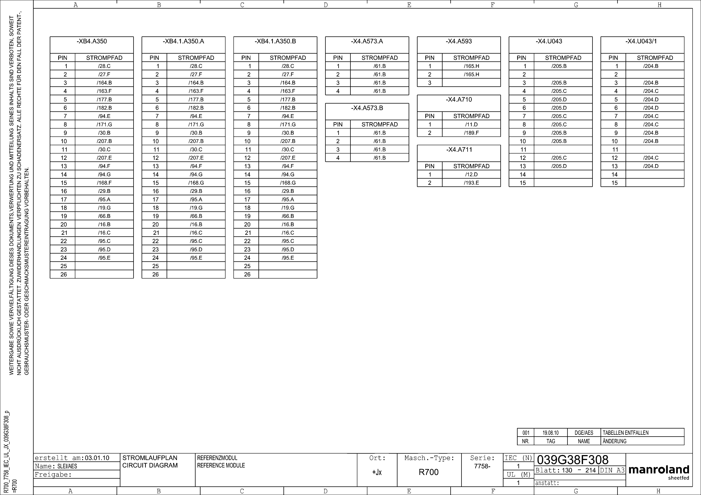

# +Jx — Sheet 130 of 214 — REFERENZMODUL

**REFERENCE MODULE**

> Part of the manroland **R700** printing press IEC/UL circuit diagrams.
> Drawing class: **Stromlaufplan / Circuit diagram** (DIN A3).
> Document `+Jx` covers the **1st printing module + feed register** machine section.

## At a glance

| Field | Value |
|---|---|
| Document | `+Jx`  (039G38F308) |
| Sheet | **130** of 214 |
| Section (DE) | REFERENZMODUL |
| Section (EN) | REFERENCE MODULE |
| Section type | REFERENCE_MODULE — Reference module |
| Machine type | `R700` |
| Series | `7758` |
| Created | 03.01.10 |
| Replaces | — |
| Columns used | A, B, C, D, E, F, G, H |
| Path numbers | — |
| Labels on sheet | 269 |
| Cross-refs out | 108 |
| Cross-refs in | 0 |

**Previous:** [+Jx sheet 129](SHEET_0129.md) · **Next:** [+Jx sheet 131](SHEET_0131.md) · **Document TOC:** [_TOC.md](_TOC.md)  (+Jx) · **Master TOC:** [all sheets](../_MASTER_TOC.md)

## Sheet image (300 DPI, exact vector render)



_Rendered directly from the PDF vector layer at 300 DPI (1-bit), no OCR and no resampling. Use it to confirm anything ambiguous in the text below._

## Cross-references on this sheet

Each entry is a wire leaving this sheet. The printed token is `/sheet.column`; the link resolves to that sheet inside the same document.

| Ref | Target sheet | Col | Path | Destination on target | Target section | From col |
|---|---|---|---|---|---|---|
| `/61.B` | [+Jx sheet 61](SHEET_0061.md) | B | — | — | GTW | E |
| `/205.B` | [+Jx sheet 205](SHEET_0205.md) | B | — | — | OPTION: INLINEOBSERVER | G |
| `/204.B` | [+Jx sheet 204](SHEET_0204.md) | B | — | — | OPTION: INLINEOBSERVER | H |
| `/28.C` | [+Jx sheet 28](SHEET_0028.md) | C | — | — | KAMMERRAKEL | A |
| `/28.C` | [+Jx sheet 28](SHEET_0028.md) | C | — | — | KAMMERRAKEL | B |
| `/28.C` | [+Jx sheet 28](SHEET_0028.md) | C | — | — | KAMMERRAKEL | D |
| `/165.H` | [+Jx sheet 165](SHEET_0165.md) | H | — | — | OPTION: | F |
| `/61.B` | [+Jx sheet 61](SHEET_0061.md) | B | — | — | GTW | E |
| `/27.F` | [+Jx sheet 27](SHEET_0027.md) | F | — | — | KAMMERRAKEL | A |
| `/27.F` | [+Jx sheet 27](SHEET_0027.md) | F | — | — | KAMMERRAKEL | B |
| `/27.F` | [+Jx sheet 27](SHEET_0027.md) | F | — | — | KAMMERRAKEL | D |
| `/165.H` | [+Jx sheet 165](SHEET_0165.md) | H | — | — | OPTION: | F |
| `/61.B` | [+Jx sheet 61](SHEET_0061.md) | B | — | — | GTW | E |
| `/164.B` | [+Jx sheet 164](SHEET_0164.md) | B | — | — | OPTION: | A |
| `/164.B` | [+Jx sheet 164](SHEET_0164.md) | B | — | — | OPTION: | B |
| `/164.B` | [+Jx sheet 164](SHEET_0164.md) | B | — | — | OPTION: | D |
| `/205.B` | [+Jx sheet 205](SHEET_0205.md) | B | — | — | OPTION: INLINEOBSERVER | G |
| `/204.B` | [+Jx sheet 204](SHEET_0204.md) | B | — | — | OPTION: INLINEOBSERVER | H |
| `/61.B` | [+Jx sheet 61](SHEET_0061.md) | B | — | — | GTW | E |
| `/163.F` | [+Jx sheet 163](SHEET_0163.md) | F | — | — | OPTION: | A |
| `/163.F` | [+Jx sheet 163](SHEET_0163.md) | F | — | — | OPTION: | B |
| `/163.F` | [+Jx sheet 163](SHEET_0163.md) | F | — | — | OPTION: | D |
| `/205.C` | [+Jx sheet 205](SHEET_0205.md) | C | — | — | OPTION: INLINEOBSERVER | G |
| `/204.C` | [+Jx sheet 204](SHEET_0204.md) | C | — | — | OPTION: INLINEOBSERVER | H |
| `/177.B` | [+Jx sheet 177](SHEET_0177.md) | B | — | — | SCHUTZEINRICHTUNGEN | A |
| `/177.B` | [+Jx sheet 177](SHEET_0177.md) | B | — | — | SCHUTZEINRICHTUNGEN | B |
| `/177.B` | [+Jx sheet 177](SHEET_0177.md) | B | — | — | SCHUTZEINRICHTUNGEN | D |
| `/205.D` | [+Jx sheet 205](SHEET_0205.md) | D | — | — | OPTION: INLINEOBSERVER | G |
| `/204.D` | [+Jx sheet 204](SHEET_0204.md) | D | — | — | OPTION: INLINEOBSERVER | H |
| `/182.B` | [+Jx sheet 182](SHEET_0182.md) | B | — | — | OPTION: TRANSFERMODUL 2 | A |
| `/182.B` | [+Jx sheet 182](SHEET_0182.md) | B | — | — | OPTION: TRANSFERMODUL 2 | B |
| `/182.B` | [+Jx sheet 182](SHEET_0182.md) | B | — | — | OPTION: TRANSFERMODUL 2 | D |
| `/205.D` | [+Jx sheet 205](SHEET_0205.md) | D | — | — | OPTION: INLINEOBSERVER | G |
| `/204.D` | [+Jx sheet 204](SHEET_0204.md) | D | — | — | OPTION: INLINEOBSERVER | H |
| `/94.E` | [+Jx sheet 94](SHEET_0094.md) | E | — | — | RESERVE | A |
| `/94.E` | [+Jx sheet 94](SHEET_0094.md) | E | — | — | RESERVE | B |
| `/94.E` | [+Jx sheet 94](SHEET_0094.md) | E | — | — | RESERVE | D |
| `/205.C` | [+Jx sheet 205](SHEET_0205.md) | C | — | — | OPTION: INLINEOBSERVER | G |
| `/204.C` | [+Jx sheet 204](SHEET_0204.md) | C | — | — | OPTION: INLINEOBSERVER | H |
| `/171.G` | [+Jx sheet 171](SHEET_0171.md) | G | — | — | OPTION: AUTOMATISCHEM SPÜLEN | A |
| `/171.G` | [+Jx sheet 171](SHEET_0171.md) | G | — | — | OPTION: AUTOMATISCHEM SPÜLEN | B |
| `/171.G` | [+Jx sheet 171](SHEET_0171.md) | G | — | — | OPTION: AUTOMATISCHEM SPÜLEN | D |
| `/11.D` | [+Jx sheet 11](SHEET_0011.md) | D | — | — | SPANNUNGSVERSORGUNG, SCHALTSCHRANKBELÜFTUNG | F |
| `/205.C` | [+Jx sheet 205](SHEET_0205.md) | C | — | — | OPTION: INLINEOBSERVER | G |
| `/204.C` | [+Jx sheet 204](SHEET_0204.md) | C | — | — | OPTION: INLINEOBSERVER | H |
| `/30.B` | [+Jx sheet 30](SHEET_0030.md) | B | — | — | LACKNIVEAUÜBERWACHUNG | A |
| `/30.B` | [+Jx sheet 30](SHEET_0030.md) | B | — | — | LACKNIVEAUÜBERWACHUNG | B |
| `/30.B` | [+Jx sheet 30](SHEET_0030.md) | B | — | — | LACKNIVEAUÜBERWACHUNG | D |
| `/61.B` | [+Jx sheet 61](SHEET_0061.md) | B | — | — | GTW | E |
| `/205.B` | [+Jx sheet 205](SHEET_0205.md) | B | — | — | OPTION: INLINEOBSERVER | G |
| `/204.B` | [+Jx sheet 204](SHEET_0204.md) | B | — | — | OPTION: INLINEOBSERVER | H |
| `/189.F` | [+Jx sheet 189](SHEET_0189.md) | F | — | — | OPTION: ZWISCHENTROCKNER, VORBEREITUNG | F |
| `/61.B` | [+Jx sheet 61](SHEET_0061.md) | B | — | — | GTW | E |
| `/207.B` | [+Jx sheet 207](SHEET_0207.md) | B | — | — | OPTION: ZWISCHENTROCKNER, VORBEREITUNG | A |
| `/207.B` | [+Jx sheet 207](SHEET_0207.md) | B | — | — | OPTION: ZWISCHENTROCKNER, VORBEREITUNG | B |
| `/207.B` | [+Jx sheet 207](SHEET_0207.md) | B | — | — | OPTION: ZWISCHENTROCKNER, VORBEREITUNG | D |
| `/205.B` | [+Jx sheet 205](SHEET_0205.md) | B | — | — | OPTION: INLINEOBSERVER | G |
| `/204.B` | [+Jx sheet 204](SHEET_0204.md) | B | — | — | OPTION: INLINEOBSERVER | H |
| `/61.B` | [+Jx sheet 61](SHEET_0061.md) | B | — | — | GTW | E |
| `/30.C` | [+Jx sheet 30](SHEET_0030.md) | C | — | — | LACKNIVEAUÜBERWACHUNG | A |
| `/30.C` | [+Jx sheet 30](SHEET_0030.md) | C | — | — | LACKNIVEAUÜBERWACHUNG | B |
| `/30.C` | [+Jx sheet 30](SHEET_0030.md) | C | — | — | LACKNIVEAUÜBERWACHUNG | D |
| `/61.B` | [+Jx sheet 61](SHEET_0061.md) | B | — | — | GTW | E |
| `/207.E` | [+Jx sheet 207](SHEET_0207.md) | E | — | — | OPTION: ZWISCHENTROCKNER, VORBEREITUNG | A |
| `/207.E` | [+Jx sheet 207](SHEET_0207.md) | E | — | — | OPTION: ZWISCHENTROCKNER, VORBEREITUNG | B |
| `/207.E` | [+Jx sheet 207](SHEET_0207.md) | E | — | — | OPTION: ZWISCHENTROCKNER, VORBEREITUNG | D |
| `/205.C` | [+Jx sheet 205](SHEET_0205.md) | C | — | — | OPTION: INLINEOBSERVER | G |
| `/204.C` | [+Jx sheet 204](SHEET_0204.md) | C | — | — | OPTION: INLINEOBSERVER | H |
| `/94.F` | [+Jx sheet 94](SHEET_0094.md) | F | — | — | RESERVE | A |
| `/94.F` | [+Jx sheet 94](SHEET_0094.md) | F | — | — | RESERVE | B |
| `/94.F` | [+Jx sheet 94](SHEET_0094.md) | F | — | — | RESERVE | D |
| `/205.D` | [+Jx sheet 205](SHEET_0205.md) | D | — | — | OPTION: INLINEOBSERVER | G |
| `/204.D` | [+Jx sheet 204](SHEET_0204.md) | D | — | — | OPTION: INLINEOBSERVER | H |
| `/94.G` | [+Jx sheet 94](SHEET_0094.md) | G | — | — | RESERVE | A |
| `/94.G` | [+Jx sheet 94](SHEET_0094.md) | G | — | — | RESERVE | B |
| `/94.G` | [+Jx sheet 94](SHEET_0094.md) | G | — | — | RESERVE | D |
| `/12.D` | [+Jx sheet 12](SHEET_0012.md) | D | — | — | SPANNUNGSVERSORGUNG, SCHALTSCHRANKBELÜFTUNG | F |
| `/193.E` | [+Jx sheet 193](SHEET_0193.md) | E | — | — | OPTION: ZWISCHENTROCKNER, VORBEREITUNG | F |
| `/168.F` | [+Jx sheet 168](SHEET_0168.md) | F | — | — | OPTION: | A |
| `/168.G` | [+Jx sheet 168](SHEET_0168.md) | G | — | — | OPTION: | B |
| `/168.G` | [+Jx sheet 168](SHEET_0168.md) | G | — | — | OPTION: | D |
| `/29.B` | [+Jx sheet 29](SHEET_0029.md) | B | — | — | KAMMERRAKEL | A |
| `/29.B` | [+Jx sheet 29](SHEET_0029.md) | B | — | — | KAMMERRAKEL | B |
| `/29.B` | [+Jx sheet 29](SHEET_0029.md) | B | — | — | KAMMERRAKEL | D |
| `/95.A` | [+Jx sheet 95](SHEET_0095.md) | A | — | — | RESERVE | A |
| `/95.A` | [+Jx sheet 95](SHEET_0095.md) | A | — | — | RESERVE | B |
| `/95.A` | [+Jx sheet 95](SHEET_0095.md) | A | — | — | RESERVE | D |
| `/19.G` | [+Jx sheet 19](SHEET_0019.md) | G | — | — | LACKPUMPE | A |
| `/19.G` | [+Jx sheet 19](SHEET_0019.md) | G | — | — | LACKPUMPE | B |
| `/19.G` | [+Jx sheet 19](SHEET_0019.md) | G | — | — | LACKPUMPE | D |
| `/66.B` | [+Jx sheet 66](SHEET_0066.md) | B | — | — | DRUCKANSTELLUNG | A |
| `/66.B` | [+Jx sheet 66](SHEET_0066.md) | B | — | — | DRUCKANSTELLUNG | B |
| `/66.B` | [+Jx sheet 66](SHEET_0066.md) | B | — | — | DRUCKANSTELLUNG | D |
| `/16.B` | [+Jx sheet 16](SHEET_0016.md) | B | — | — | ÖLUMLAUFSCHMIERUNG | A |
| `/16.B` | [+Jx sheet 16](SHEET_0016.md) | B | — | — | ÖLUMLAUFSCHMIERUNG | B |
| `/16.B` | [+Jx sheet 16](SHEET_0016.md) | B | — | — | ÖLUMLAUFSCHMIERUNG | D |
| `/16.C` | [+Jx sheet 16](SHEET_0016.md) | C | — | — | ÖLUMLAUFSCHMIERUNG | A |
| `/16.C` | [+Jx sheet 16](SHEET_0016.md) | C | — | — | ÖLUMLAUFSCHMIERUNG | B |
| `/16.C` | [+Jx sheet 16](SHEET_0016.md) | C | — | — | ÖLUMLAUFSCHMIERUNG | D |
| `/95.C` | [+Jx sheet 95](SHEET_0095.md) | C | — | — | RESERVE | A |
| `/95.C` | [+Jx sheet 95](SHEET_0095.md) | C | — | — | RESERVE | B |
| `/95.C` | [+Jx sheet 95](SHEET_0095.md) | C | — | — | RESERVE | D |
| `/95.D` | [+Jx sheet 95](SHEET_0095.md) | D | — | — | RESERVE | A |
| `/95.D` | [+Jx sheet 95](SHEET_0095.md) | D | — | — | RESERVE | B |
| `/95.D` | [+Jx sheet 95](SHEET_0095.md) | D | — | — | RESERVE | D |
| `/95.E` | [+Jx sheet 95](SHEET_0095.md) | E | — | — | RESERVE | A |
| `/95.E` | [+Jx sheet 95](SHEET_0095.md) | E | — | — | RESERVE | B |
| `/95.E` | [+Jx sheet 95](SHEET_0095.md) | E | — | — | RESERVE | D |

## Devices on this sheet

| Tag | Class | Class meaning (IEC) | Col | Sub | Terminal | Sign |
|---|---|---|---|---|---|---|
| `X4.A573.A` | — | cross-device reference | D | — | — | — |
| `X4.A573.B` | — | cross-device reference | E | — | — | — |
| `XB4.1.A350.A` | — | cross-device reference | B | — | — | — |
| `XB4.1.A350.B` | — | cross-device reference | C | — | — | — |
| `XB4.A350` | — | cross-device reference | A | — | — | — |
| `X4.A593` | — | cross-device reference | F | — | — | — |
| `X4.U043` | — | cross-device reference | G | — | — | — |
| `X4.A711` | — | cross-device reference | F | — | — | — |
| `X4.A710` | — | cross-device reference | F | — | — | — |
| `NR.` | — | cross-device reference | F | — | — | — |
| `19.08.10` | — | cross-device reference | G | — | — | — |

## Potentials / nets

_No named potentials on this sheet._

## Wire-end annotations (grouped as printed)

A wire that continues elsewhere is annotated with a small cluster: the destination description, the path/line number `#NN`, and the `/sheet.column` cross reference. Each row below is one such cluster exactly as it is grouped on the drawing.

| Col | Y | Path | Cross-ref | Text on the wire |
|---|---|---|---|---|
| A | 65.4 | — | — | `XB4.A350` |
| F | 65.4 | — | — | `X4.A593` |
| G | 65.4 | — | — | `X4.U043` |
| H | 65.4 | — | — | `X4.U043/1` |
| B | 65.5 | — | — | `XB4.1.A350.A` |
| C | 65.5 | — | — | `XB4.1.A350.B` |
| D | 65.5 | — | — | `X4.A573.A` |
| A | 94.1 | — | — | `PIN STROMPFAD` |
| B | 94.1 | — | — | `PIN STROMPFAD` |
| C | 94.1 | — | — | `PIN STROMPFAD` |
| D | 94.1 | — | — | `PIN 2 3 4 1 STROMPFAD` |
| F | 94.1 | — | — | `PIN 2 3 1 STROMPFAD` |
| G | 94.1 | — | — | `PIN 10 12 13 14 15 11 2 3 4 5 6 7 8 9 1 STROMPFAD` |
| H | 94.1 | — | — | `PIN 10 12 13 14 15 11 2 3 4 5 6 7 8 9 1 STROMPFAD` |
| A | 108.3 | — | — | `2 3 4 5 6 7 8 9 1` |
| B | 108.3 | — | — | `2 3 4 5 6 7 8 9 1` |
| C | 108.3 | — | — | `2 3 4 5 6 7 8 9 1` |
| E | 108.6 | — | `/61.B` | — |
| G | 108.6 | — | `/205.B` | — |
| H | 108.6 | — | `/204.B` | — |
| A | 108.7 | — | `/28.C` | — |
| B | 108.7 | — | `/28.C` | — |
| D | 108.7 | — | `/28.C` | — |
| F | 108.7 | — | `/165.H` | — |
| A | 122.8 | — | `/27.F` | — |
| B | 122.8 | — | `/27.F` | — |
| D | 122.8 | — | `/27.F` | — |
| E | 122.8 | — | `/61.B` | — |
| F | 122.8 | — | `/165.H` | — |
| A | 137.0 | — | `/164.B` | — |
| B | 137.0 | — | `/164.B` | — |
| D | 137.0 | — | `/164.B` | — |
| E | 137.0 | — | `/61.B` | — |
| G | 137.0 | — | `/205.B` | — |
| H | 137.0 | — | `/204.B` | — |
| E | 151.1 | — | `/61.B` | — |
| A | 151.2 | — | `/163.F` | — |
| B | 151.2 | — | `/163.F` | — |
| D | 151.2 | — | `/163.F` | — |
| G | 151.2 | — | `/205.C` | — |
| H | 151.2 | — | `/204.C` | — |
| F | 164.7 | — | — | `X4.A710` |
| A | 165.3 | — | `/177.B` | — |
| B | 165.3 | — | `/177.B` | — |
| D | 165.3 | — | `/177.B` | — |
| G | 165.3 | — | `/205.D` | — |
| H | 165.3 | — | `/204.D` | — |
| E | 178.8 | — | — | `X4.A573.B` |
| A | 179.5 | — | `/182.B` | — |
| B | 179.5 | — | `/182.B` | — |
| D | 179.5 | — | `/182.B` | — |
| G | 179.5 | — | `/205.D` | — |
| H | 179.5 | — | `/204.D` | — |
| F | 193.3 | — | — | `PIN 2 1 STROMPFAD` |
| A | 193.7 | — | `/94.E` | — |
| B | 193.7 | — | `/94.E` | — |
| D | 193.7 | — | `/94.E` | — |
| G | 193.7 | — | `/205.C` | — |
| H | 193.7 | — | `/204.C` | — |
| D | 207.5 | — | — | `PIN 2 3 4 1 STROMPFAD` |
| A | 207.9 | — | `/171.G` | — |
| B | 207.9 | — | `/171.G` | — |
| D | 207.9 | — | `/171.G` | — |
| F | 207.9 | — | `/11.D` | — |
| G | 207.9 | — | `/205.C` | — |
| H | 207.9 | — | `/204.C` | — |
| A | 222.0 | — | `/30.B` | — |
| B | 222.0 | — | `/30.B` | — |
| D | 222.0 | — | `/30.B` | — |
| E | 222.0 | — | `/61.B` | — |
| F | 222.0 | — | `/189.F` | — |
| G | 222.0 | — | `/205.B` | — |
| H | 222.0 | — | `/204.B` | — |
| A | 235.9 | — | — | `10 12 13 14 15 16 17 18 19 20 11` |
| B | 235.9 | — | — | `10 12 13 14 15 16 17 18 19 20 11` |
| C | 235.9 | — | — | `10 12 13 14 15 16 17 18 19 20 11` |
| A | 236.2 | — | `/207.B` | — |
| B | 236.2 | — | `/207.B` | — |
| D | 236.2 | — | `/207.B` | — |
| E | 236.2 | — | `/61.B` | — |
| G | 236.2 | — | `/205.B` | — |
| H | 236.2 | — | `/204.B` | — |
| F | 249.7 | — | — | `X4.A711` |
| E | 250.3 | — | `/61.B` | — |
| A | 250.4 | — | `/30.C` | — |
| B | 250.4 | — | `/30.C` | — |
| D | 250.4 | — | `/30.C` | — |
| A | 264.5 | — | `/207.E` | — |
| B | 264.5 | — | `/207.E` | — |
| D | 264.5 | — | `/207.E` | — |
| E | 264.5 | — | `/61.B` | — |
| G | 264.6 | — | `/205.C` | — |
| H | 264.6 | — | `/204.C` | — |
| F | 278.3 | — | — | `PIN 2 1 STROMPFAD` |
| A | 278.7 | — | `/94.F` | — |
| B | 278.7 | — | `/94.F` | — |
| D | 278.7 | — | `/94.F` | — |
| G | 278.7 | — | `/205.D` | — |
| H | 278.7 | — | `/204.D` | — |
| A | 292.9 | — | `/94.G` | — |
| B | 292.9 | — | `/94.G` | — |
| D | 292.9 | — | `/94.G` | — |
| F | 292.9 | — | `/12.D` | — |
| A | 307.1 | — | `/168.F` | — |
| B | 307.1 | — | `/168.G` | — |
| D | 307.1 | — | `/168.G` | — |
| F | 307.1 | — | `/193.E` | — |
| A | 321.2 | — | `/29.B` | — |
| B | 321.2 | — | `/29.B` | — |
| D | 321.2 | — | `/29.B` | — |
| A | 335.4 | — | `/95.A` | — |
| B | 335.4 | — | `/95.A` | — |
| D | 335.4 | — | `/95.A` | — |
| A | 349.6 | — | `/19.G` | — |
| B | 349.6 | — | `/19.G` | — |
| D | 349.6 | — | `/19.G` | — |
| A | 363.7 | — | `/66.B` | — |
| B | 363.7 | — | `/66.B` | — |
| D | 363.7 | — | `/66.B` | — |
| A | 377.9 | — | `/16.B` | — |
| B | 377.9 | — | `/16.B` | — |
| D | 377.9 | — | `/16.B` | — |
| A | 391.8 | — | — | `22 23 24 25 26 21` |
| B | 391.8 | — | — | `22 23 24 25 26 21` |
| C | 391.8 | — | — | `22 23 24 25 26 21` |
| A | 392.1 | — | `/16.C` | — |
| B | 392.1 | — | `/16.C` | — |
| D | 392.1 | — | `/16.C` | — |
| A | 406.3 | — | `/95.C` | — |
| B | 406.3 | — | `/95.C` | — |
| D | 406.3 | — | `/95.C` | — |
| A | 420.5 | — | `/95.D` | — |
| B | 420.5 | — | `/95.D` | — |
| D | 420.5 | — | `/95.D` | — |
| A | 434.6 | — | `/95.E` | — |
| B | 434.6 | — | `/95.E` | — |
| D | 434.6 | — | `/95.E` | — |
| G | 733.0 | — | — | `001 19.08.10 DGE/AES TABELLEN ENTFALLEN` |
| G | 747.1 | — | — | `NR. TAG NAME ÄNDERUNG` |


## Reconstructed tables

This sheet carries tabular content (pin map / terminal assignment / index). The grid below was rebuilt from the drawing's own rule lines, so each row is exactly one physical row of the table.

### Table 1 — 26 data rows × 2 columns (at x=85.0, y=62.4) — **XB4.A350**

| PIN | STROMPFAD |
|---|---|
| `1` | `/28.C` |
| `2` | `/27.F` |
| `3` | `/164.B` |
| `4` | `/163.F` |
| `5` | `/177.B` |
| `6` | `/182.B` |
| `7` | `/94.E` |
| `8` | `/171.G` |
| `9` | `/30.B` |
| `10` | `/207.B` |
| `11` | `/30.C` |
| `12` | `/207.E` |
| `13` | `/94.F` |
| `14` | `/94.G` |
| `15` | `/168.F` |
| `16` | `/29.B` |
| `17` | `/95.A` |
| `18` | `/19.G` |
| `19` | `/66.B` |
| `20` | `/16.B` |
| `21` | `/16.C` |
| `22` | `/95.C` |
| `23` | `/95.D` |
| `24` | `/95.E` |
| `25` |  |
| `26` |  |


### Table 2 — 26 data rows × 2 columns (at x=240.9, y=62.4) — **XB4.1.A350.A**

| PIN | STROMPFAD |
|---|---|
| `1` | `/28.C` |
| `2` | `/27.F` |
| `3` | `/164.B` |
| `4` | `/163.F` |
| `5` | `/177.B` |
| `6` | `/182.B` |
| `7` | `/94.E` |
| `8` | `/171.G` |
| `9` | `/30.B` |
| `10` | `/207.B` |
| `11` | `/30.C` |
| `12` | `/207.E` |
| `13` | `/94.F` |
| `14` | `/94.G` |
| `15` | `/168.G` |
| `16` | `/29.B` |
| `17` | `/95.A` |
| `18` | `/19.G` |
| `19` | `/66.B` |
| `20` | `/16.B` |
| `21` | `/16.C` |
| `22` | `/95.C` |
| `23` | `/95.D` |
| `24` | `/95.E` |
| `25` |  |
| `26` |  |


### Table 3 — 26 data rows × 2 columns (at x=396.9, y=62.4) — **XB4.1.A350.B**

| PIN | STROMPFAD |
|---|---|
| `1` | `/28.C` |
| `2` | `/27.F` |
| `3` | `/164.B` |
| `4` | `/163.F` |
| `5` | `/177.B` |
| `6` | `/182.B` |
| `7` | `/94.E` |
| `8` | `/171.G` |
| `9` | `/30.B` |
| `10` | `/207.B` |
| `11` | `/30.C` |
| `12` | `/207.E` |
| `13` | `/94.F` |
| `14` | `/94.G` |
| `15` | `/168.G` |
| `16` | `/29.B` |
| `17` | `/95.A` |
| `18` | `/19.G` |
| `19` | `/66.B` |
| `20` | `/16.B` |
| `21` | `/16.C` |
| `22` | `/95.C` |
| `23` | `/95.D` |
| `24` | `/95.E` |
| `25` |  |
| `26` |  |


### Table 4 — 10 data rows × 2 columns (at x=552.8, y=62.4) — **X4.A573.A**

| PIN | STROMPFAD |
|---|---|
| `1` | `/61.B` |
| `2` | `/61.B` |
| `3` | `/61.B` |
| `4` | `/61.B` |
|  | `X4.A573.B` |
| `PIN` | `STROMPFAD` |
| `1` | `/61.B` |
| `2` | `/61.B` |
| `3` | `/61.B` |
| `4` | `/61.B` |


### Table 5 — 11 data rows × 2 columns (at x=708.7, y=62.4) — **X4.A593**

| PIN | STROMPFAD |
|---|---|
| `1` | `/165.H` |
| `2` | `/165.H` |
| `3` |  |
|  | `X4.A710` |
| `PIN` | `STROMPFAD` |
| `1` | `/11.D` |
| `2` | `/189.F` |
|  | `X4.A711` |
| `PIN` | `STROMPFAD` |
| `1` | `/12.D` |
| `2` | `/193.E` |


### Table 6 — 15 data rows × 2 columns (at x=864.6, y=62.4) — **X4.U043**

| PIN | STROMPFAD |
|---|---|
| `1` | `/205.B` |
| `2` |  |
| `3` | `/205.B` |
| `4` | `/205.C` |
| `5` | `/205.D` |
| `6` | `/205.D` |
| `7` | `/205.C` |
| `8` | `/205.C` |
| `9` | `/205.B` |
| `10` | `/205.B` |
| `11` |  |
| `12` | `/205.C` |
| `13` | `/205.D` |
| `14` |  |
| `15` |  |


### Table 7 — 15 data rows × 2 columns (at x=1020.5, y=62.4) — **X4.U043/1**

| PIN | STROMPFAD |
|---|---|
| `1` | `/204.B` |
| `2` |  |
| `3` | `/204.B` |
| `4` | `/204.C` |
| `5` | `/204.D` |
| `6` | `/204.D` |
| `7` | `/204.C` |
| `8` | `/204.C` |
| `9` | `/204.B` |
| `10` | `/204.B` |
| `11` |  |
| `12` | `/204.C` |
| `13` | `/204.D` |
| `14` |  |
| `15` |  |


## Notes and free text on this sheet

| Text | Col | Y (pt) |
|---|---|---|
| `PIN` | D | 94.13 |
| `STROMPFAD` | E | 94.09 |
| `PIN` | B | 94.13 |
| `STROMPFAD` | B | 94.09 |
| `PIN` | C | 94.13 |
| `STROMPFAD` | D | 94.09 |
| `PIN` | A | 94.13 |
| `STROMPFAD` | A | 94.09 |
| `PIN` | E | 94.13 |
| `STROMPFAD` | F | 94.09 |
| `PIN` | F | 94.13 |
| `STROMPFAD` | G | 94.09 |
| `PIN` | G | 94.13 |
| `STROMPFAD` | H | 94.09 |
| `X4.U043/1` | H | 65.44 |
| `TAG` | G | 747.23 |
| `NAME` | G | 747.22 |
| `ÄNDERUNG` | G | 747.25 |
| `DGE/AES` | G | 733.06 |
| `TABELLEN ENTFALLEN` | H | 733.1 |

## Complete label inventory (exact text from the drawing)

Every text object inside the drawing area of this sheet, in DIN reading order (column A→H, then top→bottom). This is the authoritative list: if a string is not here it is not printed on this sheet.

| Col | Y | X | Dir | Type | Text |
|---|---|---|---|---|---|
| A | 65.4 | 130.4 | → | device ref | `XB4.A350` |
| A | 94.1 | 98.2 | → | text | `PIN` |
| A | 94.1 | 146.6 | → | text | `STROMPFAD` |
| A | 108.3 | 109.7 | → | number | `1` |
| A | 108.7 | 166.8 | → | cross-reference | `/28.C` |
| A | 122.5 | 108.3 | → | number | `2` |
| A | 122.8 | 167.2 | → | cross-reference | `/27.F` |
| A | 136.7 | 108.3 | → | number | `3` |
| A | 137.0 | 164.6 | → | cross-reference | `/164.B` |
| A | 150.8 | 108.3 | → | number | `4` |
| A | 151.2 | 164.8 | → | cross-reference | `/163.F` |
| A | 165.0 | 108.3 | → | number | `5` |
| A | 165.3 | 164.6 | → | cross-reference | `/177.B` |
| A | 179.2 | 108.3 | → | number | `6` |
| A | 179.5 | 164.6 | → | cross-reference | `/182.B` |
| A | 193.3 | 108.3 | → | number | `7` |
| A | 193.7 | 167.0 | → | cross-reference | `/94.E` |
| A | 207.5 | 108.3 | → | number | `8` |
| A | 207.9 | 164.1 | → | cross-reference | `/171.G` |
| A | 221.7 | 108.3 | → | number | `9` |
| A | 222.0 | 167.0 | → | cross-reference | `/30.B` |
| A | 235.9 | 102.9 | → | number | `10` |
| A | 236.2 | 164.6 | → | cross-reference | `/207.B` |
| A | 250.0 | 104.3 | → | number | `11` |
| A | 250.4 | 166.8 | → | cross-reference | `/30.C` |
| A | 264.2 | 102.9 | → | number | `12` |
| A | 264.5 | 164.6 | → | cross-reference | `/207.E` |
| A | 278.4 | 102.9 | → | number | `13` |
| A | 278.7 | 167.2 | → | cross-reference | `/94.F` |
| A | 292.6 | 102.9 | → | number | `14` |
| A | 292.9 | 166.5 | → | cross-reference | `/94.G` |
| A | 306.7 | 102.9 | → | number | `15` |
| A | 307.1 | 164.8 | → | cross-reference | `/168.F` |
| A | 320.9 | 102.9 | → | number | `16` |
| A | 321.2 | 167.0 | → | cross-reference | `/29.B` |
| A | 335.1 | 102.9 | → | number | `17` |
| A | 335.4 | 166.8 | → | cross-reference | `/95.A` |
| A | 349.3 | 102.9 | → | number | `18` |
| A | 349.6 | 166.5 | → | cross-reference | `/19.G` |
| A | 363.4 | 102.9 | → | number | `19` |
| A | 363.7 | 167.0 | → | cross-reference | `/66.B` |
| A | 377.6 | 102.9 | → | number | `20` |
| A | 377.9 | 167.0 | → | cross-reference | `/16.B` |
| A | 391.8 | 104.3 | → | number | `21` |
| A | 392.1 | 166.8 | → | cross-reference | `/16.C` |
| A | 405.9 | 102.9 | → | number | `22` |
| A | 406.3 | 166.8 | → | cross-reference | `/95.C` |
| A | 420.1 | 102.9 | → | number | `23` |
| A | 420.5 | 166.8 | → | cross-reference | `/95.D` |
| A | 434.3 | 102.9 | → | number | `24` |
| A | 434.6 | 167.0 | → | cross-reference | `/95.E` |
| A | 448.5 | 102.9 | → | number | `25` |
| A | 462.6 | 102.9 | → | number | `26` |
| B | 65.4 | 276.7 | → | device ref | `XB4.1.A350.A` |
| B | 94.1 | 254.1 | → | text | `PIN` |
| B | 94.1 | 302.5 | → | text | `STROMPFAD` |
| B | 108.3 | 265.6 | → | number | `1` |
| B | 108.7 | 322.7 | → | cross-reference | `/28.C` |
| B | 122.5 | 264.2 | → | number | `2` |
| B | 122.8 | 323.1 | → | cross-reference | `/27.F` |
| B | 136.7 | 264.2 | → | number | `3` |
| B | 137.0 | 320.5 | → | cross-reference | `/164.B` |
| B | 150.8 | 264.2 | → | number | `4` |
| B | 151.2 | 320.7 | → | cross-reference | `/163.F` |
| B | 165.0 | 264.2 | → | number | `5` |
| B | 165.3 | 320.5 | → | cross-reference | `/177.B` |
| B | 179.2 | 264.2 | → | number | `6` |
| B | 179.5 | 320.5 | → | cross-reference | `/182.B` |
| B | 193.3 | 264.2 | → | number | `7` |
| B | 193.7 | 322.9 | → | cross-reference | `/94.E` |
| B | 207.5 | 264.2 | → | number | `8` |
| B | 207.9 | 320.0 | → | cross-reference | `/171.G` |
| B | 221.7 | 264.2 | → | number | `9` |
| B | 222.0 | 322.9 | → | cross-reference | `/30.B` |
| B | 235.9 | 258.8 | → | number | `10` |
| B | 236.2 | 320.5 | → | cross-reference | `/207.B` |
| B | 250.0 | 260.2 | → | number | `11` |
| B | 250.4 | 322.7 | → | cross-reference | `/30.C` |
| B | 264.2 | 258.8 | → | number | `12` |
| B | 264.5 | 320.5 | → | cross-reference | `/207.E` |
| B | 278.4 | 258.8 | → | number | `13` |
| B | 278.7 | 323.1 | → | cross-reference | `/94.F` |
| B | 292.6 | 258.8 | → | number | `14` |
| B | 292.9 | 322.4 | → | cross-reference | `/94.G` |
| B | 306.7 | 258.8 | → | number | `15` |
| B | 307.1 | 320.0 | → | cross-reference | `/168.G` |
| B | 320.9 | 258.8 | → | number | `16` |
| B | 321.2 | 322.9 | → | cross-reference | `/29.B` |
| B | 335.1 | 258.8 | → | number | `17` |
| B | 335.4 | 322.7 | → | cross-reference | `/95.A` |
| B | 349.3 | 258.8 | → | number | `18` |
| B | 349.6 | 322.4 | → | cross-reference | `/19.G` |
| B | 363.4 | 258.8 | → | number | `19` |
| B | 363.7 | 322.9 | → | cross-reference | `/66.B` |
| B | 377.6 | 258.8 | → | number | `20` |
| B | 377.9 | 322.9 | → | cross-reference | `/16.B` |
| B | 391.8 | 260.2 | → | number | `21` |
| B | 392.1 | 322.7 | → | cross-reference | `/16.C` |
| B | 405.9 | 258.8 | → | number | `22` |
| B | 406.3 | 322.7 | → | cross-reference | `/95.C` |
| B | 420.1 | 258.8 | → | number | `23` |
| B | 420.5 | 322.7 | → | cross-reference | `/95.D` |
| B | 434.3 | 258.8 | → | number | `24` |
| B | 434.6 | 322.9 | → | cross-reference | `/95.E` |
| B | 448.5 | 258.8 | → | number | `25` |
| B | 462.6 | 258.8 | → | number | `26` |
| C | 65.4 | 432.9 | → | device ref | `XB4.1.A350.B` |
| C | 94.1 | 410.0 | → | text | `PIN` |
| C | 108.3 | 421.5 | → | number | `1` |
| C | 122.5 | 420.1 | → | number | `2` |
| C | 136.7 | 420.1 | → | number | `3` |
| C | 150.8 | 420.1 | → | number | `4` |
| C | 165.0 | 420.1 | → | number | `5` |
| C | 179.2 | 420.1 | → | number | `6` |
| C | 193.3 | 420.1 | → | number | `7` |
| C | 207.5 | 420.1 | → | number | `8` |
| C | 221.7 | 420.1 | → | number | `9` |
| C | 235.9 | 414.7 | → | number | `10` |
| C | 250.0 | 416.1 | → | number | `11` |
| C | 264.2 | 414.7 | → | number | `12` |
| C | 278.4 | 414.7 | → | number | `13` |
| C | 292.6 | 414.7 | → | number | `14` |
| C | 306.7 | 414.7 | → | number | `15` |
| C | 320.9 | 414.7 | → | number | `16` |
| C | 335.1 | 414.7 | → | number | `17` |
| C | 349.3 | 414.7 | → | number | `18` |
| C | 363.4 | 414.7 | → | number | `19` |
| C | 377.6 | 414.7 | → | number | `20` |
| C | 391.8 | 416.1 | → | number | `21` |
| C | 405.9 | 414.7 | → | number | `22` |
| C | 420.1 | 414.7 | → | number | `23` |
| C | 434.3 | 414.7 | → | number | `24` |
| C | 448.5 | 414.7 | → | number | `25` |
| C | 462.6 | 414.7 | → | number | `26` |
| D | 65.4 | 596.4 | → | device ref | `X4.A573.A` |
| D | 94.1 | 458.4 | → | text | `STROMPFAD` |
| D | 94.1 | 565.9 | → | text | `PIN` |
| D | 108.3 | 571.7 | → | number | `1` |
| D | 108.7 | 478.6 | → | cross-reference | `/28.C` |
| D | 122.5 | 571.3 | → | number | `2` |
| D | 122.8 | 479.1 | → | cross-reference | `/27.F` |
| D | 136.7 | 571.3 | → | number | `3` |
| D | 137.0 | 476.4 | → | cross-reference | `/164.B` |
| D | 150.8 | 571.5 | → | number | `4` |
| D | 151.2 | 476.6 | → | cross-reference | `/163.F` |
| D | 165.3 | 476.4 | → | cross-reference | `/177.B` |
| D | 179.5 | 476.4 | → | cross-reference | `/182.B` |
| D | 193.7 | 478.8 | → | cross-reference | `/94.E` |
| D | 207.5 | 565.9 | → | text | `PIN` |
| D | 207.9 | 475.9 | → | cross-reference | `/171.G` |
| D | 221.7 | 571.7 | → | number | `1` |
| D | 222.0 | 478.8 | → | cross-reference | `/30.B` |
| D | 235.9 | 571.3 | → | number | `2` |
| D | 236.2 | 476.4 | → | cross-reference | `/207.B` |
| D | 250.0 | 571.3 | → | number | `3` |
| D | 250.4 | 478.6 | → | cross-reference | `/30.C` |
| D | 264.2 | 571.5 | → | number | `4` |
| D | 264.5 | 476.4 | → | cross-reference | `/207.E` |
| D | 278.7 | 479.1 | → | cross-reference | `/94.F` |
| D | 292.9 | 478.3 | → | cross-reference | `/94.G` |
| D | 307.1 | 475.9 | → | cross-reference | `/168.G` |
| D | 321.2 | 478.8 | → | cross-reference | `/29.B` |
| D | 335.4 | 478.6 | → | cross-reference | `/95.A` |
| D | 349.6 | 478.3 | → | cross-reference | `/19.G` |
| D | 363.7 | 478.8 | → | cross-reference | `/66.B` |
| D | 377.9 | 478.8 | → | cross-reference | `/16.B` |
| D | 392.1 | 478.6 | → | cross-reference | `/16.C` |
| D | 406.3 | 478.6 | → | cross-reference | `/95.C` |
| D | 420.5 | 478.6 | → | cross-reference | `/95.D` |
| D | 434.6 | 478.8 | → | cross-reference | `/95.E` |
| E | 94.1 | 614.3 | → | text | `STROMPFAD` |
| E | 94.1 | 721.8 | → | text | `PIN` |
| E | 108.3 | 727.7 | → | number | `1` |
| E | 108.6 | 634.7 | → | cross-reference | `/61.B` |
| E | 122.5 | 727.2 | → | number | `2` |
| E | 122.8 | 634.7 | → | cross-reference | `/61.B` |
| E | 136.7 | 727.2 | → | number | `3` |
| E | 137.0 | 634.7 | → | cross-reference | `/61.B` |
| E | 151.1 | 634.7 | → | cross-reference | `/61.B` |
| E | 178.8 | 596.7 | → | device ref | `X4.A573.B` |
| E | 193.3 | 721.8 | → | text | `PIN` |
| E | 207.5 | 614.3 | → | text | `STROMPFAD` |
| E | 207.5 | 727.7 | → | number | `1` |
| E | 221.7 | 727.2 | → | number | `2` |
| E | 222.0 | 634.7 | → | cross-reference | `/61.B` |
| E | 236.2 | 634.7 | → | cross-reference | `/61.B` |
| E | 250.3 | 634.7 | → | cross-reference | `/61.B` |
| E | 264.5 | 634.7 | → | cross-reference | `/61.B` |
| E | 278.4 | 721.8 | → | text | `PIN` |
| E | 292.6 | 727.7 | → | number | `1` |
| E | 306.7 | 727.2 | → | number | `2` |
| F | 65.4 | 757.4 | → | device ref | `X4.A593` |
| F | 94.1 | 770.2 | → | text | `STROMPFAD` |
| F | 94.1 | 877.7 | → | text | `PIN` |
| F | 108.3 | 889.2 | → | number | `1` |
| F | 108.7 | 788.2 | → | cross-reference | `/165.H` |
| F | 122.5 | 887.8 | → | number | `2` |
| F | 122.8 | 788.2 | → | cross-reference | `/165.H` |
| F | 136.7 | 887.8 | → | number | `3` |
| F | 150.8 | 887.8 | → | number | `4` |
| F | 164.6 | 757.6 | → | device ref | `X4.A710` |
| F | 165.0 | 887.8 | → | number | `5` |
| F | 179.2 | 887.8 | → | number | `6` |
| F | 193.3 | 770.2 | → | text | `STROMPFAD` |
| F | 193.3 | 887.8 | → | number | `7` |
| F | 207.5 | 887.8 | → | number | `8` |
| F | 207.9 | 790.4 | → | cross-reference | `/11.D` |
| F | 221.7 | 887.8 | → | number | `9` |
| F | 222.0 | 788.5 | → | cross-reference | `/189.F` |
| F | 235.9 | 882.4 | → | number | `10` |
| F | 249.7 | 758.3 | → | device ref | `X4.A711` |
| F | 250.0 | 883.8 | → | number | `11` |
| F | 264.2 | 882.4 | → | number | `12` |
| F | 278.3 | 770.2 | → | text | `STROMPFAD` |
| F | 278.4 | 882.4 | → | number | `13` |
| F | 292.6 | 882.4 | → | number | `14` |
| F | 292.9 | 790.4 | → | cross-reference | `/12.D` |
| F | 306.7 | 882.4 | → | number | `15` |
| F | 307.1 | 788.2 | → | cross-reference | `/193.E` |
| F | 733.0 | 887.6 | → | number | `001` |
| F | 747.1 | 886.8 | → | device ref | `NR.` |
| G | 65.4 | 910.2 | → | device ref | `X4.U043` |
| G | 94.1 | 926.1 | → | text | `STROMPFAD` |
| G | 94.1 | 1033.7 | → | text | `PIN` |
| G | 108.3 | 1045.1 | → | number | `1` |
| G | 108.6 | 937.0 | → | cross-reference | `/205.B` |
| G | 122.5 | 1043.7 | → | number | `2` |
| G | 136.7 | 1043.7 | → | number | `3` |
| G | 137.0 | 937.0 | → | cross-reference | `/205.B` |
| G | 150.8 | 1043.7 | → | number | `4` |
| G | 151.2 | 936.9 | → | cross-reference | `/205.C` |
| G | 165.0 | 1043.7 | → | number | `5` |
| G | 165.4 | 936.9 | → | cross-reference | `/205.D` |
| G | 179.2 | 1043.7 | → | number | `6` |
| G | 179.5 | 936.9 | → | cross-reference | `/205.D` |
| G | 193.3 | 1043.7 | → | number | `7` |
| G | 193.7 | 936.9 | → | cross-reference | `/205.C` |
| G | 207.5 | 1043.7 | → | number | `8` |
| G | 207.9 | 936.9 | → | cross-reference | `/205.C` |
| G | 221.7 | 1043.7 | → | number | `9` |
| G | 222.0 | 937.0 | → | cross-reference | `/205.B` |
| G | 235.9 | 1038.3 | → | number | `10` |
| G | 236.2 | 937.0 | → | cross-reference | `/205.B` |
| G | 250.0 | 1039.7 | → | number | `11` |
| G | 264.2 | 1038.3 | → | number | `12` |
| G | 264.6 | 936.9 | → | cross-reference | `/205.C` |
| G | 278.4 | 1038.3 | → | number | `13` |
| G | 278.7 | 936.9 | → | cross-reference | `/205.D` |
| G | 292.6 | 1038.3 | → | number | `14` |
| G | 306.7 | 1038.3 | → | number | `15` |
| G | 733.1 | 921.5 | → | device ref | `19.08.10` |
| G | 733.1 | 976.4 | → | text | `DGE/AES` |
| G | 747.2 | 928.5 | → | text | `TAG` |
| G | 747.2 | 981.8 | → | text | `NAME` |
| G | 747.3 | 1024.0 | → | text | `ÄNDERUNG` |
| H | 65.4 | 1062.6 | → | text | `X4.U043/1` |
| H | 94.1 | 1082.0 | → | text | `STROMPFAD` |
| H | 108.6 | 1092.9 | → | cross-reference | `/204.B` |
| H | 137.0 | 1092.9 | → | cross-reference | `/204.B` |
| H | 151.2 | 1092.8 | → | cross-reference | `/204.C` |
| H | 165.4 | 1092.8 | → | cross-reference | `/204.D` |
| H | 179.5 | 1092.8 | → | cross-reference | `/204.D` |
| H | 193.7 | 1092.8 | → | cross-reference | `/204.C` |
| H | 207.9 | 1092.8 | → | cross-reference | `/204.C` |
| H | 222.0 | 1092.9 | → | cross-reference | `/204.B` |
| H | 236.2 | 1092.9 | → | cross-reference | `/204.B` |
| H | 264.6 | 1092.8 | → | cross-reference | `/204.C` |
| H | 278.7 | 1092.8 | → | cross-reference | `/204.D` |
| H | 733.1 | 1024.0 | → | text | `TABELLEN ENTFALLEN` |

## Reading-order text block

The same content as a plain block, grouped by DIN column — convenient to paste or to match against a visual description.

```text
=== Column A ===
  65.4  130.4  devref       XB4.A350
  94.1   98.2  text         PIN
  94.1  146.6  text         STROMPFAD
 108.3  109.7  numeric      1
 108.7  166.8  xref         /28.C
 122.5  108.3  numeric      2
 122.8  167.2  xref         /27.F
 136.7  108.3  numeric      3
 137.0  164.6  xref         /164.B
 150.8  108.3  numeric      4
 151.2  164.8  xref         /163.F
 165.0  108.3  numeric      5
 165.3  164.6  xref         /177.B
 179.2  108.3  numeric      6
 179.5  164.6  xref         /182.B
 193.3  108.3  numeric      7
 193.7  167.0  xref         /94.E
 207.5  108.3  numeric      8
 207.9  164.1  xref         /171.G
 221.7  108.3  numeric      9
 222.0  167.0  xref         /30.B
 235.9  102.9  numeric      10
 236.2  164.6  xref         /207.B
 250.0  104.3  numeric      11
 250.4  166.8  xref         /30.C
 264.2  102.9  numeric      12
 264.5  164.6  xref         /207.E
 278.4  102.9  numeric      13
 278.7  167.2  xref         /94.F
 292.6  102.9  numeric      14
 292.9  166.5  xref         /94.G
 306.7  102.9  numeric      15
 307.1  164.8  xref         /168.F
 320.9  102.9  numeric      16
 321.2  167.0  xref         /29.B
 335.1  102.9  numeric      17
 335.4  166.8  xref         /95.A
 349.3  102.9  numeric      18
 349.6  166.5  xref         /19.G
 363.4  102.9  numeric      19
 363.7  167.0  xref         /66.B
 377.6  102.9  numeric      20
 377.9  167.0  xref         /16.B
 391.8  104.3  numeric      21
 392.1  166.8  xref         /16.C
 405.9  102.9  numeric      22
 406.3  166.8  xref         /95.C
 420.1  102.9  numeric      23
 420.5  166.8  xref         /95.D
 434.3  102.9  numeric      24
 434.6  167.0  xref         /95.E
 448.5  102.9  numeric      25
 462.6  102.9  numeric      26
=== Column B ===
  65.4  276.7  devref       XB4.1.A350.A
  94.1  254.1  text         PIN
  94.1  302.5  text         STROMPFAD
 108.3  265.6  numeric      1
 108.7  322.7  xref         /28.C
 122.5  264.2  numeric      2
 122.8  323.1  xref         /27.F
 136.7  264.2  numeric      3
 137.0  320.5  xref         /164.B
 150.8  264.2  numeric      4
 151.2  320.7  xref         /163.F
 165.0  264.2  numeric      5
 165.3  320.5  xref         /177.B
 179.2  264.2  numeric      6
 179.5  320.5  xref         /182.B
 193.3  264.2  numeric      7
 193.7  322.9  xref         /94.E
 207.5  264.2  numeric      8
 207.9  320.0  xref         /171.G
 221.7  264.2  numeric      9
 222.0  322.9  xref         /30.B
 235.9  258.8  numeric      10
 236.2  320.5  xref         /207.B
 250.0  260.2  numeric      11
 250.4  322.7  xref         /30.C
 264.2  258.8  numeric      12
 264.5  320.5  xref         /207.E
 278.4  258.8  numeric      13
 278.7  323.1  xref         /94.F
 292.6  258.8  numeric      14
 292.9  322.4  xref         /94.G
 306.7  258.8  numeric      15
 307.1  320.0  xref         /168.G
 320.9  258.8  numeric      16
 321.2  322.9  xref         /29.B
 335.1  258.8  numeric      17
 335.4  322.7  xref         /95.A
 349.3  258.8  numeric      18
 349.6  322.4  xref         /19.G
 363.4  258.8  numeric      19
 363.7  322.9  xref         /66.B
 377.6  258.8  numeric      20
 377.9  322.9  xref         /16.B
 391.8  260.2  numeric      21
 392.1  322.7  xref         /16.C
 405.9  258.8  numeric      22
 406.3  322.7  xref         /95.C
 420.1  258.8  numeric      23
 420.5  322.7  xref         /95.D
 434.3  258.8  numeric      24
 434.6  322.9  xref         /95.E
 448.5  258.8  numeric      25
 462.6  258.8  numeric      26
=== Column C ===
  65.4  432.9  devref       XB4.1.A350.B
  94.1  410.0  text         PIN
 108.3  421.5  numeric      1
 122.5  420.1  numeric      2
 136.7  420.1  numeric      3
 150.8  420.1  numeric      4
 165.0  420.1  numeric      5
 179.2  420.1  numeric      6
 193.3  420.1  numeric      7
 207.5  420.1  numeric      8
 221.7  420.1  numeric      9
 235.9  414.7  numeric      10
 250.0  416.1  numeric      11
 264.2  414.7  numeric      12
 278.4  414.7  numeric      13
 292.6  414.7  numeric      14
 306.7  414.7  numeric      15
 320.9  414.7  numeric      16
 335.1  414.7  numeric      17
 349.3  414.7  numeric      18
 363.4  414.7  numeric      19
 377.6  414.7  numeric      20
 391.8  416.1  numeric      21
 405.9  414.7  numeric      22
 420.1  414.7  numeric      23
 434.3  414.7  numeric      24
 448.5  414.7  numeric      25
 462.6  414.7  numeric      26
=== Column D ===
  65.4  596.4  devref       X4.A573.A
  94.1  458.4  text         STROMPFAD
  94.1  565.9  text         PIN
 108.3  571.7  numeric      1
 108.7  478.6  xref         /28.C
 122.5  571.3  numeric      2
 122.8  479.1  xref         /27.F
 136.7  571.3  numeric      3
 137.0  476.4  xref         /164.B
 150.8  571.5  numeric      4
 151.2  476.6  xref         /163.F
 165.3  476.4  xref         /177.B
 179.5  476.4  xref         /182.B
 193.7  478.8  xref         /94.E
 207.5  565.9  text         PIN
 207.9  475.9  xref         /171.G
 221.7  571.7  numeric      1
 222.0  478.8  xref         /30.B
 235.9  571.3  numeric      2
 236.2  476.4  xref         /207.B
 250.0  571.3  numeric      3
 250.4  478.6  xref         /30.C
 264.2  571.5  numeric      4
 264.5  476.4  xref         /207.E
 278.7  479.1  xref         /94.F
 292.9  478.3  xref         /94.G
 307.1  475.9  xref         /168.G
 321.2  478.8  xref         /29.B
 335.4  478.6  xref         /95.A
 349.6  478.3  xref         /19.G
 363.7  478.8  xref         /66.B
 377.9  478.8  xref         /16.B
 392.1  478.6  xref         /16.C
 406.3  478.6  xref         /95.C
 420.5  478.6  xref         /95.D
 434.6  478.8  xref         /95.E
=== Column E ===
  94.1  614.3  text         STROMPFAD
  94.1  721.8  text         PIN
 108.3  727.7  numeric      1
 108.6  634.7  xref         /61.B
 122.5  727.2  numeric      2
 122.8  634.7  xref         /61.B
 136.7  727.2  numeric      3
 137.0  634.7  xref         /61.B
 151.1  634.7  xref         /61.B
 178.8  596.7  devref       X4.A573.B
 193.3  721.8  text         PIN
 207.5  614.3  text         STROMPFAD
 207.5  727.7  numeric      1
 221.7  727.2  numeric      2
 222.0  634.7  xref         /61.B
 236.2  634.7  xref         /61.B
 250.3  634.7  xref         /61.B
 264.5  634.7  xref         /61.B
 278.4  721.8  text         PIN
 292.6  727.7  numeric      1
 306.7  727.2  numeric      2
=== Column F ===
  65.4  757.4  devref       X4.A593
  94.1  770.2  text         STROMPFAD
  94.1  877.7  text         PIN
 108.3  889.2  numeric      1
 108.7  788.2  xref         /165.H
 122.5  887.8  numeric      2
 122.8  788.2  xref         /165.H
 136.7  887.8  numeric      3
 150.8  887.8  numeric      4
 164.6  757.6  devref       X4.A710
 165.0  887.8  numeric      5
 179.2  887.8  numeric      6
 193.3  770.2  text         STROMPFAD
 193.3  887.8  numeric      7
 207.5  887.8  numeric      8
 207.9  790.4  xref         /11.D
 221.7  887.8  numeric      9
 222.0  788.5  xref         /189.F
 235.9  882.4  numeric      10
 249.7  758.3  devref       X4.A711
 250.0  883.8  numeric      11
 264.2  882.4  numeric      12
 278.3  770.2  text         STROMPFAD
 278.4  882.4  numeric      13
 292.6  882.4  numeric      14
 292.9  790.4  xref         /12.D
 306.7  882.4  numeric      15
 307.1  788.2  xref         /193.E
 733.0  887.6  numeric      001
 747.1  886.8  devref       NR.
=== Column G ===
  65.4  910.2  devref       X4.U043
  94.1  926.1  text         STROMPFAD
  94.1 1033.7  text         PIN
 108.3 1045.1  numeric      1
 108.6  937.0  xref         /205.B
 122.5 1043.7  numeric      2
 136.7 1043.7  numeric      3
 137.0  937.0  xref         /205.B
 150.8 1043.7  numeric      4
 151.2  936.9  xref         /205.C
 165.0 1043.7  numeric      5
 165.4  936.9  xref         /205.D
 179.2 1043.7  numeric      6
 179.5  936.9  xref         /205.D
 193.3 1043.7  numeric      7
 193.7  936.9  xref         /205.C
 207.5 1043.7  numeric      8
 207.9  936.9  xref         /205.C
 221.7 1043.7  numeric      9
 222.0  937.0  xref         /205.B
 235.9 1038.3  numeric      10
 236.2  937.0  xref         /205.B
 250.0 1039.7  numeric      11
 264.2 1038.3  numeric      12
 264.6  936.9  xref         /205.C
 278.4 1038.3  numeric      13
 278.7  936.9  xref         /205.D
 292.6 1038.3  numeric      14
 306.7 1038.3  numeric      15
 733.1  921.5  devref       19.08.10
 733.1  976.4  text         DGE/AES
 747.2  928.5  text         TAG
 747.2  981.8  text         NAME
 747.3 1024.0  text         ÄNDERUNG
=== Column H ===
  65.4 1062.6  text         X4.U043/1
  94.1 1082.0  text         STROMPFAD
 108.6 1092.9  xref         /204.B
 137.0 1092.9  xref         /204.B
 151.2 1092.8  xref         /204.C
 165.4 1092.8  xref         /204.D
 179.5 1092.8  xref         /204.D
 193.7 1092.8  xref         /204.C
 207.9 1092.8  xref         /204.C
 222.0 1092.9  xref         /204.B
 236.2 1092.9  xref         /204.B
 264.6 1092.8  xref         /204.C
 278.7 1092.8  xref         /204.D
 733.1 1024.0  text         TABELLEN ENTFALLEN
```

---
_Generated from the PDF vector text layer; no OCR. Source: `R700_7758_IEC_UL_JX_039G38F308_p`, sheet 130._
