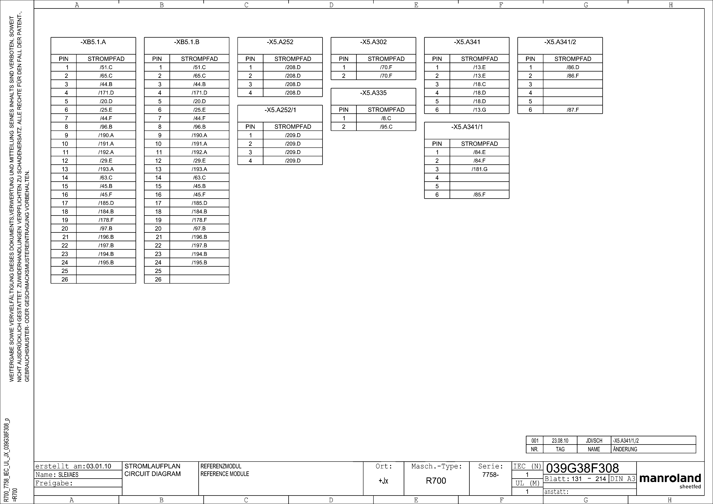

# +Jx — Sheet 131 of 214 — REFERENZMODUL

**REFERENCE MODULE**

> Part of the manroland **R700** printing press IEC/UL circuit diagrams.
> Drawing class: **Stromlaufplan / Circuit diagram** (DIN A3).
> Document `+Jx` covers the **1st printing module + feed register** machine section.

## At a glance

| Field | Value |
|---|---|
| Document | `+Jx`  (039G38F308) |
| Sheet | **131** of 214 |
| Section (DE) | REFERENZMODUL |
| Section (EN) | REFERENCE MODULE |
| Section type | REFERENCE_MODULE — Reference module |
| Machine type | `R700` |
| Series | `7758` |
| Created | 03.01.10 |
| Replaces | — |
| Columns used | A, B, C, D, E, F, G |
| Path numbers | — |
| Labels on sheet | 190 |
| Cross-refs out | 73 |
| Cross-refs in | 0 |

**Previous:** [+Jx sheet 130](SHEET_0130.md) · **Next:** [+Jx sheet 132](SHEET_0132.md) · **Document TOC:** [_TOC.md](_TOC.md)  (+Jx) · **Master TOC:** [all sheets](../_MASTER_TOC.md)

## Sheet image (300 DPI, exact vector render)



_Rendered directly from the PDF vector layer at 300 DPI (1-bit), no OCR and no resampling. Use it to confirm anything ambiguous in the text below._

## Cross-references on this sheet

Each entry is a wire leaving this sheet. The printed token is `/sheet.column`; the link resolves to that sheet inside the same document.

| Ref | Target sheet | Col | Path | Destination on target | Target section | From col |
|---|---|---|---|---|---|---|
| `/13.E` | [+Jx sheet 13](SHEET_0013.md) | E | — | — | SPANNUNGSVERSORGUNG, SCHALTSCHRANKBELÜFTUNG | F |
| `/70.F` | [+Jx sheet 70](SHEET_0070.md) | F | — | — | MOTOR: UMFANGSREGISTER | E |
| `/51.C` | [+Jx sheet 51](SHEET_0051.md) | C | — | — | SIGNALGEBER: AKUSTISCHE WARNSIGNALE | A |
| `/51.C` | [+Jx sheet 51](SHEET_0051.md) | C | — | — | SIGNALGEBER: AKUSTISCHE WARNSIGNALE | B |
| `/86.D` | [+Jx sheet 86](SHEET_0086.md) | D | — | — | BOGENFÜHRUNG | G |
| `/208.D` | [+Jx sheet 208](SHEET_0208.md) | D | — | — | OPTION: WASCHMITTELWECHSELBETRIEB | D |
| `/13.E` | [+Jx sheet 13](SHEET_0013.md) | E | — | — | SPANNUNGSVERSORGUNG, SCHALTSCHRANKBELÜFTUNG | F |
| `/70.F` | [+Jx sheet 70](SHEET_0070.md) | F | — | — | MOTOR: UMFANGSREGISTER | E |
| `/86.F` | [+Jx sheet 86](SHEET_0086.md) | F | — | — | BOGENFÜHRUNG | G |
| `/65.C` | [+Jx sheet 65](SHEET_0065.md) | C | — | — | TROPFEINRICHTUNG | A |
| `/65.C` | [+Jx sheet 65](SHEET_0065.md) | C | — | — | TROPFEINRICHTUNG | B |
| `/208.D` | [+Jx sheet 208](SHEET_0208.md) | D | — | — | OPTION: WASCHMITTELWECHSELBETRIEB | D |
| `/44.B` | [+Jx sheet 44](SHEET_0044.md) | B | — | — | MASCHINENBEDIENUNG | A |
| `/44.B` | [+Jx sheet 44](SHEET_0044.md) | B | — | — | MASCHINENBEDIENUNG | B |
| `/18.C` | [+Jx sheet 18](SHEET_0018.md) | C | — | — | LACKPUMPE | F |
| `/208.D` | [+Jx sheet 208](SHEET_0208.md) | D | — | — | OPTION: WASCHMITTELWECHSELBETRIEB | D |
| `/18.D` | [+Jx sheet 18](SHEET_0018.md) | D | — | — | LACKPUMPE | F |
| `/171.D` | [+Jx sheet 171](SHEET_0171.md) | D | — | — | OPTION: AUTOMATISCHEM SPÜLEN | A |
| `/171.D` | [+Jx sheet 171](SHEET_0171.md) | D | — | — | OPTION: AUTOMATISCHEM SPÜLEN | B |
| `/208.D` | [+Jx sheet 208](SHEET_0208.md) | D | — | — | OPTION: WASCHMITTELWECHSELBETRIEB | D |
| `/20.D` | [+Jx sheet 20](SHEET_0020.md) | D | — | — | LACKPUMPE | A |
| `/20.D` | [+Jx sheet 20](SHEET_0020.md) | D | — | — | LACKPUMPE | B |
| `/18.D` | [+Jx sheet 18](SHEET_0018.md) | D | — | — | LACKPUMPE | F |
| `/25.E` | [+Jx sheet 25](SHEET_0025.md) | E | — | — | HILFSANTRIEB, LACKDOSIER /AUFTRAGSWALZEN | A |
| `/25.E` | [+Jx sheet 25](SHEET_0025.md) | E | — | — | HILFSANTRIEB, LACKDOSIER /AUFTRAGSWALZEN | B |
| `/13.G` | [+Jx sheet 13](SHEET_0013.md) | G | — | — | SPANNUNGSVERSORGUNG, SCHALTSCHRANKBELÜFTUNG | F |
| `/87.F` | [+Jx sheet 87](SHEET_0087.md) | F | — | — | BOGENFÜHRUNG | G |
| `/44.F` | [+Jx sheet 44](SHEET_0044.md) | F | — | — | MASCHINENBEDIENUNG | A |
| `/44.F` | [+Jx sheet 44](SHEET_0044.md) | F | — | — | MASCHINENBEDIENUNG | B |
| `/8.C` | [+Jx sheet 8](SHEET_0008.md) | C | — | — | SPANNUNGSVERSORGUNG, SCHALTSCHRANKBELÜFTUNG | E |
| `/96.B` | [+Jx sheet 96](SHEET_0096.md) | B | — | — | RESERVE | A |
| `/96.B` | [+Jx sheet 96](SHEET_0096.md) | B | — | — | RESERVE | B |
| `/95.C` | [+Jx sheet 95](SHEET_0095.md) | C | — | — | RESERVE | E |
| `/190.A` | [+Jx sheet 190](SHEET_0190.md) | A | — | — | OPTION: ZWISCHENTROCKNER, VORBEREITUNG | A |
| `/190.A` | [+Jx sheet 190](SHEET_0190.md) | A | — | — | OPTION: ZWISCHENTROCKNER, VORBEREITUNG | B |
| `/209.D` | [+Jx sheet 209](SHEET_0209.md) | D | — | — | OPTION: WASCHMITTELWECHSELBETRIEB | D |
| `/191.A` | [+Jx sheet 191](SHEET_0191.md) | A | — | — | OPTION: ZWISCHENTROCKNER, VORBEREITUNG | A |
| `/191.A` | [+Jx sheet 191](SHEET_0191.md) | A | — | — | OPTION: ZWISCHENTROCKNER, VORBEREITUNG | B |
| `/209.D` | [+Jx sheet 209](SHEET_0209.md) | D | — | — | OPTION: WASCHMITTELWECHSELBETRIEB | D |
| `/84.E` | [+Jx sheet 84](SHEET_0084.md) | E | — | — | BOGENFÜHRUNG | F |
| `/192.A` | [+Jx sheet 192](SHEET_0192.md) | A | — | — | OPTION: ZWISCHENTROCKNER, VORBEREITUNG | A |
| `/192.A` | [+Jx sheet 192](SHEET_0192.md) | A | — | — | OPTION: ZWISCHENTROCKNER, VORBEREITUNG | B |
| `/209.D` | [+Jx sheet 209](SHEET_0209.md) | D | — | — | OPTION: WASCHMITTELWECHSELBETRIEB | D |
| `/29.E` | [+Jx sheet 29](SHEET_0029.md) | E | — | — | KAMMERRAKEL | A |
| `/29.E` | [+Jx sheet 29](SHEET_0029.md) | E | — | — | KAMMERRAKEL | B |
| `/84.F` | [+Jx sheet 84](SHEET_0084.md) | F | — | — | BOGENFÜHRUNG | F |
| `/209.D` | [+Jx sheet 209](SHEET_0209.md) | D | — | — | OPTION: WASCHMITTELWECHSELBETRIEB | D |
| `/193.A` | [+Jx sheet 193](SHEET_0193.md) | A | — | — | OPTION: ZWISCHENTROCKNER, VORBEREITUNG | A |
| `/193.A` | [+Jx sheet 193](SHEET_0193.md) | A | — | — | OPTION: ZWISCHENTROCKNER, VORBEREITUNG | B |
| `/181.G` | [+Jx sheet 181](SHEET_0181.md) | G | — | — | OPTION: TRANSFERMODUL 2 | F |
| `/63.C` | [+Jx sheet 63](SHEET_0063.md) | C | — | — | LACKAUFTRAGSWALZE | A |
| `/63.C` | [+Jx sheet 63](SHEET_0063.md) | C | — | — | LACKAUFTRAGSWALZE | B |
| `/45.B` | [+Jx sheet 45](SHEET_0045.md) | B | — | — | MASCHINENBEDIENUNG | A |
| `/45.B` | [+Jx sheet 45](SHEET_0045.md) | B | — | — | MASCHINENBEDIENUNG | B |
| `/45.F` | [+Jx sheet 45](SHEET_0045.md) | F | — | — | MASCHINENBEDIENUNG | A |
| `/45.F` | [+Jx sheet 45](SHEET_0045.md) | F | — | — | MASCHINENBEDIENUNG | B |
| `/85.F` | [+Jx sheet 85](SHEET_0085.md) | F | — | — | BOGENFÜHRUNG | F |
| `/185.D` | [+Jx sheet 185](SHEET_0185.md) | D | — | — | OPTION: TRANSFERMODUL 1 + 2 | A |
| `/185.D` | [+Jx sheet 185](SHEET_0185.md) | D | — | — | OPTION: TRANSFERMODUL 1 + 2 | B |
| `/184.B` | [+Jx sheet 184](SHEET_0184.md) | B | — | — | OPTION: TRANSFERMODUL 1 + 2 | A |
| `/184.B` | [+Jx sheet 184](SHEET_0184.md) | B | — | — | OPTION: TRANSFERMODUL 1 + 2 | B |
| `/178.F` | [+Jx sheet 178](SHEET_0178.md) | F | — | — | OPTION: TRANSFERMODUL 1 NACH | A |
| `/178.F` | [+Jx sheet 178](SHEET_0178.md) | F | — | — | OPTION: TRANSFERMODUL 1 NACH | B |
| `/97.B` | [+Jx sheet 97](SHEET_0097.md) | B | — | — | RESERVE | A |
| `/97.B` | [+Jx sheet 97](SHEET_0097.md) | B | — | — | RESERVE | B |
| `/196.B` | [+Jx sheet 196](SHEET_0196.md) | B | — | — | OPTION: ZWISCHENTROCKNER, VORBEREITUNG | A |
| `/196.B` | [+Jx sheet 196](SHEET_0196.md) | B | — | — | OPTION: ZWISCHENTROCKNER, VORBEREITUNG | B |
| `/197.B` | [+Jx sheet 197](SHEET_0197.md) | B | — | — | OPTION: ZWISCHENTROCKNER, VORBEREITUNG | A |
| `/197.B` | [+Jx sheet 197](SHEET_0197.md) | B | — | — | OPTION: ZWISCHENTROCKNER, VORBEREITUNG | B |
| `/194.B` | [+Jx sheet 194](SHEET_0194.md) | B | — | — | OPTION: ZWISCHENTROCKNER, VORBEREITUNG | A |
| `/194.B` | [+Jx sheet 194](SHEET_0194.md) | B | — | — | OPTION: ZWISCHENTROCKNER, VORBEREITUNG | B |
| `/195.B` | [+Jx sheet 195](SHEET_0195.md) | B | — | — | OPTION: ZWISCHENTROCKNER, VORBEREITUNG | A |
| `/195.B` | [+Jx sheet 195](SHEET_0195.md) | B | — | — | OPTION: ZWISCHENTROCKNER, VORBEREITUNG | B |

## Devices on this sheet

| Tag | Class | Class meaning (IEC) | Col | Sub | Terminal | Sign |
|---|---|---|---|---|---|---|
| `X5.A252` | — | cross-device reference | C | — | — | — |
| `XB5.1.B` | — | cross-device reference | B | — | — | — |
| `XB5.1.A` | — | cross-device reference | A | — | — | — |
| `X5.A302` | — | cross-device reference | E | — | — | — |
| `X5.A335` | — | cross-device reference | D | — | — | — |
| `X5.A341` | — | cross-device reference | F | — | — | — |
| `NR.` | — | cross-device reference | F | — | — | — |
| `23.08.10` | — | cross-device reference | G | — | — | — |

## Potentials / nets

_No named potentials on this sheet._

## Wire-end annotations (grouped as printed)

A wire that continues elsewhere is annotated with a small cluster: the destination description, the path/line number `#NN`, and the `/sheet.column` cross reference. Each row below is one such cluster exactly as it is grouped on the drawing.

| Col | Y | Path | Cross-ref | Text on the wire |
|---|---|---|---|---|
| C | 65.4 | — | — | `X5.A252` |
| E | 65.4 | — | — | `X5.A302` |
| F | 65.4 | — | — | `X5.A341` |
| G | 65.4 | — | — | `X5.A341/2` |
| A | 65.5 | — | — | `XB5.1.A` |
| B | 65.5 | — | — | `XB5.1.B` |
| A | 94.1 | — | — | `PIN STROMPFAD` |
| B | 94.1 | — | — | `PIN STROMPFAD` |
| C | 94.1 | — | — | `PIN 2 3 4 1 STROMPFAD` |
| D | 94.1 | — | — | `PIN 2 1 STROMPFAD` |
| F | 94.1 | — | — | `PIN 2 3 5 6 4 1 STROMPFAD` |
| G | 94.1 | — | — | `PIN 2 3 5 6 4 1 STROMPFAD` |
| A | 108.3 | — | — | `2 3 4 5 6 7 8 9 1` |
| B | 108.3 | — | — | `2 3 4 5 6 7 8 9 1` |
| E | 108.6 | — | `/70.F` | — |
| F | 108.6 | — | `/13.E` | — |
| A | 108.7 | — | `/51.C` | — |
| B | 108.7 | — | `/51.C` | — |
| D | 108.7 | — | `/208.D` | — |
| G | 108.7 | — | `/86.D` | — |
| A | 122.8 | — | `/65.C` | — |
| B | 122.8 | — | `/65.C` | — |
| D | 122.8 | — | `/208.D` | — |
| E | 122.8 | — | `/70.F` | — |
| F | 122.8 | — | `/13.E` | — |
| G | 122.8 | — | `/86.F` | — |
| A | 137.0 | — | `/44.B` | — |
| B | 137.0 | — | `/44.B` | — |
| D | 137.0 | — | `/208.D` | — |
| F | 137.0 | — | `/18.C` | — |
| D | 150.5 | — | — | `X5.A335` |
| A | 151.2 | — | `/171.D` | — |
| B | 151.2 | — | `/171.D` | — |
| D | 151.2 | — | `/208.D` | — |
| F | 151.2 | — | `/18.D` | — |
| A | 165.3 | — | `/20.D` | — |
| B | 165.3 | — | `/20.D` | — |
| F | 165.3 | — | `/18.D` | — |
| C | 178.8 | — | — | `X5.A252/1` |
| D | 179.1 | — | — | `PIN 2 1 STROMPFAD` |
| A | 179.5 | — | `/25.E` | — |
| B | 179.5 | — | `/25.E` | — |
| F | 179.5 | — | `/13.G` | — |
| G | 179.5 | — | `/87.F` | — |
| A | 193.7 | — | `/44.F` | — |
| B | 193.7 | — | `/44.F` | — |
| E | 193.7 | — | `/8.C` | — |
| F | 207.2 | — | — | `X5.A341/1` |
| C | 207.5 | — | — | `PIN 2 3 4 1 STROMPFAD` |
| A | 207.8 | — | `/96.B` | — |
| B | 207.8 | — | `/96.B` | — |
| E | 207.9 | — | `/95.C` | — |
| A | 222.0 | — | `/190.A` | — |
| B | 222.0 | — | `/190.A` | — |
| D | 222.0 | — | `/209.D` | — |
| F | 235.8 | — | — | `PIN 2 3 5 6 4 1 STROMPFAD` |
| A | 235.9 | — | — | `10 12 13 14 15 16 17 18 19 20 11` |
| B | 235.9 | — | — | `10 12 13 14 15 16 17 18 19 20 11` |
| A | 236.2 | — | `/191.A` | — |
| B | 236.2 | — | `/191.A` | — |
| D | 236.2 | — | `/209.D` | — |
| F | 250.3 | — | `/84.E` | — |
| A | 250.4 | — | `/192.A` | — |
| B | 250.4 | — | `/192.A` | — |
| D | 250.4 | — | `/209.D` | — |
| A | 264.5 | — | `/29.E` | — |
| B | 264.5 | — | `/29.E` | — |
| F | 264.5 | — | `/84.F` | — |
| D | 264.6 | — | `/209.D` | — |
| A | 278.7 | — | `/193.A` | — |
| B | 278.7 | — | `/193.A` | — |
| F | 278.7 | — | `/181.G` | — |
| A | 292.9 | — | `/63.C` | — |
| B | 292.9 | — | `/63.C` | — |
| A | 307.0 | — | `/45.B` | — |
| B | 307.0 | — | `/45.B` | — |
| A | 321.2 | — | `/45.F` | — |
| B | 321.2 | — | `/45.F` | — |
| F | 321.2 | — | `/85.F` | — |
| A | 335.4 | — | `/185.D` | — |
| B | 335.4 | — | `/185.D` | — |
| A | 349.6 | — | `/184.B` | — |
| B | 349.6 | — | `/184.B` | — |
| A | 363.8 | — | `/178.F` | — |
| B | 363.8 | — | `/178.F` | — |
| A | 377.9 | — | `/97.B` | — |
| B | 377.9 | — | `/97.B` | — |
| A | 391.8 | — | — | `22 23 24 25 26 21` |
| B | 391.8 | — | — | `22 23 24 25 26 21` |
| A | 392.1 | — | `/196.B` | — |
| B | 392.1 | — | `/196.B` | — |
| A | 406.3 | — | `/197.B` | — |
| B | 406.3 | — | `/197.B` | — |
| A | 420.4 | — | `/194.B` | — |
| B | 420.4 | — | `/194.B` | — |
| A | 434.6 | — | `/195.B` | — |
| B | 434.6 | — | `/195.B` | — |
| G | 733.0 | — | — | `001 23.08.10 JDI/SCH X5.A341/1,/2` |
| G | 747.1 | — | — | `NR. TAG NAME ÄNDERUNG` |


## Reconstructed tables

This sheet carries tabular content (pin map / terminal assignment / index). The grid below was rebuilt from the drawing's own rule lines, so each row is exactly one physical row of the table.

### Table 1 — 26 data rows × 2 columns (at x=85.0, y=62.4) — **XB5.1.A**

| PIN | STROMPFAD |
|---|---|
| `1` | `/51.C` |
| `2` | `/65.C` |
| `3` | `/44.B` |
| `4` | `/171.D` |
| `5` | `/20.D` |
| `6` | `/25.E` |
| `7` | `/44.F` |
| `8` | `/96.B` |
| `9` | `/190.A` |
| `10` | `/191.A` |
| `11` | `/192.A` |
| `12` | `/29.E` |
| `13` | `/193.A` |
| `14` | `/63.C` |
| `15` | `/45.B` |
| `16` | `/45.F` |
| `17` | `/185.D` |
| `18` | `/184.B` |
| `19` | `/178.F` |
| `20` | `/97.B` |
| `21` | `/196.B` |
| `22` | `/197.B` |
| `23` | `/194.B` |
| `24` | `/195.B` |
| `25` |  |
| `26` |  |


### Table 2 — 26 data rows × 2 columns (at x=240.9, y=62.4) — **XB5.1.B**

| PIN | STROMPFAD |
|---|---|
| `1` | `/51.C` |
| `2` | `/65.C` |
| `3` | `/44.B` |
| `4` | `/171.D` |
| `5` | `/20.D` |
| `6` | `/25.E` |
| `7` | `/44.F` |
| `8` | `/96.B` |
| `9` | `/190.A` |
| `10` | `/191.A` |
| `11` | `/192.A` |
| `12` | `/29.E` |
| `13` | `/193.A` |
| `14` | `/63.C` |
| `15` | `/45.B` |
| `16` | `/45.F` |
| `17` | `/185.D` |
| `18` | `/184.B` |
| `19` | `/178.F` |
| `20` | `/97.B` |
| `21` | `/196.B` |
| `22` | `/197.B` |
| `23` | `/194.B` |
| `24` | `/195.B` |
| `25` |  |
| `26` |  |


### Table 3 — 10 data rows × 2 columns (at x=396.9, y=62.4) — **X5.A252**

| PIN | STROMPFAD |
|---|---|
| `1` | `/208.D` |
| `2` | `/208.D` |
| `3` | `/208.D` |
| `4` | `/208.D` |
|  | `X5.A252/1` |
| `PIN` | `STROMPFAD` |
| `1` | `/209.D` |
| `2` | `/209.D` |
| `3` | `/209.D` |
| `4` | `/209.D` |


### Table 4 — 6 data rows × 2 columns (at x=552.8, y=62.4) — **X5.A302**

| PIN | STROMPFAD |
|---|---|
| `1` | `/70.F` |
| `2` | `/70.F` |
|  | `X5.A335` |
| `PIN` | `STROMPFAD` |
| `1` | `/8.C` |
| `2` | `/95.C` |


### Table 5 — 14 data rows × 2 columns (at x=708.7, y=62.4) — **X5.A341**

| PIN | STROMPFAD |
|---|---|
| `1` | `/13.E` |
| `2` | `/13.E` |
| `3` | `/18.C` |
| `4` | `/18.D` |
| `5` | `/18.D` |
| `6` | `/13.G` |
|  | `X5.A341/1` |
| `PIN` | `STROMPFAD` |
| `1` | `/84.E` |
| `2` | `/84.F` |
| `3` | `/181.G` |
| `4` |  |
| `5` |  |
| `6` | `/85.F` |


### Table 6 — 6 data rows × 2 columns (at x=864.6, y=62.4) — **X5.A341/2**

| PIN | STROMPFAD |
|---|---|
| `1` | `/86.D` |
| `2` | `/86.F` |
| `3` |  |
| `4` |  |
| `5` |  |
| `6` | `/87.F` |


## Notes and free text on this sheet

| Text | Col | Y (pt) |
|---|---|---|
| `PIN` | C | 94.13 |
| `STROMPFAD` | D | 94.09 |
| `X5.A252/1` | C | 178.83 |
| `PIN` | B | 94.13 |
| `STROMPFAD` | B | 94.09 |
| `PIN` | A | 94.13 |
| `STROMPFAD` | A | 94.09 |
| `PIN` | D | 94.13 |
| `STROMPFAD` | E | 94.09 |
| `PIN` | E | 94.13 |
| `STROMPFAD` | F | 94.09 |
| `X5.A341/1` | F | 207.17 |
| `PIN` | F | 94.13 |
| `STROMPFAD` | G | 94.09 |
| `X5.A341/2` | G | 65.44 |
| `TAG` | G | 747.23 |
| `NAME` | G | 747.22 |
| `ÄNDERUNG` | G | 747.25 |
| `JDI/SCH` | G | 733.05 |
| `X5.A341/1,/2` | G | 733.07 |

## Complete label inventory (exact text from the drawing)

Every text object inside the drawing area of this sheet, in DIN reading order (column A→H, then top→bottom). This is the authoritative list: if a string is not here it is not printed on this sheet.

| Col | Y | X | Dir | Type | Text |
|---|---|---|---|---|---|
| A | 65.5 | 134.6 | → | device ref | `XB5.1.A` |
| A | 94.1 | 98.2 | → | text | `PIN` |
| A | 94.1 | 146.6 | → | text | `STROMPFAD` |
| A | 108.3 | 109.7 | → | number | `1` |
| A | 108.7 | 166.8 | → | cross-reference | `/51.C` |
| A | 122.5 | 108.3 | → | number | `2` |
| A | 122.8 | 166.8 | → | cross-reference | `/65.C` |
| A | 136.7 | 108.3 | → | number | `3` |
| A | 137.0 | 167.0 | → | cross-reference | `/44.B` |
| A | 150.8 | 108.3 | → | number | `4` |
| A | 151.2 | 164.4 | → | cross-reference | `/171.D` |
| A | 165.0 | 108.3 | → | number | `5` |
| A | 165.3 | 166.8 | → | cross-reference | `/20.D` |
| A | 179.2 | 108.3 | → | number | `6` |
| A | 179.5 | 167.0 | → | cross-reference | `/25.E` |
| A | 193.3 | 108.3 | → | number | `7` |
| A | 193.7 | 167.2 | → | cross-reference | `/44.F` |
| A | 207.5 | 108.3 | → | number | `8` |
| A | 207.8 | 167.0 | → | cross-reference | `/96.B` |
| A | 221.7 | 108.3 | → | number | `9` |
| A | 222.0 | 164.4 | → | cross-reference | `/190.A` |
| A | 235.9 | 102.9 | → | number | `10` |
| A | 236.2 | 164.4 | → | cross-reference | `/191.A` |
| A | 250.0 | 104.3 | → | number | `11` |
| A | 250.4 | 164.4 | → | cross-reference | `/192.A` |
| A | 264.2 | 102.9 | → | number | `12` |
| A | 264.5 | 167.0 | → | cross-reference | `/29.E` |
| A | 278.4 | 102.9 | → | number | `13` |
| A | 278.7 | 164.4 | → | cross-reference | `/193.A` |
| A | 292.6 | 102.9 | → | number | `14` |
| A | 292.9 | 166.8 | → | cross-reference | `/63.C` |
| A | 306.7 | 102.9 | → | number | `15` |
| A | 307.0 | 167.0 | → | cross-reference | `/45.B` |
| A | 320.9 | 102.9 | → | number | `16` |
| A | 321.2 | 167.2 | → | cross-reference | `/45.F` |
| A | 335.1 | 102.9 | → | number | `17` |
| A | 335.4 | 164.4 | → | cross-reference | `/185.D` |
| A | 349.3 | 102.9 | → | number | `18` |
| A | 349.6 | 164.6 | → | cross-reference | `/184.B` |
| A | 363.4 | 102.9 | → | number | `19` |
| A | 363.8 | 164.8 | → | cross-reference | `/178.F` |
| A | 377.6 | 102.9 | → | number | `20` |
| A | 377.9 | 167.0 | → | cross-reference | `/97.B` |
| A | 391.8 | 104.3 | → | number | `21` |
| A | 392.1 | 164.6 | → | cross-reference | `/196.B` |
| A | 405.9 | 102.9 | → | number | `22` |
| A | 406.3 | 164.6 | → | cross-reference | `/197.B` |
| A | 420.1 | 102.9 | → | number | `23` |
| A | 420.4 | 164.6 | → | cross-reference | `/194.B` |
| A | 434.3 | 102.9 | → | number | `24` |
| A | 434.6 | 164.6 | → | cross-reference | `/195.B` |
| A | 448.5 | 102.9 | → | number | `25` |
| A | 462.6 | 102.9 | → | number | `26` |
| B | 65.5 | 290.8 | → | device ref | `XB5.1.B` |
| B | 94.1 | 254.1 | → | text | `PIN` |
| B | 94.1 | 302.5 | → | text | `STROMPFAD` |
| B | 108.3 | 265.6 | → | number | `1` |
| B | 108.7 | 322.7 | → | cross-reference | `/51.C` |
| B | 122.5 | 264.2 | → | number | `2` |
| B | 122.8 | 322.7 | → | cross-reference | `/65.C` |
| B | 136.7 | 264.2 | → | number | `3` |
| B | 137.0 | 322.9 | → | cross-reference | `/44.B` |
| B | 150.8 | 264.2 | → | number | `4` |
| B | 151.2 | 320.3 | → | cross-reference | `/171.D` |
| B | 165.0 | 264.2 | → | number | `5` |
| B | 165.3 | 322.7 | → | cross-reference | `/20.D` |
| B | 179.2 | 264.2 | → | number | `6` |
| B | 179.5 | 322.9 | → | cross-reference | `/25.E` |
| B | 193.3 | 264.2 | → | number | `7` |
| B | 193.7 | 323.1 | → | cross-reference | `/44.F` |
| B | 207.5 | 264.2 | → | number | `8` |
| B | 207.8 | 322.9 | → | cross-reference | `/96.B` |
| B | 221.7 | 264.2 | → | number | `9` |
| B | 222.0 | 320.3 | → | cross-reference | `/190.A` |
| B | 235.9 | 258.8 | → | number | `10` |
| B | 236.2 | 320.3 | → | cross-reference | `/191.A` |
| B | 250.0 | 260.2 | → | number | `11` |
| B | 250.4 | 320.3 | → | cross-reference | `/192.A` |
| B | 264.2 | 258.8 | → | number | `12` |
| B | 264.5 | 322.9 | → | cross-reference | `/29.E` |
| B | 278.4 | 258.8 | → | number | `13` |
| B | 278.7 | 320.3 | → | cross-reference | `/193.A` |
| B | 292.6 | 258.8 | → | number | `14` |
| B | 292.9 | 322.7 | → | cross-reference | `/63.C` |
| B | 306.7 | 258.8 | → | number | `15` |
| B | 307.0 | 322.9 | → | cross-reference | `/45.B` |
| B | 320.9 | 258.8 | → | number | `16` |
| B | 321.2 | 323.1 | → | cross-reference | `/45.F` |
| B | 335.1 | 258.8 | → | number | `17` |
| B | 335.4 | 320.3 | → | cross-reference | `/185.D` |
| B | 349.3 | 258.8 | → | number | `18` |
| B | 349.6 | 320.5 | → | cross-reference | `/184.B` |
| B | 363.4 | 258.8 | → | number | `19` |
| B | 363.8 | 320.7 | → | cross-reference | `/178.F` |
| B | 377.6 | 258.8 | → | number | `20` |
| B | 377.9 | 322.9 | → | cross-reference | `/97.B` |
| B | 391.8 | 260.2 | → | number | `21` |
| B | 392.1 | 320.5 | → | cross-reference | `/196.B` |
| B | 405.9 | 258.8 | → | number | `22` |
| B | 406.3 | 320.5 | → | cross-reference | `/197.B` |
| B | 420.1 | 258.8 | → | number | `23` |
| B | 420.4 | 320.5 | → | cross-reference | `/194.B` |
| B | 434.3 | 258.8 | → | number | `24` |
| B | 434.6 | 320.5 | → | cross-reference | `/195.B` |
| B | 448.5 | 258.8 | → | number | `25` |
| B | 462.6 | 258.8 | → | number | `26` |
| C | 65.4 | 445.7 | → | device ref | `X5.A252` |
| C | 94.1 | 410.0 | → | text | `PIN` |
| C | 108.3 | 415.8 | → | number | `1` |
| C | 122.5 | 415.4 | → | number | `2` |
| C | 136.7 | 415.4 | → | number | `3` |
| C | 150.8 | 415.6 | → | number | `4` |
| C | 178.8 | 442.1 | → | text | `X5.A252/1` |
| C | 207.5 | 410.0 | → | text | `PIN` |
| C | 221.7 | 415.8 | → | number | `1` |
| C | 235.9 | 415.4 | → | number | `2` |
| C | 250.0 | 415.4 | → | number | `3` |
| C | 264.2 | 415.6 | → | number | `4` |
| D | 94.1 | 458.4 | → | text | `STROMPFAD` |
| D | 94.1 | 565.9 | → | text | `PIN` |
| D | 108.3 | 571.7 | → | number | `1` |
| D | 108.7 | 476.2 | → | cross-reference | `/208.D` |
| D | 122.5 | 571.3 | → | number | `2` |
| D | 122.8 | 476.2 | → | cross-reference | `/208.D` |
| D | 137.0 | 476.2 | → | cross-reference | `/208.D` |
| D | 150.5 | 601.5 | → | device ref | `X5.A335` |
| D | 151.2 | 476.2 | → | cross-reference | `/208.D` |
| D | 179.2 | 565.9 | → | text | `PIN` |
| D | 193.3 | 571.7 | → | number | `1` |
| D | 207.5 | 458.4 | → | text | `STROMPFAD` |
| D | 207.5 | 571.3 | → | number | `2` |
| D | 222.0 | 476.2 | → | cross-reference | `/209.D` |
| D | 236.2 | 476.2 | → | cross-reference | `/209.D` |
| D | 250.4 | 476.2 | → | cross-reference | `/209.D` |
| D | 264.6 | 476.2 | → | cross-reference | `/209.D` |
| E | 65.4 | 601.7 | → | device ref | `X5.A302` |
| E | 94.1 | 614.3 | → | text | `STROMPFAD` |
| E | 94.1 | 721.8 | → | text | `PIN` |
| E | 108.3 | 727.7 | → | number | `1` |
| E | 108.6 | 635.0 | → | cross-reference | `/70.F` |
| E | 122.5 | 727.2 | → | number | `2` |
| E | 122.8 | 635.0 | → | cross-reference | `/70.F` |
| E | 136.7 | 727.2 | → | number | `3` |
| E | 150.8 | 727.4 | → | number | `4` |
| E | 165.0 | 727.2 | → | number | `5` |
| E | 179.1 | 614.3 | → | text | `STROMPFAD` |
| E | 179.2 | 727.2 | → | number | `6` |
| E | 193.7 | 636.9 | → | cross-reference | `/8.C` |
| E | 207.9 | 634.5 | → | cross-reference | `/95.C` |
| E | 235.9 | 721.8 | → | text | `PIN` |
| E | 250.0 | 727.7 | → | number | `1` |
| E | 264.2 | 727.2 | → | number | `2` |
| E | 278.4 | 727.2 | → | number | `3` |
| E | 292.6 | 727.4 | → | number | `4` |
| E | 306.7 | 727.2 | → | number | `5` |
| E | 320.9 | 727.2 | → | number | `6` |
| F | 65.4 | 758.3 | → | device ref | `X5.A341` |
| F | 94.1 | 770.2 | → | text | `STROMPFAD` |
| F | 94.1 | 877.7 | → | text | `PIN` |
| F | 108.3 | 883.6 | → | number | `1` |
| F | 108.6 | 790.6 | → | cross-reference | `/13.E` |
| F | 122.5 | 883.1 | → | number | `2` |
| F | 122.8 | 790.6 | → | cross-reference | `/13.E` |
| F | 136.7 | 883.1 | → | number | `3` |
| F | 137.0 | 790.4 | → | cross-reference | `/18.C` |
| F | 150.8 | 883.3 | → | number | `4` |
| F | 151.2 | 790.4 | → | cross-reference | `/18.D` |
| F | 165.0 | 883.1 | → | number | `5` |
| F | 165.3 | 790.4 | → | cross-reference | `/18.D` |
| F | 179.2 | 883.1 | → | number | `6` |
| F | 179.5 | 790.2 | → | cross-reference | `/13.G` |
| F | 207.2 | 753.9 | → | text | `X5.A341/1` |
| F | 235.8 | 770.2 | → | text | `STROMPFAD` |
| F | 250.3 | 790.6 | → | cross-reference | `/84.E` |
| F | 264.5 | 790.9 | → | cross-reference | `/84.F` |
| F | 278.7 | 787.7 | → | cross-reference | `/181.G` |
| F | 321.2 | 790.9 | → | cross-reference | `/85.F` |
| F | 733.0 | 887.6 | → | number | `001` |
| F | 747.1 | 886.8 | → | device ref | `NR.` |
| G | 65.4 | 909.1 | → | text | `X5.A341/2` |
| G | 94.1 | 926.1 | → | text | `STROMPFAD` |
| G | 108.7 | 946.3 | → | cross-reference | `/86.D` |
| G | 122.8 | 946.8 | → | cross-reference | `/86.F` |
| G | 179.5 | 946.8 | → | cross-reference | `/87.F` |
| G | 733.1 | 921.9 | → | device ref | `23.08.10` |
| G | 733.1 | 978.6 | → | text | `JDI/SCH` |
| G | 733.1 | 1023.7 | → | text | `X5.A341/1,/2` |
| G | 747.2 | 928.5 | → | text | `TAG` |
| G | 747.2 | 981.8 | → | text | `NAME` |
| G | 747.3 | 1024.0 | → | text | `ÄNDERUNG` |

## Reading-order text block

The same content as a plain block, grouped by DIN column — convenient to paste or to match against a visual description.

```text
=== Column A ===
  65.5  134.6  devref       XB5.1.A
  94.1   98.2  text         PIN
  94.1  146.6  text         STROMPFAD
 108.3  109.7  numeric      1
 108.7  166.8  xref         /51.C
 122.5  108.3  numeric      2
 122.8  166.8  xref         /65.C
 136.7  108.3  numeric      3
 137.0  167.0  xref         /44.B
 150.8  108.3  numeric      4
 151.2  164.4  xref         /171.D
 165.0  108.3  numeric      5
 165.3  166.8  xref         /20.D
 179.2  108.3  numeric      6
 179.5  167.0  xref         /25.E
 193.3  108.3  numeric      7
 193.7  167.2  xref         /44.F
 207.5  108.3  numeric      8
 207.8  167.0  xref         /96.B
 221.7  108.3  numeric      9
 222.0  164.4  xref         /190.A
 235.9  102.9  numeric      10
 236.2  164.4  xref         /191.A
 250.0  104.3  numeric      11
 250.4  164.4  xref         /192.A
 264.2  102.9  numeric      12
 264.5  167.0  xref         /29.E
 278.4  102.9  numeric      13
 278.7  164.4  xref         /193.A
 292.6  102.9  numeric      14
 292.9  166.8  xref         /63.C
 306.7  102.9  numeric      15
 307.0  167.0  xref         /45.B
 320.9  102.9  numeric      16
 321.2  167.2  xref         /45.F
 335.1  102.9  numeric      17
 335.4  164.4  xref         /185.D
 349.3  102.9  numeric      18
 349.6  164.6  xref         /184.B
 363.4  102.9  numeric      19
 363.8  164.8  xref         /178.F
 377.6  102.9  numeric      20
 377.9  167.0  xref         /97.B
 391.8  104.3  numeric      21
 392.1  164.6  xref         /196.B
 405.9  102.9  numeric      22
 406.3  164.6  xref         /197.B
 420.1  102.9  numeric      23
 420.4  164.6  xref         /194.B
 434.3  102.9  numeric      24
 434.6  164.6  xref         /195.B
 448.5  102.9  numeric      25
 462.6  102.9  numeric      26
=== Column B ===
  65.5  290.8  devref       XB5.1.B
  94.1  254.1  text         PIN
  94.1  302.5  text         STROMPFAD
 108.3  265.6  numeric      1
 108.7  322.7  xref         /51.C
 122.5  264.2  numeric      2
 122.8  322.7  xref         /65.C
 136.7  264.2  numeric      3
 137.0  322.9  xref         /44.B
 150.8  264.2  numeric      4
 151.2  320.3  xref         /171.D
 165.0  264.2  numeric      5
 165.3  322.7  xref         /20.D
 179.2  264.2  numeric      6
 179.5  322.9  xref         /25.E
 193.3  264.2  numeric      7
 193.7  323.1  xref         /44.F
 207.5  264.2  numeric      8
 207.8  322.9  xref         /96.B
 221.7  264.2  numeric      9
 222.0  320.3  xref         /190.A
 235.9  258.8  numeric      10
 236.2  320.3  xref         /191.A
 250.0  260.2  numeric      11
 250.4  320.3  xref         /192.A
 264.2  258.8  numeric      12
 264.5  322.9  xref         /29.E
 278.4  258.8  numeric      13
 278.7  320.3  xref         /193.A
 292.6  258.8  numeric      14
 292.9  322.7  xref         /63.C
 306.7  258.8  numeric      15
 307.0  322.9  xref         /45.B
 320.9  258.8  numeric      16
 321.2  323.1  xref         /45.F
 335.1  258.8  numeric      17
 335.4  320.3  xref         /185.D
 349.3  258.8  numeric      18
 349.6  320.5  xref         /184.B
 363.4  258.8  numeric      19
 363.8  320.7  xref         /178.F
 377.6  258.8  numeric      20
 377.9  322.9  xref         /97.B
 391.8  260.2  numeric      21
 392.1  320.5  xref         /196.B
 405.9  258.8  numeric      22
 406.3  320.5  xref         /197.B
 420.1  258.8  numeric      23
 420.4  320.5  xref         /194.B
 434.3  258.8  numeric      24
 434.6  320.5  xref         /195.B
 448.5  258.8  numeric      25
 462.6  258.8  numeric      26
=== Column C ===
  65.4  445.7  devref       X5.A252
  94.1  410.0  text         PIN
 108.3  415.8  numeric      1
 122.5  415.4  numeric      2
 136.7  415.4  numeric      3
 150.8  415.6  numeric      4
 178.8  442.1  text         X5.A252/1
 207.5  410.0  text         PIN
 221.7  415.8  numeric      1
 235.9  415.4  numeric      2
 250.0  415.4  numeric      3
 264.2  415.6  numeric      4
=== Column D ===
  94.1  458.4  text         STROMPFAD
  94.1  565.9  text         PIN
 108.3  571.7  numeric      1
 108.7  476.2  xref         /208.D
 122.5  571.3  numeric      2
 122.8  476.2  xref         /208.D
 137.0  476.2  xref         /208.D
 150.5  601.5  devref       X5.A335
 151.2  476.2  xref         /208.D
 179.2  565.9  text         PIN
 193.3  571.7  numeric      1
 207.5  458.4  text         STROMPFAD
 207.5  571.3  numeric      2
 222.0  476.2  xref         /209.D
 236.2  476.2  xref         /209.D
 250.4  476.2  xref         /209.D
 264.6  476.2  xref         /209.D
=== Column E ===
  65.4  601.7  devref       X5.A302
  94.1  614.3  text         STROMPFAD
  94.1  721.8  text         PIN
 108.3  727.7  numeric      1
 108.6  635.0  xref         /70.F
 122.5  727.2  numeric      2
 122.8  635.0  xref         /70.F
 136.7  727.2  numeric      3
 150.8  727.4  numeric      4
 165.0  727.2  numeric      5
 179.1  614.3  text         STROMPFAD
 179.2  727.2  numeric      6
 193.7  636.9  xref         /8.C
 207.9  634.5  xref         /95.C
 235.9  721.8  text         PIN
 250.0  727.7  numeric      1
 264.2  727.2  numeric      2
 278.4  727.2  numeric      3
 292.6  727.4  numeric      4
 306.7  727.2  numeric      5
 320.9  727.2  numeric      6
=== Column F ===
  65.4  758.3  devref       X5.A341
  94.1  770.2  text         STROMPFAD
  94.1  877.7  text         PIN
 108.3  883.6  numeric      1
 108.6  790.6  xref         /13.E
 122.5  883.1  numeric      2
 122.8  790.6  xref         /13.E
 136.7  883.1  numeric      3
 137.0  790.4  xref         /18.C
 150.8  883.3  numeric      4
 151.2  790.4  xref         /18.D
 165.0  883.1  numeric      5
 165.3  790.4  xref         /18.D
 179.2  883.1  numeric      6
 179.5  790.2  xref         /13.G
 207.2  753.9  text         X5.A341/1
 235.8  770.2  text         STROMPFAD
 250.3  790.6  xref         /84.E
 264.5  790.9  xref         /84.F
 278.7  787.7  xref         /181.G
 321.2  790.9  xref         /85.F
 733.0  887.6  numeric      001
 747.1  886.8  devref       NR.
=== Column G ===
  65.4  909.1  text         X5.A341/2
  94.1  926.1  text         STROMPFAD
 108.7  946.3  xref         /86.D
 122.8  946.8  xref         /86.F
 179.5  946.8  xref         /87.F
 733.1  921.9  devref       23.08.10
 733.1  978.6  text         JDI/SCH
 733.1 1023.7  text         X5.A341/1,/2
 747.2  928.5  text         TAG
 747.2  981.8  text         NAME
 747.3 1024.0  text         ÄNDERUNG
```

---
_Generated from the PDF vector text layer; no OCR. Source: `R700_7758_IEC_UL_JX_039G38F308_p`, sheet 131._
