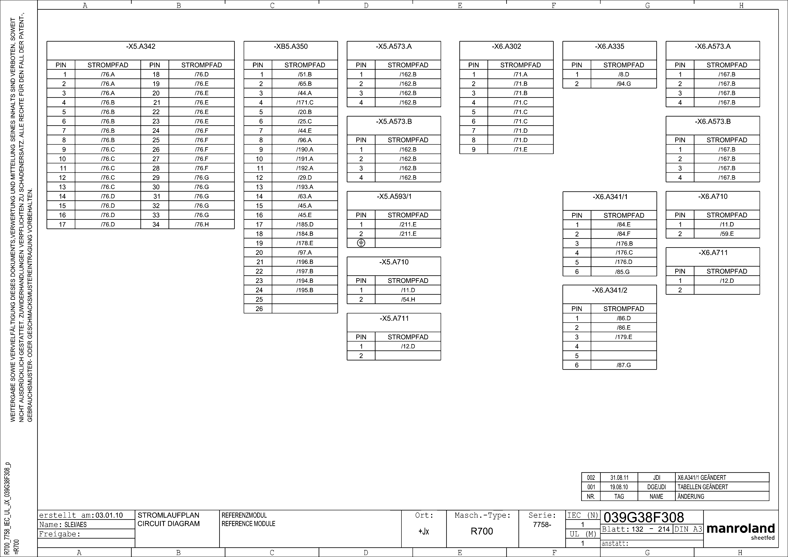

# +Jx — Sheet 132 of 214 — REFERENZMODUL

**REFERENCE MODULE**

> Part of the manroland **R700** printing press IEC/UL circuit diagrams.
> Drawing class: **Stromlaufplan / Circuit diagram** (DIN A3).
> Document `+Jx` covers the **1st printing module + feed register** machine section.

## At a glance

| Field | Value |
|---|---|
| Document | `+Jx`  (039G38F308) |
| Sheet | **132** of 214 |
| Section (DE) | REFERENZMODUL |
| Section (EN) | REFERENCE MODULE |
| Section type | REFERENCE_MODULE — Reference module |
| Machine type | `R700` |
| Series | `7758` |
| Created | 03.01.10 |
| Replaces | — |
| Columns used | A, B, C, D, E, F, G, H |
| Path numbers | — |
| Labels on sheet | 271 |
| Cross-refs out | 103 |
| Cross-refs in | 0 |

**Previous:** [+Jx sheet 131](SHEET_0131.md) · **Next:** [+Jx sheet 133](SHEET_0133.md) · **Document TOC:** [_TOC.md](_TOC.md)  (+Jx) · **Master TOC:** [all sheets](../_MASTER_TOC.md)

## Sheet image (300 DPI, exact vector render)



_Rendered directly from the PDF vector layer at 300 DPI (1-bit), no OCR and no resampling. Use it to confirm anything ambiguous in the text below._

## Cross-references on this sheet

Each entry is a wire leaving this sheet. The printed token is `/sheet.column`; the link resolves to that sheet inside the same document.

| Ref | Target sheet | Col | Path | Destination on target | Target section | From col |
|---|---|---|---|---|---|---|
| `/76.A` | [+Jx sheet 76](SHEET_0076.md) | A | — | — | BUSVERBINDUNGEN: SICHERHEITSKREIS | A |
| `/51.B` | [+Jx sheet 51](SHEET_0051.md) | B | — | — | SIGNALGEBER: AKUSTISCHE WARNSIGNALE | C |
| `/71.A` | [+Jx sheet 71](SHEET_0071.md) | A | — | — | MOTOR: SEITENREGISTER | F |
| `/162.B` | [+Jx sheet 162](SHEET_0162.md) | B | — | — | OPTION: | D |
| `/167.B` | [+Jx sheet 167](SHEET_0167.md) | B | — | — | OPTION: | H |
| `/8.D` | [+Jx sheet 8](SHEET_0008.md) | D | — | — | SPANNUNGSVERSORGUNG, SCHALTSCHRANKBELÜFTUNG | G |
| `/76.D` | [+Jx sheet 76](SHEET_0076.md) | D | — | — | BUSVERBINDUNGEN: SICHERHEITSKREIS | B |
| `/76.A` | [+Jx sheet 76](SHEET_0076.md) | A | — | — | BUSVERBINDUNGEN: SICHERHEITSKREIS | A |
| `/76.E` | [+Jx sheet 76](SHEET_0076.md) | E | — | — | BUSVERBINDUNGEN: SICHERHEITSKREIS | B |
| `/65.B` | [+Jx sheet 65](SHEET_0065.md) | B | — | — | TROPFEINRICHTUNG | C |
| `/71.B` | [+Jx sheet 71](SHEET_0071.md) | B | — | — | MOTOR: SEITENREGISTER | F |
| `/162.B` | [+Jx sheet 162](SHEET_0162.md) | B | — | — | OPTION: | D |
| `/94.G` | [+Jx sheet 94](SHEET_0094.md) | G | — | — | RESERVE | G |
| `/167.B` | [+Jx sheet 167](SHEET_0167.md) | B | — | — | OPTION: | H |
| `/76.A` | [+Jx sheet 76](SHEET_0076.md) | A | — | — | BUSVERBINDUNGEN: SICHERHEITSKREIS | A |
| `/76.E` | [+Jx sheet 76](SHEET_0076.md) | E | — | — | BUSVERBINDUNGEN: SICHERHEITSKREIS | B |
| `/44.A` | [+Jx sheet 44](SHEET_0044.md) | A | — | — | MASCHINENBEDIENUNG | C |
| `/71.B` | [+Jx sheet 71](SHEET_0071.md) | B | — | — | MOTOR: SEITENREGISTER | F |
| `/162.B` | [+Jx sheet 162](SHEET_0162.md) | B | — | — | OPTION: | D |
| `/167.B` | [+Jx sheet 167](SHEET_0167.md) | B | — | — | OPTION: | H |
| `/76.B` | [+Jx sheet 76](SHEET_0076.md) | B | — | — | BUSVERBINDUNGEN: SICHERHEITSKREIS | A |
| `/76.E` | [+Jx sheet 76](SHEET_0076.md) | E | — | — | BUSVERBINDUNGEN: SICHERHEITSKREIS | B |
| `/162.B` | [+Jx sheet 162](SHEET_0162.md) | B | — | — | OPTION: | D |
| `/167.B` | [+Jx sheet 167](SHEET_0167.md) | B | — | — | OPTION: | H |
| `/71.C` | [+Jx sheet 71](SHEET_0071.md) | C | — | — | MOTOR: SEITENREGISTER | F |
| `/171.C` | [+Jx sheet 171](SHEET_0171.md) | C | — | — | OPTION: AUTOMATISCHEM SPÜLEN | C |
| `/76.B` | [+Jx sheet 76](SHEET_0076.md) | B | — | — | BUSVERBINDUNGEN: SICHERHEITSKREIS | A |
| `/76.E` | [+Jx sheet 76](SHEET_0076.md) | E | — | — | BUSVERBINDUNGEN: SICHERHEITSKREIS | B |
| `/20.B` | [+Jx sheet 20](SHEET_0020.md) | B | — | — | LACKPUMPE | C |
| `/71.C` | [+Jx sheet 71](SHEET_0071.md) | C | — | — | MOTOR: SEITENREGISTER | F |
| `/76.B` | [+Jx sheet 76](SHEET_0076.md) | B | — | — | BUSVERBINDUNGEN: SICHERHEITSKREIS | A |
| `/76.E` | [+Jx sheet 76](SHEET_0076.md) | E | — | — | BUSVERBINDUNGEN: SICHERHEITSKREIS | B |
| `/25.C` | [+Jx sheet 25](SHEET_0025.md) | C | — | — | HILFSANTRIEB, LACKDOSIER /AUFTRAGSWALZEN | C |
| `/71.C` | [+Jx sheet 71](SHEET_0071.md) | C | — | — | MOTOR: SEITENREGISTER | F |
| `/76.B` | [+Jx sheet 76](SHEET_0076.md) | B | — | — | BUSVERBINDUNGEN: SICHERHEITSKREIS | A |
| `/44.E` | [+Jx sheet 44](SHEET_0044.md) | E | — | — | MASCHINENBEDIENUNG | C |
| `/76.F` | [+Jx sheet 76](SHEET_0076.md) | F | — | — | BUSVERBINDUNGEN: SICHERHEITSKREIS | B |
| `/71.D` | [+Jx sheet 71](SHEET_0071.md) | D | — | — | MOTOR: SEITENREGISTER | F |
| `/76.B` | [+Jx sheet 76](SHEET_0076.md) | B | — | — | BUSVERBINDUNGEN: SICHERHEITSKREIS | A |
| `/96.A` | [+Jx sheet 96](SHEET_0096.md) | A | — | — | RESERVE | C |
| `/76.F` | [+Jx sheet 76](SHEET_0076.md) | F | — | — | BUSVERBINDUNGEN: SICHERHEITSKREIS | B |
| `/71.D` | [+Jx sheet 71](SHEET_0071.md) | D | — | — | MOTOR: SEITENREGISTER | F |
| `/71.E` | [+Jx sheet 71](SHEET_0071.md) | E | — | — | MOTOR: SEITENREGISTER | F |
| `/76.F` | [+Jx sheet 76](SHEET_0076.md) | F | — | — | BUSVERBINDUNGEN: SICHERHEITSKREIS | B |
| `/190.A` | [+Jx sheet 190](SHEET_0190.md) | A | — | — | OPTION: ZWISCHENTROCKNER, VORBEREITUNG | C |
| `/162.B` | [+Jx sheet 162](SHEET_0162.md) | B | — | — | OPTION: | D |
| `/167.B` | [+Jx sheet 167](SHEET_0167.md) | B | — | — | OPTION: | H |
| `/76.C` | [+Jx sheet 76](SHEET_0076.md) | C | — | — | BUSVERBINDUNGEN: SICHERHEITSKREIS | A |
| `/76.F` | [+Jx sheet 76](SHEET_0076.md) | F | — | — | BUSVERBINDUNGEN: SICHERHEITSKREIS | B |
| `/191.A` | [+Jx sheet 191](SHEET_0191.md) | A | — | — | OPTION: ZWISCHENTROCKNER, VORBEREITUNG | C |
| `/162.B` | [+Jx sheet 162](SHEET_0162.md) | B | — | — | OPTION: | D |
| `/167.B` | [+Jx sheet 167](SHEET_0167.md) | B | — | — | OPTION: | H |
| `/76.C` | [+Jx sheet 76](SHEET_0076.md) | C | — | — | BUSVERBINDUNGEN: SICHERHEITSKREIS | A |
| `/76.F` | [+Jx sheet 76](SHEET_0076.md) | F | — | — | BUSVERBINDUNGEN: SICHERHEITSKREIS | B |
| `/192.A` | [+Jx sheet 192](SHEET_0192.md) | A | — | — | OPTION: ZWISCHENTROCKNER, VORBEREITUNG | C |
| `/162.B` | [+Jx sheet 162](SHEET_0162.md) | B | — | — | OPTION: | D |
| `/167.B` | [+Jx sheet 167](SHEET_0167.md) | B | — | — | OPTION: | H |
| `/76.C` | [+Jx sheet 76](SHEET_0076.md) | C | — | — | BUSVERBINDUNGEN: SICHERHEITSKREIS | A |
| `/76.G` | [+Jx sheet 76](SHEET_0076.md) | G | — | — | BUSVERBINDUNGEN: SICHERHEITSKREIS | B |
| `/162.B` | [+Jx sheet 162](SHEET_0162.md) | B | — | — | OPTION: | D |
| `/167.B` | [+Jx sheet 167](SHEET_0167.md) | B | — | — | OPTION: | H |
| `/76.C` | [+Jx sheet 76](SHEET_0076.md) | C | — | — | BUSVERBINDUNGEN: SICHERHEITSKREIS | A |
| `/29.D` | [+Jx sheet 29](SHEET_0029.md) | D | — | — | KAMMERRAKEL | C |
| `/193.A` | [+Jx sheet 193](SHEET_0193.md) | A | — | — | OPTION: ZWISCHENTROCKNER, VORBEREITUNG | C |
| `/76.G` | [+Jx sheet 76](SHEET_0076.md) | G | — | — | BUSVERBINDUNGEN: SICHERHEITSKREIS | B |
| `/76.C` | [+Jx sheet 76](SHEET_0076.md) | C | — | — | BUSVERBINDUNGEN: SICHERHEITSKREIS | A |
| `/63.A` | [+Jx sheet 63](SHEET_0063.md) | A | — | — | LACKAUFTRAGSWALZE | C |
| `/76.G` | [+Jx sheet 76](SHEET_0076.md) | G | — | — | BUSVERBINDUNGEN: SICHERHEITSKREIS | B |
| `/76.D` | [+Jx sheet 76](SHEET_0076.md) | D | — | — | BUSVERBINDUNGEN: SICHERHEITSKREIS | A |
| `/45.A` | [+Jx sheet 45](SHEET_0045.md) | A | — | — | MASCHINENBEDIENUNG | C |
| `/76.G` | [+Jx sheet 76](SHEET_0076.md) | G | — | — | BUSVERBINDUNGEN: SICHERHEITSKREIS | B |
| `/76.D` | [+Jx sheet 76](SHEET_0076.md) | D | — | — | BUSVERBINDUNGEN: SICHERHEITSKREIS | A |
| `/45.E` | [+Jx sheet 45](SHEET_0045.md) | E | — | — | MASCHINENBEDIENUNG | C |
| `/76.G` | [+Jx sheet 76](SHEET_0076.md) | G | — | — | BUSVERBINDUNGEN: SICHERHEITSKREIS | B |
| `/76.D` | [+Jx sheet 76](SHEET_0076.md) | D | — | — | BUSVERBINDUNGEN: SICHERHEITSKREIS | A |
| `/84.E` | [+Jx sheet 84](SHEET_0084.md) | E | — | — | BOGENFÜHRUNG | G |
| `/211.E` | [+Jx sheet 211](SHEET_0211.md) | E | — | — | OPTION: WASCHMITTELWECHSELBETRIEB | D |
| `/76.D` | [+Jx sheet 76](SHEET_0076.md) | D | — | — | BUSVERBINDUNGEN: SICHERHEITSKREIS | A |
| `/76.H` | [+Jx sheet 76](SHEET_0076.md) | H | — | — | BUSVERBINDUNGEN: SICHERHEITSKREIS | B |
| `/11.D` | [+Jx sheet 11](SHEET_0011.md) | D | — | — | SPANNUNGSVERSORGUNG, SCHALTSCHRANKBELÜFTUNG | H |
| `/185.D` | [+Jx sheet 185](SHEET_0185.md) | D | — | — | OPTION: TRANSFERMODUL 1 + 2 | C |
| `/59.E` | [+Jx sheet 59](SHEET_0059.md) | E | — | — | SCHUTZEINRICHTUNGEN | H |
| `/84.F` | [+Jx sheet 84](SHEET_0084.md) | F | — | — | BOGENFÜHRUNG | G |
| `/184.B` | [+Jx sheet 184](SHEET_0184.md) | B | — | — | OPTION: TRANSFERMODUL 1 + 2 | C |
| `/211.E` | [+Jx sheet 211](SHEET_0211.md) | E | — | — | OPTION: WASCHMITTELWECHSELBETRIEB | D |
| `/178.E` | [+Jx sheet 178](SHEET_0178.md) | E | — | — | OPTION: TRANSFERMODUL 1 NACH | C |
| `/176.B` | [+Jx sheet 176](SHEET_0176.md) | B | — | — | OPTION: TRANSFERMODUL 1 NACH | G |
| `/97.A` | [+Jx sheet 97](SHEET_0097.md) | A | — | — | RESERVE | C |
| `/176.C` | [+Jx sheet 176](SHEET_0176.md) | C | — | — | OPTION: TRANSFERMODUL 1 NACH | G |
| `/196.B` | [+Jx sheet 196](SHEET_0196.md) | B | — | — | OPTION: ZWISCHENTROCKNER, VORBEREITUNG | C |
| `/176.D` | [+Jx sheet 176](SHEET_0176.md) | D | — | — | OPTION: TRANSFERMODUL 1 NACH | G |
| `/12.D` | [+Jx sheet 12](SHEET_0012.md) | D | — | STROMPFAD PIN 1 2 | SPANNUNGSVERSORGUNG, SCHALTSCHRANKBELÜFTUNG | H |
| `/197.B` | [+Jx sheet 197](SHEET_0197.md) | B | — | — | OPTION: ZWISCHENTROCKNER, VORBEREITUNG | C |
| `/85.G` | [+Jx sheet 85](SHEET_0085.md) | G | — | — | BOGENFÜHRUNG | G |
| `/194.B` | [+Jx sheet 194](SHEET_0194.md) | B | — | — | OPTION: ZWISCHENTROCKNER, VORBEREITUNG | C |
| `/195.B` | [+Jx sheet 195](SHEET_0195.md) | B | — | — | OPTION: ZWISCHENTROCKNER, VORBEREITUNG | C |
| `/11.D` | [+Jx sheet 11](SHEET_0011.md) | D | — | — | SPANNUNGSVERSORGUNG, SCHALTSCHRANKBELÜFTUNG | D |
| `/54.H` | [+Jx sheet 54](SHEET_0054.md) | H | — | — | SCHUTZEINRICHTUNGEN | D |
| `/86.D` | [+Jx sheet 86](SHEET_0086.md) | D | — | — | BOGENFÜHRUNG | G |
| `/86.E` | [+Jx sheet 86](SHEET_0086.md) | E | — | — | BOGENFÜHRUNG | G |
| `/12.D` | [+Jx sheet 12](SHEET_0012.md) | D | — | STROMPFAD PIN 1 2 | SPANNUNGSVERSORGUNG, SCHALTSCHRANKBELÜFTUNG | D |
| `/179.E` | [+Jx sheet 179](SHEET_0179.md) | E | — | — | OPTION: TRANSFERMODUL 1 NACH | G |
| `/87.G` | [+Jx sheet 87](SHEET_0087.md) | G | — | — | BOGENFÜHRUNG | G |

## Devices on this sheet

| Tag | Class | Class meaning (IEC) | Col | Sub | Terminal | Sign |
|---|---|---|---|---|---|---|
| `X6.A302` | — | cross-device reference | F | — | — | — |
| `X6.A335` | — | cross-device reference | G | — | — | — |
| `X6.A573.A` | — | cross-device reference | H | — | — | — |
| `X6.A573.B` | — | cross-device reference | H | — | — | — |
| `X5.A573.A` | — | cross-device reference | D | — | — | — |
| `X5.A573.B` | — | cross-device reference | D | — | — | — |
| `XB5.A350` | — | cross-device reference | C | — | — | — |
| `X5.A342` | — | cross-device reference | B | — | — | — |
| `X6.A711` | — | cross-device reference | H | — | — | — |
| `X6.A710` | — | cross-device reference | H | — | — | — |
| `X5.A711` | — | cross-device reference | D | — | — | — |
| `X5.A710` | — | cross-device reference | D | — | — | — |
| `NR.` | — | cross-device reference | F | — | — | — |
| `19.08.10` | — | cross-device reference | G | — | — | — |
| `31.08.11` | — | cross-device reference | G | — | — | — |

## Potentials / nets

_No named potentials on this sheet._

## Wire-end annotations (grouped as printed)

A wire that continues elsewhere is annotated with a small cluster: the destination description, the path/line number `#NN`, and the `/sheet.column` cross reference. Each row below is one such cluster exactly as it is grouped on the drawing.

| Col | Y | Path | Cross-ref | Text on the wire |
|---|---|---|---|---|
| B | 65.4 | — | — | `X5.A342` |
| C | 65.4 | — | — | `XB5.A350` |
| F | 65.4 | — | — | `X6.A302` |
| G | 65.4 | — | — | `X6.A335` |
| D | 65.5 | — | — | `X5.A573.A` |
| H | 65.5 | — | — | `X6.A573.A` |
| A | 94.1 | — | — | `PIN STROMPFAD` |
| B | 94.1 | — | — | `PIN 18 19 20 22 23 24 25 26 27 28 29 30 32 33 34 21 31 STROMPFAD` |
| C | 94.1 | — | — | `PIN STROMPFAD` |
| D | 94.1 | — | — | `PIN 2 3 4 1 STROMPFAD` |
| E | 94.1 | — | — | `PIN 2 3 5 6 7 8 9 4 1 STROMPFAD` |
| G | 94.1 | — | — | `PIN 2 1 STROMPFAD` |
| H | 94.1 | — | — | `PIN 2 3 4 1 STROMPFAD` |
| A | 108.3 | — | — | `2 3 4 5 6 7 8 9 1` |
| C | 108.3 | — | — | `2 3 4 5 6 7 8 9 1` |
| A | 108.6 | — | `/76.A` | — |
| C | 108.6 | — | `/51.B` | — |
| D | 108.6 | — | `/162.B` | — |
| F | 108.6 | — | `/71.A` | — |
| G | 108.6 | — | `/8.D` | — |
| H | 108.6 | — | `/167.B` | — |
| B | 108.7 | — | `/76.D` | — |
| A | 122.8 | — | `/76.A` | — |
| B | 122.8 | — | `/76.E` | — |
| C | 122.8 | — | `/65.B` | — |
| D | 122.8 | — | `/162.B` | — |
| F | 122.8 | — | `/71.B` | — |
| G | 122.8 | — | `/94.G` | — |
| H | 122.8 | — | `/167.B` | — |
| A | 137.0 | — | `/76.A` | — |
| B | 137.0 | — | `/76.E` | — |
| C | 137.0 | — | `/44.A` | — |
| D | 137.0 | — | `/162.B` | — |
| F | 137.0 | — | `/71.B` | — |
| H | 137.0 | — | `/167.B` | — |
| A | 151.1 | — | `/76.B` | — |
| B | 151.1 | — | `/76.E` | — |
| C | 151.2 | — | `/171.C` | — |
| D | 151.2 | — | `/162.B` | — |
| F | 151.2 | — | `/71.C` | — |
| H | 151.2 | — | `/167.B` | — |
| A | 165.3 | — | `/76.B` | — |
| B | 165.3 | — | `/76.E` | — |
| C | 165.3 | — | `/20.B` | — |
| F | 165.3 | — | `/71.C` | — |
| D | 178.8 | — | — | `X5.A573.B` |
| H | 178.8 | — | — | `X6.A573.B` |
| A | 179.5 | — | `/76.B` | — |
| B | 179.5 | — | `/76.E` | — |
| C | 179.5 | — | `/25.C` | — |
| F | 179.5 | — | `/71.C` | — |
| A | 193.7 | — | `/76.B` | — |
| B | 193.7 | — | `/76.F` | — |
| C | 193.7 | — | `/44.E` | — |
| F | 193.7 | — | `/71.D` | — |
| D | 207.5 | — | — | `PIN 2 3 4 1 STROMPFAD` |
| H | 207.5 | — | — | `PIN 2 3 4 1 STROMPFAD` |
| A | 207.8 | — | `/76.B` | — |
| B | 207.8 | — | `/76.F` | — |
| C | 207.8 | — | `/96.A` | — |
| F | 207.9 | — | `/71.D` | — |
| A | 222.0 | — | `/76.C` | — |
| B | 222.0 | — | `/76.F` | — |
| C | 222.0 | — | `/190.A` | — |
| D | 222.0 | — | `/162.B` | — |
| F | 222.0 | — | `/71.E` | — |
| H | 222.0 | — | `/167.B` | — |
| A | 235.9 | — | — | `10 12 13 14 15 16 17 11` |
| C | 235.9 | — | — | `10 12 13 14 15 16 17 18 19 20 11` |
| A | 236.2 | — | `/76.C` | — |
| B | 236.2 | — | `/76.F` | — |
| C | 236.2 | — | `/191.A` | — |
| D | 236.2 | — | `/162.B` | — |
| H | 236.2 | — | `/167.B` | — |
| A | 250.4 | — | `/76.C` | — |
| B | 250.4 | — | `/76.F` | — |
| C | 250.4 | — | `/192.A` | — |
| D | 250.4 | — | `/162.B` | — |
| H | 250.4 | — | `/167.B` | — |
| B | 264.5 | — | `/76.G` | — |
| D | 264.5 | — | `/162.B` | — |
| H | 264.5 | — | `/167.B` | — |
| A | 264.6 | — | `/76.C` | — |
| C | 264.6 | — | `/29.D` | — |
| A | 278.7 | — | `/76.C` | — |
| B | 278.7 | — | `/76.G` | — |
| C | 278.7 | — | `/193.A` | — |
| D | 292.2 | — | — | `X5.A593/1` |
| H | 292.2 | — | — | `X6.A710` |
| G | 292.8 | — | — | `X6.A341/1` |
| A | 292.9 | — | `/76.D` | — |
| B | 292.9 | — | `/76.G` | — |
| C | 292.9 | — | `/63.A` | — |
| C | 307.0 | — | `/45.A` | — |
| A | 307.1 | — | `/76.D` | — |
| B | 307.1 | — | `/76.G` | — |
| D | 320.9 | — | — | `PIN 2 1 STROMPFAD` |
| H | 320.9 | — | — | `PIN 2 1 STROMPFAD` |
| A | 321.2 | — | `/76.D` | — |
| B | 321.2 | — | `/76.G` | — |
| C | 321.2 | — | `/45.E` | — |
| G | 321.4 | — | — | `PIN 2 3 5 6 4 1 STROMPFAD` |
| A | 335.4 | — | `/76.D` | — |
| B | 335.4 | — | `/76.H` | — |
| C | 335.4 | — | `/185.D` | — |
| D | 335.4 | — | `/211.E` | — |
| G | 335.4 | — | `/84.E` | — |
| H | 335.4 | — | `/11.D` | — |
| C | 349.6 | — | `/184.B` | — |
| D | 349.6 | — | `/211.E` | — |
| G | 349.6 | — | `/84.F` | — |
| H | 349.6 | — | `/59.E` | — |
| C | 363.8 | — | `/178.E` | — |
| G | 364.5 | — | `/176.B` | — |
| H | 377.2 | — | — | `X6.A711` |
| C | 377.9 | — | `/97.A` | — |
| G | 377.9 | — | `/176.C` | — |
| D | 391.4 | — | — | `X5.A710` |
| C | 391.8 | — | — | `22 23 24 25 26 21` |
| C | 392.1 | — | `/196.B` | — |
| G | 392.1 | — | `/176.D` | — |
| H | 405.9 | — | `/12.D` | `PIN 2 1 STROMPFAD` |
| C | 406.3 | — | `/197.B` | — |
| G | 407.2 | — | `/85.G` | — |
| D | 420.1 | — | — | `PIN 2 1 STROMPFAD` |
| C | 420.4 | — | `/194.B` | — |
| G | 433.9 | — | — | `X6.A341/2` |
| C | 434.6 | — | `/195.B` | — |
| D | 434.6 | — | `/11.D` | — |
| D | 448.8 | — | `/54.H` | — |
| G | 462.6 | — | — | `PIN 2 3 5 6 4 1 STROMPFAD` |
| D | 476.5 | — | — | `X5.A711` |
| G | 477.1 | — | `/86.D` | — |
| G | 491.3 | — | `/86.E` | — |
| D | 505.1 | — | `/12.D` | `PIN 2 1 STROMPFAD` |
| G | 505.5 | — | `/179.E` | — |
| G | 548.0 | — | `/87.G` | — |
| G | 718.7 | — | — | `002 31.08.11 JDI X6.A341/1 GEÄNDERT` |
| G | 733.0 | — | — | `001 19.08.10 DGE/JDI TABELLEN GEÄNDERT` |
| G | 747.1 | — | — | `NR. TAG NAME ÄNDERUNG` |


## Reconstructed tables

This sheet carries tabular content (pin map / terminal assignment / index). The grid below was rebuilt from the drawing's own rule lines, so each row is exactly one physical row of the table.

### Table 1 — 17 data rows × 4 columns (at x=70.9, y=62.4) — **X5.A342**

| PIN | STROMPFAD | PIN | STROMPFAD |
|---|---|---|---|
| `1` | `/76.A` | `18` | `/76.D` |
| `2` | `/76.A` | `19` | `/76.E` |
| `3` | `/76.A` | `20` | `/76.E` |
| `4` | `/76.B` | `21` | `/76.E` |
| `5` | `/76.B` | `22` | `/76.E` |
| `6` | `/76.B` | `23` | `/76.E` |
| `7` | `/76.B` | `24` | `/76.F` |
| `8` | `/76.B` | `25` | `/76.F` |
| `9` | `/76.C` | `26` | `/76.F` |
| `10` | `/76.C` | `27` | `/76.F` |
| `11` | `/76.C` | `28` | `/76.F` |
| `12` | `/76.C` | `29` | `/76.G` |
| `13` | `/76.C` | `30` | `/76.G` |
| `14` | `/76.D` | `31` | `/76.G` |
| `15` | `/76.D` | `32` | `/76.G` |
| `16` | `/76.D` | `33` | `/76.G` |
| `17` | `/76.D` | `34` | `/76.H` |


### Table 2 — 26 data rows × 2 columns (at x=368.5, y=62.4) — **XB5.A350**

| PIN | STROMPFAD |
|---|---|
| `1` | `/51.B` |
| `2` | `/65.B` |
| `3` | `/44.A` |
| `4` | `/171.C` |
| `5` | `/20.B` |
| `6` | `/25.C` |
| `7` | `/44.E` |
| `8` | `/96.A` |
| `9` | `/190.A` |
| `10` | `/191.A` |
| `11` | `/192.A` |
| `12` | `/29.D` |
| `13` | `/193.A` |
| `14` | `/63.A` |
| `15` | `/45.A` |
| `16` | `/45.E` |
| `17` | `/185.D` |
| `18` | `/184.B` |
| `19` | `/178.E` |
| `20` | `/97.A` |
| `21` | `/196.B` |
| `22` | `/197.B` |
| `23` | `/194.B` |
| `24` | `/195.B` |
| `25` |  |
| `26` |  |


### Table 3 — 22 data rows × 2 columns (at x=524.4, y=62.4) — **X5.A573.A**

| PIN | STROMPFAD |
|---|---|
| `1` | `/162.B` |
| `2` | `/162.B` |
| `3` | `/162.B` |
| `4` | `/162.B` |
|  | `X5.A573.B` |
| `PIN` | `STROMPFAD` |
| `1` | `/162.B` |
| `2` | `/162.B` |
| `3` | `/162.B` |
| `4` | `/162.B` |
|  | `X5.A593/1` |
| `PIN` | `STROMPFAD` |
| `1` | `/211.E` |
| `2` | `/211.E` |
|  | `X5.A710` |
| `PIN` | `STROMPFAD` |
| `1` | `/11.D` |
| `2` | `/54.H` |
|  | `X5.A711` |
| `PIN` | `STROMPFAD` |
| `1` | `/12.D` |
| `2` |  |


### Table 4 — 9 data rows × 2 columns (at x=694.5, y=62.4) — **X6.A302**

| PIN | STROMPFAD |
|---|---|
| `1` | `/71.A` |
| `2` | `/71.B` |
| `3` | `/71.B` |
| `4` | `/71.C` |
| `5` | `/71.C` |
| `6` | `/71.C` |
| `7` | `/71.D` |
| `8` | `/71.D` |
| `9` | `/71.E` |


### Table 5 — 18 data rows × 2 columns (at x=850.4, y=62.4) — **X6.A335**

| PIN | STROMPFAD |
|---|---|
| `1` | `/8.D` |
| `2` | `/94.G` |
|  | `X6.A341/1` |
| `PIN` | `STROMPFAD` |
| `1` | `/84.E` |
| `2` | `/84.F` |
| `3` | `/176.B` |
| `4` | `/176.C` |
| `5` | `/176.D` |
| `6` | `/85.G` |
|  | `X6.A341/2` |
| `PIN` | `STROMPFAD` |
| `1` | `/86.D` |
| `2` | `/86.E` |
| `3` | `/179.E` |
| `4` |  |
| `5` |  |
| `6` | `/87.G` |


### Table 6 — 18 data rows × 2 columns (at x=1006.3, y=62.4) — **X6.A573.A**

| PIN | STROMPFAD |
|---|---|
| `1` | `/167.B` |
| `2` | `/167.B` |
| `3` | `/167.B` |
| `4` | `/167.B` |
|  | `X6.A573.B` |
| `PIN` | `STROMPFAD` |
| `1` | `/167.B` |
| `2` | `/167.B` |
| `3` | `/167.B` |
| `4` | `/167.B` |
|  | `X6.A710` |
| `PIN` | `STROMPFAD` |
| `1` | `/11.D` |
| `2` | `/59.E` |
|  | `X6.A711` |
| `PIN` | `STROMPFAD` |
| `1` | `/12.D` |
| `2` |  |


## Notes and free text on this sheet

| Text | Col | Y (pt) |
|---|---|---|
| `PIN` | E | 94.13 |
| `STROMPFAD` | F | 94.09 |
| `PIN` | F | 94.13 |
| `STROMPFAD` | G | 94.09 |
| `PIN` | G | 94.13 |
| `STROMPFAD` | H | 94.09 |
| `X6.A341/1` | G | 292.75 |
| `X6.A341/2` | G | 433.95 |
| `PIN` | D | 94.13 |
| `STROMPFAD` | D | 94.09 |
| `PIN` | C | 94.13 |
| `STROMPFAD` | C | 94.09 |
| `X5.A593/1` | D | 292.21 |
| `PIN` | A | 94.13 |
| `STROMPFAD` | A | 94.09 |
| `PIN` | B | 94.13 |
| `STROMPFAD` | B | 94.09 |
| `TAG` | G | 747.23 |
| `NAME` | G | 747.22 |
| `ÄNDERUNG` | G | 747.25 |
| `DGE/JDI` | G | 733.03 |
| `TABELLEN GEÄNDERT` | H | 733.1 |
| `JDI` | G | 718.7 |
| `X6.A341/1 GEÄNDERT` | H | 718.81 |

## Complete label inventory (exact text from the drawing)

Every text object inside the drawing area of this sheet, in DIN reading order (column A→H, then top→bottom). This is the authoritative list: if a string is not here it is not printed on this sheet.

| Col | Y | X | Dir | Type | Text |
|---|---|---|---|---|---|
| A | 94.1 | 84.0 | → | text | `PIN` |
| A | 94.1 | 132.4 | → | text | `STROMPFAD` |
| A | 108.3 | 95.5 | → | number | `1` |
| A | 108.6 | 152.6 | → | cross-reference | `/76.A` |
| A | 122.5 | 94.1 | → | number | `2` |
| A | 122.8 | 152.6 | → | cross-reference | `/76.A` |
| A | 136.7 | 94.1 | → | number | `3` |
| A | 137.0 | 152.6 | → | cross-reference | `/76.A` |
| A | 150.8 | 94.1 | → | number | `4` |
| A | 151.1 | 152.8 | → | cross-reference | `/76.B` |
| A | 165.0 | 94.1 | → | number | `5` |
| A | 165.3 | 152.8 | → | cross-reference | `/76.B` |
| A | 179.2 | 94.1 | → | number | `6` |
| A | 179.5 | 152.8 | → | cross-reference | `/76.B` |
| A | 193.3 | 94.1 | → | number | `7` |
| A | 193.7 | 152.8 | → | cross-reference | `/76.B` |
| A | 207.5 | 94.1 | → | number | `8` |
| A | 207.8 | 152.8 | → | cross-reference | `/76.B` |
| A | 221.7 | 94.1 | → | number | `9` |
| A | 222.0 | 152.6 | → | cross-reference | `/76.C` |
| A | 235.9 | 88.7 | → | number | `10` |
| A | 236.2 | 152.6 | → | cross-reference | `/76.C` |
| A | 250.0 | 90.1 | → | number | `11` |
| A | 250.4 | 152.6 | → | cross-reference | `/76.C` |
| A | 264.2 | 88.7 | → | number | `12` |
| A | 264.6 | 152.6 | → | cross-reference | `/76.C` |
| A | 278.4 | 88.7 | → | number | `13` |
| A | 278.7 | 152.6 | → | cross-reference | `/76.C` |
| A | 292.6 | 88.7 | → | number | `14` |
| A | 292.9 | 152.6 | → | cross-reference | `/76.D` |
| A | 306.7 | 88.7 | → | number | `15` |
| A | 307.1 | 152.6 | → | cross-reference | `/76.D` |
| A | 320.9 | 88.7 | → | number | `16` |
| A | 321.2 | 152.6 | → | cross-reference | `/76.D` |
| A | 335.1 | 88.7 | → | number | `17` |
| A | 335.4 | 152.6 | → | cross-reference | `/76.D` |
| B | 65.4 | 190.6 | → | device ref | `X5.A342` |
| B | 94.1 | 225.8 | → | text | `PIN` |
| B | 94.1 | 274.1 | → | text | `STROMPFAD` |
| B | 108.3 | 230.5 | → | number | `18` |
| B | 108.7 | 294.4 | → | cross-reference | `/76.D` |
| B | 122.5 | 230.5 | → | number | `19` |
| B | 122.8 | 294.5 | → | cross-reference | `/76.E` |
| B | 136.7 | 230.5 | → | number | `20` |
| B | 137.0 | 294.5 | → | cross-reference | `/76.E` |
| B | 150.8 | 231.9 | → | number | `21` |
| B | 151.1 | 294.5 | → | cross-reference | `/76.E` |
| B | 165.0 | 230.5 | → | number | `22` |
| B | 165.3 | 294.5 | → | cross-reference | `/76.E` |
| B | 179.2 | 230.5 | → | number | `23` |
| B | 179.5 | 294.5 | → | cross-reference | `/76.E` |
| B | 193.3 | 230.5 | → | number | `24` |
| B | 193.7 | 294.8 | → | cross-reference | `/76.F` |
| B | 207.5 | 230.5 | → | number | `25` |
| B | 207.8 | 294.8 | → | cross-reference | `/76.F` |
| B | 221.7 | 230.5 | → | number | `26` |
| B | 222.0 | 294.8 | → | cross-reference | `/76.F` |
| B | 235.9 | 230.5 | → | number | `27` |
| B | 236.2 | 294.8 | → | cross-reference | `/76.F` |
| B | 250.0 | 230.5 | → | number | `28` |
| B | 250.4 | 294.8 | → | cross-reference | `/76.F` |
| B | 264.2 | 230.5 | → | number | `29` |
| B | 264.5 | 294.1 | → | cross-reference | `/76.G` |
| B | 278.4 | 230.5 | → | number | `30` |
| B | 278.7 | 294.1 | → | cross-reference | `/76.G` |
| B | 292.6 | 231.9 | → | number | `31` |
| B | 292.9 | 294.1 | → | cross-reference | `/76.G` |
| B | 306.7 | 230.5 | → | number | `32` |
| B | 307.1 | 294.1 | → | cross-reference | `/76.G` |
| B | 320.9 | 230.5 | → | number | `33` |
| B | 321.2 | 294.1 | → | cross-reference | `/76.G` |
| B | 335.1 | 230.5 | → | number | `34` |
| B | 335.4 | 294.5 | → | cross-reference | `/76.H` |
| C | 65.4 | 413.9 | → | device ref | `XB5.A350` |
| C | 94.1 | 381.7 | → | text | `PIN` |
| C | 94.1 | 430.0 | → | text | `STROMPFAD` |
| C | 108.3 | 393.2 | → | number | `1` |
| C | 108.6 | 450.4 | → | cross-reference | `/51.B` |
| C | 122.5 | 391.7 | → | number | `2` |
| C | 122.8 | 450.4 | → | cross-reference | `/65.B` |
| C | 136.7 | 391.7 | → | number | `3` |
| C | 137.0 | 450.3 | → | cross-reference | `/44.A` |
| C | 150.8 | 391.7 | → | number | `4` |
| C | 151.2 | 447.9 | → | cross-reference | `/171.C` |
| C | 165.0 | 391.7 | → | number | `5` |
| C | 165.3 | 450.4 | → | cross-reference | `/20.B` |
| C | 179.2 | 391.7 | → | number | `6` |
| C | 179.5 | 450.3 | → | cross-reference | `/25.C` |
| C | 193.3 | 391.7 | → | number | `7` |
| C | 193.7 | 450.4 | → | cross-reference | `/44.E` |
| C | 207.5 | 391.7 | → | number | `8` |
| C | 207.8 | 450.3 | → | cross-reference | `/96.A` |
| C | 221.7 | 391.7 | → | number | `9` |
| C | 222.0 | 447.9 | → | cross-reference | `/190.A` |
| C | 235.9 | 386.4 | → | number | `10` |
| C | 236.2 | 447.9 | → | cross-reference | `/191.A` |
| C | 250.0 | 387.8 | → | number | `11` |
| C | 250.4 | 447.9 | → | cross-reference | `/192.A` |
| C | 264.2 | 386.4 | → | number | `12` |
| C | 264.6 | 450.3 | → | cross-reference | `/29.D` |
| C | 278.4 | 386.4 | → | number | `13` |
| C | 278.7 | 447.9 | → | cross-reference | `/193.A` |
| C | 292.6 | 386.4 | → | number | `14` |
| C | 292.9 | 450.3 | → | cross-reference | `/63.A` |
| C | 306.7 | 386.4 | → | number | `15` |
| C | 307.0 | 450.3 | → | cross-reference | `/45.A` |
| C | 320.9 | 386.4 | → | number | `16` |
| C | 321.2 | 450.4 | → | cross-reference | `/45.E` |
| C | 335.1 | 386.4 | → | number | `17` |
| C | 335.4 | 447.9 | → | cross-reference | `/185.D` |
| C | 349.3 | 386.4 | → | number | `18` |
| C | 349.6 | 448.0 | → | cross-reference | `/184.B` |
| C | 363.4 | 386.4 | → | number | `19` |
| C | 363.7 | 448.0 | → | cross-reference | `/178.E` |
| C | 377.6 | 386.4 | → | number | `20` |
| C | 377.9 | 450.3 | → | cross-reference | `/97.A` |
| C | 391.8 | 387.8 | → | number | `21` |
| C | 392.1 | 448.0 | → | cross-reference | `/196.B` |
| C | 405.9 | 386.4 | → | number | `22` |
| C | 406.3 | 448.0 | → | cross-reference | `/197.B` |
| C | 420.1 | 386.4 | → | number | `23` |
| C | 420.4 | 448.0 | → | cross-reference | `/194.B` |
| C | 434.3 | 386.4 | → | number | `24` |
| C | 434.6 | 448.0 | → | cross-reference | `/195.B` |
| C | 448.5 | 386.4 | → | number | `25` |
| C | 462.6 | 386.4 | → | number | `26` |
| D | 65.4 | 568.1 | → | device ref | `X5.A573.A` |
| D | 94.1 | 537.6 | → | text | `PIN` |
| D | 94.1 | 585.9 | → | text | `STROMPFAD` |
| D | 108.3 | 543.4 | → | number | `1` |
| D | 108.6 | 603.9 | → | cross-reference | `/162.B` |
| D | 122.5 | 543.0 | → | number | `2` |
| D | 122.8 | 603.9 | → | cross-reference | `/162.B` |
| D | 136.7 | 543.0 | → | number | `3` |
| D | 137.0 | 603.9 | → | cross-reference | `/162.B` |
| D | 150.8 | 543.1 | → | number | `4` |
| D | 151.2 | 603.9 | → | cross-reference | `/162.B` |
| D | 178.8 | 568.3 | → | device ref | `X5.A573.B` |
| D | 207.5 | 537.6 | → | text | `PIN` |
| D | 207.5 | 585.9 | → | text | `STROMPFAD` |
| D | 221.7 | 543.4 | → | number | `1` |
| D | 222.0 | 603.9 | → | cross-reference | `/162.B` |
| D | 235.9 | 543.0 | → | number | `2` |
| D | 236.2 | 603.9 | → | cross-reference | `/162.B` |
| D | 250.0 | 543.0 | → | number | `3` |
| D | 250.4 | 603.9 | → | cross-reference | `/162.B` |
| D | 264.2 | 543.1 | → | number | `4` |
| D | 264.5 | 603.9 | → | cross-reference | `/162.B` |
| D | 292.2 | 569.6 | → | text | `X5.A593/1` |
| D | 320.9 | 537.6 | → | text | `PIN` |
| D | 320.9 | 585.9 | → | text | `STROMPFAD` |
| D | 335.1 | 543.4 | → | number | `1` |
| D | 335.4 | 603.9 | → | cross-reference | `/211.E` |
| D | 349.3 | 543.0 | → | number | `2` |
| D | 349.6 | 603.9 | → | cross-reference | `/211.E` |
| D | 391.4 | 573.3 | → | device ref | `X5.A710` |
| D | 420.1 | 537.6 | → | text | `PIN` |
| D | 420.1 | 585.9 | → | text | `STROMPFAD` |
| D | 434.3 | 543.4 | → | number | `1` |
| D | 434.6 | 606.2 | → | cross-reference | `/11.D` |
| D | 448.5 | 543.0 | → | number | `2` |
| D | 448.8 | 606.3 | → | cross-reference | `/54.H` |
| D | 476.5 | 574.0 | → | device ref | `X5.A711` |
| D | 505.1 | 585.9 | → | text | `STROMPFAD` |
| D | 505.2 | 537.6 | → | text | `PIN` |
| D | 519.3 | 543.4 | → | number | `1` |
| D | 519.7 | 606.2 | → | cross-reference | `/12.D` |
| D | 533.5 | 543.0 | → | number | `2` |
| E | 94.1 | 707.7 | → | text | `PIN` |
| E | 108.3 | 713.5 | → | number | `1` |
| E | 122.5 | 713.1 | → | number | `2` |
| E | 136.7 | 713.1 | → | number | `3` |
| E | 150.8 | 713.2 | → | number | `4` |
| E | 165.0 | 713.1 | → | number | `5` |
| E | 179.2 | 713.1 | → | number | `6` |
| E | 193.3 | 713.1 | → | number | `7` |
| E | 207.5 | 713.1 | → | number | `8` |
| E | 221.7 | 713.1 | → | number | `9` |
| F | 65.4 | 743.4 | → | device ref | `X6.A302` |
| F | 94.1 | 756.0 | → | text | `STROMPFAD` |
| F | 94.1 | 863.6 | → | text | `PIN` |
| F | 108.3 | 869.4 | → | number | `1` |
| F | 108.6 | 776.3 | → | cross-reference | `/71.A` |
| F | 122.5 | 869.0 | → | number | `2` |
| F | 122.8 | 776.4 | → | cross-reference | `/71.B` |
| F | 137.0 | 776.4 | → | cross-reference | `/71.B` |
| F | 151.2 | 776.3 | → | cross-reference | `/71.C` |
| F | 165.3 | 776.3 | → | cross-reference | `/71.C` |
| F | 179.5 | 776.3 | → | cross-reference | `/71.C` |
| F | 193.7 | 776.3 | → | cross-reference | `/71.D` |
| F | 207.9 | 776.3 | → | cross-reference | `/71.D` |
| F | 222.0 | 776.4 | → | cross-reference | `/71.E` |
| F | 321.4 | 863.8 | → | text | `PIN` |
| F | 335.6 | 869.6 | → | number | `1` |
| F | 349.8 | 869.2 | → | number | `2` |
| F | 364.0 | 869.2 | → | number | `3` |
| F | 378.1 | 869.3 | → | number | `4` |
| F | 392.3 | 869.2 | → | number | `5` |
| F | 406.5 | 869.2 | → | number | `6` |
| F | 462.6 | 863.6 | → | text | `PIN` |
| F | 476.8 | 869.4 | → | number | `1` |
| F | 491.0 | 869.0 | → | number | `2` |
| F | 505.2 | 869.0 | → | number | `3` |
| F | 519.3 | 869.1 | → | number | `4` |
| F | 533.5 | 869.0 | → | number | `5` |
| F | 547.7 | 869.0 | → | number | `6` |
| F | 718.8 | 887.2 | → | number | `002` |
| F | 733.0 | 887.6 | → | number | `001` |
| F | 747.1 | 886.8 | → | device ref | `NR.` |
| G | 65.4 | 899.1 | → | device ref | `X6.A335` |
| G | 94.1 | 911.9 | → | text | `STROMPFAD` |
| G | 94.1 | 1019.5 | → | text | `PIN` |
| G | 108.3 | 1025.3 | → | number | `1` |
| G | 108.6 | 934.6 | → | cross-reference | `/8.D` |
| G | 122.5 | 1024.9 | → | number | `2` |
| G | 122.8 | 931.9 | → | cross-reference | `/94.G` |
| G | 136.7 | 1024.9 | → | number | `3` |
| G | 150.8 | 1025.0 | → | number | `4` |
| G | 207.5 | 1019.5 | → | text | `PIN` |
| G | 221.7 | 1025.3 | → | number | `1` |
| G | 235.9 | 1024.9 | → | number | `2` |
| G | 250.0 | 1024.9 | → | number | `3` |
| G | 264.2 | 1025.0 | → | number | `4` |
| G | 292.8 | 895.8 | → | text | `X6.A341/1` |
| G | 320.9 | 1019.5 | → | text | `PIN` |
| G | 321.4 | 912.1 | → | text | `STROMPFAD` |
| G | 335.1 | 1025.3 | → | number | `1` |
| G | 335.4 | 932.3 | → | cross-reference | `/84.E` |
| G | 349.3 | 1024.9 | → | number | `2` |
| G | 349.6 | 932.6 | → | cross-reference | `/84.F` |
| G | 364.5 | 930.9 | → | cross-reference | `/176.B` |
| G | 377.9 | 930.5 | → | cross-reference | `/176.C` |
| G | 392.1 | 929.8 | → | cross-reference | `/176.D` |
| G | 405.9 | 1019.5 | → | text | `PIN` |
| G | 407.2 | 929.8 | → | cross-reference | `/85.G` |
| G | 420.1 | 1025.3 | → | number | `1` |
| G | 433.9 | 894.9 | → | text | `X6.A341/2` |
| G | 434.3 | 1024.9 | → | number | `2` |
| G | 462.6 | 911.9 | → | text | `STROMPFAD` |
| G | 477.2 | 932.2 | → | cross-reference | `/86.D` |
| G | 491.3 | 932.3 | → | cross-reference | `/86.E` |
| G | 505.5 | 929.9 | → | cross-reference | `/179.E` |
| G | 548.0 | 931.9 | → | cross-reference | `/87.G` |
| G | 718.7 | 987.1 | → | text | `JDI` |
| G | 718.8 | 922.5 | → | device ref | `31.08.11` |
| G | 733.0 | 978.3 | → | text | `DGE/JDI` |
| G | 733.1 | 921.5 | → | device ref | `19.08.10` |
| G | 747.2 | 928.5 | → | text | `TAG` |
| G | 747.2 | 981.8 | → | text | `NAME` |
| G | 747.3 | 1024.0 | → | text | `ÄNDERUNG` |
| H | 65.4 | 1050.0 | → | device ref | `X6.A573.A` |
| H | 94.1 | 1067.8 | → | text | `STROMPFAD` |
| H | 108.6 | 1085.8 | → | cross-reference | `/167.B` |
| H | 122.8 | 1085.8 | → | cross-reference | `/167.B` |
| H | 137.0 | 1085.8 | → | cross-reference | `/167.B` |
| H | 151.2 | 1085.8 | → | cross-reference | `/167.B` |
| H | 178.8 | 1050.2 | → | device ref | `X6.A573.B` |
| H | 207.5 | 1067.8 | → | text | `STROMPFAD` |
| H | 222.0 | 1085.8 | → | cross-reference | `/167.B` |
| H | 236.2 | 1085.8 | → | cross-reference | `/167.B` |
| H | 250.4 | 1085.8 | → | cross-reference | `/167.B` |
| H | 264.5 | 1085.8 | → | cross-reference | `/167.B` |
| H | 292.2 | 1055.2 | → | device ref | `X6.A710` |
| H | 320.9 | 1067.8 | → | text | `STROMPFAD` |
| H | 335.4 | 1088.1 | → | cross-reference | `/11.D` |
| H | 349.6 | 1088.2 | → | cross-reference | `/59.E` |
| H | 377.2 | 1055.9 | → | device ref | `X6.A711` |
| H | 405.9 | 1067.8 | → | text | `STROMPFAD` |
| H | 420.5 | 1088.1 | → | cross-reference | `/12.D` |
| H | 718.8 | 1024.1 | → | text | `X6.A341/1 GEÄNDERT` |
| H | 733.1 | 1024.0 | → | text | `TABELLEN GEÄNDERT` |

## Reading-order text block

The same content as a plain block, grouped by DIN column — convenient to paste or to match against a visual description.

```text
=== Column A ===
  94.1   84.0  text         PIN
  94.1  132.4  text         STROMPFAD
 108.3   95.5  numeric      1
 108.6  152.6  xref         /76.A
 122.5   94.1  numeric      2
 122.8  152.6  xref         /76.A
 136.7   94.1  numeric      3
 137.0  152.6  xref         /76.A
 150.8   94.1  numeric      4
 151.1  152.8  xref         /76.B
 165.0   94.1  numeric      5
 165.3  152.8  xref         /76.B
 179.2   94.1  numeric      6
 179.5  152.8  xref         /76.B
 193.3   94.1  numeric      7
 193.7  152.8  xref         /76.B
 207.5   94.1  numeric      8
 207.8  152.8  xref         /76.B
 221.7   94.1  numeric      9
 222.0  152.6  xref         /76.C
 235.9   88.7  numeric      10
 236.2  152.6  xref         /76.C
 250.0   90.1  numeric      11
 250.4  152.6  xref         /76.C
 264.2   88.7  numeric      12
 264.6  152.6  xref         /76.C
 278.4   88.7  numeric      13
 278.7  152.6  xref         /76.C
 292.6   88.7  numeric      14
 292.9  152.6  xref         /76.D
 306.7   88.7  numeric      15
 307.1  152.6  xref         /76.D
 320.9   88.7  numeric      16
 321.2  152.6  xref         /76.D
 335.1   88.7  numeric      17
 335.4  152.6  xref         /76.D
=== Column B ===
  65.4  190.6  devref       X5.A342
  94.1  225.8  text         PIN
  94.1  274.1  text         STROMPFAD
 108.3  230.5  numeric      18
 108.7  294.4  xref         /76.D
 122.5  230.5  numeric      19
 122.8  294.5  xref         /76.E
 136.7  230.5  numeric      20
 137.0  294.5  xref         /76.E
 150.8  231.9  numeric      21
 151.1  294.5  xref         /76.E
 165.0  230.5  numeric      22
 165.3  294.5  xref         /76.E
 179.2  230.5  numeric      23
 179.5  294.5  xref         /76.E
 193.3  230.5  numeric      24
 193.7  294.8  xref         /76.F
 207.5  230.5  numeric      25
 207.8  294.8  xref         /76.F
 221.7  230.5  numeric      26
 222.0  294.8  xref         /76.F
 235.9  230.5  numeric      27
 236.2  294.8  xref         /76.F
 250.0  230.5  numeric      28
 250.4  294.8  xref         /76.F
 264.2  230.5  numeric      29
 264.5  294.1  xref         /76.G
 278.4  230.5  numeric      30
 278.7  294.1  xref         /76.G
 292.6  231.9  numeric      31
 292.9  294.1  xref         /76.G
 306.7  230.5  numeric      32
 307.1  294.1  xref         /76.G
 320.9  230.5  numeric      33
 321.2  294.1  xref         /76.G
 335.1  230.5  numeric      34
 335.4  294.5  xref         /76.H
=== Column C ===
  65.4  413.9  devref       XB5.A350
  94.1  381.7  text         PIN
  94.1  430.0  text         STROMPFAD
 108.3  393.2  numeric      1
 108.6  450.4  xref         /51.B
 122.5  391.7  numeric      2
 122.8  450.4  xref         /65.B
 136.7  391.7  numeric      3
 137.0  450.3  xref         /44.A
 150.8  391.7  numeric      4
 151.2  447.9  xref         /171.C
 165.0  391.7  numeric      5
 165.3  450.4  xref         /20.B
 179.2  391.7  numeric      6
 179.5  450.3  xref         /25.C
 193.3  391.7  numeric      7
 193.7  450.4  xref         /44.E
 207.5  391.7  numeric      8
 207.8  450.3  xref         /96.A
 221.7  391.7  numeric      9
 222.0  447.9  xref         /190.A
 235.9  386.4  numeric      10
 236.2  447.9  xref         /191.A
 250.0  387.8  numeric      11
 250.4  447.9  xref         /192.A
 264.2  386.4  numeric      12
 264.6  450.3  xref         /29.D
 278.4  386.4  numeric      13
 278.7  447.9  xref         /193.A
 292.6  386.4  numeric      14
 292.9  450.3  xref         /63.A
 306.7  386.4  numeric      15
 307.0  450.3  xref         /45.A
 320.9  386.4  numeric      16
 321.2  450.4  xref         /45.E
 335.1  386.4  numeric      17
 335.4  447.9  xref         /185.D
 349.3  386.4  numeric      18
 349.6  448.0  xref         /184.B
 363.4  386.4  numeric      19
 363.7  448.0  xref         /178.E
 377.6  386.4  numeric      20
 377.9  450.3  xref         /97.A
 391.8  387.8  numeric      21
 392.1  448.0  xref         /196.B
 405.9  386.4  numeric      22
 406.3  448.0  xref         /197.B
 420.1  386.4  numeric      23
 420.4  448.0  xref         /194.B
 434.3  386.4  numeric      24
 434.6  448.0  xref         /195.B
 448.5  386.4  numeric      25
 462.6  386.4  numeric      26
=== Column D ===
  65.4  568.1  devref       X5.A573.A
  94.1  537.6  text         PIN
  94.1  585.9  text         STROMPFAD
 108.3  543.4  numeric      1
 108.6  603.9  xref         /162.B
 122.5  543.0  numeric      2
 122.8  603.9  xref         /162.B
 136.7  543.0  numeric      3
 137.0  603.9  xref         /162.B
 150.8  543.1  numeric      4
 151.2  603.9  xref         /162.B
 178.8  568.3  devref       X5.A573.B
 207.5  537.6  text         PIN
 207.5  585.9  text         STROMPFAD
 221.7  543.4  numeric      1
 222.0  603.9  xref         /162.B
 235.9  543.0  numeric      2
 236.2  603.9  xref         /162.B
 250.0  543.0  numeric      3
 250.4  603.9  xref         /162.B
 264.2  543.1  numeric      4
 264.5  603.9  xref         /162.B
 292.2  569.6  text         X5.A593/1
 320.9  537.6  text         PIN
 320.9  585.9  text         STROMPFAD
 335.1  543.4  numeric      1
 335.4  603.9  xref         /211.E
 349.3  543.0  numeric      2
 349.6  603.9  xref         /211.E
 391.4  573.3  devref       X5.A710
 420.1  537.6  text         PIN
 420.1  585.9  text         STROMPFAD
 434.3  543.4  numeric      1
 434.6  606.2  xref         /11.D
 448.5  543.0  numeric      2
 448.8  606.3  xref         /54.H
 476.5  574.0  devref       X5.A711
 505.1  585.9  text         STROMPFAD
 505.2  537.6  text         PIN
 519.3  543.4  numeric      1
 519.7  606.2  xref         /12.D
 533.5  543.0  numeric      2
=== Column E ===
  94.1  707.7  text         PIN
 108.3  713.5  numeric      1
 122.5  713.1  numeric      2
 136.7  713.1  numeric      3
 150.8  713.2  numeric      4
 165.0  713.1  numeric      5
 179.2  713.1  numeric      6
 193.3  713.1  numeric      7
 207.5  713.1  numeric      8
 221.7  713.1  numeric      9
=== Column F ===
  65.4  743.4  devref       X6.A302
  94.1  756.0  text         STROMPFAD
  94.1  863.6  text         PIN
 108.3  869.4  numeric      1
 108.6  776.3  xref         /71.A
 122.5  869.0  numeric      2
 122.8  776.4  xref         /71.B
 137.0  776.4  xref         /71.B
 151.2  776.3  xref         /71.C
 165.3  776.3  xref         /71.C
 179.5  776.3  xref         /71.C
 193.7  776.3  xref         /71.D
 207.9  776.3  xref         /71.D
 222.0  776.4  xref         /71.E
 321.4  863.8  text         PIN
 335.6  869.6  numeric      1
 349.8  869.2  numeric      2
 364.0  869.2  numeric      3
 378.1  869.3  numeric      4
 392.3  869.2  numeric      5
 406.5  869.2  numeric      6
 462.6  863.6  text         PIN
 476.8  869.4  numeric      1
 491.0  869.0  numeric      2
 505.2  869.0  numeric      3
 519.3  869.1  numeric      4
 533.5  869.0  numeric      5
 547.7  869.0  numeric      6
 718.8  887.2  numeric      002
 733.0  887.6  numeric      001
 747.1  886.8  devref       NR.
=== Column G ===
  65.4  899.1  devref       X6.A335
  94.1  911.9  text         STROMPFAD
  94.1 1019.5  text         PIN
 108.3 1025.3  numeric      1
 108.6  934.6  xref         /8.D
 122.5 1024.9  numeric      2
 122.8  931.9  xref         /94.G
 136.7 1024.9  numeric      3
 150.8 1025.0  numeric      4
 207.5 1019.5  text         PIN
 221.7 1025.3  numeric      1
 235.9 1024.9  numeric      2
 250.0 1024.9  numeric      3
 264.2 1025.0  numeric      4
 292.8  895.8  text         X6.A341/1
 320.9 1019.5  text         PIN
 321.4  912.1  text         STROMPFAD
 335.1 1025.3  numeric      1
 335.4  932.3  xref         /84.E
 349.3 1024.9  numeric      2
 349.6  932.6  xref         /84.F
 364.5  930.9  xref         /176.B
 377.9  930.5  xref         /176.C
 392.1  929.8  xref         /176.D
 405.9 1019.5  text         PIN
 407.2  929.8  xref         /85.G
 420.1 1025.3  numeric      1
 433.9  894.9  text         X6.A341/2
 434.3 1024.9  numeric      2
 462.6  911.9  text         STROMPFAD
 477.2  932.2  xref         /86.D
 491.3  932.3  xref         /86.E
 505.5  929.9  xref         /179.E
 548.0  931.9  xref         /87.G
 718.7  987.1  text         JDI
 718.8  922.5  devref       31.08.11
 733.0  978.3  text         DGE/JDI
 733.1  921.5  devref       19.08.10
 747.2  928.5  text         TAG
 747.2  981.8  text         NAME
 747.3 1024.0  text         ÄNDERUNG
=== Column H ===
  65.4 1050.0  devref       X6.A573.A
  94.1 1067.8  text         STROMPFAD
 108.6 1085.8  xref         /167.B
 122.8 1085.8  xref         /167.B
 137.0 1085.8  xref         /167.B
 151.2 1085.8  xref         /167.B
 178.8 1050.2  devref       X6.A573.B
 207.5 1067.8  text         STROMPFAD
 222.0 1085.8  xref         /167.B
 236.2 1085.8  xref         /167.B
 250.4 1085.8  xref         /167.B
 264.5 1085.8  xref         /167.B
 292.2 1055.2  devref       X6.A710
 320.9 1067.8  text         STROMPFAD
 335.4 1088.1  xref         /11.D
 349.6 1088.2  xref         /59.E
 377.2 1055.9  devref       X6.A711
 405.9 1067.8  text         STROMPFAD
 420.5 1088.1  xref         /12.D
 718.8 1024.1  text         X6.A341/1 GEÄNDERT
 733.1 1024.0  text         TABELLEN GEÄNDERT
```

---
_Generated from the PDF vector text layer; no OCR. Source: `R700_7758_IEC_UL_JX_039G38F308_p`, sheet 132._
