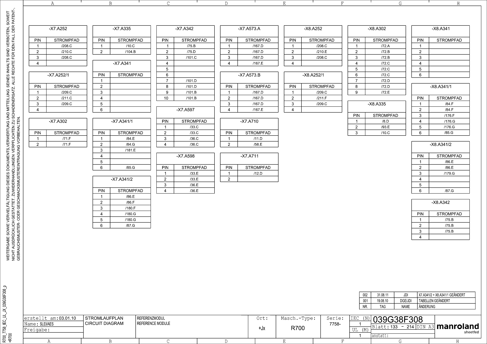

# +Jx — Sheet 133 of 214 — REFERENZMODUL

**REFERENCE MODULE**

> Part of the manroland **R700** printing press IEC/UL circuit diagrams.
> Drawing class: **Stromlaufplan / Circuit diagram** (DIN A3).
> Document `+Jx` covers the **1st printing module + feed register** machine section.

## At a glance

| Field | Value |
|---|---|
| Document | `+Jx`  (039G38F308) |
| Sheet | **133** of 214 |
| Section (DE) | REFERENZMODUL |
| Section (EN) | REFERENCE MODULE |
| Section type | REFERENCE_MODULE — Reference module |
| Machine type | `R700` |
| Series | `7758` |
| Created | 03.01.10 |
| Replaces | — |
| Columns used | A, B, C, D, E, F, G, H |
| Path numbers | — |
| Labels on sheet | 257 |
| Cross-refs out | 77 |
| Cross-refs in | 0 |

**Previous:** [+Jx sheet 132](SHEET_0132.md) · **Next:** [+Jx sheet 134](SHEET_0134.md) · **Document TOC:** [_TOC.md](_TOC.md)  (+Jx) · **Master TOC:** [all sheets](../_MASTER_TOC.md)

## Sheet image (300 DPI, exact vector render)



_Rendered directly from the PDF vector layer at 300 DPI (1-bit), no OCR and no resampling. Use it to confirm anything ambiguous in the text below._

## Cross-references on this sheet

Each entry is a wire leaving this sheet. The printed token is `/sheet.column`; the link resolves to that sheet inside the same document.

| Ref | Target sheet | Col | Path | Destination on target | Target section | From col |
|---|---|---|---|---|---|---|
| `/75.B` | [+Jx sheet 75](SHEET_0075.md) | B | — | — | FEHLBOGENKONTROLLE | C |
| `/72.A` | [+Jx sheet 72](SHEET_0072.md) | A | — | — | MOTOR: SCHRÄGREGISTER | G |
| `/10.C` | [+Jx sheet 10](SHEET_0010.md) | C | — | — | SPANNUNGSVERSORGUNG, SCHALTSCHRANKBELÜFTUNG | B |
| `/208.C` | [+Jx sheet 208](SHEET_0208.md) | C | — | — | OPTION: WASCHMITTELWECHSELBETRIEB | A |
| `/167.D` | [+Jx sheet 167](SHEET_0167.md) | D | — | — | OPTION: | E |
| `/208.C` | [+Jx sheet 208](SHEET_0208.md) | C | — | — | OPTION: WASCHMITTELWECHSELBETRIEB | F |
| `/72.B` | [+Jx sheet 72](SHEET_0072.md) | B | — | — | MOTOR: SCHRÄGREGISTER | G |
| `/104.B` | [+Jx sheet 104](SHEET_0104.md) | B | — | — | RESERVE | B |
| `/210.E` | [+Jx sheet 210](SHEET_0210.md) | E | — | — | OPTION: WASCHMITTELWECHSELBETRIEB | F |
| `/75.D` | [+Jx sheet 75](SHEET_0075.md) | D | — | — | FEHLBOGENKONTROLLE | C |
| `/210.C` | [+Jx sheet 210](SHEET_0210.md) | C | — | — | OPTION: WASCHMITTELWECHSELBETRIEB | A |
| `/167.D` | [+Jx sheet 167](SHEET_0167.md) | D | — | — | OPTION: | E |
| `/72.B` | [+Jx sheet 72](SHEET_0072.md) | B | — | — | MOTOR: SCHRÄGREGISTER | G |
| `/208.C` | [+Jx sheet 208](SHEET_0208.md) | C | — | — | OPTION: WASCHMITTELWECHSELBETRIEB | A |
| `/101.C` | [+Jx sheet 101](SHEET_0101.md) | C | — | — | RESERVE | C |
| `/167.D` | [+Jx sheet 167](SHEET_0167.md) | D | — | — | OPTION: | E |
| `/208.C` | [+Jx sheet 208](SHEET_0208.md) | C | — | — | OPTION: WASCHMITTELWECHSELBETRIEB | F |
| `/167.E` | [+Jx sheet 167](SHEET_0167.md) | E | — | — | OPTION: | E |
| `/72.C` | [+Jx sheet 72](SHEET_0072.md) | C | — | — | MOTOR: SCHRÄGREGISTER | G |
| `/72.C` | [+Jx sheet 72](SHEET_0072.md) | C | — | — | MOTOR: SCHRÄGREGISTER | G |
| `/72.C` | [+Jx sheet 72](SHEET_0072.md) | C | — | — | MOTOR: SCHRÄGREGISTER | G |
| `/72.D` | [+Jx sheet 72](SHEET_0072.md) | D | — | — | MOTOR: SCHRÄGREGISTER | G |
| `/101.D` | [+Jx sheet 101](SHEET_0101.md) | D | — | — | RESERVE | C |
| `/72.D` | [+Jx sheet 72](SHEET_0072.md) | D | — | — | MOTOR: SCHRÄGREGISTER | G |
| `/101.D` | [+Jx sheet 101](SHEET_0101.md) | D | — | — | RESERVE | C |
| `/72.E` | [+Jx sheet 72](SHEET_0072.md) | E | — | — | MOTOR: SCHRÄGREGISTER | G |
| `/101.B` | [+Jx sheet 101](SHEET_0101.md) | B | — | — | RESERVE | C |
| `/209.C` | [+Jx sheet 209](SHEET_0209.md) | C | — | — | OPTION: WASCHMITTELWECHSELBETRIEB | A |
| `/167.D` | [+Jx sheet 167](SHEET_0167.md) | D | — | — | OPTION: | E |
| `/209.C` | [+Jx sheet 209](SHEET_0209.md) | C | — | — | OPTION: WASCHMITTELWECHSELBETRIEB | F |
| `/101.B` | [+Jx sheet 101](SHEET_0101.md) | B | — | — | RESERVE | C |
| `/211.F` | [+Jx sheet 211](SHEET_0211.md) | F | — | — | OPTION: WASCHMITTELWECHSELBETRIEB | F |
| `/211.C` | [+Jx sheet 211](SHEET_0211.md) | C | — | — | OPTION: WASCHMITTELWECHSELBETRIEB | A |
| `/167.D` | [+Jx sheet 167](SHEET_0167.md) | D | — | — | OPTION: | E |
| `/84.F` | [+Jx sheet 84](SHEET_0084.md) | F | — | — | BOGENFÜHRUNG | H |
| `/209.C` | [+Jx sheet 209](SHEET_0209.md) | C | — | — | OPTION: WASCHMITTELWECHSELBETRIEB | A |
| `/167.D` | [+Jx sheet 167](SHEET_0167.md) | D | — | — | OPTION: | E |
| `/209.C` | [+Jx sheet 209](SHEET_0209.md) | C | — | — | OPTION: WASCHMITTELWECHSELBETRIEB | F |
| `/84.F` | [+Jx sheet 84](SHEET_0084.md) | F | — | — | BOGENFÜHRUNG | H |
| `/167.E` | [+Jx sheet 167](SHEET_0167.md) | E | — | — | OPTION: | E |
| `/176.F` | [+Jx sheet 176](SHEET_0176.md) | F | — | — | OPTION: TRANSFERMODUL 1 NACH | H |
| `/8.D` | [+Jx sheet 8](SHEET_0008.md) | D | — | — | SPANNUNGSVERSORGUNG, SCHALTSCHRANKBELÜFTUNG | G |
| `/176.G` | [+Jx sheet 176](SHEET_0176.md) | G | — | — | OPTION: TRANSFERMODUL 1 NACH | H |
| `/93.E` | [+Jx sheet 93](SHEET_0093.md) | E | — | — | RESERVE | G |
| `/176.G` | [+Jx sheet 176](SHEET_0176.md) | G | — | — | OPTION: TRANSFERMODUL 1 NACH | H |
| `/33.C` | [+Jx sheet 33](SHEET_0033.md) | C | — | — | NOT AUS | C |
| `/85.G` | [+Jx sheet 85](SHEET_0085.md) | G | — | — | BOGENFÜHRUNG | H |
| `/33.C` | [+Jx sheet 33](SHEET_0033.md) | C | — | — | NOT AUS | C |
| `/10.C` | [+Jx sheet 10](SHEET_0010.md) | C | — | — | SPANNUNGSVERSORGUNG, SCHALTSCHRANKBELÜFTUNG | G |
| `/84.E` | [+Jx sheet 84](SHEET_0084.md) | E | — | — | BOGENFÜHRUNG | B |
| `/71.F` | [+Jx sheet 71](SHEET_0071.md) | F | — | — | MOTOR: SEITENREGISTER | A |
| `/36.C` | [+Jx sheet 36](SHEET_0036.md) | C | — | — | STOP SICHERN | C |
| `/11.D` | [+Jx sheet 11](SHEET_0011.md) | D | — | — | SPANNUNGSVERSORGUNG, SCHALTSCHRANKBELÜFTUNG | E |
| `/58.E` | [+Jx sheet 58](SHEET_0058.md) | E | — | — | SCHUTZEINRICHTUNGEN | E |
| `/71.F` | [+Jx sheet 71](SHEET_0071.md) | F | — | — | MOTOR: SEITENREGISTER | A |
| `/84.G` | [+Jx sheet 84](SHEET_0084.md) | G | — | — | BOGENFÜHRUNG | B |
| `/36.C` | [+Jx sheet 36](SHEET_0036.md) | C | — | — | STOP SICHERN | C |
| `/181.E` | [+Jx sheet 181](SHEET_0181.md) | E | — | — | OPTION: TRANSFERMODUL 2 | B |
| `/86.E` | [+Jx sheet 86](SHEET_0086.md) | E | — | — | BOGENFÜHRUNG | H |
| `/12.D` | [+Jx sheet 12](SHEET_0012.md) | D | — | STROMPFAD PIN 1 2 | SPANNUNGSVERSORGUNG, SCHALTSCHRANKBELÜFTUNG | D |
| `/86.E` | [+Jx sheet 86](SHEET_0086.md) | E | — | — | BOGENFÜHRUNG | H |
| `/85.G` | [+Jx sheet 85](SHEET_0085.md) | G | — | — | BOGENFÜHRUNG | B |
| `/33.E` | [+Jx sheet 33](SHEET_0033.md) | E | — | — | NOT AUS | C |
| `/179.G` | [+Jx sheet 179](SHEET_0179.md) | G | — | — | OPTION: TRANSFERMODUL 1 NACH | H |
| `/33.E` | [+Jx sheet 33](SHEET_0033.md) | E | — | — | NOT AUS | C |
| `/36.E` | [+Jx sheet 36](SHEET_0036.md) | E | — | — | STOP SICHERN | C |
| `/36.E` | [+Jx sheet 36](SHEET_0036.md) | E | — | — | STOP SICHERN | C |
| `/87.G` | [+Jx sheet 87](SHEET_0087.md) | G | — | — | BOGENFÜHRUNG | H |
| `/86.E` | [+Jx sheet 86](SHEET_0086.md) | E | — | — | BOGENFÜHRUNG | B |
| `/86.F` | [+Jx sheet 86](SHEET_0086.md) | F | — | — | BOGENFÜHRUNG | B |
| `/180.F` | [+Jx sheet 180](SHEET_0180.md) | F | — | — | OPTION: TRANSFERMODUL 2 | B |
| `/180.G` | [+Jx sheet 180](SHEET_0180.md) | G | — | — | OPTION: TRANSFERMODUL 2 | B |
| `/75.B` | [+Jx sheet 75](SHEET_0075.md) | B | — | — | FEHLBOGENKONTROLLE | H |
| `/180.G` | [+Jx sheet 180](SHEET_0180.md) | G | — | — | OPTION: TRANSFERMODUL 2 | B |
| `/75.B` | [+Jx sheet 75](SHEET_0075.md) | B | — | — | FEHLBOGENKONTROLLE | H |
| `/87.G` | [+Jx sheet 87](SHEET_0087.md) | G | — | — | BOGENFÜHRUNG | B |
| `/75.B` | [+Jx sheet 75](SHEET_0075.md) | B | — | — | FEHLBOGENKONTROLLE | H |

## Devices on this sheet

| Tag | Class | Class meaning (IEC) | Col | Sub | Terminal | Sign |
|---|---|---|---|---|---|---|
| `X7.A252` | — | cross-device reference | A | — | — | — |
| `X7.A302` | — | cross-device reference | A | — | — | — |
| `X7.A335` | — | cross-device reference | B | — | — | — |
| `X7.A341` | — | cross-device reference | B | — | — | — |
| `X7.A342` | — | cross-device reference | C | — | — | — |
| `X7.A573.A` | — | cross-device reference | D | — | — | — |
| `X7.A573.B` | — | cross-device reference | D | — | — | — |
| `X8.A252` | — | cross-device reference | F | — | — | — |
| `X8.A302` | — | cross-device reference | G | — | — | — |
| `X8.A335` | — | cross-device reference | G | — | — | — |
| `X8.A341` | — | cross-device reference | H | — | — | — |
| `X8.A342` | — | cross-device reference | H | — | — | — |
| `X7.A597` | — | cross-device reference | C | — | — | — |
| `X7.A598` | — | cross-device reference | C | — | — | — |
| `X7.A711` | — | cross-device reference | D | — | — | — |
| `X7.A710` | — | cross-device reference | D | — | — | — |
| `NR.` | — | cross-device reference | F | — | — | — |
| `19.08.10` | — | cross-device reference | G | — | — | — |
| `31.08.11` | — | cross-device reference | G | — | — | — |

## Potentials / nets

_No named potentials on this sheet._

## Wire-end annotations (grouped as printed)

A wire that continues elsewhere is annotated with a small cluster: the destination description, the path/line number `#NN`, and the `/sheet.column` cross reference. Each row below is one such cluster exactly as it is grouped on the drawing.

| Col | Y | Path | Cross-ref | Text on the wire |
|---|---|---|---|---|
| A | 65.4 | — | — | `X7.A252` |
| B | 65.4 | — | — | `X7.A335` |
| C | 65.4 | — | — | `X7.A342` |
| F | 65.4 | — | — | `X8.A252` |
| G | 65.4 | — | — | `X8.A302` |
| H | 65.4 | — | — | `X8.A341` |
| D | 65.5 | — | — | `X7.A573.A` |
| A | 94.1 | — | — | `PIN 2 3 4 1 STROMPFAD` |
| B | 94.1 | — | — | `PIN 2 1 STROMPFAD` |
| C | 94.1 | — | — | `PIN 10 2 3 4 5 6 7 8 9 1 STROMPFAD` |
| D | 94.1 | — | — | `PIN 2 3 4 1 STROMPFAD` |
| E | 94.1 | — | — | `PIN 2 3 4 1 STROMPFAD` |
| G | 94.1 | — | — | `PIN 2 3 5 6 7 8 9 4 1 STROMPFAD` |
| H | 94.1 | — | — | `PIN 2 3 5 6 4 1 STROMPFAD` |
| C | 108.6 | — | `/75.B` | — |
| G | 108.6 | — | `/72.A` | — |
| A | 108.7 | — | `/208.C` | — |
| B | 108.7 | — | `/10.C` | — |
| E | 108.7 | — | `/167.D` | — |
| F | 108.7 | — | `/208.C` | — |
| A | 122.8 | — | `/210.C` | — |
| B | 122.8 | — | `/104.B` | — |
| C | 122.8 | — | `/75.D` | — |
| E | 122.8 | — | `/167.D` | — |
| F | 122.8 | — | `/210.E` | — |
| G | 122.8 | — | `/72.B` | — |
| A | 137.0 | — | `/208.C` | — |
| C | 137.0 | — | `/101.C` | — |
| E | 137.0 | — | `/167.D` | — |
| F | 137.0 | — | `/208.C` | — |
| G | 137.0 | — | `/72.B` | — |
| B | 150.5 | — | — | `X7.A341` |
| E | 151.2 | — | `/167.E` | — |
| G | 151.2 | — | `/72.C` | — |
| G | 165.3 | — | `/72.C` | — |
| A | 178.8 | — | — | `X7.A252/1` |
| D | 178.8 | — | — | `X7.A573.B` |
| F | 178.8 | — | — | `X8.A252/1` |
| B | 179.1 | — | — | `PIN 2 3 5 6 4 1 STROMPFAD` |
| G | 179.5 | — | `/72.C` | — |
| C | 193.7 | — | `/101.D` | — |
| G | 193.7 | — | `/72.D` | — |
| H | 207.2 | — | — | `X8.A341/1` |
| A | 207.5 | — | — | `PIN 2 3 4 1 STROMPFAD` |
| D | 207.5 | — | — | `PIN 2 3 4 1 STROMPFAD` |
| E | 207.5 | — | — | `PIN 2 3 4 1 STROMPFAD` |
| C | 207.9 | — | `/101.D` | — |
| G | 207.9 | — | `/72.D` | — |
| A | 222.0 | — | `/209.C` | — |
| C | 222.0 | — | `/101.B` | — |
| E | 222.0 | — | `/167.D` | — |
| F | 222.0 | — | `/209.C` | — |
| G | 222.0 | — | `/72.E` | — |
| H | 235.8 | — | — | `PIN 2 3 5 6 4 1 STROMPFAD` |
| A | 236.2 | — | `/211.C` | — |
| C | 236.2 | — | `/101.B` | — |
| E | 236.2 | — | `/167.D` | — |
| F | 236.2 | — | `/211.F` | — |
| G | 249.7 | — | — | `X8.A335` |
| A | 250.4 | — | `/209.C` | — |
| E | 250.4 | — | `/167.D` | — |
| F | 250.4 | — | `/209.C` | — |
| H | 250.4 | — | `/84.F` | — |
| C | 263.9 | — | — | `X7.A597` |
| E | 264.5 | — | `/167.E` | — |
| H | 264.5 | — | `/84.F` | — |
| G | 278.3 | — | — | `PIN 2 3 1 STROMPFAD` |
| H | 279.1 | — | `/176.F` | — |
| A | 292.2 | — | — | `X7.A302` |
| B | 292.2 | — | — | `X7.A341/1` |
| D | 292.2 | — | — | `X7.A710` |
| C | 292.5 | — | — | `PIN 2 3 4 1 STROMPFAD` |
| G | 292.9 | — | `/8.D` | — |
| H | 293.1 | — | `/176.G` | — |
| G | 307.0 | — | `/93.E` | — |
| C | 307.1 | — | `/33.C` | — |
| H | 307.1 | — | `/176.G` | — |
| H | 320.8 | — | `/85.G` | — |
| A | 320.9 | — | — | `PIN 2 1 STROMPFAD` |
| B | 320.9 | — | — | `PIN 2 3 5 6 4 1 STROMPFAD` |
| D | 320.9 | — | — | `PIN 2 1 STROMPFAD` |
| C | 321.2 | — | `/33.C` | — |
| G | 321.2 | — | `/10.C` | — |
| A | 335.4 | — | `/71.F` | — |
| B | 335.4 | — | `/84.E` | — |
| C | 335.4 | — | `/36.C` | — |
| E | 335.4 | — | `/11.D` | — |
| H | 348.9 | — | — | `X8.A341/2` |
| A | 349.6 | — | `/71.F` | — |
| B | 349.6 | — | `/84.G` | — |
| C | 349.6 | — | `/36.C` | — |
| E | 349.6 | — | `/58.E` | — |
| B | 363.8 | — | `/181.E` | — |
| C | 377.2 | — | — | `X7.A598` |
| D | 377.2 | — | — | `X7.A711` |
| H | 377.6 | — | — | `PIN 2 3 5 6 4 1 STROMPFAD` |
| H | 392.1 | — | `/86.E` | — |
| C | 405.9 | — | — | `PIN 2 3 4 1 STROMPFAD` |
| D | 405.9 | — | `/12.D` | `PIN 2 1 STROMPFAD` |
| H | 406.2 | — | `/86.E` | — |
| B | 406.3 | — | `/85.G` | — |
| C | 420.4 | — | `/33.E` | — |
| H | 420.5 | — | `/179.G` | — |
| B | 433.9 | — | — | `X7.A341/2` |
| C | 434.6 | — | `/33.E` | — |
| C | 448.8 | — | `/36.E` | — |
| B | 462.6 | — | — | `PIN 2 3 5 6 4 1 STROMPFAD` |
| C | 462.9 | — | `/36.E` | — |
| H | 463.0 | — | `/87.G` | — |
| B | 477.1 | — | `/86.E` | — |
| H | 490.6 | — | — | `X8.A342` |
| B | 491.3 | — | `/86.F` | — |
| B | 505.5 | — | `/180.F` | — |
| H | 519.3 | — | — | `PIN 2 3 4 1 STROMPFAD` |
| B | 519.7 | — | `/180.G` | — |
| H | 533.8 | — | `/75.B` | — |
| B | 533.9 | — | `/180.G` | — |
| B | 548.0 | — | `/87.G` | — |
| H | 548.0 | — | `/75.B` | — |
| H | 562.2 | — | `/75.B` | — |
| G | 718.7 | — | — | `002 31.08.11 JDI X7.A341/2 + X8.A341/1 GEÄNDERT` |
| G | 733.0 | — | — | `001 19.08.10 DGE/JDI TABELLEN GEÄNDERT` |
| G | 747.1 | — | — | `NR. TAG NAME ÄNDERUNG` |


## Reconstructed tables

This sheet carries tabular content (pin map / terminal assignment / index). The grid below was rebuilt from the drawing's own rule lines, so each row is exactly one physical row of the table.

### Table 1 — 14 data rows × 2 columns (at x=70.9, y=62.4) — **X7.A252**

| PIN | STROMPFAD |
|---|---|
| `1` | `/208.C` |
| `2` | `/210.C` |
| `3` | `/208.C` |
| `4` |  |
|  | `X7.A252/1` |
| `PIN` | `STROMPFAD` |
| `1` | `/209.C` |
| `2` | `/211.C` |
| `3` | `/209.C` |
| `4` |  |
|  | `X7.A302` |
| `PIN` | `STROMPFAD` |
| `1` | `/71.F` |
| `2` | `/71.F` |


### Table 2 — 26 data rows × 2 columns (at x=226.8, y=62.4) — **X7.A335**

| PIN | STROMPFAD |
|---|---|
| `1` | `/10.C` |
| `2` | `/104.B` |
|  | `X7.A341` |
| `PIN` | `STROMPFAD` |
| `1` |  |
| `2` |  |
| `3` |  |
| `4` |  |
| `5` |  |
| `6` |  |
|  | `X7.A341/1` |
| `PIN` | `STROMPFAD` |
| `1` | `/84.E` |
| `2` | `/84.G` |
| `3` | `/181.E` |
| `4` |  |
| `5` |  |
| `6` | `/85.G` |
|  | `X7.A341/2` |
| `PIN` | `STROMPFAD` |
| `1` | `/86.E` |
| `2` | `/86.F` |
| `3` | `/180.F` |
| `4` | `/180.G` |
| `5` | `/180.G` |
| `6` | `/87.G` |


### Table 3 — 22 data rows × 2 columns (at x=382.7, y=62.4) — **X7.A342**

| PIN | STROMPFAD |
|---|---|
| `1` | `/75.B` |
| `2` | `/75.D` |
| `3` | `/101.C` |
| `4` |  |
| `5` |  |
| `6` |  |
| `7` | `/101.D` |
| `8` | `/101.D` |
| `9` | `/101.B` |
| `10` | `/101.B` |
|  | `X7.A597` |
| `PIN` | `STROMPFAD` |
| `1` | `/33.C` |
| `2` | `/33.C` |
| `3` | `/36.C` |
| `4` | `/36.C` |
|  | `X7.A598` |
| `PIN` | `STROMPFAD` |
| `1` | `/33.E` |
| `2` | `/33.E` |
| `3` | `/36.E` |
| `4` | `/36.E` |


### Table 4 — 18 data rows × 2 columns (at x=538.6, y=62.4) — **X7.A573.A**

| PIN | STROMPFAD |
|---|---|
| `1` | `/167.D` |
| `2` | `/167.D` |
| `3` | `/167.D` |
| `4` | `/167.E` |
|  | `X7.A573.B` |
| `PIN` | `STROMPFAD` |
| `1` | `/167.D` |
| `2` | `/167.D` |
| `3` | `/167.D` |
| `4` | `/167.E` |
|  | `X7.A710` |
| `PIN` | `STROMPFAD` |
| `1` | `/11.D` |
| `2` | `/58.E` |
|  | `X7.A711` |
| `PIN` | `STROMPFAD` |
| `1` | `/12.D` |
| `2` |  |


### Table 5 — 10 data rows × 2 columns (at x=694.5, y=62.4) — **X8.A252**

| PIN | STROMPFAD |
|---|---|
| `1` | `/208.C` |
| `2` | `/210.E` |
| `3` | `/208.C` |
| `4` |  |
|  | `X8.A252/1` |
| `PIN` | `STROMPFAD` |
| `1` | `/209.C` |
| `2` | `/211.F` |
| `3` | `/209.C` |
| `4` |  |


### Table 6 — 14 data rows × 2 columns (at x=850.4, y=62.4) — **X8.A302**

| PIN | STROMPFAD |
|---|---|
| `1` | `/72.A` |
| `2` | `/72.B` |
| `3` | `/72.B` |
| `4` | `/72.C` |
| `5` | `/72.C` |
| `6` | `/72.C` |
| `7` | `/72.D` |
| `8` | `/72.D` |
| `9` | `/72.E` |
|  | `X8.A335` |
| `PIN` | `STROMPFAD` |
| `1` | `/8.D` |
| `2` | `/93.E` |
| `3` | `/10.C` |


### Table 7 — 28 data rows × 2 columns (at x=1006.3, y=62.4) — **X8.A341**

| PIN | STROMPFAD |
|---|---|
| `1` |  |
| `2` |  |
| `3` |  |
| `4` |  |
| `5` |  |
| `6` |  |
|  | `X8.A341/1` |
| `PIN` | `STROMPFAD` |
| `1` | `/84.F` |
| `2` | `/84.F` |
| `3` | `/176.F` |
| `4` | `/176.G` |
| `5` | `/176.G` |
| `6` | `/85.G` |
|  | `X8.A341/2` |
| `PIN` | `STROMPFAD` |
| `1` | `/86.E` |
| `2` | `/86.E` |
| `3` | `/179.G` |
| `4` |  |
| `5` |  |
| `6` | `/87.G` |
|  | `X8.A342` |
| `PIN` | `STROMPFAD` |
| `1` | `/75.B` |
| `2` | `/75.B` |
| `3` | `/75.B` |
| `4` |  |


## Notes and free text on this sheet

| Text | Col | Y (pt) |
|---|---|---|
| `PIN` | A | 94.13 |
| `STROMPFAD` | A | 94.09 |
| `X7.A252/1` | A | 178.83 |
| `PIN` | B | 94.13 |
| `STROMPFAD` | B | 94.09 |
| `PIN` | C | 94.13 |
| `STROMPFAD` | C | 94.09 |
| `PIN` | D | 94.13 |
| `STROMPFAD` | E | 94.09 |
| `PIN` | E | 94.13 |
| `STROMPFAD` | F | 94.09 |
| `X8.A252/1` | F | 178.83 |
| `PIN` | F | 94.13 |
| `STROMPFAD` | G | 94.09 |
| `PIN` | G | 94.13 |
| `STROMPFAD` | H | 94.09 |
| `X7.A341/1` | B | 292.21 |
| `X7.A341/2` | B | 433.95 |
| `X8.A341/1` | H | 207.17 |
| `X8.A341/2` | H | 348.91 |
| `TAG` | G | 747.23 |
| `NAME` | G | 747.22 |
| `ÄNDERUNG` | G | 747.25 |
| `DGE/JDI` | G | 733.03 |
| `TABELLEN GEÄNDERT` | H | 733.1 |
| `JDI` | G | 718.7 |
| `X7.A341/2 + X8.A341/1 GEÄNDERT` | H | 718.81 |

## Complete label inventory (exact text from the drawing)

Every text object inside the drawing area of this sheet, in DIN reading order (column A→H, then top→bottom). This is the authoritative list: if a string is not here it is not printed on this sheet.

| Col | Y | X | Dir | Type | Text |
|---|---|---|---|---|---|
| A | 65.4 | 119.8 | → | device ref | `X7.A252` |
| A | 94.1 | 84.0 | → | text | `PIN` |
| A | 94.1 | 132.4 | → | text | `STROMPFAD` |
| A | 108.3 | 89.9 | → | number | `1` |
| A | 108.7 | 150.2 | → | cross-reference | `/208.C` |
| A | 122.5 | 89.4 | → | number | `2` |
| A | 122.8 | 150.2 | → | cross-reference | `/210.C` |
| A | 136.7 | 89.4 | → | number | `3` |
| A | 137.0 | 150.2 | → | cross-reference | `/208.C` |
| A | 150.8 | 89.6 | → | number | `4` |
| A | 178.8 | 116.1 | → | text | `X7.A252/1` |
| A | 207.5 | 84.0 | → | text | `PIN` |
| A | 207.5 | 132.4 | → | text | `STROMPFAD` |
| A | 221.7 | 89.9 | → | number | `1` |
| A | 222.0 | 150.2 | → | cross-reference | `/209.C` |
| A | 235.9 | 89.4 | → | number | `2` |
| A | 236.2 | 150.2 | → | cross-reference | `/211.C` |
| A | 250.0 | 89.4 | → | number | `3` |
| A | 250.4 | 150.2 | → | cross-reference | `/209.C` |
| A | 264.2 | 89.6 | → | number | `4` |
| A | 292.2 | 119.8 | → | device ref | `X7.A302` |
| A | 320.9 | 84.0 | → | text | `PIN` |
| A | 320.9 | 132.4 | → | text | `STROMPFAD` |
| A | 335.1 | 89.9 | → | number | `1` |
| A | 335.4 | 153.1 | → | cross-reference | `/71.F` |
| A | 349.3 | 89.4 | → | number | `2` |
| A | 349.6 | 153.1 | → | cross-reference | `/71.F` |
| B | 65.4 | 275.5 | → | device ref | `X7.A335` |
| B | 94.1 | 240.0 | → | text | `PIN` |
| B | 94.1 | 288.3 | → | text | `STROMPFAD` |
| B | 108.3 | 245.8 | → | number | `1` |
| B | 108.7 | 308.6 | → | cross-reference | `/10.C` |
| B | 122.5 | 245.3 | → | number | `2` |
| B | 122.8 | 306.3 | → | cross-reference | `/104.B` |
| B | 150.5 | 276.4 | → | device ref | `X7.A341` |
| B | 179.1 | 288.3 | → | text | `STROMPFAD` |
| B | 179.2 | 240.0 | → | text | `PIN` |
| B | 193.3 | 245.8 | → | number | `1` |
| B | 207.5 | 245.3 | → | number | `2` |
| B | 221.7 | 245.3 | → | number | `3` |
| B | 235.9 | 245.5 | → | number | `4` |
| B | 250.0 | 245.3 | → | number | `5` |
| B | 264.2 | 245.3 | → | number | `6` |
| B | 292.2 | 272.0 | → | text | `X7.A341/1` |
| B | 320.9 | 240.0 | → | text | `PIN` |
| B | 320.9 | 288.3 | → | text | `STROMPFAD` |
| B | 335.1 | 245.8 | → | number | `1` |
| B | 335.4 | 308.7 | → | cross-reference | `/84.E` |
| B | 349.3 | 245.3 | → | number | `2` |
| B | 349.6 | 308.3 | → | cross-reference | `/84.G` |
| B | 363.4 | 245.3 | → | number | `3` |
| B | 363.7 | 306.3 | → | cross-reference | `/181.E` |
| B | 377.6 | 245.5 | → | number | `4` |
| B | 391.8 | 245.3 | → | number | `5` |
| B | 405.9 | 245.3 | → | number | `6` |
| B | 406.3 | 308.3 | → | cross-reference | `/85.G` |
| B | 433.9 | 271.3 | → | text | `X7.A341/2` |
| B | 462.6 | 240.0 | → | text | `PIN` |
| B | 462.6 | 288.3 | → | text | `STROMPFAD` |
| B | 476.8 | 245.8 | → | number | `1` |
| B | 477.1 | 308.7 | → | cross-reference | `/86.E` |
| B | 491.0 | 245.3 | → | number | `2` |
| B | 491.3 | 309.0 | → | cross-reference | `/86.F` |
| B | 505.2 | 245.3 | → | number | `3` |
| B | 505.5 | 306.6 | → | cross-reference | `/180.F` |
| B | 519.3 | 245.5 | → | number | `4` |
| B | 519.7 | 305.9 | → | cross-reference | `/180.G` |
| B | 533.5 | 245.3 | → | number | `5` |
| B | 533.8 | 305.9 | → | cross-reference | `/180.G` |
| B | 547.7 | 245.3 | → | number | `6` |
| B | 548.0 | 308.3 | → | cross-reference | `/87.G` |
| C | 65.4 | 428.7 | → | device ref | `X7.A342` |
| C | 94.1 | 395.9 | → | text | `PIN` |
| C | 94.1 | 444.2 | → | text | `STROMPFAD` |
| C | 108.3 | 407.3 | → | number | `1` |
| C | 108.6 | 457.5 | → | cross-reference | `/75.B` |
| C | 122.5 | 405.9 | → | number | `2` |
| C | 122.8 | 457.4 | → | cross-reference | `/75.D` |
| C | 136.7 | 405.9 | → | number | `3` |
| C | 137.0 | 455.0 | → | cross-reference | `/101.C` |
| C | 150.8 | 405.9 | → | number | `4` |
| C | 165.0 | 405.9 | → | number | `5` |
| C | 179.2 | 405.9 | → | number | `6` |
| C | 193.3 | 405.9 | → | number | `7` |
| C | 193.7 | 455.0 | → | cross-reference | `/101.D` |
| C | 207.5 | 405.9 | → | number | `8` |
| C | 207.9 | 455.0 | → | cross-reference | `/101.D` |
| C | 221.7 | 405.9 | → | number | `9` |
| C | 222.0 | 455.1 | → | cross-reference | `/101.B` |
| C | 235.9 | 400.5 | → | number | `10` |
| C | 236.2 | 455.1 | → | cross-reference | `/101.B` |
| C | 263.9 | 431.4 | → | device ref | `X7.A597` |
| C | 292.5 | 444.2 | → | text | `STROMPFAD` |
| C | 292.6 | 395.9 | → | text | `PIN` |
| C | 306.7 | 401.7 | → | number | `1` |
| C | 307.1 | 464.5 | → | cross-reference | `/33.C` |
| C | 320.9 | 401.2 | → | number | `2` |
| C | 321.2 | 464.5 | → | cross-reference | `/33.C` |
| C | 335.1 | 401.2 | → | number | `3` |
| C | 335.4 | 464.5 | → | cross-reference | `/36.C` |
| C | 349.3 | 401.4 | → | number | `4` |
| C | 349.6 | 464.5 | → | cross-reference | `/36.C` |
| C | 377.2 | 431.6 | → | device ref | `X7.A598` |
| C | 405.9 | 395.9 | → | text | `PIN` |
| C | 405.9 | 444.2 | → | text | `STROMPFAD` |
| C | 420.1 | 401.7 | → | number | `1` |
| C | 420.4 | 464.6 | → | cross-reference | `/33.E` |
| C | 434.3 | 401.2 | → | number | `2` |
| C | 434.6 | 464.6 | → | cross-reference | `/33.E` |
| C | 448.5 | 401.2 | → | number | `3` |
| C | 448.8 | 464.6 | → | cross-reference | `/36.E` |
| C | 462.6 | 401.4 | → | number | `4` |
| C | 462.9 | 464.6 | → | cross-reference | `/36.E` |
| D | 65.4 | 582.2 | → | device ref | `X7.A573.A` |
| D | 94.1 | 551.8 | → | text | `PIN` |
| D | 108.3 | 557.6 | → | number | `1` |
| D | 122.5 | 557.1 | → | number | `2` |
| D | 136.7 | 557.1 | → | number | `3` |
| D | 150.8 | 557.3 | → | number | `4` |
| D | 178.8 | 582.5 | → | device ref | `X7.A573.B` |
| D | 207.5 | 551.8 | → | text | `PIN` |
| D | 221.7 | 557.6 | → | number | `1` |
| D | 235.9 | 557.1 | → | number | `2` |
| D | 250.0 | 557.1 | → | number | `3` |
| D | 264.2 | 557.3 | → | number | `4` |
| D | 292.2 | 587.5 | → | device ref | `X7.A710` |
| D | 320.9 | 551.8 | → | text | `PIN` |
| D | 335.1 | 557.6 | → | number | `1` |
| D | 349.3 | 557.1 | → | number | `2` |
| D | 377.2 | 588.2 | → | device ref | `X7.A711` |
| D | 405.9 | 551.8 | → | text | `PIN` |
| D | 420.1 | 557.6 | → | number | `1` |
| D | 434.3 | 557.1 | → | number | `2` |
| E | 94.1 | 600.1 | → | text | `STROMPFAD` |
| E | 94.1 | 707.7 | → | text | `PIN` |
| E | 108.3 | 713.5 | → | number | `1` |
| E | 108.7 | 618.0 | → | cross-reference | `/167.D` |
| E | 122.5 | 713.1 | → | number | `2` |
| E | 122.8 | 618.0 | → | cross-reference | `/167.D` |
| E | 136.7 | 713.1 | → | number | `3` |
| E | 137.0 | 618.0 | → | cross-reference | `/167.D` |
| E | 150.8 | 713.2 | → | number | `4` |
| E | 151.2 | 618.1 | → | cross-reference | `/167.E` |
| E | 207.5 | 600.1 | → | text | `STROMPFAD` |
| E | 207.5 | 707.7 | → | text | `PIN` |
| E | 221.7 | 713.5 | → | number | `1` |
| E | 222.0 | 618.0 | → | cross-reference | `/167.D` |
| E | 235.9 | 713.1 | → | number | `2` |
| E | 236.2 | 618.0 | → | cross-reference | `/167.D` |
| E | 250.0 | 713.1 | → | number | `3` |
| E | 250.4 | 618.0 | → | cross-reference | `/167.D` |
| E | 264.2 | 713.2 | → | number | `4` |
| E | 264.5 | 618.1 | → | cross-reference | `/167.E` |
| E | 320.9 | 600.1 | → | text | `STROMPFAD` |
| E | 335.4 | 620.4 | → | cross-reference | `/11.D` |
| E | 349.6 | 620.5 | → | cross-reference | `/58.E` |
| E | 405.9 | 600.1 | → | text | `STROMPFAD` |
| E | 420.5 | 620.4 | → | cross-reference | `/12.D` |
| F | 65.4 | 743.4 | → | device ref | `X8.A252` |
| F | 94.1 | 756.0 | → | text | `STROMPFAD` |
| F | 94.1 | 863.6 | → | text | `PIN` |
| F | 108.3 | 869.4 | → | number | `1` |
| F | 108.7 | 773.9 | → | cross-reference | `/208.C` |
| F | 122.5 | 869.0 | → | number | `2` |
| F | 122.8 | 774.0 | → | cross-reference | `/210.E` |
| F | 136.7 | 869.0 | → | number | `3` |
| F | 137.0 | 773.9 | → | cross-reference | `/208.C` |
| F | 150.8 | 869.1 | → | number | `4` |
| F | 165.0 | 869.0 | → | number | `5` |
| F | 178.8 | 739.7 | → | text | `X8.A252/1` |
| F | 179.2 | 869.0 | → | number | `6` |
| F | 193.3 | 869.0 | → | number | `7` |
| F | 207.5 | 756.0 | → | text | `STROMPFAD` |
| F | 207.5 | 869.0 | → | number | `8` |
| F | 221.7 | 869.0 | → | number | `9` |
| F | 222.0 | 773.9 | → | cross-reference | `/209.C` |
| F | 236.2 | 774.3 | → | cross-reference | `/211.F` |
| F | 250.4 | 773.9 | → | cross-reference | `/209.C` |
| F | 278.4 | 863.6 | → | text | `PIN` |
| F | 292.6 | 869.4 | → | number | `1` |
| F | 306.7 | 869.0 | → | number | `2` |
| F | 320.9 | 869.0 | → | number | `3` |
| F | 718.8 | 886.9 | → | number | `002` |
| F | 733.0 | 887.6 | → | number | `001` |
| F | 747.1 | 886.8 | → | device ref | `NR.` |
| G | 65.4 | 899.3 | → | device ref | `X8.A302` |
| G | 94.1 | 911.9 | → | text | `STROMPFAD` |
| G | 94.1 | 1019.5 | → | text | `PIN` |
| G | 108.3 | 1025.3 | → | number | `1` |
| G | 108.6 | 932.2 | → | cross-reference | `/72.A` |
| G | 122.5 | 1024.9 | → | number | `2` |
| G | 122.8 | 932.3 | → | cross-reference | `/72.B` |
| G | 136.7 | 1024.9 | → | number | `3` |
| G | 137.0 | 932.3 | → | cross-reference | `/72.B` |
| G | 150.8 | 1025.0 | → | number | `4` |
| G | 151.2 | 932.2 | → | cross-reference | `/72.C` |
| G | 165.0 | 1024.9 | → | number | `5` |
| G | 165.3 | 932.2 | → | cross-reference | `/72.C` |
| G | 179.2 | 1024.9 | → | number | `6` |
| G | 179.5 | 932.2 | → | cross-reference | `/72.C` |
| G | 193.7 | 932.2 | → | cross-reference | `/72.D` |
| G | 207.9 | 932.2 | → | cross-reference | `/72.D` |
| G | 222.0 | 932.3 | → | cross-reference | `/72.E` |
| G | 235.9 | 1019.5 | → | text | `PIN` |
| G | 249.7 | 899.1 | → | device ref | `X8.A335` |
| G | 250.0 | 1025.3 | → | number | `1` |
| G | 264.2 | 1024.9 | → | number | `2` |
| G | 278.3 | 911.9 | → | text | `STROMPFAD` |
| G | 278.4 | 1024.9 | → | number | `3` |
| G | 292.6 | 1025.0 | → | number | `4` |
| G | 292.9 | 934.6 | → | cross-reference | `/8.D` |
| G | 306.7 | 1024.9 | → | number | `5` |
| G | 307.0 | 932.3 | → | cross-reference | `/93.E` |
| G | 320.9 | 1024.9 | → | number | `6` |
| G | 321.2 | 932.2 | → | cross-reference | `/10.C` |
| G | 377.6 | 1019.5 | → | text | `PIN` |
| G | 391.8 | 1025.3 | → | number | `1` |
| G | 405.9 | 1024.9 | → | number | `2` |
| G | 420.1 | 1024.9 | → | number | `3` |
| G | 434.3 | 1025.0 | → | number | `4` |
| G | 448.5 | 1024.9 | → | number | `5` |
| G | 462.6 | 1024.9 | → | number | `6` |
| G | 519.3 | 1019.5 | → | text | `PIN` |
| G | 533.5 | 1025.3 | → | number | `1` |
| G | 547.7 | 1024.9 | → | number | `2` |
| G | 561.9 | 1024.9 | → | number | `3` |
| G | 576.0 | 1025.0 | → | number | `4` |
| G | 718.7 | 986.8 | → | text | `JDI` |
| G | 718.8 | 922.2 | → | device ref | `31.08.11` |
| G | 733.0 | 978.3 | → | text | `DGE/JDI` |
| G | 733.1 | 921.5 | → | device ref | `19.08.10` |
| G | 747.2 | 928.5 | → | text | `TAG` |
| G | 747.2 | 981.8 | → | text | `NAME` |
| G | 747.3 | 1024.0 | → | text | `ÄNDERUNG` |
| H | 65.4 | 1055.9 | → | device ref | `X8.A341` |
| H | 94.1 | 1067.8 | → | text | `STROMPFAD` |
| H | 207.2 | 1051.5 | → | text | `X8.A341/1` |
| H | 235.8 | 1067.8 | → | text | `STROMPFAD` |
| H | 250.4 | 1088.5 | → | cross-reference | `/84.F` |
| H | 264.5 | 1088.5 | → | cross-reference | `/84.F` |
| H | 279.1 | 1086.5 | → | cross-reference | `/176.F` |
| H | 293.1 | 1086.4 | → | cross-reference | `/176.G` |
| H | 307.1 | 1085.4 | → | cross-reference | `/176.G` |
| H | 320.8 | 1086.6 | → | cross-reference | `/85.G` |
| H | 348.9 | 1050.8 | → | text | `X8.A341/2` |
| H | 377.6 | 1067.8 | → | text | `STROMPFAD` |
| H | 392.1 | 1088.2 | → | cross-reference | `/86.E` |
| H | 406.3 | 1088.2 | → | cross-reference | `/86.E` |
| H | 420.5 | 1085.4 | → | cross-reference | `/179.G` |
| H | 463.0 | 1087.8 | → | cross-reference | `/87.G` |
| H | 490.6 | 1055.2 | → | device ref | `X8.A342` |
| H | 519.3 | 1067.8 | → | text | `STROMPFAD` |
| H | 533.8 | 1088.2 | → | cross-reference | `/75.B` |
| H | 548.0 | 1088.2 | → | cross-reference | `/75.B` |
| H | 562.2 | 1088.2 | → | cross-reference | `/75.B` |
| H | 718.8 | 1023.8 | → | text | `X7.A341/2 + X8.A341/1 GEÄNDERT` |
| H | 733.1 | 1024.0 | → | text | `TABELLEN GEÄNDERT` |

## Reading-order text block

The same content as a plain block, grouped by DIN column — convenient to paste or to match against a visual description.

```text
=== Column A ===
  65.4  119.8  devref       X7.A252
  94.1   84.0  text         PIN
  94.1  132.4  text         STROMPFAD
 108.3   89.9  numeric      1
 108.7  150.2  xref         /208.C
 122.5   89.4  numeric      2
 122.8  150.2  xref         /210.C
 136.7   89.4  numeric      3
 137.0  150.2  xref         /208.C
 150.8   89.6  numeric      4
 178.8  116.1  text         X7.A252/1
 207.5   84.0  text         PIN
 207.5  132.4  text         STROMPFAD
 221.7   89.9  numeric      1
 222.0  150.2  xref         /209.C
 235.9   89.4  numeric      2
 236.2  150.2  xref         /211.C
 250.0   89.4  numeric      3
 250.4  150.2  xref         /209.C
 264.2   89.6  numeric      4
 292.2  119.8  devref       X7.A302
 320.9   84.0  text         PIN
 320.9  132.4  text         STROMPFAD
 335.1   89.9  numeric      1
 335.4  153.1  xref         /71.F
 349.3   89.4  numeric      2
 349.6  153.1  xref         /71.F
=== Column B ===
  65.4  275.5  devref       X7.A335
  94.1  240.0  text         PIN
  94.1  288.3  text         STROMPFAD
 108.3  245.8  numeric      1
 108.7  308.6  xref         /10.C
 122.5  245.3  numeric      2
 122.8  306.3  xref         /104.B
 150.5  276.4  devref       X7.A341
 179.1  288.3  text         STROMPFAD
 179.2  240.0  text         PIN
 193.3  245.8  numeric      1
 207.5  245.3  numeric      2
 221.7  245.3  numeric      3
 235.9  245.5  numeric      4
 250.0  245.3  numeric      5
 264.2  245.3  numeric      6
 292.2  272.0  text         X7.A341/1
 320.9  240.0  text         PIN
 320.9  288.3  text         STROMPFAD
 335.1  245.8  numeric      1
 335.4  308.7  xref         /84.E
 349.3  245.3  numeric      2
 349.6  308.3  xref         /84.G
 363.4  245.3  numeric      3
 363.7  306.3  xref         /181.E
 377.6  245.5  numeric      4
 391.8  245.3  numeric      5
 405.9  245.3  numeric      6
 406.3  308.3  xref         /85.G
 433.9  271.3  text         X7.A341/2
 462.6  240.0  text         PIN
 462.6  288.3  text         STROMPFAD
 476.8  245.8  numeric      1
 477.1  308.7  xref         /86.E
 491.0  245.3  numeric      2
 491.3  309.0  xref         /86.F
 505.2  245.3  numeric      3
 505.5  306.6  xref         /180.F
 519.3  245.5  numeric      4
 519.7  305.9  xref         /180.G
 533.5  245.3  numeric      5
 533.8  305.9  xref         /180.G
 547.7  245.3  numeric      6
 548.0  308.3  xref         /87.G
=== Column C ===
  65.4  428.7  devref       X7.A342
  94.1  395.9  text         PIN
  94.1  444.2  text         STROMPFAD
 108.3  407.3  numeric      1
 108.6  457.5  xref         /75.B
 122.5  405.9  numeric      2
 122.8  457.4  xref         /75.D
 136.7  405.9  numeric      3
 137.0  455.0  xref         /101.C
 150.8  405.9  numeric      4
 165.0  405.9  numeric      5
 179.2  405.9  numeric      6
 193.3  405.9  numeric      7
 193.7  455.0  xref         /101.D
 207.5  405.9  numeric      8
 207.9  455.0  xref         /101.D
 221.7  405.9  numeric      9
 222.0  455.1  xref         /101.B
 235.9  400.5  numeric      10
 236.2  455.1  xref         /101.B
 263.9  431.4  devref       X7.A597
 292.5  444.2  text         STROMPFAD
 292.6  395.9  text         PIN
 306.7  401.7  numeric      1
 307.1  464.5  xref         /33.C
 320.9  401.2  numeric      2
 321.2  464.5  xref         /33.C
 335.1  401.2  numeric      3
 335.4  464.5  xref         /36.C
 349.3  401.4  numeric      4
 349.6  464.5  xref         /36.C
 377.2  431.6  devref       X7.A598
 405.9  395.9  text         PIN
 405.9  444.2  text         STROMPFAD
 420.1  401.7  numeric      1
 420.4  464.6  xref         /33.E
 434.3  401.2  numeric      2
 434.6  464.6  xref         /33.E
 448.5  401.2  numeric      3
 448.8  464.6  xref         /36.E
 462.6  401.4  numeric      4
 462.9  464.6  xref         /36.E
=== Column D ===
  65.4  582.2  devref       X7.A573.A
  94.1  551.8  text         PIN
 108.3  557.6  numeric      1
 122.5  557.1  numeric      2
 136.7  557.1  numeric      3
 150.8  557.3  numeric      4
 178.8  582.5  devref       X7.A573.B
 207.5  551.8  text         PIN
 221.7  557.6  numeric      1
 235.9  557.1  numeric      2
 250.0  557.1  numeric      3
 264.2  557.3  numeric      4
 292.2  587.5  devref       X7.A710
 320.9  551.8  text         PIN
 335.1  557.6  numeric      1
 349.3  557.1  numeric      2
 377.2  588.2  devref       X7.A711
 405.9  551.8  text         PIN
 420.1  557.6  numeric      1
 434.3  557.1  numeric      2
=== Column E ===
  94.1  600.1  text         STROMPFAD
  94.1  707.7  text         PIN
 108.3  713.5  numeric      1
 108.7  618.0  xref         /167.D
 122.5  713.1  numeric      2
 122.8  618.0  xref         /167.D
 136.7  713.1  numeric      3
 137.0  618.0  xref         /167.D
 150.8  713.2  numeric      4
 151.2  618.1  xref         /167.E
 207.5  600.1  text         STROMPFAD
 207.5  707.7  text         PIN
 221.7  713.5  numeric      1
 222.0  618.0  xref         /167.D
 235.9  713.1  numeric      2
 236.2  618.0  xref         /167.D
 250.0  713.1  numeric      3
 250.4  618.0  xref         /167.D
 264.2  713.2  numeric      4
 264.5  618.1  xref         /167.E
 320.9  600.1  text         STROMPFAD
 335.4  620.4  xref         /11.D
 349.6  620.5  xref         /58.E
 405.9  600.1  text         STROMPFAD
 420.5  620.4  xref         /12.D
=== Column F ===
  65.4  743.4  devref       X8.A252
  94.1  756.0  text         STROMPFAD
  94.1  863.6  text         PIN
 108.3  869.4  numeric      1
 108.7  773.9  xref         /208.C
 122.5  869.0  numeric      2
 122.8  774.0  xref         /210.E
 136.7  869.0  numeric      3
 137.0  773.9  xref         /208.C
 150.8  869.1  numeric      4
 165.0  869.0  numeric      5
 178.8  739.7  text         X8.A252/1
 179.2  869.0  numeric      6
 193.3  869.0  numeric      7
 207.5  756.0  text         STROMPFAD
 207.5  869.0  numeric      8
 221.7  869.0  numeric      9
 222.0  773.9  xref         /209.C
 236.2  774.3  xref         /211.F
 250.4  773.9  xref         /209.C
 278.4  863.6  text         PIN
 292.6  869.4  numeric      1
 306.7  869.0  numeric      2
 320.9  869.0  numeric      3
 718.8  886.9  numeric      002
 733.0  887.6  numeric      001
 747.1  886.8  devref       NR.
=== Column G ===
  65.4  899.3  devref       X8.A302
  94.1  911.9  text         STROMPFAD
  94.1 1019.5  text         PIN
 108.3 1025.3  numeric      1
 108.6  932.2  xref         /72.A
 122.5 1024.9  numeric      2
 122.8  932.3  xref         /72.B
 136.7 1024.9  numeric      3
 137.0  932.3  xref         /72.B
 150.8 1025.0  numeric      4
 151.2  932.2  xref         /72.C
 165.0 1024.9  numeric      5
 165.3  932.2  xref         /72.C
 179.2 1024.9  numeric      6
 179.5  932.2  xref         /72.C
 193.7  932.2  xref         /72.D
 207.9  932.2  xref         /72.D
 222.0  932.3  xref         /72.E
 235.9 1019.5  text         PIN
 249.7  899.1  devref       X8.A335
 250.0 1025.3  numeric      1
 264.2 1024.9  numeric      2
 278.3  911.9  text         STROMPFAD
 278.4 1024.9  numeric      3
 292.6 1025.0  numeric      4
 292.9  934.6  xref         /8.D
 306.7 1024.9  numeric      5
 307.0  932.3  xref         /93.E
 320.9 1024.9  numeric      6
 321.2  932.2  xref         /10.C
 377.6 1019.5  text         PIN
 391.8 1025.3  numeric      1
 405.9 1024.9  numeric      2
 420.1 1024.9  numeric      3
 434.3 1025.0  numeric      4
 448.5 1024.9  numeric      5
 462.6 1024.9  numeric      6
 519.3 1019.5  text         PIN
 533.5 1025.3  numeric      1
 547.7 1024.9  numeric      2
 561.9 1024.9  numeric      3
 576.0 1025.0  numeric      4
 718.7  986.8  text         JDI
 718.8  922.2  devref       31.08.11
 733.0  978.3  text         DGE/JDI
 733.1  921.5  devref       19.08.10
 747.2  928.5  text         TAG
 747.2  981.8  text         NAME
 747.3 1024.0  text         ÄNDERUNG
=== Column H ===
  65.4 1055.9  devref       X8.A341
  94.1 1067.8  text         STROMPFAD
 207.2 1051.5  text         X8.A341/1
 235.8 1067.8  text         STROMPFAD
 250.4 1088.5  xref         /84.F
 264.5 1088.5  xref         /84.F
 279.1 1086.5  xref         /176.F
 293.1 1086.4  xref         /176.G
 307.1 1085.4  xref         /176.G
 320.8 1086.6  xref         /85.G
 348.9 1050.8  text         X8.A341/2
 377.6 1067.8  text         STROMPFAD
 392.1 1088.2  xref         /86.E
 406.3 1088.2  xref         /86.E
 420.5 1085.4  xref         /179.G
 463.0 1087.8  xref         /87.G
 490.6 1055.2  devref       X8.A342
 519.3 1067.8  text         STROMPFAD
 533.8 1088.2  xref         /75.B
 548.0 1088.2  xref         /75.B
 562.2 1088.2  xref         /75.B
 718.8 1023.8  text         X7.A341/2 + X8.A341/1 GEÄNDERT
 733.1 1024.0  text         TABELLEN GEÄNDERT
```

---
_Generated from the PDF vector text layer; no OCR. Source: `R700_7758_IEC_UL_JX_039G38F308_p`, sheet 133._
