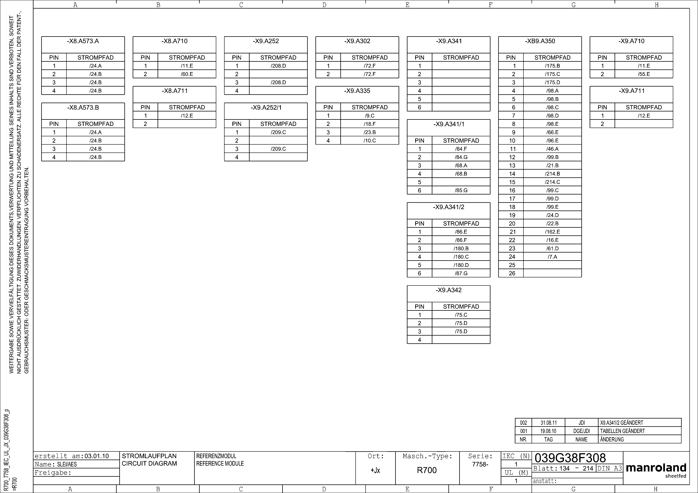

# +Jx — Sheet 134 of 214 — REFERENZMODUL

**REFERENCE MODULE**

> Part of the manroland **R700** printing press IEC/UL circuit diagrams.
> Drawing class: **Stromlaufplan / Circuit diagram** (DIN A3).
> Document `+Jx` covers the **1st printing module + feed register** machine section.

## At a glance

| Field | Value |
|---|---|
| Document | `+Jx`  (039G38F308) |
| Sheet | **134** of 214 |
| Section (DE) | REFERENZMODUL |
| Section (EN) | REFERENCE MODULE |
| Section type | REFERENCE_MODULE — Reference module |
| Machine type | `R700` |
| Series | `7758` |
| Created | 03.01.10 |
| Replaces | — |
| Columns used | A, B, C, D, E, F, G, H |
| Path numbers | — |
| Labels on sheet | 197 |
| Cross-refs out | 62 |
| Cross-refs in | 0 |

**Previous:** [+Jx sheet 133](SHEET_0133.md) · **Next:** [+Jx sheet 135](SHEET_0135.md) · **Document TOC:** [_TOC.md](_TOC.md)  (+Jx) · **Master TOC:** [all sheets](../_MASTER_TOC.md)

## Sheet image (300 DPI, exact vector render)



_Rendered directly from the PDF vector layer at 300 DPI (1-bit), no OCR and no resampling. Use it to confirm anything ambiguous in the text below._

## Cross-references on this sheet

Each entry is a wire leaving this sheet. The printed token is `/sheet.column`; the link resolves to that sheet inside the same document.

| Ref | Target sheet | Col | Path | Destination on target | Target section | From col |
|---|---|---|---|---|---|---|
| `/24.A` | [+Jx sheet 24](SHEET_0024.md) | A | — | — | HILFSANTRIEB, LACKDOSIER /AUFTRAGSWALZEN | A |
| `/11.E` | [+Jx sheet 11](SHEET_0011.md) | E | — | — | SPANNUNGSVERSORGUNG, SCHALTSCHRANKBELÜFTUNG | B |
| `/11.E` | [+Jx sheet 11](SHEET_0011.md) | E | — | — | SPANNUNGSVERSORGUNG, SCHALTSCHRANKBELÜFTUNG | H |
| `/72.F` | [+Jx sheet 72](SHEET_0072.md) | F | — | — | MOTOR: SCHRÄGREGISTER | E |
| `/175.B` | [+Jx sheet 175](SHEET_0175.md) | B | — | — | OPTION: | G |
| `/208.D` | [+Jx sheet 208](SHEET_0208.md) | D | — | — | OPTION: WASCHMITTELWECHSELBETRIEB | C |
| `/24.B` | [+Jx sheet 24](SHEET_0024.md) | B | — | — | HILFSANTRIEB, LACKDOSIER /AUFTRAGSWALZEN | A |
| `/60.E` | [+Jx sheet 60](SHEET_0060.md) | E | — | — | SCHUTZEINRICHTUNGEN | B |
| `/55.E` | [+Jx sheet 55](SHEET_0055.md) | E | — | — | SCHUTZEINRICHTUNGEN | H |
| `/72.F` | [+Jx sheet 72](SHEET_0072.md) | F | — | — | MOTOR: SCHRÄGREGISTER | E |
| `/175.C` | [+Jx sheet 175](SHEET_0175.md) | C | — | — | OPTION: | G |
| `/24.B` | [+Jx sheet 24](SHEET_0024.md) | B | — | — | HILFSANTRIEB, LACKDOSIER /AUFTRAGSWALZEN | A |
| `/208.D` | [+Jx sheet 208](SHEET_0208.md) | D | — | — | OPTION: WASCHMITTELWECHSELBETRIEB | C |
| `/175.D` | [+Jx sheet 175](SHEET_0175.md) | D | — | — | OPTION: | G |
| `/24.B` | [+Jx sheet 24](SHEET_0024.md) | B | — | — | HILFSANTRIEB, LACKDOSIER /AUFTRAGSWALZEN | A |
| `/98.A` | [+Jx sheet 98](SHEET_0098.md) | A | — | — | RESERVE | G |
| `/98.B` | [+Jx sheet 98](SHEET_0098.md) | B | — | — | RESERVE | G |
| `/12.E` | [+Jx sheet 12](SHEET_0012.md) | E | — | STROMPFAD PIN 1 2 | SPANNUNGSVERSORGUNG, SCHALTSCHRANKBELÜFTUNG | B |
| `/12.E` | [+Jx sheet 12](SHEET_0012.md) | E | — | STROMPFAD PIN 1 2 | SPANNUNGSVERSORGUNG, SCHALTSCHRANKBELÜFTUNG | H |
| `/98.C` | [+Jx sheet 98](SHEET_0098.md) | C | — | — | RESERVE | G |
| `/9.C` | [+Jx sheet 9](SHEET_0009.md) | C | — | — | SPANNUNGSVERSORGUNG, SCHALTSCHRANKBELÜFTUNG | E |
| `/98.D` | [+Jx sheet 98](SHEET_0098.md) | D | — | — | RESERVE | G |
| `/98.E` | [+Jx sheet 98](SHEET_0098.md) | E | — | — | RESERVE | G |
| `/18.F` | [+Jx sheet 18](SHEET_0018.md) | F | — | — | LACKPUMPE | E |
| `/24.A` | [+Jx sheet 24](SHEET_0024.md) | A | — | — | HILFSANTRIEB, LACKDOSIER /AUFTRAGSWALZEN | A |
| `/23.B` | [+Jx sheet 23](SHEET_0023.md) | B | — | — | LACKPUMPE | E |
| `/66.E` | [+Jx sheet 66](SHEET_0066.md) | E | — | — | DRUCKANSTELLUNG | G |
| `/209.C` | [+Jx sheet 209](SHEET_0209.md) | C | — | — | OPTION: WASCHMITTELWECHSELBETRIEB | C |
| `/24.B` | [+Jx sheet 24](SHEET_0024.md) | B | — | — | HILFSANTRIEB, LACKDOSIER /AUFTRAGSWALZEN | A |
| `/96.E` | [+Jx sheet 96](SHEET_0096.md) | E | — | — | RESERVE | G |
| `/10.C` | [+Jx sheet 10](SHEET_0010.md) | C | — | — | SPANNUNGSVERSORGUNG, SCHALTSCHRANKBELÜFTUNG | E |
| `/24.B` | [+Jx sheet 24](SHEET_0024.md) | B | — | — | HILFSANTRIEB, LACKDOSIER /AUFTRAGSWALZEN | A |
| `/46.A` | [+Jx sheet 46](SHEET_0046.md) | A | — | — | MASCHINENBEDIENUNG | G |
| `/84.F` | [+Jx sheet 84](SHEET_0084.md) | F | — | — | BOGENFÜHRUNG | F |
| `/209.C` | [+Jx sheet 209](SHEET_0209.md) | C | — | — | OPTION: WASCHMITTELWECHSELBETRIEB | C |
| `/24.B` | [+Jx sheet 24](SHEET_0024.md) | B | — | — | HILFSANTRIEB, LACKDOSIER /AUFTRAGSWALZEN | A |
| `/99.B` | [+Jx sheet 99](SHEET_0099.md) | B | — | — | RESERVE | G |
| `/84.G` | [+Jx sheet 84](SHEET_0084.md) | G | — | — | BOGENFÜHRUNG | F |
| `/68.A` | [+Jx sheet 68](SHEET_0068.md) | A | — | — | BLAS/SAUGLUFT MIT MOTORVENTILEINSTELLUNG | F |
| `/21.B` | [+Jx sheet 21](SHEET_0021.md) | B | — | — | LACKPUMPE | G |
| `/68.B` | [+Jx sheet 68](SHEET_0068.md) | B | — | — | BLAS/SAUGLUFT MIT MOTORVENTILEINSTELLUNG | F |
| `/214.B` | [+Jx sheet 214](SHEET_0214.md) | B | — | — | OPTION: FZW | G |
| `/214.C` | [+Jx sheet 214](SHEET_0214.md) | C | — | — | OPTION: FZW | G |
| `/85.G` | [+Jx sheet 85](SHEET_0085.md) | G | — | — | BOGENFÜHRUNG | F |
| `/99.C` | [+Jx sheet 99](SHEET_0099.md) | C | — | — | RESERVE | G |
| `/99.D` | [+Jx sheet 99](SHEET_0099.md) | D | — | — | RESERVE | G |
| `/99.E` | [+Jx sheet 99](SHEET_0099.md) | E | — | — | RESERVE | G |
| `/24.D` | [+Jx sheet 24](SHEET_0024.md) | D | — | — | HILFSANTRIEB, LACKDOSIER /AUFTRAGSWALZEN | G |
| `/22.B` | [+Jx sheet 22](SHEET_0022.md) | B | — | — | LACKPUMPE | G |
| `/86.E` | [+Jx sheet 86](SHEET_0086.md) | E | — | — | BOGENFÜHRUNG | F |
| `/162.E` | [+Jx sheet 162](SHEET_0162.md) | E | — | — | OPTION: | G |
| `/16.E` | [+Jx sheet 16](SHEET_0016.md) | E | — | — | ÖLUMLAUFSCHMIERUNG | G |
| `/86.F` | [+Jx sheet 86](SHEET_0086.md) | F | — | — | BOGENFÜHRUNG | F |
| `/180.B` | [+Jx sheet 180](SHEET_0180.md) | B | — | — | OPTION: TRANSFERMODUL 2 | F |
| `/61.D` | [+Jx sheet 61](SHEET_0061.md) | D | — | — | GTW | G |
| `/7.A` | [+Jx sheet 7](SHEET_0007.md) | A | — | — | SPANNUNGSVERSORGUNG, SCHALTSCHRANKBELÜFTUNG | G |
| `/180.C` | [+Jx sheet 180](SHEET_0180.md) | C | — | — | OPTION: TRANSFERMODUL 2 | F |
| `/180.D` | [+Jx sheet 180](SHEET_0180.md) | D | — | — | OPTION: TRANSFERMODUL 2 | F |
| `/87.G` | [+Jx sheet 87](SHEET_0087.md) | G | — | — | BOGENFÜHRUNG | F |
| `/75.C` | [+Jx sheet 75](SHEET_0075.md) | C | — | — | FEHLBOGENKONTROLLE | F |
| `/75.D` | [+Jx sheet 75](SHEET_0075.md) | D | — | — | FEHLBOGENKONTROLLE | F |
| `/75.D` | [+Jx sheet 75](SHEET_0075.md) | D | — | — | FEHLBOGENKONTROLLE | F |

## Devices on this sheet

| Tag | Class | Class meaning (IEC) | Col | Sub | Terminal | Sign |
|---|---|---|---|---|---|---|
| `X8.A573.A` | — | cross-device reference | A | — | — | — |
| `X8.A573.B` | — | cross-device reference | A | — | — | — |
| `X9.A252` | — | cross-device reference | C | — | — | — |
| `X9.A302` | — | cross-device reference | D | — | — | — |
| `X9.A335` | — | cross-device reference | D | — | — | — |
| `X9.A341` | — | cross-device reference | F | — | — | — |
| `XB9.A350` | — | cross-device reference | G | — | — | — |
| `X9.A342` | — | cross-device reference | F | — | — | — |
| `X9.A711` | — | cross-device reference | H | — | — | — |
| `X9.A710` | — | cross-device reference | H | — | — | — |
| `X8.A711` | — | cross-device reference | B | — | — | — |
| `X8.A710` | — | cross-device reference | B | — | — | — |
| `NR.` | — | cross-device reference | F | — | — | — |
| `19.08.10` | — | cross-device reference | G | — | — | — |
| `31.08.11` | — | cross-device reference | G | — | — | — |

## Potentials / nets

_No named potentials on this sheet._

## Wire-end annotations (grouped as printed)

A wire that continues elsewhere is annotated with a small cluster: the destination description, the path/line number `#NN`, and the `/sheet.column` cross reference. Each row below is one such cluster exactly as it is grouped on the drawing.

| Col | Y | Path | Cross-ref | Text on the wire |
|---|---|---|---|---|
| B | 65.4 | — | — | `X8.A710` |
| C | 65.4 | — | — | `X9.A252` |
| D | 65.4 | — | — | `X9.A302` |
| F | 65.4 | — | — | `X9.A341` |
| G | 65.4 | — | — | `XB9.A350` |
| H | 65.4 | — | — | `X9.A710` |
| A | 65.5 | — | — | `X8.A573.A` |
| A | 94.1 | — | — | `PIN 2 3 4 1 STROMPFAD` |
| B | 94.1 | — | — | `PIN 2 1 STROMPFAD` |
| C | 94.1 | — | — | `PIN 2 3 4 1 STROMPFAD` |
| D | 94.1 | — | — | `PIN 2 1 STROMPFAD` |
| E | 94.1 | — | — | `PIN 2 3 5 6 4 1 STROMPFAD` |
| G | 94.1 | — | — | `PIN STROMPFAD` |
| H | 94.1 | — | — | `PIN 2 1 STROMPFAD` |
| F | 108.3 | — | — | `2 3 4 5 6 7 8 9 1` |
| A | 108.6 | — | `/24.A` | — |
| B | 108.6 | — | `/11.E` | — |
| E | 108.6 | — | `/72.F` | — |
| G | 108.6 | — | `/175.B` | — |
| H | 108.6 | — | `/11.E` | — |
| C | 108.7 | — | `/208.D` | — |
| A | 122.8 | — | `/24.B` | — |
| B | 122.8 | — | `/60.E` | — |
| E | 122.8 | — | `/72.F` | — |
| G | 122.8 | — | `/175.C` | — |
| H | 122.8 | — | `/55.E` | — |
| A | 137.0 | — | `/24.B` | — |
| C | 137.0 | — | `/208.D` | — |
| G | 137.0 | — | `/175.D` | — |
| B | 150.5 | — | — | `X8.A711` |
| D | 150.5 | — | — | `X9.A335` |
| H | 150.5 | — | — | `X9.A711` |
| A | 151.1 | — | `/24.B` | — |
| G | 151.1 | — | `/98.A` | — |
| G | 165.3 | — | `/98.B` | — |
| A | 178.8 | — | — | `X8.A573.B` |
| C | 178.8 | — | — | `X9.A252/1` |
| B | 179.1 | — | `/12.E` | `PIN 2 1 STROMPFAD` |
| D | 179.1 | — | — | `PIN 2 3 4 1 STROMPFAD` |
| H | 179.1 | — | `/12.E` | `PIN 2 1 STROMPFAD` |
| G | 179.5 | — | `/98.C` | — |
| E | 193.7 | — | `/9.C` | — |
| G | 193.7 | — | `/98.D` | — |
| F | 207.2 | — | — | `X9.A341/1` |
| A | 207.5 | — | — | `PIN 2 3 4 1 STROMPFAD` |
| C | 207.5 | — | — | `PIN 2 3 4 1 STROMPFAD` |
| E | 207.8 | — | `/18.F` | — |
| G | 207.8 | — | `/98.E` | — |
| A | 222.0 | — | `/24.A` | — |
| C | 222.0 | — | `/209.C` | — |
| E | 222.0 | — | `/23.B` | — |
| G | 222.0 | — | `/66.E` | — |
| E | 235.8 | — | — | `PIN 2 3 5 6 4 1 STROMPFAD` |
| F | 235.9 | — | — | `10 12 13 14 15 16 17 18 19 20 11` |
| A | 236.2 | — | `/24.B` | — |
| E | 236.2 | — | `/10.C` | — |
| G | 236.2 | — | `/96.E` | — |
| A | 250.3 | — | `/24.B` | — |
| G | 250.3 | — | `/46.A` | — |
| C | 250.4 | — | `/209.C` | — |
| F | 250.4 | — | `/84.F` | — |
| A | 264.5 | — | `/24.B` | — |
| F | 264.5 | — | `/84.G` | — |
| G | 264.5 | — | `/99.B` | — |
| F | 278.7 | — | `/68.A` | — |
| G | 278.7 | — | `/21.B` | — |
| F | 292.9 | — | `/68.B` | — |
| G | 292.9 | — | `/214.B` | — |
| G | 307.1 | — | `/214.C` | — |
| F | 321.2 | — | `/85.G` | — |
| G | 321.2 | — | `/99.C` | — |
| G | 335.4 | — | `/99.D` | — |
| F | 348.9 | — | — | `X9.A341/2` |
| G | 349.6 | — | `/99.E` | — |
| G | 363.8 | — | `/24.D` | — |
| E | 377.6 | — | — | `PIN 2 3 5 6 4 1 STROMPFAD` |
| G | 377.9 | — | `/22.B` | — |
| F | 391.8 | — | — | `22 23 24 25 26 21` |
| F | 392.1 | — | `/86.E` | — |
| G | 392.1 | — | `/162.E` | — |
| G | 406.2 | — | `/16.E` | — |
| F | 406.3 | — | `/86.F` | — |
| F | 420.4 | — | `/180.B` | — |
| G | 420.5 | — | `/61.D` | — |
| F | 434.6 | — | `/180.C` | — |
| G | 434.6 | — | `/7.A` | — |
| F | 448.8 | — | `/180.D` | — |
| F | 463.0 | — | `/87.G` | — |
| F | 490.6 | — | — | `X9.A342` |
| E | 519.3 | — | — | `PIN 2 3 4 1 STROMPFAD` |
| F | 533.9 | — | `/75.C` | — |
| F | 548.0 | — | `/75.D` | — |
| F | 562.2 | — | `/75.D` | — |
| G | 718.7 | — | — | `002 31.08.11 JDI X9.A341/2 GEÄNDERT` |
| G | 733.0 | — | — | `001 19.08.10 DGE/JDI TABELLEN GEÄNDERT` |
| G | 747.1 | — | — | `NR. TAG NAME ÄNDERUNG` |


## Reconstructed tables

This sheet carries tabular content (pin map / terminal assignment / index). The grid below was rebuilt from the drawing's own rule lines, so each row is exactly one physical row of the table.

### Table 1 — 10 data rows × 2 columns (at x=70.9, y=62.4) — **X8.A573.A**

| PIN | STROMPFAD |
|---|---|
| `1` | `/24.A` |
| `2` | `/24.B` |
| `3` | `/24.B` |
| `4` | `/24.B` |
|  | `X8.A573.B` |
| `PIN` | `STROMPFAD` |
| `1` | `/24.A` |
| `2` | `/24.B` |
| `3` | `/24.B` |
| `4` | `/24.B` |


### Table 2 — 6 data rows × 2 columns (at x=226.8, y=62.4) — **X8.A710**

| PIN | STROMPFAD |
|---|---|
| `1` | `/11.E` |
| `2` | `/60.E` |
|  | `X8.A711` |
| `PIN` | `STROMPFAD` |
| `1` | `/12.E` |
| `2` |  |


### Table 3 — 10 data rows × 2 columns (at x=382.7, y=62.4) — **X9.A252**

| PIN | STROMPFAD |
|---|---|
| `1` | `/208.D` |
| `2` |  |
| `3` | `/208.D` |
| `4` |  |
|  | `X9.A252/1` |
| `PIN` | `STROMPFAD` |
| `1` | `/209.C` |
| `2` |  |
| `3` | `/209.C` |
| `4` |  |


### Table 4 — 8 data rows × 2 columns (at x=538.6, y=62.4) — **X9.A302**

| PIN | STROMPFAD |
|---|---|
| `1` | `/72.F` |
| `2` | `/72.F` |
|  | `X9.A335` |
| `PIN` | `STROMPFAD` |
| `1` | `/9.C` |
| `2` | `/18.F` |
| `3` | `/23.B` |
| `4` | `/10.C` |


### Table 5 — 28 data rows × 2 columns (at x=694.5, y=62.4) — **X9.A341**

| PIN | STROMPFAD |
|---|---|
| `1` |  |
| `2` |  |
| `3` |  |
| `4` |  |
| `5` |  |
| `6` |  |
|  | `X9.A341/1` |
| `PIN` | `STROMPFAD` |
| `1` | `/84.F` |
| `2` | `/84.G` |
| `3` | `/68.A` |
| `4` | `/68.B` |
| `5` |  |
| `6` | `/85.G` |
|  | `X9.A341/2` |
| `PIN` | `STROMPFAD` |
| `1` | `/86.E` |
| `2` | `/86.F` |
| `3` | `/180.B` |
| `4` | `/180.C` |
| `5` | `/180.D` |
| `6` | `/87.G` |
|  | `X9.A342` |
| `PIN` | `STROMPFAD` |
| `1` | `/75.C` |
| `2` | `/75.D` |
| `3` | `/75.D` |
| `4` |  |


### Table 6 — 26 data rows × 2 columns (at x=850.4, y=62.4) — **XB9.A350**

| PIN | STROMPFAD |
|---|---|
| `1` | `/175.B` |
| `2` | `/175.C` |
| `3` | `/175.D` |
| `4` | `/98.A` |
| `5` | `/98.B` |
| `6` | `/98.C` |
| `7` | `/98.D` |
| `8` | `/98.E` |
| `9` | `/66.E` |
| `10` | `/96.E` |
| `11` | `/46.A` |
| `12` | `/99.B` |
| `13` | `/21.B` |
| `14` | `/214.B` |
| `15` | `/214.C` |
| `16` | `/99.C` |
| `17` | `/99.D` |
| `18` | `/99.E` |
| `19` | `/24.D` |
| `20` | `/22.B` |
| `21` | `/162.E` |
| `22` | `/16.E` |
| `23` | `/61.D` |
| `24` | `/7.A` |
| `25` |  |
| `26` |  |


### Table 7 — 6 data rows × 2 columns (at x=1006.3, y=62.4) — **X9.A710**

| PIN | STROMPFAD |
|---|---|
| `1` | `/11.E` |
| `2` | `/55.E` |
|  | `X9.A711` |
| `PIN` | `STROMPFAD` |
| `1` | `/12.E` |
| `2` |  |


## Notes and free text on this sheet

| Text | Col | Y (pt) |
|---|---|---|
| `PIN` | A | 94.13 |
| `STROMPFAD` | A | 94.09 |
| `PIN` | C | 94.13 |
| `STROMPFAD` | C | 94.09 |
| `X9.A252/1` | C | 178.83 |
| `PIN` | D | 94.13 |
| `STROMPFAD` | E | 94.09 |
| `PIN` | E | 94.13 |
| `STROMPFAD` | F | 94.09 |
| `PIN` | F | 94.13 |
| `STROMPFAD` | G | 94.09 |
| `X9.A341/1` | F | 207.17 |
| `X9.A341/2` | F | 348.91 |
| `PIN` | G | 179.17 |
| `STROMPFAD` | H | 179.13 |
| `PIN` | B | 179.17 |
| `STROMPFAD` | B | 179.13 |
| `TAG` | G | 747.23 |
| `NAME` | G | 747.22 |
| `ÄNDERUNG` | G | 747.25 |
| `DGE/JDI` | G | 733.03 |
| `TABELLEN GEÄNDERT` | H | 733.1 |
| `JDI` | G | 718.7 |
| `X9.A341/2 GEÄNDERT` | H | 718.81 |

## Complete label inventory (exact text from the drawing)

Every text object inside the drawing area of this sheet, in DIN reading order (column A→H, then top→bottom). This is the authoritative list: if a string is not here it is not printed on this sheet.

| Col | Y | X | Dir | Type | Text |
|---|---|---|---|---|---|
| A | 65.4 | 114.5 | → | device ref | `X8.A573.A` |
| A | 94.1 | 84.0 | → | text | `PIN` |
| A | 94.1 | 132.4 | → | text | `STROMPFAD` |
| A | 108.3 | 89.9 | → | number | `1` |
| A | 108.6 | 152.6 | → | cross-reference | `/24.A` |
| A | 122.5 | 89.4 | → | number | `2` |
| A | 122.8 | 152.8 | → | cross-reference | `/24.B` |
| A | 136.7 | 89.4 | → | number | `3` |
| A | 137.0 | 152.8 | → | cross-reference | `/24.B` |
| A | 150.8 | 89.6 | → | number | `4` |
| A | 151.1 | 152.8 | → | cross-reference | `/24.B` |
| A | 178.8 | 114.8 | → | device ref | `X8.A573.B` |
| A | 207.5 | 84.0 | → | text | `PIN` |
| A | 207.5 | 132.4 | → | text | `STROMPFAD` |
| A | 221.7 | 89.9 | → | number | `1` |
| A | 222.0 | 152.6 | → | cross-reference | `/24.A` |
| A | 235.9 | 89.4 | → | number | `2` |
| A | 236.2 | 152.8 | → | cross-reference | `/24.B` |
| A | 250.0 | 89.4 | → | number | `3` |
| A | 250.3 | 152.8 | → | cross-reference | `/24.B` |
| A | 264.2 | 89.6 | → | number | `4` |
| A | 264.5 | 152.8 | → | cross-reference | `/24.B` |
| B | 65.4 | 275.7 | → | device ref | `X8.A710` |
| B | 94.1 | 240.0 | → | text | `PIN` |
| B | 94.1 | 288.3 | → | text | `STROMPFAD` |
| B | 108.3 | 245.8 | → | number | `1` |
| B | 108.6 | 308.7 | → | cross-reference | `/11.E` |
| B | 122.5 | 245.3 | → | number | `2` |
| B | 122.8 | 308.7 | → | cross-reference | `/60.E` |
| B | 150.5 | 276.4 | → | device ref | `X8.A711` |
| B | 179.1 | 288.3 | → | text | `STROMPFAD` |
| B | 179.2 | 240.0 | → | text | `PIN` |
| B | 193.3 | 245.8 | → | number | `1` |
| B | 193.7 | 308.7 | → | cross-reference | `/12.E` |
| B | 207.5 | 245.3 | → | number | `2` |
| C | 65.4 | 431.6 | → | device ref | `X9.A252` |
| C | 94.1 | 395.9 | → | text | `PIN` |
| C | 94.1 | 444.2 | → | text | `STROMPFAD` |
| C | 108.3 | 401.7 | → | number | `1` |
| C | 108.7 | 462.0 | → | cross-reference | `/208.D` |
| C | 122.5 | 401.2 | → | number | `2` |
| C | 136.7 | 401.2 | → | number | `3` |
| C | 137.0 | 462.0 | → | cross-reference | `/208.D` |
| C | 150.8 | 401.4 | → | number | `4` |
| C | 178.8 | 427.9 | → | text | `X9.A252/1` |
| C | 207.5 | 395.9 | → | text | `PIN` |
| C | 207.5 | 444.2 | → | text | `STROMPFAD` |
| C | 221.7 | 401.7 | → | number | `1` |
| C | 222.0 | 462.0 | → | cross-reference | `/209.C` |
| C | 235.9 | 401.2 | → | number | `2` |
| C | 250.0 | 401.2 | → | number | `3` |
| C | 250.4 | 462.0 | → | cross-reference | `/209.C` |
| C | 264.2 | 401.4 | → | number | `4` |
| D | 65.4 | 587.5 | → | device ref | `X9.A302` |
| D | 94.1 | 551.8 | → | text | `PIN` |
| D | 108.3 | 557.6 | → | number | `1` |
| D | 122.5 | 557.1 | → | number | `2` |
| D | 150.5 | 587.3 | → | device ref | `X9.A335` |
| D | 179.2 | 551.8 | → | text | `PIN` |
| D | 193.3 | 557.6 | → | number | `1` |
| D | 207.5 | 557.1 | → | number | `2` |
| D | 221.7 | 557.1 | → | number | `3` |
| D | 235.9 | 557.3 | → | number | `4` |
| E | 94.1 | 600.1 | → | text | `STROMPFAD` |
| E | 94.1 | 707.7 | → | text | `PIN` |
| E | 108.3 | 713.5 | → | number | `1` |
| E | 108.6 | 620.8 | → | cross-reference | `/72.F` |
| E | 122.5 | 713.1 | → | number | `2` |
| E | 122.8 | 620.8 | → | cross-reference | `/72.F` |
| E | 136.7 | 713.1 | → | number | `3` |
| E | 150.8 | 713.2 | → | number | `4` |
| E | 165.0 | 713.1 | → | number | `5` |
| E | 179.1 | 600.1 | → | text | `STROMPFAD` |
| E | 179.2 | 713.1 | → | number | `6` |
| E | 193.7 | 622.8 | → | cross-reference | `/9.C` |
| E | 207.8 | 620.8 | → | cross-reference | `/18.F` |
| E | 222.0 | 620.5 | → | cross-reference | `/23.B` |
| E | 235.9 | 707.7 | → | text | `PIN` |
| E | 236.2 | 620.4 | → | cross-reference | `/10.C` |
| E | 250.0 | 713.5 | → | number | `1` |
| E | 264.2 | 713.1 | → | number | `2` |
| E | 278.4 | 713.1 | → | number | `3` |
| E | 292.6 | 713.2 | → | number | `4` |
| E | 306.7 | 713.1 | → | number | `5` |
| E | 320.9 | 713.1 | → | number | `6` |
| E | 377.6 | 707.7 | → | text | `PIN` |
| E | 391.8 | 713.5 | → | number | `1` |
| E | 405.9 | 713.1 | → | number | `2` |
| E | 420.1 | 713.1 | → | number | `3` |
| E | 434.3 | 713.2 | → | number | `4` |
| E | 448.5 | 713.1 | → | number | `5` |
| E | 462.6 | 713.1 | → | number | `6` |
| E | 519.3 | 707.7 | → | text | `PIN` |
| E | 533.5 | 713.5 | → | number | `1` |
| E | 547.7 | 713.1 | → | number | `2` |
| E | 561.9 | 713.1 | → | number | `3` |
| E | 576.0 | 713.2 | → | number | `4` |
| F | 65.4 | 744.1 | → | device ref | `X9.A341` |
| F | 94.1 | 756.0 | → | text | `STROMPFAD` |
| F | 94.1 | 863.6 | → | text | `PIN` |
| F | 108.3 | 875.1 | → | number | `1` |
| F | 122.5 | 873.6 | → | number | `2` |
| F | 136.7 | 873.6 | → | number | `3` |
| F | 150.8 | 873.6 | → | number | `4` |
| F | 165.0 | 873.6 | → | number | `5` |
| F | 179.2 | 873.6 | → | number | `6` |
| F | 193.3 | 873.6 | → | number | `7` |
| F | 207.2 | 739.7 | → | text | `X9.A341/1` |
| F | 207.5 | 873.6 | → | number | `8` |
| F | 221.7 | 873.6 | → | number | `9` |
| F | 235.8 | 756.0 | → | text | `STROMPFAD` |
| F | 235.9 | 868.3 | → | number | `10` |
| F | 250.0 | 869.7 | → | number | `11` |
| F | 250.4 | 776.7 | → | cross-reference | `/84.F` |
| F | 264.2 | 868.3 | → | number | `12` |
| F | 264.5 | 776.0 | → | cross-reference | `/84.G` |
| F | 278.4 | 868.3 | → | number | `13` |
| F | 278.7 | 776.3 | → | cross-reference | `/68.A` |
| F | 292.6 | 868.3 | → | number | `14` |
| F | 292.9 | 776.4 | → | cross-reference | `/68.B` |
| F | 306.7 | 868.3 | → | number | `15` |
| F | 320.9 | 868.3 | → | number | `16` |
| F | 321.2 | 776.0 | → | cross-reference | `/85.G` |
| F | 335.1 | 868.3 | → | number | `17` |
| F | 348.9 | 739.0 | → | text | `X9.A341/2` |
| F | 349.3 | 868.3 | → | number | `18` |
| F | 363.4 | 868.3 | → | number | `19` |
| F | 377.6 | 756.0 | → | text | `STROMPFAD` |
| F | 377.6 | 868.3 | → | number | `20` |
| F | 391.8 | 869.7 | → | number | `21` |
| F | 392.1 | 776.4 | → | cross-reference | `/86.E` |
| F | 405.9 | 868.3 | → | number | `22` |
| F | 406.3 | 776.7 | → | cross-reference | `/86.F` |
| F | 420.1 | 868.3 | → | number | `23` |
| F | 420.4 | 774.0 | → | cross-reference | `/180.B` |
| F | 434.3 | 868.3 | → | number | `24` |
| F | 434.6 | 773.9 | → | cross-reference | `/180.C` |
| F | 448.5 | 868.3 | → | number | `25` |
| F | 448.8 | 773.9 | → | cross-reference | `/180.D` |
| F | 462.6 | 868.3 | → | number | `26` |
| F | 463.0 | 776.0 | → | cross-reference | `/87.G` |
| F | 490.6 | 743.4 | → | device ref | `X9.A342` |
| F | 519.3 | 756.0 | → | text | `STROMPFAD` |
| F | 533.8 | 776.3 | → | cross-reference | `/75.C` |
| F | 548.0 | 776.3 | → | cross-reference | `/75.D` |
| F | 562.2 | 776.3 | → | cross-reference | `/75.D` |
| F | 718.8 | 887.2 | → | number | `002` |
| F | 733.0 | 887.6 | → | number | `001` |
| F | 747.1 | 886.8 | → | device ref | `NR.` |
| G | 65.4 | 895.7 | → | device ref | `XB9.A350` |
| G | 94.1 | 911.9 | → | text | `STROMPFAD` |
| G | 94.1 | 1019.5 | → | text | `PIN` |
| G | 108.3 | 1025.3 | → | number | `1` |
| G | 108.6 | 929.9 | → | cross-reference | `/175.B` |
| G | 122.5 | 1024.9 | → | number | `2` |
| G | 122.8 | 929.8 | → | cross-reference | `/175.C` |
| G | 137.0 | 929.8 | → | cross-reference | `/175.D` |
| G | 151.1 | 932.2 | → | cross-reference | `/98.A` |
| G | 165.3 | 932.3 | → | cross-reference | `/98.B` |
| G | 179.2 | 1019.5 | → | text | `PIN` |
| G | 179.5 | 932.2 | → | cross-reference | `/98.C` |
| G | 193.3 | 1025.3 | → | number | `1` |
| G | 193.7 | 932.2 | → | cross-reference | `/98.D` |
| G | 207.5 | 1024.9 | → | number | `2` |
| G | 207.8 | 932.3 | → | cross-reference | `/98.E` |
| G | 222.0 | 932.3 | → | cross-reference | `/66.E` |
| G | 236.2 | 932.3 | → | cross-reference | `/96.E` |
| G | 250.3 | 932.2 | → | cross-reference | `/46.A` |
| G | 264.5 | 932.3 | → | cross-reference | `/99.B` |
| G | 278.7 | 932.3 | → | cross-reference | `/21.B` |
| G | 292.9 | 929.9 | → | cross-reference | `/214.B` |
| G | 307.1 | 929.8 | → | cross-reference | `/214.C` |
| G | 321.2 | 932.2 | → | cross-reference | `/99.C` |
| G | 335.4 | 932.2 | → | cross-reference | `/99.D` |
| G | 349.6 | 932.3 | → | cross-reference | `/99.E` |
| G | 363.8 | 932.2 | → | cross-reference | `/24.D` |
| G | 377.9 | 932.3 | → | cross-reference | `/22.B` |
| G | 392.1 | 929.9 | → | cross-reference | `/162.E` |
| G | 406.3 | 932.3 | → | cross-reference | `/16.E` |
| G | 420.5 | 932.2 | → | cross-reference | `/61.D` |
| G | 434.6 | 934.6 | → | cross-reference | `/7.A` |
| G | 718.7 | 987.1 | → | text | `JDI` |
| G | 718.8 | 922.5 | → | device ref | `31.08.11` |
| G | 733.0 | 978.3 | → | text | `DGE/JDI` |
| G | 733.1 | 921.5 | → | device ref | `19.08.10` |
| G | 747.2 | 928.5 | → | text | `TAG` |
| G | 747.2 | 981.8 | → | text | `NAME` |
| G | 747.3 | 1024.0 | → | text | `ÄNDERUNG` |
| H | 65.4 | 1055.2 | → | device ref | `X9.A710` |
| H | 94.1 | 1067.8 | → | text | `STROMPFAD` |
| H | 108.6 | 1088.2 | → | cross-reference | `/11.E` |
| H | 122.8 | 1088.2 | → | cross-reference | `/55.E` |
| H | 150.5 | 1055.9 | → | device ref | `X9.A711` |
| H | 179.1 | 1067.8 | → | text | `STROMPFAD` |
| H | 193.7 | 1088.2 | → | cross-reference | `/12.E` |
| H | 718.8 | 1024.1 | → | text | `X9.A341/2 GEÄNDERT` |
| H | 733.1 | 1024.0 | → | text | `TABELLEN GEÄNDERT` |

## Reading-order text block

The same content as a plain block, grouped by DIN column — convenient to paste or to match against a visual description.

```text
=== Column A ===
  65.4  114.5  devref       X8.A573.A
  94.1   84.0  text         PIN
  94.1  132.4  text         STROMPFAD
 108.3   89.9  numeric      1
 108.6  152.6  xref         /24.A
 122.5   89.4  numeric      2
 122.8  152.8  xref         /24.B
 136.7   89.4  numeric      3
 137.0  152.8  xref         /24.B
 150.8   89.6  numeric      4
 151.1  152.8  xref         /24.B
 178.8  114.8  devref       X8.A573.B
 207.5   84.0  text         PIN
 207.5  132.4  text         STROMPFAD
 221.7   89.9  numeric      1
 222.0  152.6  xref         /24.A
 235.9   89.4  numeric      2
 236.2  152.8  xref         /24.B
 250.0   89.4  numeric      3
 250.3  152.8  xref         /24.B
 264.2   89.6  numeric      4
 264.5  152.8  xref         /24.B
=== Column B ===
  65.4  275.7  devref       X8.A710
  94.1  240.0  text         PIN
  94.1  288.3  text         STROMPFAD
 108.3  245.8  numeric      1
 108.6  308.7  xref         /11.E
 122.5  245.3  numeric      2
 122.8  308.7  xref         /60.E
 150.5  276.4  devref       X8.A711
 179.1  288.3  text         STROMPFAD
 179.2  240.0  text         PIN
 193.3  245.8  numeric      1
 193.7  308.7  xref         /12.E
 207.5  245.3  numeric      2
=== Column C ===
  65.4  431.6  devref       X9.A252
  94.1  395.9  text         PIN
  94.1  444.2  text         STROMPFAD
 108.3  401.7  numeric      1
 108.7  462.0  xref         /208.D
 122.5  401.2  numeric      2
 136.7  401.2  numeric      3
 137.0  462.0  xref         /208.D
 150.8  401.4  numeric      4
 178.8  427.9  text         X9.A252/1
 207.5  395.9  text         PIN
 207.5  444.2  text         STROMPFAD
 221.7  401.7  numeric      1
 222.0  462.0  xref         /209.C
 235.9  401.2  numeric      2
 250.0  401.2  numeric      3
 250.4  462.0  xref         /209.C
 264.2  401.4  numeric      4
=== Column D ===
  65.4  587.5  devref       X9.A302
  94.1  551.8  text         PIN
 108.3  557.6  numeric      1
 122.5  557.1  numeric      2
 150.5  587.3  devref       X9.A335
 179.2  551.8  text         PIN
 193.3  557.6  numeric      1
 207.5  557.1  numeric      2
 221.7  557.1  numeric      3
 235.9  557.3  numeric      4
=== Column E ===
  94.1  600.1  text         STROMPFAD
  94.1  707.7  text         PIN
 108.3  713.5  numeric      1
 108.6  620.8  xref         /72.F
 122.5  713.1  numeric      2
 122.8  620.8  xref         /72.F
 136.7  713.1  numeric      3
 150.8  713.2  numeric      4
 165.0  713.1  numeric      5
 179.1  600.1  text         STROMPFAD
 179.2  713.1  numeric      6
 193.7  622.8  xref         /9.C
 207.8  620.8  xref         /18.F
 222.0  620.5  xref         /23.B
 235.9  707.7  text         PIN
 236.2  620.4  xref         /10.C
 250.0  713.5  numeric      1
 264.2  713.1  numeric      2
 278.4  713.1  numeric      3
 292.6  713.2  numeric      4
 306.7  713.1  numeric      5
 320.9  713.1  numeric      6
 377.6  707.7  text         PIN
 391.8  713.5  numeric      1
 405.9  713.1  numeric      2
 420.1  713.1  numeric      3
 434.3  713.2  numeric      4
 448.5  713.1  numeric      5
 462.6  713.1  numeric      6
 519.3  707.7  text         PIN
 533.5  713.5  numeric      1
 547.7  713.1  numeric      2
 561.9  713.1  numeric      3
 576.0  713.2  numeric      4
=== Column F ===
  65.4  744.1  devref       X9.A341
  94.1  756.0  text         STROMPFAD
  94.1  863.6  text         PIN
 108.3  875.1  numeric      1
 122.5  873.6  numeric      2
 136.7  873.6  numeric      3
 150.8  873.6  numeric      4
 165.0  873.6  numeric      5
 179.2  873.6  numeric      6
 193.3  873.6  numeric      7
 207.2  739.7  text         X9.A341/1
 207.5  873.6  numeric      8
 221.7  873.6  numeric      9
 235.8  756.0  text         STROMPFAD
 235.9  868.3  numeric      10
 250.0  869.7  numeric      11
 250.4  776.7  xref         /84.F
 264.2  868.3  numeric      12
 264.5  776.0  xref         /84.G
 278.4  868.3  numeric      13
 278.7  776.3  xref         /68.A
 292.6  868.3  numeric      14
 292.9  776.4  xref         /68.B
 306.7  868.3  numeric      15
 320.9  868.3  numeric      16
 321.2  776.0  xref         /85.G
 335.1  868.3  numeric      17
 348.9  739.0  text         X9.A341/2
 349.3  868.3  numeric      18
 363.4  868.3  numeric      19
 377.6  756.0  text         STROMPFAD
 377.6  868.3  numeric      20
 391.8  869.7  numeric      21
 392.1  776.4  xref         /86.E
 405.9  868.3  numeric      22
 406.3  776.7  xref         /86.F
 420.1  868.3  numeric      23
 420.4  774.0  xref         /180.B
 434.3  868.3  numeric      24
 434.6  773.9  xref         /180.C
 448.5  868.3  numeric      25
 448.8  773.9  xref         /180.D
 462.6  868.3  numeric      26
 463.0  776.0  xref         /87.G
 490.6  743.4  devref       X9.A342
 519.3  756.0  text         STROMPFAD
 533.8  776.3  xref         /75.C
 548.0  776.3  xref         /75.D
 562.2  776.3  xref         /75.D
 718.8  887.2  numeric      002
 733.0  887.6  numeric      001
 747.1  886.8  devref       NR.
=== Column G ===
  65.4  895.7  devref       XB9.A350
  94.1  911.9  text         STROMPFAD
  94.1 1019.5  text         PIN
 108.3 1025.3  numeric      1
 108.6  929.9  xref         /175.B
 122.5 1024.9  numeric      2
 122.8  929.8  xref         /175.C
 137.0  929.8  xref         /175.D
 151.1  932.2  xref         /98.A
 165.3  932.3  xref         /98.B
 179.2 1019.5  text         PIN
 179.5  932.2  xref         /98.C
 193.3 1025.3  numeric      1
 193.7  932.2  xref         /98.D
 207.5 1024.9  numeric      2
 207.8  932.3  xref         /98.E
 222.0  932.3  xref         /66.E
 236.2  932.3  xref         /96.E
 250.3  932.2  xref         /46.A
 264.5  932.3  xref         /99.B
 278.7  932.3  xref         /21.B
 292.9  929.9  xref         /214.B
 307.1  929.8  xref         /214.C
 321.2  932.2  xref         /99.C
 335.4  932.2  xref         /99.D
 349.6  932.3  xref         /99.E
 363.8  932.2  xref         /24.D
 377.9  932.3  xref         /22.B
 392.1  929.9  xref         /162.E
 406.3  932.3  xref         /16.E
 420.5  932.2  xref         /61.D
 434.6  934.6  xref         /7.A
 718.7  987.1  text         JDI
 718.8  922.5  devref       31.08.11
 733.0  978.3  text         DGE/JDI
 733.1  921.5  devref       19.08.10
 747.2  928.5  text         TAG
 747.2  981.8  text         NAME
 747.3 1024.0  text         ÄNDERUNG
=== Column H ===
  65.4 1055.2  devref       X9.A710
  94.1 1067.8  text         STROMPFAD
 108.6 1088.2  xref         /11.E
 122.8 1088.2  xref         /55.E
 150.5 1055.9  devref       X9.A711
 179.1 1067.8  text         STROMPFAD
 193.7 1088.2  xref         /12.E
 718.8 1024.1  text         X9.A341/2 GEÄNDERT
 733.1 1024.0  text         TABELLEN GEÄNDERT
```

---
_Generated from the PDF vector text layer; no OCR. Source: `R700_7758_IEC_UL_JX_039G38F308_p`, sheet 134._
