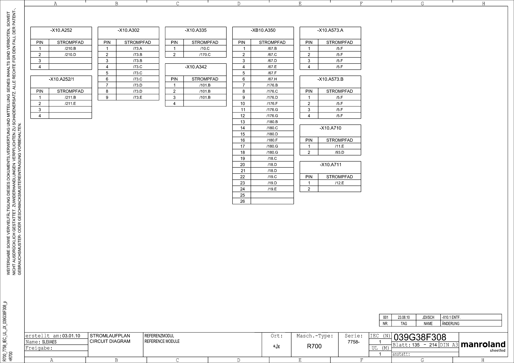

# +Jx — Sheet 135 of 214 — REFERENZMODUL

**REFERENCE MODULE**

> Part of the manroland **R700** printing press IEC/UL circuit diagrams.
> Drawing class: **Stromlaufplan / Circuit diagram** (DIN A3).
> Document `+Jx` covers the **1st printing module + feed register** machine section.

## At a glance

| Field | Value |
|---|---|
| Document | `+Jx`  (039G38F308) |
| Sheet | **135** of 214 |
| Section (DE) | REFERENZMODUL |
| Section (EN) | REFERENCE MODULE |
| Section type | REFERENCE_MODULE — Reference module |
| Machine type | `R700` |
| Series | `7758` |
| Created | 03.01.10 |
| Replaces | — |
| Columns used | A, B, C, D, E, F, G |
| Path numbers | — |
| Labels on sheet | 152 |
| Cross-refs out | 53 |
| Cross-refs in | 0 |

**Previous:** [+Jx sheet 134](SHEET_0134.md) · **Next:** [+Jx sheet 136](SHEET_0136.md) · **Document TOC:** [_TOC.md](_TOC.md)  (+Jx) · **Master TOC:** [all sheets](../_MASTER_TOC.md)

## Sheet image (300 DPI, exact vector render)



_Rendered directly from the PDF vector layer at 300 DPI (1-bit), no OCR and no resampling. Use it to confirm anything ambiguous in the text below._

## Cross-references on this sheet

Each entry is a wire leaving this sheet. The printed token is `/sheet.column`; the link resolves to that sheet inside the same document.

| Ref | Target sheet | Col | Path | Destination on target | Target section | From col |
|---|---|---|---|---|---|---|
| `/5.F` | [+Jx sheet 5](SHEET_0005.md) | F | — | — | SPANNUNGSVERSORGUNG, SCHALTSCHRANKBELÜFTUNG | F |
| `/73.A` | [+Jx sheet 73](SHEET_0073.md) | A | — | — | BEDRUCKSTOFFEINSTELLUNG | B |
| `/67.B` | [+Jx sheet 67](SHEET_0067.md) | B | — | — | BOGENFÜHRUNG | E |
| `/210.B` | [+Jx sheet 210](SHEET_0210.md) | B | — | — | OPTION: WASCHMITTELWECHSELBETRIEB | A |
| `/10.C` | [+Jx sheet 10](SHEET_0010.md) | C | — | — | SPANNUNGSVERSORGUNG, SCHALTSCHRANKBELÜFTUNG | C |
| `/5.F` | [+Jx sheet 5](SHEET_0005.md) | F | — | — | SPANNUNGSVERSORGUNG, SCHALTSCHRANKBELÜFTUNG | F |
| `/73.B` | [+Jx sheet 73](SHEET_0073.md) | B | — | — | BEDRUCKSTOFFEINSTELLUNG | B |
| `/67.C` | [+Jx sheet 67](SHEET_0067.md) | C | — | — | BOGENFÜHRUNG | E |
| `/210.D` | [+Jx sheet 210](SHEET_0210.md) | D | — | — | OPTION: WASCHMITTELWECHSELBETRIEB | A |
| `/170.C` | [+Jx sheet 170](SHEET_0170.md) | C | — | — | OPTION: AUTOMATISCHEM SPÜLEN | C |
| `/73.B` | [+Jx sheet 73](SHEET_0073.md) | B | — | — | BEDRUCKSTOFFEINSTELLUNG | B |
| `/5.F` | [+Jx sheet 5](SHEET_0005.md) | F | — | — | SPANNUNGSVERSORGUNG, SCHALTSCHRANKBELÜFTUNG | F |
| `/67.D` | [+Jx sheet 67](SHEET_0067.md) | D | — | — | BOGENFÜHRUNG | E |
| `/5.F` | [+Jx sheet 5](SHEET_0005.md) | F | — | — | SPANNUNGSVERSORGUNG, SCHALTSCHRANKBELÜFTUNG | F |
| `/67.E` | [+Jx sheet 67](SHEET_0067.md) | E | — | — | BOGENFÜHRUNG | E |
| `/73.C` | [+Jx sheet 73](SHEET_0073.md) | C | — | — | BEDRUCKSTOFFEINSTELLUNG | B |
| `/67.F` | [+Jx sheet 67](SHEET_0067.md) | F | — | — | BOGENFÜHRUNG | E |
| `/73.C` | [+Jx sheet 73](SHEET_0073.md) | C | — | — | BEDRUCKSTOFFEINSTELLUNG | B |
| `/73.C` | [+Jx sheet 73](SHEET_0073.md) | C | — | — | BEDRUCKSTOFFEINSTELLUNG | B |
| `/67.H` | [+Jx sheet 67](SHEET_0067.md) | H | — | — | BOGENFÜHRUNG | E |
| `/101.B` | [+Jx sheet 101](SHEET_0101.md) | B | — | — | RESERVE | C |
| `/176.B` | [+Jx sheet 176](SHEET_0176.md) | B | — | — | OPTION: TRANSFERMODUL 1 NACH | E |
| `/73.D` | [+Jx sheet 73](SHEET_0073.md) | D | — | — | BEDRUCKSTOFFEINSTELLUNG | B |
| `/101.B` | [+Jx sheet 101](SHEET_0101.md) | B | — | — | RESERVE | C |
| `/73.D` | [+Jx sheet 73](SHEET_0073.md) | D | — | — | BEDRUCKSTOFFEINSTELLUNG | B |
| `/176.C` | [+Jx sheet 176](SHEET_0176.md) | C | — | — | OPTION: TRANSFERMODUL 1 NACH | E |
| `/5.F` | [+Jx sheet 5](SHEET_0005.md) | F | — | — | SPANNUNGSVERSORGUNG, SCHALTSCHRANKBELÜFTUNG | F |
| `/73.E` | [+Jx sheet 73](SHEET_0073.md) | E | — | — | BEDRUCKSTOFFEINSTELLUNG | B |
| `/211.B` | [+Jx sheet 211](SHEET_0211.md) | B | — | — | OPTION: WASCHMITTELWECHSELBETRIEB | A |
| `/101.B` | [+Jx sheet 101](SHEET_0101.md) | B | — | — | RESERVE | C |
| `/176.D` | [+Jx sheet 176](SHEET_0176.md) | D | — | — | OPTION: TRANSFERMODUL 1 NACH | E |
| `/5.F` | [+Jx sheet 5](SHEET_0005.md) | F | — | — | SPANNUNGSVERSORGUNG, SCHALTSCHRANKBELÜFTUNG | F |
| `/211.E` | [+Jx sheet 211](SHEET_0211.md) | E | — | — | OPTION: WASCHMITTELWECHSELBETRIEB | A |
| `/176.F` | [+Jx sheet 176](SHEET_0176.md) | F | — | — | OPTION: TRANSFERMODUL 1 NACH | E |
| `/5.F` | [+Jx sheet 5](SHEET_0005.md) | F | — | — | SPANNUNGSVERSORGUNG, SCHALTSCHRANKBELÜFTUNG | F |
| `/176.G` | [+Jx sheet 176](SHEET_0176.md) | G | — | — | OPTION: TRANSFERMODUL 1 NACH | E |
| `/5.F` | [+Jx sheet 5](SHEET_0005.md) | F | — | — | SPANNUNGSVERSORGUNG, SCHALTSCHRANKBELÜFTUNG | F |
| `/176.G` | [+Jx sheet 176](SHEET_0176.md) | G | — | — | OPTION: TRANSFERMODUL 1 NACH | E |
| `/180.B` | [+Jx sheet 180](SHEET_0180.md) | B | — | — | OPTION: TRANSFERMODUL 2 | E |
| `/180.C` | [+Jx sheet 180](SHEET_0180.md) | C | — | — | OPTION: TRANSFERMODUL 2 | E |
| `/180.D` | [+Jx sheet 180](SHEET_0180.md) | D | — | — | OPTION: TRANSFERMODUL 2 | E |
| `/180.F` | [+Jx sheet 180](SHEET_0180.md) | F | — | — | OPTION: TRANSFERMODUL 2 | E |
| `/11.E` | [+Jx sheet 11](SHEET_0011.md) | E | — | — | SPANNUNGSVERSORGUNG, SCHALTSCHRANKBELÜFTUNG | F |
| `/180.G` | [+Jx sheet 180](SHEET_0180.md) | G | — | — | OPTION: TRANSFERMODUL 2 | E |
| `/180.G` | [+Jx sheet 180](SHEET_0180.md) | G | — | — | OPTION: TRANSFERMODUL 2 | E |
| `/93.D` | [+Jx sheet 93](SHEET_0093.md) | D | — | — | RESERVE | F |
| `/18.C` | [+Jx sheet 18](SHEET_0018.md) | C | — | — | LACKPUMPE | E |
| `/18.D` | [+Jx sheet 18](SHEET_0018.md) | D | — | — | LACKPUMPE | E |
| `/18.D` | [+Jx sheet 18](SHEET_0018.md) | D | — | — | LACKPUMPE | E |
| `/12.E` | [+Jx sheet 12](SHEET_0012.md) | E | — | STROMPFAD PIN 1 2 | SPANNUNGSVERSORGUNG, SCHALTSCHRANKBELÜFTUNG | E |
| `/19.C` | [+Jx sheet 19](SHEET_0019.md) | C | — | — | LACKPUMPE | E |
| `/19.D` | [+Jx sheet 19](SHEET_0019.md) | D | — | — | LACKPUMPE | E |
| `/19.E` | [+Jx sheet 19](SHEET_0019.md) | E | — | — | LACKPUMPE | E |

## Devices on this sheet

| Tag | Class | Class meaning (IEC) | Col | Sub | Terminal | Sign |
|---|---|---|---|---|---|---|
| `X10.A252` | — | cross-device reference | A | — | — | — |
| `X10.A302` | — | cross-device reference | B | — | — | — |
| `XB10.A350` | — | cross-device reference | D | — | — | — |
| `X10.A335` | — | cross-device reference | C | — | — | — |
| `X10.A342` | — | cross-device reference | C | — | — | — |
| `X10.A573.A` | — | cross-device reference | E | — | — | — |
| `X10.A573.B` | — | cross-device reference | F | — | — | — |
| `X10.A711` | — | cross-device reference | F | — | — | — |
| `X10.A710` | — | cross-device reference | F | — | — | — |
| `NR.` | — | cross-device reference | F | — | — | — |
| `23.08.10` | — | cross-device reference | G | — | — | — |

## Potentials / nets

_No named potentials on this sheet._

## Wire-end annotations (grouped as printed)

A wire that continues elsewhere is annotated with a small cluster: the destination description, the path/line number `#NN`, and the `/sheet.column` cross reference. Each row below is one such cluster exactly as it is grouped on the drawing.

| Col | Y | Path | Cross-ref | Text on the wire |
|---|---|---|---|---|
| A | 65.4 | — | — | `X10.A252` |
| B | 65.4 | — | — | `X10.A302` |
| C | 65.4 | — | — | `X10.A335` |
| D | 65.4 | — | — | `XB10.A350` |
| E | 65.4 | — | — | `X10.A573.A` |
| A | 94.1 | — | — | `PIN 2 3 4 1 STROMPFAD` |
| B | 94.1 | — | — | `PIN 2 3 5 6 7 8 9 4 1 STROMPFAD` |
| C | 94.1 | — | — | `PIN 2 1 STROMPFAD` |
| D | 94.1 | — | — | `PIN STROMPFAD` |
| E | 94.1 | — | — | `PIN 2 3 4 1 STROMPFAD` |
| D | 108.3 | — | — | `2 3 4 5 6 7 8 9 1` |
| A | 108.6 | — | `/210.B` | — |
| B | 108.6 | — | `/73.A` | — |
| E | 108.6 | — | `/67.B` | — |
| F | 108.6 | — | `/5.F` | — |
| C | 108.7 | — | `/10.C` | — |
| A | 122.8 | — | `/210.D` | — |
| B | 122.8 | — | `/73.B` | — |
| C | 122.8 | — | `/170.C` | — |
| E | 122.8 | — | `/67.C` | — |
| F | 122.8 | — | `/5.F` | — |
| B | 137.0 | — | `/73.B` | — |
| E | 137.0 | — | `/67.D` | — |
| F | 137.0 | — | `/5.F` | — |
| C | 150.5 | — | — | `X10.A342` |
| E | 151.1 | — | `/67.E` | — |
| F | 151.1 | — | `/5.F` | — |
| B | 151.2 | — | `/73.C` | — |
| B | 165.3 | — | `/73.C` | — |
| E | 165.3 | — | `/67.F` | — |
| A | 178.8 | — | — | `X10.A252/1` |
| F | 178.8 | — | — | `X10.A573.B` |
| C | 179.1 | — | — | `PIN 2 3 4 1 STROMPFAD` |
| B | 179.5 | — | `/73.C` | — |
| E | 179.5 | — | `/67.H` | — |
| B | 193.7 | — | `/73.D` | — |
| C | 193.7 | — | `/101.B` | — |
| E | 193.7 | — | `/176.B` | — |
| A | 207.5 | — | — | `PIN 2 3 4 1 STROMPFAD` |
| E | 207.5 | — | — | `PIN 2 3 4 1 STROMPFAD` |
| C | 207.8 | — | `/101.B` | — |
| B | 207.9 | — | `/73.D` | — |
| E | 207.9 | — | `/176.C` | — |
| A | 222.0 | — | `/211.B` | — |
| B | 222.0 | — | `/73.E` | — |
| C | 222.0 | — | `/101.B` | — |
| E | 222.0 | — | `/176.D` | — |
| F | 222.0 | — | `/5.F` | — |
| D | 235.9 | — | — | `10 12 13 14 15 16 17 18 19 20 11` |
| A | 236.2 | — | `/211.E` | — |
| E | 236.2 | — | `/176.F` | — |
| F | 236.2 | — | `/5.F` | — |
| F | 250.3 | — | `/5.F` | — |
| E | 250.4 | — | `/176.G` | — |
| F | 264.5 | — | `/5.F` | — |
| E | 264.6 | — | `/176.G` | — |
| E | 278.7 | — | `/180.B` | — |
| F | 292.2 | — | — | `X10.A710` |
| E | 292.9 | — | `/180.C` | — |
| E | 307.1 | — | `/180.D` | — |
| E | 320.9 | — | — | `PIN 2 1 STROMPFAD` |
| E | 321.2 | — | `/180.F` | — |
| E | 335.4 | — | `/180.G` | — |
| F | 335.4 | — | `/11.E` | — |
| E | 349.6 | — | `/180.G` | — |
| F | 349.6 | — | `/93.D` | — |
| E | 363.8 | — | `/18.C` | — |
| F | 377.2 | — | — | `X10.A711` |
| E | 377.9 | — | `/18.D` | — |
| D | 391.8 | — | — | `22 23 24 25 26 21` |
| E | 392.1 | — | `/18.D` | — |
| E | 405.9 | — | `/12.E` | `PIN 2 1 STROMPFAD` |
| E | 406.3 | — | `/19.C` | — |
| E | 420.5 | — | `/19.D` | — |
| E | 434.6 | — | `/19.E` | — |
| G | 733.0 | — | — | `001 23.08.10 JDI/SCH X10.1 ENTF.` |
| G | 747.1 | — | — | `NR. TAG NAME ÄNDERUNG` |


## Reconstructed tables

This sheet carries tabular content (pin map / terminal assignment / index). The grid below was rebuilt from the drawing's own rule lines, so each row is exactly one physical row of the table.

### Table 1 — 10 data rows × 2 columns (at x=70.9, y=62.4) — **X10.A252**

| PIN | STROMPFAD |
|---|---|
| `1` | `/210.B` |
| `2` | `/210.D` |
| `3` |  |
| `4` |  |
|  | `X10.A252/1` |
| `PIN` | `STROMPFAD` |
| `1` | `/211.B` |
| `2` | `/211.E` |
| `3` |  |
| `4` |  |


### Table 2 — 9 data rows × 2 columns (at x=226.8, y=62.4) — **X10.A302**

| PIN | STROMPFAD |
|---|---|
| `1` | `/73.A` |
| `2` | `/73.B` |
| `3` | `/73.B` |
| `4` | `/73.C` |
| `5` | `/73.C` |
| `6` | `/73.C` |
| `7` | `/73.D` |
| `8` | `/73.D` |
| `9` | `/73.E` |


### Table 3 — 8 data rows × 2 columns (at x=382.7, y=62.4) — **X10.A335**

| PIN | STROMPFAD |
|---|---|
| `1` | `/10.C` |
| `2` | `/170.C` |
|  | `X10.A342` |
| `PIN` | `STROMPFAD` |
| `1` | `/101.B` |
| `2` | `/101.B` |
| `3` | `/101.B` |
| `4` |  |


### Table 4 — 26 data rows × 2 columns (at x=538.6, y=62.4) — **XB10.A350**

| PIN | STROMPFAD |
|---|---|
| `1` | `/67.B` |
| `2` | `/67.C` |
| `3` | `/67.D` |
| `4` | `/67.E` |
| `5` | `/67.F` |
| `6` | `/67.H` |
| `7` | `/176.B` |
| `8` | `/176.C` |
| `9` | `/176.D` |
| `10` | `/176.F` |
| `11` | `/176.G` |
| `12` | `/176.G` |
| `13` | `/180.B` |
| `14` | `/180.C` |
| `15` | `/180.D` |
| `16` | `/180.F` |
| `17` | `/180.G` |
| `18` | `/180.G` |
| `19` | `/18.C` |
| `20` | `/18.D` |
| `21` | `/18.D` |
| `22` | `/19.C` |
| `23` | `/19.D` |
| `24` | `/19.E` |
| `25` |  |
| `26` |  |


### Table 5 — 18 data rows × 2 columns (at x=694.5, y=62.4) — **X10.A573.A**

| PIN | STROMPFAD |
|---|---|
| `1` | `/5.F` |
| `2` | `/5.F` |
| `3` | `/5.F` |
| `4` | `/5.F` |
|  | `X10.A573.B` |
| `PIN` | `STROMPFAD` |
| `1` | `/5.F` |
| `2` | `/5.F` |
| `3` | `/5.F` |
| `4` | `/5.F` |
|  | `X10.A710` |
| `PIN` | `STROMPFAD` |
| `1` | `/11.E` |
| `2` | `/93.D` |
|  | `X10.A711` |
| `PIN` | `STROMPFAD` |
| `1` | `/12.E` |
| `2` |  |


## Notes and free text on this sheet

| Text | Col | Y (pt) |
|---|---|---|
| `PIN` | A | 94.13 |
| `STROMPFAD` | A | 94.09 |
| `X10.A252/1` | A | 178.82 |
| `PIN` | B | 94.13 |
| `STROMPFAD` | B | 94.09 |
| `PIN` | D | 94.13 |
| `STROMPFAD` | E | 94.09 |
| `PIN` | C | 94.13 |
| `STROMPFAD` | C | 94.09 |
| `PIN` | E | 94.13 |
| `STROMPFAD` | F | 94.09 |
| `TAG` | G | 747.23 |
| `NAME` | G | 747.22 |
| `ÄNDERUNG` | G | 747.25 |
| `JDI/SCH` | G | 733.05 |
| `X10.1 ENTF.` | G | 733.06 |

## Complete label inventory (exact text from the drawing)

Every text object inside the drawing area of this sheet, in DIN reading order (column A→H, then top→bottom). This is the authoritative list: if a string is not here it is not printed on this sheet.

| Col | Y | X | Dir | Type | Text |
|---|---|---|---|---|---|
| A | 65.4 | 116.8 | → | device ref | `X10.A252` |
| A | 94.1 | 84.0 | → | text | `PIN` |
| A | 94.1 | 132.4 | → | text | `STROMPFAD` |
| A | 108.3 | 89.9 | → | number | `1` |
| A | 108.6 | 150.4 | → | cross-reference | `/210.B` |
| A | 122.5 | 89.4 | → | number | `2` |
| A | 122.8 | 150.2 | → | cross-reference | `/210.D` |
| A | 136.7 | 89.4 | → | number | `3` |
| A | 150.8 | 89.6 | → | number | `4` |
| A | 178.8 | 113.1 | → | text | `X10.A252/1` |
| A | 207.5 | 84.0 | → | text | `PIN` |
| A | 207.5 | 132.4 | → | text | `STROMPFAD` |
| A | 221.7 | 89.9 | → | number | `1` |
| A | 222.0 | 150.4 | → | cross-reference | `/211.B` |
| A | 235.9 | 89.4 | → | number | `2` |
| A | 236.2 | 150.4 | → | cross-reference | `/211.E` |
| A | 250.0 | 89.4 | → | number | `3` |
| A | 264.2 | 89.6 | → | number | `4` |
| B | 65.4 | 272.7 | → | device ref | `X10.A302` |
| B | 94.1 | 240.0 | → | text | `PIN` |
| B | 94.1 | 288.3 | → | text | `STROMPFAD` |
| B | 108.3 | 245.8 | → | number | `1` |
| B | 108.6 | 308.6 | → | cross-reference | `/73.A` |
| B | 122.5 | 245.3 | → | number | `2` |
| B | 122.8 | 308.7 | → | cross-reference | `/73.B` |
| B | 136.7 | 245.3 | → | number | `3` |
| B | 137.0 | 308.7 | → | cross-reference | `/73.B` |
| B | 150.8 | 245.5 | → | number | `4` |
| B | 151.2 | 308.6 | → | cross-reference | `/73.C` |
| B | 165.0 | 245.3 | → | number | `5` |
| B | 165.3 | 308.6 | → | cross-reference | `/73.C` |
| B | 179.2 | 245.3 | → | number | `6` |
| B | 179.5 | 308.6 | → | cross-reference | `/73.C` |
| B | 193.3 | 245.3 | → | number | `7` |
| B | 193.7 | 308.6 | → | cross-reference | `/73.D` |
| B | 207.5 | 245.3 | → | number | `8` |
| B | 207.9 | 308.6 | → | cross-reference | `/73.D` |
| B | 221.7 | 245.3 | → | number | `9` |
| B | 222.0 | 308.7 | → | cross-reference | `/73.E` |
| C | 65.4 | 428.5 | → | device ref | `X10.A335` |
| C | 94.1 | 395.9 | → | text | `PIN` |
| C | 94.1 | 444.2 | → | text | `STROMPFAD` |
| C | 108.3 | 401.7 | → | number | `1` |
| C | 108.7 | 464.5 | → | cross-reference | `/10.C` |
| C | 122.5 | 401.2 | → | number | `2` |
| C | 122.8 | 462.0 | → | cross-reference | `/170.C` |
| C | 150.5 | 428.6 | → | device ref | `X10.A342` |
| C | 179.1 | 444.2 | → | text | `STROMPFAD` |
| C | 179.2 | 395.9 | → | text | `PIN` |
| C | 193.3 | 401.7 | → | number | `1` |
| C | 193.7 | 462.2 | → | cross-reference | `/101.B` |
| C | 207.5 | 401.2 | → | number | `2` |
| C | 207.8 | 462.2 | → | cross-reference | `/101.B` |
| C | 221.7 | 401.2 | → | number | `3` |
| C | 222.0 | 462.2 | → | cross-reference | `/101.B` |
| C | 235.9 | 401.4 | → | number | `4` |
| D | 65.4 | 581.0 | → | device ref | `XB10.A350` |
| D | 94.1 | 551.8 | → | text | `PIN` |
| D | 108.3 | 563.2 | → | number | `1` |
| D | 122.5 | 561.8 | → | number | `2` |
| D | 136.7 | 561.8 | → | number | `3` |
| D | 150.8 | 561.8 | → | number | `4` |
| D | 165.0 | 561.8 | → | number | `5` |
| D | 179.2 | 561.8 | → | number | `6` |
| D | 193.3 | 561.8 | → | number | `7` |
| D | 207.5 | 561.8 | → | number | `8` |
| D | 221.7 | 561.8 | → | number | `9` |
| D | 235.9 | 556.4 | → | number | `10` |
| D | 250.0 | 557.9 | → | number | `11` |
| D | 264.2 | 556.4 | → | number | `12` |
| D | 278.4 | 556.4 | → | number | `13` |
| D | 292.6 | 556.4 | → | number | `14` |
| D | 306.7 | 556.4 | → | number | `15` |
| D | 320.9 | 556.4 | → | number | `16` |
| D | 335.1 | 556.4 | → | number | `17` |
| D | 349.3 | 556.4 | → | number | `18` |
| D | 363.4 | 556.4 | → | number | `19` |
| D | 377.6 | 556.4 | → | number | `20` |
| D | 391.8 | 557.9 | → | number | `21` |
| D | 405.9 | 556.4 | → | number | `22` |
| D | 420.1 | 556.4 | → | number | `23` |
| D | 434.3 | 556.4 | → | number | `24` |
| D | 448.5 | 556.4 | → | number | `25` |
| D | 462.6 | 556.4 | → | number | `26` |
| E | 65.4 | 735.2 | → | device ref | `X10.A573.A` |
| E | 94.1 | 600.1 | → | text | `STROMPFAD` |
| E | 94.1 | 707.7 | → | text | `PIN` |
| E | 108.3 | 713.5 | → | number | `1` |
| E | 108.6 | 620.5 | → | cross-reference | `/67.B` |
| E | 122.5 | 713.1 | → | number | `2` |
| E | 122.8 | 620.4 | → | cross-reference | `/67.C` |
| E | 136.7 | 713.1 | → | number | `3` |
| E | 137.0 | 620.4 | → | cross-reference | `/67.D` |
| E | 150.8 | 713.2 | → | number | `4` |
| E | 151.1 | 620.5 | → | cross-reference | `/67.E` |
| E | 165.3 | 620.8 | → | cross-reference | `/67.F` |
| E | 179.5 | 620.5 | → | cross-reference | `/67.H` |
| E | 193.7 | 618.1 | → | cross-reference | `/176.B` |
| E | 207.5 | 707.7 | → | text | `PIN` |
| E | 207.9 | 618.0 | → | cross-reference | `/176.C` |
| E | 221.7 | 713.5 | → | number | `1` |
| E | 222.0 | 618.0 | → | cross-reference | `/176.D` |
| E | 235.9 | 713.1 | → | number | `2` |
| E | 236.2 | 618.4 | → | cross-reference | `/176.F` |
| E | 250.0 | 713.1 | → | number | `3` |
| E | 250.4 | 617.7 | → | cross-reference | `/176.G` |
| E | 264.2 | 713.2 | → | number | `4` |
| E | 264.6 | 617.7 | → | cross-reference | `/176.G` |
| E | 278.7 | 618.1 | → | cross-reference | `/180.B` |
| E | 292.9 | 618.0 | → | cross-reference | `/180.C` |
| E | 307.1 | 618.0 | → | cross-reference | `/180.D` |
| E | 320.9 | 707.7 | → | text | `PIN` |
| E | 321.2 | 618.4 | → | cross-reference | `/180.F` |
| E | 335.1 | 713.5 | → | number | `1` |
| E | 335.4 | 617.7 | → | cross-reference | `/180.G` |
| E | 349.3 | 713.1 | → | number | `2` |
| E | 349.6 | 617.7 | → | cross-reference | `/180.G` |
| E | 363.8 | 620.4 | → | cross-reference | `/18.C` |
| E | 377.9 | 620.4 | → | cross-reference | `/18.D` |
| E | 392.1 | 620.4 | → | cross-reference | `/18.D` |
| E | 405.9 | 707.7 | → | text | `PIN` |
| E | 406.3 | 620.4 | → | cross-reference | `/19.C` |
| E | 420.1 | 713.5 | → | number | `1` |
| E | 420.5 | 620.4 | → | cross-reference | `/19.D` |
| E | 434.3 | 713.1 | → | number | `2` |
| E | 434.6 | 620.5 | → | cross-reference | `/19.E` |
| F | 94.1 | 756.0 | → | text | `STROMPFAD` |
| F | 108.6 | 779.1 | → | cross-reference | `/5.F` |
| F | 122.8 | 779.1 | → | cross-reference | `/5.F` |
| F | 137.0 | 779.1 | → | cross-reference | `/5.F` |
| F | 151.1 | 779.1 | → | cross-reference | `/5.F` |
| F | 178.8 | 735.4 | → | device ref | `X10.A573.B` |
| F | 207.5 | 756.0 | → | text | `STROMPFAD` |
| F | 222.0 | 779.1 | → | cross-reference | `/5.F` |
| F | 236.2 | 779.1 | → | cross-reference | `/5.F` |
| F | 250.3 | 779.1 | → | cross-reference | `/5.F` |
| F | 264.5 | 779.1 | → | cross-reference | `/5.F` |
| F | 292.2 | 740.4 | → | device ref | `X10.A710` |
| F | 320.9 | 756.0 | → | text | `STROMPFAD` |
| F | 335.4 | 776.4 | → | cross-reference | `/11.E` |
| F | 349.6 | 776.3 | → | cross-reference | `/93.D` |
| F | 377.2 | 741.1 | → | device ref | `X10.A711` |
| F | 405.9 | 756.0 | → | text | `STROMPFAD` |
| F | 420.4 | 776.4 | → | cross-reference | `/12.E` |
| F | 733.0 | 887.6 | → | number | `001` |
| F | 747.1 | 886.8 | → | device ref | `NR.` |
| G | 733.1 | 921.9 | → | device ref | `23.08.10` |
| G | 733.1 | 978.6 | → | text | `JDI/SCH` |
| G | 733.1 | 1023.7 | → | text | `X10.1 ENTF.` |
| G | 747.2 | 928.5 | → | text | `TAG` |
| G | 747.2 | 981.8 | → | text | `NAME` |
| G | 747.3 | 1024.0 | → | text | `ÄNDERUNG` |

## Reading-order text block

The same content as a plain block, grouped by DIN column — convenient to paste or to match against a visual description.

```text
=== Column A ===
  65.4  116.8  devref       X10.A252
  94.1   84.0  text         PIN
  94.1  132.4  text         STROMPFAD
 108.3   89.9  numeric      1
 108.6  150.4  xref         /210.B
 122.5   89.4  numeric      2
 122.8  150.2  xref         /210.D
 136.7   89.4  numeric      3
 150.8   89.6  numeric      4
 178.8  113.1  text         X10.A252/1
 207.5   84.0  text         PIN
 207.5  132.4  text         STROMPFAD
 221.7   89.9  numeric      1
 222.0  150.4  xref         /211.B
 235.9   89.4  numeric      2
 236.2  150.4  xref         /211.E
 250.0   89.4  numeric      3
 264.2   89.6  numeric      4
=== Column B ===
  65.4  272.7  devref       X10.A302
  94.1  240.0  text         PIN
  94.1  288.3  text         STROMPFAD
 108.3  245.8  numeric      1
 108.6  308.6  xref         /73.A
 122.5  245.3  numeric      2
 122.8  308.7  xref         /73.B
 136.7  245.3  numeric      3
 137.0  308.7  xref         /73.B
 150.8  245.5  numeric      4
 151.2  308.6  xref         /73.C
 165.0  245.3  numeric      5
 165.3  308.6  xref         /73.C
 179.2  245.3  numeric      6
 179.5  308.6  xref         /73.C
 193.3  245.3  numeric      7
 193.7  308.6  xref         /73.D
 207.5  245.3  numeric      8
 207.9  308.6  xref         /73.D
 221.7  245.3  numeric      9
 222.0  308.7  xref         /73.E
=== Column C ===
  65.4  428.5  devref       X10.A335
  94.1  395.9  text         PIN
  94.1  444.2  text         STROMPFAD
 108.3  401.7  numeric      1
 108.7  464.5  xref         /10.C
 122.5  401.2  numeric      2
 122.8  462.0  xref         /170.C
 150.5  428.6  devref       X10.A342
 179.1  444.2  text         STROMPFAD
 179.2  395.9  text         PIN
 193.3  401.7  numeric      1
 193.7  462.2  xref         /101.B
 207.5  401.2  numeric      2
 207.8  462.2  xref         /101.B
 221.7  401.2  numeric      3
 222.0  462.2  xref         /101.B
 235.9  401.4  numeric      4
=== Column D ===
  65.4  581.0  devref       XB10.A350
  94.1  551.8  text         PIN
 108.3  563.2  numeric      1
 122.5  561.8  numeric      2
 136.7  561.8  numeric      3
 150.8  561.8  numeric      4
 165.0  561.8  numeric      5
 179.2  561.8  numeric      6
 193.3  561.8  numeric      7
 207.5  561.8  numeric      8
 221.7  561.8  numeric      9
 235.9  556.4  numeric      10
 250.0  557.9  numeric      11
 264.2  556.4  numeric      12
 278.4  556.4  numeric      13
 292.6  556.4  numeric      14
 306.7  556.4  numeric      15
 320.9  556.4  numeric      16
 335.1  556.4  numeric      17
 349.3  556.4  numeric      18
 363.4  556.4  numeric      19
 377.6  556.4  numeric      20
 391.8  557.9  numeric      21
 405.9  556.4  numeric      22
 420.1  556.4  numeric      23
 434.3  556.4  numeric      24
 448.5  556.4  numeric      25
 462.6  556.4  numeric      26
=== Column E ===
  65.4  735.2  devref       X10.A573.A
  94.1  600.1  text         STROMPFAD
  94.1  707.7  text         PIN
 108.3  713.5  numeric      1
 108.6  620.5  xref         /67.B
 122.5  713.1  numeric      2
 122.8  620.4  xref         /67.C
 136.7  713.1  numeric      3
 137.0  620.4  xref         /67.D
 150.8  713.2  numeric      4
 151.1  620.5  xref         /67.E
 165.3  620.8  xref         /67.F
 179.5  620.5  xref         /67.H
 193.7  618.1  xref         /176.B
 207.5  707.7  text         PIN
 207.9  618.0  xref         /176.C
 221.7  713.5  numeric      1
 222.0  618.0  xref         /176.D
 235.9  713.1  numeric      2
 236.2  618.4  xref         /176.F
 250.0  713.1  numeric      3
 250.4  617.7  xref         /176.G
 264.2  713.2  numeric      4
 264.6  617.7  xref         /176.G
 278.7  618.1  xref         /180.B
 292.9  618.0  xref         /180.C
 307.1  618.0  xref         /180.D
 320.9  707.7  text         PIN
 321.2  618.4  xref         /180.F
 335.1  713.5  numeric      1
 335.4  617.7  xref         /180.G
 349.3  713.1  numeric      2
 349.6  617.7  xref         /180.G
 363.8  620.4  xref         /18.C
 377.9  620.4  xref         /18.D
 392.1  620.4  xref         /18.D
 405.9  707.7  text         PIN
 406.3  620.4  xref         /19.C
 420.1  713.5  numeric      1
 420.5  620.4  xref         /19.D
 434.3  713.1  numeric      2
 434.6  620.5  xref         /19.E
=== Column F ===
  94.1  756.0  text         STROMPFAD
 108.6  779.1  xref         /5.F
 122.8  779.1  xref         /5.F
 137.0  779.1  xref         /5.F
 151.1  779.1  xref         /5.F
 178.8  735.4  devref       X10.A573.B
 207.5  756.0  text         STROMPFAD
 222.0  779.1  xref         /5.F
 236.2  779.1  xref         /5.F
 250.3  779.1  xref         /5.F
 264.5  779.1  xref         /5.F
 292.2  740.4  devref       X10.A710
 320.9  756.0  text         STROMPFAD
 335.4  776.4  xref         /11.E
 349.6  776.3  xref         /93.D
 377.2  741.1  devref       X10.A711
 405.9  756.0  text         STROMPFAD
 420.4  776.4  xref         /12.E
 733.0  887.6  numeric      001
 747.1  886.8  devref       NR.
=== Column G ===
 733.1  921.9  devref       23.08.10
 733.1  978.6  text         JDI/SCH
 733.1 1023.7  text         X10.1 ENTF.
 747.2  928.5  text         TAG
 747.2  981.8  text         NAME
 747.3 1024.0  text         ÄNDERUNG
```

---
_Generated from the PDF vector text layer; no OCR. Source: `R700_7758_IEC_UL_JX_039G38F308_p`, sheet 135._
