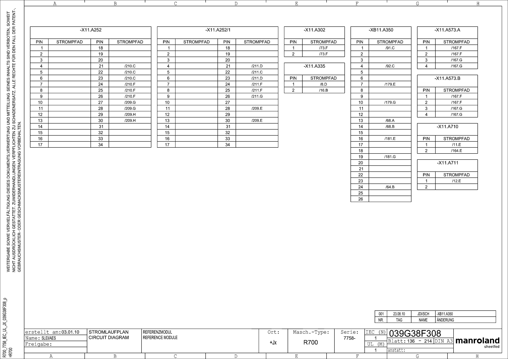

# +Jx — Sheet 136 of 214 — REFERENZMODUL

**REFERENCE MODULE**

> Part of the manroland **R700** printing press IEC/UL circuit diagrams.
> Drawing class: **Stromlaufplan / Circuit diagram** (DIN A3).
> Document `+Jx` covers the **1st printing module + feed register** machine section.

## At a glance

| Field | Value |
|---|---|
| Document | `+Jx`  (039G38F308) |
| Sheet | **136** of 214 |
| Section (DE) | REFERENZMODUL |
| Section (EN) | REFERENCE MODULE |
| Section type | REFERENCE_MODULE — Reference module |
| Machine type | `R700` |
| Series | `7758` |
| Created | 03.01.10 |
| Replaces | — |
| Columns used | A, B, C, D, E, F, G, H |
| Path numbers | — |
| Labels on sheet | 191 |
| Cross-refs out | 42 |
| Cross-refs in | 0 |

**Previous:** [+Jx sheet 135](SHEET_0135.md) · **Next:** [+Jx sheet 137](SHEET_0137.md) · **Document TOC:** [_TOC.md](_TOC.md)  (+Jx) · **Master TOC:** [all sheets](../_MASTER_TOC.md)

## Sheet image (300 DPI, exact vector render)



_Rendered directly from the PDF vector layer at 300 DPI (1-bit), no OCR and no resampling. Use it to confirm anything ambiguous in the text below._

## Cross-references on this sheet

Each entry is a wire leaving this sheet. The printed token is `/sheet.column`; the link resolves to that sheet inside the same document.

| Ref | Target sheet | Col | Path | Destination on target | Target section | From col |
|---|---|---|---|---|---|---|
| `/73.F` | [+Jx sheet 73](SHEET_0073.md) | F | — | — | BEDRUCKSTOFFEINSTELLUNG | E |
| `/167.F` | [+Jx sheet 167](SHEET_0167.md) | F | — | — | OPTION: | H |
| `/91.C` | [+Jx sheet 91](SHEET_0091.md) | C | — | — | BOGENFÜHRUNG (BLASROHRE) | G |
| `/73.F` | [+Jx sheet 73](SHEET_0073.md) | F | — | — | BEDRUCKSTOFFEINSTELLUNG | E |
| `/167.F` | [+Jx sheet 167](SHEET_0167.md) | F | — | — | OPTION: | H |
| `/167.G` | [+Jx sheet 167](SHEET_0167.md) | G | — | — | OPTION: | H |
| `/92.C` | [+Jx sheet 92](SHEET_0092.md) | C | — | — | BOGENFÜHRUNG (BLASROHRE) | G |
| `/167.G` | [+Jx sheet 167](SHEET_0167.md) | G | — | — | OPTION: | H |
| `/210.C` | [+Jx sheet 210](SHEET_0210.md) | C | — | — | OPTION: WASCHMITTELWECHSELBETRIEB | B |
| `/211.D` | [+Jx sheet 211](SHEET_0211.md) | D | — | — | OPTION: WASCHMITTELWECHSELBETRIEB | D |
| `/210.C` | [+Jx sheet 210](SHEET_0210.md) | C | — | — | OPTION: WASCHMITTELWECHSELBETRIEB | B |
| `/211.C` | [+Jx sheet 211](SHEET_0211.md) | C | — | — | OPTION: WASCHMITTELWECHSELBETRIEB | D |
| `/210.C` | [+Jx sheet 210](SHEET_0210.md) | C | — | — | OPTION: WASCHMITTELWECHSELBETRIEB | B |
| `/211.D` | [+Jx sheet 211](SHEET_0211.md) | D | — | — | OPTION: WASCHMITTELWECHSELBETRIEB | D |
| `/179.E` | [+Jx sheet 179](SHEET_0179.md) | E | — | — | OPTION: TRANSFERMODUL 1 NACH | G |
| `/210.F` | [+Jx sheet 210](SHEET_0210.md) | F | — | — | OPTION: WASCHMITTELWECHSELBETRIEB | B |
| `/211.F` | [+Jx sheet 211](SHEET_0211.md) | F | — | — | OPTION: WASCHMITTELWECHSELBETRIEB | D |
| `/8.D` | [+Jx sheet 8](SHEET_0008.md) | D | — | — | SPANNUNGSVERSORGUNG, SCHALTSCHRANKBELÜFTUNG | E |
| `/16.B` | [+Jx sheet 16](SHEET_0016.md) | B | — | — | ÖLUMLAUFSCHMIERUNG | E |
| `/210.F` | [+Jx sheet 210](SHEET_0210.md) | F | — | — | OPTION: WASCHMITTELWECHSELBETRIEB | B |
| `/211.F` | [+Jx sheet 211](SHEET_0211.md) | F | — | — | OPTION: WASCHMITTELWECHSELBETRIEB | D |
| `/210.F` | [+Jx sheet 210](SHEET_0210.md) | F | — | — | OPTION: WASCHMITTELWECHSELBETRIEB | B |
| `/211.G` | [+Jx sheet 211](SHEET_0211.md) | G | — | — | OPTION: WASCHMITTELWECHSELBETRIEB | D |
| `/167.F` | [+Jx sheet 167](SHEET_0167.md) | F | — | — | OPTION: | H |
| `/167.F` | [+Jx sheet 167](SHEET_0167.md) | F | — | — | OPTION: | H |
| `/209.G` | [+Jx sheet 209](SHEET_0209.md) | G | — | — | OPTION: WASCHMITTELWECHSELBETRIEB | B |
| `/179.G` | [+Jx sheet 179](SHEET_0179.md) | G | — | — | OPTION: TRANSFERMODUL 1 NACH | G |
| `/209.E` | [+Jx sheet 209](SHEET_0209.md) | E | — | — | OPTION: WASCHMITTELWECHSELBETRIEB | D |
| `/209.G` | [+Jx sheet 209](SHEET_0209.md) | G | — | — | OPTION: WASCHMITTELWECHSELBETRIEB | B |
| `/167.G` | [+Jx sheet 167](SHEET_0167.md) | G | — | — | OPTION: | H |
| `/167.G` | [+Jx sheet 167](SHEET_0167.md) | G | — | — | OPTION: | H |
| `/209.H` | [+Jx sheet 209](SHEET_0209.md) | H | — | — | OPTION: WASCHMITTELWECHSELBETRIEB | B |
| `/68.A` | [+Jx sheet 68](SHEET_0068.md) | A | — | — | BLAS/SAUGLUFT MIT MOTORVENTILEINSTELLUNG | G |
| `/209.E` | [+Jx sheet 209](SHEET_0209.md) | E | — | — | OPTION: WASCHMITTELWECHSELBETRIEB | D |
| `/209.H` | [+Jx sheet 209](SHEET_0209.md) | H | — | — | OPTION: WASCHMITTELWECHSELBETRIEB | B |
| `/68.B` | [+Jx sheet 68](SHEET_0068.md) | B | — | — | BLAS/SAUGLUFT MIT MOTORVENTILEINSTELLUNG | G |
| `/181.E` | [+Jx sheet 181](SHEET_0181.md) | E | — | — | OPTION: TRANSFERMODUL 2 | G |
| `/11.E` | [+Jx sheet 11](SHEET_0011.md) | E | — | — | SPANNUNGSVERSORGUNG, SCHALTSCHRANKBELÜFTUNG | H |
| `/164.E` | [+Jx sheet 164](SHEET_0164.md) | E | — | — | OPTION: | H |
| `/181.G` | [+Jx sheet 181](SHEET_0181.md) | G | — | — | OPTION: TRANSFERMODUL 2 | G |
| `/12.E` | [+Jx sheet 12](SHEET_0012.md) | E | — | STROMPFAD PIN 1 2 | SPANNUNGSVERSORGUNG, SCHALTSCHRANKBELÜFTUNG | G |
| `/64.B` | [+Jx sheet 64](SHEET_0064.md) | B | — | — | TROPFEINRICHTUNG | G |

## Devices on this sheet

| Tag | Class | Class meaning (IEC) | Col | Sub | Terminal | Sign |
|---|---|---|---|---|---|---|
| `X11.A252` | — | cross-device reference | B | — | — | — |
| `X11.A302` | — | cross-device reference | E | — | — | — |
| `X11.A335` | — | cross-device reference | E | — | — | — |
| `XB11.A350` | — | cross-device reference | F | — | — | — |
| `X11.A573.A` | — | cross-device reference | G | — | — | — |
| `X11.A573.B` | — | cross-device reference | G | — | — | — |
| `X11.A711` | — | cross-device reference | H | — | — | — |
| `X11.A710` | — | cross-device reference | G | — | — | — |
| `NR.` | — | cross-device reference | F | — | — | — |
| `23.08.10` | — | cross-device reference | G | — | — | — |
| `XB11.A350` | — | cross-device reference | G | — | — | — |

## Potentials / nets

_No named potentials on this sheet._

## Wire-end annotations (grouped as printed)

A wire that continues elsewhere is annotated with a small cluster: the destination description, the path/line number `#NN`, and the `/sheet.column` cross reference. Each row below is one such cluster exactly as it is grouped on the drawing.

| Col | Y | Path | Cross-ref | Text on the wire |
|---|---|---|---|---|
| B | 65.4 | — | — | `X11.A252` |
| D | 65.4 | — | — | `X11.A252/1` |
| E | 65.4 | — | — | `X11.A302` |
| F | 65.4 | — | — | `XB11.A350` |
| G | 65.4 | — | — | `X11.A573.A` |
| A | 94.1 | — | — | `PIN STROMPFAD` |
| B | 94.1 | — | — | `PIN 18 19 20 22 23 24 25 26 27 28 29 30 32 33 34 21 31 STROMPFAD` |
| C | 94.1 | — | — | `PIN STROMPFAD` |
| D | 94.1 | — | — | `PIN 18 19 20 22 23 24 25 26 27 28 29 30 32 33 34 21 31 STROMPFAD` |
| E | 94.1 | — | — | `PIN 2 1 STROMPFAD` |
| F | 94.1 | — | — | `PIN STROMPFAD` |
| G | 94.1 | — | — | `PIN 2 3 4 1 STROMPFAD` |
| A | 108.3 | — | — | `2 3 4 5 6 7 8 9 1` |
| C | 108.3 | — | — | `2 3 4 5 6 7 8 9 1` |
| F | 108.3 | — | — | `2 3 4 5 6 7 8 9 1` |
| E | 108.6 | — | `/73.F` | — |
| H | 108.6 | — | `/167.F` | — |
| G | 108.7 | — | `/91.C` | — |
| E | 122.8 | — | `/73.F` | — |
| H | 122.8 | — | `/167.F` | — |
| H | 137.0 | — | `/167.G` | — |
| E | 150.5 | — | — | `X11.A335` |
| B | 151.2 | — | `/210.C` | — |
| D | 151.2 | — | `/211.D` | — |
| G | 151.2 | — | `/92.C` | — |
| H | 151.2 | — | `/167.G` | — |
| B | 165.3 | — | `/210.C` | — |
| D | 165.3 | — | `/211.C` | — |
| G | 178.8 | — | — | `X11.A573.B` |
| E | 179.1 | — | — | `PIN 2 1 STROMPFAD` |
| B | 179.5 | — | `/210.C` | — |
| D | 179.5 | — | `/211.D` | — |
| B | 193.7 | — | `/210.F` | — |
| D | 193.7 | — | `/211.F` | — |
| E | 193.7 | — | `/8.D` | — |
| G | 193.7 | — | `/179.E` | — |
| G | 207.5 | — | — | `PIN 2 3 4 1 STROMPFAD` |
| B | 207.8 | — | `/210.F` | — |
| D | 207.8 | — | `/211.F` | — |
| E | 207.8 | — | `/16.B` | — |
| B | 222.0 | — | `/210.F` | — |
| D | 222.0 | — | `/211.G` | — |
| H | 222.0 | — | `/167.F` | — |
| A | 235.9 | — | — | `10 12 13 14 15 16 17 11` |
| C | 235.9 | — | — | `10 12 13 14 15 16 17 11` |
| F | 235.9 | — | — | `10 12 13 14 15 16 17 18 19 20 11` |
| B | 236.2 | — | `/209.G` | — |
| G | 236.2 | — | `/179.G` | — |
| H | 236.2 | — | `/167.F` | — |
| B | 250.4 | — | `/209.G` | — |
| D | 250.4 | — | `/209.E` | — |
| H | 250.4 | — | `/167.G` | — |
| B | 264.6 | — | `/209.H` | — |
| H | 264.6 | — | `/167.G` | — |
| B | 278.7 | — | `/209.H` | — |
| D | 278.7 | — | `/209.E` | — |
| G | 278.7 | — | `/68.A` | — |
| G | 292.2 | — | — | `X11.A710` |
| G | 292.9 | — | `/68.B` | — |
| G | 320.9 | — | — | `PIN 2 1 STROMPFAD` |
| G | 321.2 | — | `/181.E` | — |
| H | 335.4 | — | `/11.E` | — |
| H | 349.6 | — | `/164.E` | — |
| G | 363.8 | — | `/181.G` | — |
| H | 377.2 | — | — | `X11.A711` |
| F | 391.8 | — | — | `22 23 24 25 26 21` |
| G | 405.9 | — | `/12.E` | `PIN 2 1 STROMPFAD` |
| G | 434.6 | — | `/64.B` | — |
| G | 733.0 | — | — | `001 23.08.10 JDI/SCH XB11.A350` |
| G | 747.1 | — | — | `NR. TAG NAME ÄNDERUNG` |


## Reconstructed tables

This sheet carries tabular content (pin map / terminal assignment / index). The grid below was rebuilt from the drawing's own rule lines, so each row is exactly one physical row of the table.

### Table 1 — 17 data rows × 4 columns (at x=70.9, y=62.4) — **X11.A252**

| PIN | STROMPFAD | PIN | STROMPFAD |
|---|---|---|---|
| `1` |  | `18` |  |
| `2` |  | `19` |  |
| `3` |  | `20` |  |
| `4` |  | `21` | `/210.C` |
| `5` |  | `22` | `/210.C` |
| `6` |  | `23` | `/210.C` |
| `7` |  | `24` | `/210.F` |
| `8` |  | `25` | `/210.F` |
| `9` |  | `26` | `/210.F` |
| `10` |  | `27` | `/209.G` |
| `11` |  | `28` | `/209.G` |
| `12` |  | `29` | `/209.H` |
| `13` |  | `30` | `/209.H` |
| `14` |  | `31` |  |
| `15` |  | `32` |  |
| `16` |  | `33` |  |
| `17` |  | `34` |  |


### Table 2 — 17 data rows × 4 columns (at x=368.5, y=62.4) — **X11.A252/1**

| PIN | STROMPFAD | PIN | STROMPFAD |
|---|---|---|---|
| `1` |  | `18` |  |
| `2` |  | `19` |  |
| `3` |  | `20` |  |
| `4` |  | `21` | `/211.D` |
| `5` |  | `22` | `/211.C` |
| `6` |  | `23` | `/211.D` |
| `7` |  | `24` | `/211.F` |
| `8` |  | `25` | `/211.F` |
| `9` |  | `26` | `/211.G` |
| `10` |  | `27` |  |
| `11` |  | `28` | `/209.E` |
| `12` |  | `29` |  |
| `13` |  | `30` | `/209.E` |
| `14` |  | `31` |  |
| `15` |  | `32` |  |
| `16` |  | `33` |  |
| `17` |  | `34` |  |


### Table 3 — 6 data rows × 2 columns (at x=666.1, y=62.4) — **X11.A302**

| PIN | STROMPFAD |
|---|---|
| `1` | `/73.F` |
| `2` | `/73.F` |
|  | `X11.A335` |
| `PIN` | `STROMPFAD` |
| `1` | `/8.D` |
| `2` | `/16.B` |


### Table 4 — 26 data rows × 2 columns (at x=822.0, y=62.4) — **XB11.A350**

| PIN | STROMPFAD |
|---|---|
| `1` | `/91.C` |
| `2` |  |
| `3` |  |
| `4` | `/92.C` |
| `5` |  |
| `6` |  |
| `7` | `/179.E` |
| `8` |  |
| `9` |  |
| `10` | `/179.G` |
| `11` |  |
| `12` |  |
| `13` | `/68.A` |
| `14` | `/68.B` |
| `15` |  |
| `16` | `/181.E` |
| `17` |  |
| `18` |  |
| `19` | `/181.G` |
| `20` |  |
| `21` |  |
| `22` |  |
| `23` |  |
| `24` | `/64.B` |
| `25` |  |
| `26` |  |


### Table 5 — 18 data rows × 2 columns (at x=978.0, y=62.4) — **X11.A573.A**

| PIN | STROMPFAD |
|---|---|
| `1` | `/167.F` |
| `2` | `/167.F` |
| `3` | `/167.G` |
| `4` | `/167.G` |
|  | `X11.A573.B` |
| `PIN` | `STROMPFAD` |
| `1` | `/167.F` |
| `2` | `/167.F` |
| `3` | `/167.G` |
| `4` | `/167.G` |
|  | `X11.A710` |
| `PIN` | `STROMPFAD` |
| `1` | `/11.E` |
| `2` | `/164.E` |
|  | `X11.A711` |
| `PIN` | `STROMPFAD` |
| `1` | `/12.E` |
| `2` |  |


## Notes and free text on this sheet

| Text | Col | Y (pt) |
|---|---|---|
| `PIN` | A | 94.13 |
| `STROMPFAD` | A | 94.09 |
| `PIN` | B | 94.13 |
| `STROMPFAD` | B | 94.09 |
| `PIN` | C | 94.13 |
| `STROMPFAD` | C | 94.09 |
| `PIN` | D | 94.13 |
| `STROMPFAD` | D | 94.09 |
| `X11.A252/1` | D | 65.44 |
| `PIN` | E | 94.13 |
| `STROMPFAD` | E | 94.09 |
| `PIN` | F | 94.13 |
| `STROMPFAD` | G | 94.09 |
| `PIN` | G | 94.13 |
| `STROMPFAD` | H | 94.09 |
| `TAG` | G | 747.23 |
| `NAME` | G | 747.22 |
| `ÄNDERUNG` | G | 747.25 |
| `JDI/SCH` | G | 733.05 |

## Complete label inventory (exact text from the drawing)

Every text object inside the drawing area of this sheet, in DIN reading order (column A→H, then top→bottom). This is the authoritative list: if a string is not here it is not printed on this sheet.

| Col | Y | X | Dir | Type | Text |
|---|---|---|---|---|---|
| A | 94.1 | 84.0 | → | text | `PIN` |
| A | 94.1 | 132.4 | → | text | `STROMPFAD` |
| A | 108.3 | 95.5 | → | number | `1` |
| A | 122.5 | 94.1 | → | number | `2` |
| A | 136.7 | 94.1 | → | number | `3` |
| A | 150.8 | 94.1 | → | number | `4` |
| A | 165.0 | 94.1 | → | number | `5` |
| A | 179.2 | 94.1 | → | number | `6` |
| A | 193.3 | 94.1 | → | number | `7` |
| A | 207.5 | 94.1 | → | number | `8` |
| A | 221.7 | 94.1 | → | number | `9` |
| A | 235.9 | 88.7 | → | number | `10` |
| A | 250.0 | 90.1 | → | number | `11` |
| A | 264.2 | 88.7 | → | number | `12` |
| A | 278.4 | 88.7 | → | number | `13` |
| A | 292.6 | 88.7 | → | number | `14` |
| A | 306.7 | 88.7 | → | number | `15` |
| A | 320.9 | 88.7 | → | number | `16` |
| A | 335.1 | 88.7 | → | number | `17` |
| B | 65.4 | 187.7 | → | device ref | `X11.A252` |
| B | 94.1 | 225.8 | → | text | `PIN` |
| B | 94.1 | 274.1 | → | text | `STROMPFAD` |
| B | 108.3 | 230.5 | → | number | `18` |
| B | 122.5 | 230.5 | → | number | `19` |
| B | 136.7 | 230.5 | → | number | `20` |
| B | 150.8 | 231.9 | → | number | `21` |
| B | 151.2 | 292.0 | → | cross-reference | `/210.C` |
| B | 165.0 | 230.5 | → | number | `22` |
| B | 165.4 | 292.0 | → | cross-reference | `/210.C` |
| B | 179.2 | 230.5 | → | number | `23` |
| B | 179.5 | 292.0 | → | cross-reference | `/210.C` |
| B | 193.3 | 230.5 | → | number | `24` |
| B | 193.7 | 292.4 | → | cross-reference | `/210.F` |
| B | 207.5 | 230.5 | → | number | `25` |
| B | 207.9 | 292.4 | → | cross-reference | `/210.F` |
| B | 221.7 | 230.5 | → | number | `26` |
| B | 222.0 | 292.4 | → | cross-reference | `/210.F` |
| B | 235.9 | 230.5 | → | number | `27` |
| B | 236.2 | 291.7 | → | cross-reference | `/209.G` |
| B | 250.0 | 230.5 | → | number | `28` |
| B | 250.4 | 291.7 | → | cross-reference | `/209.G` |
| B | 264.2 | 230.5 | → | number | `29` |
| B | 264.6 | 292.1 | → | cross-reference | `/209.H` |
| B | 278.4 | 230.5 | → | number | `30` |
| B | 278.7 | 292.1 | → | cross-reference | `/209.H` |
| B | 292.6 | 231.9 | → | number | `31` |
| B | 306.7 | 230.5 | → | number | `32` |
| B | 320.9 | 230.5 | → | number | `33` |
| B | 335.1 | 230.5 | → | number | `34` |
| C | 94.1 | 381.7 | → | text | `PIN` |
| C | 94.1 | 430.0 | → | text | `STROMPFAD` |
| C | 108.3 | 393.2 | → | number | `1` |
| C | 122.5 | 391.7 | → | number | `2` |
| C | 136.7 | 391.7 | → | number | `3` |
| C | 150.8 | 391.7 | → | number | `4` |
| C | 165.0 | 391.7 | → | number | `5` |
| C | 179.2 | 391.7 | → | number | `6` |
| C | 193.3 | 391.7 | → | number | `7` |
| C | 207.5 | 391.7 | → | number | `8` |
| C | 221.7 | 391.7 | → | number | `9` |
| C | 235.9 | 386.4 | → | number | `10` |
| C | 250.0 | 387.8 | → | number | `11` |
| C | 264.2 | 386.4 | → | number | `12` |
| C | 278.4 | 386.4 | → | number | `13` |
| C | 292.6 | 386.4 | → | number | `14` |
| C | 306.7 | 386.4 | → | number | `15` |
| C | 320.9 | 386.4 | → | number | `16` |
| C | 335.1 | 386.4 | → | number | `17` |
| D | 65.4 | 481.6 | → | text | `X11.A252/1` |
| D | 94.1 | 523.4 | → | text | `PIN` |
| D | 94.1 | 571.7 | → | text | `STROMPFAD` |
| D | 108.3 | 528.1 | → | number | `18` |
| D | 122.5 | 528.1 | → | number | `19` |
| D | 136.7 | 528.1 | → | number | `20` |
| D | 150.8 | 529.5 | → | number | `21` |
| D | 151.2 | 589.6 | → | cross-reference | `/211.D` |
| D | 165.0 | 528.1 | → | number | `22` |
| D | 165.4 | 589.6 | → | cross-reference | `/211.C` |
| D | 179.2 | 528.1 | → | number | `23` |
| D | 179.5 | 589.6 | → | cross-reference | `/211.D` |
| D | 193.3 | 528.1 | → | number | `24` |
| D | 193.7 | 590.0 | → | cross-reference | `/211.F` |
| D | 207.5 | 528.1 | → | number | `25` |
| D | 207.9 | 590.0 | → | cross-reference | `/211.F` |
| D | 221.7 | 528.1 | → | number | `26` |
| D | 222.0 | 589.3 | → | cross-reference | `/211.G` |
| D | 235.9 | 528.1 | → | number | `27` |
| D | 250.0 | 528.1 | → | number | `28` |
| D | 250.4 | 589.7 | → | cross-reference | `/209.E` |
| D | 264.2 | 528.1 | → | number | `29` |
| D | 278.4 | 528.1 | → | number | `30` |
| D | 278.7 | 589.7 | → | cross-reference | `/209.E` |
| D | 292.6 | 529.5 | → | number | `31` |
| D | 306.7 | 528.1 | → | number | `32` |
| D | 320.9 | 528.1 | → | number | `33` |
| D | 335.1 | 528.1 | → | number | `34` |
| E | 65.4 | 712.1 | → | device ref | `X11.A302` |
| E | 94.1 | 679.3 | → | text | `PIN` |
| E | 94.1 | 727.7 | → | text | `STROMPFAD` |
| E | 108.3 | 685.1 | → | number | `1` |
| E | 108.6 | 748.3 | → | cross-reference | `/73.F` |
| E | 122.5 | 684.7 | → | number | `2` |
| E | 122.8 | 748.3 | → | cross-reference | `/73.F` |
| E | 150.5 | 711.9 | → | device ref | `X11.A335` |
| E | 179.1 | 727.7 | → | text | `STROMPFAD` |
| E | 179.2 | 679.3 | → | text | `PIN` |
| E | 193.3 | 685.1 | → | number | `1` |
| E | 193.7 | 750.3 | → | cross-reference | `/8.D` |
| E | 207.5 | 684.7 | → | number | `2` |
| E | 207.8 | 748.1 | → | cross-reference | `/16.B` |
| F | 65.4 | 864.4 | → | device ref | `XB11.A350` |
| F | 94.1 | 835.2 | → | text | `PIN` |
| F | 108.3 | 846.7 | → | number | `1` |
| F | 122.5 | 845.3 | → | number | `2` |
| F | 136.7 | 845.3 | → | number | `3` |
| F | 150.8 | 845.3 | → | number | `4` |
| F | 165.0 | 845.3 | → | number | `5` |
| F | 179.2 | 845.3 | → | number | `6` |
| F | 193.3 | 845.3 | → | number | `7` |
| F | 207.5 | 845.3 | → | number | `8` |
| F | 221.7 | 845.3 | → | number | `9` |
| F | 235.9 | 839.9 | → | number | `10` |
| F | 250.0 | 841.3 | → | number | `11` |
| F | 264.2 | 839.9 | → | number | `12` |
| F | 278.4 | 839.9 | → | number | `13` |
| F | 292.6 | 839.9 | → | number | `14` |
| F | 306.7 | 839.9 | → | number | `15` |
| F | 320.9 | 839.9 | → | number | `16` |
| F | 335.1 | 839.9 | → | number | `17` |
| F | 349.3 | 839.9 | → | number | `18` |
| F | 363.4 | 839.9 | → | number | `19` |
| F | 377.6 | 839.9 | → | number | `20` |
| F | 391.8 | 841.3 | → | number | `21` |
| F | 405.9 | 839.9 | → | number | `22` |
| F | 420.1 | 839.9 | → | number | `23` |
| F | 434.3 | 839.9 | → | number | `24` |
| F | 448.5 | 839.9 | → | number | `25` |
| F | 462.6 | 839.9 | → | number | `26` |
| F | 733.0 | 887.6 | → | number | `001` |
| F | 747.1 | 886.8 | → | device ref | `NR.` |
| G | 65.4 | 1018.6 | → | device ref | `X11.A573.A` |
| G | 94.1 | 883.6 | → | text | `STROMPFAD` |
| G | 94.1 | 991.1 | → | text | `PIN` |
| G | 108.3 | 996.9 | → | number | `1` |
| G | 108.7 | 903.8 | → | cross-reference | `/91.C` |
| G | 122.5 | 996.5 | → | number | `2` |
| G | 136.7 | 996.5 | → | number | `3` |
| G | 150.8 | 996.7 | → | number | `4` |
| G | 151.2 | 903.8 | → | cross-reference | `/92.C` |
| G | 178.8 | 1018.9 | → | device ref | `X11.A573.B` |
| G | 193.7 | 901.6 | → | cross-reference | `/179.E` |
| G | 207.5 | 991.1 | → | text | `PIN` |
| G | 221.7 | 996.9 | → | number | `1` |
| G | 235.9 | 996.5 | → | number | `2` |
| G | 236.2 | 901.1 | → | cross-reference | `/179.G` |
| G | 250.0 | 996.5 | → | number | `3` |
| G | 264.2 | 996.7 | → | number | `4` |
| G | 278.7 | 903.8 | → | cross-reference | `/68.A` |
| G | 292.2 | 1023.9 | → | device ref | `X11.A710` |
| G | 292.9 | 904.0 | → | cross-reference | `/68.B` |
| G | 320.9 | 991.1 | → | text | `PIN` |
| G | 321.2 | 901.6 | → | cross-reference | `/181.E` |
| G | 335.1 | 996.9 | → | number | `1` |
| G | 349.3 | 996.5 | → | number | `2` |
| G | 363.8 | 901.1 | → | cross-reference | `/181.G` |
| G | 405.9 | 991.1 | → | text | `PIN` |
| G | 420.1 | 996.9 | → | number | `1` |
| G | 434.3 | 996.5 | → | number | `2` |
| G | 434.6 | 904.0 | → | cross-reference | `/64.B` |
| G | 733.1 | 921.9 | → | device ref | `23.08.10` |
| G | 733.1 | 978.6 | → | text | `JDI/SCH` |
| G | 733.1 | 1023.7 | → | device ref | `XB11.A350` |
| G | 747.2 | 928.5 | → | text | `TAG` |
| G | 747.2 | 981.8 | → | text | `NAME` |
| G | 747.3 | 1024.0 | → | text | `ÄNDERUNG` |
| H | 94.1 | 1039.5 | → | text | `STROMPFAD` |
| H | 108.6 | 1057.7 | → | cross-reference | `/167.F` |
| H | 122.8 | 1057.7 | → | cross-reference | `/167.F` |
| H | 137.0 | 1057.0 | → | cross-reference | `/167.G` |
| H | 151.2 | 1057.0 | → | cross-reference | `/167.G` |
| H | 207.5 | 1039.5 | → | text | `STROMPFAD` |
| H | 222.0 | 1057.7 | → | cross-reference | `/167.F` |
| H | 236.2 | 1057.7 | → | cross-reference | `/167.F` |
| H | 250.4 | 1057.0 | → | cross-reference | `/167.G` |
| H | 264.6 | 1057.0 | → | cross-reference | `/167.G` |
| H | 320.9 | 1039.5 | → | text | `STROMPFAD` |
| H | 335.4 | 1059.9 | → | cross-reference | `/11.E` |
| H | 349.6 | 1057.5 | → | cross-reference | `/164.E` |
| H | 377.2 | 1024.6 | → | device ref | `X11.A711` |
| H | 405.9 | 1039.5 | → | text | `STROMPFAD` |
| H | 420.4 | 1059.9 | → | cross-reference | `/12.E` |

## Reading-order text block

The same content as a plain block, grouped by DIN column — convenient to paste or to match against a visual description.

```text
=== Column A ===
  94.1   84.0  text         PIN
  94.1  132.4  text         STROMPFAD
 108.3   95.5  numeric      1
 122.5   94.1  numeric      2
 136.7   94.1  numeric      3
 150.8   94.1  numeric      4
 165.0   94.1  numeric      5
 179.2   94.1  numeric      6
 193.3   94.1  numeric      7
 207.5   94.1  numeric      8
 221.7   94.1  numeric      9
 235.9   88.7  numeric      10
 250.0   90.1  numeric      11
 264.2   88.7  numeric      12
 278.4   88.7  numeric      13
 292.6   88.7  numeric      14
 306.7   88.7  numeric      15
 320.9   88.7  numeric      16
 335.1   88.7  numeric      17
=== Column B ===
  65.4  187.7  devref       X11.A252
  94.1  225.8  text         PIN
  94.1  274.1  text         STROMPFAD
 108.3  230.5  numeric      18
 122.5  230.5  numeric      19
 136.7  230.5  numeric      20
 150.8  231.9  numeric      21
 151.2  292.0  xref         /210.C
 165.0  230.5  numeric      22
 165.4  292.0  xref         /210.C
 179.2  230.5  numeric      23
 179.5  292.0  xref         /210.C
 193.3  230.5  numeric      24
 193.7  292.4  xref         /210.F
 207.5  230.5  numeric      25
 207.9  292.4  xref         /210.F
 221.7  230.5  numeric      26
 222.0  292.4  xref         /210.F
 235.9  230.5  numeric      27
 236.2  291.7  xref         /209.G
 250.0  230.5  numeric      28
 250.4  291.7  xref         /209.G
 264.2  230.5  numeric      29
 264.6  292.1  xref         /209.H
 278.4  230.5  numeric      30
 278.7  292.1  xref         /209.H
 292.6  231.9  numeric      31
 306.7  230.5  numeric      32
 320.9  230.5  numeric      33
 335.1  230.5  numeric      34
=== Column C ===
  94.1  381.7  text         PIN
  94.1  430.0  text         STROMPFAD
 108.3  393.2  numeric      1
 122.5  391.7  numeric      2
 136.7  391.7  numeric      3
 150.8  391.7  numeric      4
 165.0  391.7  numeric      5
 179.2  391.7  numeric      6
 193.3  391.7  numeric      7
 207.5  391.7  numeric      8
 221.7  391.7  numeric      9
 235.9  386.4  numeric      10
 250.0  387.8  numeric      11
 264.2  386.4  numeric      12
 278.4  386.4  numeric      13
 292.6  386.4  numeric      14
 306.7  386.4  numeric      15
 320.9  386.4  numeric      16
 335.1  386.4  numeric      17
=== Column D ===
  65.4  481.6  text         X11.A252/1
  94.1  523.4  text         PIN
  94.1  571.7  text         STROMPFAD
 108.3  528.1  numeric      18
 122.5  528.1  numeric      19
 136.7  528.1  numeric      20
 150.8  529.5  numeric      21
 151.2  589.6  xref         /211.D
 165.0  528.1  numeric      22
 165.4  589.6  xref         /211.C
 179.2  528.1  numeric      23
 179.5  589.6  xref         /211.D
 193.3  528.1  numeric      24
 193.7  590.0  xref         /211.F
 207.5  528.1  numeric      25
 207.9  590.0  xref         /211.F
 221.7  528.1  numeric      26
 222.0  589.3  xref         /211.G
 235.9  528.1  numeric      27
 250.0  528.1  numeric      28
 250.4  589.7  xref         /209.E
 264.2  528.1  numeric      29
 278.4  528.1  numeric      30
 278.7  589.7  xref         /209.E
 292.6  529.5  numeric      31
 306.7  528.1  numeric      32
 320.9  528.1  numeric      33
 335.1  528.1  numeric      34
=== Column E ===
  65.4  712.1  devref       X11.A302
  94.1  679.3  text         PIN
  94.1  727.7  text         STROMPFAD
 108.3  685.1  numeric      1
 108.6  748.3  xref         /73.F
 122.5  684.7  numeric      2
 122.8  748.3  xref         /73.F
 150.5  711.9  devref       X11.A335
 179.1  727.7  text         STROMPFAD
 179.2  679.3  text         PIN
 193.3  685.1  numeric      1
 193.7  750.3  xref         /8.D
 207.5  684.7  numeric      2
 207.8  748.1  xref         /16.B
=== Column F ===
  65.4  864.4  devref       XB11.A350
  94.1  835.2  text         PIN
 108.3  846.7  numeric      1
 122.5  845.3  numeric      2
 136.7  845.3  numeric      3
 150.8  845.3  numeric      4
 165.0  845.3  numeric      5
 179.2  845.3  numeric      6
 193.3  845.3  numeric      7
 207.5  845.3  numeric      8
 221.7  845.3  numeric      9
 235.9  839.9  numeric      10
 250.0  841.3  numeric      11
 264.2  839.9  numeric      12
 278.4  839.9  numeric      13
 292.6  839.9  numeric      14
 306.7  839.9  numeric      15
 320.9  839.9  numeric      16
 335.1  839.9  numeric      17
 349.3  839.9  numeric      18
 363.4  839.9  numeric      19
 377.6  839.9  numeric      20
 391.8  841.3  numeric      21
 405.9  839.9  numeric      22
 420.1  839.9  numeric      23
 434.3  839.9  numeric      24
 448.5  839.9  numeric      25
 462.6  839.9  numeric      26
 733.0  887.6  numeric      001
 747.1  886.8  devref       NR.
=== Column G ===
  65.4 1018.6  devref       X11.A573.A
  94.1  883.6  text         STROMPFAD
  94.1  991.1  text         PIN
 108.3  996.9  numeric      1
 108.7  903.8  xref         /91.C
 122.5  996.5  numeric      2
 136.7  996.5  numeric      3
 150.8  996.7  numeric      4
 151.2  903.8  xref         /92.C
 178.8 1018.9  devref       X11.A573.B
 193.7  901.6  xref         /179.E
 207.5  991.1  text         PIN
 221.7  996.9  numeric      1
 235.9  996.5  numeric      2
 236.2  901.1  xref         /179.G
 250.0  996.5  numeric      3
 264.2  996.7  numeric      4
 278.7  903.8  xref         /68.A
 292.2 1023.9  devref       X11.A710
 292.9  904.0  xref         /68.B
 320.9  991.1  text         PIN
 321.2  901.6  xref         /181.E
 335.1  996.9  numeric      1
 349.3  996.5  numeric      2
 363.8  901.1  xref         /181.G
 405.9  991.1  text         PIN
 420.1  996.9  numeric      1
 434.3  996.5  numeric      2
 434.6  904.0  xref         /64.B
 733.1  921.9  devref       23.08.10
 733.1  978.6  text         JDI/SCH
 733.1 1023.7  devref       XB11.A350
 747.2  928.5  text         TAG
 747.2  981.8  text         NAME
 747.3 1024.0  text         ÄNDERUNG
=== Column H ===
  94.1 1039.5  text         STROMPFAD
 108.6 1057.7  xref         /167.F
 122.8 1057.7  xref         /167.F
 137.0 1057.0  xref         /167.G
 151.2 1057.0  xref         /167.G
 207.5 1039.5  text         STROMPFAD
 222.0 1057.7  xref         /167.F
 236.2 1057.7  xref         /167.F
 250.4 1057.0  xref         /167.G
 264.6 1057.0  xref         /167.G
 320.9 1039.5  text         STROMPFAD
 335.4 1059.9  xref         /11.E
 349.6 1057.5  xref         /164.E
 377.2 1024.6  devref       X11.A711
 405.9 1039.5  text         STROMPFAD
 420.4 1059.9  xref         /12.E
```

---
_Generated from the PDF vector text layer; no OCR. Source: `R700_7758_IEC_UL_JX_039G38F308_p`, sheet 136._
