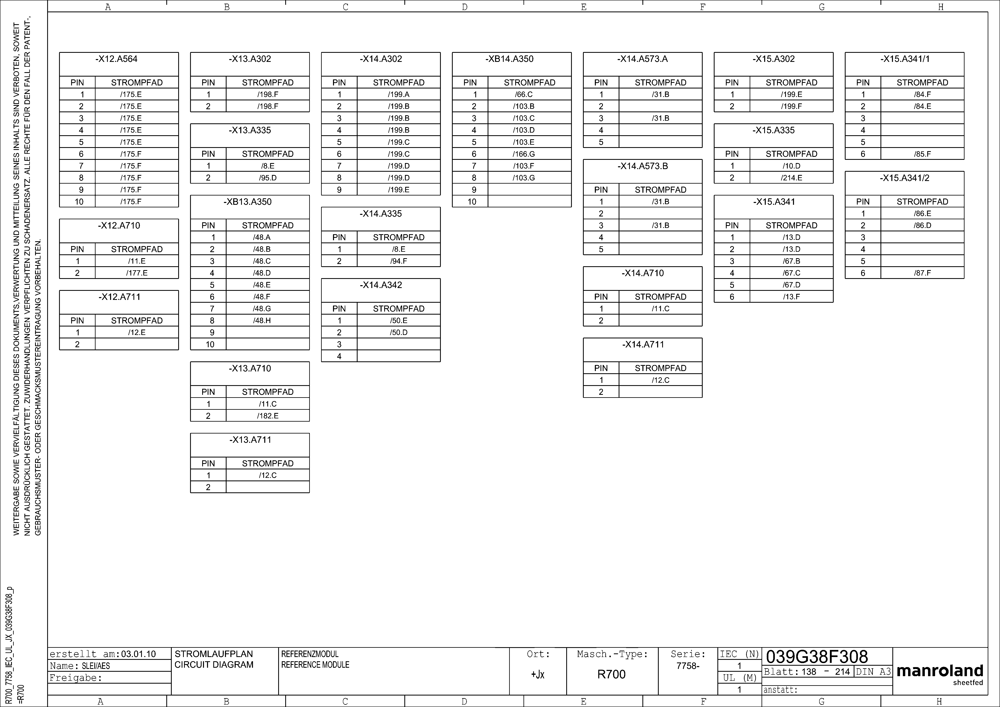

# +Jx — Sheet 138 of 214 — REFERENZMODUL

**REFERENCE MODULE**

> Part of the manroland **R700** printing press IEC/UL circuit diagrams.
> Drawing class: **Stromlaufplan / Circuit diagram** (DIN A3).
> Document `+Jx` covers the **1st printing module + feed register** machine section.

## At a glance

| Field | Value |
|---|---|
| Document | `+Jx`  (039G38F308) |
| Sheet | **138** of 214 |
| Section (DE) | REFERENZMODUL |
| Section (EN) | REFERENCE MODULE |
| Section type | REFERENCE_MODULE — Reference module |
| Machine type | `R700` |
| Series | `7758` |
| Created | 03.01.10 |
| Replaces | — |
| Columns used | A, B, C, D, E, F, G, H |
| Path numbers | — |
| Labels on sheet | 227 |
| Cross-refs out | 71 |
| Cross-refs in | 0 |

**Previous:** [+Jx sheet 137](SHEET_0137.md) · **Next:** [+Jx sheet 139](SHEET_0139.md) · **Document TOC:** [_TOC.md](_TOC.md)  (+Jx) · **Master TOC:** [all sheets](../_MASTER_TOC.md)

## Sheet image (300 DPI, exact vector render)



_Rendered directly from the PDF vector layer at 300 DPI (1-bit), no OCR and no resampling. Use it to confirm anything ambiguous in the text below._

## Cross-references on this sheet

Each entry is a wire leaving this sheet. The printed token is `/sheet.column`; the link resolves to that sheet inside the same document.

| Ref | Target sheet | Col | Path | Destination on target | Target section | From col |
|---|---|---|---|---|---|---|
| `/31.B` | [+Jx sheet 31](SHEET_0031.md) | B | — | — | BELEUCHTUNG | F |
| `/175.E` | [+Jx sheet 175](SHEET_0175.md) | E | — | — | OPTION: | A |
| `/199.A` | [+Jx sheet 199](SHEET_0199.md) | A | — | — | OPTION: | C |
| `/199.E` | [+Jx sheet 199](SHEET_0199.md) | E | — | — | OPTION: | G |
| `/84.F` | [+Jx sheet 84](SHEET_0084.md) | F | — | — | BOGENFÜHRUNG | H |
| `/198.F` | [+Jx sheet 198](SHEET_0198.md) | F | — | — | OPTION: | B |
| `/66.C` | [+Jx sheet 66](SHEET_0066.md) | C | — | — | DRUCKANSTELLUNG | E |
| `/84.E` | [+Jx sheet 84](SHEET_0084.md) | E | — | — | BOGENFÜHRUNG | H |
| `/175.E` | [+Jx sheet 175](SHEET_0175.md) | E | — | — | OPTION: | A |
| `/198.F` | [+Jx sheet 198](SHEET_0198.md) | F | — | — | OPTION: | B |
| `/199.B` | [+Jx sheet 199](SHEET_0199.md) | B | — | — | OPTION: | C |
| `/103.B` | [+Jx sheet 103](SHEET_0103.md) | B | — | — | RESERVE | E |
| `/199.F` | [+Jx sheet 199](SHEET_0199.md) | F | — | — | OPTION: | G |
| `/31.B` | [+Jx sheet 31](SHEET_0031.md) | B | — | — | BELEUCHTUNG | F |
| `/175.E` | [+Jx sheet 175](SHEET_0175.md) | E | — | — | OPTION: | A |
| `/199.B` | [+Jx sheet 199](SHEET_0199.md) | B | — | — | OPTION: | C |
| `/103.C` | [+Jx sheet 103](SHEET_0103.md) | C | — | — | RESERVE | E |
| `/175.E` | [+Jx sheet 175](SHEET_0175.md) | E | — | — | OPTION: | A |
| `/199.B` | [+Jx sheet 199](SHEET_0199.md) | B | — | — | OPTION: | C |
| `/103.D` | [+Jx sheet 103](SHEET_0103.md) | D | — | — | RESERVE | E |
| `/175.E` | [+Jx sheet 175](SHEET_0175.md) | E | — | — | OPTION: | A |
| `/103.E` | [+Jx sheet 103](SHEET_0103.md) | E | — | — | RESERVE | E |
| `/199.C` | [+Jx sheet 199](SHEET_0199.md) | C | — | — | OPTION: | C |
| `/85.F` | [+Jx sheet 85](SHEET_0085.md) | F | — | — | BOGENFÜHRUNG | H |
| `/175.F` | [+Jx sheet 175](SHEET_0175.md) | F | — | — | OPTION: | A |
| `/166.G` | [+Jx sheet 166](SHEET_0166.md) | G | — | — | OPTION: | E |
| `/199.C` | [+Jx sheet 199](SHEET_0199.md) | C | — | — | OPTION: | C |
| `/8.E` | [+Jx sheet 8](SHEET_0008.md) | E | — | — | SPANNUNGSVERSORGUNG, SCHALTSCHRANKBELÜFTUNG | B |
| `/175.F` | [+Jx sheet 175](SHEET_0175.md) | F | — | — | OPTION: | A |
| `/103.F` | [+Jx sheet 103](SHEET_0103.md) | F | — | — | RESERVE | E |
| `/10.D` | [+Jx sheet 10](SHEET_0010.md) | D | — | — | SPANNUNGSVERSORGUNG, SCHALTSCHRANKBELÜFTUNG | G |
| `/199.D` | [+Jx sheet 199](SHEET_0199.md) | D | — | — | OPTION: | C |
| `/214.E` | [+Jx sheet 214](SHEET_0214.md) | E | — | — | OPTION: FZW | G |
| `/175.F` | [+Jx sheet 175](SHEET_0175.md) | F | — | — | OPTION: | A |
| `/95.D` | [+Jx sheet 95](SHEET_0095.md) | D | — | — | RESERVE | B |
| `/103.G` | [+Jx sheet 103](SHEET_0103.md) | G | — | — | RESERVE | E |
| `/199.D` | [+Jx sheet 199](SHEET_0199.md) | D | — | — | OPTION: | C |
| `/199.E` | [+Jx sheet 199](SHEET_0199.md) | E | — | — | OPTION: | C |
| `/175.F` | [+Jx sheet 175](SHEET_0175.md) | F | — | — | OPTION: | A |
| `/31.B` | [+Jx sheet 31](SHEET_0031.md) | B | — | — | BELEUCHTUNG | F |
| `/175.F` | [+Jx sheet 175](SHEET_0175.md) | F | — | — | OPTION: | A |
| `/86.E` | [+Jx sheet 86](SHEET_0086.md) | E | — | — | BOGENFÜHRUNG | H |
| `/31.B` | [+Jx sheet 31](SHEET_0031.md) | B | — | — | BELEUCHTUNG | F |
| `/86.D` | [+Jx sheet 86](SHEET_0086.md) | D | — | — | BOGENFÜHRUNG | H |
| `/48.A` | [+Jx sheet 48](SHEET_0048.md) | A | — | — | 7 SEGMENTANZEIGE | B |
| `/13.D` | [+Jx sheet 13](SHEET_0013.md) | D | — | — | SPANNUNGSVERSORGUNG, SCHALTSCHRANKBELÜFTUNG | G |
| `/8.E` | [+Jx sheet 8](SHEET_0008.md) | E | — | — | SPANNUNGSVERSORGUNG, SCHALTSCHRANKBELÜFTUNG | C |
| `/48.B` | [+Jx sheet 48](SHEET_0048.md) | B | — | — | 7 SEGMENTANZEIGE | B |
| `/13.D` | [+Jx sheet 13](SHEET_0013.md) | D | — | — | SPANNUNGSVERSORGUNG, SCHALTSCHRANKBELÜFTUNG | G |
| `/11.E` | [+Jx sheet 11](SHEET_0011.md) | E | — | — | SPANNUNGSVERSORGUNG, SCHALTSCHRANKBELÜFTUNG | A |
| `/67.B` | [+Jx sheet 67](SHEET_0067.md) | B | — | — | BOGENFÜHRUNG | G |
| `/94.F` | [+Jx sheet 94](SHEET_0094.md) | F | — | — | RESERVE | C |
| `/48.C` | [+Jx sheet 48](SHEET_0048.md) | C | — | — | 7 SEGMENTANZEIGE | B |
| `/177.E` | [+Jx sheet 177](SHEET_0177.md) | E | — | — | SCHUTZEINRICHTUNGEN | A |
| `/87.F` | [+Jx sheet 87](SHEET_0087.md) | F | — | — | BOGENFÜHRUNG | H |
| `/48.D` | [+Jx sheet 48](SHEET_0048.md) | D | — | — | 7 SEGMENTANZEIGE | B |
| `/67.C` | [+Jx sheet 67](SHEET_0067.md) | C | — | — | BOGENFÜHRUNG | G |
| `/48.E` | [+Jx sheet 48](SHEET_0048.md) | E | — | — | 7 SEGMENTANZEIGE | B |
| `/67.D` | [+Jx sheet 67](SHEET_0067.md) | D | — | — | BOGENFÜHRUNG | G |
| `/11.C` | [+Jx sheet 11](SHEET_0011.md) | C | — | STROMPFAD PIN 1 2 | SPANNUNGSVERSORGUNG, SCHALTSCHRANKBELÜFTUNG | E |
| `/48.F` | [+Jx sheet 48](SHEET_0048.md) | F | — | — | 7 SEGMENTANZEIGE | B |
| `/13.F` | [+Jx sheet 13](SHEET_0013.md) | F | — | — | SPANNUNGSVERSORGUNG, SCHALTSCHRANKBELÜFTUNG | G |
| `/48.G` | [+Jx sheet 48](SHEET_0048.md) | G | — | — | 7 SEGMENTANZEIGE | B |
| `/12.E` | [+Jx sheet 12](SHEET_0012.md) | E | — | STROMPFAD PIN 1 2 | SPANNUNGSVERSORGUNG, SCHALTSCHRANKBELÜFTUNG | A |
| `/50.E` | [+Jx sheet 50](SHEET_0050.md) | E | — | — | SIGNALGEBER: AKUSTISCHE WARNSIGNALE | C |
| `/48.H` | [+Jx sheet 48](SHEET_0048.md) | H | — | — | 7 SEGMENTANZEIGE | B |
| `/50.D` | [+Jx sheet 50](SHEET_0050.md) | D | — | — | SIGNALGEBER: AKUSTISCHE WARNSIGNALE | C |
| `/12.C` | [+Jx sheet 12](SHEET_0012.md) | C | — | STROMPFAD PIN 1 2 | SPANNUNGSVERSORGUNG, SCHALTSCHRANKBELÜFTUNG | E |
| `/11.C` | [+Jx sheet 11](SHEET_0011.md) | C | — | — | SPANNUNGSVERSORGUNG, SCHALTSCHRANKBELÜFTUNG | B |
| `/182.E` | [+Jx sheet 182](SHEET_0182.md) | E | — | — | OPTION: TRANSFERMODUL 2 | B |
| `/12.C` | [+Jx sheet 12](SHEET_0012.md) | C | — | STROMPFAD PIN 1 2 | SPANNUNGSVERSORGUNG, SCHALTSCHRANKBELÜFTUNG | B |

## Devices on this sheet

| Tag | Class | Class meaning (IEC) | Col | Sub | Terminal | Sign |
|---|---|---|---|---|---|---|
| `X12.A564` | — | cross-device reference | A | — | — | — |
| `X13.A302` | — | cross-device reference | B | — | — | — |
| `X13.A335` | — | cross-device reference | B | — | — | — |
| `XB13.A350` | — | cross-device reference | B | — | — | — |
| `X14.A302` | — | cross-device reference | C | — | — | — |
| `X14.A335` | — | cross-device reference | C | — | — | — |
| `X14.A342` | — | cross-device reference | C | — | — | — |
| `XB14.A350` | — | cross-device reference | D | — | — | — |
| `X14.A573.B` | — | cross-device reference | F | — | — | — |
| `X14.A573.A` | — | cross-device reference | E | — | — | — |
| `X15.A302` | — | cross-device reference | G | — | — | — |
| `X15.A335` | — | cross-device reference | G | — | — | — |
| `X15.A341` | — | cross-device reference | G | — | — | — |
| `X13.A711` | — | cross-device reference | B | — | — | — |
| `X12.A711` | — | cross-device reference | A | — | — | — |
| `X13.A710` | — | cross-device reference | B | — | — | — |
| `X12.A710` | — | cross-device reference | A | — | — | — |
| `X14.A711` | — | cross-device reference | F | — | — | — |
| `X14.A710` | — | cross-device reference | F | — | — | — |

## Potentials / nets

_No named potentials on this sheet._

## Wire-end annotations (grouped as printed)

A wire that continues elsewhere is annotated with a small cluster: the destination description, the path/line number `#NN`, and the `/sheet.column` cross reference. Each row below is one such cluster exactly as it is grouped on the drawing.

| Col | Y | Path | Cross-ref | Text on the wire |
|---|---|---|---|---|
| A | 65.4 | — | — | `X12.A564` |
| B | 65.4 | — | — | `X13.A302` |
| C | 65.4 | — | — | `X14.A302` |
| D | 65.4 | — | — | `XB14.A350` |
| E | 65.4 | — | — | `X14.A573.A` |
| G | 65.4 | — | — | `X15.A302` |
| H | 65.4 | — | — | `X15.A341/1` |
| A | 94.1 | — | — | `PIN 10 2 3 4 5 6 7 8 9 1 STROMPFAD` |
| B | 94.1 | — | — | `PIN 2 1 STROMPFAD` |
| C | 94.1 | — | — | `PIN 2 3 5 6 7 8 9 4 1 STROMPFAD` |
| D | 94.1 | — | — | `PIN 10 2 3 4 5 6 7 8 9 1 STROMPFAD` |
| E | 94.1 | — | — | `PIN 2 3 5 4 1 STROMPFAD` |
| G | 94.1 | — | — | `PIN 2 1 STROMPFAD` |
| H | 94.1 | — | — | `PIN 2 3 5 6 4 1 STROMPFAD` |
| A | 108.6 | — | `/175.E` | — |
| B | 108.6 | — | `/198.F` | — |
| C | 108.6 | — | `/199.A` | — |
| F | 108.6 | — | `/31.B` | — |
| G | 108.6 | — | `/199.E` | — |
| H | 108.6 | — | `/84.F` | — |
| E | 108.7 | — | `/66.C` | — |
| A | 122.8 | — | `/175.E` | — |
| B | 122.8 | — | `/198.F` | — |
| C | 122.8 | — | `/199.B` | — |
| E | 122.8 | — | `/103.B` | — |
| G | 122.8 | — | `/199.F` | — |
| H | 122.8 | — | `/84.E` | — |
| A | 137.0 | — | `/175.E` | — |
| C | 137.0 | — | `/199.B` | — |
| E | 137.0 | — | `/103.C` | — |
| F | 137.0 | — | `/31.B` | — |
| B | 150.5 | — | — | `X13.A335` |
| G | 150.5 | — | — | `X15.A335` |
| A | 151.2 | — | `/175.E` | — |
| C | 151.2 | — | `/199.B` | — |
| E | 151.2 | — | `/103.D` | — |
| A | 165.3 | — | `/175.E` | — |
| C | 165.3 | — | `/199.C` | — |
| E | 165.3 | — | `/103.E` | — |
| B | 179.1 | — | — | `PIN 2 1 STROMPFAD` |
| G | 179.1 | — | — | `PIN 2 1 STROMPFAD` |
| A | 179.5 | — | `/175.F` | — |
| C | 179.5 | — | `/199.C` | — |
| E | 179.5 | — | `/166.G` | — |
| H | 179.5 | — | `/85.F` | — |
| F | 193.0 | — | — | `X14.A573.B` |
| B | 193.6 | — | `/8.E` | — |
| A | 193.7 | — | `/175.F` | — |
| C | 193.7 | — | `/199.D` | — |
| E | 193.7 | — | `/103.F` | — |
| G | 193.7 | — | `/10.D` | — |
| H | 207.2 | — | — | `X15.A341/2` |
| A | 207.8 | — | `/175.F` | — |
| G | 207.8 | — | `/214.E` | — |
| B | 207.9 | — | `/95.D` | — |
| C | 207.9 | — | `/199.D` | — |
| E | 207.9 | — | `/103.G` | — |
| E | 221.7 | — | — | `PIN 2 3 5 4 1 STROMPFAD` |
| A | 222.0 | — | `/175.F` | — |
| C | 222.0 | — | `/199.E` | — |
| B | 235.5 | — | — | `XB13.A350` |
| G | 235.5 | — | — | `X15.A341` |
| H | 235.8 | — | — | `PIN 2 3 5 6 4 1 STROMPFAD` |
| A | 236.2 | — | `/175.F` | — |
| F | 236.2 | — | `/31.B` | — |
| C | 249.7 | — | — | `X14.A335` |
| H | 250.3 | — | `/86.E` | — |
| A | 263.9 | — | — | `X12.A710` |
| B | 264.2 | — | — | `PIN 10 2 3 4 5 6 7 8 9 1 STROMPFAD` |
| G | 264.2 | — | — | `PIN 2 3 5 6 4 1 STROMPFAD` |
| F | 264.5 | — | `/31.B` | — |
| H | 264.6 | — | `/86.D` | — |
| C | 278.3 | — | — | `PIN 2 1 STROMPFAD` |
| B | 278.7 | — | `/48.A` | — |
| G | 278.7 | — | `/13.D` | — |
| A | 292.5 | — | — | `PIN 2 1 STROMPFAD` |
| B | 292.9 | — | `/48.B` | — |
| C | 292.9 | — | `/8.E` | — |
| G | 292.9 | — | `/13.D` | — |
| A | 307.0 | — | `/11.E` | — |
| G | 307.0 | — | `/67.B` | — |
| B | 307.1 | — | `/48.C` | — |
| C | 307.1 | — | `/94.F` | — |
| F | 320.6 | — | — | `X14.A710` |
| A | 321.2 | — | `/177.E` | — |
| B | 321.2 | — | `/48.D` | — |
| G | 321.2 | — | `/67.C` | — |
| H | 321.2 | — | `/87.F` | — |
| C | 334.7 | — | — | `X14.A342` |
| B | 335.4 | — | `/48.E` | — |
| G | 335.4 | — | `/67.D` | — |
| A | 348.9 | — | — | `X12.A711` |
| E | 349.2 | — | `/11.C` | `PIN 2 1 STROMPFAD` |
| B | 349.6 | — | `/48.F` | — |
| G | 349.6 | — | `/13.F` | — |
| C | 363.4 | — | — | `PIN 2 3 4 1 STROMPFAD` |
| B | 363.8 | — | `/48.G` | — |
| A | 377.6 | — | `/12.E` | `PIN 2 1 STROMPFAD` |
| B | 377.9 | — | `/48.H` | — |
| C | 377.9 | — | `/50.E` | — |
| C | 392.1 | — | `/50.D` | — |
| F | 405.6 | — | — | `X14.A711` |
| B | 433.9 | — | — | `X13.A710` |
| E | 434.2 | — | `/12.C` | `PIN 2 1 STROMPFAD` |
| B | 462.6 | — | — | `PIN 2 1 STROMPFAD` |
| B | 477.1 | — | `/11.C` | — |
| B | 491.3 | — | `/182.E` | — |
| B | 519.0 | — | — | `X13.A711` |
| B | 547.6 | — | `/12.C` | `PIN 2 1 STROMPFAD` |


## Reconstructed tables

This sheet carries tabular content (pin map / terminal assignment / index). The grid below was rebuilt from the drawing's own rule lines, so each row is exactly one physical row of the table.

### Table 1 — 18 data rows × 2 columns (at x=70.9, y=62.4) — **X12.A564**

| PIN | STROMPFAD |
|---|---|
| `1` | `/175.E` |
| `2` | `/175.E` |
| `3` | `/175.E` |
| `4` | `/175.E` |
| `5` | `/175.E` |
| `6` | `/175.F` |
| `7` | `/175.F` |
| `8` | `/175.F` |
| `9` | `/175.F` |
| `10` | `/175.F` |
|  | `X12.A710` |
| `PIN` | `STROMPFAD` |
| `1` | `/11.E` |
| `2` | `/177.E` |
|  | `X12.A711` |
| `PIN` | `STROMPFAD` |
| `1` | `/12.E` |
| `2` |  |


### Table 2 — 26 data rows × 2 columns (at x=226.8, y=62.4) — **X13.A302**

| PIN | STROMPFAD |
|---|---|
| `1` | `/198.F` |
| `2` | `/198.F` |
|  | `X13.A335` |
| `PIN` | `STROMPFAD` |
| `1` | `/8.E` |
| `2` | `/95.D` |
|  | `XB13.A350` |
| `PIN` | `STROMPFAD` |
| `1` | `/48.A` |
| `2` | `/48.B` |
| `3` | `/48.C` |
| `4` | `/48.D` |
| `5` | `/48.E` |
| `6` | `/48.F` |
| `7` | `/48.G` |
| `8` | `/48.H` |
| `9` |  |
| `10` |  |
|  | `X13.A710` |
| `PIN` | `STROMPFAD` |
| `1` | `/11.C` |
| `2` | `/182.E` |
|  | `X13.A711` |
| `PIN` | `STROMPFAD` |
| `1` | `/12.C` |
| `2` |  |


### Table 3 — 19 data rows × 2 columns (at x=382.7, y=62.4) — **X14.A302**

| PIN | STROMPFAD |
|---|---|
| `1` | `/199.A` |
| `2` | `/199.B` |
| `3` | `/199.B` |
| `4` | `/199.B` |
| `5` | `/199.C` |
| `6` | `/199.C` |
| `7` | `/199.D` |
| `8` | `/199.D` |
| `9` | `/199.E` |
|  | `X14.A335` |
| `PIN` | `STROMPFAD` |
| `1` | `/8.E` |
| `2` | `/94.F` |
|  | `X14.A342` |
| `PIN` | `STROMPFAD` |
| `1` | `/50.E` |
| `2` | `/50.D` |
| `3` |  |
| `4` |  |


### Table 4 — 10 data rows × 2 columns (at x=538.6, y=62.4) — **XB14.A350**

| PIN | STROMPFAD |
|---|---|
| `1` | `/66.C` |
| `2` | `/103.B` |
| `3` | `/103.C` |
| `4` | `/103.D` |
| `5` | `/103.E` |
| `6` | `/166.G` |
| `7` | `/103.F` |
| `8` | `/103.G` |
| `9` |  |
| `10` |  |


### Table 5 — 20 data rows × 2 columns (at x=694.5, y=62.4) — **X14.A573.A**

| PIN | STROMPFAD |
|---|---|
| `1` | `/31.B` |
| `2` |  |
| `3` | `/31.B` |
| `4` |  |
| `5` |  |
|  | `X14.A573.B` |
| `PIN` | `STROMPFAD` |
| `1` | `/31.B` |
| `2` |  |
| `3` | `/31.B` |
| `4` |  |
| `5` |  |
|  | `X14.A710` |
| `PIN` | `STROMPFAD` |
| `1` | `/11.C` |
| `2` |  |
|  | `X14.A711` |
| `PIN` | `STROMPFAD` |
| `1` | `/12.C` |
| `2` |  |


### Table 6 — 14 data rows × 2 columns (at x=850.4, y=62.4) — **X15.A302**

| PIN | STROMPFAD |
|---|---|
| `1` | `/199.E` |
| `2` | `/199.F` |
|  | `X15.A335` |
| `PIN` | `STROMPFAD` |
| `1` | `/10.D` |
| `2` | `/214.E` |
|  | `X15.A341` |
| `PIN` | `STROMPFAD` |
| `1` | `/13.D` |
| `2` | `/13.D` |
| `3` | `/67.B` |
| `4` | `/67.C` |
| `5` | `/67.D` |
| `6` | `/13.F` |


### Table 7 — 14 data rows × 2 columns (at x=1006.3, y=62.4) — **X15.A341/1**

| PIN | STROMPFAD |
|---|---|
| `1` | `/84.F` |
| `2` | `/84.E` |
| `3` |  |
| `4` |  |
| `5` |  |
| `6` | `/85.F` |
|  | `X15.A341/2` |
| `PIN` | `STROMPFAD` |
| `1` | `/86.E` |
| `2` | `/86.D` |
| `3` |  |
| `4` |  |
| `5` |  |
| `6` | `/87.F` |


## Notes and free text on this sheet

| Text | Col | Y (pt) |
|---|---|---|
| `PIN` | A | 94.13 |
| `STROMPFAD` | A | 94.09 |
| `PIN` | B | 94.13 |
| `STROMPFAD` | B | 94.09 |
| `PIN` | C | 94.13 |
| `STROMPFAD` | C | 94.09 |
| `PIN` | D | 94.13 |
| `STROMPFAD` | E | 94.09 |
| `PIN` | E | 221.69 |
| `STROMPFAD` | F | 221.65 |
| `PIN` | F | 94.13 |
| `STROMPFAD` | G | 94.09 |
| `PIN` | G | 94.13 |
| `STROMPFAD` | H | 94.09 |
| `X15.A341/1` | H | 65.44 |
| `X15.A341/2` | H | 207.17 |

## Complete label inventory (exact text from the drawing)

Every text object inside the drawing area of this sheet, in DIN reading order (column A→H, then top→bottom). This is the authoritative list: if a string is not here it is not printed on this sheet.

| Col | Y | X | Dir | Type | Text |
|---|---|---|---|---|---|
| A | 65.4 | 113.8 | → | device ref | `X12.A564` |
| A | 94.1 | 84.0 | → | text | `PIN` |
| A | 94.1 | 132.4 | → | text | `STROMPFAD` |
| A | 108.3 | 95.5 | → | number | `1` |
| A | 108.6 | 143.3 | → | cross-reference | `/175.E` |
| A | 122.5 | 94.1 | → | number | `2` |
| A | 122.8 | 143.3 | → | cross-reference | `/175.E` |
| A | 136.7 | 94.1 | → | number | `3` |
| A | 137.0 | 143.3 | → | cross-reference | `/175.E` |
| A | 150.8 | 94.1 | → | number | `4` |
| A | 151.2 | 143.3 | → | cross-reference | `/175.E` |
| A | 165.0 | 94.1 | → | number | `5` |
| A | 165.3 | 143.3 | → | cross-reference | `/175.E` |
| A | 179.2 | 94.1 | → | number | `6` |
| A | 179.5 | 143.6 | → | cross-reference | `/175.F` |
| A | 193.3 | 94.1 | → | number | `7` |
| A | 193.7 | 143.6 | → | cross-reference | `/175.F` |
| A | 207.5 | 94.1 | → | number | `8` |
| A | 207.9 | 143.6 | → | cross-reference | `/175.F` |
| A | 221.7 | 94.1 | → | number | `9` |
| A | 222.0 | 143.6 | → | cross-reference | `/175.F` |
| A | 235.9 | 88.7 | → | number | `10` |
| A | 236.2 | 143.6 | → | cross-reference | `/175.F` |
| A | 263.9 | 116.8 | → | device ref | `X12.A710` |
| A | 292.5 | 132.4 | → | text | `STROMPFAD` |
| A | 292.6 | 84.0 | → | text | `PIN` |
| A | 306.7 | 89.9 | → | number | `1` |
| A | 307.0 | 152.8 | → | cross-reference | `/11.E` |
| A | 320.9 | 89.4 | → | number | `2` |
| A | 321.2 | 150.4 | → | cross-reference | `/177.E` |
| A | 348.9 | 117.5 | → | device ref | `X12.A711` |
| A | 377.6 | 84.0 | → | text | `PIN` |
| A | 377.6 | 132.4 | → | text | `STROMPFAD` |
| A | 391.8 | 89.9 | → | number | `1` |
| A | 392.1 | 152.8 | → | cross-reference | `/12.E` |
| A | 405.9 | 89.4 | → | number | `2` |
| B | 65.4 | 272.7 | → | device ref | `X13.A302` |
| B | 94.1 | 240.0 | → | text | `PIN` |
| B | 94.1 | 288.3 | → | text | `STROMPFAD` |
| B | 108.3 | 245.8 | → | number | `1` |
| B | 108.6 | 306.6 | → | cross-reference | `/198.F` |
| B | 122.5 | 245.3 | → | number | `2` |
| B | 122.8 | 306.6 | → | cross-reference | `/198.F` |
| B | 150.5 | 272.6 | → | device ref | `X13.A335` |
| B | 179.1 | 288.3 | → | text | `STROMPFAD` |
| B | 179.2 | 240.0 | → | text | `PIN` |
| B | 193.3 | 245.8 | → | number | `1` |
| B | 193.6 | 311.1 | → | cross-reference | `/8.E` |
| B | 207.5 | 245.3 | → | number | `2` |
| B | 207.9 | 308.6 | → | cross-reference | `/95.D` |
| B | 235.5 | 266.3 | → | device ref | `XB13.A350` |
| B | 264.2 | 240.0 | → | text | `PIN` |
| B | 264.2 | 288.3 | → | text | `STROMPFAD` |
| B | 278.4 | 251.4 | → | number | `1` |
| B | 278.7 | 301.5 | → | cross-reference | `/48.A` |
| B | 292.6 | 250.0 | → | number | `2` |
| B | 292.9 | 301.6 | → | cross-reference | `/48.B` |
| B | 306.7 | 250.0 | → | number | `3` |
| B | 307.1 | 301.5 | → | cross-reference | `/48.C` |
| B | 320.9 | 250.0 | → | number | `4` |
| B | 321.2 | 301.5 | → | cross-reference | `/48.D` |
| B | 335.1 | 250.0 | → | number | `5` |
| B | 335.4 | 301.6 | → | cross-reference | `/48.E` |
| B | 349.3 | 250.0 | → | number | `6` |
| B | 349.6 | 301.9 | → | cross-reference | `/48.F` |
| B | 363.4 | 250.0 | → | number | `7` |
| B | 363.8 | 301.2 | → | cross-reference | `/48.G` |
| B | 377.6 | 250.0 | → | number | `8` |
| B | 377.9 | 301.6 | → | cross-reference | `/48.H` |
| B | 391.8 | 250.0 | → | number | `9` |
| B | 405.9 | 244.6 | → | number | `10` |
| B | 433.9 | 272.7 | → | device ref | `X13.A710` |
| B | 462.6 | 240.0 | → | text | `PIN` |
| B | 462.6 | 288.3 | → | text | `STROMPFAD` |
| B | 476.8 | 245.8 | → | number | `1` |
| B | 477.2 | 308.6 | → | cross-reference | `/11.C` |
| B | 491.0 | 245.3 | → | number | `2` |
| B | 491.3 | 306.3 | → | cross-reference | `/182.E` |
| B | 519.0 | 273.4 | → | device ref | `X13.A711` |
| B | 547.6 | 288.3 | → | text | `STROMPFAD` |
| B | 547.7 | 240.0 | → | text | `PIN` |
| B | 561.9 | 245.8 | → | number | `1` |
| B | 562.2 | 308.6 | → | cross-reference | `/12.C` |
| B | 576.0 | 245.3 | → | number | `2` |
| C | 65.4 | 428.6 | → | device ref | `X14.A302` |
| C | 94.1 | 395.9 | → | text | `PIN` |
| C | 94.1 | 444.2 | → | text | `STROMPFAD` |
| C | 108.3 | 401.7 | → | number | `1` |
| C | 108.6 | 462.0 | → | cross-reference | `/199.A` |
| C | 122.5 | 401.2 | → | number | `2` |
| C | 122.8 | 462.2 | → | cross-reference | `/199.B` |
| C | 136.7 | 401.2 | → | number | `3` |
| C | 137.0 | 462.2 | → | cross-reference | `/199.B` |
| C | 150.8 | 401.4 | → | number | `4` |
| C | 151.2 | 462.2 | → | cross-reference | `/199.B` |
| C | 165.0 | 401.2 | → | number | `5` |
| C | 165.4 | 462.0 | → | cross-reference | `/199.C` |
| C | 179.2 | 401.2 | → | number | `6` |
| C | 179.5 | 462.0 | → | cross-reference | `/199.C` |
| C | 193.3 | 401.2 | → | number | `7` |
| C | 193.7 | 462.0 | → | cross-reference | `/199.D` |
| C | 207.5 | 401.2 | → | number | `8` |
| C | 207.9 | 462.0 | → | cross-reference | `/199.D` |
| C | 221.7 | 401.2 | → | number | `9` |
| C | 222.0 | 462.2 | → | cross-reference | `/199.E` |
| C | 249.7 | 428.5 | → | device ref | `X14.A335` |
| C | 278.3 | 444.2 | → | text | `STROMPFAD` |
| C | 278.4 | 395.9 | → | text | `PIN` |
| C | 292.6 | 401.7 | → | number | `1` |
| C | 292.8 | 467.0 | → | cross-reference | `/8.E` |
| C | 306.7 | 401.2 | → | number | `2` |
| C | 307.1 | 464.9 | → | cross-reference | `/94.F` |
| C | 334.7 | 428.6 | → | device ref | `X14.A342` |
| C | 363.4 | 395.9 | → | text | `PIN` |
| C | 363.4 | 444.2 | → | text | `STROMPFAD` |
| C | 377.6 | 401.7 | → | number | `1` |
| C | 377.9 | 464.6 | → | cross-reference | `/50.E` |
| C | 391.8 | 401.2 | → | number | `2` |
| C | 392.1 | 464.5 | → | cross-reference | `/50.D` |
| C | 405.9 | 401.2 | → | number | `3` |
| C | 420.1 | 401.4 | → | number | `4` |
| D | 65.4 | 578.1 | → | device ref | `XB14.A350` |
| D | 94.1 | 551.8 | → | text | `PIN` |
| D | 108.3 | 563.2 | → | number | `1` |
| D | 122.5 | 561.8 | → | number | `2` |
| D | 136.7 | 561.8 | → | number | `3` |
| D | 150.8 | 561.8 | → | number | `4` |
| D | 165.0 | 561.8 | → | number | `5` |
| D | 179.2 | 561.8 | → | number | `6` |
| D | 193.3 | 561.8 | → | number | `7` |
| D | 207.5 | 561.8 | → | number | `8` |
| D | 221.7 | 561.8 | → | number | `9` |
| D | 235.9 | 556.4 | → | number | `10` |
| E | 65.4 | 735.2 | → | device ref | `X14.A573.A` |
| E | 94.1 | 600.1 | → | text | `STROMPFAD` |
| E | 94.1 | 707.7 | → | text | `PIN` |
| E | 108.3 | 713.5 | → | number | `1` |
| E | 108.7 | 613.3 | → | cross-reference | `/66.C` |
| E | 122.5 | 713.1 | → | number | `2` |
| E | 122.8 | 611.0 | → | cross-reference | `/103.B` |
| E | 136.7 | 713.1 | → | number | `3` |
| E | 137.0 | 610.9 | → | cross-reference | `/103.C` |
| E | 150.8 | 713.2 | → | number | `4` |
| E | 151.2 | 610.9 | → | cross-reference | `/103.D` |
| E | 165.0 | 713.1 | → | number | `5` |
| E | 165.3 | 611.0 | → | cross-reference | `/103.E` |
| E | 179.5 | 610.6 | → | cross-reference | `/166.G` |
| E | 193.7 | 611.3 | → | cross-reference | `/103.F` |
| E | 207.9 | 610.6 | → | cross-reference | `/103.G` |
| E | 221.7 | 707.7 | → | text | `PIN` |
| E | 235.9 | 713.5 | → | number | `1` |
| E | 250.0 | 713.1 | → | number | `2` |
| E | 264.2 | 713.1 | → | number | `3` |
| E | 278.4 | 713.2 | → | number | `4` |
| E | 292.6 | 713.1 | → | number | `5` |
| E | 349.3 | 707.7 | → | text | `PIN` |
| E | 363.4 | 713.5 | → | number | `1` |
| E | 377.6 | 713.1 | → | number | `2` |
| E | 434.3 | 707.7 | → | text | `PIN` |
| E | 448.5 | 713.5 | → | number | `1` |
| E | 462.6 | 713.1 | → | number | `2` |
| F | 94.1 | 756.0 | → | text | `STROMPFAD` |
| F | 94.1 | 863.6 | → | text | `PIN` |
| F | 108.3 | 869.4 | → | number | `1` |
| F | 108.6 | 776.4 | → | cross-reference | `/31.B` |
| F | 122.5 | 869.0 | → | number | `2` |
| F | 137.0 | 776.4 | → | cross-reference | `/31.B` |
| F | 179.2 | 863.6 | → | text | `PIN` |
| F | 193.0 | 735.4 | → | device ref | `X14.A573.B` |
| F | 193.3 | 869.4 | → | number | `1` |
| F | 207.5 | 869.0 | → | number | `2` |
| F | 221.7 | 756.0 | → | text | `STROMPFAD` |
| F | 236.2 | 776.4 | → | cross-reference | `/31.B` |
| F | 264.2 | 863.6 | → | text | `PIN` |
| F | 264.5 | 776.4 | → | cross-reference | `/31.B` |
| F | 278.4 | 869.4 | → | number | `1` |
| F | 292.6 | 869.0 | → | number | `2` |
| F | 306.7 | 869.0 | → | number | `3` |
| F | 320.6 | 740.4 | → | device ref | `X14.A710` |
| F | 320.9 | 869.1 | → | number | `4` |
| F | 335.1 | 869.0 | → | number | `5` |
| F | 349.2 | 756.0 | → | text | `STROMPFAD` |
| F | 349.3 | 869.0 | → | number | `6` |
| F | 363.8 | 776.3 | → | cross-reference | `/11.C` |
| F | 405.6 | 741.1 | → | device ref | `X14.A711` |
| F | 434.2 | 756.0 | → | text | `STROMPFAD` |
| F | 448.8 | 776.3 | → | cross-reference | `/12.C` |
| G | 65.4 | 896.3 | → | device ref | `X15.A302` |
| G | 94.1 | 911.9 | → | text | `STROMPFAD` |
| G | 94.1 | 1019.5 | → | text | `PIN` |
| G | 108.3 | 1025.3 | → | number | `1` |
| G | 108.6 | 929.9 | → | cross-reference | `/199.E` |
| G | 122.5 | 1024.9 | → | number | `2` |
| G | 122.8 | 930.2 | → | cross-reference | `/199.F` |
| G | 136.7 | 1024.9 | → | number | `3` |
| G | 150.5 | 896.2 | → | device ref | `X15.A335` |
| G | 150.8 | 1025.0 | → | number | `4` |
| G | 165.0 | 1024.9 | → | number | `5` |
| G | 179.1 | 911.9 | → | text | `STROMPFAD` |
| G | 179.2 | 1024.9 | → | number | `6` |
| G | 193.7 | 932.2 | → | cross-reference | `/10.D` |
| G | 207.8 | 929.9 | → | cross-reference | `/214.E` |
| G | 235.5 | 897.0 | → | device ref | `X15.A341` |
| G | 235.9 | 1019.5 | → | text | `PIN` |
| G | 250.0 | 1025.3 | → | number | `1` |
| G | 264.2 | 911.9 | → | text | `STROMPFAD` |
| G | 264.2 | 1024.9 | → | number | `2` |
| G | 278.4 | 1024.9 | → | number | `3` |
| G | 278.7 | 932.2 | → | cross-reference | `/13.D` |
| G | 292.6 | 1025.0 | → | number | `4` |
| G | 292.9 | 932.2 | → | cross-reference | `/13.D` |
| G | 306.7 | 1024.9 | → | number | `5` |
| G | 307.0 | 932.3 | → | cross-reference | `/67.B` |
| G | 320.9 | 1024.9 | → | number | `6` |
| G | 321.2 | 932.2 | → | cross-reference | `/67.C` |
| G | 335.4 | 932.2 | → | cross-reference | `/67.D` |
| G | 349.6 | 932.6 | → | cross-reference | `/13.F` |
| H | 65.4 | 1048.5 | → | text | `X15.A341/1` |
| H | 94.1 | 1067.8 | → | text | `STROMPFAD` |
| H | 108.6 | 1088.5 | → | cross-reference | `/84.F` |
| H | 122.8 | 1088.2 | → | cross-reference | `/84.E` |
| H | 179.5 | 1088.5 | → | cross-reference | `/85.F` |
| H | 207.2 | 1047.8 | → | text | `X15.A341/2` |
| H | 235.8 | 1067.8 | → | text | `STROMPFAD` |
| H | 250.3 | 1088.2 | → | cross-reference | `/86.E` |
| H | 264.6 | 1088.1 | → | cross-reference | `/86.D` |
| H | 321.2 | 1088.5 | → | cross-reference | `/87.F` |

## Reading-order text block

The same content as a plain block, grouped by DIN column — convenient to paste or to match against a visual description.

```text
=== Column A ===
  65.4  113.8  devref       X12.A564
  94.1   84.0  text         PIN
  94.1  132.4  text         STROMPFAD
 108.3   95.5  numeric      1
 108.6  143.3  xref         /175.E
 122.5   94.1  numeric      2
 122.8  143.3  xref         /175.E
 136.7   94.1  numeric      3
 137.0  143.3  xref         /175.E
 150.8   94.1  numeric      4
 151.2  143.3  xref         /175.E
 165.0   94.1  numeric      5
 165.3  143.3  xref         /175.E
 179.2   94.1  numeric      6
 179.5  143.6  xref         /175.F
 193.3   94.1  numeric      7
 193.7  143.6  xref         /175.F
 207.5   94.1  numeric      8
 207.9  143.6  xref         /175.F
 221.7   94.1  numeric      9
 222.0  143.6  xref         /175.F
 235.9   88.7  numeric      10
 236.2  143.6  xref         /175.F
 263.9  116.8  devref       X12.A710
 292.5  132.4  text         STROMPFAD
 292.6   84.0  text         PIN
 306.7   89.9  numeric      1
 307.0  152.8  xref         /11.E
 320.9   89.4  numeric      2
 321.2  150.4  xref         /177.E
 348.9  117.5  devref       X12.A711
 377.6   84.0  text         PIN
 377.6  132.4  text         STROMPFAD
 391.8   89.9  numeric      1
 392.1  152.8  xref         /12.E
 405.9   89.4  numeric      2
=== Column B ===
  65.4  272.7  devref       X13.A302
  94.1  240.0  text         PIN
  94.1  288.3  text         STROMPFAD
 108.3  245.8  numeric      1
 108.6  306.6  xref         /198.F
 122.5  245.3  numeric      2
 122.8  306.6  xref         /198.F
 150.5  272.6  devref       X13.A335
 179.1  288.3  text         STROMPFAD
 179.2  240.0  text         PIN
 193.3  245.8  numeric      1
 193.6  311.1  xref         /8.E
 207.5  245.3  numeric      2
 207.9  308.6  xref         /95.D
 235.5  266.3  devref       XB13.A350
 264.2  240.0  text         PIN
 264.2  288.3  text         STROMPFAD
 278.4  251.4  numeric      1
 278.7  301.5  xref         /48.A
 292.6  250.0  numeric      2
 292.9  301.6  xref         /48.B
 306.7  250.0  numeric      3
 307.1  301.5  xref         /48.C
 320.9  250.0  numeric      4
 321.2  301.5  xref         /48.D
 335.1  250.0  numeric      5
 335.4  301.6  xref         /48.E
 349.3  250.0  numeric      6
 349.6  301.9  xref         /48.F
 363.4  250.0  numeric      7
 363.8  301.2  xref         /48.G
 377.6  250.0  numeric      8
 377.9  301.6  xref         /48.H
 391.8  250.0  numeric      9
 405.9  244.6  numeric      10
 433.9  272.7  devref       X13.A710
 462.6  240.0  text         PIN
 462.6  288.3  text         STROMPFAD
 476.8  245.8  numeric      1
 477.2  308.6  xref         /11.C
 491.0  245.3  numeric      2
 491.3  306.3  xref         /182.E
 519.0  273.4  devref       X13.A711
 547.6  288.3  text         STROMPFAD
 547.7  240.0  text         PIN
 561.9  245.8  numeric      1
 562.2  308.6  xref         /12.C
 576.0  245.3  numeric      2
=== Column C ===
  65.4  428.6  devref       X14.A302
  94.1  395.9  text         PIN
  94.1  444.2  text         STROMPFAD
 108.3  401.7  numeric      1
 108.6  462.0  xref         /199.A
 122.5  401.2  numeric      2
 122.8  462.2  xref         /199.B
 136.7  401.2  numeric      3
 137.0  462.2  xref         /199.B
 150.8  401.4  numeric      4
 151.2  462.2  xref         /199.B
 165.0  401.2  numeric      5
 165.4  462.0  xref         /199.C
 179.2  401.2  numeric      6
 179.5  462.0  xref         /199.C
 193.3  401.2  numeric      7
 193.7  462.0  xref         /199.D
 207.5  401.2  numeric      8
 207.9  462.0  xref         /199.D
 221.7  401.2  numeric      9
 222.0  462.2  xref         /199.E
 249.7  428.5  devref       X14.A335
 278.3  444.2  text         STROMPFAD
 278.4  395.9  text         PIN
 292.6  401.7  numeric      1
 292.8  467.0  xref         /8.E
 306.7  401.2  numeric      2
 307.1  464.9  xref         /94.F
 334.7  428.6  devref       X14.A342
 363.4  395.9  text         PIN
 363.4  444.2  text         STROMPFAD
 377.6  401.7  numeric      1
 377.9  464.6  xref         /50.E
 391.8  401.2  numeric      2
 392.1  464.5  xref         /50.D
 405.9  401.2  numeric      3
 420.1  401.4  numeric      4
=== Column D ===
  65.4  578.1  devref       XB14.A350
  94.1  551.8  text         PIN
 108.3  563.2  numeric      1
 122.5  561.8  numeric      2
 136.7  561.8  numeric      3
 150.8  561.8  numeric      4
 165.0  561.8  numeric      5
 179.2  561.8  numeric      6
 193.3  561.8  numeric      7
 207.5  561.8  numeric      8
 221.7  561.8  numeric      9
 235.9  556.4  numeric      10
=== Column E ===
  65.4  735.2  devref       X14.A573.A
  94.1  600.1  text         STROMPFAD
  94.1  707.7  text         PIN
 108.3  713.5  numeric      1
 108.7  613.3  xref         /66.C
 122.5  713.1  numeric      2
 122.8  611.0  xref         /103.B
 136.7  713.1  numeric      3
 137.0  610.9  xref         /103.C
 150.8  713.2  numeric      4
 151.2  610.9  xref         /103.D
 165.0  713.1  numeric      5
 165.3  611.0  xref         /103.E
 179.5  610.6  xref         /166.G
 193.7  611.3  xref         /103.F
 207.9  610.6  xref         /103.G
 221.7  707.7  text         PIN
 235.9  713.5  numeric      1
 250.0  713.1  numeric      2
 264.2  713.1  numeric      3
 278.4  713.2  numeric      4
 292.6  713.1  numeric      5
 349.3  707.7  text         PIN
 363.4  713.5  numeric      1
 377.6  713.1  numeric      2
 434.3  707.7  text         PIN
 448.5  713.5  numeric      1
 462.6  713.1  numeric      2
=== Column F ===
  94.1  756.0  text         STROMPFAD
  94.1  863.6  text         PIN
 108.3  869.4  numeric      1
 108.6  776.4  xref         /31.B
 122.5  869.0  numeric      2
 137.0  776.4  xref         /31.B
 179.2  863.6  text         PIN
 193.0  735.4  devref       X14.A573.B
 193.3  869.4  numeric      1
 207.5  869.0  numeric      2
 221.7  756.0  text         STROMPFAD
 236.2  776.4  xref         /31.B
 264.2  863.6  text         PIN
 264.5  776.4  xref         /31.B
 278.4  869.4  numeric      1
 292.6  869.0  numeric      2
 306.7  869.0  numeric      3
 320.6  740.4  devref       X14.A710
 320.9  869.1  numeric      4
 335.1  869.0  numeric      5
 349.2  756.0  text         STROMPFAD
 349.3  869.0  numeric      6
 363.8  776.3  xref         /11.C
 405.6  741.1  devref       X14.A711
 434.2  756.0  text         STROMPFAD
 448.8  776.3  xref         /12.C
=== Column G ===
  65.4  896.3  devref       X15.A302
  94.1  911.9  text         STROMPFAD
  94.1 1019.5  text         PIN
 108.3 1025.3  numeric      1
 108.6  929.9  xref         /199.E
 122.5 1024.9  numeric      2
 122.8  930.2  xref         /199.F
 136.7 1024.9  numeric      3
 150.5  896.2  devref       X15.A335
 150.8 1025.0  numeric      4
 165.0 1024.9  numeric      5
 179.1  911.9  text         STROMPFAD
 179.2 1024.9  numeric      6
 193.7  932.2  xref         /10.D
 207.8  929.9  xref         /214.E
 235.5  897.0  devref       X15.A341
 235.9 1019.5  text         PIN
 250.0 1025.3  numeric      1
 264.2  911.9  text         STROMPFAD
 264.2 1024.9  numeric      2
 278.4 1024.9  numeric      3
 278.7  932.2  xref         /13.D
 292.6 1025.0  numeric      4
 292.9  932.2  xref         /13.D
 306.7 1024.9  numeric      5
 307.0  932.3  xref         /67.B
 320.9 1024.9  numeric      6
 321.2  932.2  xref         /67.C
 335.4  932.2  xref         /67.D
 349.6  932.6  xref         /13.F
=== Column H ===
  65.4 1048.5  text         X15.A341/1
  94.1 1067.8  text         STROMPFAD
 108.6 1088.5  xref         /84.F
 122.8 1088.2  xref         /84.E
 179.5 1088.5  xref         /85.F
 207.2 1047.8  text         X15.A341/2
 235.8 1067.8  text         STROMPFAD
 250.3 1088.2  xref         /86.E
 264.6 1088.1  xref         /86.D
 321.2 1088.5  xref         /87.F
```

---
_Generated from the PDF vector text layer; no OCR. Source: `R700_7758_IEC_UL_JX_039G38F308_p`, sheet 138._
