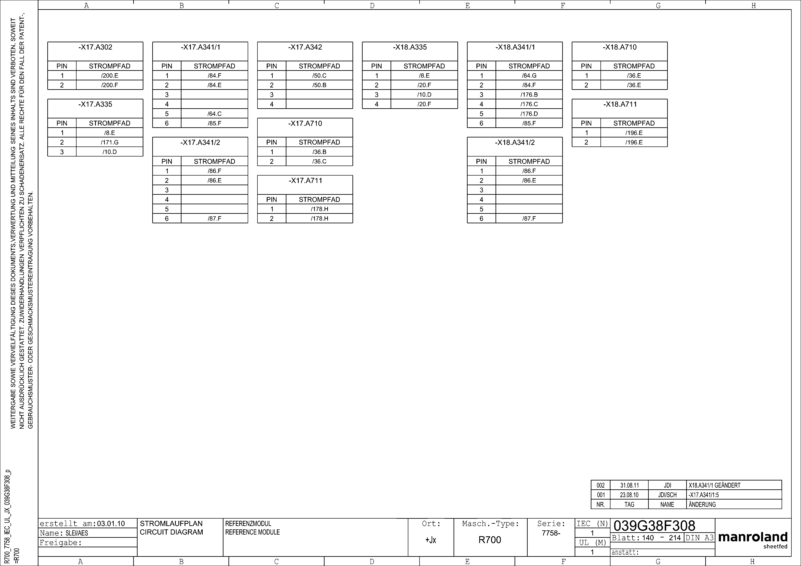

# +Jx — Sheet 140 of 214 — REFERENZMODUL

**REFERENCE MODULE**

> Part of the manroland **R700** printing press IEC/UL circuit diagrams.
> Drawing class: **Stromlaufplan / Circuit diagram** (DIN A3).
> Document `+Jx` covers the **1st printing module + feed register** machine section.

## At a glance

| Field | Value |
|---|---|
| Document | `+Jx`  (039G38F308) |
| Sheet | **140** of 214 |
| Section (DE) | REFERENZMODUL |
| Section (EN) | REFERENCE MODULE |
| Section type | REFERENCE_MODULE — Reference module |
| Machine type | `R700` |
| Series | `7758` |
| Created | 03.01.10 |
| Replaces | — |
| Columns used | A, B, C, D, E, F, G, H |
| Path numbers | — |
| Labels on sheet | 128 |
| Cross-refs out | 35 |
| Cross-refs in | 0 |

**Previous:** [+Jx sheet 139](SHEET_0139.md) · **Next:** [+Jx sheet 141](SHEET_0141.md) · **Document TOC:** [_TOC.md](_TOC.md)  (+Jx) · **Master TOC:** [all sheets](../_MASTER_TOC.md)

## Sheet image (300 DPI, exact vector render)



_Rendered directly from the PDF vector layer at 300 DPI (1-bit), no OCR and no resampling. Use it to confirm anything ambiguous in the text below._

## Cross-references on this sheet

Each entry is a wire leaving this sheet. The printed token is `/sheet.column`; the link resolves to that sheet inside the same document.

| Ref | Target sheet | Col | Path | Destination on target | Target section | From col |
|---|---|---|---|---|---|---|
| `/8.E` | [+Jx sheet 8](SHEET_0008.md) | E | — | — | SPANNUNGSVERSORGUNG, SCHALTSCHRANKBELÜFTUNG | E |
| `/36.E` | [+Jx sheet 36](SHEET_0036.md) | E | — | — | STOP SICHERN | G |
| `/200.E` | [+Jx sheet 200](SHEET_0200.md) | E | — | — | OPTION: | A |
| `/84.F` | [+Jx sheet 84](SHEET_0084.md) | F | — | — | BOGENFÜHRUNG | B |
| `/84.G` | [+Jx sheet 84](SHEET_0084.md) | G | — | — | BOGENFÜHRUNG | F |
| `/50.C` | [+Jx sheet 50](SHEET_0050.md) | C | — | — | SIGNALGEBER: AKUSTISCHE WARNSIGNALE | C |
| `/84.E` | [+Jx sheet 84](SHEET_0084.md) | E | — | — | BOGENFÜHRUNG | B |
| `/50.B` | [+Jx sheet 50](SHEET_0050.md) | B | — | — | SIGNALGEBER: AKUSTISCHE WARNSIGNALE | C |
| `/36.E` | [+Jx sheet 36](SHEET_0036.md) | E | — | — | STOP SICHERN | G |
| `/20.F` | [+Jx sheet 20](SHEET_0020.md) | F | — | — | LACKPUMPE | E |
| `/84.F` | [+Jx sheet 84](SHEET_0084.md) | F | — | — | BOGENFÜHRUNG | F |
| `/200.F` | [+Jx sheet 200](SHEET_0200.md) | F | — | — | OPTION: | A |
| `/176.B` | [+Jx sheet 176](SHEET_0176.md) | B | — | — | OPTION: TRANSFERMODUL 1 NACH | F |
| `/10.D` | [+Jx sheet 10](SHEET_0010.md) | D | — | — | SPANNUNGSVERSORGUNG, SCHALTSCHRANKBELÜFTUNG | E |
| `/20.F` | [+Jx sheet 20](SHEET_0020.md) | F | — | — | LACKPUMPE | E |
| `/176.C` | [+Jx sheet 176](SHEET_0176.md) | C | — | — | OPTION: TRANSFERMODUL 1 NACH | F |
| `/64.C` | [+Jx sheet 64](SHEET_0064.md) | C | — | — | TROPFEINRICHTUNG | B |
| `/176.D` | [+Jx sheet 176](SHEET_0176.md) | D | — | — | OPTION: TRANSFERMODUL 1 NACH | F |
| `/85.F` | [+Jx sheet 85](SHEET_0085.md) | F | — | — | BOGENFÜHRUNG | B |
| `/85.F` | [+Jx sheet 85](SHEET_0085.md) | F | — | — | BOGENFÜHRUNG | F |
| `/8.E` | [+Jx sheet 8](SHEET_0008.md) | E | — | — | SPANNUNGSVERSORGUNG, SCHALTSCHRANKBELÜFTUNG | A |
| `/196.E` | [+Jx sheet 196](SHEET_0196.md) | E | — | — | OPTION: ZWISCHENTROCKNER, VORBEREITUNG | G |
| `/196.E` | [+Jx sheet 196](SHEET_0196.md) | E | — | — | OPTION: ZWISCHENTROCKNER, VORBEREITUNG | G |
| `/171.G` | [+Jx sheet 171](SHEET_0171.md) | G | — | — | OPTION: AUTOMATISCHEM SPÜLEN | A |
| `/36.B` | [+Jx sheet 36](SHEET_0036.md) | B | — | — | STOP SICHERN | C |
| `/10.D` | [+Jx sheet 10](SHEET_0010.md) | D | — | — | SPANNUNGSVERSORGUNG, SCHALTSCHRANKBELÜFTUNG | A |
| `/36.C` | [+Jx sheet 36](SHEET_0036.md) | C | — | — | STOP SICHERN | C |
| `/86.F` | [+Jx sheet 86](SHEET_0086.md) | F | — | — | BOGENFÜHRUNG | B |
| `/86.F` | [+Jx sheet 86](SHEET_0086.md) | F | — | — | BOGENFÜHRUNG | F |
| `/86.E` | [+Jx sheet 86](SHEET_0086.md) | E | — | — | BOGENFÜHRUNG | B |
| `/86.E` | [+Jx sheet 86](SHEET_0086.md) | E | — | — | BOGENFÜHRUNG | F |
| `/178.H` | [+Jx sheet 178](SHEET_0178.md) | H | — | — | OPTION: TRANSFERMODUL 1 NACH | C |
| `/87.F` | [+Jx sheet 87](SHEET_0087.md) | F | — | — | BOGENFÜHRUNG | B |
| `/87.F` | [+Jx sheet 87](SHEET_0087.md) | F | — | — | BOGENFÜHRUNG | F |
| `/178.H` | [+Jx sheet 178](SHEET_0178.md) | H | — | — | OPTION: TRANSFERMODUL 1 NACH | C |

## Devices on this sheet

| Tag | Class | Class meaning (IEC) | Col | Sub | Terminal | Sign |
|---|---|---|---|---|---|---|
| `X17.A302` | — | cross-device reference | A | — | — | — |
| `X17.A335` | — | cross-device reference | A | — | — | — |
| `X17.A342` | — | cross-device reference | C | — | — | — |
| `X18.A335` | — | cross-device reference | D | — | — | — |
| `X17.A711` | — | cross-device reference | C | — | — | — |
| `X17.A710` | — | cross-device reference | C | — | — | — |
| `X18.A711` | — | cross-device reference | G | — | — | — |
| `X18.A710` | — | cross-device reference | G | — | — | — |
| `NR.` | — | cross-device reference | F | — | — | — |
| `23.08.10` | — | cross-device reference | G | — | — | — |
| `31.08.11` | — | cross-device reference | G | — | — | — |

## Potentials / nets

_No named potentials on this sheet._

## Wire-end annotations (grouped as printed)

A wire that continues elsewhere is annotated with a small cluster: the destination description, the path/line number `#NN`, and the `/sheet.column` cross reference. Each row below is one such cluster exactly as it is grouped on the drawing.

| Col | Y | Path | Cross-ref | Text on the wire |
|---|---|---|---|---|
| A | 65.4 | — | — | `X17.A302` |
| B | 65.4 | — | — | `X17.A341/1` |
| C | 65.4 | — | — | `X17.A342` |
| D | 65.4 | — | — | `X18.A335` |
| F | 65.4 | — | — | `X18.A341/1` |
| G | 65.4 | — | — | `X18.A710` |
| A | 94.1 | — | — | `PIN 2 1 STROMPFAD` |
| B | 94.1 | — | — | `PIN 2 3 5 6 4 1 STROMPFAD` |
| C | 94.1 | — | — | `PIN 2 3 4 1 STROMPFAD` |
| D | 94.1 | — | — | `PIN 2 3 4 1 STROMPFAD` |
| E | 94.1 | — | — | `PIN 2 3 5 6 4 1 STROMPFAD` |
| G | 94.1 | — | — | `PIN 2 1 STROMPFAD` |
| A | 108.6 | — | `/200.E` | — |
| B | 108.6 | — | `/84.F` | — |
| E | 108.6 | — | `/8.E` | — |
| F | 108.6 | — | `/84.G` | — |
| G | 108.6 | — | `/36.E` | — |
| C | 108.7 | — | `/50.C` | — |
| A | 122.8 | — | `/200.F` | — |
| B | 122.8 | — | `/84.E` | — |
| C | 122.8 | — | `/50.B` | — |
| E | 122.8 | — | `/20.F` | — |
| F | 122.8 | — | `/84.F` | — |
| G | 122.8 | — | `/36.E` | — |
| E | 137.0 | — | `/10.D` | — |
| F | 137.0 | — | `/176.B` | — |
| A | 150.5 | — | — | `X17.A335` |
| G | 150.5 | — | — | `X18.A711` |
| E | 151.2 | — | `/20.F` | — |
| F | 151.2 | — | `/176.C` | — |
| B | 165.3 | — | `/64.C` | — |
| F | 165.3 | — | `/176.D` | — |
| C | 178.8 | — | — | `X17.A710` |
| A | 179.1 | — | — | `PIN 2 3 1 STROMPFAD` |
| G | 179.1 | — | — | `PIN 2 1 STROMPFAD` |
| B | 179.5 | — | `/85.F` | — |
| F | 179.5 | — | `/85.F` | — |
| A | 193.6 | — | `/8.E` | — |
| G | 193.7 | — | `/196.E` | — |
| B | 207.2 | — | — | `X17.A341/2` |
| F | 207.2 | — | — | `X18.A341/2` |
| C | 207.5 | — | — | `PIN 2 1 STROMPFAD` |
| G | 207.8 | — | `/196.E` | — |
| A | 207.9 | — | `/171.G` | — |
| A | 222.0 | — | `/10.D` | — |
| C | 222.0 | — | `/36.B` | — |
| B | 235.8 | — | — | `PIN 2 3 5 6 4 1 STROMPFAD` |
| E | 235.8 | — | — | `PIN 2 3 5 6 4 1 STROMPFAD` |
| C | 236.2 | — | `/36.C` | — |
| B | 250.4 | — | `/86.F` | — |
| F | 250.4 | — | `/86.F` | — |
| C | 263.9 | — | — | `X17.A711` |
| B | 264.5 | — | `/86.E` | — |
| F | 264.5 | — | `/86.E` | — |
| C | 292.5 | — | — | `PIN 2 1 STROMPFAD` |
| C | 307.1 | — | `/178.H` | — |
| B | 321.2 | — | `/87.F` | — |
| F | 321.2 | — | `/87.F` | — |
| C | 321.3 | — | `/178.H` | — |
| G | 718.7 | — | — | `002 31.08.11 JDI X18.A341/1 GEÄNDERT` |
| G | 733.0 | — | — | `001 23.08.10 JDI/SCH X17.A341/1:5` |
| G | 747.1 | — | — | `NR. TAG NAME ÄNDERUNG` |


## Reconstructed tables

This sheet carries tabular content (pin map / terminal assignment / index). The grid below was rebuilt from the drawing's own rule lines, so each row is exactly one physical row of the table.

### Table 1 — 7 data rows × 2 columns (at x=70.9, y=62.4) — **X17.A302**

| PIN | STROMPFAD |
|---|---|
| `1` | `/200.E` |
| `2` | `/200.F` |
|  | `X17.A335` |
| `PIN` | `STROMPFAD` |
| `1` | `/8.E` |
| `2` | `/171.G` |
| `3` | `/10.D` |


### Table 2 — 14 data rows × 2 columns (at x=226.8, y=62.4) — **X17.A341/1**

| PIN | STROMPFAD |
|---|---|
| `1` | `/84.F` |
| `2` | `/84.E` |
| `3` |  |
| `4` |  |
| `5` | `/64.C` |
| `6` | `/85.F` |
|  | `X17.A341/2` |
| `PIN` | `STROMPFAD` |
| `1` | `/86.F` |
| `2` | `/86.E` |
| `3` |  |
| `4` |  |
| `5` |  |
| `6` | `/87.F` |


### Table 3 — 12 data rows × 2 columns (at x=382.7, y=62.4) — **X17.A342**

| PIN | STROMPFAD |
|---|---|
| `1` | `/50.C` |
| `2` | `/50.B` |
| `3` |  |
| `4` |  |
|  | `X17.A710` |
| `PIN` | `STROMPFAD` |
| `1` | `/36.B` |
| `2` | `/36.C` |
|  | `X17.A711` |
| `PIN` | `STROMPFAD` |
| `1` | `/178.H` |
| `2` | `/178.H` |


### Table 4 — 4 data rows × 2 columns (at x=538.6, y=62.4) — **X18.A335**

| PIN | STROMPFAD |
|---|---|
| `1` | `/8.E` |
| `2` | `/20.F` |
| `3` | `/10.D` |
| `4` | `/20.F` |


### Table 5 — 14 data rows × 2 columns (at x=694.5, y=62.4) — **X18.A341/1**

| PIN | STROMPFAD |
|---|---|
| `1` | `/84.G` |
| `2` | `/84.F` |
| `3` | `/176.B` |
| `4` | `/176.C` |
| `5` | `/176.D` |
| `6` | `/85.F` |
|  | `X18.A341/2` |
| `PIN` | `STROMPFAD` |
| `1` | `/86.F` |
| `2` | `/86.E` |
| `3` |  |
| `4` |  |
| `5` |  |
| `6` | `/87.F` |


### Table 6 — 6 data rows × 2 columns (at x=850.4, y=62.4) — **X18.A710**

| PIN | STROMPFAD |
|---|---|
| `1` | `/36.E` |
| `2` | `/36.E` |
|  | `X18.A711` |
| `PIN` | `STROMPFAD` |
| `1` | `/196.E` |
| `2` | `/196.E` |


## Notes and free text on this sheet

| Text | Col | Y (pt) |
|---|---|---|
| `PIN` | A | 94.13 |
| `STROMPFAD` | A | 94.09 |
| `PIN` | C | 94.13 |
| `STROMPFAD` | C | 94.09 |
| `PIN` | B | 94.13 |
| `STROMPFAD` | B | 94.09 |
| `X17.A341/1` | B | 65.44 |
| `X17.A341/2` | B | 207.17 |
| `PIN` | D | 94.13 |
| `STROMPFAD` | E | 94.09 |
| `PIN` | E | 94.13 |
| `STROMPFAD` | F | 94.09 |
| `X18.A341/1` | F | 65.44 |
| `X18.A341/2` | F | 207.17 |
| `PIN` | F | 179.17 |
| `STROMPFAD` | G | 179.13 |
| `TAG` | G | 747.23 |
| `NAME` | G | 747.22 |
| `ÄNDERUNG` | G | 747.25 |
| `JDI/SCH` | G | 733.05 |
| `X17.A341/1:5` | G | 733.08 |
| `JDI` | G | 718.7 |
| `X18.A341/1 GEÄNDERT` | H | 718.81 |

## Complete label inventory (exact text from the drawing)

Every text object inside the drawing area of this sheet, in DIN reading order (column A→H, then top→bottom). This is the authoritative list: if a string is not here it is not printed on this sheet.

| Col | Y | X | Dir | Type | Text |
|---|---|---|---|---|---|
| A | 65.4 | 116.8 | → | device ref | `X17.A302` |
| A | 94.1 | 84.0 | → | text | `PIN` |
| A | 94.1 | 132.4 | → | text | `STROMPFAD` |
| A | 108.3 | 89.9 | → | number | `1` |
| A | 108.6 | 150.4 | → | cross-reference | `/200.E` |
| A | 122.5 | 89.4 | → | number | `2` |
| A | 122.8 | 150.7 | → | cross-reference | `/200.F` |
| A | 150.5 | 116.6 | → | device ref | `X17.A335` |
| A | 179.1 | 132.4 | → | text | `STROMPFAD` |
| A | 179.2 | 84.0 | → | text | `PIN` |
| A | 193.3 | 89.9 | → | number | `1` |
| A | 193.6 | 155.2 | → | cross-reference | `/8.E` |
| A | 207.5 | 89.4 | → | number | `2` |
| A | 207.9 | 150.0 | → | cross-reference | `/171.G` |
| A | 221.7 | 89.4 | → | number | `3` |
| A | 222.0 | 152.6 | → | cross-reference | `/10.D` |
| B | 65.4 | 269.0 | → | text | `X17.A341/1` |
| B | 94.1 | 240.0 | → | text | `PIN` |
| B | 94.1 | 288.3 | → | text | `STROMPFAD` |
| B | 108.3 | 245.8 | → | number | `1` |
| B | 108.6 | 309.0 | → | cross-reference | `/84.F` |
| B | 122.5 | 245.3 | → | number | `2` |
| B | 122.8 | 308.7 | → | cross-reference | `/84.E` |
| B | 136.7 | 245.3 | → | number | `3` |
| B | 150.8 | 245.5 | → | number | `4` |
| B | 165.0 | 245.3 | → | number | `5` |
| B | 165.3 | 308.6 | → | cross-reference | `/64.C` |
| B | 179.2 | 245.3 | → | number | `6` |
| B | 179.5 | 309.0 | → | cross-reference | `/85.F` |
| B | 207.2 | 268.3 | → | text | `X17.A341/2` |
| B | 235.8 | 288.3 | → | text | `STROMPFAD` |
| B | 235.9 | 240.0 | → | text | `PIN` |
| B | 250.0 | 245.8 | → | number | `1` |
| B | 250.4 | 309.0 | → | cross-reference | `/86.F` |
| B | 264.2 | 245.3 | → | number | `2` |
| B | 264.5 | 308.7 | → | cross-reference | `/86.E` |
| B | 278.4 | 245.3 | → | number | `3` |
| B | 292.6 | 245.5 | → | number | `4` |
| B | 306.7 | 245.3 | → | number | `5` |
| B | 320.9 | 245.3 | → | number | `6` |
| B | 321.2 | 309.0 | → | cross-reference | `/87.F` |
| C | 65.4 | 428.6 | → | device ref | `X17.A342` |
| C | 94.1 | 395.9 | → | text | `PIN` |
| C | 94.1 | 444.2 | → | text | `STROMPFAD` |
| C | 108.3 | 401.7 | → | number | `1` |
| C | 108.7 | 464.5 | → | cross-reference | `/50.C` |
| C | 122.5 | 401.2 | → | number | `2` |
| C | 122.8 | 464.6 | → | cross-reference | `/50.B` |
| C | 136.7 | 401.2 | → | number | `3` |
| C | 150.8 | 401.4 | → | number | `4` |
| C | 178.8 | 428.6 | → | device ref | `X17.A710` |
| C | 207.5 | 395.9 | → | text | `PIN` |
| C | 207.5 | 444.2 | → | text | `STROMPFAD` |
| C | 221.7 | 401.7 | → | number | `1` |
| C | 222.0 | 464.6 | → | cross-reference | `/36.B` |
| C | 235.9 | 401.2 | → | number | `2` |
| C | 236.2 | 464.5 | → | cross-reference | `/36.C` |
| C | 263.9 | 429.3 | → | device ref | `X17.A711` |
| C | 292.5 | 444.2 | → | text | `STROMPFAD` |
| C | 292.6 | 395.9 | → | text | `PIN` |
| C | 306.7 | 401.7 | → | number | `1` |
| C | 307.1 | 462.2 | → | cross-reference | `/178.H` |
| C | 320.9 | 401.2 | → | number | `2` |
| C | 321.3 | 462.2 | → | cross-reference | `/178.H` |
| D | 65.4 | 584.4 | → | device ref | `X18.A335` |
| D | 94.1 | 551.8 | → | text | `PIN` |
| D | 108.3 | 557.6 | → | number | `1` |
| D | 122.5 | 557.1 | → | number | `2` |
| D | 136.7 | 557.1 | → | number | `3` |
| D | 150.8 | 557.3 | → | number | `4` |
| E | 94.1 | 600.1 | → | text | `STROMPFAD` |
| E | 94.1 | 707.7 | → | text | `PIN` |
| E | 108.3 | 713.5 | → | number | `1` |
| E | 108.6 | 622.9 | → | cross-reference | `/8.E` |
| E | 122.5 | 713.1 | → | number | `2` |
| E | 122.8 | 620.8 | → | cross-reference | `/20.F` |
| E | 136.7 | 713.1 | → | number | `3` |
| E | 137.0 | 620.4 | → | cross-reference | `/10.D` |
| E | 150.8 | 713.2 | → | number | `4` |
| E | 151.1 | 620.8 | → | cross-reference | `/20.F` |
| E | 165.0 | 713.1 | → | number | `5` |
| E | 179.2 | 713.1 | → | number | `6` |
| E | 235.9 | 707.7 | → | text | `PIN` |
| E | 250.0 | 713.5 | → | number | `1` |
| E | 264.2 | 713.1 | → | number | `2` |
| E | 278.4 | 713.1 | → | number | `3` |
| E | 292.6 | 713.2 | → | number | `4` |
| E | 306.7 | 713.1 | → | number | `5` |
| E | 320.9 | 713.1 | → | number | `6` |
| F | 65.4 | 736.7 | → | text | `X18.A341/1` |
| F | 94.1 | 756.0 | → | text | `STROMPFAD` |
| F | 94.1 | 863.6 | → | text | `PIN` |
| F | 108.3 | 869.4 | → | number | `1` |
| F | 108.6 | 776.0 | → | cross-reference | `/84.G` |
| F | 122.5 | 869.0 | → | number | `2` |
| F | 122.8 | 776.7 | → | cross-reference | `/84.F` |
| F | 137.0 | 774.0 | → | cross-reference | `/176.B` |
| F | 151.2 | 773.9 | → | cross-reference | `/176.C` |
| F | 165.4 | 773.9 | → | cross-reference | `/176.D` |
| F | 179.2 | 863.6 | → | text | `PIN` |
| F | 179.5 | 776.7 | → | cross-reference | `/85.F` |
| F | 193.3 | 869.4 | → | number | `1` |
| F | 207.2 | 736.0 | → | text | `X18.A341/2` |
| F | 207.5 | 869.0 | → | number | `2` |
| F | 235.8 | 756.0 | → | text | `STROMPFAD` |
| F | 250.4 | 776.7 | → | cross-reference | `/86.F` |
| F | 264.5 | 776.4 | → | cross-reference | `/86.E` |
| F | 321.2 | 776.7 | → | cross-reference | `/87.F` |
| F | 718.8 | 887.0 | → | number | `002` |
| F | 733.0 | 887.6 | → | number | `001` |
| F | 747.1 | 886.8 | → | device ref | `NR.` |
| G | 65.4 | 896.3 | → | device ref | `X18.A710` |
| G | 94.1 | 911.9 | → | text | `STROMPFAD` |
| G | 108.6 | 932.3 | → | cross-reference | `/36.E` |
| G | 122.8 | 932.3 | → | cross-reference | `/36.E` |
| G | 150.5 | 897.0 | → | device ref | `X18.A711` |
| G | 179.1 | 911.9 | → | text | `STROMPFAD` |
| G | 193.7 | 929.9 | → | cross-reference | `/196.E` |
| G | 207.8 | 929.9 | → | cross-reference | `/196.E` |
| G | 718.7 | 987.0 | → | text | `JDI` |
| G | 718.8 | 922.3 | → | device ref | `31.08.11` |
| G | 733.1 | 921.9 | → | device ref | `23.08.10` |
| G | 733.1 | 978.6 | → | text | `JDI/SCH` |
| G | 733.1 | 1023.7 | → | text | `X17.A341/1:5` |
| G | 747.2 | 928.5 | → | text | `TAG` |
| G | 747.2 | 981.8 | → | text | `NAME` |
| G | 747.3 | 1024.0 | → | text | `ÄNDERUNG` |
| H | 718.8 | 1024.0 | → | text | `X18.A341/1 GEÄNDERT` |

## Reading-order text block

The same content as a plain block, grouped by DIN column — convenient to paste or to match against a visual description.

```text
=== Column A ===
  65.4  116.8  devref       X17.A302
  94.1   84.0  text         PIN
  94.1  132.4  text         STROMPFAD
 108.3   89.9  numeric      1
 108.6  150.4  xref         /200.E
 122.5   89.4  numeric      2
 122.8  150.7  xref         /200.F
 150.5  116.6  devref       X17.A335
 179.1  132.4  text         STROMPFAD
 179.2   84.0  text         PIN
 193.3   89.9  numeric      1
 193.6  155.2  xref         /8.E
 207.5   89.4  numeric      2
 207.9  150.0  xref         /171.G
 221.7   89.4  numeric      3
 222.0  152.6  xref         /10.D
=== Column B ===
  65.4  269.0  text         X17.A341/1
  94.1  240.0  text         PIN
  94.1  288.3  text         STROMPFAD
 108.3  245.8  numeric      1
 108.6  309.0  xref         /84.F
 122.5  245.3  numeric      2
 122.8  308.7  xref         /84.E
 136.7  245.3  numeric      3
 150.8  245.5  numeric      4
 165.0  245.3  numeric      5
 165.3  308.6  xref         /64.C
 179.2  245.3  numeric      6
 179.5  309.0  xref         /85.F
 207.2  268.3  text         X17.A341/2
 235.8  288.3  text         STROMPFAD
 235.9  240.0  text         PIN
 250.0  245.8  numeric      1
 250.4  309.0  xref         /86.F
 264.2  245.3  numeric      2
 264.5  308.7  xref         /86.E
 278.4  245.3  numeric      3
 292.6  245.5  numeric      4
 306.7  245.3  numeric      5
 320.9  245.3  numeric      6
 321.2  309.0  xref         /87.F
=== Column C ===
  65.4  428.6  devref       X17.A342
  94.1  395.9  text         PIN
  94.1  444.2  text         STROMPFAD
 108.3  401.7  numeric      1
 108.7  464.5  xref         /50.C
 122.5  401.2  numeric      2
 122.8  464.6  xref         /50.B
 136.7  401.2  numeric      3
 150.8  401.4  numeric      4
 178.8  428.6  devref       X17.A710
 207.5  395.9  text         PIN
 207.5  444.2  text         STROMPFAD
 221.7  401.7  numeric      1
 222.0  464.6  xref         /36.B
 235.9  401.2  numeric      2
 236.2  464.5  xref         /36.C
 263.9  429.3  devref       X17.A711
 292.5  444.2  text         STROMPFAD
 292.6  395.9  text         PIN
 306.7  401.7  numeric      1
 307.1  462.2  xref         /178.H
 320.9  401.2  numeric      2
 321.3  462.2  xref         /178.H
=== Column D ===
  65.4  584.4  devref       X18.A335
  94.1  551.8  text         PIN
 108.3  557.6  numeric      1
 122.5  557.1  numeric      2
 136.7  557.1  numeric      3
 150.8  557.3  numeric      4
=== Column E ===
  94.1  600.1  text         STROMPFAD
  94.1  707.7  text         PIN
 108.3  713.5  numeric      1
 108.6  622.9  xref         /8.E
 122.5  713.1  numeric      2
 122.8  620.8  xref         /20.F
 136.7  713.1  numeric      3
 137.0  620.4  xref         /10.D
 150.8  713.2  numeric      4
 151.1  620.8  xref         /20.F
 165.0  713.1  numeric      5
 179.2  713.1  numeric      6
 235.9  707.7  text         PIN
 250.0  713.5  numeric      1
 264.2  713.1  numeric      2
 278.4  713.1  numeric      3
 292.6  713.2  numeric      4
 306.7  713.1  numeric      5
 320.9  713.1  numeric      6
=== Column F ===
  65.4  736.7  text         X18.A341/1
  94.1  756.0  text         STROMPFAD
  94.1  863.6  text         PIN
 108.3  869.4  numeric      1
 108.6  776.0  xref         /84.G
 122.5  869.0  numeric      2
 122.8  776.7  xref         /84.F
 137.0  774.0  xref         /176.B
 151.2  773.9  xref         /176.C
 165.4  773.9  xref         /176.D
 179.2  863.6  text         PIN
 179.5  776.7  xref         /85.F
 193.3  869.4  numeric      1
 207.2  736.0  text         X18.A341/2
 207.5  869.0  numeric      2
 235.8  756.0  text         STROMPFAD
 250.4  776.7  xref         /86.F
 264.5  776.4  xref         /86.E
 321.2  776.7  xref         /87.F
 718.8  887.0  numeric      002
 733.0  887.6  numeric      001
 747.1  886.8  devref       NR.
=== Column G ===
  65.4  896.3  devref       X18.A710
  94.1  911.9  text         STROMPFAD
 108.6  932.3  xref         /36.E
 122.8  932.3  xref         /36.E
 150.5  897.0  devref       X18.A711
 179.1  911.9  text         STROMPFAD
 193.7  929.9  xref         /196.E
 207.8  929.9  xref         /196.E
 718.7  987.0  text         JDI
 718.8  922.3  devref       31.08.11
 733.1  921.9  devref       23.08.10
 733.1  978.6  text         JDI/SCH
 733.1 1023.7  text         X17.A341/1:5
 747.2  928.5  text         TAG
 747.2  981.8  text         NAME
 747.3 1024.0  text         ÄNDERUNG
=== Column H ===
 718.8 1024.0  text         X18.A341/1 GEÄNDERT
```

---
_Generated from the PDF vector text layer; no OCR. Source: `R700_7758_IEC_UL_JX_039G38F308_p`, sheet 140._
