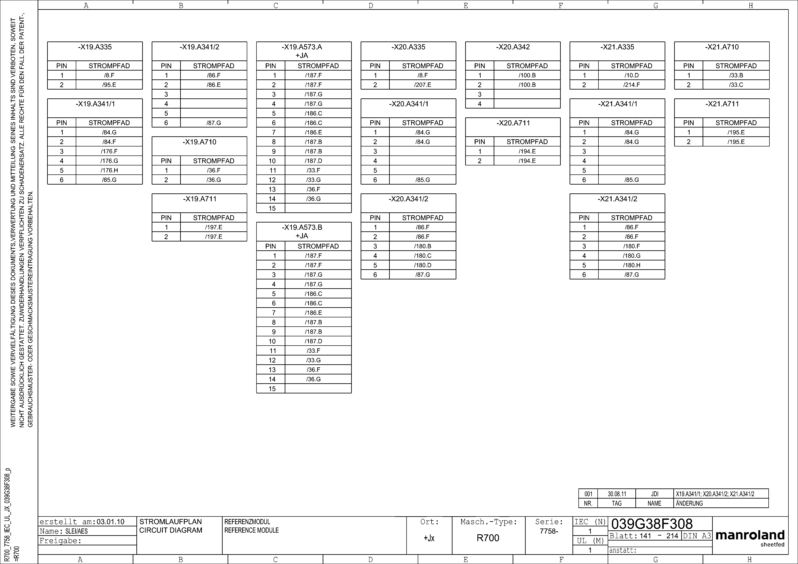

# +Jx — Sheet 141 of 214 — REFERENZMODUL

**REFERENCE MODULE**

> Part of the manroland **R700** printing press IEC/UL circuit diagrams.
> Drawing class: **Stromlaufplan / Circuit diagram** (DIN A3).
> Document `+Jx` covers the **1st printing module + feed register** machine section.

## At a glance

| Field | Value |
|---|---|
| Document | `+Jx`  (039G38F308) |
| Sheet | **141** of 214 |
| Section (DE) | REFERENZMODUL |
| Section (EN) | REFERENCE MODULE |
| Section type | REFERENCE_MODULE — Reference module |
| Machine type | `R700` |
| Series | `7758` |
| Created | 03.01.10 |
| Replaces | — |
| Columns used | A, B, C, D, E, F, G, H |
| Path numbers | — |
| Labels on sheet | 220 |
| Cross-refs out | 73 |
| Cross-refs in | 0 |

**Previous:** [+Jx sheet 140](SHEET_0140.md) · **Next:** [+Jx sheet 142](SHEET_0142.md) · **Document TOC:** [_TOC.md](_TOC.md)  (+Jx) · **Master TOC:** [all sheets](../_MASTER_TOC.md)

## Sheet image (300 DPI, exact vector render)



_Rendered directly from the PDF vector layer at 300 DPI (1-bit), no OCR and no resampling. Use it to confirm anything ambiguous in the text below._

## Cross-references on this sheet

Each entry is a wire leaving this sheet. The printed token is `/sheet.column`; the link resolves to that sheet inside the same document.

| Ref | Target sheet | Col | Path | Destination on target | Target section | From col |
|---|---|---|---|---|---|---|
| `/8.F` | [+Jx sheet 8](SHEET_0008.md) | F | — | — | SPANNUNGSVERSORGUNG, SCHALTSCHRANKBELÜFTUNG | A |
| `/8.F` | [+Jx sheet 8](SHEET_0008.md) | F | — | — | SPANNUNGSVERSORGUNG, SCHALTSCHRANKBELÜFTUNG | E |
| `/33.B` | [+Jx sheet 33](SHEET_0033.md) | B | — | — | NOT AUS | H |
| `/86.F` | [+Jx sheet 86](SHEET_0086.md) | F | — | — | BOGENFÜHRUNG | B |
| `/100.B` | [+Jx sheet 100](SHEET_0100.md) | B | — | — | RESERVE | F |
| `/187.F` | [+Jx sheet 187](SHEET_0187.md) | F | — | — | OPTION: TRANSFERMODUL 1 + 2 | C |
| `/10.D` | [+Jx sheet 10](SHEET_0010.md) | D | — | — | SPANNUNGSVERSORGUNG, SCHALTSCHRANKBELÜFTUNG | G |
| `/95.E` | [+Jx sheet 95](SHEET_0095.md) | E | — | — | RESERVE | A |
| `/86.E` | [+Jx sheet 86](SHEET_0086.md) | E | — | — | BOGENFÜHRUNG | B |
| `/187.F` | [+Jx sheet 187](SHEET_0187.md) | F | — | — | OPTION: TRANSFERMODUL 1 + 2 | C |
| `/207.E` | [+Jx sheet 207](SHEET_0207.md) | E | — | — | OPTION: ZWISCHENTROCKNER, VORBEREITUNG | E |
| `/100.B` | [+Jx sheet 100](SHEET_0100.md) | B | — | — | RESERVE | F |
| `/214.F` | [+Jx sheet 214](SHEET_0214.md) | F | — | — | OPTION: FZW | G |
| `/33.C` | [+Jx sheet 33](SHEET_0033.md) | C | — | — | NOT AUS | H |
| `/187.G` | [+Jx sheet 187](SHEET_0187.md) | G | — | — | OPTION: TRANSFERMODUL 1 + 2 | C |
| `/187.G` | [+Jx sheet 187](SHEET_0187.md) | G | — | — | OPTION: TRANSFERMODUL 1 + 2 | C |
| `/186.C` | [+Jx sheet 186](SHEET_0186.md) | C | — | — | OPTION: TRANSFERMODUL 1 + 2 | C |
| `/87.G` | [+Jx sheet 87](SHEET_0087.md) | G | — | — | BOGENFÜHRUNG | B |
| `/186.C` | [+Jx sheet 186](SHEET_0186.md) | C | — | — | OPTION: TRANSFERMODUL 1 + 2 | C |
| `/186.E` | [+Jx sheet 186](SHEET_0186.md) | E | — | — | OPTION: TRANSFERMODUL 1 + 2 | C |
| `/195.E` | [+Jx sheet 195](SHEET_0195.md) | E | — | — | OPTION: ZWISCHENTROCKNER, VORBEREITUNG | H |
| `/84.G` | [+Jx sheet 84](SHEET_0084.md) | G | — | — | BOGENFÜHRUNG | A |
| `/84.G` | [+Jx sheet 84](SHEET_0084.md) | G | — | — | BOGENFÜHRUNG | E |
| `/84.G` | [+Jx sheet 84](SHEET_0084.md) | G | — | — | BOGENFÜHRUNG | G |
| `/84.F` | [+Jx sheet 84](SHEET_0084.md) | F | — | — | BOGENFÜHRUNG | A |
| `/187.B` | [+Jx sheet 187](SHEET_0187.md) | B | — | — | OPTION: TRANSFERMODUL 1 + 2 | C |
| `/195.E` | [+Jx sheet 195](SHEET_0195.md) | E | — | — | OPTION: ZWISCHENTROCKNER, VORBEREITUNG | H |
| `/84.G` | [+Jx sheet 84](SHEET_0084.md) | G | — | — | BOGENFÜHRUNG | E |
| `/84.G` | [+Jx sheet 84](SHEET_0084.md) | G | — | — | BOGENFÜHRUNG | G |
| `/187.B` | [+Jx sheet 187](SHEET_0187.md) | B | — | — | OPTION: TRANSFERMODUL 1 + 2 | C |
| `/194.E` | [+Jx sheet 194](SHEET_0194.md) | E | — | — | OPTION: ZWISCHENTROCKNER, VORBEREITUNG | F |
| `/176.F` | [+Jx sheet 176](SHEET_0176.md) | F | — | — | OPTION: TRANSFERMODUL 1 NACH | A |
| `/194.E` | [+Jx sheet 194](SHEET_0194.md) | E | — | — | OPTION: ZWISCHENTROCKNER, VORBEREITUNG | F |
| `/176.G` | [+Jx sheet 176](SHEET_0176.md) | G | — | — | OPTION: TRANSFERMODUL 1 NACH | A |
| `/187.D` | [+Jx sheet 187](SHEET_0187.md) | D | — | — | OPTION: TRANSFERMODUL 1 + 2 | C |
| `/36.F` | [+Jx sheet 36](SHEET_0036.md) | F | — | — | STOP SICHERN | B |
| `/33.F` | [+Jx sheet 33](SHEET_0033.md) | F | — | — | NOT AUS | C |
| `/176.H` | [+Jx sheet 176](SHEET_0176.md) | H | — | — | OPTION: TRANSFERMODUL 1 NACH | A |
| `/85.G` | [+Jx sheet 85](SHEET_0085.md) | G | — | — | BOGENFÜHRUNG | A |
| `/36.G` | [+Jx sheet 36](SHEET_0036.md) | G | — | — | STOP SICHERN | B |
| `/33.G` | [+Jx sheet 33](SHEET_0033.md) | G | — | — | NOT AUS | C |
| `/85.G` | [+Jx sheet 85](SHEET_0085.md) | G | — | — | BOGENFÜHRUNG | E |
| `/85.G` | [+Jx sheet 85](SHEET_0085.md) | G | — | — | BOGENFÜHRUNG | G |
| `/36.F` | [+Jx sheet 36](SHEET_0036.md) | F | — | — | STOP SICHERN | C |
| `/36.G` | [+Jx sheet 36](SHEET_0036.md) | G | — | — | STOP SICHERN | C |
| `/197.E` | [+Jx sheet 197](SHEET_0197.md) | E | — | — | OPTION: ZWISCHENTROCKNER, VORBEREITUNG | B |
| `/86.F` | [+Jx sheet 86](SHEET_0086.md) | F | — | — | BOGENFÜHRUNG | E |
| `/86.F` | [+Jx sheet 86](SHEET_0086.md) | F | — | — | BOGENFÜHRUNG | G |
| `/86.F` | [+Jx sheet 86](SHEET_0086.md) | F | — | — | BOGENFÜHRUNG | E |
| `/86.F` | [+Jx sheet 86](SHEET_0086.md) | F | — | — | BOGENFÜHRUNG | G |
| `/197.E` | [+Jx sheet 197](SHEET_0197.md) | E | — | — | OPTION: ZWISCHENTROCKNER, VORBEREITUNG | B |
| `/180.B` | [+Jx sheet 180](SHEET_0180.md) | B | — | — | OPTION: TRANSFERMODUL 2 | E |
| `/180.F` | [+Jx sheet 180](SHEET_0180.md) | F | — | — | OPTION: TRANSFERMODUL 2 | G |
| `/187.F` | [+Jx sheet 187](SHEET_0187.md) | F | — | — | OPTION: TRANSFERMODUL 1 + 2 | C |
| `/180.G` | [+Jx sheet 180](SHEET_0180.md) | G | — | — | OPTION: TRANSFERMODUL 2 | G |
| `/180.C` | [+Jx sheet 180](SHEET_0180.md) | C | — | — | OPTION: TRANSFERMODUL 2 | E |
| `/187.F` | [+Jx sheet 187](SHEET_0187.md) | F | — | — | OPTION: TRANSFERMODUL 1 + 2 | C |
| `/180.D` | [+Jx sheet 180](SHEET_0180.md) | D | — | — | OPTION: TRANSFERMODUL 2 | E |
| `/180.H` | [+Jx sheet 180](SHEET_0180.md) | H | — | — | OPTION: TRANSFERMODUL 2 | G |
| `/87.G` | [+Jx sheet 87](SHEET_0087.md) | G | — | — | BOGENFÜHRUNG | E |
| `/87.G` | [+Jx sheet 87](SHEET_0087.md) | G | — | — | BOGENFÜHRUNG | G |
| `/187.G` | [+Jx sheet 187](SHEET_0187.md) | G | — | — | OPTION: TRANSFERMODUL 1 + 2 | C |
| `/187.G` | [+Jx sheet 187](SHEET_0187.md) | G | — | — | OPTION: TRANSFERMODUL 1 + 2 | C |
| `/186.C` | [+Jx sheet 186](SHEET_0186.md) | C | — | — | OPTION: TRANSFERMODUL 1 + 2 | C |
| `/186.C` | [+Jx sheet 186](SHEET_0186.md) | C | — | — | OPTION: TRANSFERMODUL 1 + 2 | C |
| `/186.E` | [+Jx sheet 186](SHEET_0186.md) | E | — | — | OPTION: TRANSFERMODUL 1 + 2 | C |
| `/187.B` | [+Jx sheet 187](SHEET_0187.md) | B | — | — | OPTION: TRANSFERMODUL 1 + 2 | C |
| `/187.B` | [+Jx sheet 187](SHEET_0187.md) | B | — | — | OPTION: TRANSFERMODUL 1 + 2 | C |
| `/187.D` | [+Jx sheet 187](SHEET_0187.md) | D | — | — | OPTION: TRANSFERMODUL 1 + 2 | C |
| `/33.F` | [+Jx sheet 33](SHEET_0033.md) | F | — | — | NOT AUS | C |
| `/33.G` | [+Jx sheet 33](SHEET_0033.md) | G | — | — | NOT AUS | C |
| `/36.F` | [+Jx sheet 36](SHEET_0036.md) | F | — | — | STOP SICHERN | C |
| `/36.G` | [+Jx sheet 36](SHEET_0036.md) | G | — | — | STOP SICHERN | C |

## Devices on this sheet

| Tag | Class | Class meaning (IEC) | Col | Sub | Terminal | Sign |
|---|---|---|---|---|---|---|
| `X19.A335` | — | cross-device reference | A | — | — | — |
| `X20.A342` | — | cross-device reference | F | — | — | — |
| `X20.A711` | — | cross-device reference | F | — | — | — |
| `X21.A335` | — | cross-device reference | G | — | — | — |
| `X19.A711` | — | cross-device reference | B | — | — | — |
| `X19.A710` | — | cross-device reference | B | — | — | — |
| `X21.A711` | — | cross-device reference | H | — | — | — |
| `X21.A710` | — | cross-device reference | H | — | — | — |
| `X20.A335` | — | cross-device reference | D | — | — | — |
| `X19.A573.A` | — | cross-device reference | C | — | — | — |
| `X19.A573.B` | — | cross-device reference | C | — | — | — |
| `NR.` | — | cross-device reference | F | — | — | — |
| `30.08.11` | — | cross-device reference | G | — | — | — |

## Potentials / nets

_No named potentials on this sheet._

## Wire-end annotations (grouped as printed)

A wire that continues elsewhere is annotated with a small cluster: the destination description, the path/line number `#NN`, and the `/sheet.column` cross reference. Each row below is one such cluster exactly as it is grouped on the drawing.

| Col | Y | Path | Cross-ref | Text on the wire |
|---|---|---|---|---|
| A | 65.4 | — | — | `X19.A335` |
| B | 65.4 | — | — | `X19.A341/2` |
| C | 65.4 | — | — | `X19.A573.A` |
| D | 65.4 | — | — | `X20.A335` |
| F | 65.4 | — | — | `X20.A342` |
| G | 65.4 | — | — | `X21.A335` |
| H | 65.4 | — | — | `X21.A710` |
| C | 78.1 | — | — | `+JA` |
| A | 94.1 | — | — | `PIN 2 1 STROMPFAD` |
| B | 94.1 | — | — | `PIN 2 3 5 6 4 1 STROMPFAD` |
| C | 94.1 | — | — | `PIN 10 12 13 14 15 11 2 3 4 5 6 7 8 9 1 STROMPFAD` |
| D | 94.1 | — | — | `PIN 2 1 STROMPFAD` |
| E | 94.1 | — | — | `PIN 2 3 4 1 STROMPFAD` |
| G | 94.1 | — | — | `PIN 2 1 STROMPFAD` |
| H | 94.1 | — | — | `PIN 2 1 STROMPFAD` |
| A | 108.6 | — | `/8.F` | — |
| B | 108.6 | — | `/86.F` | — |
| C | 108.6 | — | `/187.F` | — |
| E | 108.6 | — | `/8.F` | — |
| F | 108.6 | — | `/100.B` | — |
| H | 108.6 | — | `/33.B` | — |
| G | 108.7 | — | `/10.D` | — |
| A | 122.8 | — | `/95.E` | — |
| B | 122.8 | — | `/86.E` | — |
| C | 122.8 | — | `/187.F` | — |
| E | 122.8 | — | `/207.E` | — |
| F | 122.8 | — | `/100.B` | — |
| G | 122.8 | — | `/214.F` | — |
| H | 122.8 | — | `/33.C` | — |
| C | 137.0 | — | `/187.G` | — |
| A | 150.5 | — | — | `X19.A341/1` |
| D | 150.5 | — | — | `X20.A341/1` |
| G | 150.5 | — | — | `X21.A341/1` |
| H | 150.5 | — | — | `X21.A711` |
| C | 151.2 | — | `/187.G` | — |
| C | 165.3 | — | `/186.C` | — |
| F | 178.8 | — | — | `X20.A711` |
| A | 179.1 | — | — | `PIN 2 3 5 6 4 1 STROMPFAD` |
| D | 179.1 | — | — | `PIN 2 3 5 6 4 1 STROMPFAD` |
| G | 179.1 | — | — | `PIN 2 3 5 6 4 1 STROMPFAD` |
| H | 179.1 | — | — | `PIN 2 1 STROMPFAD` |
| B | 179.5 | — | `/87.G` | — |
| C | 179.5 | — | `/186.C` | — |
| A | 193.7 | — | `/84.G` | — |
| C | 193.7 | — | `/186.E` | — |
| E | 193.7 | — | `/84.G` | — |
| G | 193.7 | — | `/84.G` | — |
| H | 193.7 | — | `/195.E` | — |
| B | 207.2 | — | — | `X19.A710` |
| E | 207.5 | — | — | `PIN 2 1 STROMPFAD` |
| A | 207.8 | — | `/84.F` | — |
| C | 207.8 | — | `/187.B` | — |
| E | 207.8 | — | `/84.G` | — |
| G | 207.8 | — | `/84.G` | — |
| H | 207.8 | — | `/195.E` | — |
| A | 222.0 | — | `/176.F` | — |
| C | 222.0 | — | `/187.B` | — |
| F | 222.0 | — | `/194.E` | — |
| B | 235.8 | — | — | `PIN 2 1 STROMPFAD` |
| A | 236.2 | — | `/176.G` | — |
| C | 236.2 | — | `/187.D` | — |
| F | 236.2 | — | `/194.E` | — |
| A | 250.4 | — | `/176.H` | — |
| B | 250.4 | — | `/36.F` | — |
| C | 250.4 | — | `/33.F` | — |
| A | 264.5 | — | `/85.G` | — |
| B | 264.5 | — | `/36.G` | — |
| C | 264.5 | — | `/33.G` | — |
| E | 264.5 | — | `/85.G` | — |
| G | 264.5 | — | `/85.G` | — |
| C | 278.7 | — | `/36.F` | — |
| B | 292.2 | — | — | `X19.A711` |
| D | 292.2 | — | — | `X20.A341/2` |
| G | 292.2 | — | — | `X21.A341/2` |
| C | 292.9 | — | `/36.G` | — |
| B | 320.9 | — | — | `PIN 2 1 STROMPFAD` |
| D | 320.9 | — | — | `PIN 2 3 5 6 4 1 STROMPFAD` |
| G | 320.9 | — | — | `PIN 2 3 5 6 4 1 STROMPFAD` |
| C | 334.7 | — | — | `X19.A573.B` |
| B | 335.4 | — | `/197.E` | — |
| E | 335.4 | — | `/86.F` | — |
| G | 335.4 | — | `/86.F` | — |
| C | 347.4 | — | — | `+JA` |
| B | 349.6 | — | `/197.E` | — |
| E | 349.6 | — | `/86.F` | — |
| G | 349.6 | — | `/86.F` | — |
| C | 363.4 | — | — | `PIN 10 12 13 14 15 11 2 3 4 5 6 7 8 9 1 STROMPFAD` |
| E | 363.8 | — | `/180.B` | — |
| G | 363.8 | — | `/180.F` | — |
| C | 377.9 | — | `/187.F` | — |
| E | 377.9 | — | `/180.C` | — |
| G | 377.9 | — | `/180.G` | — |
| C | 392.1 | — | `/187.F` | — |
| E | 392.1 | — | `/180.D` | — |
| G | 392.1 | — | `/180.H` | — |
| C | 406.3 | — | `/187.G` | — |
| E | 406.3 | — | `/87.G` | — |
| G | 406.3 | — | `/87.G` | — |
| C | 420.5 | — | `/187.G` | — |
| C | 434.6 | — | `/186.C` | — |
| C | 448.8 | — | `/186.C` | — |
| C | 463.0 | — | `/186.E` | — |
| C | 477.1 | — | `/187.B` | — |
| C | 491.3 | — | `/187.B` | — |
| C | 505.5 | — | `/187.D` | — |
| C | 519.6 | — | `/33.F` | — |
| C | 533.8 | — | `/33.G` | — |
| C | 548.0 | — | `/36.F` | — |
| C | 562.2 | — | `/36.G` | — |
| G | 734.1 | — | — | `001 30.08.11 JDI X19.A341/1; X20.A341/2; X21.A341/2` |
| G | 748.3 | — | — | `NR. TAG NAME ÄNDERUNG` |


## Reconstructed tables

This sheet carries tabular content (pin map / terminal assignment / index). The grid below was rebuilt from the drawing's own rule lines, so each row is exactly one physical row of the table.

### Table 1 — 10 data rows × 2 columns (at x=70.9, y=62.4) — **X19.A335**

| PIN | STROMPFAD |
|---|---|
| `1` | `/8.F` |
| `2` | `/95.E` |
|  | `X19.A341/1` |
| `PIN` | `STROMPFAD` |
| `1` | `/84.G` |
| `2` | `/84.F` |
| `3` | `/176.F` |
| `4` | `/176.G` |
| `5` | `/176.H` |
| `6` | `/85.G` |


### Table 2 — 14 data rows × 2 columns (at x=226.8, y=62.4) — **X19.A341/2**

| PIN | STROMPFAD |
|---|---|
| `1` | `/86.F` |
| `2` | `/86.E` |
| `3` |  |
| `4` |  |
| `5` |  |
| `6` | `/87.G` |
|  | `X19.A710` |
| `PIN` | `STROMPFAD` |
| `1` | `/36.F` |
| `2` | `/36.G` |
|  | `X19.A711` |
| `PIN` | `STROMPFAD` |
| `1` | `/197.E` |
| `2` | `/197.E` |


### Table 3 — 33 data rows × 2 columns (at x=382.7, y=62.4) — **X19.A573.A +JA**

| PIN | STROMPFAD |
|---|---|
| `1` | `/187.F` |
| `2` | `/187.F` |
| `3` | `/187.G` |
| `4` | `/187.G` |
| `5` | `/186.C` |
| `6` | `/186.C` |
| `7` | `/186.E` |
| `8` | `/187.B` |
| `9` | `/187.B` |
| `10` | `/187.D` |
| `11` | `/33.F` |
| `12` | `/33.G` |
| `13` | `/36.F` |
| `14` | `/36.G` |
| `15` |  |
|  | `X19.A573.B` |
|  | `+JA` |
| `PIN` | `STROMPFAD` |
| `1` | `/187.F` |
| `2` | `/187.F` |
| `3` | `/187.G` |
| `4` | `/187.G` |
| `5` | `/186.C` |
| `6` | `/186.C` |
| `7` | `/186.E` |
| `8` | `/187.B` |
| `9` | `/187.B` |
| `10` | `/187.D` |
| `11` | `/33.F` |
| `12` | `/33.G` |
| `13` | `/36.F` |
| `14` | `/36.G` |
| `15` |  |


### Table 4 — 18 data rows × 2 columns (at x=538.6, y=62.4) — **X20.A335**

| PIN | STROMPFAD |
|---|---|
| `1` | `/8.F` |
| `2` | `/207.E` |
|  | `X20.A341/1` |
| `PIN` | `STROMPFAD` |
| `1` | `/84.G` |
| `2` | `/84.G` |
| `3` |  |
| `4` |  |
| `5` |  |
| `6` | `/85.G` |
|  | `X20.A341/2` |
| `PIN` | `STROMPFAD` |
| `1` | `/86.F` |
| `2` | `/86.F` |
| `3` | `/180.B` |
| `4` | `/180.C` |
| `5` | `/180.D` |
| `6` | `/87.G` |


### Table 5 — 8 data rows × 2 columns (at x=694.5, y=62.4) — **X20.A342**

| PIN | STROMPFAD |
|---|---|
| `1` | `/100.B` |
| `2` | `/100.B` |
| `3` |  |
| `4` |  |
|  | `X20.A711` |
| `PIN` | `STROMPFAD` |
| `1` | `/194.E` |
| `2` | `/194.E` |


### Table 6 — 18 data rows × 2 columns (at x=850.4, y=62.4) — **X21.A335**

| PIN | STROMPFAD |
|---|---|
| `1` | `/10.D` |
| `2` | `/214.F` |
|  | `X21.A341/1` |
| `PIN` | `STROMPFAD` |
| `1` | `/84.G` |
| `2` | `/84.G` |
| `3` |  |
| `4` |  |
| `5` |  |
| `6` | `/85.G` |
|  | `X21.A341/2` |
| `PIN` | `STROMPFAD` |
| `1` | `/86.F` |
| `2` | `/86.F` |
| `3` | `/180.F` |
| `4` | `/180.G` |
| `5` | `/180.H` |
| `6` | `/87.G` |


### Table 7 — 6 data rows × 2 columns (at x=1006.3, y=62.4) — **X21.A710**

| PIN | STROMPFAD |
|---|---|
| `1` | `/33.B` |
| `2` | `/33.C` |
|  | `X21.A711` |
| `PIN` | `STROMPFAD` |
| `1` | `/195.E` |
| `2` | `/195.E` |


## Notes and free text on this sheet

| Text | Col | Y (pt) |
|---|---|---|
| `PIN` | A | 94.13 |
| `STROMPFAD` | A | 94.09 |
| `X19.A341/1` | A | 150.48 |
| `PIN` | B | 94.13 |
| `STROMPFAD` | B | 94.09 |
| `X19.A341/2` | B | 65.44 |
| `PIN` | E | 94.13 |
| `STROMPFAD` | F | 94.09 |
| `PIN` | F | 94.13 |
| `STROMPFAD` | G | 94.09 |
| `X21.A341/1` | G | 150.48 |
| `X21.A341/2` | G | 292.21 |
| `PIN` | G | 179.17 |
| `STROMPFAD` | H | 179.13 |
| `PIN` | D | 94.13 |
| `STROMPFAD` | E | 94.09 |
| `X20.A341/1` | D | 150.48 |
| `X20.A341/2` | D | 292.21 |
| `PIN` | C | 94.13 |
| `STROMPFAD` | C | 94.09 |
| `+JA` | C | 78.1 |
| `TAG` | G | 748.4 |
| `NAME` | G | 748.39 |
| `ÄNDERUNG` | G | 748.41 |
| `JDI` | G | 734.15 |
| `X19.A341/1; X20.A341/2; X21.A341/2` | H | 734.26 |

## Complete label inventory (exact text from the drawing)

Every text object inside the drawing area of this sheet, in DIN reading order (column A→H, then top→bottom). This is the authoritative list: if a string is not here it is not printed on this sheet.

| Col | Y | X | Dir | Type | Text |
|---|---|---|---|---|---|
| A | 65.4 | 116.6 | → | device ref | `X19.A335` |
| A | 94.1 | 84.0 | → | text | `PIN` |
| A | 94.1 | 132.4 | → | text | `STROMPFAD` |
| A | 108.3 | 89.9 | → | number | `1` |
| A | 108.6 | 155.5 | → | cross-reference | `/8.F` |
| A | 122.5 | 89.4 | → | number | `2` |
| A | 122.8 | 152.8 | → | cross-reference | `/95.E` |
| A | 150.5 | 113.1 | → | text | `X19.A341/1` |
| A | 179.1 | 132.4 | → | text | `STROMPFAD` |
| A | 179.2 | 84.0 | → | text | `PIN` |
| A | 193.3 | 89.9 | → | number | `1` |
| A | 193.7 | 152.4 | → | cross-reference | `/84.G` |
| A | 207.5 | 89.4 | → | number | `2` |
| A | 207.8 | 153.1 | → | cross-reference | `/84.F` |
| A | 221.7 | 89.4 | → | number | `3` |
| A | 222.0 | 150.7 | → | cross-reference | `/176.F` |
| A | 235.9 | 89.6 | → | number | `4` |
| A | 236.2 | 150.0 | → | cross-reference | `/176.G` |
| A | 250.0 | 89.4 | → | number | `5` |
| A | 250.4 | 150.4 | → | cross-reference | `/176.H` |
| A | 264.2 | 89.4 | → | number | `6` |
| A | 264.5 | 152.4 | → | cross-reference | `/85.G` |
| B | 65.4 | 268.3 | → | text | `X19.A341/2` |
| B | 94.1 | 240.0 | → | text | `PIN` |
| B | 94.1 | 288.3 | → | text | `STROMPFAD` |
| B | 108.3 | 245.8 | → | number | `1` |
| B | 108.6 | 309.0 | → | cross-reference | `/86.F` |
| B | 122.5 | 245.3 | → | number | `2` |
| B | 122.8 | 308.7 | → | cross-reference | `/86.E` |
| B | 136.7 | 245.3 | → | number | `3` |
| B | 150.8 | 245.5 | → | number | `4` |
| B | 165.0 | 245.3 | → | number | `5` |
| B | 179.2 | 245.3 | → | number | `6` |
| B | 179.5 | 308.3 | → | cross-reference | `/87.G` |
| B | 207.2 | 272.7 | → | device ref | `X19.A710` |
| B | 235.8 | 288.3 | → | text | `STROMPFAD` |
| B | 235.9 | 240.0 | → | text | `PIN` |
| B | 250.0 | 245.8 | → | number | `1` |
| B | 250.4 | 309.0 | → | cross-reference | `/36.F` |
| B | 264.2 | 245.3 | → | number | `2` |
| B | 264.5 | 308.3 | → | cross-reference | `/36.G` |
| B | 292.2 | 273.4 | → | device ref | `X19.A711` |
| B | 320.9 | 240.0 | → | text | `PIN` |
| B | 320.9 | 288.3 | → | text | `STROMPFAD` |
| B | 335.1 | 245.8 | → | number | `1` |
| B | 335.4 | 306.3 | → | cross-reference | `/197.E` |
| B | 349.3 | 245.3 | → | number | `2` |
| B | 349.6 | 306.3 | → | cross-reference | `/197.E` |
| C | 65.4 | 420.5 | → | device ref | `X19.A573.A` |
| C | 78.1 | 441.1 | → | text | `+JA` |
| C | 94.1 | 395.9 | → | text | `PIN` |
| C | 94.1 | 444.2 | → | text | `STROMPFAD` |
| C | 108.3 | 407.3 | → | number | `1` |
| C | 108.6 | 455.4 | → | cross-reference | `/187.F` |
| C | 122.5 | 405.9 | → | number | `2` |
| C | 122.8 | 455.4 | → | cross-reference | `/187.F` |
| C | 136.7 | 405.9 | → | number | `3` |
| C | 137.0 | 454.7 | → | cross-reference | `/187.G` |
| C | 150.8 | 405.9 | → | number | `4` |
| C | 151.2 | 454.7 | → | cross-reference | `/187.G` |
| C | 165.0 | 405.9 | → | number | `5` |
| C | 165.4 | 455.0 | → | cross-reference | `/186.C` |
| C | 179.2 | 405.9 | → | number | `6` |
| C | 179.5 | 455.0 | → | cross-reference | `/186.C` |
| C | 193.3 | 405.9 | → | number | `7` |
| C | 193.7 | 455.1 | → | cross-reference | `/186.E` |
| C | 207.5 | 405.9 | → | number | `8` |
| C | 207.8 | 455.1 | → | cross-reference | `/187.B` |
| C | 221.7 | 405.9 | → | number | `9` |
| C | 222.0 | 455.1 | → | cross-reference | `/187.B` |
| C | 235.9 | 400.5 | → | number | `10` |
| C | 236.2 | 455.0 | → | cross-reference | `/187.D` |
| C | 250.0 | 402.0 | → | number | `11` |
| C | 250.4 | 457.8 | → | cross-reference | `/33.F` |
| C | 264.2 | 400.5 | → | number | `12` |
| C | 264.5 | 457.1 | → | cross-reference | `/33.G` |
| C | 278.4 | 400.5 | → | number | `13` |
| C | 278.7 | 457.8 | → | cross-reference | `/36.F` |
| C | 292.6 | 400.5 | → | number | `14` |
| C | 292.9 | 457.1 | → | cross-reference | `/36.G` |
| C | 306.7 | 400.5 | → | number | `15` |
| C | 334.7 | 420.8 | → | device ref | `X19.A573.B` |
| C | 347.4 | 441.1 | → | text | `+JA` |
| C | 363.4 | 395.9 | → | text | `PIN` |
| C | 363.4 | 444.2 | → | text | `STROMPFAD` |
| C | 377.6 | 407.3 | → | number | `1` |
| C | 377.9 | 455.4 | → | cross-reference | `/187.F` |
| C | 391.8 | 405.9 | → | number | `2` |
| C | 392.1 | 455.4 | → | cross-reference | `/187.F` |
| C | 405.9 | 405.9 | → | number | `3` |
| C | 406.3 | 454.7 | → | cross-reference | `/187.G` |
| C | 420.1 | 405.9 | → | number | `4` |
| C | 420.5 | 454.7 | → | cross-reference | `/187.G` |
| C | 434.3 | 405.9 | → | number | `5` |
| C | 434.6 | 455.0 | → | cross-reference | `/186.C` |
| C | 448.5 | 405.9 | → | number | `6` |
| C | 448.8 | 455.0 | → | cross-reference | `/186.C` |
| C | 462.6 | 405.9 | → | number | `7` |
| C | 463.0 | 455.1 | → | cross-reference | `/186.E` |
| C | 476.8 | 405.9 | → | number | `8` |
| C | 477.1 | 455.1 | → | cross-reference | `/187.B` |
| C | 491.0 | 405.9 | → | number | `9` |
| C | 491.3 | 455.1 | → | cross-reference | `/187.B` |
| C | 505.2 | 400.5 | → | number | `10` |
| C | 505.5 | 455.0 | → | cross-reference | `/187.D` |
| C | 519.3 | 402.0 | → | number | `11` |
| C | 519.7 | 457.8 | → | cross-reference | `/33.F` |
| C | 533.5 | 400.5 | → | number | `12` |
| C | 533.8 | 457.1 | → | cross-reference | `/33.G` |
| C | 547.7 | 400.5 | → | number | `13` |
| C | 548.0 | 457.8 | → | cross-reference | `/36.F` |
| C | 561.9 | 400.5 | → | number | `14` |
| C | 562.2 | 457.1 | → | cross-reference | `/36.G` |
| C | 576.0 | 400.5 | → | number | `15` |
| D | 65.4 | 584.4 | → | device ref | `X20.A335` |
| D | 94.1 | 551.8 | → | text | `PIN` |
| D | 108.3 | 557.6 | → | number | `1` |
| D | 122.5 | 557.1 | → | number | `2` |
| D | 150.5 | 580.8 | → | text | `X20.A341/1` |
| D | 179.2 | 551.8 | → | text | `PIN` |
| D | 193.3 | 557.6 | → | number | `1` |
| D | 207.5 | 557.1 | → | number | `2` |
| D | 221.7 | 557.1 | → | number | `3` |
| D | 235.9 | 557.3 | → | number | `4` |
| D | 250.0 | 557.1 | → | number | `5` |
| D | 264.2 | 557.1 | → | number | `6` |
| D | 292.2 | 580.1 | → | text | `X20.A341/2` |
| D | 320.9 | 551.8 | → | text | `PIN` |
| D | 335.1 | 557.6 | → | number | `1` |
| D | 349.3 | 557.1 | → | number | `2` |
| D | 363.4 | 557.1 | → | number | `3` |
| D | 377.6 | 557.3 | → | number | `4` |
| D | 391.8 | 557.1 | → | number | `5` |
| D | 405.9 | 557.1 | → | number | `6` |
| E | 94.1 | 600.1 | → | text | `STROMPFAD` |
| E | 94.1 | 707.7 | → | text | `PIN` |
| E | 108.3 | 713.5 | → | number | `1` |
| E | 108.6 | 623.2 | → | cross-reference | `/8.F` |
| E | 122.5 | 713.1 | → | number | `2` |
| E | 122.8 | 618.1 | → | cross-reference | `/207.E` |
| E | 136.7 | 713.1 | → | number | `3` |
| E | 150.8 | 713.2 | → | number | `4` |
| E | 179.1 | 600.1 | → | text | `STROMPFAD` |
| E | 193.7 | 620.1 | → | cross-reference | `/84.G` |
| E | 207.5 | 707.7 | → | text | `PIN` |
| E | 207.9 | 620.1 | → | cross-reference | `/84.G` |
| E | 221.7 | 713.5 | → | number | `1` |
| E | 235.9 | 713.1 | → | number | `2` |
| E | 264.5 | 620.1 | → | cross-reference | `/85.G` |
| E | 320.9 | 600.1 | → | text | `STROMPFAD` |
| E | 335.4 | 620.8 | → | cross-reference | `/86.F` |
| E | 349.6 | 620.8 | → | cross-reference | `/86.F` |
| E | 363.7 | 618.1 | → | cross-reference | `/180.B` |
| E | 377.9 | 618.0 | → | cross-reference | `/180.C` |
| E | 392.1 | 618.0 | → | cross-reference | `/180.D` |
| E | 406.3 | 620.1 | → | cross-reference | `/87.G` |
| F | 65.4 | 740.4 | → | device ref | `X20.A342` |
| F | 94.1 | 756.0 | → | text | `STROMPFAD` |
| F | 94.1 | 863.6 | → | text | `PIN` |
| F | 108.3 | 869.4 | → | number | `1` |
| F | 108.6 | 774.0 | → | cross-reference | `/100.B` |
| F | 122.5 | 869.0 | → | number | `2` |
| F | 122.8 | 774.0 | → | cross-reference | `/100.B` |
| F | 178.8 | 741.1 | → | device ref | `X20.A711` |
| F | 179.2 | 863.6 | → | text | `PIN` |
| F | 193.3 | 869.4 | → | number | `1` |
| F | 207.5 | 756.0 | → | text | `STROMPFAD` |
| F | 207.5 | 869.0 | → | number | `2` |
| F | 221.7 | 869.0 | → | number | `3` |
| F | 222.0 | 774.0 | → | cross-reference | `/194.E` |
| F | 235.9 | 869.1 | → | number | `4` |
| F | 236.2 | 774.0 | → | cross-reference | `/194.E` |
| F | 250.0 | 869.0 | → | number | `5` |
| F | 264.2 | 869.0 | → | number | `6` |
| F | 320.9 | 863.6 | → | text | `PIN` |
| F | 335.1 | 869.4 | → | number | `1` |
| F | 349.3 | 869.0 | → | number | `2` |
| F | 363.4 | 869.0 | → | number | `3` |
| F | 377.6 | 869.1 | → | number | `4` |
| F | 391.8 | 869.0 | → | number | `5` |
| F | 405.9 | 869.0 | → | number | `6` |
| F | 734.1 | 872.3 | → | number | `001` |
| F | 748.3 | 871.5 | → | device ref | `NR.` |
| G | 65.4 | 896.2 | → | device ref | `X21.A335` |
| G | 94.1 | 911.9 | → | text | `STROMPFAD` |
| G | 94.1 | 1019.5 | → | text | `PIN` |
| G | 108.3 | 1025.3 | → | number | `1` |
| G | 108.7 | 932.2 | → | cross-reference | `/10.D` |
| G | 122.5 | 1024.9 | → | number | `2` |
| G | 122.8 | 930.2 | → | cross-reference | `/214.F` |
| G | 150.5 | 892.6 | → | text | `X21.A341/1` |
| G | 179.1 | 911.9 | → | text | `STROMPFAD` |
| G | 179.2 | 1019.5 | → | text | `PIN` |
| G | 193.3 | 1025.3 | → | number | `1` |
| G | 193.7 | 931.9 | → | cross-reference | `/84.G` |
| G | 207.5 | 1024.9 | → | number | `2` |
| G | 207.9 | 931.9 | → | cross-reference | `/84.G` |
| G | 264.5 | 931.9 | → | cross-reference | `/85.G` |
| G | 292.2 | 891.9 | → | text | `X21.A341/2` |
| G | 320.9 | 911.9 | → | text | `STROMPFAD` |
| G | 335.4 | 932.6 | → | cross-reference | `/86.F` |
| G | 349.6 | 932.6 | → | cross-reference | `/86.F` |
| G | 363.8 | 930.2 | → | cross-reference | `/180.F` |
| G | 377.9 | 929.5 | → | cross-reference | `/180.G` |
| G | 392.1 | 929.9 | → | cross-reference | `/180.H` |
| G | 406.3 | 931.9 | → | cross-reference | `/87.G` |
| G | 734.1 | 971.7 | → | text | `JDI` |
| G | 734.2 | 907.0 | → | device ref | `30.08.11` |
| G | 748.4 | 913.2 | → | text | `TAG` |
| G | 748.4 | 966.5 | → | text | `NAME` |
| G | 748.4 | 1008.7 | → | text | `ÄNDERUNG` |
| H | 65.4 | 1052.2 | → | device ref | `X21.A710` |
| H | 94.1 | 1067.8 | → | text | `STROMPFAD` |
| H | 108.6 | 1088.2 | → | cross-reference | `/33.B` |
| H | 122.8 | 1088.1 | → | cross-reference | `/33.C` |
| H | 150.5 | 1052.9 | → | device ref | `X21.A711` |
| H | 179.1 | 1067.8 | → | text | `STROMPFAD` |
| H | 193.7 | 1085.8 | → | cross-reference | `/195.E` |
| H | 207.8 | 1085.8 | → | cross-reference | `/195.E` |
| H | 734.3 | 1008.7 | → | text | `X19.A341/1; X20.A341/2; X21.A341/2` |

## Reading-order text block

The same content as a plain block, grouped by DIN column — convenient to paste or to match against a visual description.

```text
=== Column A ===
  65.4  116.6  devref       X19.A335
  94.1   84.0  text         PIN
  94.1  132.4  text         STROMPFAD
 108.3   89.9  numeric      1
 108.6  155.5  xref         /8.F
 122.5   89.4  numeric      2
 122.8  152.8  xref         /95.E
 150.5  113.1  text         X19.A341/1
 179.1  132.4  text         STROMPFAD
 179.2   84.0  text         PIN
 193.3   89.9  numeric      1
 193.7  152.4  xref         /84.G
 207.5   89.4  numeric      2
 207.8  153.1  xref         /84.F
 221.7   89.4  numeric      3
 222.0  150.7  xref         /176.F
 235.9   89.6  numeric      4
 236.2  150.0  xref         /176.G
 250.0   89.4  numeric      5
 250.4  150.4  xref         /176.H
 264.2   89.4  numeric      6
 264.5  152.4  xref         /85.G
=== Column B ===
  65.4  268.3  text         X19.A341/2
  94.1  240.0  text         PIN
  94.1  288.3  text         STROMPFAD
 108.3  245.8  numeric      1
 108.6  309.0  xref         /86.F
 122.5  245.3  numeric      2
 122.8  308.7  xref         /86.E
 136.7  245.3  numeric      3
 150.8  245.5  numeric      4
 165.0  245.3  numeric      5
 179.2  245.3  numeric      6
 179.5  308.3  xref         /87.G
 207.2  272.7  devref       X19.A710
 235.8  288.3  text         STROMPFAD
 235.9  240.0  text         PIN
 250.0  245.8  numeric      1
 250.4  309.0  xref         /36.F
 264.2  245.3  numeric      2
 264.5  308.3  xref         /36.G
 292.2  273.4  devref       X19.A711
 320.9  240.0  text         PIN
 320.9  288.3  text         STROMPFAD
 335.1  245.8  numeric      1
 335.4  306.3  xref         /197.E
 349.3  245.3  numeric      2
 349.6  306.3  xref         /197.E
=== Column C ===
  65.4  420.5  devref       X19.A573.A
  78.1  441.1  text         +JA
  94.1  395.9  text         PIN
  94.1  444.2  text         STROMPFAD
 108.3  407.3  numeric      1
 108.6  455.4  xref         /187.F
 122.5  405.9  numeric      2
 122.8  455.4  xref         /187.F
 136.7  405.9  numeric      3
 137.0  454.7  xref         /187.G
 150.8  405.9  numeric      4
 151.2  454.7  xref         /187.G
 165.0  405.9  numeric      5
 165.4  455.0  xref         /186.C
 179.2  405.9  numeric      6
 179.5  455.0  xref         /186.C
 193.3  405.9  numeric      7
 193.7  455.1  xref         /186.E
 207.5  405.9  numeric      8
 207.8  455.1  xref         /187.B
 221.7  405.9  numeric      9
 222.0  455.1  xref         /187.B
 235.9  400.5  numeric      10
 236.2  455.0  xref         /187.D
 250.0  402.0  numeric      11
 250.4  457.8  xref         /33.F
 264.2  400.5  numeric      12
 264.5  457.1  xref         /33.G
 278.4  400.5  numeric      13
 278.7  457.8  xref         /36.F
 292.6  400.5  numeric      14
 292.9  457.1  xref         /36.G
 306.7  400.5  numeric      15
 334.7  420.8  devref       X19.A573.B
 347.4  441.1  text         +JA
 363.4  395.9  text         PIN
 363.4  444.2  text         STROMPFAD
 377.6  407.3  numeric      1
 377.9  455.4  xref         /187.F
 391.8  405.9  numeric      2
 392.1  455.4  xref         /187.F
 405.9  405.9  numeric      3
 406.3  454.7  xref         /187.G
 420.1  405.9  numeric      4
 420.5  454.7  xref         /187.G
 434.3  405.9  numeric      5
 434.6  455.0  xref         /186.C
 448.5  405.9  numeric      6
 448.8  455.0  xref         /186.C
 462.6  405.9  numeric      7
 463.0  455.1  xref         /186.E
 476.8  405.9  numeric      8
 477.1  455.1  xref         /187.B
 491.0  405.9  numeric      9
 491.3  455.1  xref         /187.B
 505.2  400.5  numeric      10
 505.5  455.0  xref         /187.D
 519.3  402.0  numeric      11
 519.7  457.8  xref         /33.F
 533.5  400.5  numeric      12
 533.8  457.1  xref         /33.G
 547.7  400.5  numeric      13
 548.0  457.8  xref         /36.F
 561.9  400.5  numeric      14
 562.2  457.1  xref         /36.G
 576.0  400.5  numeric      15
=== Column D ===
  65.4  584.4  devref       X20.A335
  94.1  551.8  text         PIN
 108.3  557.6  numeric      1
 122.5  557.1  numeric      2
 150.5  580.8  text         X20.A341/1
 179.2  551.8  text         PIN
 193.3  557.6  numeric      1
 207.5  557.1  numeric      2
 221.7  557.1  numeric      3
 235.9  557.3  numeric      4
 250.0  557.1  numeric      5
 264.2  557.1  numeric      6
 292.2  580.1  text         X20.A341/2
 320.9  551.8  text         PIN
 335.1  557.6  numeric      1
 349.3  557.1  numeric      2
 363.4  557.1  numeric      3
 377.6  557.3  numeric      4
 391.8  557.1  numeric      5
 405.9  557.1  numeric      6
=== Column E ===
  94.1  600.1  text         STROMPFAD
  94.1  707.7  text         PIN
 108.3  713.5  numeric      1
 108.6  623.2  xref         /8.F
 122.5  713.1  numeric      2
 122.8  618.1  xref         /207.E
 136.7  713.1  numeric      3
 150.8  713.2  numeric      4
 179.1  600.1  text         STROMPFAD
 193.7  620.1  xref         /84.G
 207.5  707.7  text         PIN
 207.9  620.1  xref         /84.G
 221.7  713.5  numeric      1
 235.9  713.1  numeric      2
 264.5  620.1  xref         /85.G
 320.9  600.1  text         STROMPFAD
 335.4  620.8  xref         /86.F
 349.6  620.8  xref         /86.F
 363.7  618.1  xref         /180.B
 377.9  618.0  xref         /180.C
 392.1  618.0  xref         /180.D
 406.3  620.1  xref         /87.G
=== Column F ===
  65.4  740.4  devref       X20.A342
  94.1  756.0  text         STROMPFAD
  94.1  863.6  text         PIN
 108.3  869.4  numeric      1
 108.6  774.0  xref         /100.B
 122.5  869.0  numeric      2
 122.8  774.0  xref         /100.B
 178.8  741.1  devref       X20.A711
 179.2  863.6  text         PIN
 193.3  869.4  numeric      1
 207.5  756.0  text         STROMPFAD
 207.5  869.0  numeric      2
 221.7  869.0  numeric      3
 222.0  774.0  xref         /194.E
 235.9  869.1  numeric      4
 236.2  774.0  xref         /194.E
 250.0  869.0  numeric      5
 264.2  869.0  numeric      6
 320.9  863.6  text         PIN
 335.1  869.4  numeric      1
 349.3  869.0  numeric      2
 363.4  869.0  numeric      3
 377.6  869.1  numeric      4
 391.8  869.0  numeric      5
 405.9  869.0  numeric      6
 734.1  872.3  numeric      001
 748.3  871.5  devref       NR.
=== Column G ===
  65.4  896.2  devref       X21.A335
  94.1  911.9  text         STROMPFAD
  94.1 1019.5  text         PIN
 108.3 1025.3  numeric      1
 108.7  932.2  xref         /10.D
 122.5 1024.9  numeric      2
 122.8  930.2  xref         /214.F
 150.5  892.6  text         X21.A341/1
 179.1  911.9  text         STROMPFAD
 179.2 1019.5  text         PIN
 193.3 1025.3  numeric      1
 193.7  931.9  xref         /84.G
 207.5 1024.9  numeric      2
 207.9  931.9  xref         /84.G
 264.5  931.9  xref         /85.G
 292.2  891.9  text         X21.A341/2
 320.9  911.9  text         STROMPFAD
 335.4  932.6  xref         /86.F
 349.6  932.6  xref         /86.F
 363.8  930.2  xref         /180.F
 377.9  929.5  xref         /180.G
 392.1  929.9  xref         /180.H
 406.3  931.9  xref         /87.G
 734.1  971.7  text         JDI
 734.2  907.0  devref       30.08.11
 748.4  913.2  text         TAG
 748.4  966.5  text         NAME
 748.4 1008.7  text         ÄNDERUNG
=== Column H ===
  65.4 1052.2  devref       X21.A710
  94.1 1067.8  text         STROMPFAD
 108.6 1088.2  xref         /33.B
 122.8 1088.1  xref         /33.C
 150.5 1052.9  devref       X21.A711
 179.1 1067.8  text         STROMPFAD
 193.7 1085.8  xref         /195.E
 207.8 1085.8  xref         /195.E
 734.3 1008.7  text         X19.A341/1; X20.A341/2; X21.A341/2
```

---
_Generated from the PDF vector text layer; no OCR. Source: `R700_7758_IEC_UL_JX_039G38F308_p`, sheet 141._
