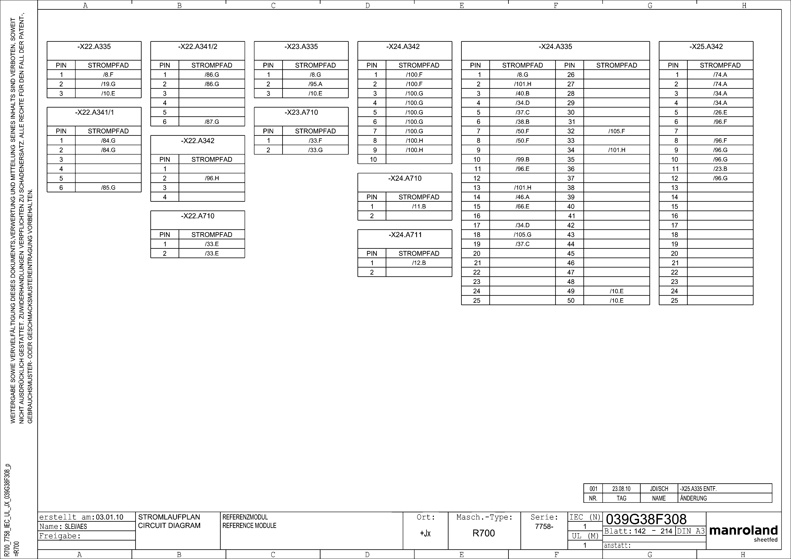

# +Jx — Sheet 142 of 214 — REFERENZMODUL

**REFERENCE MODULE**

> Part of the manroland **R700** printing press IEC/UL circuit diagrams.
> Drawing class: **Stromlaufplan / Circuit diagram** (DIN A3).
> Document `+Jx` covers the **1st printing module + feed register** machine section.

## At a glance

| Field | Value |
|---|---|
| Document | `+Jx`  (039G38F308) |
| Sheet | **142** of 214 |
| Section (DE) | REFERENZMODUL |
| Section (EN) | REFERENCE MODULE |
| Section type | REFERENCE_MODULE — Reference module |
| Machine type | `R700` |
| Series | `7758` |
| Created | 03.01.10 |
| Replaces | — |
| Columns used | A, B, C, D, E, F, G, H |
| Path numbers | — |
| Labels on sheet | 220 |
| Cross-refs out | 59 |
| Cross-refs in | 0 |

**Previous:** [+Jx sheet 141](SHEET_0141.md) · **Next:** [+Jx sheet 143](SHEET_0143.md) · **Document TOC:** [_TOC.md](_TOC.md)  (+Jx) · **Master TOC:** [all sheets](../_MASTER_TOC.md)

## Sheet image (300 DPI, exact vector render)



_Rendered directly from the PDF vector layer at 300 DPI (1-bit), no OCR and no resampling. Use it to confirm anything ambiguous in the text below._

## Cross-references on this sheet

Each entry is a wire leaving this sheet. The printed token is `/sheet.column`; the link resolves to that sheet inside the same document.

| Ref | Target sheet | Col | Path | Destination on target | Target section | From col |
|---|---|---|---|---|---|---|
| `/8.F` | [+Jx sheet 8](SHEET_0008.md) | F | — | — | SPANNUNGSVERSORGUNG, SCHALTSCHRANKBELÜFTUNG | A |
| `/8.G` | [+Jx sheet 8](SHEET_0008.md) | G | — | — | SPANNUNGSVERSORGUNG, SCHALTSCHRANKBELÜFTUNG | C |
| `/8.G` | [+Jx sheet 8](SHEET_0008.md) | G | — | — | SPANNUNGSVERSORGUNG, SCHALTSCHRANKBELÜFTUNG | F |
| `/74.A` | [+Jx sheet 74](SHEET_0074.md) | A | — | — | REDUNDANZ: ANTRIEBE | H |
| `/86.G` | [+Jx sheet 86](SHEET_0086.md) | G | — | — | BOGENFÜHRUNG | B |
| `/100.F` | [+Jx sheet 100](SHEET_0100.md) | F | — | — | RESERVE | E |
| `/95.A` | [+Jx sheet 95](SHEET_0095.md) | A | — | — | RESERVE | C |
| `/74.A` | [+Jx sheet 74](SHEET_0074.md) | A | — | — | REDUNDANZ: ANTRIEBE | H |
| `/19.G` | [+Jx sheet 19](SHEET_0019.md) | G | — | — | LACKPUMPE | A |
| `/86.G` | [+Jx sheet 86](SHEET_0086.md) | G | — | — | BOGENFÜHRUNG | B |
| `/100.F` | [+Jx sheet 100](SHEET_0100.md) | F | — | — | RESERVE | E |
| `/101.H` | [+Jx sheet 101](SHEET_0101.md) | H | — | — | RESERVE | F |
| `/10.E` | [+Jx sheet 10](SHEET_0010.md) | E | — | — | SPANNUNGSVERSORGUNG, SCHALTSCHRANKBELÜFTUNG | A |
| `/10.E` | [+Jx sheet 10](SHEET_0010.md) | E | — | — | SPANNUNGSVERSORGUNG, SCHALTSCHRANKBELÜFTUNG | C |
| `/40.B` | [+Jx sheet 40](SHEET_0040.md) | B | — | — | LAUFKOMMANDOS | F |
| `/34.A` | [+Jx sheet 34](SHEET_0034.md) | A | — | — | NOT AUS | H |
| `/100.G` | [+Jx sheet 100](SHEET_0100.md) | G | — | — | RESERVE | E |
| `/34.A` | [+Jx sheet 34](SHEET_0034.md) | A | — | — | NOT AUS | H |
| `/100.G` | [+Jx sheet 100](SHEET_0100.md) | G | — | — | RESERVE | E |
| `/34.D` | [+Jx sheet 34](SHEET_0034.md) | D | — | — | NOT AUS | F |
| `/26.E` | [+Jx sheet 26](SHEET_0026.md) | E | — | — | HILFSANTRIEB, LACKDOSIER /AUFTRAGSWALZEN | H |
| `/100.G` | [+Jx sheet 100](SHEET_0100.md) | G | — | — | RESERVE | E |
| `/37.C` | [+Jx sheet 37](SHEET_0037.md) | C | — | — | STOP SICHERN | F |
| `/38.B` | [+Jx sheet 38](SHEET_0038.md) | B | — | — | LAUFKOMMANDOS | F |
| `/87.G` | [+Jx sheet 87](SHEET_0087.md) | G | — | — | BOGENFÜHRUNG | B |
| `/96.F` | [+Jx sheet 96](SHEET_0096.md) | F | — | — | RESERVE | H |
| `/100.G` | [+Jx sheet 100](SHEET_0100.md) | G | — | — | RESERVE | E |
| `/50.F` | [+Jx sheet 50](SHEET_0050.md) | F | — | — | SIGNALGEBER: AKUSTISCHE WARNSIGNALE | F |
| `/105.F` | [+Jx sheet 105](SHEET_0105.md) | F | — | — | RESERVE | G |
| `/100.G` | [+Jx sheet 100](SHEET_0100.md) | G | — | — | RESERVE | E |
| `/33.F` | [+Jx sheet 33](SHEET_0033.md) | F | — | — | NOT AUS | C |
| `/50.F` | [+Jx sheet 50](SHEET_0050.md) | F | — | — | SIGNALGEBER: AKUSTISCHE WARNSIGNALE | F |
| `/96.F` | [+Jx sheet 96](SHEET_0096.md) | F | — | — | RESERVE | H |
| `/84.G` | [+Jx sheet 84](SHEET_0084.md) | G | — | — | BOGENFÜHRUNG | A |
| `/100.H` | [+Jx sheet 100](SHEET_0100.md) | H | — | — | RESERVE | E |
| `/84.G` | [+Jx sheet 84](SHEET_0084.md) | G | — | — | BOGENFÜHRUNG | A |
| `/33.G` | [+Jx sheet 33](SHEET_0033.md) | G | — | — | NOT AUS | C |
| `/96.G` | [+Jx sheet 96](SHEET_0096.md) | G | — | — | RESERVE | H |
| `/100.H` | [+Jx sheet 100](SHEET_0100.md) | H | — | — | RESERVE | E |
| `/101.H` | [+Jx sheet 101](SHEET_0101.md) | H | — | — | RESERVE | G |
| `/99.B` | [+Jx sheet 99](SHEET_0099.md) | B | — | — | RESERVE | F |
| `/96.G` | [+Jx sheet 96](SHEET_0096.md) | G | — | — | RESERVE | H |
| `/96.E` | [+Jx sheet 96](SHEET_0096.md) | E | — | — | RESERVE | F |
| `/23.B` | [+Jx sheet 23](SHEET_0023.md) | B | — | — | LACKPUMPE | H |
| `/96.G` | [+Jx sheet 96](SHEET_0096.md) | G | — | — | RESERVE | H |
| `/96.H` | [+Jx sheet 96](SHEET_0096.md) | H | — | — | RESERVE | B |
| `/85.G` | [+Jx sheet 85](SHEET_0085.md) | G | — | — | BOGENFÜHRUNG | A |
| `/101.H` | [+Jx sheet 101](SHEET_0101.md) | H | — | — | RESERVE | F |
| `/11.B` | [+Jx sheet 11](SHEET_0011.md) | B | — | STROMPFAD PIN 1 2 | SPANNUNGSVERSORGUNG, SCHALTSCHRANKBELÜFTUNG | D |
| `/46.A` | [+Jx sheet 46](SHEET_0046.md) | A | — | — | MASCHINENBEDIENUNG | F |
| `/66.E` | [+Jx sheet 66](SHEET_0066.md) | E | — | — | DRUCKANSTELLUNG | F |
| `/34.D` | [+Jx sheet 34](SHEET_0034.md) | D | — | — | NOT AUS | F |
| `/105.G` | [+Jx sheet 105](SHEET_0105.md) | G | — | — | RESERVE | F |
| `/33.E` | [+Jx sheet 33](SHEET_0033.md) | E | — | — | NOT AUS | B |
| `/37.C` | [+Jx sheet 37](SHEET_0037.md) | C | — | — | STOP SICHERN | F |
| `/12.B` | [+Jx sheet 12](SHEET_0012.md) | B | — | STROMPFAD PIN 1 2 | SPANNUNGSVERSORGUNG, SCHALTSCHRANKBELÜFTUNG | D |
| `/33.E` | [+Jx sheet 33](SHEET_0033.md) | E | — | — | NOT AUS | B |
| `/10.E` | [+Jx sheet 10](SHEET_0010.md) | E | — | — | SPANNUNGSVERSORGUNG, SCHALTSCHRANKBELÜFTUNG | G |
| `/10.E` | [+Jx sheet 10](SHEET_0010.md) | E | — | — | SPANNUNGSVERSORGUNG, SCHALTSCHRANKBELÜFTUNG | G |

## Devices on this sheet

| Tag | Class | Class meaning (IEC) | Col | Sub | Terminal | Sign |
|---|---|---|---|---|---|---|
| `X22.A335` | — | cross-device reference | A | — | — | — |
| `X23.A335` | — | cross-device reference | C | — | — | — |
| `X24.A342` | — | cross-device reference | D | — | — | — |
| `X24.A335` | — | cross-device reference | F | — | — | — |
| `X22.A342` | — | cross-device reference | B | — | — | — |
| `X24.A711` | — | cross-device reference | D | — | — | — |
| `X22.A710` | — | cross-device reference | B | — | — | — |
| `X23.A710` | — | cross-device reference | C | — | — | — |
| `X24.A710` | — | cross-device reference | D | — | — | — |
| `X25.A342` | — | cross-device reference | H | — | — | — |
| `NR.` | — | cross-device reference | F | — | — | — |
| `23.08.10` | — | cross-device reference | G | — | — | — |

## Potentials / nets

_No named potentials on this sheet._

## Wire-end annotations (grouped as printed)

A wire that continues elsewhere is annotated with a small cluster: the destination description, the path/line number `#NN`, and the `/sheet.column` cross reference. Each row below is one such cluster exactly as it is grouped on the drawing.

| Col | Y | Path | Cross-ref | Text on the wire |
|---|---|---|---|---|
| A | 65.4 | — | — | `X22.A335` |
| B | 65.4 | — | — | `X22.A341/2` |
| C | 65.4 | — | — | `X23.A335` |
| D | 65.4 | — | — | `X24.A342` |
| F | 65.4 | — | — | `X24.A335` |
| H | 65.4 | — | — | `X25.A342` |
| A | 94.1 | — | — | `PIN 2 3 1 STROMPFAD` |
| B | 94.1 | — | — | `PIN 2 3 5 6 4 1 STROMPFAD` |
| C | 94.1 | — | — | `PIN 2 3 1 STROMPFAD` |
| D | 94.1 | — | — | `PIN 10 2 3 4 5 6 7 8 9 1 STROMPFAD` |
| E | 94.1 | — | — | `PIN STROMPFAD` |
| F | 94.1 | — | — | `PIN STROMPFAD` |
| H | 94.1 | — | — | `PIN STROMPFAD` |
| E | 108.3 | — | — | `2 3 4 5 6 7 8 9 1` |
| F | 108.3 | — | — | `26 27 28 29 30 32 33 34 35 36 37 38 39 40 42 43 44 45 46 47 48 49 50 31 41` |
| G | 108.3 | — | — | `2 3 4 5 6 7 8 9 1` |
| A | 108.6 | — | `/8.F` | — |
| B | 108.6 | — | `/86.G` | — |
| C | 108.6 | — | `/8.G` | — |
| E | 108.6 | — | `/100.F` | — |
| F | 108.6 | — | `/8.G` | — |
| H | 108.6 | — | `/74.A` | — |
| A | 122.8 | — | `/19.G` | — |
| B | 122.8 | — | `/86.G` | — |
| C | 122.8 | — | `/95.A` | — |
| E | 122.8 | — | `/100.F` | — |
| F | 122.8 | — | `/101.H` | — |
| H | 122.8 | — | `/74.A` | — |
| A | 137.0 | — | `/10.E` | — |
| C | 137.0 | — | `/10.E` | — |
| E | 137.0 | — | `/100.G` | — |
| F | 137.0 | — | `/40.B` | — |
| H | 137.0 | — | `/34.A` | — |
| H | 151.1 | — | `/34.A` | — |
| E | 151.2 | — | `/100.G` | — |
| F | 151.2 | — | `/34.D` | — |
| A | 164.7 | — | — | `X22.A341/1` |
| C | 164.7 | — | — | `X23.A710` |
| E | 165.3 | — | `/100.G` | — |
| F | 165.3 | — | `/37.C` | — |
| H | 165.3 | — | `/26.E` | — |
| B | 179.5 | — | `/87.G` | — |
| E | 179.5 | — | `/100.G` | — |
| F | 179.5 | — | `/38.B` | — |
| H | 179.5 | — | `/96.F` | — |
| A | 193.3 | — | — | `PIN 2 3 5 6 4 1 STROMPFAD` |
| C | 193.3 | — | — | `PIN 2 1 STROMPFAD` |
| E | 193.7 | — | `/100.G` | — |
| F | 193.7 | — | `/50.F` | — |
| G | 193.7 | — | `/105.F` | — |
| B | 207.2 | — | — | `X22.A342` |
| A | 207.8 | — | `/84.G` | — |
| C | 207.8 | — | `/33.F` | — |
| F | 207.8 | — | `/50.F` | — |
| H | 207.8 | — | `/96.F` | — |
| E | 207.9 | — | `/100.H` | — |
| A | 222.0 | — | `/84.G` | — |
| C | 222.0 | — | `/33.G` | — |
| E | 222.0 | — | `/100.H` | — |
| G | 222.0 | — | `/101.H` | — |
| H | 222.0 | — | `/96.G` | — |
| B | 235.8 | — | — | `PIN 2 3 4 1 STROMPFAD` |
| E | 235.9 | — | — | `10 12 13 14 15 16 17 18 19 20 11` |
| G | 235.9 | — | — | `10 12 13 14 15 16 17 18 19 20 11` |
| F | 236.2 | — | `/99.B` | — |
| H | 236.2 | — | `/96.G` | — |
| F | 250.3 | — | `/96.E` | — |
| H | 250.3 | — | `/23.B` | — |
| D | 263.9 | — | — | `X24.A710` |
| H | 264.5 | — | `/96.G` | — |
| B | 264.6 | — | `/96.H` | — |
| A | 278.7 | — | `/85.G` | — |
| F | 278.7 | — | `/101.H` | — |
| D | 292.5 | — | `/11.B` | `PIN 2 1 STROMPFAD` |
| F | 292.9 | — | `/46.A` | — |
| F | 307.0 | — | `/66.E` | — |
| B | 320.6 | — | — | `X22.A710` |
| F | 335.4 | — | `/34.D` | — |
| D | 348.9 | — | — | `X24.A711` |
| B | 349.2 | — | — | `PIN 2 1 STROMPFAD` |
| F | 349.6 | — | `/105.G` | — |
| B | 363.7 | — | `/33.E` | — |
| F | 363.8 | — | `/37.C` | — |
| D | 377.6 | — | `/12.B` | `PIN 2 1 STROMPFAD` |
| B | 377.9 | — | `/33.E` | — |
| E | 391.8 | — | — | `22 23 24 25 21` |
| G | 391.8 | — | — | `22 23 24 25 21` |
| G | 434.6 | — | `/10.E` | — |
| G | 448.8 | — | `/10.E` | — |
| G | 733.0 | — | — | `001 23.08.10 JDI/SCH X25.A335 ENTF.` |
| G | 747.1 | — | — | `NR. TAG NAME ÄNDERUNG` |


## Reconstructed tables

This sheet carries tabular content (pin map / terminal assignment / index). The grid below was rebuilt from the drawing's own rule lines, so each row is exactly one physical row of the table.

### Table 1 — 11 data rows × 2 columns (at x=70.9, y=62.4) — **X22.A335**

| PIN | STROMPFAD |
|---|---|
| `1` | `/8.F` |
| `2` | `/19.G` |
| `3` | `/10.E` |
|  | `X22.A341/1` |
| `PIN` | `STROMPFAD` |
| `1` | `/84.G` |
| `2` | `/84.G` |
| `3` |  |
| `4` |  |
| `5` |  |
| `6` | `/85.G` |


### Table 2 — 16 data rows × 2 columns (at x=226.8, y=62.4) — **X22.A341/2**

| PIN | STROMPFAD |
|---|---|
| `1` | `/86.G` |
| `2` | `/86.G` |
| `3` |  |
| `4` |  |
| `5` |  |
| `6` | `/87.G` |
|  | `X22.A342` |
| `PIN` | `STROMPFAD` |
| `1` |  |
| `2` | `/96.H` |
| `3` |  |
| `4` |  |
|  | `X22.A710` |
| `PIN` | `STROMPFAD` |
| `1` | `/33.E` |
| `2` | `/33.E` |


### Table 3 — 7 data rows × 2 columns (at x=382.7, y=62.4) — **X23.A335**

| PIN | STROMPFAD |
|---|---|
| `1` | `/8.G` |
| `2` | `/95.A` |
| `3` | `/10.E` |
|  | `X23.A710` |
| `PIN` | `STROMPFAD` |
| `1` | `/33.F` |
| `2` | `/33.G` |


### Table 4 — 18 data rows × 2 columns (at x=538.6, y=62.4) — **X24.A342**

| PIN | STROMPFAD |
|---|---|
| `1` | `/100.F` |
| `2` | `/100.F` |
| `3` | `/100.G` |
| `4` | `/100.G` |
| `5` | `/100.G` |
| `6` | `/100.G` |
| `7` | `/100.G` |
| `8` | `/100.H` |
| `9` | `/100.H` |
| `10` |  |
|  | `X24.A710` |
| `PIN` | `STROMPFAD` |
| `1` | `/11.B` |
| `2` |  |
|  | `X24.A711` |
| `PIN` | `STROMPFAD` |
| `1` | `/12.B` |
| `2` |  |


### Table 5 — 25 data rows × 4 columns (at x=694.5, y=62.4) — **X24.A335**

| PIN | STROMPFAD | PIN | STROMPFAD |
|---|---|---|---|
| `1` | `/8.G` | `26` |  |
| `2` | `/101.H` | `27` |  |
| `3` | `/40.B` | `28` |  |
| `4` | `/34.D` | `29` |  |
| `5` | `/37.C` | `30` |  |
| `6` | `/38.B` | `31` |  |
| `7` | `/50.F` | `32` | `/105.F` |
| `8` | `/50.F` | `33` |  |
| `9` |  | `34` | `/101.H` |
| `10` | `/99.B` | `35` |  |
| `11` | `/96.E` | `36` |  |
| `12` |  | `37` |  |
| `13` | `/101.H` | `38` |  |
| `14` | `/46.A` | `39` |  |
| `15` | `/66.E` | `40` |  |
| `16` |  | `41` |  |
| `17` | `/34.D` | `42` |  |
| `18` | `/105.G` | `43` |  |
| `19` | `/37.C` | `44` |  |
| `20` |  | `45` |  |
| `21` |  | `46` |  |
| `22` |  | `47` |  |
| `23` |  | `48` |  |
| `24` |  | `49` | `/10.E` |
| `25` |  | `50` | `/10.E` |


### Table 6 — 25 data rows × 2 columns (at x=992.1, y=62.4) — **X25.A342**

| PIN | STROMPFAD |
|---|---|
| `1` | `/74.A` |
| `2` | `/74.A` |
| `3` | `/34.A` |
| `4` | `/34.A` |
| `5` | `/26.E` |
| `6` | `/96.F` |
| `7` |  |
| `8` | `/96.F` |
| `9` | `/96.G` |
| `10` | `/96.G` |
| `11` | `/23.B` |
| `12` | `/96.G` |
| `13` |  |
| `14` |  |
| `15` |  |
| `16` |  |
| `17` |  |
| `18` |  |
| `19` |  |
| `20` |  |
| `21` |  |
| `22` |  |
| `23` |  |
| `24` |  |
| `25` |  |


## Notes and free text on this sheet

| Text | Col | Y (pt) |
|---|---|---|
| `PIN` | A | 94.13 |
| `STROMPFAD` | A | 94.09 |
| `X22.A341/1` | A | 164.65 |
| `PIN` | C | 94.13 |
| `STROMPFAD` | C | 94.09 |
| `PIN` | D | 94.13 |
| `STROMPFAD` | E | 94.09 |
| `PIN` | E | 94.13 |
| `STROMPFAD` | F | 94.09 |
| `PIN` | F | 94.13 |
| `STROMPFAD` | G | 94.09 |
| `PIN` | B | 94.13 |
| `STROMPFAD` | B | 94.09 |
| `X22.A341/2` | B | 65.44 |
| `PIN` | G | 94.13 |
| `STROMPFAD` | H | 94.09 |
| `TAG` | G | 747.23 |
| `NAME` | G | 747.22 |
| `ÄNDERUNG` | G | 747.25 |
| `JDI/SCH` | G | 733.05 |
| `X25.A335 ENTF.` | H | 733.07 |

## Complete label inventory (exact text from the drawing)

Every text object inside the drawing area of this sheet, in DIN reading order (column A→H, then top→bottom). This is the authoritative list: if a string is not here it is not printed on this sheet.

| Col | Y | X | Dir | Type | Text |
|---|---|---|---|---|---|
| A | 65.4 | 116.6 | → | device ref | `X22.A335` |
| A | 94.1 | 84.0 | → | text | `PIN` |
| A | 94.1 | 132.4 | → | text | `STROMPFAD` |
| A | 108.3 | 89.9 | → | number | `1` |
| A | 108.6 | 155.5 | → | cross-reference | `/8.F` |
| A | 122.5 | 89.4 | → | number | `2` |
| A | 122.8 | 152.4 | → | cross-reference | `/19.G` |
| A | 136.7 | 89.4 | → | number | `3` |
| A | 137.0 | 152.8 | → | cross-reference | `/10.E` |
| A | 164.7 | 113.1 | → | text | `X22.A341/1` |
| A | 193.3 | 84.0 | → | text | `PIN` |
| A | 193.3 | 132.4 | → | text | `STROMPFAD` |
| A | 207.5 | 89.9 | → | number | `1` |
| A | 207.9 | 152.4 | → | cross-reference | `/84.G` |
| A | 221.7 | 89.4 | → | number | `2` |
| A | 222.0 | 152.4 | → | cross-reference | `/84.G` |
| A | 235.9 | 89.4 | → | number | `3` |
| A | 250.0 | 89.6 | → | number | `4` |
| A | 264.2 | 89.4 | → | number | `5` |
| A | 278.4 | 89.4 | → | number | `6` |
| A | 278.7 | 152.4 | → | cross-reference | `/85.G` |
| B | 65.4 | 268.3 | → | text | `X22.A341/2` |
| B | 94.1 | 240.0 | → | text | `PIN` |
| B | 94.1 | 288.3 | → | text | `STROMPFAD` |
| B | 108.3 | 245.8 | → | number | `1` |
| B | 108.6 | 308.3 | → | cross-reference | `/86.G` |
| B | 122.5 | 245.3 | → | number | `2` |
| B | 122.8 | 308.3 | → | cross-reference | `/86.G` |
| B | 136.7 | 245.3 | → | number | `3` |
| B | 150.8 | 245.5 | → | number | `4` |
| B | 165.0 | 245.3 | → | number | `5` |
| B | 179.2 | 245.3 | → | number | `6` |
| B | 179.5 | 308.3 | → | cross-reference | `/87.G` |
| B | 207.2 | 272.7 | → | device ref | `X22.A342` |
| B | 235.8 | 288.3 | → | text | `STROMPFAD` |
| B | 235.9 | 240.0 | → | text | `PIN` |
| B | 250.0 | 245.8 | → | number | `1` |
| B | 264.2 | 245.3 | → | number | `2` |
| B | 264.6 | 308.7 | → | cross-reference | `/96.H` |
| B | 278.4 | 245.3 | → | number | `3` |
| B | 292.6 | 245.5 | → | number | `4` |
| B | 320.6 | 272.7 | → | device ref | `X22.A710` |
| B | 349.2 | 288.3 | → | text | `STROMPFAD` |
| B | 349.3 | 240.0 | → | text | `PIN` |
| B | 363.4 | 245.8 | → | number | `1` |
| B | 363.7 | 308.7 | → | cross-reference | `/33.E` |
| B | 377.6 | 245.3 | → | number | `2` |
| B | 377.9 | 308.7 | → | cross-reference | `/33.E` |
| C | 65.4 | 428.5 | → | device ref | `X23.A335` |
| C | 94.1 | 395.9 | → | text | `PIN` |
| C | 94.1 | 444.2 | → | text | `STROMPFAD` |
| C | 108.3 | 401.7 | → | number | `1` |
| C | 108.6 | 466.6 | → | cross-reference | `/8.G` |
| C | 122.5 | 401.2 | → | number | `2` |
| C | 122.8 | 464.5 | → | cross-reference | `/95.A` |
| C | 136.7 | 401.2 | → | number | `3` |
| C | 137.0 | 464.6 | → | cross-reference | `/10.E` |
| C | 164.6 | 428.6 | → | device ref | `X23.A710` |
| C | 193.3 | 395.9 | → | text | `PIN` |
| C | 193.3 | 444.2 | → | text | `STROMPFAD` |
| C | 207.5 | 401.7 | → | number | `1` |
| C | 207.8 | 464.9 | → | cross-reference | `/33.F` |
| C | 221.7 | 401.2 | → | number | `2` |
| C | 222.0 | 464.2 | → | cross-reference | `/33.G` |
| D | 65.4 | 581.7 | → | device ref | `X24.A342` |
| D | 94.1 | 551.8 | → | text | `PIN` |
| D | 108.3 | 563.2 | → | number | `1` |
| D | 122.5 | 561.8 | → | number | `2` |
| D | 136.7 | 561.8 | → | number | `3` |
| D | 150.8 | 561.8 | → | number | `4` |
| D | 165.0 | 561.8 | → | number | `5` |
| D | 179.2 | 561.8 | → | number | `6` |
| D | 193.3 | 561.8 | → | number | `7` |
| D | 207.5 | 561.8 | → | number | `8` |
| D | 221.7 | 561.8 | → | number | `9` |
| D | 235.9 | 556.4 | → | number | `10` |
| D | 263.9 | 584.5 | → | device ref | `X24.A710` |
| D | 292.6 | 551.8 | → | text | `PIN` |
| D | 306.7 | 557.6 | → | number | `1` |
| D | 320.9 | 557.1 | → | number | `2` |
| D | 348.9 | 585.2 | → | device ref | `X24.A711` |
| D | 377.6 | 551.8 | → | text | `PIN` |
| D | 391.8 | 557.6 | → | number | `1` |
| D | 405.9 | 557.1 | → | number | `2` |
| E | 94.1 | 600.1 | → | text | `STROMPFAD` |
| E | 94.1 | 707.7 | → | text | `PIN` |
| E | 108.3 | 719.1 | → | number | `1` |
| E | 108.6 | 611.3 | → | cross-reference | `/100.F` |
| E | 122.5 | 717.7 | → | number | `2` |
| E | 122.8 | 611.3 | → | cross-reference | `/100.F` |
| E | 136.7 | 717.7 | → | number | `3` |
| E | 137.0 | 610.6 | → | cross-reference | `/100.G` |
| E | 150.8 | 717.7 | → | number | `4` |
| E | 151.2 | 610.6 | → | cross-reference | `/100.G` |
| E | 165.0 | 717.7 | → | number | `5` |
| E | 165.3 | 610.6 | → | cross-reference | `/100.G` |
| E | 179.2 | 717.7 | → | number | `6` |
| E | 179.5 | 610.6 | → | cross-reference | `/100.G` |
| E | 193.3 | 717.7 | → | number | `7` |
| E | 193.7 | 610.6 | → | cross-reference | `/100.G` |
| E | 207.5 | 717.7 | → | number | `8` |
| E | 207.9 | 611.0 | → | cross-reference | `/100.H` |
| E | 221.7 | 717.7 | → | number | `9` |
| E | 222.0 | 611.0 | → | cross-reference | `/100.H` |
| E | 235.9 | 712.3 | → | number | `10` |
| E | 250.0 | 713.8 | → | number | `11` |
| E | 264.2 | 712.3 | → | number | `12` |
| E | 278.4 | 712.3 | → | number | `13` |
| E | 292.5 | 600.1 | → | text | `STROMPFAD` |
| E | 292.6 | 712.3 | → | number | `14` |
| E | 306.7 | 712.3 | → | number | `15` |
| E | 307.0 | 620.5 | → | cross-reference | `/11.B` |
| E | 320.9 | 712.3 | → | number | `16` |
| E | 335.1 | 712.3 | → | number | `17` |
| E | 349.3 | 712.3 | → | number | `18` |
| E | 363.4 | 712.3 | → | number | `19` |
| E | 377.6 | 600.1 | → | text | `STROMPFAD` |
| E | 377.6 | 712.3 | → | number | `20` |
| E | 391.8 | 713.8 | → | number | `21` |
| E | 392.1 | 620.5 | → | cross-reference | `/12.B` |
| E | 405.9 | 712.3 | → | number | `22` |
| E | 420.1 | 712.3 | → | number | `23` |
| E | 434.3 | 712.3 | → | number | `24` |
| E | 448.5 | 712.3 | → | number | `25` |
| F | 65.4 | 811.1 | → | device ref | `X24.A335` |
| F | 94.1 | 756.0 | → | text | `STROMPFAD` |
| F | 94.1 | 849.4 | → | text | `PIN` |
| F | 108.3 | 854.1 | → | number | `26` |
| F | 108.6 | 778.4 | → | cross-reference | `/8.G` |
| F | 122.5 | 854.1 | → | number | `27` |
| F | 122.8 | 774.0 | → | cross-reference | `/101.H` |
| F | 136.7 | 854.1 | → | number | `28` |
| F | 137.0 | 776.4 | → | cross-reference | `/40.B` |
| F | 150.8 | 854.1 | → | number | `29` |
| F | 151.2 | 776.3 | → | cross-reference | `/34.D` |
| F | 165.0 | 854.1 | → | number | `30` |
| F | 165.3 | 776.3 | → | cross-reference | `/37.C` |
| F | 179.2 | 855.5 | → | number | `31` |
| F | 179.5 | 776.4 | → | cross-reference | `/38.B` |
| F | 193.3 | 854.1 | → | number | `32` |
| F | 193.7 | 776.7 | → | cross-reference | `/50.F` |
| F | 207.5 | 854.1 | → | number | `33` |
| F | 207.8 | 776.7 | → | cross-reference | `/50.F` |
| F | 221.7 | 854.1 | → | number | `34` |
| F | 235.9 | 854.1 | → | number | `35` |
| F | 236.2 | 776.4 | → | cross-reference | `/99.B` |
| F | 250.0 | 854.1 | → | number | `36` |
| F | 250.3 | 776.4 | → | cross-reference | `/96.E` |
| F | 264.2 | 854.1 | → | number | `37` |
| F | 278.4 | 854.1 | → | number | `38` |
| F | 278.7 | 774.0 | → | cross-reference | `/101.H` |
| F | 292.6 | 854.1 | → | number | `39` |
| F | 292.9 | 776.3 | → | cross-reference | `/46.A` |
| F | 306.7 | 854.1 | → | number | `40` |
| F | 307.0 | 776.4 | → | cross-reference | `/66.E` |
| F | 320.9 | 855.5 | → | number | `41` |
| F | 335.1 | 854.1 | → | number | `42` |
| F | 335.4 | 776.3 | → | cross-reference | `/34.D` |
| F | 349.3 | 854.1 | → | number | `43` |
| F | 349.6 | 773.6 | → | cross-reference | `/105.G` |
| F | 363.4 | 854.1 | → | number | `44` |
| F | 363.8 | 776.3 | → | cross-reference | `/37.C` |
| F | 377.6 | 854.1 | → | number | `45` |
| F | 391.8 | 854.1 | → | number | `46` |
| F | 405.9 | 854.1 | → | number | `47` |
| F | 420.1 | 854.1 | → | number | `48` |
| F | 434.3 | 854.1 | → | number | `49` |
| F | 448.5 | 854.1 | → | number | `50` |
| F | 733.0 | 887.6 | → | number | `001` |
| F | 747.1 | 886.8 | → | device ref | `NR.` |
| G | 94.1 | 897.7 | → | text | `STROMPFAD` |
| G | 94.1 | 1005.3 | → | text | `PIN` |
| G | 108.3 | 1016.8 | → | number | `1` |
| G | 122.5 | 1015.4 | → | number | `2` |
| G | 136.7 | 1015.4 | → | number | `3` |
| G | 150.8 | 1015.4 | → | number | `4` |
| G | 165.0 | 1015.4 | → | number | `5` |
| G | 179.2 | 1015.4 | → | number | `6` |
| G | 193.3 | 1015.4 | → | number | `7` |
| G | 193.7 | 916.0 | → | cross-reference | `/105.F` |
| G | 207.5 | 1015.4 | → | number | `8` |
| G | 221.7 | 1015.4 | → | number | `9` |
| G | 222.0 | 915.7 | → | cross-reference | `/101.H` |
| G | 235.9 | 1010.0 | → | number | `10` |
| G | 250.0 | 1011.4 | → | number | `11` |
| G | 264.2 | 1010.0 | → | number | `12` |
| G | 278.4 | 1010.0 | → | number | `13` |
| G | 292.6 | 1010.0 | → | number | `14` |
| G | 306.7 | 1010.0 | → | number | `15` |
| G | 320.9 | 1010.0 | → | number | `16` |
| G | 335.1 | 1010.0 | → | number | `17` |
| G | 349.3 | 1010.0 | → | number | `18` |
| G | 363.4 | 1010.0 | → | number | `19` |
| G | 377.6 | 1010.0 | → | number | `20` |
| G | 391.8 | 1011.4 | → | number | `21` |
| G | 405.9 | 1010.0 | → | number | `22` |
| G | 420.1 | 1010.0 | → | number | `23` |
| G | 434.3 | 1010.0 | → | number | `24` |
| G | 434.6 | 918.1 | → | cross-reference | `/10.E` |
| G | 448.5 | 1010.0 | → | number | `25` |
| G | 448.8 | 918.1 | → | cross-reference | `/10.E` |
| G | 733.1 | 921.9 | → | device ref | `23.08.10` |
| G | 733.1 | 978.6 | → | text | `JDI/SCH` |
| G | 747.2 | 928.5 | → | text | `TAG` |
| G | 747.2 | 981.8 | → | text | `NAME` |
| G | 747.3 | 1024.0 | → | text | `ÄNDERUNG` |
| H | 65.4 | 1038.0 | → | device ref | `X25.A342` |
| H | 94.1 | 1053.6 | → | text | `STROMPFAD` |
| H | 108.6 | 1073.9 | → | cross-reference | `/74.A` |
| H | 122.8 | 1073.9 | → | cross-reference | `/74.A` |
| H | 137.0 | 1073.9 | → | cross-reference | `/34.A` |
| H | 151.1 | 1073.9 | → | cross-reference | `/34.A` |
| H | 165.3 | 1074.0 | → | cross-reference | `/26.E` |
| H | 179.5 | 1074.3 | → | cross-reference | `/96.F` |
| H | 207.8 | 1074.3 | → | cross-reference | `/96.F` |
| H | 222.0 | 1073.6 | → | cross-reference | `/96.G` |
| H | 236.2 | 1073.6 | → | cross-reference | `/96.G` |
| H | 250.3 | 1074.0 | → | cross-reference | `/23.B` |
| H | 264.5 | 1073.6 | → | cross-reference | `/96.G` |
| H | 733.1 | 1023.7 | → | text | `X25.A335 ENTF.` |

## Reading-order text block

The same content as a plain block, grouped by DIN column — convenient to paste or to match against a visual description.

```text
=== Column A ===
  65.4  116.6  devref       X22.A335
  94.1   84.0  text         PIN
  94.1  132.4  text         STROMPFAD
 108.3   89.9  numeric      1
 108.6  155.5  xref         /8.F
 122.5   89.4  numeric      2
 122.8  152.4  xref         /19.G
 136.7   89.4  numeric      3
 137.0  152.8  xref         /10.E
 164.7  113.1  text         X22.A341/1
 193.3   84.0  text         PIN
 193.3  132.4  text         STROMPFAD
 207.5   89.9  numeric      1
 207.9  152.4  xref         /84.G
 221.7   89.4  numeric      2
 222.0  152.4  xref         /84.G
 235.9   89.4  numeric      3
 250.0   89.6  numeric      4
 264.2   89.4  numeric      5
 278.4   89.4  numeric      6
 278.7  152.4  xref         /85.G
=== Column B ===
  65.4  268.3  text         X22.A341/2
  94.1  240.0  text         PIN
  94.1  288.3  text         STROMPFAD
 108.3  245.8  numeric      1
 108.6  308.3  xref         /86.G
 122.5  245.3  numeric      2
 122.8  308.3  xref         /86.G
 136.7  245.3  numeric      3
 150.8  245.5  numeric      4
 165.0  245.3  numeric      5
 179.2  245.3  numeric      6
 179.5  308.3  xref         /87.G
 207.2  272.7  devref       X22.A342
 235.8  288.3  text         STROMPFAD
 235.9  240.0  text         PIN
 250.0  245.8  numeric      1
 264.2  245.3  numeric      2
 264.6  308.7  xref         /96.H
 278.4  245.3  numeric      3
 292.6  245.5  numeric      4
 320.6  272.7  devref       X22.A710
 349.2  288.3  text         STROMPFAD
 349.3  240.0  text         PIN
 363.4  245.8  numeric      1
 363.7  308.7  xref         /33.E
 377.6  245.3  numeric      2
 377.9  308.7  xref         /33.E
=== Column C ===
  65.4  428.5  devref       X23.A335
  94.1  395.9  text         PIN
  94.1  444.2  text         STROMPFAD
 108.3  401.7  numeric      1
 108.6  466.6  xref         /8.G
 122.5  401.2  numeric      2
 122.8  464.5  xref         /95.A
 136.7  401.2  numeric      3
 137.0  464.6  xref         /10.E
 164.6  428.6  devref       X23.A710
 193.3  395.9  text         PIN
 193.3  444.2  text         STROMPFAD
 207.5  401.7  numeric      1
 207.8  464.9  xref         /33.F
 221.7  401.2  numeric      2
 222.0  464.2  xref         /33.G
=== Column D ===
  65.4  581.7  devref       X24.A342
  94.1  551.8  text         PIN
 108.3  563.2  numeric      1
 122.5  561.8  numeric      2
 136.7  561.8  numeric      3
 150.8  561.8  numeric      4
 165.0  561.8  numeric      5
 179.2  561.8  numeric      6
 193.3  561.8  numeric      7
 207.5  561.8  numeric      8
 221.7  561.8  numeric      9
 235.9  556.4  numeric      10
 263.9  584.5  devref       X24.A710
 292.6  551.8  text         PIN
 306.7  557.6  numeric      1
 320.9  557.1  numeric      2
 348.9  585.2  devref       X24.A711
 377.6  551.8  text         PIN
 391.8  557.6  numeric      1
 405.9  557.1  numeric      2
=== Column E ===
  94.1  600.1  text         STROMPFAD
  94.1  707.7  text         PIN
 108.3  719.1  numeric      1
 108.6  611.3  xref         /100.F
 122.5  717.7  numeric      2
 122.8  611.3  xref         /100.F
 136.7  717.7  numeric      3
 137.0  610.6  xref         /100.G
 150.8  717.7  numeric      4
 151.2  610.6  xref         /100.G
 165.0  717.7  numeric      5
 165.3  610.6  xref         /100.G
 179.2  717.7  numeric      6
 179.5  610.6  xref         /100.G
 193.3  717.7  numeric      7
 193.7  610.6  xref         /100.G
 207.5  717.7  numeric      8
 207.9  611.0  xref         /100.H
 221.7  717.7  numeric      9
 222.0  611.0  xref         /100.H
 235.9  712.3  numeric      10
 250.0  713.8  numeric      11
 264.2  712.3  numeric      12
 278.4  712.3  numeric      13
 292.5  600.1  text         STROMPFAD
 292.6  712.3  numeric      14
 306.7  712.3  numeric      15
 307.0  620.5  xref         /11.B
 320.9  712.3  numeric      16
 335.1  712.3  numeric      17
 349.3  712.3  numeric      18
 363.4  712.3  numeric      19
 377.6  600.1  text         STROMPFAD
 377.6  712.3  numeric      20
 391.8  713.8  numeric      21
 392.1  620.5  xref         /12.B
 405.9  712.3  numeric      22
 420.1  712.3  numeric      23
 434.3  712.3  numeric      24
 448.5  712.3  numeric      25
=== Column F ===
  65.4  811.1  devref       X24.A335
  94.1  756.0  text         STROMPFAD
  94.1  849.4  text         PIN
 108.3  854.1  numeric      26
 108.6  778.4  xref         /8.G
 122.5  854.1  numeric      27
 122.8  774.0  xref         /101.H
 136.7  854.1  numeric      28
 137.0  776.4  xref         /40.B
 150.8  854.1  numeric      29
 151.2  776.3  xref         /34.D
 165.0  854.1  numeric      30
 165.3  776.3  xref         /37.C
 179.2  855.5  numeric      31
 179.5  776.4  xref         /38.B
 193.3  854.1  numeric      32
 193.7  776.7  xref         /50.F
 207.5  854.1  numeric      33
 207.8  776.7  xref         /50.F
 221.7  854.1  numeric      34
 235.9  854.1  numeric      35
 236.2  776.4  xref         /99.B
 250.0  854.1  numeric      36
 250.3  776.4  xref         /96.E
 264.2  854.1  numeric      37
 278.4  854.1  numeric      38
 278.7  774.0  xref         /101.H
 292.6  854.1  numeric      39
 292.9  776.3  xref         /46.A
 306.7  854.1  numeric      40
 307.0  776.4  xref         /66.E
 320.9  855.5  numeric      41
 335.1  854.1  numeric      42
 335.4  776.3  xref         /34.D
 349.3  854.1  numeric      43
 349.6  773.6  xref         /105.G
 363.4  854.1  numeric      44
 363.8  776.3  xref         /37.C
 377.6  854.1  numeric      45
 391.8  854.1  numeric      46
 405.9  854.1  numeric      47
 420.1  854.1  numeric      48
 434.3  854.1  numeric      49
 448.5  854.1  numeric      50
 733.0  887.6  numeric      001
 747.1  886.8  devref       NR.
=== Column G ===
  94.1  897.7  text         STROMPFAD
  94.1 1005.3  text         PIN
 108.3 1016.8  numeric      1
 122.5 1015.4  numeric      2
 136.7 1015.4  numeric      3
 150.8 1015.4  numeric      4
 165.0 1015.4  numeric      5
 179.2 1015.4  numeric      6
 193.3 1015.4  numeric      7
 193.7  916.0  xref         /105.F
 207.5 1015.4  numeric      8
 221.7 1015.4  numeric      9
 222.0  915.7  xref         /101.H
 235.9 1010.0  numeric      10
 250.0 1011.4  numeric      11
 264.2 1010.0  numeric      12
 278.4 1010.0  numeric      13
 292.6 1010.0  numeric      14
 306.7 1010.0  numeric      15
 320.9 1010.0  numeric      16
 335.1 1010.0  numeric      17
 349.3 1010.0  numeric      18
 363.4 1010.0  numeric      19
 377.6 1010.0  numeric      20
 391.8 1011.4  numeric      21
 405.9 1010.0  numeric      22
 420.1 1010.0  numeric      23
 434.3 1010.0  numeric      24
 434.6  918.1  xref         /10.E
 448.5 1010.0  numeric      25
 448.8  918.1  xref         /10.E
 733.1  921.9  devref       23.08.10
 733.1  978.6  text         JDI/SCH
 747.2  928.5  text         TAG
 747.2  981.8  text         NAME
 747.3 1024.0  text         ÄNDERUNG
=== Column H ===
  65.4 1038.0  devref       X25.A342
  94.1 1053.6  text         STROMPFAD
 108.6 1073.9  xref         /74.A
 122.8 1073.9  xref         /74.A
 137.0 1073.9  xref         /34.A
 151.1 1073.9  xref         /34.A
 165.3 1074.0  xref         /26.E
 179.5 1074.3  xref         /96.F
 207.8 1074.3  xref         /96.F
 222.0 1073.6  xref         /96.G
 236.2 1073.6  xref         /96.G
 250.3 1074.0  xref         /23.B
 264.5 1073.6  xref         /96.G
 733.1 1023.7  text         X25.A335 ENTF.
```

---
_Generated from the PDF vector text layer; no OCR. Source: `R700_7758_IEC_UL_JX_039G38F308_p`, sheet 142._
